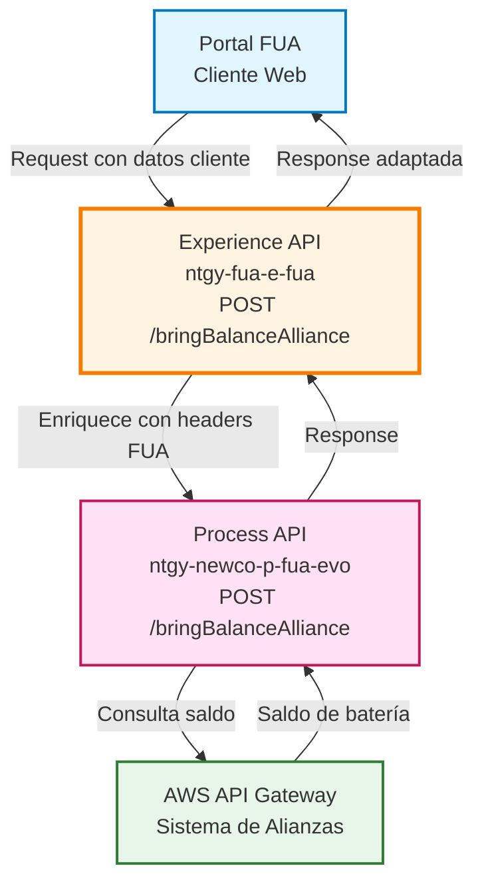
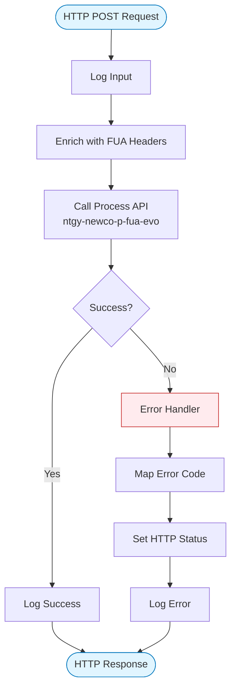
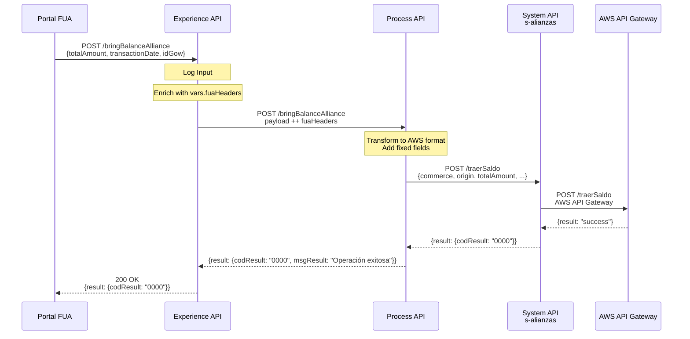
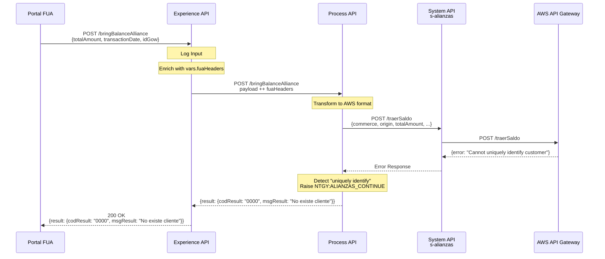
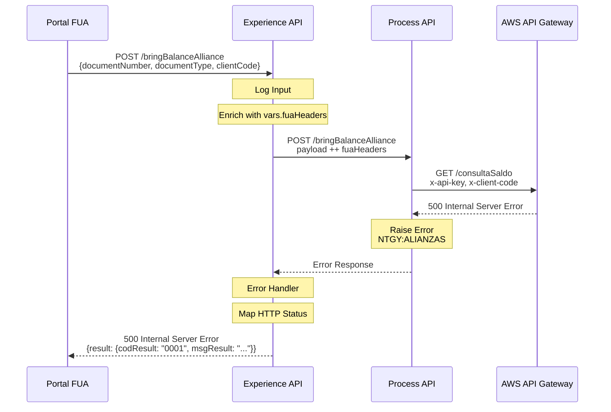

# POST /bringBalanceAlliance

## 📌 Descripción General

### Propósito del Endpoint

Este endpoint permite transferir saldo de batería de alianzas a Naturgy. Actúa como punto de entrada del portal FUA para realizar transferencias de saldo desde el sistema de alianzas externo (Moeve) gestionado en AWS API Gateway.

### Tipo de API

**Capa:** Experience API (API-Led Connectivity)

**Función:** Adaptación de experiencia para canal web del portal FUA

### Patrón de Integración

**Tipo:** Pass-Through con Enriquecimiento de Headers

**Descripción:** El endpoint recibe los datos del cliente, enriquece el request con headers FUA (`vars.fuaHeaders`) y delega la lógica de negocio al Process API. La respuesta se devuelve de forma transparente al cliente.

### Arquitectura API-Led Connectivity



---

## 💼 Propósito del Negocio

### Casos de Uso Principales

1. **Transferencia de Saldo de Batería**
   - Cliente del portal FUA transfiere su saldo disponible desde el programa de alianzas (Moeve) a Naturgy
   - Permite al usuario convertir sus puntos/batería en beneficios con Naturgy

2. **Validación de Cliente en Sistema de Alianzas**
   - Verifica la existencia del cliente en el sistema de alianzas AWS
   - Maneja casos especiales cuando el cliente no está registrado o tiene restricciones (talla XS)

3. **Integración con Programa de Fidelización**
   - Facilita la gestión del programa de puntos/batería entre Moeve y Naturgy
   - Permite al cliente aprovechar su saldo acumulado en el programa de alianzas

### 📱 Canal y Audiencia

#### Canal de Consumo

**Canal:** Web

**Características del Canal:**
- **Plataforma**: Portal FUA (Frontal Único de Atención)
- **Dispositivos**: Navegadores web (desktop y responsive)
- **Conectividad**: Conexión estable requerida
- **Experiencia de Usuario**: Consulta en tiempo real del saldo

#### Audiencia Objetivo

**Usuarios Finales:**
- **Clientes Naturgy**: Clientes residenciales y empresariales con acceso al portal FUA
- **Participantes del Programa de Alianzas**: Usuarios registrados en el programa de fidelización

**Contexto de Uso:**
- **Transferencia de Saldo**: Cliente accede al portal para transferir su saldo desde Moeve a Naturgy
- **Gestión de Beneficios**: Usuario convierte su saldo acumulado en beneficios con Naturgy

#### Adaptaciones del Canal

**Optimizaciones Aplicadas:**
- **Enriquecimiento de Headers**: Añade automáticamente headers FUA para trazabilidad
- **Formato de Respuesta**: Mantiene formato JSON estándar del Process API
- **Manejo de Errores**: Mapeo de códigos HTTP y mensajes de error personalizados

### 🔗 Endpoints Dependientes

Este Experience API consume el siguiente Process API:

| Process API | Endpoint | Método | Propósito |
|-------------|----------|--------|-----------|
| `ntgy-newco-p-fua-evo` | `/bringBalanceAlliance` | POST | Orquesta la consulta de saldo de batería con validación de cliente en sistema de alianzas AWS |

### Contexto Empresarial

- **Dominio:** Programa de Fidelización y Alianzas
- **Sector:** Energía - Utilities
- **División:** Naturgy España - NewCo
- **Canal:** Portal Web FUA

### Stakeholders

- **Clientes Naturgy**: Necesitan consultar su saldo de batería de forma rápida y confiable
- **Equipo de Marketing**: Gestiona el programa de alianzas y fidelización
- **Soporte al Cliente**: Requiere visibilidad del saldo para atención al cliente

### Valor de Negocio

- **Transparencia**: Cliente puede consultar su saldo en tiempo real
- **Fidelización**: Facilita la participación en el programa de alianzas
- **Autoservicio**: Reduce carga en call center al permitir consultas autónomas
- **Integración**: Conecta el portal FUA con el sistema de alianzas externo

---

## 🔧 Especificación Técnica

### URLs por Ambiente

| Ambiente | URL Base | URL Completa |
|----------|----------|--------------|
| **Local** | `http://localhost:8081` | `http://localhost:8081/fua/api/bringBalanceAlliance` |
| **Development** | `https://ntgy-fua-e-fua-dev.de-c1.cloudhub.io` | `https://ntgy-fua-e-fua-dev.de-c1.cloudhub.io/fua/api/bringBalanceAlliance` |
| **Production** | `https://ntgy-fua-e-fua-pro.de-c1.cloudhub.io` | `https://ntgy-fua-e-fua-pro.de-c1.cloudhub.io/fua/api/bringBalanceAlliance` |

### Método HTTP

```
POST /fua/api/bringBalanceAlliance
```

### 🎯 Consideraciones del Canal

#### Limitaciones del Canal

| Aspecto | Limitación | Razón |
|---------|------------|-------|
| **Timeout** | 60 segundos | Configurado en `newco-p-fua-evo.timeout` para operaciones de alianzas |
| **Rate Limiting** | Según política API Manager | Protección del sistema de alianzas externo |

#### Campos Específicos del Canal

**Campos Añadidos por el Experience API:**

| Campo | Tipo | Descripción | Razón |
|-------|------|-------------|-------|
| `vars.fuaHeaders` | Object | Headers de trazabilidad FUA | Permite tracking de requests desde el portal |

### Parámetros de Entrada

#### Request Body

**Content-Type:** `application/json`

**Estructura del Request:**

```json
{
  "totalAmount": "number",
  "transactionDate": "string",
  "idGow": "string"
}
```

**Campos del Request:**

| Campo | Tipo | Obligatorio | Descripción |
|-------|------|-------------|-------------|
| `totalAmount` | number | Sí | Importe del saldo a transferir a Naturgy |
| `transactionDate` | string | No | Fecha del movimiento (formato: YYYY-MM-DD). Si no se proporciona, se usa cadena vacía |
| `idGow` | string | Sí | Identificador único para Moeve (sistema de alianzas) |

**Nota:** El Experience API enriquece automáticamente el request con `vars.fuaHeaders` (headers de trazabilidad FUA) antes de enviarlo al Process API.

### Respuestas

#### Respuesta Exitosa (200 OK)

**Content-Type:** `application/json`

⚠️ **Nota:** Este Experience API es pass-through para la respuesta exitosa. La estructura exacta de la respuesta proviene del System API `ntgy-newco-s-alianzas` y no se transforma en ninguna capa.

**Estructura Mínima Confirmada:**

```json
{
  "result": {
    "codResult": "0000",
    "msgResult": "string"
  }
}
```

**Campos Confirmados:**

| Campo | Tipo | Descripción |
|-------|------|-------------|
| `result.codResult` | string | Código de resultado ("0000" = éxito) |
| `result.msgResult` | string | Mensaje descriptivo del resultado |

📖 **Para la estructura completa de la respuesta exitosa, consultar la documentación del System API:** `ntgy-newco-s-alianzas` endpoint `/traerSaldo`

#### Respuesta de Error - Cliente No Encontrado (200 OK)

```json
{
  "result": {
    "codResult": "0000",
    "msgResult": "No existe cliente"
  }
}
```

**Nota:** El Process API maneja el caso especial de "Client not found" como un error controlado con código 0000.

#### Respuesta de Error - Validación (400 Bad Request)

```json
{
  "result": {
    "codResult": "0004",
    "msgResult": "Error de validación"
  }
}
```

#### Respuesta de Error - Error del Sistema (500 Internal Server Error)

```json
{
  "result": {
    "codResult": "0001",
    "msgResult": "Error interno del servidor"
  }
}
```

### Códigos de Estado HTTP

| Código | Descripción | Cuándo se usa |
|--------|-------------|---------------|
| **200** | OK | Operación exitosa o cliente no encontrado (caso controlado) |
| **400** | Bad Request | Error de validación (codResult = "0004") |
| **401** | Unauthorized | Error de autenticación |
| **403** | Forbidden | Error de autorización |
| **404** | Not Found | Recurso no encontrado |
| **500** | Internal Server Error | Error interno del sistema |

### Autenticación

- **Tipo:** OAuth 2.0 (heredado de la configuración del API)
- **Headers requeridos:** `Authorization: Bearer {token}`

### Timeouts

| Tipo | Valor | Razón |
|------|-------|-------|
| **Request Timeout** | 60 segundos | Configurado para operaciones de alianzas que pueden requerir tiempo de procesamiento |

---

## 🏗️ Implementación Técnica

### Arquitectura del Flow



### Transformaciones de Canal

**Transformación de Request:**

El Experience API enriquece el request original con headers FUA:

```dataweave
%dw 2.0
output application/json
---
payload ++ vars.fuaHeaders
```

**Campos del Request Original (3 campos):**
- `totalAmount` - Importe del saldo a transferir
- `transactionDate` - Fecha del movimiento (opcional)
- `idGow` - Identificador único para Moeve

**Campos Añadidos por vars.fuaHeaders:**
- Headers de trazabilidad del portal FUA (x-transaction-id, x-client-id, etc.)
- Información de contexto de la sesión
- Metadatos de auditoría

**Transformación en Process API:**

El Process API recibe estos campos y los transforma en una estructura más compleja para el System API:

```dataweave
%dw 2.0
output application/json
---
{
    "commerce": "001",                    // Valor fijo
    "origin": p('s-alianzas.origin'),     // Identificativo del origen (FUA)
    "originType": "015",                  // Valor fijo
    "originId": p('s-alianzas.originId'), // Identificador del origen
    "country": "ES",                      // España
    "operation": "003",                   // Código de operación fijo
    "partnerId": "NATURGY",               // Partner fijo
    "actionCode": "15112",                // Código de acción fijo
    "totalAmount": payload.totalAmount,   // Del request original
    "transactionDate": payload.transactionDate default "",
    "externalId": correlationId,          // ID único de la operación
    "idGow": payload.idGow                // Del request original
}
```

**Campos Fijos Añadidos por Process API:**
- `commerce`, `originType`, `country`, `operation`, `partnerId`, `actionCode` - Valores fijos para el sistema de alianzas
- `origin`, `originId` - Configurados en properties del Process API
- `externalId` - Generado automáticamente (correlationId) para trazabilidad

**Transformación de Response:**

⚠️ **Este Experience API NO transforma la respuesta del Process API.**

La respuesta del Process API se devuelve de forma transparente al cliente.

Para el schema completo de la respuesta, consultar:
📖 **Process API: `ntgy-newco-p-fua-evo` endpoint `/bringBalanceAlliance`**

### Patrones de Diseño

**Patrón:** Pass-Through con Enriquecimiento de Headers

**Justificación:** 
- El Experience API actúa como punto de entrada del portal FUA
- Añade contexto específico del canal (headers FUA) sin modificar la lógica de negocio
- Delega la orquestación completa al Process API
- Mantiene separación de responsabilidades entre capas

### Diagramas de Secuencia

#### 1. Flujo Normal de Éxito



#### 2. Flujo con Cliente No Encontrado



#### 3. Flujo con Error Técnico



### Optimizaciones del Canal

**Enriquecimiento Automático:**
- Los headers FUA se añaden automáticamente desde `vars.fuaHeaders`
- No requiere configuración adicional por parte del cliente
- Facilita la trazabilidad de requests desde el portal

**Logging:**
- Log de entrada con el payload completo
- Log de salida en caso de error
- Facilita debugging y auditoría

### Manejo de Errores

#### Error Handler del Experience API

El Experience API implementa un error handler que:

1. **Captura errores del Process API**
2. **Extrae código y mensaje de error**
3. **Mapea a código HTTP apropiado**
4. **Transforma a formato estándar**
5. **Registra en logs**

#### Mapeo de Códigos HTTP

```dataweave
%dw 2.0
output application/java
---
if(error.errorMessage.payload.result.codResult == "0004")
    400
else if((error.errorMessage.payload.result.msgResult contains ("400")) or (error.description contains ("400")))
    400
else if((error.errorMessage.payload.result.msgResult contains ("401")) or (error.description contains ("401")))
    401
else if((error.errorMessage.payload.result.msgResult contains ("403")) or (error.description contains ("403")))
    403
else if((error.errorMessage.payload.result.msgResult contains ("404")) or (error.description contains ("404")))
    404
else
    500
```

#### Casos Especiales

**Cliente No Encontrado:**
- El Process API maneja este caso con error tipo `NTGY:ALIANZAS_CONTINUE`
- Se devuelve código 0000 con mensaje "No existe cliente"
- Permite al portal FUA manejar este caso de forma específica

**Errores de Sistema:**
- Se propagan con código 0001
- Se mapean a HTTP 500
- Se registran en logs para análisis

---

## 💻 Ejemplos de Uso

### Ejemplo 1: Llamada Exitosa - Transferencia de Saldo

#### cURL

```bash
curl -X POST "https://ntgy-fua-e-fua-pro.de-c1.cloudhub.io/fua/api/bringBalanceAlliance" \
  -H "Content-Type: application/json" \
  -H "Authorization: Bearer YOUR_ACCESS_TOKEN" \
  -H "client_id: YOUR_CLIENT_ID" \
  -d '{
    "totalAmount": 150.50,
    "transactionDate": "2026-10-19",
    "idGow": "GOW123456"
  }'
```

#### Respuesta (200 OK)

```json
{
  "result": {
    "codResult": "0000",
    "msgResult": "Operación exitosa"
  }
}
```

**Nota:** La respuesta real puede contener campos adicionales del System API. Consultar documentación de `ntgy-newco-s-alianzas` para estructura completa.

### Ejemplo 2: Cliente No Encontrado en Sistema de Alianzas

#### cURL

```bash
curl -X POST "https://ntgy-fua-e-fua-pro.de-c1.cloudhub.io/fua/api/bringBalanceAlliance" \
  -H "Content-Type: application/json" \
  -H "Authorization: Bearer YOUR_ACCESS_TOKEN" \
  -H "client_id: YOUR_CLIENT_ID" \
  -d '{
    "totalAmount": 50.00,
    "transactionDate": "2026-10-19",
    "idGow": "GOW999999"
  }'
```

#### Respuesta (200 OK)

```json
{
  "result": {
    "codResult": "0000",
    "msgResult": "No existe cliente"
  }
}
```

**Nota:** Este es un caso especial manejado por el Process API cuando el System API no puede identificar al cliente de forma única.

### Ejemplo 3: Error - Cliente con Talla XS

#### cURL

```bash
curl -X POST "https://ntgy-fua-e-fua-pro.de-c1.cloudhub.io/fua/api/bringBalanceAlliance" \
  -H "Content-Type: application/json" \
  -H "Authorization: Bearer YOUR_ACCESS_TOKEN" \
  -H "client_id: YOUR_CLIENT_ID" \
  -d '{
    "totalAmount": 25.00,
    "transactionDate": "2026-10-19",
    "idGow": "GOWXS001"
  }'
```

#### Respuesta (400 Bad Request)

```json
{
  "result": {
    "codResult": "0004",
    "msgResult": "Tu talla actual es la XS por lo que no puedes realizar transferencia de saldo a Naturgy."
  }
}
```

**Nota:** Este error ocurre cuando el cliente tiene una alianza de talla XS con Naturgy, lo cual no permite transferencias de saldo.

### Ejemplo 4: JavaScript (para Portal Web)

```javascript
async function transferirSaldoAlianza(totalAmount, transactionDate, idGow) {
  try {
    const response = await fetch('https://ntgy-fua-e-fua-pro.de-c1.cloudhub.io/fua/api/bringBalanceAlliance', {
      method: 'POST',
      headers: {
        'Content-Type': 'application/json',
        'Authorization': `Bearer ${accessToken}`,
        'client_id': 'YOUR_CLIENT_ID'
      },
      body: JSON.stringify({
        totalAmount,
        transactionDate,
        idGow
      })
    });

    const data = await response.json();
    
    if (data.result.codResult === "0000") {
      if (data.result.msgResult === "No existe cliente") {
        console.log('Cliente no encontrado en sistema de alianzas');
        return { success: false, reason: 'not_found' };
      } else {
        console.log('Transferencia de saldo exitosa');
        return { success: true };
      }
    } else if (data.result.codResult === "0004") {
      console.warn('Cliente con talla XS - No puede transferir saldo');
      return { success: false, reason: 'xs_size', message: data.result.msgResult };
    } else {
      console.error('Error:', data.result.msgResult);
      throw new Error(data.result.msgResult);
    }
  } catch (error) {
    console.error('Error al transferir saldo:', error);
    throw error;
  }
}

// Uso
transferirSaldoAlianza(150.50, '2026-10-19', 'GOW123456')
  .then(result => {
    if (result.success) {
      document.getElementById('message').textContent = 'Transferencia realizada con éxito';
      document.getElementById('message').className = 'success';
    } else if (result.reason === 'not_found') {
      document.getElementById('message').textContent = 'Cliente no encontrado';
      document.getElementById('message').className = 'warning';
    } else if (result.reason === 'xs_size') {
      document.getElementById('message').textContent = result.message;
      document.getElementById('message').className = 'error';
    }
  })
  .catch(error => {
    document.getElementById('message').textContent = 'Error al procesar la transferencia';
    document.getElementById('message').className = 'error';
  });
```

### Ejemplo 5: Python

```python
import requests
import json
from datetime import datetime

def transferir_saldo_alianza(total_amount, transaction_date, id_gow, access_token):
    """
    Transfiere saldo de batería de alianzas a Naturgy
    
    Args:
        total_amount (float): Importe del saldo a transferir
        transaction_date (str): Fecha del movimiento (YYYY-MM-DD)
        id_gow (str): Identificador único para Moeve
        access_token (str): Token de autenticación
    
    Returns:
        dict: Resultado de la operación
    """
    url = 'https://ntgy-fua-e-fua-pro.de-c1.cloudhub.io/fua/api/bringBalanceAlliance'
    
    headers = {
        'Content-Type': 'application/json',
        'Authorization': f'Bearer {access_token}',
        'client_id': 'YOUR_CLIENT_ID'
    }
    
    payload = {
        'totalAmount': total_amount,
        'transactionDate': transaction_date,
        'idGow': id_gow
    }
    
    try:
        response = requests.post(url, headers=headers, json=payload, timeout=60)
        response.raise_for_status()
        
        data = response.json()
        
        if data['result']['codResult'] == '0000':
            if data['result']['msgResult'] == 'No existe cliente':
                print('Cliente no encontrado en sistema de alianzas')
                return {'success': False, 'reason': 'not_found'}
            else:
                print('Transferencia de saldo exitosa')
                return {'success': True, 'data': data}
        elif data['result']['codResult'] == '0004':
            print(f"Error de validación: {data['result']['msgResult']}")
            return {'success': False, 'reason': 'validation_error', 'message': data['result']['msgResult']}
        else:
            print(f"Error: {data['result']['msgResult']}")
            return {'success': False, 'reason': 'error', 'message': data['result']['msgResult']}
            
    except requests.exceptions.RequestException as e:
        print(f"Error en la petición: {e}")
        return {'success': False, 'reason': 'request_error', 'error': str(e)}

# Uso
resultado = transferir_saldo_alianza(
    total_amount=150.50,
    transaction_date=datetime.now().strftime('%Y-%m-%d'),
    id_gow='GOW123456',
    access_token='your_access_token'
)

if resultado['success']:
    print("✓ Transferencia completada con éxito")
    # La respuesta completa está en resultado['data']
    print(f"Respuesta del servidor: {resultado['data']}")
else:
    print(f"✗ Error: {resultado.get('reason')}")
    if 'message' in resultado:
        print(f"  Mensaje: {resultado['message']}")
```
