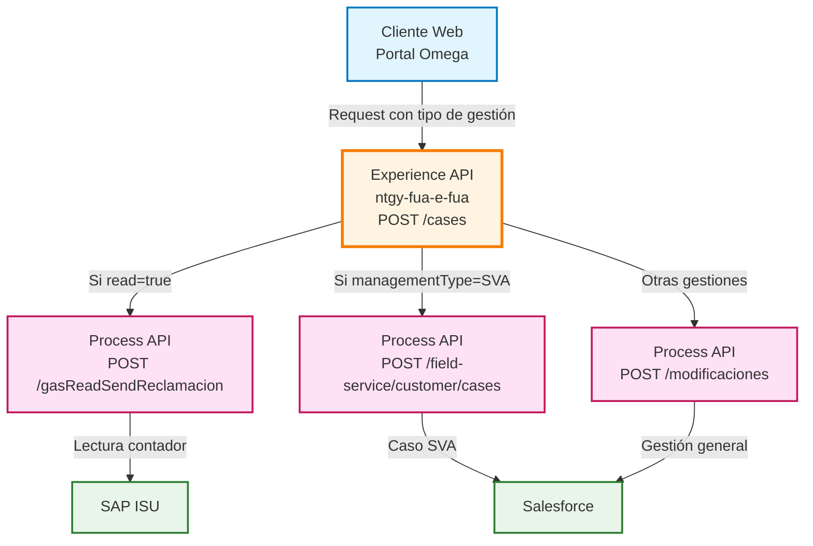
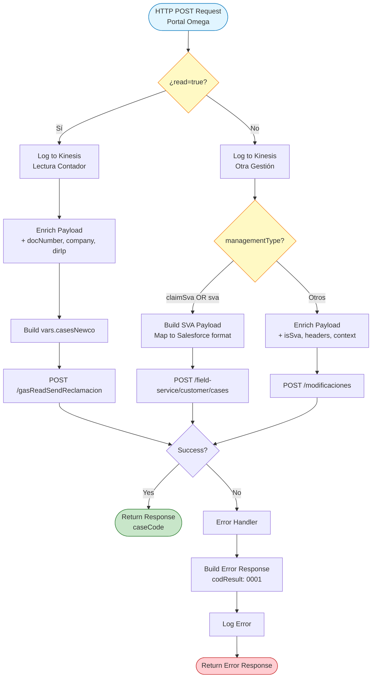
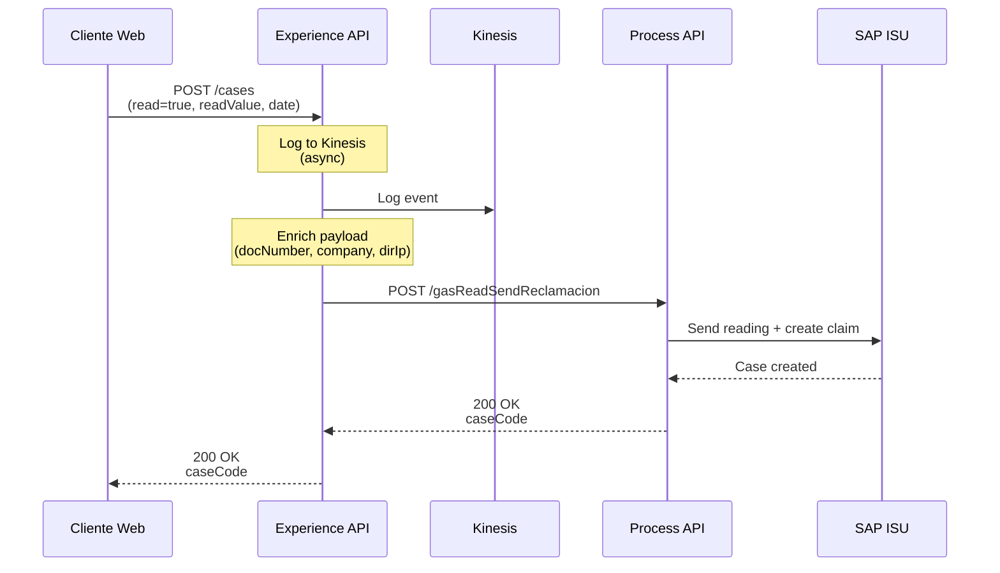
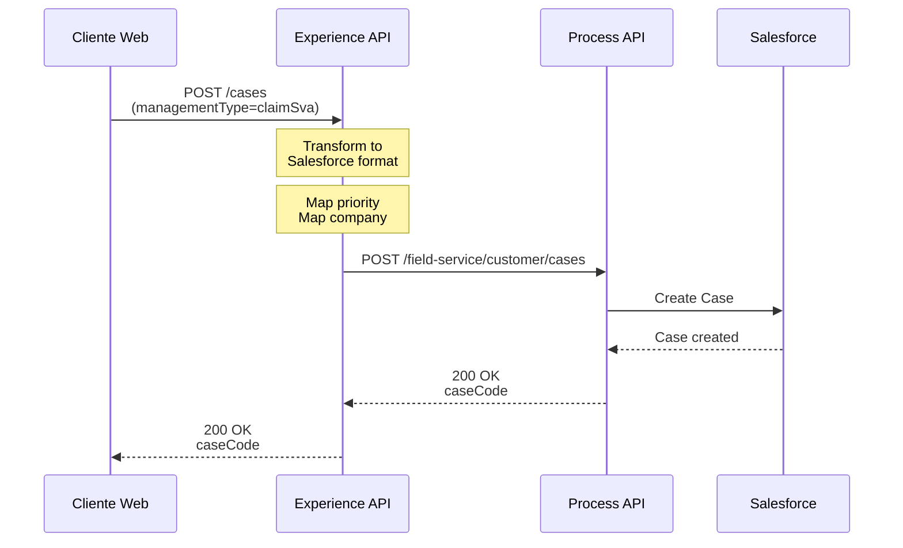
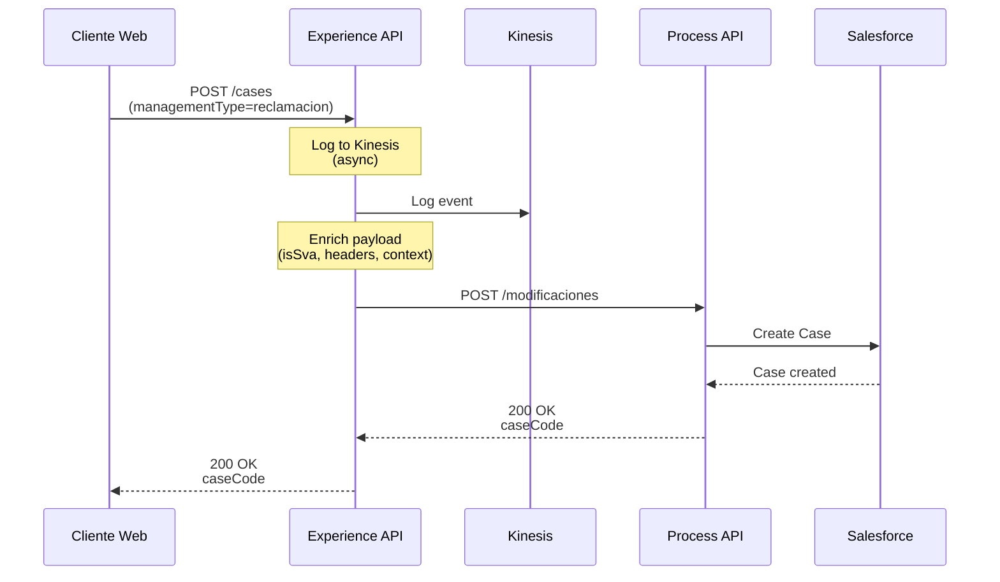
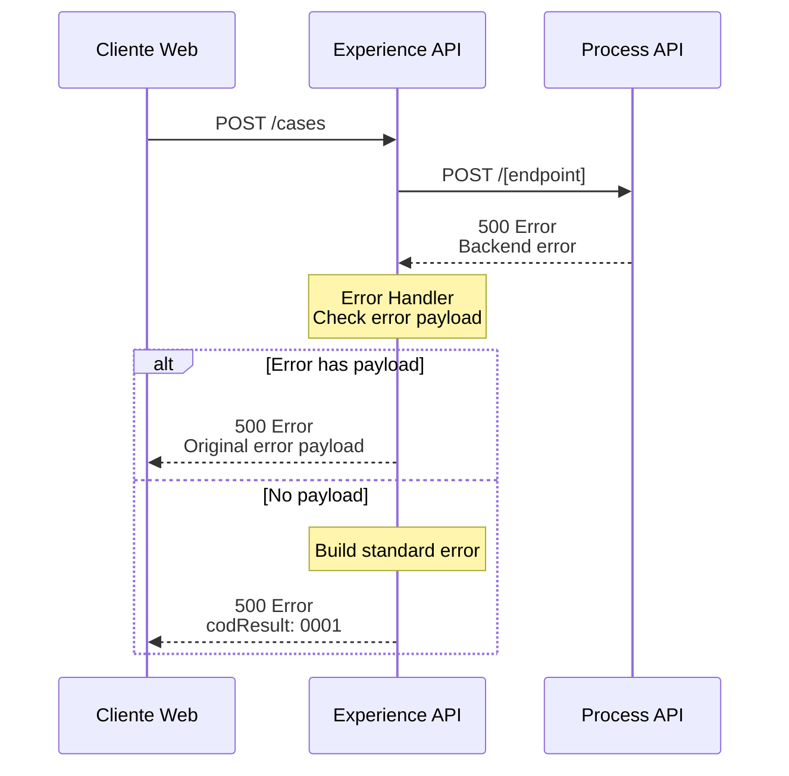

# POST /cases

## 📌 Descripción General

### Propósito del Endpoint

Este endpoint permite crear una nueva gestión del cliente en el sistema, soportando múltiples tipos de solicitudes: consultas, peticiones, reclamaciones, lecturas de contador y servicios SVA (Servicios de Valor Añadido). El endpoint implementa lógica de enrutamiento inteligente que dirige la solicitud al Process API apropiado según el tipo de gestión solicitada.

### Tipo de API

**Capa:** Experience API (API-Led Connectivity)

**Función:** Orquestación y enrutamiento de gestiones para canal web (Portal Omega)

### Patrón de Integración

**Tipo:** Content-Based Router + Data Enrichment

**Descripción:** Este endpoint analiza el tipo de gestión solicitada y enruta la petición a uno de tres endpoints diferentes del Process API, enriqueciendo los datos con información de headers y contexto antes del envío.

### Arquitectura API-Led Connectivity



---

## 💼 Propósito del Negocio

### Casos de Uso Principales

1. **Envío de Lectura de Contador con Reclamación**
   - Cliente envía lectura de su contador de gas
   - Se genera automáticamente una reclamación si hay discrepancia
   - Incluye logging en Kinesis para auditoría
   - Enriquecimiento con datos del cliente y dirección IP

2. **Creación de Caso SVA (Servicios de Valor Añadido)**
   - Solicitudes de servicios técnicos especiales
   - Creación directa en Salesforce con prioridad configurable
   - Mapeo de compañía (Newco/Imperial) a formato Salesforce
   - Incluye información del cliente y tipo de asistencia

3. **Gestiones Generales (Consultas, Peticiones, Reclamaciones)**
   - Cualquier otro tipo de gestión no clasificada como lectura o SVA
   - Enrutamiento a endpoint de modificaciones genéricas
   - Enriquecimiento con datos de contexto y headers
   - Logging en Kinesis para trazabilidad

### 📱 Canal y Audiencia

#### Canal de Consumo

**Canal:** Web (Portal Omega)

**Características del Canal:**
- **Plataforma**: Portal web de autoservicio FUA
- **Dispositivos**: Navegadores web (desktop y mobile responsive)
- **Conectividad**: Conexión estable requerida para envío de archivos
- **Experiencia de Usuario**: Formularios web con validación y carga de documentos

#### Audiencia Objetivo

**Usuarios Finales:**
- **Clientes Residenciales**: Crean gestiones relacionadas con sus contratos de energía
- **Clientes con Contador**: Envían lecturas de contador de gas
- **Clientes SVA**: Solicitan servicios técnicos especializados

**Contexto de Uso:**
- **Reclamación de Factura**: Cliente no está de acuerdo con su facturación
- **Lectura de Contador**: Cliente envía lectura para evitar estimaciones
- **Solicitud de Servicio**: Cliente necesita asistencia técnica o servicio especial
- **Consulta General**: Cliente tiene dudas sobre su contrato o servicio

#### Adaptaciones del Canal

**Optimizaciones Aplicadas:**
- **Enriquecimiento de Datos**: Se añaden automáticamente datos de contexto (IP, headers, compañía)
- **Logging Asíncrono**: Registro en Kinesis para auditoría sin afectar performance
- **Validación de Archivos**: Soporte para adjuntar documentos en la gestión
- **Transformación Condicional**: Adaptación del payload según tipo de gestión

### 🔗 Endpoints Dependientes

Este Experience API consume los siguientes Process APIs según el tipo de gestión:

| Process API | Endpoint | Método | Propósito | Condición |
|-------------|----------|--------|-----------|-----------|
| `ntgy-newco-p-fua-evo` | `/gasReadSendReclamacion` | POST | Envío de lectura de contador con reclamación | `payload.read == true` |
| `ntgy-newco-p-fua-evo` | `/field-service/customer/cases` | POST | Creación de caso SVA en Salesforce | `managementType == "claimSva" OR "sva"` |
| `ntgy-newco-p-fua-evo` | `/modificaciones` | POST | Gestiones generales (default) | Otros casos |

### Contexto Empresarial

- **Dominio:** Gestión de Casos y Atención al Cliente
- **Sector:** Energía - Utilities
- **División:** Naturgy España - NewCo
- **Canal:** Web (Portal Omega)

### Stakeholders

- **Clientes Finales**: Necesitan crear gestiones de forma autónoma
- **Agentes de Atención al Cliente**: Reciben y gestionan las solicitudes creadas
- **Área de Operaciones**: Procesa lecturas de contador y servicios técnicos
- **Área de Calidad**: Monitorea tiempos de respuesta y resolución

### Valor de Negocio

- **Autoservicio**: Cliente puede crear gestiones sin llamar al call center
- **Trazabilidad**: Todas las gestiones quedan registradas con auditoría completa
- **Eficiencia Operativa**: Enrutamiento automático según tipo de gestión
- **Mejora de Experiencia**: Proceso simplificado con validaciones en tiempo real

---

## 🔧 Especificación Técnica

### URLs por Ambiente

| Ambiente | URL Base | URL Completa |
|----------|----------|--------------|
| **Local** | `http://localhost:8081` | `http://localhost:8081/fua/api/cases` |
| **Development** | `https://ntgy-fua-e-fua-dev.de-c1.cloudhub.io` | `https://ntgy-fua-e-fua-dev.de-c1.cloudhub.io/fua/api/cases` |
| **Production** | `https://ntgy-fua-e-fua-pro.de-c1.cloudhub.io` | `https://ntgy-fua-e-fua-pro.de-c1.cloudhub.io/fua/api/cases` |

### Método HTTP

```
POST /fua/api/cases
```

### 🎯 Consideraciones del Canal

#### Limitaciones del Canal

| Aspecto | Limitación | Razón |
|---------|------------|-------|
| **Timeout** | 60 segundos | Tiempo máximo para creación de caso en Process API |
| **Tamaño de Request** | 10 MB máximo | Límite para archivos adjuntos |
| **Rate Limiting** | Según API Gateway | Protección contra abuso |

#### Headers Requeridos

| Header | Tipo | Obligatorio | Descripción |
|--------|------|-------------|-------------|
| `x-client-code` | string | Sí | Código de identificación del cliente (DNI/NIE) |
| `x-trading-company` | string | Sí | Compañía comercializadora (newco/imp) |
| `x-correlation-id` | string | Sí | ID de correlación para trazabilidad |
| `Content-Type` | string | Sí | Debe ser `application/json` |

### Parámetros de Entrada (Request Body)

#### Campos Comunes (Todos los Tipos de Gestión)

| Campo | Tipo | Obligatorio | Descripción |
|-------|------|-------------|-------------|
| `managementType` | string | Sí | Tipo de gestión (claimSva, sva, otros) |
| `comments` | string | No | Comentarios adicionales del cliente |
| `files` | array | No | Archivos adjuntos (formato omegaFile) |

#### Campos Específicos para Lectura de Contador (`read=true`)

| Campo | Tipo | Obligatorio | Descripción |
|-------|------|-------------|-------------|
| `read` | boolean | Sí | Indica que es una lectura de contador |
| `readValue` | string | Sí | Valor de la lectura del contador |
| `date` | string | Sí | Fecha de la lectura |
| `type` | string | No | Tipo de lectura |
| `contractId` | string | Sí | ID del contrato asociado |
| `CUPS` | string | No | Código CUPS del punto de suministro |

#### Campos Específicos para Casos SVA

| Campo | Tipo | Obligatorio | Descripción |
|-------|------|-------------|-------------|
| `assistanceType` | string | Sí | Tipo de asistencia solicitada |
| `clientName` | string | Sí | Nombre del cliente |
| `contractId` | string | Sí | ID del contrato |
| `isUrgent` | boolean | No | Indica si es urgente (afecta prioridad) |

#### Campos Específicos para Gestiones Generales

| Campo | Tipo | Obligatorio | Descripción |
|-------|------|-------------|-------------|
| `caseId` | string | No | ID del caso (si es actualización) |
| `productFamily` | string | No | Familia de producto |
| `serviceAccountId` | string | No | ID de cuenta de servicio |
| `billingAccountId` | string | No | ID de cuenta de facturación |
| `invoiceId` | string | No | ID de factura (para reclamaciones) |
| `reasonSelected` | string | No | Motivo seleccionado |
| `serviceContractId` | string | No | ID de contrato de servicio |
| `preferredContactId` | string | No | ID de contacto preferido |

### Ejemplo de Request - Lectura de Contador

```json
{
  "read": true,
  "readValue": "12345",
  "date": "2024-01-15",
  "type": "gas",
  "contractId": "1234567890",
  "CUPS": "ES0021000000000001JN",
  "comments": "Lectura mensual de contador"
}
```

### Ejemplo de Request - Caso SVA

```json
{
  "managementType": "claimSva",
  "assistanceType": "Revisión técnica",
  "clientName": "Juan Pérez",
  "contractId": "1234567890",
  "comments": "Necesito revisión del contador",
  "isUrgent": true
}
```

### Ejemplo de Request - Gestión General

```json
{
  "managementType": "reclamacion",
  "invoiceId": "FAC-2024-001",
  "reasonSelected": "Importe incorrecto",
  "comments": "La factura tiene un importe superior al esperado",
  "files": [
    {
      "fileName": "factura.pdf",
      "fileContent": "base64_encoded_content",
      "mimeType": "application/pdf"
    }
  ]
}
```

### Respuestas

#### 200 OK - Gestión Creada Exitosamente

```json
{
  "result": {
    "codResult": "0000",
    "msgResult": "No hay error"
  },
  "caseCode": "P2200006417"
}
```

**Campos de Respuesta:**

| Campo | Tipo | Descripción |
|-------|------|-------------|
| `result.codResult` | string | Código de resultado ("0000" = éxito) |
| `result.msgResult` | string | Mensaje descriptivo del resultado |
| `caseCode` | string | Código único del caso creado |

#### 400 Bad Request - Error de Validación

```json
{
  "result": {
    "codResult": "0001",
    "msgResult": "Campo obligatorio faltante: managementType"
  }
}
```

#### 500 Internal Server Error - Error del Sistema

```json
{
  "result": {
    "codResult": "0001",
    "msgResult": "Error al crear la gestión"
  }
}
```

### Autenticación

- **Tipo:** OAuth 2.0 (gestionado por API Gateway)
- **Scope:** Acceso a creación de gestiones del cliente autenticado

### Timeouts

| Tipo | Valor | Razón |
|------|-------|-------|
| **Request Timeout** | 60 segundos | Configurado para Process API ntgy-newco-p-fua-evo |
| **Connection Idle Timeout** | 60 segundos | Mantiene conexión activa durante creación |

---

## 🏗️ Implementación Técnica

### Arquitectura del Flow



### Código del Flow Principal

**Ubicación:** `src/main/mule/implementation/post-cases.xml`

```xml
<flow name="post-cases" doc:id="16354550-f0ee-44f6-8263-2296ae50e976">
    <!-- Choice Router: Enrutamiento según tipo de gestión -->
    <choice doc:name="Choice">
        
        <!-- RUTA 1: Lectura de Contador (read=true) -->
        <when expression="#[payload.read == true]">
            <!-- Logging en Kinesis -->
            <logger level="INFO" doc:name="LoggerKinesis" 
                    message="#[payload]" category="kinesisLogger" />
            
            <!-- Enriquecimiento de datos -->
            <ee:transform doc:name="Set Payload for Newco Post Cases Request">
                <ee:message>
                    <ee:set-payload><![CDATA[%dw 2.2
import * from dw::core::Strings
output application/json
---
payload
++
vars.fuaHeaders 
++
{
    "docNumber": attributes.headers['x-client-code'],
    "company": attributes.headers['x-trading-company'],
    "dirIp": substringBefore(substringAfter(attributes.remoteAddress,"/"),":")
}]]></ee:set-payload>
                </ee:message>
            </ee:transform>
            
            <!-- Build variable para Newco -->
            <ee:transform doc:name="Transform Message">
                <ee:variables>
                    <ee:set-variable variableName="casesNewco"><![CDATA[%dw 2.0
output application/json
---
{
    ("caseId": payload.caseId) if (payload.caseId != null),
    ("contractId": payload.contractId) if (payload.contractId != null),
    "isSva": p('newco-fua.isSva.afirmativo'),
    // ... más campos según payload
} ++ vars.fuaHeaders]]></ee:set-variable>
                </ee:variables>
            </ee:transform>
            
            <!-- Llamada al Process API -->
            <http:request method="POST" 
                          doc:name="Creación Caso Newco Reclamacion" 
                          config-ref="HTTP_FUA_PROCESS_NEWCO_EVO" 
                          path="/gasReadSendReclamacion">
                <http:body><![CDATA[#[vars.casesNewco]]]></http:body>
                <http:headers><![CDATA[#[vars.fuaHeaders]]]></http:headers>
            </http:request>
        </when>
        
        <!-- RUTA 2: Caso SVA -->
        <when expression='#[payload.managementType == "claimSva" or payload.managementType == "sva"]'>
            <logger level="INFO" doc:name="Logger" />
            
            <!-- Transformación para Salesforce -->
            <http:request method="POST" 
                          doc:name="Creación solicitud SVA" 
                          config-ref="HTTP_FUA_PROCESS_NEWCO_EVO" 
                          path="/field-service/customer/cases">
                <http:body><![CDATA[#[%dw 2.0
output application/json
var priority = if (payload.isUrgent == true) "High" else "Medium"
var compania = if (payload.company == "newco" or payload.company == "Newco")
  "Naturgy Clientes"
else if (payload.company == "imp" or payload.company == "Imp") 
  "Naturgy Iberia" 
else ""
---
{
    "subject": payload.assistanceType default "",
    "description": "Nombre del cliente: " ++ payload.clientName default "" ++
                   "; Número de documento de identidad: " ++ payload.docNumber default "" ++
                   "; Número de contrato: " ++ payload.contractId default "" ++
                   "; comentario: "++ payload.comments default "",
    "recordTypeId": p('newco-p-fua-evo.recordtypeid'),
    "origin": p('newco-p-fua-evo.origin.omega'),
    "priority": priority,
    "company": compania
}]]]></http:body>
            </http:request>
        </when>
        
        <!-- RUTA 3: Gestiones Generales (Default) -->
        <otherwise>
            <!-- Logging en Kinesis -->
            <logger level="INFO" doc:name="LoggerKinesis" 
                    message="#[payload]" category="kinesisLogger" />
            
            <!-- Enriquecimiento de datos -->
            <ee:transform doc:name="Set Payload for Newco Post Cases Request">
                <ee:message>
                    <ee:set-payload><![CDATA[%dw 2.2
import * from dw::core::Strings
output application/json
---
payload
++
{"isSva": p('newco-p-fua-evo.isSva.afirmativo')}
++
vars.fuaHeaders 
++
{
    "docNumber": attributes.headers['x-client-code'],
    "company": attributes.headers['x-trading-company'],
    "dirIp": substringBefore(substringAfter(attributes.remoteAddress,"/"),":")
}]]></ee:set-payload>
                </ee:message>
            </ee:transform>
            
            <!-- Llamada al Process API -->
            <http:request method="POST" 
                          doc:name="POST Cases Request" 
                          config-ref="HTTP_FUA_PROCESS_NEWCO_EVO" 
                          path="/modificaciones" />
        </otherwise>
    </choice>
    
    <!-- Error Handler -->
    <error-handler>
        <on-error-propagate enableNotifications="true" logException="true" 
                            doc:name="On Error Propagate">
            <ee:transform doc:name="Set Error Message">
                <ee:message>
                    <ee:set-payload><![CDATA[%dw 2.0
output application/json
---
if ( !isEmpty(error.errorMessage.payload) ) error.errorMessage.payload
else 
{
    "result": {
        "codResult": "0001",
        "msgResult": error.description as String replace /\"/ with("")
    }
}]]></ee:set-payload>
                </ee:message>
            </ee:transform>
            <logger level="ERROR" doc:name="Error" message="#[payload]" />
        </on-error-propagate>
    </error-handler>
</flow>
```

### Transformaciones de Canal

**Enriquecimiento de Datos (Común a todas las rutas):**

| Campo Original | Campo Añadido | Origen | Propósito |
|----------------|---------------|--------|-----------|
| - | `docNumber` | Header `x-client-code` | Identificación del cliente |
| - | `company` | Header `x-trading-company` | Compañía comercializadora |
| - | `dirIp` | `attributes.remoteAddress` | IP del cliente para auditoría |
| - | `isSva` | Property `newco-p-fua-evo.isSva.afirmativo` | Indicador SVA |

**Transformación Específica para SVA:**

```dataweave
%dw 2.0
output application/json
var priority = if (payload.isUrgent == true) "High" else "Medium"
var compania = if (payload.company == "newco" or payload.company == "Newco")
  "Naturgy Clientes"
else if (payload.company == "imp" or payload.company == "Imp") 
  "Naturgy Iberia" 
else ""
---
{
    "subject": payload.assistanceType default "",
    "description": "Nombre del cliente: " ++ payload.clientName default "" ++
                   "; Número de documento de identidad: " ++ payload.docNumber default "" ++
                   "; Número de contrato: " ++ payload.contractId default "" ++
                   "; comentario: "++ payload.comments default "",
    "recordTypeId": p('newco-p-fua-evo.recordtypeid'),
    "origin": p('newco-p-fua-evo.origin.omega'),
    "priority": priority,
    "company": compania
}
```

**Lógica de Mapeo:**
- **Prioridad**: `isUrgent=true` → "High", `isUrgent=false` → "Medium"
- **Compañía**: "newco" → "Naturgy Clientes", "imp" → "Naturgy Iberia"
- **Descripción**: Concatenación de datos del cliente en formato legible

### Patrones de Diseño

**Patrón 1: Content-Based Router**

**Justificación:** 
- Diferentes tipos de gestión requieren diferentes endpoints del Process API
- Permite escalabilidad al añadir nuevos tipos de gestión
- Separa claramente la lógica de cada tipo de caso

**Patrón 2: Data Enrichment**

**Justificación:**
- El Experience API añade contexto que el cliente no proporciona
- Enriquece con datos de headers, IP y configuración
- Facilita auditoría y trazabilidad

**Patrón 3: Asynchronous Logging**

**Justificación:**
- Logging en Kinesis no bloquea el flujo principal
- Permite auditoría completa sin afectar performance
- Categoría "kinesisLogger" para filtrado específico

### Diagramas de Secuencia

#### 1. Flujo de Lectura de Contador (read=true)



#### 2. Flujo de Caso SVA



#### 3. Flujo de Gestión General



#### 4. Flujo con Error



### Configuración HTTP

**Connector:** `HTTP_FUA_PROCESS_NEWCO_EVO`

```yaml
# Configuración en e-fua-pro-config.yaml
newco-p-fua-evo:
  host: "mule-worker-internal-ntgy-newco-p-fua-evo.de-c1.cloudhub.io"
  port: "8091"
  timeout: "60000"
  recordtypeid: "0125I00000056X4QAI"
```

**Características:**
- **Base Path:** `/api`
- **Response Timeout:** 60 segundos
- **Connection Idle Timeout:** 60 segundos
- **Protocol:** HTTP (interno CloudHub)

### Manejo de Errores

**Estrategia:** Error Handler con Preservación de Payload Original

**Lógica de Error:**

```dataweave
%dw 2.0
output application/json
---
if ( !isEmpty(error.errorMessage.payload) ) 
    error.errorMessage.payload
else 
{
    "result": {
        "codResult": "0001",
        "msgResult": error.description as String replace /\"/ with("")
    }
}
```

**Tipos de Errores Manejados:**

1. **Errores del Process API con Payload**
   - Se devuelve el payload de error original del Process API
   - Mantiene la estructura de error del backend

2. **Errores sin Payload (Connectivity, Timeout)**
   - Se construye respuesta estándar con codResult "0001"
   - Se incluye descripción del error técnico

3. **Errores de Transformación**
   - Error al construir payload enriquecido
   - Error al mapear datos para SVA

**Logging de Errores:**
- Nivel ERROR en logs de Mule
- Incluye payload completo del error
- Trazabilidad mediante correlation-id

---

## 💻 Ejemplos de Uso

### Ejemplo 1: Crear Lectura de Contador

#### cURL

```bash
curl -X POST "https://ntgy-fua-e-fua-pro.de-c1.cloudhub.io/fua/api/cases" \
  -H "Content-Type: application/json" \
  -H "x-client-code: 12345678A" \
  -H "x-trading-company: newco" \
  -H "x-correlation-id: 550e8400-e29b-41d4-a716-446655440000" \
  -H "client_id: YOUR_CLIENT_ID" \
  -H "client_secret: YOUR_CLIENT_SECRET" \
  -d '{
    "read": true,
    "readValue": "12345",
    "date": "2024-01-15",
    "type": "gas",
    "contractId": "1234567890",
    "CUPS": "ES0021000000000001JN",
    "comments": "Lectura mensual de contador"
  }'
```

#### Respuesta (200 OK)

```json
{
  "result": {
    "codResult": "0000",
    "msgResult": "No hay error"
  },
  "caseCode": "P2200006420"
}
```

### Ejemplo 2: Crear Caso SVA Urgente

#### cURL

```bash
curl -X POST "https://ntgy-fua-e-fua-pro.de-c1.cloudhub.io/fua/api/cases" \
  -H "Content-Type: application/json" \
  -H "x-client-code: 12345678A" \
  -H "x-trading-company: newco" \
  -H "x-correlation-id: 550e8400-e29b-41d4-a716-446655440001" \
  -H "client_id: YOUR_CLIENT_ID" \
  -H "client_secret: YOUR_CLIENT_SECRET" \
  -d '{
    "managementType": "claimSva",
    "assistanceType": "Revisión técnica urgente",
    "clientName": "Juan Pérez García",
    "contractId": "1234567890",
    "comments": "Fuga de gas detectada, requiere atención inmediata",
    "isUrgent": true
  }'
```

#### Respuesta (200 OK)

```json
{
  "result": {
    "codResult": "0000",
    "msgResult": "No hay error"
  },
  "caseCode": "P2200006421"
}
```

### Ejemplo 3: Crear Reclamación de Factura

#### JavaScript (Portal Web)

```javascript
async function createInvoiceClaim(invoiceId, reason, comments, files = []) {
  try {
    const payload = {
      managementType: "reclamacion",
      invoiceId: invoiceId,
      reasonSelected: reason,
      comments: comments,
      files: files
    };

    const response = await fetch('https://ntgy-fua-e-fua-pro.de-c1.cloudhub.io/fua/api/cases', {
      method: 'POST',
      headers: {
        'Content-Type': 'application/json',
        'x-client-code': getClientCode(),
        'x-trading-company': 'newco',
        'x-correlation-id': generateCorrelationId(),
        'client_id': 'YOUR_CLIENT_ID',
        'client_secret': 'YOUR_CLIENT_SECRET'
      },
      body: JSON.stringify(payload)
    });

    if (!response.ok) {
      throw new Error(`HTTP error! status: ${response.status}`);
    }

    const data = await response.json();
    
    if (data.result.codResult === "0000") {
      console.log(`Reclamación creada exitosamente: ${data.caseCode}`);
      return data.caseCode;
    } else {
      console.error('Error:', data.result.msgResult);
      return null;
    }
  } catch (error) {
    console.error('Error al crear reclamación:', error);
    return null;
  }
}

// Uso
const caseCode = await createInvoiceClaim(
  'FAC-2024-001',
  'Importe incorrecto',
  'La factura tiene un importe superior al esperado'
);
```

### Ejemplo 4: Python - Crear Gestión con Archivos

```python
import requests
import uuid
import base64

def create_case_with_files(management_type, invoice_id, reason, comments, file_paths):
    """
    Crea una gestión con archivos adjuntos
    
    Args:
        management_type (str):
