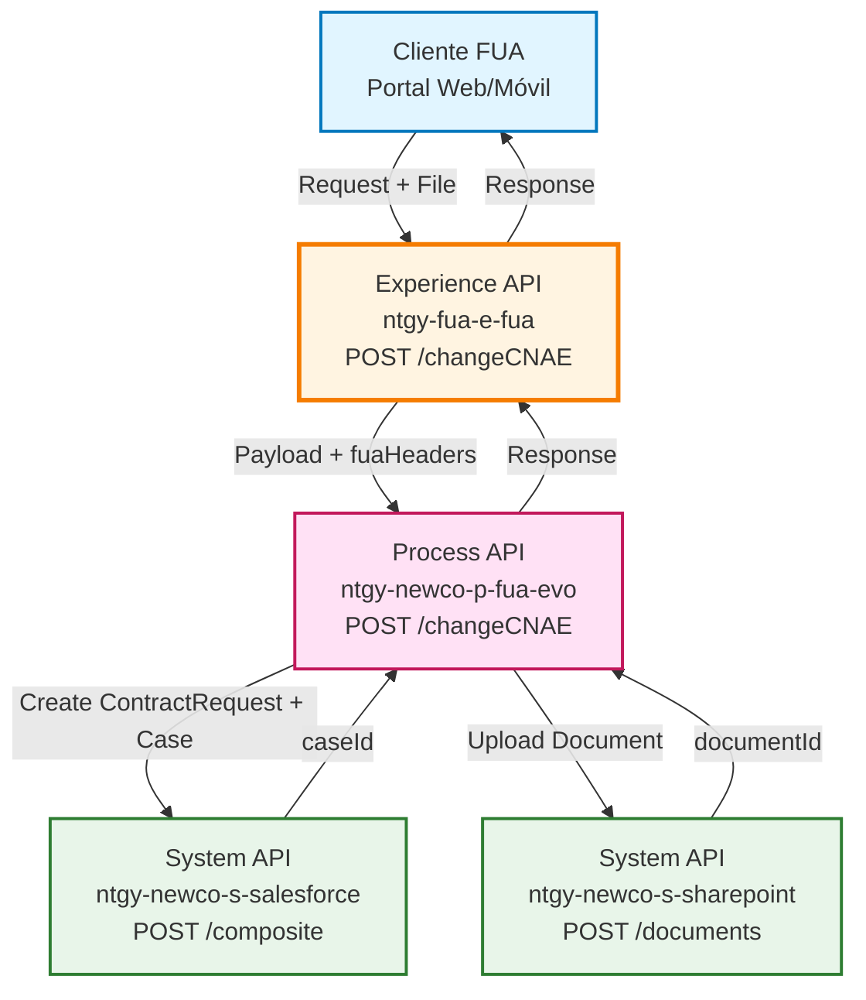
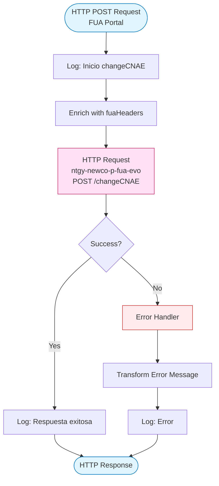
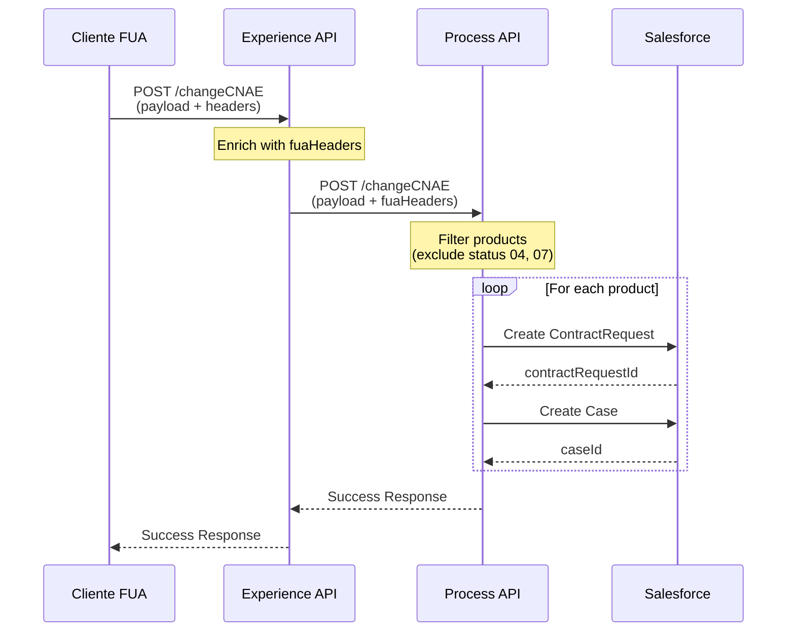
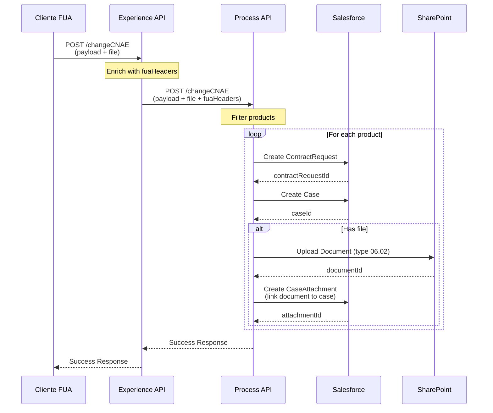
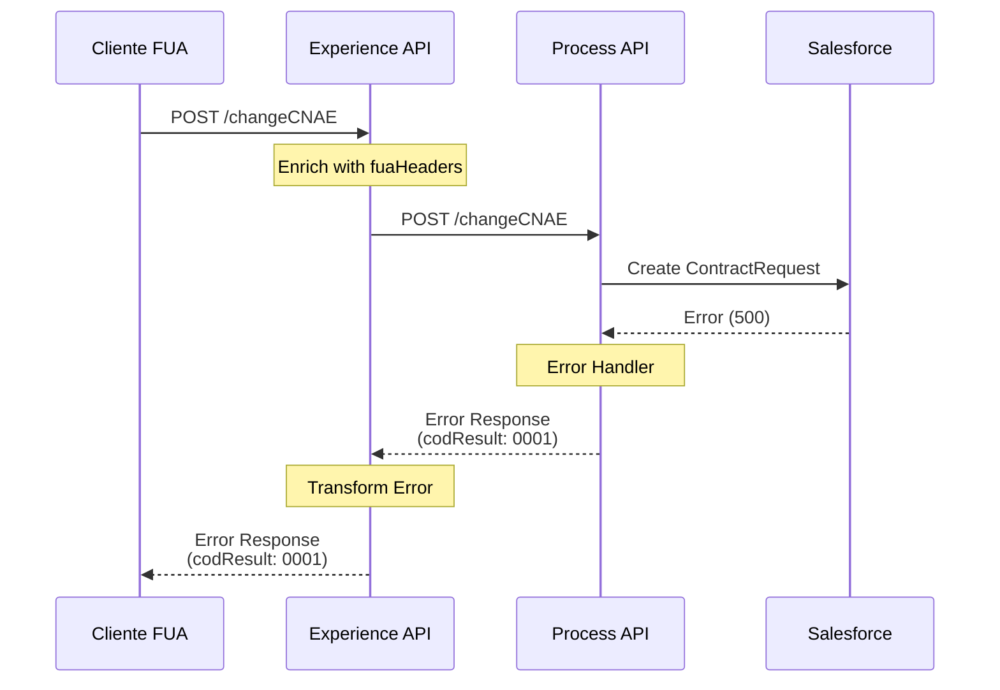

# POST /changeCNAE

## 📌 Descripción General

### Propósito del Endpoint

Este endpoint permite modificar el Código Nacional de Actividades Económicas (CNAE) de una pyme, creando automáticamente una solicitud de contratación y un caso de gestión en Salesforce para cada producto activo del cliente. Opcionalmente, permite adjuntar documentación justificativa que se almacena en SharePoint.

### Tipo de API

**Capa:** Experience API (API-Led Connectivity)

**Función:** Orquestación de modificación de CNAE con gestión documental

### Patrón de Integración

**Tipo:** Pass-Through con enriquecimiento de headers

**Descripción:** El Experience API actúa como pass-through hacia el Process API, enriqueciendo el payload con headers de contexto FUA (fuaHeaders) que contienen información de autenticación y trazabilidad.

### Arquitectura API-Led Connectivity



---

## 💼 Propósito del Negocio

### Casos de Uso Principales

1. **Cambio de Actividad Económica**
   - Una pyme cambia su actividad principal y necesita actualizar el CNAE
   - Se genera automáticamente la solicitud de contratación con el nuevo CNAE
   - Se crea un caso de gestión para seguimiento del cambio

2. **Actualización Masiva de Contratos**
   - Modificación del CNAE para múltiples contratos del mismo cliente
   - Creación de solicitudes individuales por cada contrato activo
   - Generación de casos de gestión independientes por contrato

3. **Modificación con Documentación Justificativa**
   - Cambio de CNAE con adjuntos de documentación legal
   - Almacenamiento automático en SharePoint
   - Vinculación de documentos al caso de gestión

### 📱 Canal y Audiencia

#### Canal de Consumo

**Canal:** FUA (Frontal Único de Atención)

**Características del Canal:**
- **Plataforma**: Portal web de autoservicio y aplicación móvil
- **Dispositivos**: Desktop, tablet, smartphone
- **Conectividad**: Requiere conexión estable para upload de archivos
- **Experiencia de Usuario**: Formulario con validación de CNAE y upload opcional de documentos

#### Audiencia Objetivo

**Usuarios Finales:**
- **Clientes Pyme**: Empresas que necesitan actualizar su actividad económica
- **Agentes de Atención**: Personal de call center que gestiona cambios para clientes

**Contexto de Uso:**
- **Cambio de Actividad**: Cliente modifica su giro de negocio
- **Regularización**: Actualización de CNAE por requisitos legales o fiscales
- **Gestión Asistida**: Agente realiza el cambio en nombre del cliente

#### Adaptaciones del Canal

**Optimizaciones Aplicadas:**
- **Enriquecimiento de Headers**: Añade contexto de usuario y trazabilidad (fuaHeaders)
- **Gestión de Archivos**: Soporte para adjuntos en base64
- **Timeout Extendido**: 60 segundos para procesar múltiples contratos y documentos

### 🔗 Endpoints Dependientes

Este Experience API consume el siguiente Process API:

| Process API | Endpoint | Método | Propósito |
|-------------|----------|--------|-----------|
| `ntgy-newco-p-fua-evo` | `/changeCNAE` | POST | Orquesta la modificación de CNAE creando solicitudes de contratación y casos de gestión en Salesforce |

### Contexto Empresarial

- **Dominio:** Gestión de Clientes y Contratos
- **Sector:** Energía - Utilities
- **División:** Naturgy España - NewCo
- **Canal:** FUA (Portal Web y Móvil)

### Stakeholders

- **Clientes Pyme**: Necesitan actualizar su CNAE de forma ágil y con seguimiento
- **Departamento Comercial**: Requiere trazabilidad de cambios de actividad económica
- **Área de Facturación**: Necesita CNAE actualizado para correcta facturación
- **Compliance**: Requiere documentación justificativa de cambios

### Valor de Negocio

- **Automatización**: Elimina procesos manuales de actualización de CNAE
- **Trazabilidad**: Cada cambio genera caso de gestión con seguimiento completo
- **Cumplimiento**: Permite adjuntar documentación legal justificativa
- **Eficiencia**: Procesa múltiples contratos en una sola operación

---

## 🔧 Especificación Técnica

### URLs por Ambiente

| Ambiente | URL Base | URL Completa |
|----------|----------|--------------|
| **Local** | `http://localhost:8081` | `http://localhost:8081/fua/api/changeCNAE` |
| **Development** | `https://ntgy-fua-e-fua-dev.de-c1.cloudhub.io` | `https://ntgy-fua-e-fua-dev.de-c1.cloudhub.io/fua/api/changeCNAE` |
| **UAT** | `https://ntgy-fua-e-fua-uat.de-c1.cloudhub.io` | `https://ntgy-fua-e-fua-uat.de-c1.cloudhub.io/fua/api/changeCNAE` |
| **Production** | `https://ntgy-fua-e-fua-pro.de-c1.cloudhub.io` | `https://ntgy-fua-e-fua-pro.de-c1.cloudhub.io/fua/api/changeCNAE` |

### Método HTTP

```
POST /fua/api/changeCNAE
```

### 🎯 Consideraciones del Canal

#### Limitaciones del Canal

| Aspecto | Limitación | Razón |
|---------|------------|-------|
| **Timeout** | 60 segundos | Procesa múltiples contratos y documentos |
| **Tamaño de Archivo** | 10 MB máximo | Limitación de SharePoint |
| **Contratos Simultáneos** | Sin límite técnico | Procesados iterativamente |
| **Formatos de Archivo** | PDF, DOC, DOCX, PNG, JPG, ZIP | Validación en Process API |

#### Campos Específicos del Canal

**Campos Añadidos por el Experience API (fuaHeaders):**

| Campo | Tipo | Descripción | Razón |
|-------|------|-------------|-------|
| `x-client-id` | string | ID del cliente en Salesforce | Identificación del cliente |
| `x-client-code` | string | Código del cliente | Trazabilidad |
| `x-contact-id` | string | ID del contacto | Usuario que realiza la acción |
| `x-interaction-id` | string | ID de la interacción | Vinculación con caso padre |
| `x-user-id` | string | ID del usuario/agente | Asignación de caso |
| `x-agent-mail` | string | Email del agente | Contexto de ejecución en Salesforce |
| `DirIp` | string | IP del cliente | Auditoría |
| `correlationId` | string | ID de correlación | Trazabilidad end-to-end |

### Parámetros de Entrada

#### Headers

| Header | Tipo | Obligatorio | Descripción |
|--------|------|-------------|-------------|
| `Content-Type` | string | ✅ | `application/json` |
| `x-client-id` | string | ✅ | ID del cliente en Salesforce |
| `x-client-code` | string | ✅ | Código del cliente |
| `x-contact-id` | string | ✅ | ID del contacto que realiza la operación |
| `x-interaction-id` | string | ⚠️ | ID de la interacción (caso padre) |
| `x-user-id` | string | ⚠️ | ID del usuario/agente (si aplica) |
| `x-agent-mail` | string | ⚠️ | Email del agente (si aplica) |

#### Body (application/json)

```json
{
  "contractAccountID": "string",
  "products": [
    {
      "contractId": "string",
      "contractStatus": "string",
      "CUPS": "string",
      "newCNAE": "string",
      "motive": "string",
      "descriptionMotive": "string"
    }
  ],
  "file": "string (base64)",
  "fileNameWithExtension": "string"
}
```

**Campos del Body:**

| Campo | Tipo | Obligatorio | Descripción |
|-------|------|-------------|-------------|
| `contractAccountID` | string | ✅ | ID de la cuenta contrato |
| `products` | array | ✅ | Lista de productos a modificar |
| `products[].contractId` | string | ✅ | ID del contrato |
| `products[].contractStatus` | string | ✅ | Estado del contrato (se excluyen '04' y '07') |
| `products[].CUPS` | string | ✅ | Código CUPS del suministro |
| `products[].newCNAE` | string | ✅ | Nuevo código CNAE (4 dígitos) |
| `products[].motive` | string | ✅ | Motivo del cambio |
| `products[].descriptionMotive` | string | ✅ | Descripción detallada del motivo |
| `file` | string | ⚠️ | Archivo adjunto en base64 |
| `fileNameWithExtension` | string | ⚠️ | Nombre del archivo con extensión |

**Validaciones:**
- Los contratos con `contractStatus` '04' (Cancelado) o '07' (Suspendido) son excluidos automáticamente
- El CNAE debe ser un código válido de 4 dígitos
- Si se incluye `file`, debe incluirse también `fileNameWithExtension`

### Respuestas

#### 200 OK - Éxito

```json
{
  "result": {
    "codResult": "0000",
    "msgResult": "No hay error"
  }
}
```

**Campos de Respuesta:**

| Campo | Tipo | Descripción |
|-------|------|-------------|
| `result.codResult` | string | Código de resultado ("0000" = éxito) |
| `result.msgResult` | string | Mensaje descriptivo del resultado |

#### 500 Internal Server Error

```json
{
  "result": {
    "codResult": "0001",
    "msgResult": "Error description"
  }
}
```

### Autenticación

- **Tipo:** OAuth 2.0 (gestionado por API Gateway)
- **Headers Requeridos:** Token de autenticación en header `Authorization`

### Timeouts

| Tipo | Valor | Razón |
|------|-------|-------|
| **Request Timeout** | 60 segundos | Procesa múltiples contratos, casos y documentos |
| **Connection Idle Timeout** | 60 segundos | Mantiene conexión para operaciones largas |

---

## 🏗️ Implementación Técnica

### Arquitectura del Flow



### Transformaciones de Canal

**Este Experience API NO transforma la estructura del payload.**

El Experience API actúa como pass-through, enriqueciendo el payload con headers de contexto FUA:

```dataweave
%dw 2.0
output application/json
---
payload ++ vars.fuaHeaders
```

**Headers añadidos (fuaHeaders):**
- `x-client-id`: ID del cliente
- `x-client-code`: Código del cliente
- `x-contact-id`: ID del contacto
- `x-interaction-id`: ID de la interacción
- `x-user-id`: ID del usuario/agente
- `x-agent-mail`: Email del agente
- `DirIp`: IP del cliente
- `correlationId`: ID de correlación

Para el schema completo de request y response, consultar:
📖 **Process API: `ntgy-newco-p-fua-evo` endpoint `/changeCNAE`**

### Patrones de Diseño

**Patrón:** Pass-Through con Enriquecimiento de Contexto

**Justificación:** 
- El Experience API no necesita transformar la lógica de negocio
- Añade contexto específico del canal FUA (headers de autenticación y trazabilidad)
- Permite que el Process API maneje toda la orquestación compleja

### Diagramas de Secuencia

#### 1. Flujo Normal de Éxito (Sin Archivo)



#### 2. Flujo con Archivo Adjunto



#### 3. Flujo con Error



### Optimizaciones del Canal

1. **Enriquecimiento de Headers**: Añade contexto FUA sin modificar el payload original
2. **Timeout Extendido**: 60 segundos para operaciones complejas con múltiples contratos
3. **Gestión de Errores**: Transforma errores del Process API a formato estándar FUA

### Manejo de Errores

#### Error Handler del Experience API

```dataweave
%dw 2.0
output application/json
---
{
  "result": {
    "codResult": "0001",
    "msgResult": error.description as String replace /\"/ with("")
  }
}
```

**Tipos de Errores:**
- **Timeout**: Si el Process API no responde en 60 segundos
- **Connection Error**: Si no se puede conectar con el Process API
- **Business Error**: Errores de validación o lógica de negocio del Process API
- **System Error**: Errores internos de Salesforce o SharePoint

**Logging:**
- Todos los errores se registran con nivel ERROR
- Se incluye el mensaje de error completo para troubleshooting

---

## 💻 Ejemplos de Uso

### Ejemplo 1: Cambio de CNAE para Múltiples Contratos (Sin Archivo)

#### cURL

```bash
curl -X POST "https://ntgy-fua-e-fua-pro.de-c1.cloudhub.io/fua/api/changeCNAE" \
  -H "Content-Type: application/json" \
  -H "Authorization: Bearer YOUR_TOKEN" \
  -H "x-client-id: 0015I00000XXXXX" \
  -H "x-client-code: 200000000000" \
  -H "x-contact-id: 0035I00000XXXXX" \
  -H "x-interaction-id: 5005I00000XXXXX" \
  -d '{
    "contractAccountID": "200000000000",
    "products": [
      {
        "contractId": "4900000001",
        "contractStatus": "01",
        "CUPS": "ES0000000000000000XX0F",
        "newCNAE": "4711",
        "motive": "Informar/Modificar CNAE",
        "descriptionMotive": "Cambio de actividad económica a comercio minorista"
      },
      {
        "contractId": "4900000002",
        "contractStatus": "01",
        "CUPS": "ES0000000000000000YY0F",
        "newCNAE": "4711",
        "motive": "Informar/Modificar CNAE",
        "descriptionMotive": "Cambio de actividad económica a comercio minorista"
      }
    ]
  }'
```

#### Respuesta (200 OK)

```json
{
  "result": {
    "codResult": "0000",
    "msgResult": "No hay error"
  }
}
```

### Ejemplo 2: Cambio de CNAE con Documento Adjunto

#### Request Body

```json
{
  "contractAccountID": "200000000000",
  "products": [
    {
      "contractId": "4900000001",
      "contractStatus": "01",
      "CUPS": "ES0000000000000000XX0F",
      "newCNAE": "4711",
      "motive": "Informar/Modificar CNAE",
      "descriptionMotive": "Cambio de actividad económica con justificación legal"
    }
  ],
  "file": "JVBERi0xLjQKJeLjz9MKMyAwIG9iago8PC9UeXBlL1BhZ2UvUGFyZW50IDIgMCBSL1Jlc291cmNlczw8L0ZvbnQ8PC9GMSA1IDAgUj4+Pj4vTWVkaWFCb3hbMCAwIDYxMiA3OTJdL0NvbnRlbnRzIDQgMCBSPj4KZW5kb2JqCg==",
  "fileNameWithExtension": "justificacion_cnae.pdf"
}
```

#### Respuesta (200 OK)

```json
{
  "result": {
    "codResult": "0000",
    "msgResult": "No hay error"
  }
}
```

### Ejemplo 3: JavaScript (Frontend FUA)

```javascript
async function changeCNAE(contractAccountID, products, file = null, fileName = null) {
  const payload = {
    contractAccountID,
    products
  };
  
  // Añadir archivo si existe
  if (file && fileName) {
    payload.file = file; // base64 string
    payload.fileNameWithExtension = fileName;
  }
  
  const response = await fetch('https://ntgy-fua-e-fua-pro.de-c1.cloudhub.io/fua/api/changeCNAE', {
    method: 'POST',
    headers: {
      'Content-Type': 'application/json',
      'Authorization': `Bearer ${authToken}`,
      'x-client-id': clientId,
      'x-client-code': clientCode,
      'x-contact-id': contactId,
      'x-interaction-id': interactionId
    },
    body: JSON.stringify(payload)
  });
  
  if (!response.ok) {
    throw new Error(`Error: ${response.status}`);
  }
  
  return await response.json();
}

// Uso
try {
  const result = await changeCNAE(
    '200000000000',
    [
      {
        contractId: '4900000001',
        contractStatus: '01',
        CUPS: 'ES0000000000000000XX0F',
        newCNAE: '4711',
        motive: 'Informar/Modificar CNAE',
        descriptionMotive: 'Cambio de actividad económica'
      }
    ]
  );
  console.log('CNAE modificado exitosamente:', result);
} catch (error) {
  console.error('Error al modificar CNAE:', error);
}
```

### Ejemplo 4: Python

```python
import requests
import base64

def change_cnae(contract_account_id, products, file_path=None):
    url = 'https://ntgy-fua-e-fua-pro.de-c1.cloudhub.io/fua/api/changeCNAE'
    
    headers = {
        'Content-Type': 'application/json',
        'Authorization': f'Bearer {auth_token}',
        'x-client-id': client_id,
        'x-client-code': client_code,
        'x-contact-id': contact_id,
        'x-interaction-id': interaction_id
    }
    
    payload = {
        'contractAccountID': contract_account_id,
        'products': products
    }
    
    # Añadir archivo si existe
    if file_path:
        with open(file_path, 'rb') as f:
            file_content = base64.b64encode(f.read()).decode('utf-8')
        payload['file'] = file_content
        payload['fileNameWithExtension'] = file_path.split('/')[-1]
    
    response = requests.post(url, json=payload, headers=headers)
    response.raise_for_status()
    
    return response.json()

# Uso
products = [
    {
        'contractId': '4900000001',
        'contractStatus': '01',
        'CUPS': 'ES0000000000000000XX0F',
        'newCNAE': '4711',
        'motive': 'Informar/Modificar CNAE',
        'descriptionMotive': 'Cambio de actividad económica'
    }
]

try:
    result = change_cnae('200000000000', products, 'justificacion.pdf')
    print(f"CNAE modificado exitosamente: {result}")
except requests.exceptions.HTTPError as e:
    print(f"Error al modificar CNAE: {e}")
```

### Ejemplo 5: Error - Timeout

#### Respuesta (500 Internal Server Error)

```json
{
  "result": {
    "codResult": "0001",
    "msgResult": "HTTP:TIMEOUT - The request exceeded the configured timeout"
  }
}
```

### Ejemplo 6: Error - Validación de Negocio

#### Respuesta (500 Internal Server Error)

```json
{
  "result": {
    "codResult": "0001",
    "msgResult": "Error al crear solicitud de contratación en Salesforce: Invalid CNAE code"
  }
}