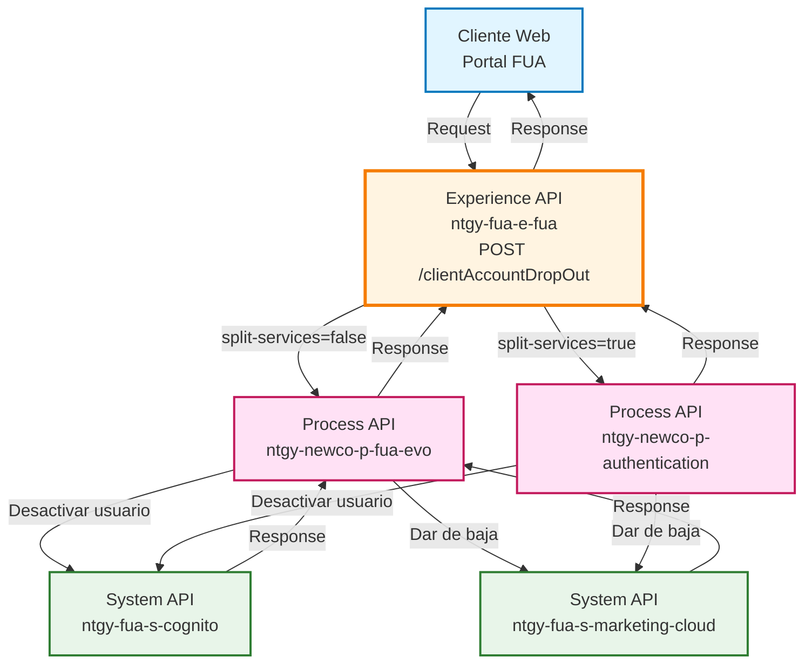
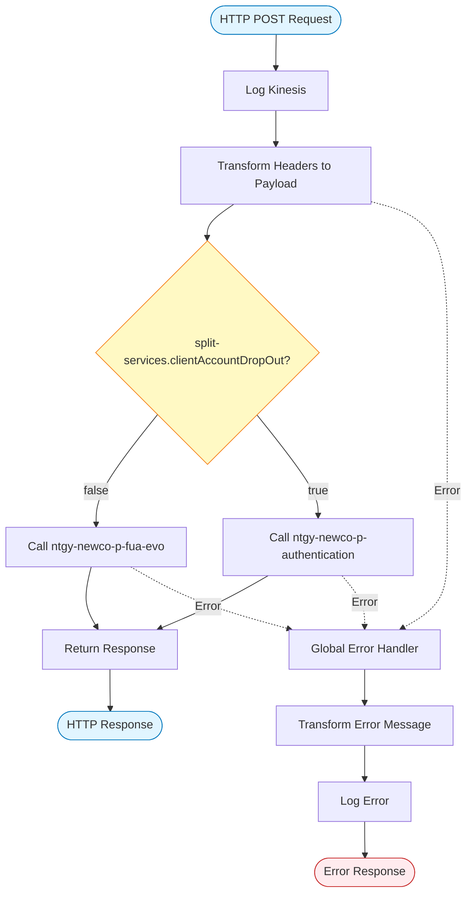
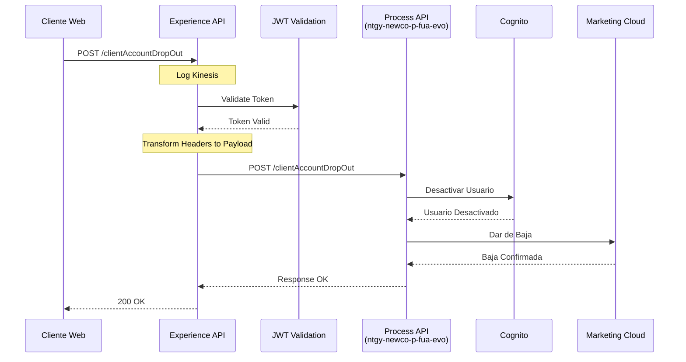
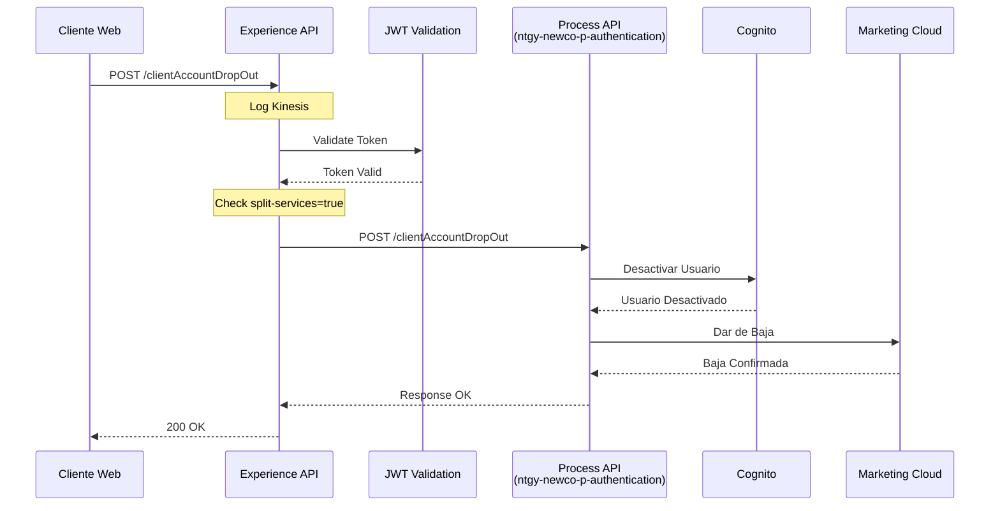
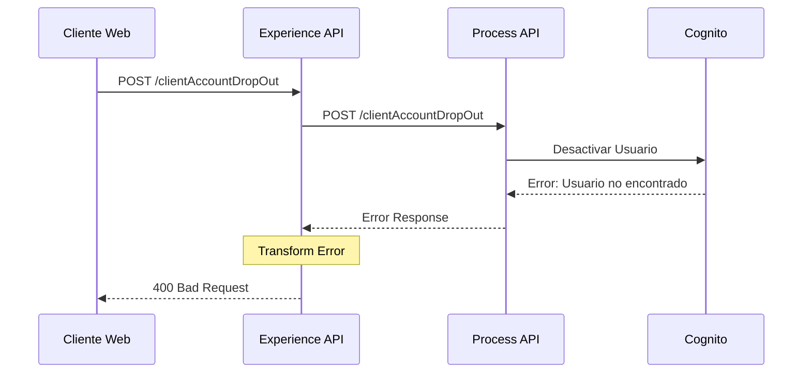
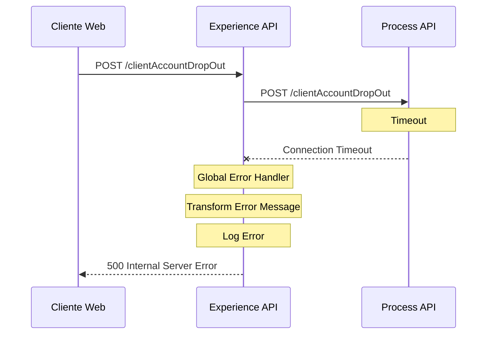

# POST /clientAccountDropOut

## 📌 Descripción General

### Propósito del Endpoint

Este endpoint gestiona la baja completa del cliente del área de autoservicio FUA (Frontal Único de Atención), desactivando su cuenta de usuario en AWS Cognito y dándolo de baja en Salesforce Marketing Cloud. Permite a los clientes solicitar la desactivación de su acceso al portal web de autoservicio.

### Tipo de API

**Capa:** Experience API (API-Led Connectivity)

**Función:** Orquestación de baja de cliente con adaptación para canal web

### Patrón de Integración

**Tipo:** Orquestación con Routing Condicional

**Descripción:** El Experience API orquesta la llamada al Process API correspondiente según la configuración de división de servicios (`split-services.clientAccountDropOut`). Transforma los headers FUA en el payload requerido por el Process API y gestiona el routing entre dos posibles backends.

### Arquitectura API-Led Connectivity



---

## 💼 Propósito del Negocio

### Casos de Uso Principales

1. **Baja Voluntaria del Cliente**
   - Cliente solicita desactivar su cuenta del área de autoservicio
   - Se desactiva el acceso a través del portal web FUA
   - Se mantiene la relación comercial pero sin acceso digital

2. **Gestión de Privacidad y GDPR**
   - Cliente ejerce su derecho a limitar el procesamiento de datos
   - Desactivación de comunicaciones de marketing
   - Cumplimiento con regulaciones de protección de datos

3. **Cambio de Canal de Atención**
   - Cliente prefiere gestionar sus servicios por otros canales
   - Transición de autoservicio digital a atención telefónica o presencial
   - Mantenimiento de la cuenta comercial activa

### 📱 Canal y Audiencia

#### Canal de Consumo

**Canal:** Web

**Características del Canal:**
- **Plataforma**: Portal web FUA (Frontal Único de Atención)
- **Dispositivos**: Navegadores web (desktop y móvil)
- **Conectividad**: Requiere conexión estable para completar la operación
- **Experiencia de Usuario**: Proceso de confirmación con validación de identidad

#### Audiencia Objetivo

**Usuarios Finales:**
- **Clientes Residenciales**: Clientes de energía que desean darse de baja del autoservicio
- **Clientes Empresariales**: Empresas que gestionan sus contratos y prefieren otros canales

**Contexto de Uso:**
- **Solicitud de Baja**: Cliente decide no usar más el portal de autoservicio
- **Cambio de Preferencias**: Cliente prefiere atención por otros medios
- **Gestión de Privacidad**: Cliente limita el uso de sus datos digitales

#### Adaptaciones del Canal

**Optimizaciones Aplicadas:**
- **Simplificación de Datos**: Solo requiere headers de autenticación y datos del cliente
- **Formato de Respuesta**: Respuesta estándar con código de resultado
- **Validación de Identidad**: Usa headers FUA para validar la identidad del cliente
- **Error Handling**: Manejo robusto de errores con mensajes claros

### 🔗 Endpoints Dependientes

Este Experience API consume los siguientes Process APIs:

| Process API | Endpoint | Método | Propósito |
|-------------|----------|--------|-----------|
| `ntgy-newco-p-fua-evo` | `/clientAccountDropOut` | POST | Orquestación de baja en Cognito y Marketing Cloud (configuración por defecto) |
| `ntgy-newco-p-authentication` | `/clientAccountDropOut` | POST | Orquestación alternativa cuando split-services está activo |

**Nota sobre Routing Condicional:**
El Experience API selecciona dinámicamente el Process API según la propiedad de configuración `split-services.clientAccountDropOut`:
- `false` (por defecto): Usa `ntgy-newco-p-fua-evo`
- `true`: Usa `ntgy-newco-p-authentication`

### Contexto Empresarial

- **Dominio:** Gestión de Clientes y Autenticación
- **Sector:** Energía - Utilities
- **División:** Naturgy España - NewCo
- **Canal:** Web (Portal FUA)

### Stakeholders

- **Clientes Finales**: Usuarios que solicitan la baja del área de autoservicio
- **Equipo de Atención al Cliente**: Gestiona solicitudes de baja y cambios de canal
- **Equipo de Cumplimiento**: Asegura cumplimiento con GDPR y privacidad
- **Equipo de Marketing**: Gestiona las bajas de comunicaciones

### Valor de Negocio

- **Autonomía del Cliente**: Permite al cliente gestionar su propia baja sin intervención
- **Cumplimiento Normativo**: Facilita el cumplimiento con GDPR y regulaciones de privacidad
- **Eficiencia Operativa**: Reduce carga en call center al automatizar el proceso
- **Flexibilidad de Canal**: Permite a clientes elegir su canal de atención preferido

---

## 🔧 Especificación Técnica

### URLs por Ambiente

| Ambiente | URL Base | URL Completa |
|----------|----------|--------------|
| **Local** | `http://localhost:8081` | `http://localhost:8081/fua/api/clientAccountDropOut` |
| **Development** | `https://ntgy-fua-e-fua-dev.de-c1.cloudhub.io` | `https://ntgy-fua-e-fua-dev.de-c1.cloudhub.io/fua/api/clientAccountDropOut` |
| **Production** | `https://ntgy-fua-e-fua-pro.de-c1.cloudhub.io` | `https://ntgy-fua-e-fua-pro.de-c1.cloudhub.io/fua/api/clientAccountDropOut` |

### Método HTTP

```
POST /fua/api/clientAccountDropOut
```

### 🎯 Consideraciones del Canal

#### Limitaciones del Canal

| Aspecto | Limitación | Razón |
|---------|------------|-------|
| **Timeout** | 60 segundos | Operación que involucra múltiples sistemas backend |
| **Rate Limiting** | Estándar del API Gateway | Protección contra abuso |
| **Autenticación** | Obligatoria | Requiere sesión activa del cliente |

#### Campos Específicos del Canal

**Campos Añadidos por el Experience API:**

| Campo | Tipo | Descripción | Razón |
|-------|------|-------------|-------|
| `dirIp` | String | Dirección IP del cliente | Auditoría y seguridad |
| `docNumber` | String | Número de documento del cliente | Identificación del cliente |
| `userRole` | String | Rol del usuario | Control de acceso |

**Headers FUA Propagados:**
- `x-interaction-id`: ID de correlación de la transacción
- `x-client-doc-number`: Número de documento del cliente
- `x-user-role`: Rol del usuario (cliente, agente, admin)
- `x-client-id`: ID del cliente en el sistema
- `x-origin`: Origen de la petición

### Parámetros de Entrada

#### Headers (Obligatorios)

| Header | Tipo | Obligatorio | Descripción |
|--------|------|-------------|-------------|
| `Content-Type` | String | Sí | Debe ser `application/json` |
| `x-client-doc-number` | String | Sí | Número de documento del cliente (DNI/NIE) |
| `x-user-role` | String | Sí | Rol del usuario en el sistema |
| `x-client-id` | String | No | ID del cliente en el sistema |
| `x-interaction-id` | String | No | ID de correlación para trazabilidad |
| `x-access-token` | String | Sí | Token de autenticación OAuth 2.0 |
| `x-trading-company` | String | No | Compañía comercializadora |
| `x-user-id` | String | No | ID del usuario |
| `x-language` | String | No | Idioma preferido (es, ca, eu, gl) |
| `x-client-code` | String | No | Código del cliente |
| `x-origin` | String | No | Origen de la petición |

#### Body

**No requiere body.** Toda la información necesaria se obtiene de los headers.

### Respuestas

#### Respuesta Exitosa (200 OK)

```json
{
  "result": {
    "codResult": "0000",
    "msgResult": "Baja realizada correctamente"
  }
}
```

**Estructura de Respuesta:**

| Campo | Tipo | Descripción |
|-------|------|-------------|
| `result` | Object | Objeto con el resultado de la operación |
| `result.codResult` | String | Código de resultado ("0000" = éxito) |
| `result.msgResult` | String | Mensaje descriptivo del resultado |

#### Respuesta de Error (400 Bad Request)

```json
{
  "result": {
    "codResult": "0001",
    "msgResult": "Error en la validación de datos"
  }
}
```

#### Respuesta de Error (401 Unauthorized)

```json
{
  "result": {
    "codResult": "0001",
    "msgResult": "Token de autenticación inválido o expirado"
  }
}
```

#### Respuesta de Error (500 Internal Server Error)

```json
{
  "result": {
    "codResult": "0001",
    "msgResult": "Error interno del servidor"
  }
}
```

### Autenticación

- **Tipo:** OAuth 2.0 Bearer Token
- **Header:** `x-access-token`
- **Validación:** JWT validation flow antes del procesamiento
- **Roles Permitidos:** Cliente, Agente, Admin

### Timeouts

| Tipo | Valor | Razón |
|------|-------|-------|
| **Request Timeout** | 60 segundos | Operación que involucra Cognito y Marketing Cloud |
| **Connection Timeout** | 30 segundos | Tiempo para establecer conexión con Process API |

---

## 🏗️ Implementación Técnica

### Arquitectura del Flow



### Transformaciones de Canal

#### Transformación de Request (Experience → Process API)

**Archivo:** `post-client-account-drop-out.xml` (líneas 75-91)

```dataweave
%dw 2.0
import * from dw::core::Strings
output application/json
---
vars.fuaHeaders
++
{
    "docNumber": attributes.headers['x-client-doc-number'],
    "userRole": attributes.headers['x-user-role'],
    "dirIp": substringBefore(substringAfter(attributes.remoteAddress,"/"),":")
}
```

**Mapeo de Campos:**

| Campo Original (Headers) | Campo Transformado (Payload) | Transformación |
|--------------------------|------------------------------|----------------|
| `vars.fuaHeaders.*` | `*` | Propagación de todos los headers FUA |
| `x-client-doc-number` | `docNumber` | Extracción directa del header |
| `x-user-role` | `userRole` | Extracción directa del header |
| `attributes.remoteAddress` | `dirIp` | Extracción de IP del formato "/IP:puerto" |

#### Transformación de Error

**Archivo:** `post-client-account-drop-out.xml` (líneas 106-120)

```dataweave
%dw 2.0
output application/json
---
if ( !isEmpty(error.errorMessage.payload) ) error.errorMessage.payload
else 
{
    "result": {
        "codResult": "0001",
        "msgResult": error.description as String replace /\"/ with("")
    }
}
```

**Lógica:**
- Si el error tiene payload, lo propaga
- Si no, construye respuesta estándar con código "0001"
- Limpia comillas del mensaje de error

### Patrones de Diseño

**Patrón:** Content-Based Router con Feature Toggle

**Justificación:** 
- Permite migración gradual entre servicios de autenticación
- Facilita A/B testing y rollback
- Mantiene compatibilidad durante transiciones

**Implementación:**
```xml
<choice doc:name="Choice">
    <when expression="#[(Mule::p('split-services.clientAccountDropOut') as Boolean default false)]">
        <http:request config-ref="HTTP_Request_newco-p-authentication" path="/clientAccountDropOut" />
    </when>
    <otherwise>
        <http:request config-ref="HTTP_FUA_PROCESS_NEWCO_EVO" path="/clientAccountDropOut" />
    </otherwise>
</choice>
```

### Diagramas de Secuencia

#### 1. Flujo Normal de Éxito (split-services = false)



#### 2. Flujo con Routing Alternativo (split-services = true)



#### 3. Flujo con Error de Negocio



#### 4. Flujo con Error Técnico



### Configuración de Routing

**Archivo de Configuración:** `e-fua-pro-config.yaml` (líneas 78-81)

```yaml
split-services:
  clientAccountDropOut: "false"
```

**Configuraciones de Process APIs:**

```yaml
# Process API Principal (por defecto)
newco-p-fua-evo:
  host: "mule-worker-internal-ntgy-newco-p-fua-evo.de-c1.cloudhub.io"
  port: "8091"
  timeout: "60000"

# Process API Alternativo (cuando split-services=true)
p-authentication:
  host: "ntgy-newco-p-authentication-vx8fhl.internal-6bnlu3.irl-e1.cloudhub.io"
  port: "443"
  protocol: "HTTPS"
  timeout: "600000"
  basePath: "/api/v1"
```

### Manejo de Errores

**Global Error Handler:**

```xml
<error-handler>
    <on-error-propagate enableNotifications="true" logException="true">
        <ee:transform doc:name="Set Error Message">
            <ee:set-payload>
                if ( !isEmpty(error.errorMessage.payload) ) error.errorMessage.payload
                else {
                    "result": {
                        "codResult": "0001",
                        "msgResult": error.description as String replace /\"/ with("")
                    }
                }
            </ee:set-payload>
        </ee:transform>
        <logger level="ERROR" message="..." />
    </on-error-propagate>
</error-handler>
```

**Tipos de Errores Manejados:**
- **HTTP:TIMEOUT**: Timeout en llamada a Process API
- **HTTP:CONNECTIVITY**: Error de conectividad con backend
- **VALIDATION**: Error de validación de datos
- **AUTHENTICATION**: Error de autenticación/autorización
- **ANY**: Cualquier otro error no específico

### Logging y Observabilidad

**Log Kinesis (Inicio):**
```dataweave
{
    headers: {
        method: attributes.method,
        requestUri: attributes.requestUri,
        correlationId: correlationId
    },
    message: {
        payload: payload
    }
}
```

**Nivel de Logs:**
- **INFO**: Inicio de operación (Kinesis)
- **ERROR**: Errores en el procesamiento

---

## 💻 Ejemplos de Uso

### Ejemplo 1: Llamada Exitosa desde Portal Web

#### cURL

```bash
curl -X POST "https://ntgy-fua-e-fua-pro.de-c1.cloudhub.io/fua/api/clientAccountDropOut" \
  -H "Content-Type: application/json" \
  -H "x-client-doc-number: 12345678A" \
  -H "x-user-role: customer" \
  -H "x-access-token: eyJhbGciOiJIUzI1NiIsInR5cCI6IkpXVCJ9..." \
  -H "x-interaction-id: 550e8400-e29b-41d4-a716-446655440000" \
  -H "x-client-id: CLI123456" \
  -H "x-origin: web-portal"
```

#### Respuesta (200 OK)

```json
{
  "result": {
    "codResult": "0000",
    "msgResult": "Baja realizada correctamente"
  }
}
```

### Ejemplo 2: JavaScript (Portal Web)

```javascript
const clientAccountDropOut = async () => {
  try {
    const response = await fetch(
      'https://ntgy-fua-e-fua-pro.de-c1.cloudhub.io/fua/api/clientAccountDropOut',
      {
        method: 'POST',
        headers: {
          'Content-Type': 'application/json',
          'x-client-doc-number': '12345678A',
          'x-user-role': 'customer',
          'x-access-token': sessionStorage.getItem('accessToken'),
          'x-interaction-id': generateUUID(),
          'x-client-id': 'CLI123456',
          'x-origin': 'web-portal'
        }
      }
    );

    const data = await response.json();
    
    if (data.result.codResult === '0000') {
      console.log('Baja realizada correctamente');
      // Redirigir a página de confirmación
      window.location.href = '/confirmacion-baja';
    } else {
      console.error('Error en la baja:', data.result.msgResult);
      showErrorMessage(data.result.msgResult);
    }
  } catch (error) {
    console.error('Error de conexión:', error);
    showErrorMessage('Error al procesar la solicitud. Inténtelo más tarde.');
  }
};

// Función auxiliar para generar UUID
function generateUUID() {
  return 'xxxxxxxx-xxxx-4xxx-yxxx-xxxxxxxxxxxx'.replace(/[xy]/g, function(c) {
    const r = Math.random() * 16 | 0;
    const v = c === 'x' ? r : (r & 0x3 | 0x8);
    return v.toString(16);
  });
}
```

### Ejemplo 3: Python

```python
import requests
import uuid

def client_account_drop_out(doc_number, access_token, client_id):
    """
    Solicita la baja del cliente del área de autoservicio FUA
    
    Args:
        doc_number (str): Número de documento del cliente
        access_token (str): Token de autenticación OAuth 2.0
        client_id (str): ID del cliente en el sistema
    
    Returns:
        dict: Respuesta del servidor
    """
    url = 'https://ntgy-fua-e-fua-pro.de-c1.cloudhub.io/fua/api/clientAccountDropOut'
    
    headers = {
        'Content-Type': 'application/json',
        'x-client-doc-number': doc_number,
        'x-user-role': 'customer',
        'x-access-token': access_token,
        'x-interaction-id': str(uuid.uuid4()),
        'x-client-id': client_id,
        'x-origin': 'web-portal'
    }
    
    try:
        response = requests.post(url, headers=headers, timeout=60)
        response.raise_for_status()
        
        data = response.json()
        
        if data['result']['codResult'] == '0000':
            print('Baja realizada correctamente')
            return {'success': True, 'data': data}
        else:
            print(f"Error: {data['result']['msgResult']}")
            return {'success': False, 'error': data['result']['msgResult']}
            
    except requests.exceptions.Timeout:
        print('Error: Timeout en la solicitud')
        return {'success': False, 'error': 'Timeout'}
    except requests.exceptions.RequestException as e:
        print(f'Error de conexión: {e}')
        return {'success': False, 'error': str(e)}

# Ejemplo de uso
if __name__ == '__main__':
    result = client_account_drop_out(
        doc_number='12345678A',
        access_token='eyJhbGciOiJIUzI1NiIsInR5cCI6IkpXVCJ9...',
        client_id='CLI123456'
    )
    
    if result['success']:
        print('Cliente dado de baja exitosamente')
    else:
        print(f"Error en la baja: {result['error']}")
```

### Ejemplo 4: Error - Token Inválido

#### Request

```bash
curl -X POST "https://ntgy-fua-e-fua-pro.de-c1.cloudhub.io/fua/api/clientAccountDropOut" \
  -H "Content-Type: application/json" \
  -H "x-client-doc-number: 12345678A" \
  -H "x-user-role: customer" \
  -H "x-access-token: token_invalido"
```

#### Respuesta (401 Unauthorized)

```json
{
  "result": {
    "codResult": "0001",
    "msgResult": "Token de autenticación inválido o expirado"
  }
}
```

### Ejemplo 5: Error - Timeout del Backend

#### Request

```bash
curl -X POST "https://ntgy-fua-e-fua-pro.de-c1.cloudhub.io/fua/api/clientAccountDropOut" \
  -H "Content-Type: application/json" \
  -H "x-client-doc-number: 12345678A" \
  -H "x-user-role: customer" \
  -H "x-access-token: eyJhbGciOiJIUzI1NiIsInR5cCI6IkpXVCJ9..."
```

#### Respuesta (500 Internal Server Error)

```json
{
  "result": {
    "codResult": "0001",
    "msgResult": "Timeout al procesar la solicitud. Por favor, inténtelo más tarde."
  }
}