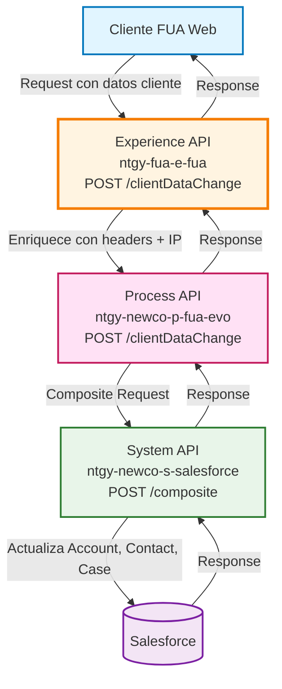
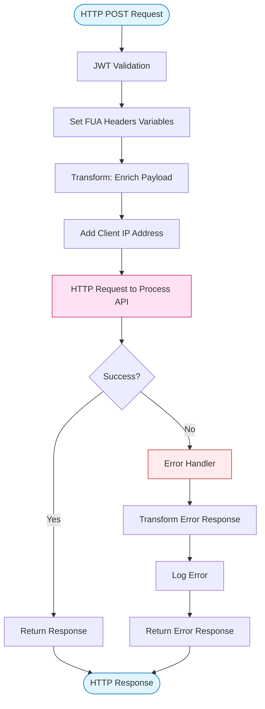
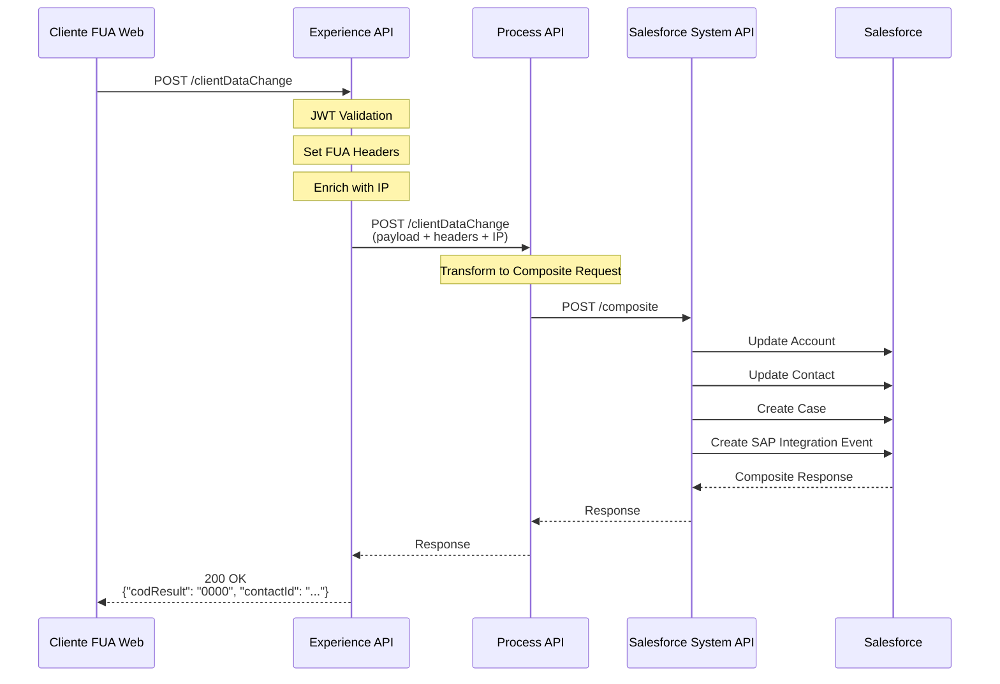
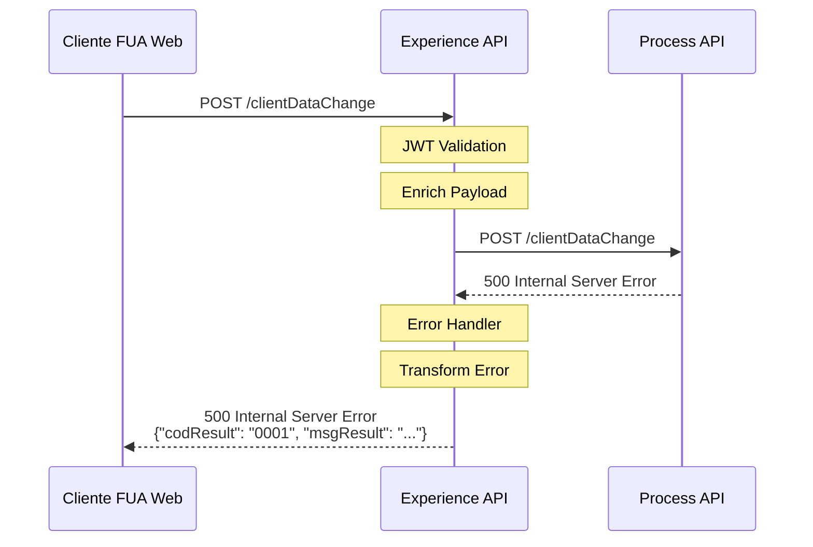
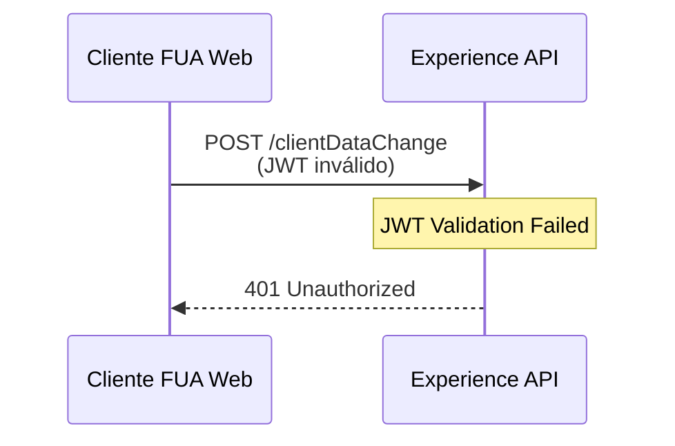

# POST /clientDataChange

## 📌 Descripción General

### Propósito del Endpoint

Este endpoint permite actualizar los datos personales del cliente titular a través del canal FUA (Frontal Único de Atención). Actúa como punto de entrada para modificaciones de información del cliente, enriqueciendo la solicitud con headers específicos del canal y la dirección IP del cliente antes de delegar el procesamiento al Process API correspondiente.

### Tipo de API

**Capa:** Experience API (API-Led Connectivity)

**Función:** Orquestación y enriquecimiento de datos para el canal FUA Web

### Patrón de Integración

**Tipo:** Pass-Through con Enriquecimiento de Headers

**Descripción:** Este Experience API enriquece el payload original con información contextual del canal (headers FUA y dirección IP del cliente) antes de delegar el procesamiento completo al Process API `ntgy-newco-p-fua-evo`. No transforma la estructura de datos, solo añade metadatos necesarios para el procesamiento downstream.

### Arquitectura API-Led Connectivity



---

## 💼 Propósito del Negocio

### Casos de Uso Principales

1. **Actualización de Datos de Contacto**
   - El cliente titular actualiza su teléfono móvil o email desde el portal FUA
   - Permite mantener actualizados los canales de comunicación con el cliente
   - Genera trazabilidad mediante Case de gestión en Salesforce

2. **Modificación de Preferencias de Comunicación**
   - El cliente cambia su canal preferente de contacto (email, teléfono, SMS)
   - Actualiza el horario preferente para ser contactado
   - Mejora la experiencia del cliente al respetar sus preferencias

3. **Actualización de Datos Personales**
   - Modificación de nombre, apellidos o nacionalidad del titular
   - Sincronización de datos entre Account y Contact en Salesforce
   - Dispara evento de integración SAP para sincronización con sistemas backend

### 📱 Canal y Audiencia

#### Canal de Consumo

**Canal:** FUA Web (Frontal Único de Atención)

**Características del Canal:**
- **Plataforma**: Portal web de autoservicio para clientes Naturgy
- **Dispositivos**: Desktop y mobile responsive
- **Conectividad**: Requiere conexión estable para operaciones de actualización
- **Experiencia de Usuario**: Formularios guiados con validación en tiempo real

#### Audiencia Objetivo

**Usuarios Finales:**
- **Clientes Titulares**: Clientes residenciales o empresariales que necesitan actualizar sus datos personales
- **Agentes de Atención al Cliente**: Personal de call center que asiste a clientes en la actualización de datos

**Contexto de Uso:**
- **Autoservicio**: Cliente accede al portal FUA y actualiza sus datos de forma autónoma
- **Asistencia Guiada**: Agente realiza la actualización en nombre del cliente durante una llamada

#### Adaptaciones del Canal

**Optimizaciones Aplicadas:**
- **Enriquecimiento de Headers**: Añade headers FUA (`x-client-id`, `x-contact-id`, `x-user-id`, etc.)
- **Captura de IP**: Extrae y añade la dirección IP del cliente para auditoría
- **Timeout Extendido**: 60 segundos para permitir operaciones complejas en Salesforce
- **Manejo de Errores**: Transformación de errores técnicos en mensajes amigables

### 🔗 Endpoints Dependientes

Este Experience API consume el siguiente Process API:

| Process API | Endpoint | Método | Propósito |
|-------------|----------|--------|-----------|
| `ntgy-newco-p-fua-evo` | `/clientDataChange` | POST | Procesa la modificación de datos del cliente titular en Salesforce, actualizando Account, Contact y creando Case de gestión |

### Contexto Empresarial

- **Dominio:** Gestión de Clientes y Autoservicio
- **Sector:** Energía - Utilities
- **División:** Naturgy España - NewCo
- **Canal:** FUA Web (Frontal Único de Atención)

### Stakeholders

- **Clientes Finales**: Necesitan mantener actualizados sus datos de contacto y preferencias
- **Departamento de Atención al Cliente**: Requiere herramientas para asistir a clientes en actualizaciones
- **Departamento de Marketing**: Necesita datos actualizados para campañas de comunicación
- **Compliance y Auditoría**: Requiere trazabilidad completa de cambios en datos personales

### Valor de Negocio

- **Mejora de la Experiencia del Cliente**: Permite autoservicio 24/7 para actualización de datos
- **Reducción de Costes Operativos**: Disminuye llamadas al call center por cambios de datos
- **Cumplimiento Normativo**: Garantiza trazabilidad de cambios para GDPR y auditorías
- **Calidad de Datos**: Mantiene información actualizada en todos los sistemas (Salesforce, SAP)

---

## 🔧 Especificación Técnica

### URLs por Ambiente

| Ambiente | URL Base | URL Completa |
|----------|----------|--------------|
| **Local** | `http://localhost:8081` | `http://localhost:8081/fua/api/clientDataChange` |
| **Development** | `https://ntgy-fua-e-fua-dev.de-c1.cloudhub.io` | `https://ntgy-fua-e-fua-dev.de-c1.cloudhub.io/fua/api/clientDataChange` |
| **Production** | `https://ntgy-fua-e-fua-pro.de-c1.cloudhub.io` | `https://ntgy-fua-e-fua-pro.de-c1.cloudhub.io/fua/api/clientDataChange` |

### Método HTTP

```
POST /fua/api/clientDataChange
```

### 🎯 Consideraciones del Canal

#### Limitaciones del Canal

| Aspecto | Limitación | Razón |
|---------|------------|-------|
| **Timeout** | 60 segundos | Permite operaciones complejas en Salesforce (Composite Request con múltiples objetos) |
| **Rate Limiting** | Según políticas de API Gateway | Protección contra abuso y garantía de disponibilidad |
| **Autenticación** | JWT obligatorio | Seguridad y trazabilidad de operaciones |

#### Campos Específicos del Canal

**Campos Añadidos por el Experience API:**

| Campo | Tipo | Descripción | Razón |
|-------|------|-------------|-------|
| `DirIp` | String | Dirección IP del cliente | Auditoría y cumplimiento normativo (GDPR) |
| `x-interaction-id` | String (Header) | ID de interacción del canal | Trazabilidad de la sesión del usuario |
| `x-client-id` | String (Header) | ID del cliente en Salesforce | Identificación del Account |
| `x-contact-id` | String (Header) | ID del contacto en Salesforce | Identificación del Contact |
| `x-user-id` | String (Header) | ID del usuario/agente | Diferenciación entre autoservicio y asistido |
| `x-agent-mail` | String (Header) | Email del agente | Trazabilidad de operaciones asistidas |

### Parámetros de Entrada

#### Headers Obligatorios

| Header | Tipo | Descripción | Ejemplo |
|--------|------|-------------|---------|
| `Content-Type` | String | Tipo de contenido | `application/json` |
| `x-client-id` | String | ID del cliente (Account) en Salesforce | `0015I00000XxXxXXXX` |
| `x-contact-id` | String | ID del contacto en Salesforce | `0035I00000YyYyYYYY` |

#### Headers Opcionales

| Header | Tipo | Descripción | Ejemplo |
|--------|------|-------------|---------|
| `x-user-id` | String | ID del usuario/agente (si es asistido) | `0055I00000ZzZzZZZZ` |
| `x-agent-mail` | String | Email del agente (si es asistido) | `agente@naturgy.com` |
| `x-interaction-id` | String | ID de la interacción/sesión | `INT-2024-001234` |
| `x-interaction-origin` | String | Origen de la interacción | `FUA_WEB` |
| `x-origin` | String | Sistema origen | `FUA` |
| `x-user-role` | String | Rol del usuario | `customer`, `agent` |
| `traceparent` | String | Trace ID para distributed tracing | `00-abc123...` |
| `x-language` | String | Idioma preferido | `es`, `ca`, `en` |

#### Body (application/json)

```json
{
  "client": {
    "name": "Juan",
    "surname": "García",
    "surname2": "López",
    "phone": "666777888",
    "email": "juan.garcia@example.com",
    "preferredEmail": "juan.garcia@example.com",
    "nationalityId": "ES",
    "channel": "email",
    "scheduleId": "morning",
    "contactId": "0035I00000YyYyYYYY",
    "isIndividualClient": true
  }
}
```

**Campos del Body:**

| Campo | Tipo | Obligatorio | Descripción |
|-------|------|-------------|-------------|
| `client.name` | String | Sí | Nombre del cliente |
| `client.surname` | String | Sí | Primer apellido |
| `client.surname2` | String | No | Segundo apellido |
| `client.phone` | String | Sí | Teléfono de contacto |
| `client.email` | String | Sí | Email de contacto principal |
| `client.preferredEmail` | String | No | Email preferido del contacto (usado en procesos de registro y validación) |
| `client.nationalityId` | String | No | Código de nacionalidad (ISO) |
| `client.channel` | String | No | Canal preferente de comunicación |
| `client.scheduleId` | String | No | Horario preferente de contacto |
| `client.contactId` | String | Sí | ID del contacto en Salesforce |
| `client.isIndividualClient` | Boolean | Sí | Indica si es cliente individual o empresa |

### Respuestas

#### 200 OK - Actualización Exitosa

```json
{
  "result": {
    "codResult": "0000",
    "msgResult": "Ejecución correcta"
  },
  "contactId": "0035I00000YyYyYYYY"
}
```

**Campos de Respuesta:**

| Campo | Tipo | Descripción |
|-------|------|-------------|
| `result.codResult` | String | Código de resultado (`0000` = éxito) |
| `result.msgResult` | String | Mensaje descriptivo del resultado |
| `contactId` | String | ID del contacto actualizado en Salesforce |

#### 500 Internal Server Error

```json
{
  "result": {
    "codResult": "0001",
    "msgResult": "Error al procesar la solicitud"
  }
}
```

**Campos de Error:**

| Campo | Tipo | Descripción |
|-------|------|-------------|
| `result.codResult` | String | Código de error (`0001` = error genérico) |
| `result.msgResult` | String | Descripción del error |

### Autenticación

- **Tipo:** JWT (JSON Web Token)
- **Validación:** Flow `jwt-validation` ejecutado antes del procesamiento
- **Headers:** Token incluido en headers de autenticación

### Timeouts

| Tipo | Valor | Razón |
|------|-------|-------|
| **Request Timeout** | 60 segundos | Permite operaciones complejas en Salesforce (Composite Request) |
| **Connection Idle Timeout** | 60 segundos | Mantiene conexión estable con Process API |

---

## 🏗️ Implementación Técnica

### Arquitectura del Flow



### Transformaciones de Canal

**Enriquecimiento del Payload:**

El Experience API NO transforma la estructura de datos del cliente, pero SÍ enriquece el payload con información contextual:

```dataweave
%dw 2.2
import * from dw::core::Strings
output application/json
---
payload
++
vars.fuaHeaders 
++ 
{
    "DirIp": substringBefore(substringAfter(attributes.remoteAddress,"/"),":")
}
```

**Campos Añadidos:**

| Campo Original | Campo Añadido | Transformación |
|----------------|---------------|----------------|
| N/A | `x-interaction-id` | Extraído de headers y añadido al payload |
| N/A | `x-client-id` | Extraído de headers y añadido al payload |
| N/A | `x-contact-id` | Extraído de headers y añadido al payload |
| N/A | `x-user-id` | Extraído de headers y añadido al payload (si existe) |
| N/A | `x-agent-mail` | Extraído de headers y añadido al payload (si existe) |
| N/A | `DirIp` | Extraído de `attributes.remoteAddress` |

**Variables FUA Headers (vars.fuaHeaders):**

Configuradas en el flow principal `e-fua-main` (líneas 15-37 de `e-fua.xml`):

```dataweave
{
  ("x-interaction-id": attributes.headers['x-interaction-id']) if (attributes.headers['x-interaction-id'] != "null" and !isEmpty(attributes.headers['x-interaction-id'])),
  ("x-interaction-origin": attributes.headers['x-interaction-origin']) if (attributes.headers['x-interaction-origin'] != "null" and !isEmpty(attributes.headers['x-interaction-origin'])),
  ("x-user-id": attributes.headers['x-user-id']) if (attributes.headers['x-user-id'] != "null" and !isEmpty(attributes.headers['x-user-id'])),
  ("x-client-id": attributes.headers['x-client-id']) if (attributes.headers['x-client-id'] != "null" and !isEmpty(attributes.headers['x-client-id'])),
  ("x-contact-id": attributes.headers['x-contact-id']) if (attributes.headers['x-contact-id'] != "null" and !isEmpty(attributes.headers['x-contact-id'])),
  ("x-agent-mail": attributes.headers['x-agent-mail']) if (attributes.headers['x-agent-mail'] != "null" and !isEmpty(attributes.headers['x-agent-mail']))
}
```

### Patrones de Diseño

**Patrón:** Pass-Through con Enriquecimiento de Contexto

**Justificación:** 
- El Experience API no necesita transformar la estructura de datos del cliente
- Su responsabilidad es añadir contexto del canal (headers FUA, IP) necesario para:
  - Auditoría y trazabilidad (GDPR)
  - Identificación de la sesión del usuario
  - Diferenciación entre autoservicio y asistido por agente
- Delega toda la lógica de negocio al Process API

### Diagramas de Secuencia

#### 1. Flujo Normal de Éxito



#### 2. Flujo con Error en Process API



#### 3. Flujo con Error de Validación JWT



### Delegación al Process API

⚠️ **Este Experience API NO implementa la lógica de negocio.**

**Responsabilidades del Process API (`ntgy-newco-p-fua-evo`):**

1. **Transformación a Composite Request de Salesforce**
   - Construye request para actualizar Account
   - Construye request para actualizar Contact
   - Construye request para crear Case de gestión
   - Construye request para crear evento de integración SAP

2. **Lógica Condicional**
   - Diferencia entre cliente individual y empresa (`isIndividualClient`)
   - Aplica transformaciones específicas según tipo de cliente
   - Maneja campos opcionales (canal, horario, nacionalidad)

3. **Integración con Salesforce**
   - Ejecuta Composite Request en Salesforce
   - Maneja respuestas y errores de Salesforce
   - Retorna resultado consolidado

**Para detalles completos de la implementación, consultar:**
📖 **Process API: `ntgy-newco-p-fua-evo` endpoint `POST /clientDataChange`**
📖 **System API: `ntgy-newco-s-salesforce` endpoint `POST /composite`**

### Manejo de Errores

**Error Handler del Experience API:**

```dataweave
%dw 2.0
output application/json
---
{
  "result": {
    "codResult": "0001",
    "msgResult": error.description as String replace /"/ with("")
  }
}
```

**Estrategia:**
- Captura cualquier error del Process API
- Transforma el error técnico en formato estándar
- Registra el error en logs con nivel ERROR
- Retorna código `0001` para errores genéricos

**Códigos de Error:**

| Código | Descripción | Origen |
|--------|-------------|--------|
| `0000` | Ejecución correcta | Process API |
| `0001` | Error genérico | Experience API (error handler) |

---

## 💻 Ejemplos de Uso

### Ejemplo 1: Actualización Exitosa desde Portal FUA

#### cURL

```bash
curl -X POST "https://ntgy-fua-e-fua-pro.de-c1.cloudhub.io/fua/api/clientDataChange" \
  -H "Content-Type: application/json" \
  -H "Authorization: Bearer YOUR_JWT_TOKEN" \
  -H "x-client-id: 0015I00000XxXxXXXX" \
  -H "x-contact-id: 0035I00000YyYyYYYY" \
  -H "x-interaction-id: INT-2024-001234" \
  -H "x-origin: FUA" \
  -d '{
    "client": {
      "name": "Juan",
      "surname": "García",
      "surname2": "López",
      "phone": "666777888",
      "email": "juan.garcia@example.com",
      "preferredEmail": "juan.garcia@example.com",
      "nationalityId": "ES",
      "channel": "email",
      "scheduleId": "morning",
      "contactId": "0035I00000YyYyYYYY",
      "isIndividualClient": true
    }
  }'
```

#### Respuesta (200 OK)

```json
{
  "result": {
    "codResult": "0000",
    "msgResult": "Ejecución correcta"
  },
  "contactId": "0035I00000YyYyYYYY"
}
```

### Ejemplo 2: Actualización Asistida por Agente

#### cURL

```bash
curl -X POST "https://ntgy-fua-e-fua-pro.de-c1.cloudhub.io/fua/api/clientDataChange" \
  -H "Content-Type: application/json" \
  -H "Authorization: Bearer YOUR_JWT_TOKEN" \
  -H "x-client-id: 0015I00000XxXxXXXX" \
  -H "x-contact-id: 0035I00000YyYyYYYY" \
  -H "x-user-id: 0055I00000ZzZzZZZZ" \
  -H "x-agent-mail: agente@naturgy.com" \
  -H "x-interaction-id: INT-2024-001235" \
  -H "x-user-role: agent" \
  -d '{
    "client": {
      "name": "María",
      "surname": "Rodríguez",
      "surname2": "Martínez",
      "phone": "677888999",
      "email": "maria.rodriguez@example.com",
      "preferredEmail": "maria.rodriguez@example.com",
      "nationalityId": "ES",
      "channel": "phone",
      "scheduleId": "afternoon",
      "contactId": "0035I00000YyYyYYYY",
      "isIndividualClient": true
    }
  }'
```

#### Respuesta (200 OK)

```json
{
  "result": {
    "codResult": "0000",
    "msgResult": "Ejecución correcta"
  },
  "contactId": "0035I00000YyYyYYYY"
}
```

### Ejemplo 3: Error de Procesamiento

#### cURL

```bash
curl -X POST "https://ntgy-fua-e-fua-pro.de-c1.cloudhub.io/fua/api/clientDataChange" \
  -H "Content-Type: application/json" \
  -H "Authorization: Bearer YOUR_JWT_TOKEN" \
  -H "x-client-id: INVALID_ID" \
  -H "x-contact-id: INVALID_CONTACT" \
  -d '{
    "client": {
      "name": "Test",
      "surname": "Error",
      "phone": "000000000",
      "email": "test@error.com",
      "contactId": "INVALID_CONTACT",
      "isIndividualClient": true
    }
  }'
```

#### Respuesta (500 Internal Server Error)

```json
{
  "result": {
    "codResult": "0001",
    "msgResult": "Internal server error"
  }
}
```

### Ejemplo 4: JavaScript (Frontend FUA)

```javascript
async function updateClientData(clientData) {
  try {
    const response = await fetch('https://ntgy-fua-e-fua-pro.de-c1.cloudhub.io/fua/api/clientDataChange', {
      method: 'POST',
      headers: {
        'Content-Type': 'application/json',
        'Authorization': `Bearer ${getJWTToken()}`,
        'x-client-id': clientData.clientId,
        'x-contact-id': clientData.contactId,
        'x-interaction-id': getInteractionId(),
        'x-origin': 'FUA'
      },
      body: JSON.stringify({
        client: {
          name: clientData.name,
          surname: clientData.surname,
          surname2: clientData.surname2,
          phone: clientData.phone,
          email: clientData.email,
          preferredEmail: clientData.preferredEmail,
          nationalityId: clientData.nationalityId,
          channel: clientData.preferredChannel,
          scheduleId: clientData.preferredSchedule,
          contactId: clientData.contactId,
          isIndividualClient: clientData.isIndividual
        }
      })
    });

    const data = await response.json();
    
    if (data.result.codResult === '0000') {
      console.log('Datos actualizados correctamente');
      return { success: true, contactId: data.contactId };
    } else {
      console.error('Error al actualizar datos:', data.result.msgResult);
      return { success: false, error: data.result.msgResult };
    }
  } catch (error) {
    console.error('Error de red:', error);
    return { success: false, error: 'Error de conexión' };
  }
}

// Uso
const result = await updateClientData({
  clientId: '0015I00000XxXxXXXX',
  contactId: '0035I00000YyYyYYYY',
  name: 'Juan',
  surname: 'García',
  surname2: 'López',
  phone: '666777888',
  email: 'juan.garcia@example.com',
  preferredEmail: 'juan.garcia@example.com',
  nationalityId: 'ES',
  preferredChannel: 'email',
  preferredSchedule: 'morning',
  isIndividual: true
});
