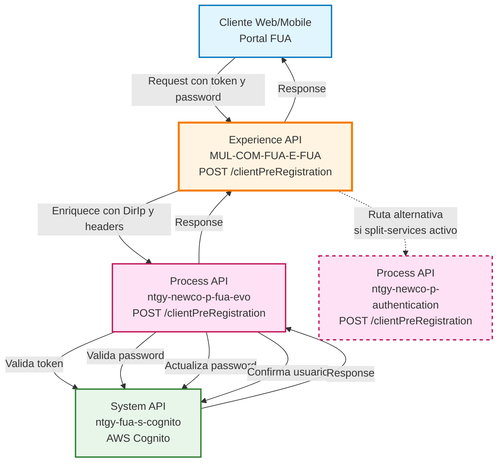
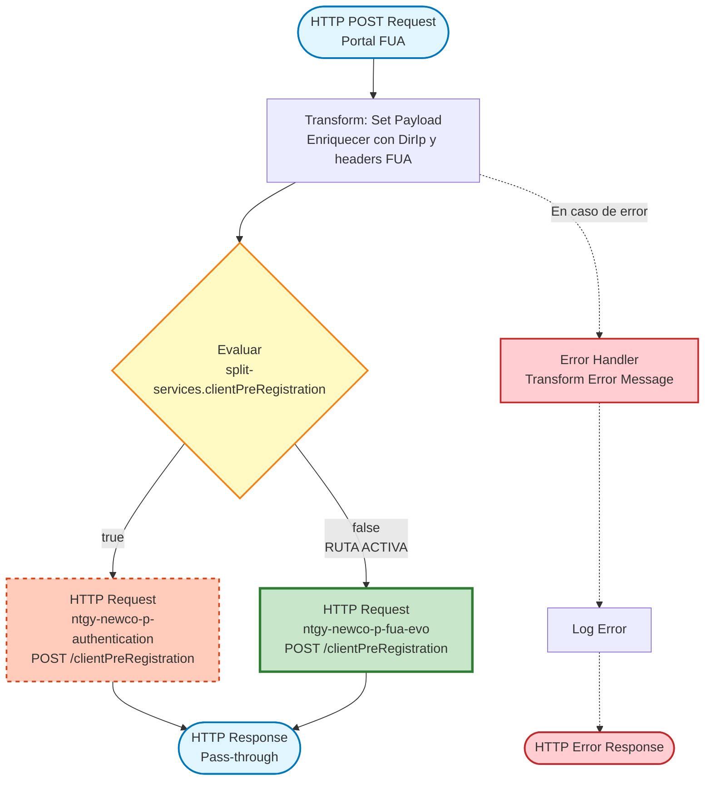
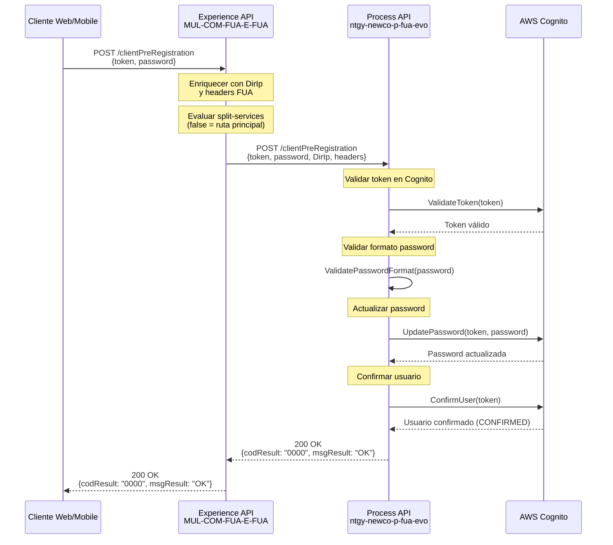
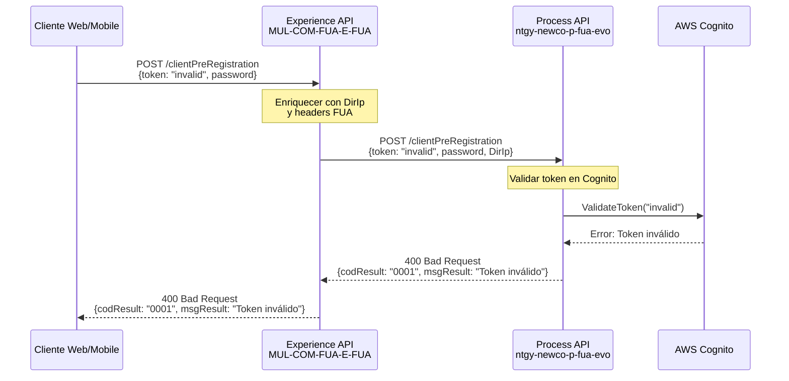
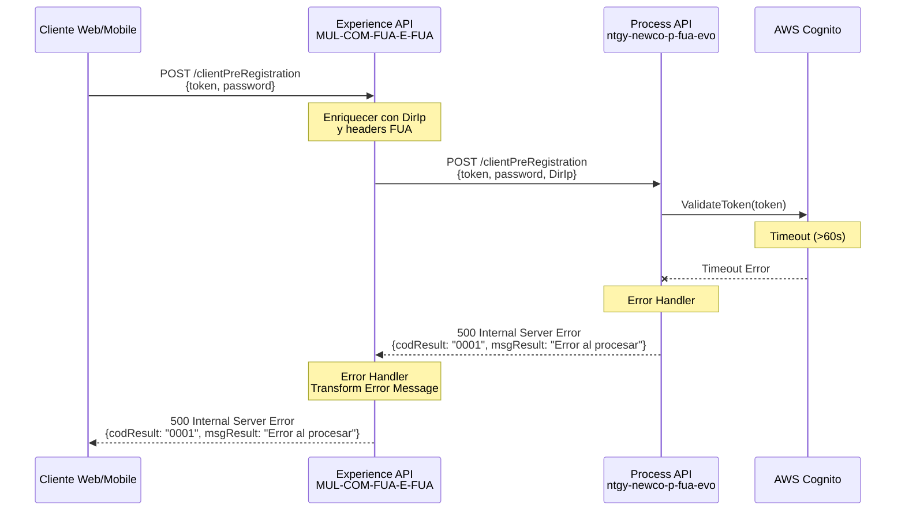

# POST /clientPreRegistration

## 📌 Descripción General

### Propósito del Endpoint

Este endpoint completa el proceso de pre-registro de un cliente en el portal FUA (Frontal Único de Atención) de Naturgy. Valida el token de pre-registro recibido por email, verifica que la contraseña cumpla con los requisitos de seguridad, actualiza la contraseña del usuario en AWS Cognito y confirma la cuenta cambiando su estado a `CONFIRMED`.

Es el segundo paso del flujo de registro de clientes, después de que el usuario haya recibido el email de pre-registro con el token de confirmación.

### Tipo de API

**Capa:** Experience API (API-Led Connectivity)

**Función:** Orquestación de experiencia de usuario para canales web y móvil en el proceso de registro de clientes

### Patrón de Integración

**Tipo:** Pass-Through con Enriquecimiento de Contexto

**Descripción:** El Experience API enriquece el request con información contextual del cliente (dirección IP y headers FUA) y enruta la petición al Process API correspondiente. La respuesta del Process API se retorna sin transformaciones adicionales.

### Arquitectura API-Led Connectivity



---

## 💼 Propósito del Negocio

### Casos de Uso Principales

1. **Confirmación de Registro de Cliente**
   - El cliente recibe un email con un token de pre-registro
   - Accede al portal FUA e introduce el token y su nueva contraseña
   - El sistema valida el token, actualiza la contraseña y confirma la cuenta
   - El cliente puede iniciar sesión inmediatamente después

2. **Validación de Seguridad de Contraseña**
   - Verifica que la contraseña cumpla con los requisitos de complejidad de Cognito
   - Previene el uso de contraseñas débiles
   - Garantiza el cumplimiento de políticas de seguridad

3. **Activación de Cuenta en Cognito**
   - Cambia el estado del usuario de `UNCONFIRMED` a `CONFIRMED`
   - Habilita el acceso completo a los servicios del portal FUA
   - Completa el ciclo de registro del cliente

### 📱 Canal y Audiencia

#### Canal de Consumo

**Canal:** Web y Mobile

**Características del Canal:**
- **Plataforma**: Portal web FUA y aplicación móvil de Naturgy
- **Dispositivos**: Navegadores web (desktop/mobile) y apps nativas iOS/Android
- **Conectividad**: Requiere conexión a internet estable para comunicación con Cognito
- **Experiencia de Usuario**: Formulario simple con dos campos (token y contraseña)

#### Audiencia Objetivo

**Usuarios Finales:**
- **Clientes Nuevos de Naturgy**: Personas que han solicitado el alta como clientes y están completando su registro
- **Clientes Existentes Migrando a Portal Digital**: Clientes que están activando su acceso al portal de autoservicio

**Contexto de Uso:**
- **Registro Inicial**: Cliente nuevo completando su primer acceso al portal
- **Activación de Cuenta**: Cliente existente activando su cuenta digital por primera vez
- **Recuperación de Acceso**: En algunos casos, reactivación de cuentas suspendidas

#### Adaptaciones del Canal

**Optimizaciones Aplicadas:**
- **Enriquecimiento de Contexto**: Se añade automáticamente la dirección IP del cliente (`DirIp`) para auditoría y seguridad
- **Headers FUA**: Se propagan headers de contexto del portal (interaction-id, user-id, origin, etc.)
- **Timeout Extendido**: 60 segundos para permitir las múltiples validaciones en Cognito
- **Manejo de Errores**: Respuestas de error estandarizadas para mostrar mensajes claros al usuario

### 🔗 Endpoints Dependientes

Este Experience API consume los siguientes Process APIs (enrutamiento condicional):

| Process API | Endpoint | Método | Propósito | Estado |
|-------------|----------|--------|-----------|--------|
| `ntgy-newco-p-fua-evo` | `/clientPreRegistration` | POST | Proceso completo de pre-registro: validación de token, validación de contraseña, actualización de contraseña y cambio de estado a CONFIRMED en Cognito | ✅ Activo (ruta principal) |
| `ntgy-newco-p-authentication` | `/clientPreRegistration` | POST | Proceso completo de pre-registro: validación de token, validación de contraseña, actualización de contraseña y cambio de estado a CONFIRMED en Cognito | ⚙️ Alternativo (configurable) |

**Nota sobre Enrutamiento:** El Experience API implementa un patrón de enrutamiento condicional basado en la propiedad `split-services.clientPreRegistration`. Actualmente configurado en `false`, por lo que se usa la ruta principal (`ntgy-newco-p-fua-evo`).

### Contexto Empresarial

- **Dominio:** Gestión de Identidad y Acceso de Clientes
- **Sector:** Energía - Utilities
- **División:** Naturgy España - NewCo
- **Canal:** Web y Mobile (Portal FUA)

### Stakeholders

- **Clientes de Naturgy**: Necesitan completar su registro para acceder a servicios de autoservicio
- **Equipo de Atención al Cliente**: Requieren que el proceso de registro sea simple y sin fricciones
- **Equipo de Seguridad**: Necesitan garantizar que las contraseñas cumplan con políticas de seguridad
- **Equipo de Desarrollo**: Requieren visibilidad del proceso para troubleshooting

### Valor de Negocio

- **Reducción de Fricción en Registro**: Proceso simple de dos pasos (email + confirmación) mejora la tasa de conversión
- **Seguridad Mejorada**: Validación de contraseñas y tokens garantiza cuentas seguras
- **Autoservicio Habilitado**: Clientes confirmados pueden acceder inmediatamente a servicios digitales
- **Reducción de Carga en Call Center**: Proceso automatizado reduce llamadas de soporte para activación de cuentas

---

## 🔧 Especificación Técnica

### URLs por Ambiente

| Ambiente | URL Base | URL Completa |
|----------|----------|--------------|
| **Local** | `http://localhost:8081` | `http://localhost:8081/fua/api/clientPreRegistration` |
| **Development** | `https://mul-com-fua-e-fua-dev.us-e2.cloudhub.io` | `https://mul-com-fua-e-fua-dev.us-e2.cloudhub.io/fua/api/clientPreRegistration` |
| **UAT** | `https://mul-com-fua-e-fua-uat.us-e2.cloudhub.io` | `https://mul-com-fua-e-fua-uat.us-e2.cloudhub.io/fua/api/clientPreRegistration` |
| **Production** | `https://mul-com-fua-e-fua-pro.us-e2.cloudhub.io` | `https://mul-com-fua-e-fua-pro.us-e2.cloudhub.io/fua/api/clientPreRegistration` |

### Método HTTP

```
POST /fua/api/clientPreRegistration
```

### 🎯 Consideraciones del Canal

#### Limitaciones del Canal

| Aspecto | Limitación | Razón |
|---------|------------|-------|
| **Timeout** | 60 segundos | Permite múltiples validaciones en Cognito (token, password, update, confirm) |
| **Rate Limiting** | Estándar del API Gateway | Previene ataques de fuerza bruta en validación de tokens |
| **Tamaño de Request** | < 1 KB | Solo contiene token y password (campos pequeños) |
| **Reintentos** | No recomendado | Operación idempotente pero puede causar errores si el usuario ya está confirmado |

#### Campos Específicos del Canal

**Campos Añadidos por el Experience API:**

| Campo | Tipo | Descripción | Razón |
|-------|------|-------------|-------|
| `DirIp` | string | Dirección IP del cliente | Auditoría y seguridad - permite rastrear origen de la petición |
| `x-interaction-id` | string (header) | ID único de la interacción | Trazabilidad end-to-end de la petición |
| `x-interaction-origin` | string (header) | Origen de la interacción (web/mobile) | Identificar canal de acceso |
| `x-user-id` | string (header) | ID del usuario (si disponible) | Contexto de usuario |
| `x-origin` | string (header) | Origen de la petición | Identificar fuente de la llamada |

**Campos del Request Original (del cliente):**

| Campo | Tipo | Descripción |
|-------|------|-------------|
| `token` | string | Token de pre-registro recibido por email |
| `password` | string | Nueva contraseña del usuario |

### Parámetros de Entrada

#### Headers

| Header | Tipo | Requerido | Descripción |
|--------|------|-----------|-------------|
| `Content-Type` | string | ✅ Sí | Debe ser `application/json` |
| `x-interaction-id` | string | ⚠️ Recomendado | ID único para trazabilidad de la petición |
| `x-interaction-origin` | string | ⚠️ Recomendado | Origen de la interacción (ej: "web", "mobile") |
| `x-origin` | string | ⚠️ Recomendado | Origen específico de la petición |

#### Body (JSON)

```json
{
  "token": "string",
  "password": "string"
}
```

| Campo | Tipo | Requerido | Descripción | Validaciones |
|-------|------|-----------|-------------|--------------|
| `token` | string | ✅ Sí | Token de pre-registro recibido por email | Debe ser un token válido generado por Cognito |
| `password` | string | ✅ Sí | Nueva contraseña del usuario | Debe cumplir con política de Cognito: mínimo 8 caracteres, mayúsculas, minúsculas, números y caracteres especiales |

### Respuestas

#### 200 OK - Pre-registro Completado Exitosamente

```json
{
  "result": {
    "codResult": "0000",
    "msgResult": "OK"
  }
}
```

| Campo | Tipo | Descripción |
|-------|------|-------------|
| `result` | object | Objeto con el resultado de la operación |
| `result.codResult` | string | Código de resultado ("0000" = éxito) |
| `result.msgResult` | string | Mensaje descriptivo del resultado |

#### 400 Bad Request - Error de Validación

```json
{
  "result": {
    "codResult": "0001",
    "msgResult": "Token inválido o expirado"
  }
}
```

**Posibles Errores de Validación:**
- Token inválido o expirado
- Contraseña no cumple con requisitos de seguridad
- Usuario ya confirmado
- Token ya utilizado

#### 500 Internal Server Error - Error del Sistema

```json
{
  "result": {
    "codResult": "0001",
    "msgResult": "Error al procesar la solicitud"
  }
}
```

### Autenticación

- **Tipo:** No requiere autenticación previa (es parte del proceso de registro)
- **Nota:** El token de pre-registro actúa como mecanismo de autenticación temporal

### Timeouts

| Tipo | Valor | Razón |
|------|-------|-------|
| **Request Timeout** | 60 segundos | Permite completar las 4 operaciones en Cognito: validar token, validar password, actualizar password, confirmar usuario |
| **Connection Idle Timeout** | 60 segundos | Mantiene conexión abierta durante proceso completo |

---

## 🏗️ Implementación Técnica

### Arquitectura del Flow



### Transformaciones de Canal

#### Enriquecimiento del Request

El Experience API enriquece el request original con información contextual:

**Transformación DataWeave:**

```dataweave
%dw 2.0
import * from dw::core::Strings
output application/json
---
payload
++
vars.fuaHeaders  
++
{
    "DirIp": substringBefore(substringAfter(attributes.remoteAddress,"/"),":")
}
```

**Campos Añadidos:**

| Campo Original | Campo Enriquecido | Transformación |
|----------------|-------------------|----------------|
| `payload` (token, password) | `payload` | Sin cambios - pass-through |
| N/A | `DirIp` | Extraído de `attributes.remoteAddress` |
| `attributes.headers` | `vars.fuaHeaders.*` | Headers FUA propagados (x-interaction-id, x-user-id, etc.) |

#### Pass-Through de Response

⚠️ **Este Experience API NO transforma la respuesta del Process API.**

La respuesta del Process API se retorna tal cual al cliente. Para el schema completo de la respuesta, consultar:

📖 **Process API: `ntgy-newco-p-fua-evo` endpoint `/clientPreRegistration`**

### Enrutamiento Condicional

El Experience API implementa un patrón de **enrutamiento condicional** para permitir flexibilidad en el despliegue:

**Configuración Actual (Producción):**
```yaml
split-services:
  clientPreRegistration: "false"
```

**Lógica de Enrutamiento:**

```xml
<choice>
  <when expression="#[(Mule::p('split-services.clientPreRegistration') as Boolean default false)]">
    <!-- Ruta alternativa: ntgy-newco-p-authentication -->
    <http:request config-ref="HTTP_Request_newco-p-authentication" 
                  path="/clientPreRegistration" />
  </when>
  <otherwise>
    <!-- Ruta principal ACTIVA: ntgy-newco-p-fua-evo -->
    <http:request config-ref="HTTP_FUA_PROCESS_NEWCO_EVO" 
                  path="/clientPreRegistration" />
  </otherwise>
</choice>
```

**Configuraciones HTTP:**

| Config | Host | Port | Timeout | Estado |
|--------|------|------|---------|--------|
| `HTTP_FUA_PROCESS_NEWCO_EVO` | `mule-worker-internal-ntgy-newco-p-fua-evo.de-c1.cloudhub.io` | 8091 | 60s | ✅ Activo |
| `HTTP_Request_newco-p-authentication` | `ntgy-newco-p-authentication-vx8fhl.internal-6bnlu3.irl-e1.cloudhub.io` | 443 | 600s | ⚙️ Alternativo |

### Patrones de Diseño

**Patrón:** API Gateway con Enrutamiento Condicional

**Justificación:** 
- Permite migración gradual entre implementaciones de Process API
- Facilita A/B testing y despliegues blue-green
- Mantiene compatibilidad con clientes sin cambios en el contrato
- Centraliza lógica de enrutamiento en la capa de Experience

### Diagramas de Secuencia

#### 1. Flujo Normal de Éxito



#### 2. Flujo con Error de Negocio (Token Inválido)



#### 3. Flujo con Error Técnico (Timeout Cognito)



### Manejo de Errores

#### Error Handler del Experience API

```dataweave
%dw 2.0
output application/json
---
if ( !isEmpty(error.errorMessage.payload) ) 
  error.errorMessage.payload
else 
{
  "result": {
    "codResult": "0001",
    "msgResult": error.description as String replace /"/ with("")
  }
}
```

**Estrategia:**
1. Si el Process API retorna un error estructurado, se propaga tal cual
2. Si es un error técnico sin payload, se construye respuesta estándar
3. Se registra el error en logs para troubleshooting
4. Se retorna HTTP 500 con mensaje descriptivo

#### Códigos de Error Comunes

| Código | Mensaje | Causa | Acción Recomendada |
|--------|---------|-------|-------------------|
| `0000` | OK | Operación exitosa | N/A |
| `0001` | Token inválido o expirado | Token no válido en Cognito | Solicitar nuevo token de pre-registro |
| `0001` | Contraseña no cumple requisitos | Password débil | Usar contraseña más fuerte (8+ chars, mayúsculas, números, especiales) |
| `0001` | Usuario ya confirmado | Cuenta ya activada previamente | Intentar login directo |
| `0001` | Error al procesar la solicitud | Error técnico en Cognito o Process API | Reintentar o contactar soporte |

---

## 💻 Ejemplos de Uso

### Ejemplo 1: Pre-registro Exitoso desde Portal Web

#### cURL

```bash
curl -X POST "https://mul-com-fua-e-fua-pro.us-e2.cloudhub.io/fua/api/clientPreRegistration" \
  -H "Content-Type: application/json" \
  -H "x-interaction-id: 12345-67890-abcde" \
  -H "x-interaction-origin: web" \
  -H "x-origin: portal-fua" \
  -d '{
    "token": "eyJhbGciOiJIUzI1NiIsInR5cCI6IkpXVCJ9...",
    "password": "MySecureP@ssw0rd!"
  }'
```

#### Respuesta (200 OK)

```json
{
  "result": {
    "codResult": "0000",
    "msgResult": "OK"
  }
}
```

**Interpretación:** El pre-registro se completó exitosamente. El usuario puede ahora iniciar sesión con su email y la contraseña establecida.

---

### Ejemplo 2: Error - Token Inválido

#### cURL

```bash
curl -X POST "https://mul-com-fua-e-fua-pro.us-e2.cloudhub.io/fua/api/clientPreRegistration" \
  -H "Content-Type: application/json" \
  -H "x-interaction-id: 12345-67890-abcde" \
  -d '{
    "token": "token_invalido_o_expirado",
    "password": "MySecureP@ssw0rd!"
  }'
```

#### Respuesta (400 Bad Request)

```json
{
  "result": {
    "codResult": "0001",
    "msgResult": "Token inválido o expirado"
  }
}
```

**Interpretación:** El token proporcionado no es válido o ha expirado. El usuario debe solicitar un nuevo email de pre-registro.

---

### Ejemplo 3: Error - Contraseña Débil

#### cURL

```bash
curl -X POST "https://mul-com-fua-e-fua-pro.us-e2.cloudhub.io/fua/api/clientPreRegistration" \
  -H "Content-Type: application/json" \
  -d '{
    "token": "eyJhbGciOiJIUzI1NiIsInR5cCI6IkpXVCJ9...",
    "password": "123456"
  }'
```

#### Respuesta (400 Bad Request)

```json
{
  "result": {
    "codResult": "0001",
    "msgResult": "La contraseña no cumple con los requisitos de seguridad"
  }
}
```

**Interpretación:** La contraseña no cumple con la política de Cognito. Debe tener al menos 8 caracteres, incluir mayúsculas, minúsculas, números y caracteres especiales.

---

### Ejemplo 4: JavaScript (React/Vue) para Portal Web

```javascript
async function completarPreRegistro(token, password) {
  try {
    const response = await fetch(
      'https://mul-com-fua-e-fua-pro.us-e2.cloudhub.io/fua/api/clientPreRegistration',
      {
        method: 'POST',
        headers: {
          'Content-Type': 'application/json',
          'x-interaction-id': generateInteractionId(),
          'x-interaction-origin': 'web',
          'x-origin': 'portal-fua'
        },
        body: JSON.stringify({
          token: token,
          password: password
        })
      }
    );

    const data = await response.json();

    if (response.ok && data.result.codResult === '0000') {
      console.log('Pre-registro completado exitosamente');
      // Redirigir al usuario a la página de login
      window.location.href = '/login?registered=true';
    } else {
      console.error('Error en pre-registro:', data.result.msgResult);
      // Mostrar mensaje de error al usuario
      showErrorMessage(data.result.msgResult);
    }
  } catch (error) {
    console.error('Error de red:', error);
    showErrorMessage('Error de conexión. Por favor, inténtelo de nuevo.');
  }
}

function generateInteractionId() {
  return `${Date.now()}-${Math.random().toString(36).substr(2, 9)}`;
}
```

---

### Ejemplo 5: Python para Testing/Automatización

```python
import requests
import json

def completar_pre_registro(token, password):
    """
    Completa el proceso de pre-registro de un cliente.
    
    Args:
        token (str): Token de pre-registro recibido por email
        password (str): Nueva contraseña del usuario
        
    Returns:
        dict: Respuesta del API con el resultado de la operación
    """
    url = 'https://mul-com-fua-e-fua-pro.us-e2.cloudhub.io/fua/api/clientPreRegistration'
    
    headers = {
        'Content-Type': 'application/json',
        'x-interaction-id': f'{int(time.time())}-test',
        'x-interaction-origin': 'automation',
        'x-origin': 'testing-suite'
    }
    
    payload = {
        'token': token,
        'password': password
    }
    
    try:
        response = requests.post(url, headers=headers, json=payload, timeout=60)
        response.raise_for_status()
        
        result = response.json()
        
        if result['result']['codResult'] == '0000':
            print(f"✅ Pre-registro completado exitosamente")
            return result
        else:
            print(f"❌ Error: {result['result']['msgResult']}")
            return result
            
    except requests.exceptions.Timeout:
        print("❌ Timeout: La operación tardó más de 60 segundos")
        return None
    except requests.exceptions.RequestException as e:
        print(f"❌ Error de red: {str(e)}")
        return None

# Ejemplo de uso
if __name__ == "__main__":
    import time
    
    # Token de ejemplo (en producción vendría del email)
    token = "eyJhbGciOiJIUzI1NiIsInR5cCI6IkpXVCJ9..."
    password = "MySecureP@ssw0rd!"
    
    resultado = completar_pre_registro(token, password)
    
    if resultado:
        print(f"Código de resultado: {resultado['result']['codResult']}")
        print(f"Mensaje: {resultado['result']['msgResult']}")
```

---

### Ejemplo 6: Postman Collection (JSON)

```json
{
  "info": {
    "name": "FUA - Client Pre-Registration",
    "description": "Endpoint para completar el pre-registro de clientes",
    "schema": "https://schema.getpostman.com/json/collection/v2.1.0/collection.json"
  },
  "item": [
    {
      "name": "Pre-registro Exitoso",
      "request": {
        "method": "POST",
        "header": [
          {
            "key": "Content-Type",
            "value": "application/json"
          },
          {
            "key": "x-interaction-id",
            "value": "{{$guid}}"
          },
          {
            "key": "x-interaction-origin",
            "value": "web"
          }
        ],
        "body": {
          "mode": "raw",
          "raw": "{\n  \"token\": \"{{pre_registration_token}}\",\n  \"password\": \"MySecureP@ssw0rd!\"\n}"
        },
        "url": {
          "raw": "{{base_url}}/fua/api/clientPreRegistration",
          "host": ["{{base_url}}"],
          "path": ["fua", "api", "clientPreRegistration"]
        }
      },
      "response": []
    }
  ],
  "variable": [
    {
      "key": "base_url",
      "value": "https://mul-com-fua-e-fua-pro.us-e2.cloudhub.io"
    },
    {
      "key": "pre_registration_token",
      "value": "eyJhbGciOiJIUzI1NiIsInR5cCI6IkpXVCJ9..."
    }
  ]
}
```
