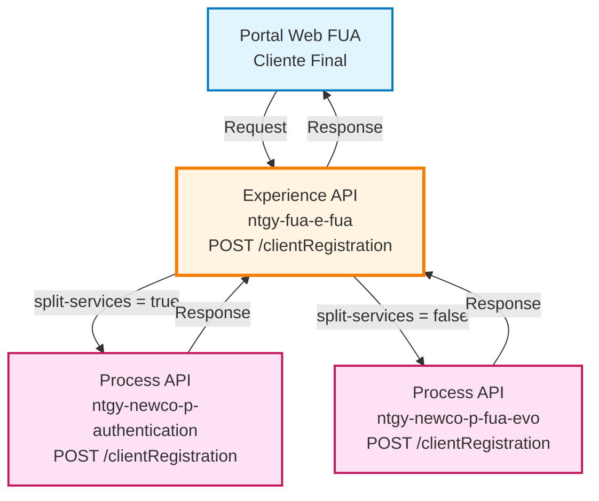
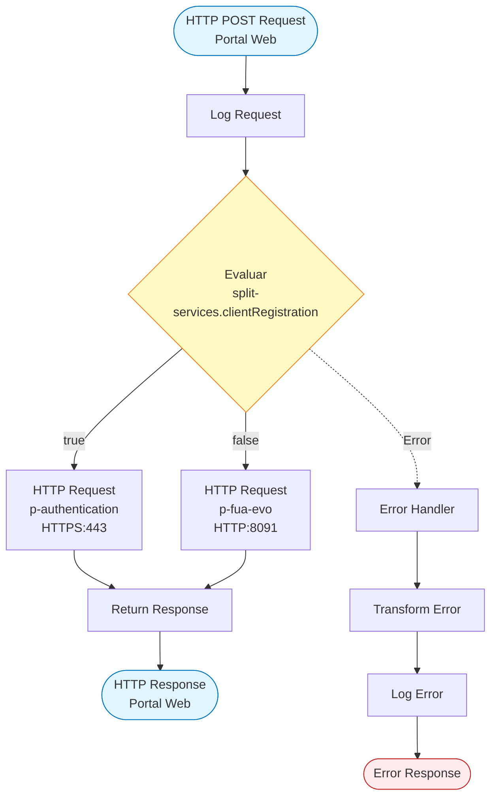
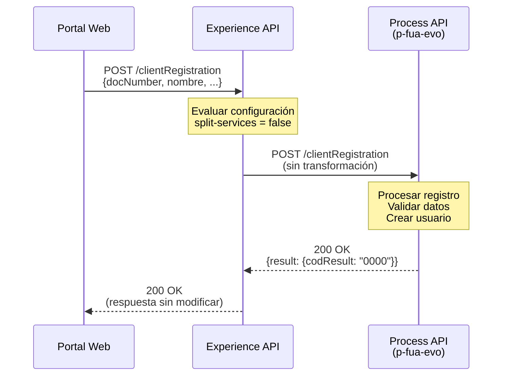
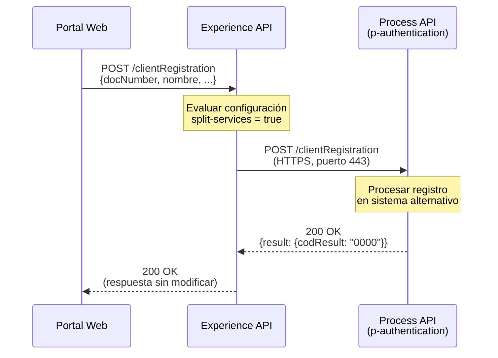
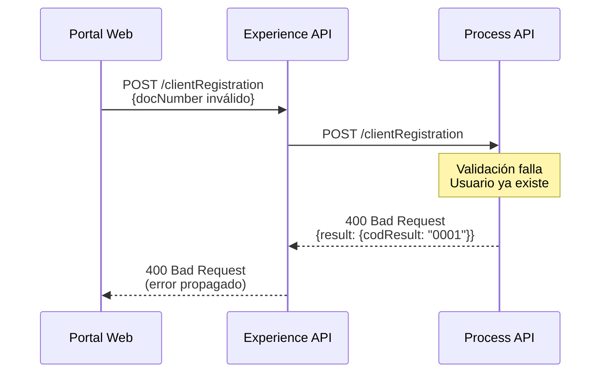
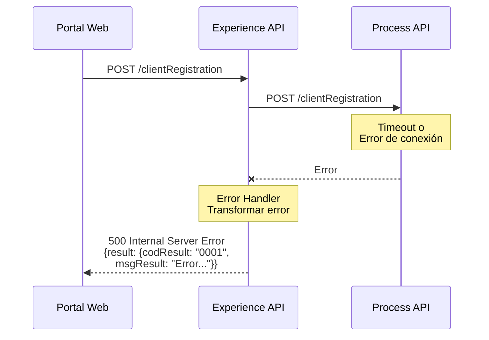

# POST /clientRegistration

## 📌 Descripción General

### Propósito del Endpoint

Este endpoint permite el registro de nuevos usuarios en el portal FUA (Frontal Único de Atención) de Naturgy. Actúa como un gateway inteligente que enruta dinámicamente las solicitudes de registro entre dos sistemas de autenticación diferentes según la configuración del entorno, proporcionando una experiencia unificada para el canal web independientemente del backend utilizado.

### Tipo de API

**Capa:** Experience API (API-Led Connectivity)

**Función:** Gateway de enrutamiento dinámico para registro de usuarios

### Patrón de Integración

**Tipo:** Pass-Through con Enrutamiento Condicional

**Descripción:** Este Experience API no transforma los datos, sino que actúa como un proxy inteligente que:
- Recibe la solicitud de registro del portal web
- Evalúa la configuración `split-services.clientRegistration`
- Enruta la petición al Process API correspondiente
- Retorna la respuesta sin modificación

### Arquitectura API-Led Connectivity



---

## 💼 Propósito del Negocio

### Casos de Uso Principales

1. **Registro de Nuevo Cliente Web**
   - Usuario accede al portal FUA por primera vez
   - Completa formulario de registro con datos personales
   - Sistema crea cuenta de usuario para autoservicio

2. **Migración Transparente entre Sistemas**
   - Permite cambiar el backend de autenticación sin afectar al frontend
   - Facilita pruebas A/B entre sistemas de autenticación
   - Soporta estrategia de migración gradual

3. **Unificación de Experiencia de Usuario**
   - Proporciona interfaz única independiente del sistema backend
   - Mantiene consistencia en el proceso de registro
   - Simplifica integración del portal web

### 📱 Canal y Audiencia

#### Canal de Consumo

**Canal:** Web

**Características del Canal:**
- **Plataforma**: Portal web FUA (Frontal Único de Atención)
- **Dispositivos**: Navegadores web (desktop y mobile)
- **Conectividad**: Conexión estable requerida para completar registro
- **Experiencia de Usuario**: Formulario de registro paso a paso con validación

#### Audiencia Objetivo

**Usuarios Finales:**
- **Clientes Potenciales**: Personas que desean crear cuenta en portal Naturgy
- **Nuevos Clientes**: Clientes recién contratados que necesitan acceso digital

**Contexto de Uso:**
- **Primer Acceso**: Usuario nuevo que desea registrarse en el portal
- **Autoservicio**: Cliente que prefiere gestionar servicios online

#### Adaptaciones del Canal

**Optimizaciones Aplicadas:**
- **Enrutamiento Transparente**: El usuario no percibe qué backend procesa su registro
- **Manejo de Errores Unificado**: Errores estandarizados independiente del backend
- **Timeout Extendido**: 600 segundos para operaciones de registro complejas

### 🔗 Endpoints Dependientes

Este Experience API consume los siguientes Process APIs:

| Process API | Endpoint | Método | Propósito |
|-------------|----------|--------|-----------|
| `ntgy-newco-p-authentication` | `/clientRegistration` | POST | Registro en sistema de autenticación Newco (configuración split-services activa) |
| `ntgy-newco-p-fua-evo` | `/clientRegistration` | POST | Registro en sistema FUA Process EVO (configuración split-services inactiva) |

### Contexto Empresarial

- **Dominio:** Gestión de Identidad y Acceso
- **Sector:** Energía - Utilities
- **División:** Naturgy España - Portal FUA
- **Canal:** Web

### Stakeholders

- **Clientes Finales**: Necesitan proceso de registro simple y rápido
- **Equipo de Desarrollo Web**: Requieren API estable independiente de cambios backend
- **Equipo de Arquitectura**: Necesitan flexibilidad para migrar sistemas de autenticación

### Valor de Negocio

- **Flexibilidad Arquitectónica**: Permite cambiar backend sin modificar frontend
- **Reducción de Acoplamiento**: Portal web independiente del sistema de autenticación
- **Facilita Migración**: Soporta transición gradual entre sistemas
- **Mejora Experiencia**: Proceso de registro unificado y consistente

---

## 🔧 Especificación Técnica

### URLs por Ambiente

| Ambiente | URL Base | URL Completa |
|----------|----------|--------------|
| **Local** | `http://localhost:8081` | `http://localhost:8081/fua/api/clientRegistration` |
| **Development** | `https://ntgy-fua-e-fua-dev.de-c1.cloudhub.io` | `https://ntgy-fua-e-fua-dev.de-c1.cloudhub.io/fua/api/clientRegistration` |
| **Production** | `https://ntgy-fua-e-fua-pro.de-c1.cloudhub.io` | `https://ntgy-fua-e-fua-pro.de-c1.cloudhub.io/fua/api/clientRegistration` |

### Método HTTP

```
POST /fua/api/clientRegistration
```

### 🎯 Consideraciones del Canal

#### Limitaciones del Canal

| Aspecto | Limitación | Razón |
|---------|------------|-------|
| **Timeout** | 600 segundos | Operaciones de registro pueden incluir validaciones complejas |
| **Rate Limiting** | Según política API Gateway | Prevenir abuso en proceso de registro |
| **Validación** | Según backend seleccionado | Cada Process API tiene sus propias reglas |

#### Enrutamiento Dinámico

**Configuración de Enrutamiento:**

El endpoint utiliza la propiedad `split-services.clientRegistration` para determinar el destino:

| Valor Configuración | Destino | Configuración HTTP |
|---------------------|---------|-------------------|
| `true` | `ntgy-newco-p-authentication` | HTTPS, puerto 443, timeout 600s |
| `false` (default) | `ntgy-newco-p-fua-evo` | HTTP, puerto 8091, timeout 60s |

**Configuración Actual (Producción):**
```yaml
split-services:
  clientRegistration: "false"  # Enruta a ntgy-newco-p-fua-evo
```

### Parámetros de Entrada

#### Headers

| Header | Tipo | Requerido | Descripción |
|--------|------|-----------|-------------|
| `Content-Type` | string | Sí | Debe ser `application/json` |
| `client_id` | string | Sí | Identificador de cliente OAuth 2.0 |
| `client_secret` | string | Sí | Secreto de cliente OAuth 2.0 |

#### Body (application/json)

```json
{
  "docNumber": "string",
  "nombre": "string",
  "apellido1": "string",
  "apellido2": "string",
  "email": "string",
  "password": "string"
}
```

| Campo | Tipo | Requerido | Descripción | Validaciones |
|-------|------|-----------|-------------|--------------|
| `docNumber` | string | Sí | Número de documento del cliente | DNI/NIE válido |
| `nombre` | string | Sí | Nombre del cliente | No vacío |
| `apellido1` | string | Sí | Primer apellido del cliente | No vacío |
| `apellido2` | string | No | Segundo apellido del cliente | Opcional |
| `email` | string | No | Email del usuario | Formato email válido |
| `password` | string | Sí | Contraseña de usuario | Según política de seguridad |

### Respuestas

#### 200 OK - Registro Exitoso

```json
{
  "result": {
    "codResult": "0000",
    "msgResult": "Usuario registrado correctamente"
  }
}
```

| Campo | Tipo | Descripción |
|-------|------|-------------|
| `result` | object | Objeto con resultado de la operación |
| `result.codResult` | string | Código de resultado ("0000" = éxito) |
| `result.msgResult` | string | Mensaje descriptivo del resultado |

#### 400 Bad Request - Error de Validación

```json
{
  "result": {
    "codResult": "0001",
    "msgResult": "Datos de entrada inválidos"
  }
}
```

#### 500 Internal Server Error - Error del Sistema

```json
{
  "result": {
    "codResult": "0001",
    "msgResult": "Error en el proceso de registro"
  }
}
```

### Autenticación

- **Tipo:** OAuth 2.0 Client Credentials
- **Headers Requeridos:** `client_id`, `client_secret`
- **Scope:** Según configuración API Gateway

### Timeouts

| Tipo | Valor | Razón |
|------|-------|-------|
| **Request Timeout (p-authentication)** | 600 segundos | Proceso de registro puede incluir validaciones extensas |
| **Request Timeout (p-fua-evo)** | 60 segundos | Proceso estándar de registro |
| **Connection Idle Timeout** | Igual que request timeout | Mantener conexión durante proceso completo |

---

## 🏗️ Implementación Técnica

### Arquitectura del Flow



### Configuración de Conectores HTTP

#### Conector 1: ntgy-newco-p-authentication

```xml
<http:request-config 
    name="HTTP_Request_newco-p-authentication"
    basePath="${p-authentication.basePath}"
    responseTimeout="${p-authentication.timeout}">
    <http:request-connection 
        protocol="${p-authentication.protocol}"
        host="${p-authentication.host}"
        port="${p-authentication.port}" />
</http:request-config>
```

**Configuración (Producción):**
- Host: `ntgy-newco-p-authentication-vx8fhl.internal-6bnlu3.irl-e1.cloudhub.io`
- Puerto: `443`
- Protocolo: `HTTPS`
- Base Path: `/api/v1`
- Timeout: `600000` ms (10 minutos)

#### Conector 2: ntgy-newco-p-fua-evo

```xml
<http:request-config 
    name="HTTP_FUA_PROCESS_NEWCO_EVO"
    basePath="/api"
    responseTimeout="${newco-p-fua-evo.timeout}">
    <http:request-connection 
        host="${newco-p-fua-evo.host}"
        port="${newco-p-fua-evo.port}"
        connectionIdleTimeout="${newco-p-fua-evo.timeout}"/>
</http:request-config>
```

**Configuración (Producción):**
- Host: `mule-worker-internal-ntgy-newco-p-fua-evo.de-c1.cloudhub.io`
- Puerto: `8091`
- Protocolo: `HTTP`
- Base Path: `/api`
- Timeout: `60000` ms (1 minuto)

### Lógica de Enrutamiento

**Implementación XML:**

```xml
<flow name="post-client-registration">
    <choice doc:name="Choice">
        <when expression="#[(Mule::p('split-services.clientRegistration') as Boolean default false)]">
            <http:request 
                method="POST" 
                path="/clientRegistration" 
                config-ref="HTTP_Request_newco-p-authentication" />
        </when>
        <otherwise>
            <http:request 
                method="POST" 
                path="/clientRegistration" 
                config-ref="HTTP_FUA_PROCESS_NEWCO_EVO" />
        </otherwise>
    </choice>
    
    <error-handler>
        <on-error-propagate>
            <ee:transform doc:name="Set Error Message">
                <ee:set-payload><![CDATA[%dw 2.0
output application/json
---
if ( !isEmpty(error.errorMessage.payload) ) 
    error.errorMessage.payload
else {
    "result": {
        "codResult": "0001",
        "msgResult": error.description as String replace /\"/ with("")
    }
}]]></ee:set-payload>
            </ee:transform>
            <logger level="ERROR" doc:name="Error" />
        </on-error-propagate>
    </error-handler>
</flow>
```

### Transformaciones de Canal

⚠️ **Este Experience API NO transforma la petición ni la respuesta.**

**Comportamiento:**
- **Request**: Se reenvía tal cual al Process API seleccionado
- **Response**: Se retorna tal cual desde el Process API

Para el schema completo de request/response, consultar:
- 📖 **Process API: `ntgy-newco-p-authentication` endpoint `/clientRegistration`**
- 📖 **Process API: `ntgy-newco-p-fua-evo` endpoint `/clientRegistration`**

### Patrones de Diseño

**Patrón:** Content-Based Router (Enrutador Basado en Contenido)

**Justificación:** 
- Permite selección dinámica del backend según configuración
- Facilita migración gradual entre sistemas
- Reduce acoplamiento entre frontend y backend
- Soporta estrategias de despliegue blue-green

**Patrón Secundario:** Pass-Through Proxy

**Justificación:**
- No requiere transformación de datos
- Minimiza latencia
- Simplifica mantenimiento
- Delega lógica de negocio a Process APIs

### Diagramas de Secuencia

#### 1. Flujo Normal de Éxito (split-services = false)



#### 2. Flujo con Enrutamiento Alternativo (split-services = true)



#### 3. Flujo con Error de Negocio



#### 4. Flujo con Error Técnico



### Manejo de Errores

#### Estrategia de Error Handling

**Global Error Handler:**

```dataweave
%dw 2.0
output application/json
---
if ( !isEmpty(error.errorMessage.payload) ) 
    error.errorMessage.payload
else {
    "result": {
        "codResult": "0001",
        "msgResult": error.description as String replace /\"/ with("")
    }
}
```

**Comportamiento:**
1. Si el error del Process API tiene payload → Propagar tal cual
2. Si no hay payload → Construir respuesta estándar con descripción del error
3. Logging de error en nivel ERROR
4. Propagación del error al cliente

#### Tipos de Errores

| Tipo Error | Código | Origen | Acción |
|------------|--------|--------|--------|
| Validación de datos | 0001 | Process API | Propagar al cliente |
| Usuario ya existe | 0001 | Process API | Propagar al cliente |
| Timeout | 0001 | Experience API | Transformar y propagar |
| Error de conexión | 0001 | Experience API | Transformar y propagar |
| Error interno | 0001 | Process API | Propagar al cliente |

### Configuración de Propiedades

**Archivo:** `e-fua-pro-config.yaml`

```yaml
# Configuración de enrutamiento
split-services:
  clientRegistration: "false"  # false = p-fua-evo, true = p-authentication

# Configuración p-authentication (alternativo)
p-authentication:
  host: "ntgy-newco-p-authentication-vx8fhl.internal-6bnlu3.irl-e1.cloudhub.io"
  port: "443"
  protocol: "HTTPS"
  timeout: "600000"
  basePath: "/api/v1"

# Configuración p-fua-evo (principal)
newco-p-fua-evo:
  host: "mule-worker-internal-ntgy-newco-p-fua-evo.de-c1.cloudhub.io"
  port: "8091"
  timeout: "60000"
```

---

## 💻 Ejemplos de Uso

### Ejemplo 1: Registro Exitoso de Cliente

#### cURL

```bash
curl -X POST "https://ntgy-fua-e-fua-pro.de-c1.cloudhub.io/fua/api/clientRegistration" \
  -H "Content-Type: application/json" \
  -H "client_id: YOUR_CLIENT_ID" \
  -H "client_secret: YOUR_CLIENT_SECRET" \
  -d '{
    "docNumber": "12345678A",
    "nombre": "Juan",
    "apellido1": "García",
    "apellido2": "López",
    "email": "juan.garcia@example.com",
    "password": "SecureP@ssw0rd123"
  }'
```

#### Respuesta (200 OK)

```json
{
  "result": {
    "codResult": "0000",
    "msgResult": "Usuario registrado correctamente"
  }
}
```

### Ejemplo 2: Error - Usuario Ya Existe

#### cURL

```bash
curl -X POST "https://ntgy-fua-e-fua-pro.de-c1.cloudhub.io/fua/api/clientRegistration" \
  -H "Content-Type: application/json" \
  -H "client_id: YOUR_CLIENT_ID" \
  -H "client_secret: YOUR_CLIENT_SECRET" \
  -d '{
    "docNumber": "12345678A",
    "nombre": "Juan",
    "apellido1": "García",
    "password": "SecureP@ssw0rd123"
  }'
```

#### Respuesta (400 Bad Request)

```json
{
  "result": {
    "codResult": "0001",
    "msgResult": "El usuario ya existe en el sistema"
  }
}
```

### Ejemplo 3: JavaScript (Portal Web)

```javascript
async function registrarCliente(datosCliente) {
  try {
    const response = await fetch(
      'https://ntgy-fua-e-fua-pro.de-c1.cloudhub.io/fua/api/clientRegistration',
      {
        method: 'POST',
        headers: {
          'Content-Type': 'application/json',
          'client_id': 'YOUR_CLIENT_ID',
          'client_secret': 'YOUR_CLIENT_SECRET'
        },
        body: JSON.stringify({
          docNumber: datosCliente.documento,
          nombre: datosCliente.nombre,
          apellido1: datosCliente.apellido1,
          apellido2: datosCliente.apellido2,
          email: datosCliente.email,
          password: datosCliente.password
        })
      }
    );

    const resultado = await response.json();
    
    if (resultado.result.codResult === '0000') {
      console.log('Registro exitoso:', resultado.result.msgResult);
      return { success: true, data: resultado };
    } else {
      console.error('Error en registro:', resultado.result.msgResult);
      return { success: false, error: resultado.result.msgResult };
    }
  } catch (error) {
    console.error('Error de conexión:', error);
    return { success: false, error: 'Error de conexión con el servidor' };
  }
}

// Uso
const datosCliente = {
  documento: '12345678A',
  nombre: 'Juan',
  apellido1: 'García',
  apellido2: 'López',
  email: 'juan.garcia@example.com',
  password: 'SecureP@ssw0rd123'
};

registrarCliente(datosCliente)
  .then(resultado => {
    if (resultado.success) {
      // Redirigir a página de confirmación
      window.location.href = '/registro-exitoso';
    } else {
      // Mostrar mensaje de error
      alert(resultado.error);
    }
  });
```

### Ejemplo 4: Python

```python
import requests
import json

def registrar_cliente(datos_cliente):
    """
    Registra un nuevo cliente en el portal FUA
    
    Args:
        datos_cliente (dict): Datos del cliente a registrar
        
    Returns:
        dict: Resultado del registro
    """
    url = 'https://ntgy-fua-e-fua-pro.de-c1.cloudhub.io/fua/api/clientRegistration'
    
    headers = {
        'Content-Type': 'application/json',
        'client_id': 'YOUR_CLIENT_ID',
        'client_secret': 'YOUR_CLIENT_SECRET'
    }
    
    payload = {
        'docNumber': datos_cliente['documento'],
        'nombre': datos_cliente['nombre'],
        'apellido1': datos_cliente['apellido1'],
        'apellido2': datos_cliente.get('apellido2', ''),
        'email': datos_cliente.get('email', ''),
        'password': datos_cliente['password']
    }
    
    try:
        response = requests.post(url, headers=headers, json=payload, timeout=30)
        response.raise_for_status()
        
        resultado = response.json()
        
        if resultado['result']['codResult'] == '0000':
            print(f"✓ Registro exitoso: {resultado['result']['msgResult']}")
            return {'success': True, 'data': resultado}
        else:
            print(f"✗ Error en registro: {resultado['result']['msgResult']}")
            return {'success': False, 'error': resultado['result']['msgResult']}
            
    except requests.exceptions.Timeout:
        print("✗ Error: Timeout en la petición")
        return {'success': False, 'error': 'Timeout'}
    except requests.exceptions.RequestException as e:
        print(f"✗ Error de conexión: {str(e)}")
        return {'success': False, 'error': str(e)}

# Ejemplo de uso
datos_cliente = {
    'documento': '12345678A',
    'nombre': 'Juan',
    'apellido1': 'García',
    'apellido2': 'López',
    'email': 'juan.garcia@example.com',
    'password': 'SecureP@ssw0rd123'
}

resultado = registrar_cliente(datos_cliente)

if resultado['success']:
    print("Cliente registrado correctamente")
else:
    print(f"Error: {resultado['error']}")
```

### Ejemplo 5: Registro sin Campos Opcionales

#### cURL

```bash
curl -X POST "https://ntgy-fua-e-fua-pro.de-c1.cloudhub.io/fua/api/clientRegistration" \
  -H "Content-Type: application/json" \
  -H "client_id: YOUR_CLIENT_ID" \
  -H "client_secret: YOUR_CLIENT_SECRET" \
  -d '{
    "docNumber": "87654321B",
    "nombre": "María",
    "apellido1": "Rodríguez",
    "password": "SecureP@ssw0rd456"
  }'
```

**Nota:** Los campos `apellido2` y `email` son opcionales y pueden omitirse.

#### Respuesta (200 OK)

```json
{
  "result": {
    "codResult": "0000",
    "msgResult": "Usuario registrado correctamente"
  }
}