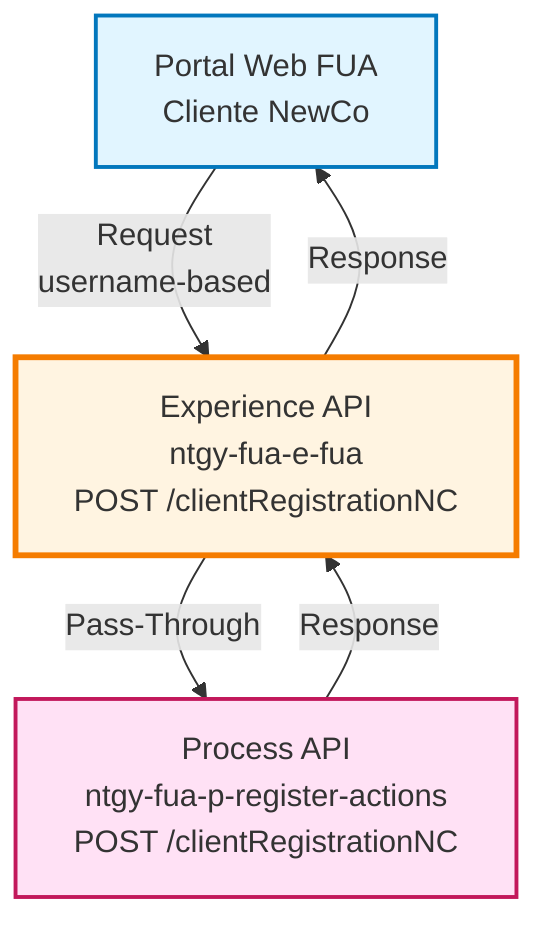
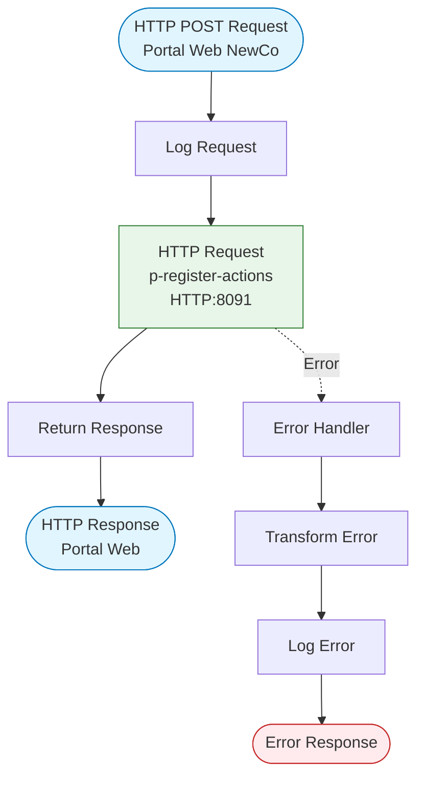
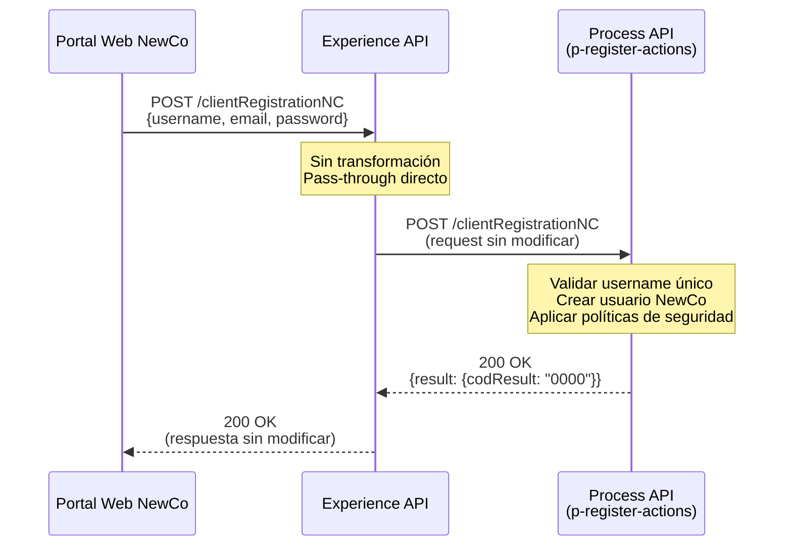
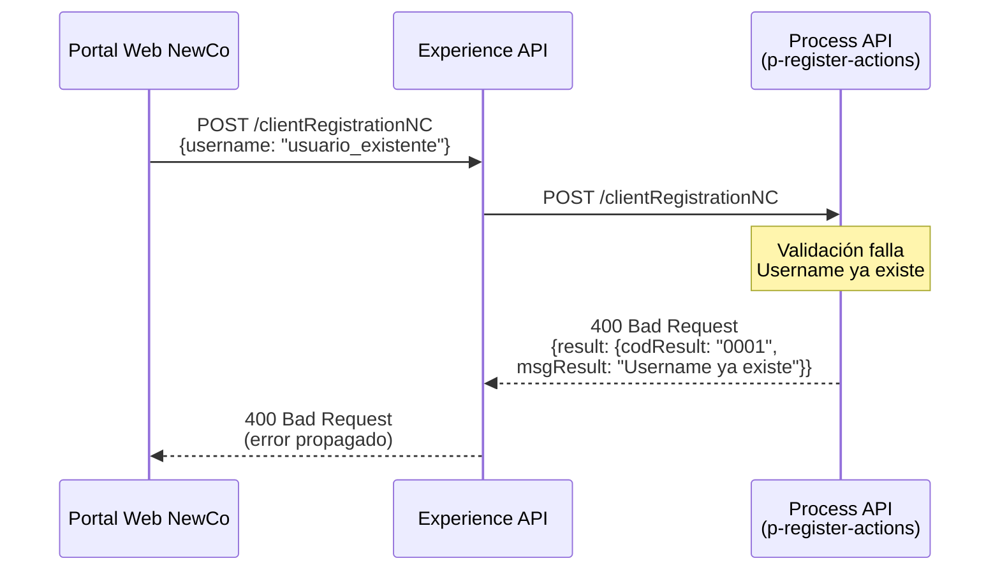
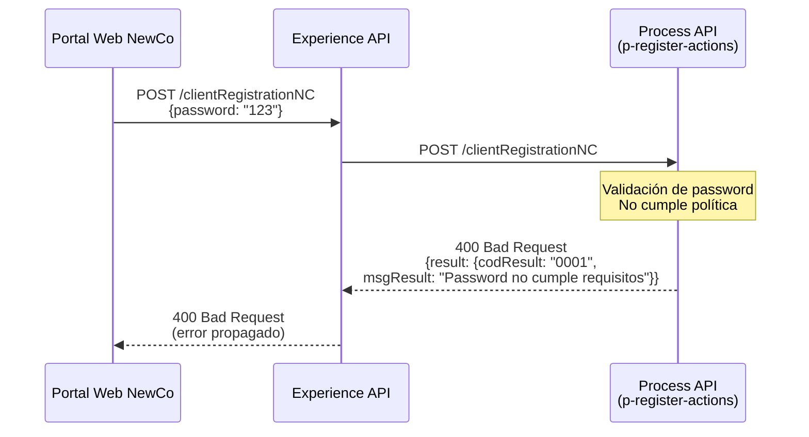
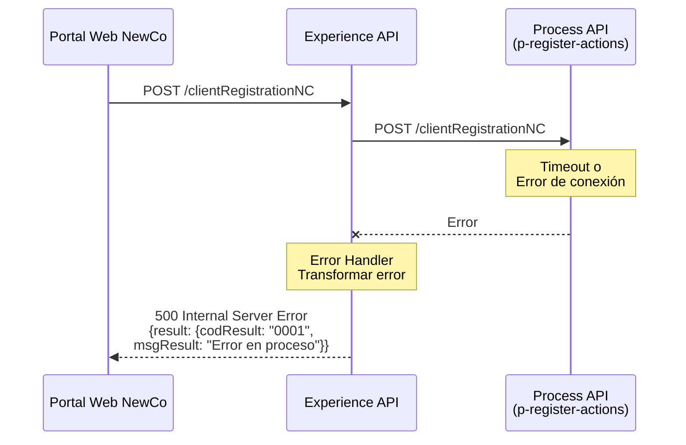

# POST /clientRegistrationNC

## 📌 Descripción General

### Propósito del Endpoint

Este endpoint proporciona un proceso de registro simplificado específicamente diseñado para clientes **NewCo (NC)** en el portal FUA de Naturgy. A diferencia del registro estándar que requiere documento de identidad y nombres completos, este endpoint utiliza un modelo simplificado basado en **username**, optimizado para el sistema moderno NewCo.

### Tipo de API

**Capa:** Experience API (API-Led Connectivity)

**Función:** Proxy pass-through para registro simplificado de usuarios NewCo

### Patrón de Integración

**Tipo:** Pass-Through Proxy (sin transformación)

**Descripción:** Este Experience API actúa como un proxy directo que:
- Recibe la solicitud de registro simplificada del portal web
- Reenvía la petición sin modificación al Process API especializado
- Retorna la respuesta tal cual al cliente
- No aplica enrutamiento condicional (destino único)

### Arquitectura API-Led Connectivity



---

## 💼 Propósito del Negocio

### Casos de Uso Principales

1. **Registro Simplificado NewCo**
   - Cliente NewCo accede al portal FUA por primera vez
   - Completa formulario simplificado con username y password
   - Sistema crea cuenta sin requerir datos de documento de identidad

2. **Onboarding Rápido**
   - Reduce fricción en proceso de registro
   - Acelera adopción del portal de autoservicio
   - Mejora experiencia de usuario para clientes modernos

3. **Separación de Sistemas Legacy vs Moderno**
   - Clientes NewCo usan proceso de registro moderno
   - Clientes Imperial usan proceso tradicional (POST /clientRegistration)
   - Facilita migración gradual entre sistemas

### 📱 Canal y Audiencia

#### Canal de Consumo

**Canal:** Web

**Características del Canal:**
- **Plataforma**: Portal web FUA (Frontal Único de Atención) - Versión NewCo
- **Dispositivos**: Navegadores web (desktop y mobile)
- **Conectividad**: Conexión estable requerida
- **Experiencia de Usuario**: Formulario simplificado de 2-3 campos

#### Audiencia Objetivo

**Usuarios Finales:**
- **Clientes NewCo**: Clientes del sistema moderno de Naturgy
- **Nuevos Clientes**: Personas que contratan servicios en el sistema NewCo
- **Usuarios Digitales**: Perfil de usuario que prefiere procesos simplificados

**Contexto de Uso:**
- **Primer Acceso NewCo**: Usuario nuevo en sistema moderno
- **Registro Express**: Cliente que valora rapidez sobre completitud de datos
- **Autoservicio Digital**: Usuario que prefiere gestión online

#### Adaptaciones del Canal

**Optimizaciones Aplicadas:**
- **Simplificación de Campos**: Solo username, email (opcional) y password
- **Proceso Único**: Sin enrutamiento condicional, destino fijo
- **Timeout Estándar**: 30 segundos (proceso más rápido que registro tradicional)

### 🔗 Endpoints Dependientes

Este Experience API consume el siguiente Process API:

| Process API | Endpoint | Método | Propósito |
|-------------|----------|--------|-----------|
| `ntgy-fua-p-register-actions` | `/clientRegistrationNC` | POST | Registro de cliente NewCo con estructura simplificada basada en username |

### Contexto Empresarial

- **Dominio:** Gestión de Identidad y Acceso - NewCo
- **Sector:** Energía - Utilities
- **División:** Naturgy España - Portal FUA NewCo
- **Canal:** Web

### Stakeholders

- **Clientes NewCo**: Necesitan proceso de registro rápido y simple
- **Equipo de Producto Digital**: Requieren reducir fricción en onboarding
- **Equipo de Desarrollo Web**: Necesitan API específica para flujo NewCo

### Valor de Negocio

- **Reducción de Fricción**: Menos campos = mayor tasa de conversión
- **Diferenciación NewCo**: Experiencia moderna vs sistema legacy
- **Simplicidad Arquitectónica**: Un solo destino, sin lógica condicional
- **Velocidad de Registro**: Proceso más rápido que registro tradicional

---

## 🔧 Especificación Técnica

### URLs por Ambiente

| Ambiente | URL Base | URL Completa |
|----------|----------|--------------|
| **Local** | `http://localhost:8081` | `http://localhost:8081/fua/api/clientRegistrationNC` |
| **Development** | `https://ntgy-fua-e-fua-dev.de-c1.cloudhub.io` | `https://ntgy-fua-e-fua-dev.de-c1.cloudhub.io/fua/api/clientRegistrationNC` |
| **Production** | `https://ntgy-fua-e-fua-pro.de-c1.cloudhub.io` | `https://ntgy-fua-e-fua-pro.de-c1.cloudhub.io/fua/api/clientRegistrationNC` |

### Método HTTP

```
POST /fua/api/clientRegistrationNC
```

### 🎯 Consideraciones del Canal

#### Limitaciones del Canal

| Aspecto | Limitación | Razón |
|---------|------------|-------|
| **Timeout** | 30 segundos | Proceso simplificado, más rápido que registro tradicional |
| **Rate Limiting** | Según política API Gateway | Prevenir abuso en proceso de registro |
| **Validación** | Según backend NewCo | Reglas específicas del sistema moderno |

#### Diferencias con POST /clientRegistration

| Aspecto | POST /clientRegistration | POST /clientRegistrationNC |
|---------|-------------------------|---------------------------|
| **Campos Request** | docNumber, nombre, apellido1, apellido2, email, password | **username**, email, password |
| **Complejidad** | 6 campos (4 obligatorios) | 3 campos (2 obligatorios) |
| **Enrutamiento** | Dinámico (2 destinos) | Fijo (1 destino) |
| **Timeout** | 60s o 600s (según destino) | 30s |
| **Sistema Destino** | Imperial o NewCo | Solo NewCo |
| **Process API** | p-authentication o p-fua-evo | p-register-actions |

### Parámetros de Entrada

#### Headers

| Header | Tipo | Requerido | Descripción |
|--------|------|-----------|-------------|
| `Content-Type` | string | Sí | Debe ser `application/json` |
| `client_id` | string | Sí | Identificador de cliente OAuth 2.0 |
| `client_secret` | string | Sí | Secreto de cliente OAuth 2.0 |

#### Body (application/json)

```json
{
  "username": "string",
  "email": "string",
  "password": "string"
}
```

| Campo | Tipo | Requerido | Descripción | Validaciones |
|-------|------|-----------|-------------|--------------|
| `username` | string | Sí | Nombre de usuario único del cliente | Alfanumérico, sin espacios, único en sistema |
| `email` | string | No | Email del usuario | Formato email válido si se proporciona |
| `password` | string | Sí | Contraseña de usuario | Según política de seguridad NewCo |

**⚠️ Nota Importante:** Este endpoint NO requiere:
- ❌ `docNumber` (documento de identidad)
- ❌ `nombre` (nombre del cliente)
- ❌ `apellido1` (primer apellido)
- ❌ `apellido2` (segundo apellido)

### Respuestas

#### 200 OK - Registro Exitoso

```json
{
  "result": {
    "codResult": "0000",
    "msgResult": "Usuario registrado correctamente"
  }
}
```

| Campo | Tipo | Descripción |
|-------|------|-------------|
| `result` | object | Objeto con resultado de la operación |
| `result.codResult` | string | Código de resultado ("0000" = éxito) |
| `result.msgResult` | string | Mensaje descriptivo del resultado |

#### 400 Bad Request - Error de Validación

```json
{
  "result": {
    "codResult": "0001",
    "msgResult": "Username ya existe en el sistema"
  }
}
```

**Errores Comunes:**
- Username ya registrado
- Formato de email inválido
- Password no cumple política de seguridad
- Campos obligatorios faltantes

#### 500 Internal Server Error - Error del Sistema

```json
{
  "result": {
    "codResult": "0001",
    "msgResult": "Error en el proceso de registro"
  }
}
```

### Autenticación

- **Tipo:** OAuth 2.0 Client Credentials
- **Headers Requeridos:** `client_id`, `client_secret`
- **Scope:** Según configuración API Gateway

### Timeouts

| Tipo | Valor | Razón |
|------|-------|-------|
| **Request Timeout** | 30 segundos | Proceso simplificado, más rápido que registro tradicional |
| **Connection Idle Timeout** | 30 segundos | Mantener conexión durante proceso completo |

---

## 🏗️ Implementación Técnica

### Arquitectura del Flow



### Configuración del Conector HTTP

#### Conector: ntgy-fua-p-register-actions

```xml
<http:request-config 
    name="HTTP_API_ProcesoAccionesRegistro"
    basePath="/api"
    responseTimeout="${p-register-actions.timeout}">
    <http:request-connection 
        host="${p-register-actions.host}"
        port="${p-register-actions.port}"
        connectionIdleTimeout="${p-register-actions.timeout}" />
</http:request-config>
```

**Configuración (Producción):**
- Host: `mule-worker-internal-ntgy-fua-p-register-actions.de-c1.cloudhub.io`
- Puerto: `8091`
- Protocolo: `HTTP`
- Base Path: `/api`
- Timeout: `30000` ms (30 segundos)

### Implementación del Flow

**Implementación XML:**

```xml
<flow name="post-client-registration-NC">
    <http:request 
        method="POST" 
        path="/clientRegistrationNC" 
        config-ref="HTTP_API_ProcesoAccionesRegistro" />
    
    <error-handler>
        <on-error-propagate>
            <ee:transform doc:name="Set Error Message">
                <ee:set-payload><![CDATA[%dw 2.0
output application/json
---
if ( !isEmpty(error.errorMessage.payload) ) 
    error.errorMessage.payload
else {
    "result": {
        "codResult": "0001",
        "msgResult": error.description as String replace /\"/ with("")
    }
}]]></ee:set-payload>
            </ee:transform>
            <logger level="ERROR" doc:name="Error" />
        </on-error-propagate>
    </error-handler>
</flow>
```

**Características de la Implementación:**
- ✅ **Sin enrutamiento condicional**: Destino único y fijo
- ✅ **Sin transformación**: Request y response pasan sin modificación
- ✅ **Manejo de errores estándar**: Mismo patrón que otros endpoints
- ✅ **Logging de errores**: Trazabilidad completa

### Transformaciones de Canal

⚠️ **Este Experience API NO transforma la petición ni la respuesta.**

**Comportamiento:**
- **Request**: Se reenvía tal cual al Process API
- **Response**: Se retorna tal cual desde el Process API

Para el schema completo de request/response, consultar:
- 📖 **Process API: `ntgy-fua-p-register-actions` endpoint `/clientRegistrationNC`**

### Patrones de Diseño

**Patrón:** Simple Pass-Through Proxy

**Justificación:** 
- Proceso simplificado no requiere transformación
- Minimiza latencia en registro
- Delega toda lógica de negocio al Process API
- Facilita mantenimiento y evolución

**Ventajas:**
- ⚡ Máximo rendimiento (sin overhead de transformación)
- 🔧 Fácil mantenimiento
- 📊 Trazabilidad directa
- 🎯 Separación clara de responsabilidades

### Diagramas de Secuencia

#### 1. Flujo Normal de Éxito



#### 2. Flujo con Error de Negocio - Username Duplicado



#### 3. Flujo con Error de Validación - Password Débil



#### 4. Flujo con Error Técnico



### Manejo de Errores

#### Estrategia de Error Handling

**Global Error Handler:**

```dataweave
%dw 2.0
output application/json
---
if ( !isEmpty(error.errorMessage.payload) ) 
    error.errorMessage.payload
else {
    "result": {
        "codResult": "0001",
        "msgResult": error.description as String replace /\"/ with("")
    }
}
```

**Comportamiento:**
1. Si el error del Process API tiene payload → Propagar tal cual
2. Si no hay payload → Construir respuesta estándar con descripción del error
3. Logging de error en nivel ERROR
4. Propagación del error al cliente

#### Tipos de Errores

| Tipo Error | Código | Origen | Acción |
|------------|--------|--------|--------|
| Username duplicado | 0001 | Process API | Propagar al cliente |
| Email inválido | 0001 | Process API | Propagar al cliente |
| Password débil | 0001 | Process API | Propagar al cliente |
| Campos faltantes | 0001 | Process API | Propagar al cliente |
| Timeout | 0001 | Experience API | Transformar y propagar |
| Error de conexión | 0001 | Experience API | Transformar y propagar |

### Configuración de Propiedades

**Archivo:** `e-fua-pro-config.yaml`

```yaml
# Configuración p-register-actions
p-register-actions:
  host: "mule-worker-internal-ntgy-fua-p-register-actions.de-c1.cloudhub.io"
  port: "8091"
  timeout: "30000"
```

**Características:**
- ✅ Timeout optimizado para proceso simplificado (30s vs 60s/600s)
- ✅ Protocolo HTTP estándar (no HTTPS)
- ✅ Puerto CloudHub interno (8091)
- ✅ Sin configuración condicional (destino único)

---

## 💻 Ejemplos de Uso

### Ejemplo 1: Registro Exitoso con Email

#### cURL

```bash
curl -X POST "https://ntgy-fua-e-fua-pro.de-c1.cloudhub.io/fua/api/clientRegistrationNC" \
  -H "Content-Type: application/json" \
  -H "client_id: YOUR_CLIENT_ID" \
  -H "client_secret: YOUR_CLIENT_SECRET" \
  -d '{
    "username": "juangarcia2024",
    "email": "juan.garcia@example.com",
    "password": "SecureP@ssw0rd123"
  }'
```

#### Respuesta (200 OK)

```json
{
  "result": {
    "codResult": "0000",
    "msgResult": "Usuario registrado correctamente"
  }
}
```

### Ejemplo 2: Registro Mínimo (sin Email)

#### cURL

```bash
curl -X POST "https://ntgy-fua-e-fua-pro.de-c1.cloudhub.io/fua/api/clientRegistrationNC" \
  -H "Content-Type: application/json" \
  -H "client_id: YOUR_CLIENT_ID" \
  -H "client_secret: YOUR_CLIENT_SECRET" \
  -d '{
    "username": "mariarodriguez2024",
    "password": "SecureP@ssw0rd456"
  }'
```

**Nota:** El campo `email` es opcional y puede omitirse.

#### Respuesta (200 OK)

```json
{
  "result": {
    "codResult": "0000",
    "msgResult": "Usuario registrado correctamente"
  }
}
```

### Ejemplo 3: Error - Username Ya Existe

#### cURL

```bash
curl -X POST "https://ntgy-fua-e-fua-pro.de-c1.cloudhub.io/fua/api/clientRegistrationNC" \
  -H "Content-Type: application/json" \
  -H "client_id: YOUR_CLIENT_ID" \
  -H "client_secret: YOUR_CLIENT_SECRET" \
  -d '{
    "username": "juangarcia2024",
    "password": "SecureP@ssw0rd123"
  }'
```

#### Respuesta (400 Bad Request)

```json
{
  "result": {
    "codResult": "0001",
    "msgResult": "El username ya existe en el sistema"
  }
}
```

### Ejemplo 4: JavaScript (Portal Web NewCo)

```javascript
async function registrarClienteNewCo(datosCliente) {
  try {
    const response = await fetch(
      'https://ntgy-fua-e-fua-pro.de-c1.cloudhub.io/fua/api/clientRegistrationNC',
      {
        method: 'POST',
        headers: {
          'Content-Type': 'application/json',
          'client_id': 'YOUR_CLIENT_ID',
          'client_secret': 'YOUR_CLIENT_SECRET'
        },
        body: JSON.stringify({
          username: datosCliente.username,
          email: datosCliente.email || undefined, // Opcional
          password: datosCliente.password
        })
      }
    );

    const resultado = await response.json();
    
    if (resultado.result.codResult === '0000') {
      console.log('✓ Registro NewCo exitoso:', resultado.result.msgResult);
      return { success: true, data: resultado };
    } else {
      console.error('✗ Error en registro:', resultado.result.msgResult);
      return { success: false, error: resultado.result.msgResult };
    }
  } catch (error) {
    console.error('✗ Error de conexión:', error);
    return { success: false, error: 'Error de conexión con el servidor' };
  }
}

// Ejemplo de uso - Registro con email
const datosConEmail = {
  username: 'juangarcia2024',
  email: 'juan.garcia@example.com',
  password: 'SecureP@ssw0rd123'
};

registrarClienteNewCo(datosConEmail)
  .then(resultado => {
    if (resultado.success) {
      // Redirigir a página de confirmación
      window.location.href = '/registro-exitoso-newco';
    } else {
      // Mostrar mensaje de error
      mostrarError(resultado.error);
    }
  });

// Ejemplo de uso - Registro sin email (mínimo)
const datosSinEmail = {
  username: 'mariarodriguez2024',
  password: 'SecureP@ssw0rd456'
};

registrarClienteNewCo(datosSinEmail)
  .then(resultado => {
    if (resultado.success) {
      console.log('Usuario NewCo registrado sin email');
    }
  });
```

### Ejemplo 5: Python

```python
import requests
import json
from typing import Optional

def registrar_cliente_newco(username: str, password: str, email: Optional[str] = None) -> dict:
    """
    Registra un nuevo cliente NewCo en el portal FUA
    
    Args:
        username (str): Nombre de usuario único
        password (str): Contraseña del usuario
        email (str, optional): Email del usuario
        
    Returns:
        dict: Resultado del registro
    """
    url = 'https://ntgy-fua-e-fua-pro.de-c1.cloudhub.io/fua/api/clientRegistrationNC'
    
    headers = {
        'Content-Type': 'application/json',
        'client_id': 'YOUR_CLIENT_ID',
        'client_secret': 'YOUR_CLIENT_SECRET'
    }
    
    # Construir payload (email es opcional)
    payload = {
        'username': username,
        'password': password
    }
    
    if email:
        payload['email'] = email
    
    try:
        response = requests.post(url, headers=headers, json=payload, timeout=30)
        response.raise_for_status()
        
        resultado = response.json()
        
        if resultado['result']['codResult'] == '0000':
            print(f"✓ Registro NewCo exitoso: {resultado['result']['msgResult']}")
            return {'success': True, 'data': resultado}
        else:
            print(f"✗ Error en registro: {resultado['result']['msgResult']}")
            return {'success': False, 'error': resultado['result']['msgResult']}
            
    except requests.exceptions.Timeout:
        print("✗ Error: Timeout en la petición")
        return {'success': False, 'error': 'Timeout'}
    except requests.exceptions.RequestException as e:
        print(f"✗ Error de conexión: {str(e)}")
        return {'success': False, 'error': str(e)}

# Ejemplo 1: Registro con email
resultado1 = registrar_cliente_newco(
    username='juangarcia2024',
    password='SecureP@ssw0rd123',
    email='juan.garcia@example.com'
)

if resultado1['success']:
    print("Cliente NewCo registrado con email")

# Ejemplo 2: Registro sin email (mínimo)
resultado2 = registrar_cliente_newco(
    username='mariarodriguez2024',
    password='SecureP@ssw0rd456'
)

if resultado2['success']:
    print("Cliente NewCo registrado sin email")
else:
    print(f"Error: {resultado2['error']}")
```

### Ejemplo 6: Comparación con Registro Tradicional

#### Registro Tradicional (POST /clientRegistration)

```bash
# Requiere 6 campos (4 obligatorios)
curl -X POST ".../clientRegistration" \
  -d '{
    "docNumber": "12345678A",
    "nombre": "Juan",
    "apellido1": "García",
    "apellido2": "López",
    "email": "juan.garcia@example.com",
    "password": "SecureP@ssw0rd123"
  }'
```

#### Registro NewCo (POST /clientRegistrationNC)

```bash
# Requiere solo 3 campos (2 obligatorios)
curl -X POST ".../clientRegistrationNC" \
  -d '{
    "username": "juangarcia2024",
    "email": "juan.garcia@example.com",
    "password": "SecureP@ssw0rd123"
  }'
```

**Ventajas del Registro NewCo:**
- ✅ 50% menos campos obligatorios
- ✅ No requiere documento de identidad
- ✅ Proceso más rápido (30s vs 60s/600s timeout)
- ✅ Experiencia simplificada para usuario digital