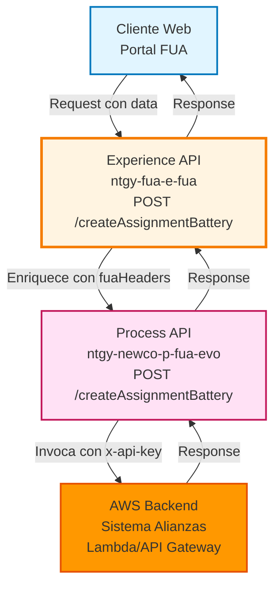
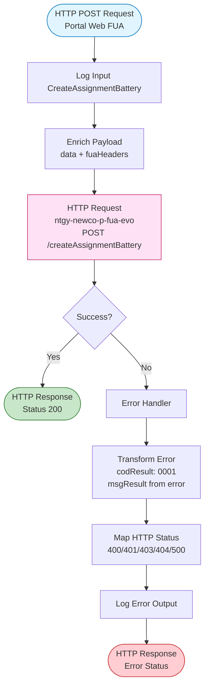
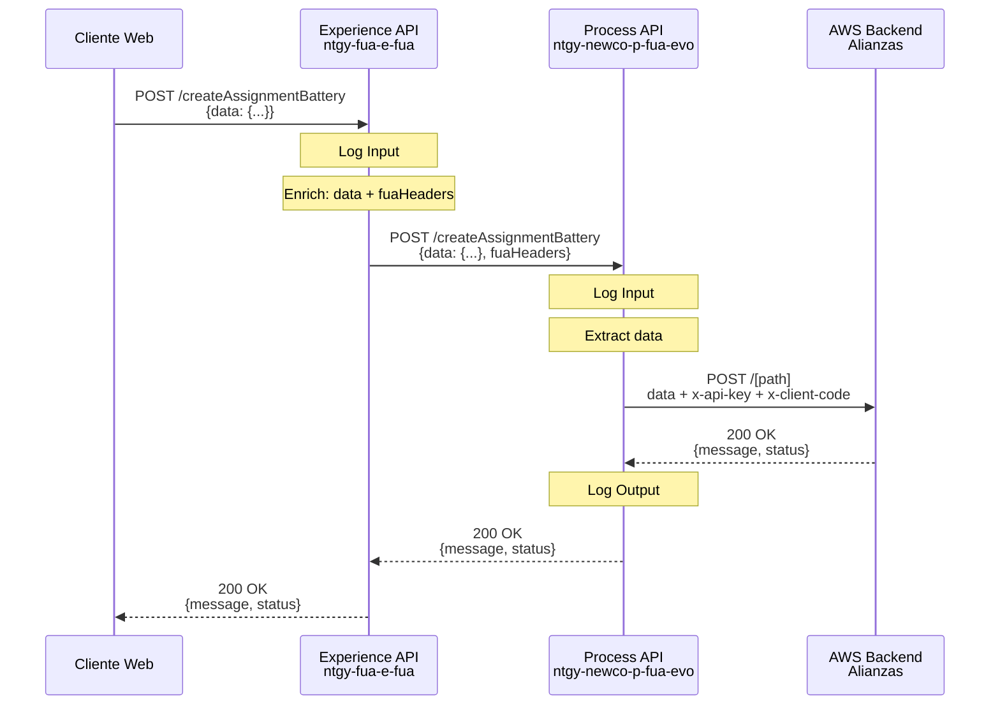
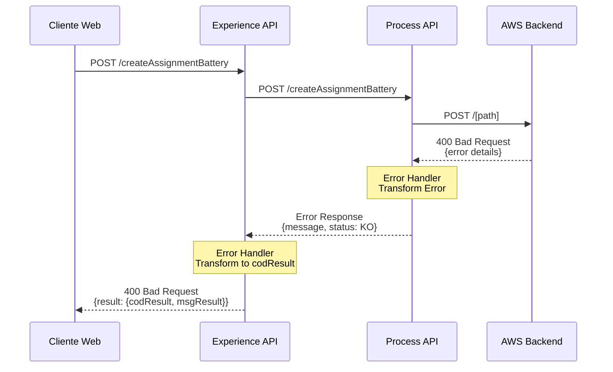
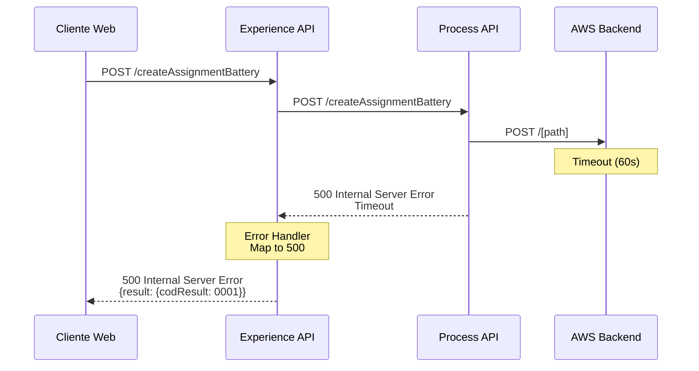

# POST /createAssignmentBattery

## 📌 Descripción General

### Propósito del Endpoint

Este endpoint permite asignar la configuración de saldo de batería para clientes que participan en el programa de Alianzas de Naturgy. El endpoint actúa como punto de entrada desde el canal web, orquestando la comunicación con el Process API que gestiona la integración con el sistema de Alianzas alojado en AWS.

### Tipo de API

**Capa:** Experience API (API-Led Connectivity)

**Función:** Adaptación de experiencia para canal web con orquestación de servicios de Alianzas

### Patrón de Integración

**Tipo:** Pass-Through con Enriquecimiento de Headers

**Descripción:** El Experience API recibe la solicitud del cliente web, enriquece el payload con headers de contexto FUA (`vars.fuaHeaders`), y delega la lógica de negocio al Process API que gestiona la comunicación con AWS.

### Arquitectura API-Led Connectivity



---

## 💼 Propósito del Negocio

### Casos de Uso Principales

1. **Asignación de Configuración de Batería**
   - Cliente web solicita asignar configuración de saldo de batería
   - Sistema registra la configuración en el programa de Alianzas
   - Permite gestionar el balance energético del cliente

2. **Integración con Programa de Alianzas**
   - Sincroniza configuración con sistema externo de Alianzas
   - Mantiene consistencia entre portal FUA y sistema de gestión de baterías
   - Facilita seguimiento de configuraciones de clientes

3. **Gestión de Saldo Energético**
   - Permite configurar parámetros de saldo de batería
   - Habilita funcionalidades de autoconsumo y gestión energética
   - Soporta programa de incentivos de Alianzas

### 📱 Canal y Audiencia

#### Canal de Consumo

**Canal:** Web

**Características del Canal:**
- **Plataforma**: Portal web FUA (Frontal Único de Atención)
- **Dispositivos**: Navegadores web (desktop y responsive)
- **Conectividad**: Conexión estable requerida
- **Experiencia de Usuario**: Formulario de configuración de batería

#### Audiencia Objetivo

**Usuarios Finales:**
- **Clientes Residenciales**: Clientes con instalaciones de batería que participan en programa de Alianzas
- **Clientes con Autoconsumo**: Usuarios con sistemas de generación y almacenamiento energético

**Contexto de Uso:**
- **Configuración Inicial**: Primera asignación de configuración de batería
- **Actualización de Parámetros**: Modificación de configuración existente
- **Gestión de Saldo**: Ajuste de parámetros de balance energético

#### Adaptaciones del Canal

**Optimizaciones Aplicadas:**
- **Enriquecimiento de Contexto**: Añade headers FUA con información de sesión y cliente
- **Timeout Extendido**: 60 segundos para operaciones con AWS
- **Manejo de Errores Robusto**: Transformación de errores técnicos a mensajes de negocio

### 🔗 Endpoints Dependientes

Este Experience API consume el siguiente Process API:

| Process API | Endpoint | Método | Propósito |
|-------------|----------|--------|-----------|
| `ntgy-newco-p-fua-evo` | `/createAssignmentBattery` | POST | Orquesta la asignación de configuración de batería con el backend de Alianzas AWS |

### Contexto Empresarial

- **Dominio:** Autoservicio de Clientes - Gestión de Alianzas
- **Sector:** Energía - Utilities
- **División:** Naturgy España - NewCo
- **Canal:** Web (Portal FUA)
- **Programa:** Alianzas - Gestión de Baterías

### Stakeholders

- **Clientes Finales**: Usuarios del portal FUA que gestionan su configuración de batería
- **Equipo de Alianzas**: Responsables del programa de incentivos y gestión de baterías
- **Equipo de Operaciones**: Monitoreo y soporte de configuraciones de batería

### Valor de Negocio

- **Autoservicio Digital**: Permite a clientes gestionar su configuración sin intervención de agentes
- **Integración con Alianzas**: Sincronización automática con sistema externo de gestión
- **Experiencia Unificada**: Portal único para todas las operaciones de gestión energética
- **Eficiencia Operativa**: Reduce carga de call center mediante autogestión

---

## 🔧 Especificación Técnica

### URLs por Ambiente

| Ambiente | URL Base | URL Completa |
|----------|----------|--------------|
| **Local** | `http://localhost:8081` | `http://localhost:8081/fua/api/createAssignmentBattery` |
| **Development** | `https://ntgy-fua-e-fua-dev.de-c1.cloudhub.io` | `https://ntgy-fua-e-fua-dev.de-c1.cloudhub.io/fua/api/createAssignmentBattery` |
| **UAT** | `https://ntgy-fua-e-fua-uat.de-c1.cloudhub.io` | `https://ntgy-fua-e-fua-uat.de-c1.cloudhub.io/fua/api/createAssignmentBattery` |
| **Production** | `https://ntgy-fua-e-fua-pro.de-c1.cloudhub.io` | `https://ntgy-fua-e-fua-pro.de-c1.cloudhub.io/fua/api/createAssignmentBattery` |

### Método HTTP

```
POST /fua/api/createAssignmentBattery
```

### 🎯 Consideraciones del Canal

#### Limitaciones del Canal

| Aspecto | Limitación | Razón |
|---------|------------|-------|
| **Timeout** | 60 segundos | Operación con AWS puede requerir tiempo de procesamiento |
| **Rate Limiting** | Según política API Gateway | Protección contra abuso |
| **Autenticación** | OAuth 2.0 requerido | Seguridad de operaciones sensibles |

#### Campos Específicos del Canal

**Campos Añadidos por el Experience API:**

| Campo | Tipo | Descripción | Razón |
|-------|------|-------------|-------|
| `fuaHeaders` | Object | Headers de contexto FUA (sesión, cliente, canal) | Trazabilidad y contexto de operación |

### Parámetros de Entrada

#### Headers

| Header | Tipo | Requerido | Descripción |
|--------|------|-----------|-------------|
| `Content-Type` | string | ✅ | Debe ser `application/json` |
| `Authorization` | string | ✅ | Token OAuth 2.0 |
| `x-client-code` | string | ✅ | Código de cliente (propagado a AWS) |

#### Body (application/json)

```json
{
  "data": {
    // Estructura específica del sistema de Alianzas
    // Los campos exactos dependen de la configuración de batería
  }
}
```

**Nota:** La estructura del campo `data` es definida por el sistema de Alianzas AWS. El Experience API actúa como pass-through para este payload.

### Respuestas

⚠️ **IMPORTANTE: Este Experience API es PASS-THROUGH de la respuesta del Process API.**

El Experience API NO transforma la respuesta exitosa. La estructura es definida completamente por el backend de Alianzas AWS y se propaga sin modificación a través del Process API.

#### 200 OK - Asignación Exitosa

```json
// Estructura definida por el backend de Alianzas AWS
// El Experience API devuelve la respuesta tal cual del Process API
// que a su vez la devuelve tal cual de AWS
```

**Para conocer la estructura exacta de respuesta:**
- Consultar documentación del sistema de Alianzas AWS
- Revisar documentación del Process API: `ntgy-newco-p-fua-evo` endpoint `/createAssignmentBattery`
- Ejecutar el endpoint en ambiente de desarrollo y capturar la respuesta real

**Cadena de Pass-Through:**
```
AWS Backend → Process API (sin transformación) → Experience API (sin transformación) → Cliente
```

**Evidencia del código:**
- **Experience API:** NO hay transformación de respuesta exitosa (solo enriquece request)
- **Process API:** NO hay transformación de respuesta exitosa (solo logging)

#### 400 Bad Request - Error de Validación

```json
{
  "result": {
    "codResult": "0001",
    "msgResult": "Error de validación: [detalle del error]"
  }
}
```

#### 401 Unauthorized - Error de Autenticación

```json
{
  "result": {
    "codResult": "0001",
    "msgResult": "401: No autorizado"
  }
}
```

#### 403 Forbidden - Error de Autorización

```json
{
  "result": {
    "codResult": "0001",
    "msgResult": "403: Acceso prohibido"
  }
}
```

#### 404 Not Found - Recurso No Encontrado

```json
{
  "result": {
    "codResult": "0001",
    "msgResult": "404: Recurso no encontrado"
  }
}
```

#### 500 Internal Server Error - Error del Servidor

```json
{
  "result": {
    "codResult": "0001",
    "msgResult": "Error interno del servidor"
  }
}
```

### Autenticación

- **Tipo:** OAuth 2.0
- **Scope:** Operaciones de gestión de batería
- **Token:** Bearer token en header Authorization

### Timeouts

| Tipo | Valor | Razón |
|------|-------|-------|
| **Request Timeout (Experience → Process)** | 60 segundos | Operación con AWS puede requerir tiempo |
| **Request Timeout (Process → AWS)** | Configurado en Process API | Delegado al Process API |

---

## 🏗️ Implementación Técnica

### Arquitectura del Flow



### Transformaciones de Canal

**Enriquecimiento de Payload:**

El Experience API enriquece el payload recibido con headers de contexto FUA:

```dataweave
%dw 2.0
output application/json
---
{
    "data": payload
} ++ vars.fuaHeaders
```

**Campos Añadidos:**
- `vars.fuaHeaders`: Objeto con información de contexto de sesión FUA (cliente, canal, trazabilidad)

**Transformación de Errores:**

```dataweave
%dw 2.0
output application/json
---
{
    "result": {
        "codResult": "0001",
        "msgResult": if(error.errorMessage.payload.result.msgResult != null) 
                        error.errorMessage.payload.result.msgResult 
                     else 
                        error.description
    }
}
```

**Mapeo de HTTP Status:**

```dataweave
%dw 2.0
output application/java
---
if((error.errorMessage.payload.result.msgResult contains ("400")) or (error.description contains ("400")))
    400
else if((error.errorMessage.payload.result.msgResult contains ("401")) or (error.description contains ("401")))
    401
else if((error.errorMessage.payload.result.msgResult contains ("403")) or (error.description contains ("403")))
    403
else if((error.errorMessage.payload.result.msgResult contains ("404")) or (error.description contains ("404")))
    404
else
    500
```

### Configuración de Conectores

#### HTTP Request Configuration (Experience → Process)

```xml
<http:request-config 
    name="HTTP_FUA_PROCESS_NEWCO_EVO" 
    basePath="/api" 
    responseTimeout="${newco-p-fua-evo.timeout}">
    <http:request-connection 
        host="${newco-p-fua-evo.host}" 
        port="${newco-p-fua-evo.port}" 
        connectionIdleTimeout="${newco-p-fua-evo.timeout}"/>
</http:request-config>
```

**Configuración (Production):**
- **Host:** `mule-worker-internal-ntgy-newco-p-fua-evo.de-c1.cloudhub.io`
- **Port:** `8091`
- **Timeout:** `60000` ms (60 segundos)

### Patrones de Diseño

**Patrón:** API Gateway con Enriquecimiento de Contexto

**Justificación:** 
- El Experience API actúa como gateway que añade contexto de sesión FUA
- Delega la lógica de negocio al Process API
- Proporciona manejo de errores consistente para el canal web
- Permite evolución independiente de la lógica de Alianzas

### Diagramas de Secuencia

#### 1. Flujo Normal de Éxito



#### 2. Flujo con Error de Negocio (AWS)



#### 3. Flujo con Error Técnico (Timeout)



### Manejo de Errores

#### Estrategia de Error Handling

**Experience API:**
1. **Captura de Errores del Process API**: Intercepta cualquier error propagado
2. **Transformación Estándar**: Convierte a formato `{result: {codResult, msgResult}}`
3. **Mapeo de HTTP Status**: Extrae código HTTP del mensaje de error
4. **Logging**: Registra error para trazabilidad

**Process API:**
1. **Try-Catch**: Envuelve llamada a AWS en bloque try
2. **Transformación de Error**: Convierte error AWS a formato estándar
3. **Raise Error**: Lanza error tipo `NTGY:ALIANZAS`
4. **Logging**: Registra input/output para debugging

#### Códigos de Error

| Código | Descripción | Origen | Acción |
|--------|-------------|--------|--------|
| `0001` | Error genérico | Experience API | Revisar msgResult para detalles |
| `400` | Validación fallida | AWS/Process API | Verificar estructura del payload |
| `401` | No autorizado | AWS | Verificar x-api-key y autenticación |
| `403` | Acceso prohibido | AWS | Verificar permisos del cliente |
| `404` | Recurso no encontrado | AWS | Verificar existencia del recurso |
| `500` | Error interno | Cualquier capa | Revisar logs para diagnóstico |

### Configuración de Propiedades

**Experience API (e-fua-pro-config.yaml):**
```yaml
newco-p-fua-evo:
  host: "mule-worker-internal-ntgy-newco-p-fua-evo.de-c1.cloudhub.io"
  port: "8091"
  timeout: "60000"
```

**Process API (properties-pro.yaml):**
```yaml
aws:
  host: "[AWS_HOST]"
  port: "[AWS_PORT]"
  timeout: "[AWS_TIMEOUT]"
  apiKey: "[ENCRYPTED]"
  alianzas:
    methodCrearAsignacionBateria: "POST"
    pathCrearAsignacionBateria: "[AWS_PATH]"
```

---

## 💻 Ejemplos de Uso

### Ejemplo 1: Llamada Exitosa desde Portal Web

#### cURL

```bash
curl -X POST "https://ntgy-fua-e-fua-pro.de-c1.cloudhub.io/fua/api/createAssignmentBattery" \
  -H "Content-Type: application/json" \
  -H "Authorization: Bearer YOUR_ACCESS_TOKEN" \
  -H "x-client-code: 12345678" \
  -d '{
    "data": {
      "clientId": "12345678",
      "batteryConfig": {
        "capacity": 10,
        "mode": "auto"
      }
    }
  }'
```

#### Respuesta (200 OK)

```json
// Respuesta real del backend AWS Alianzas (pass-through)
// Ejemplo ilustrativo basado en sistemas típicos de alianzas:
{
  "status": "success",
  "message": "Battery assignment created successfully",
  "assignmentId": "BAT-2026-001234"
}
```

**Nota:** La estructura exacta depende del backend AWS. El Experience API devuelve la respuesta sin modificación.

### Ejemplo 2: JavaScript (Portal Web FUA)

```javascript
async function createBatteryAssignment(batteryData) {
  try {
    const response = await fetch(
      'https://ntgy-fua-e-fua-pro.de-c1.cloudhub.io/fua/api/createAssignmentBattery',
      {
        method: 'POST',
        headers: {
          'Content-Type': 'application/json',
          'Authorization': `Bearer ${accessToken}`,
          'x-client-code': clientCode
        },
        body: JSON.stringify({
          data: batteryData
        })
      }
    );

    if (!response.ok) {
      const error = await response.json();
      throw new Error(error.result.msgResult);
    }

    const result = await response.json();
    console.log('Configuración asignada:', result);
    return result;
  } catch (error) {
    console.error('Error al asignar configuración:', error);
    throw error;
  }
}

// Uso
const batteryConfig = {
  clientId: "12345678",
  batteryConfig: {
    capacity: 10,
    mode: "auto"
  }
};

createBatteryAssignment(batteryConfig)
  .then(result => {
    alert('Configuración de batería asignada exitosamente');
  })
  .catch(error => {
    alert('Error: ' + error.message);
  });
```

### Ejemplo 3: Error de Validación (400)

#### Request

```bash
curl -X POST "https://ntgy-fua-e-fua-pro.de-c1.cloudhub.io/fua/api/createAssignmentBattery" \
  -H "Content-Type: application/json" \
  -H "Authorization: Bearer YOUR_ACCESS_TOKEN" \
  -H "x-client-code: 12345678" \
  -d '{
    "data": {
      "clientId": "invalid"
    }
  }'
```

#### Respuesta (400 Bad Request)

```json
{
  "result": {
    "codResult": "0001",
    "msgResult": "400: Error de validación - Campo batteryConfig requerido"
  }
}
```

### Ejemplo 4: Error de Autenticación (401)

#### Request

```bash
curl -X POST "https://ntgy-fua-e-fua-pro.de-c1.cloudhub.io/fua/api/createAssignmentBattery" \
  -H "Content-Type: application/json" \
  -H "Authorization: Bearer INVALID_TOKEN" \
  -H "x-client-code: 12345678" \
  -d '{
    "data": {
      "clientId": "12345678",
      "batteryConfig": {
        "capacity": 10
      }
    }
  }'
```

#### Respuesta (401 Unauthorized)

```json
{
  "result": {
    "codResult": "0001",
    "msgResult": "401: Token de autenticación inválido o expirado"
  }
}
```

### Ejemplo 5: Python

```python
import requests
import json

def create_battery_assignment(access_token, client_code, battery_data):
    """
    Asigna configuración de batería a través del API de FUA
    
    Args:
        access_token (str): Token OAuth 2.0
        client_code (str): Código de cliente
        battery_data (dict): Datos de configuración de batería
    
    Returns:
        dict: Respuesta del API
    """
    url = "https://ntgy-fua-e-fua-pro.de-c1.cloudhub.io/fua/api/createAssignmentBattery"
    
    headers = {
        "Content-Type": "application/json",
        "Authorization": f"Bearer {access_token}",
        "x-client-code": client_code
    }
    
    payload = {
        "data": battery_data
    }
    
    try:
        response = requests.post(url, headers=headers, json=payload, timeout=60)
        response.raise_for_status()
        return response.json()
    except requests.exceptions.HTTPError as e:
        error_data = e.response.json()
        print(f"Error HTTP {e.response.status_code}: {error_data['result']['msgResult']}")
        raise
    except requests.exceptions.Timeout:
        print("Error: Timeout al conectar con el servidor")
        raise
    except requests.exceptions.RequestException as e:
        print(f"Error de conexión: {str(e)}")
        raise

# Uso
if __name__ == "__main__":
    access_token = "YOUR_ACCESS_TOKEN"
    client_code = "12345678"
    
    battery_config = {
        "clientId": "12345678",
        "batteryConfig": {
            "capacity": 10,
            "mode": "auto"
        }
    }
    
    try:
        result = create_battery_assignment(access_token, client_code, battery_config)
        print("Éxito:", json.dumps(result, indent=2))
    except Exception as e:
        print(f"Error al asignar configuración: {str(e)}")