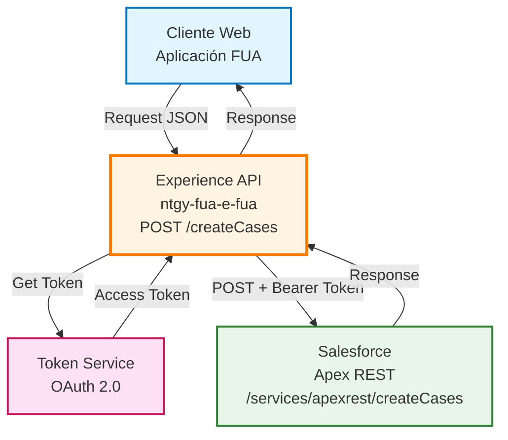
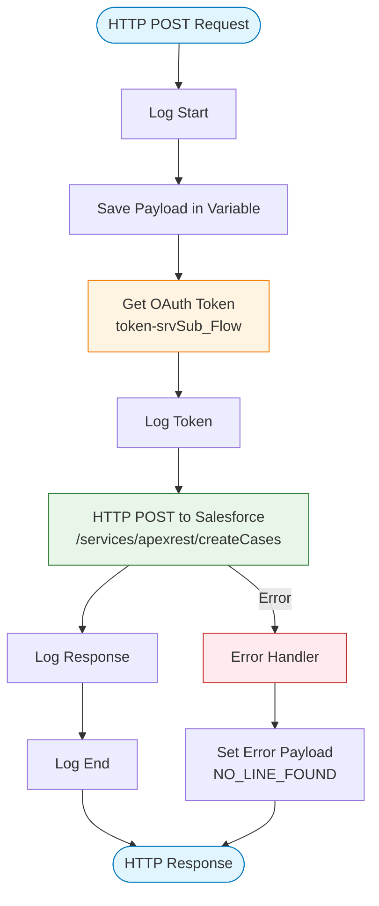
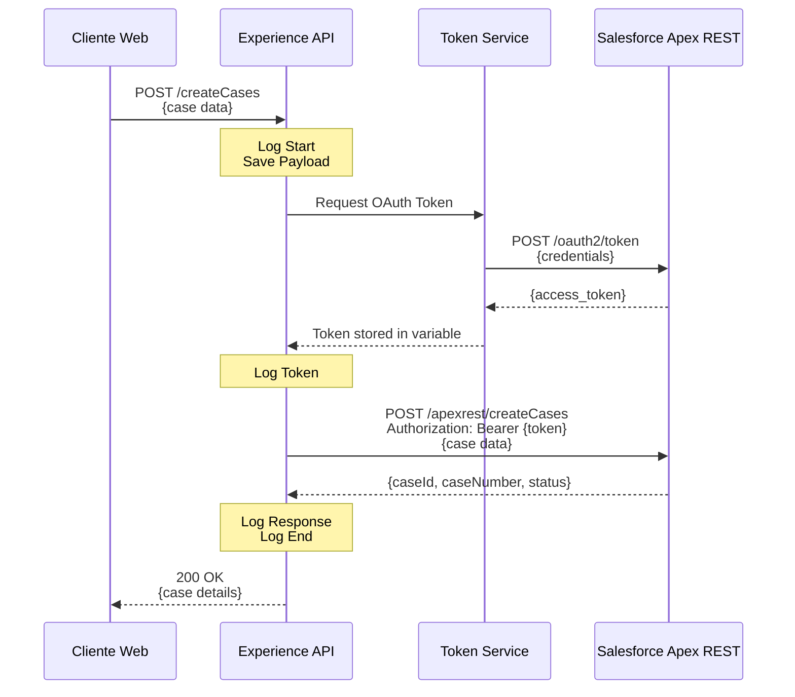
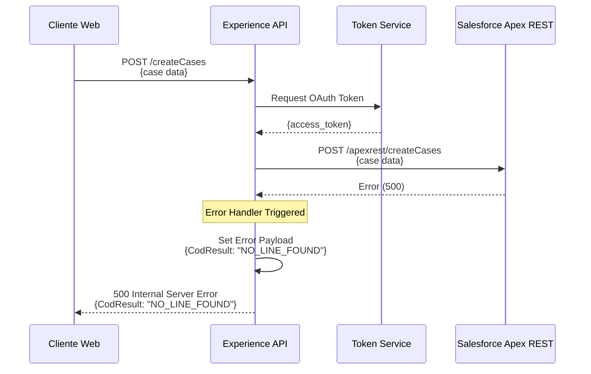
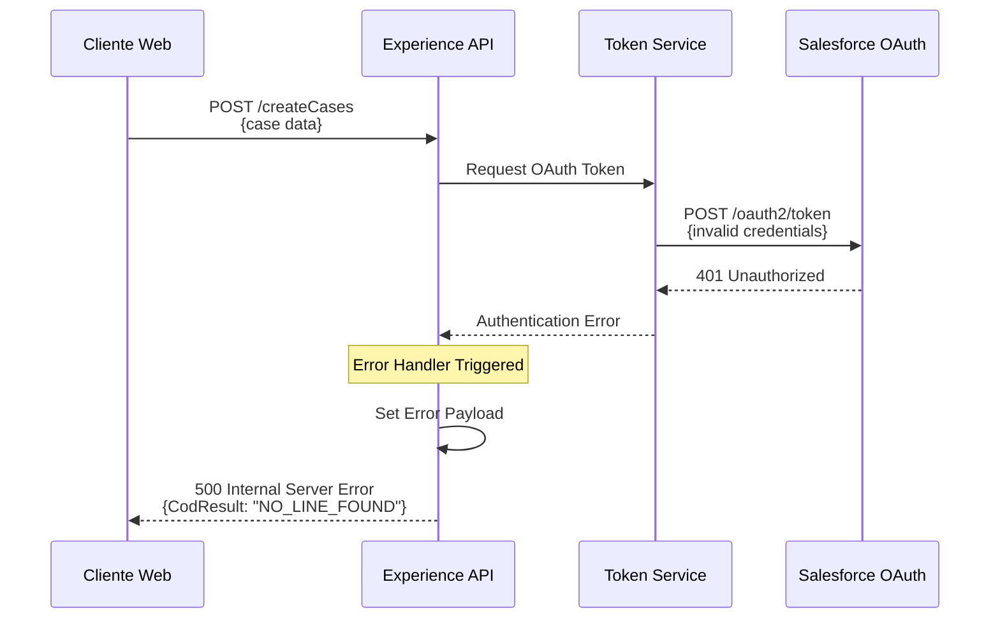

# POST /createCases

## 📌 Descripción General

### Propósito del Endpoint

Este endpoint permite a los usuarios de la aplicación web FUA (Frontal Único de Atención) crear casos de soporte o servicio directamente en Salesforce Service Cloud. Actúa como un puente entre la interfaz de usuario y el sistema CRM, facilitando la gestión de solicitudes, quejas y consultas de clientes.

### Tipo de API

**Capa:** Experience API (API-Led Connectivity)

**Función:** Integración directa con Salesforce para gestión de casos de soporte

### Patrón de Integración

**Tipo:** Pass-Through con Autenticación OAuth

**Descripción:** El endpoint recibe el payload del cliente, obtiene un token OAuth de Salesforce y envía la solicitud sin transformación al servicio Apex REST. La estructura del request y response está definida por el servicio Apex en Salesforce.

### Arquitectura API-Led Connectivity



---

## 💼 Propósito del Negocio

### Casos de Uso Principales

1. **Creación de Casos de Soporte**
   - Los clientes pueden reportar problemas técnicos o solicitar asistencia
   - Registro automático en Salesforce para seguimiento por el equipo de soporte

2. **Gestión de Quejas**
   - Permite a los usuarios registrar quejas sobre el servicio
   - Integración directa con el sistema de gestión de casos de Naturgy

3. **Solicitudes de Servicio**
   - Creación de casos para cambios de servicio o consultas
   - Trazabilidad completa desde la creación hasta la resolución

### 📱 Canal y Audiencia

#### Canal de Consumo

**Canal:** Web

**Características del Canal:**
- **Plataforma**: Aplicación web FUA (Frontal Único de Atención)
- **Dispositivos**: Navegadores web (desktop y móvil)
- **Conectividad**: Requiere conexión estable para comunicación con Salesforce
- **Experiencia de Usuario**: Formulario de creación de casos con validación en tiempo real

#### Audiencia Objetivo

**Usuarios Finales:**
- **Clientes Residenciales**: Usuarios que necesitan reportar problemas o hacer consultas sobre su servicio de energía
- **Clientes Empresariales**: Empresas que requieren soporte técnico o gestión de casos

**Contexto de Uso:**
- **Autoservicio**: Clientes creando casos sin intervención de agentes
- **Soporte Proactivo**: Registro de problemas antes de que escalen

#### Adaptaciones del Canal

**Optimizaciones Aplicadas:**
- **Pass-Through**: No se aplican transformaciones, la estructura es definida por Salesforce
- **Autenticación Transparente**: El token OAuth se gestiona automáticamente
- **Manejo de Errores**: Respuesta estándar en caso de error (`NO_LINE_FOUND`)

### 🔗 Endpoints Dependientes

Este Experience API consume los siguientes servicios:

| Servicio | Endpoint | Método | Propósito |
|----------|----------|--------|-----------|
| `Salesforce OAuth` | `/services/oauth2/token` | POST | Obtención de token de acceso OAuth 2.0 |
| `Salesforce Apex REST` | `/services/apexrest/createCases` | POST | Creación de casos en Salesforce Service Cloud |

### Contexto Empresarial

- **Dominio:** Gestión de Casos de Soporte
- **Sector:** Energía - Utilities
- **División:** Naturgy España - NewCo
- **Canal:** Web (Aplicación FUA)

### Stakeholders

- **Clientes de Energía**: Necesitan un canal eficiente para reportar problemas y solicitar soporte
- **Equipo de Soporte**: Requieren que los casos se registren correctamente en Salesforce para su gestión
- **Administradores de Salesforce**: Mantienen la configuración del servicio Apex REST

### Valor de Negocio

- **Mejora de la Experiencia del Cliente**: Canal de autoservicio 24/7 para creación de casos
- **Eficiencia Operativa**: Registro automático en Salesforce sin intervención manual
- **Trazabilidad**: Todos los casos quedan registrados en el CRM para seguimiento
- **Reducción de Carga en Call Center**: Los clientes pueden crear casos sin llamar

---

## 🔧 Especificación Técnica

### URLs por Ambiente

| Ambiente | URL Base | URL Completa |
|----------|----------|--------------|
| **Local** | `http://localhost:8081` | `http://localhost:8081/fua/api/createCases` |
| **Development** | `https://ntgy-fua-e-fua-dev.de-c1.cloudhub.io` | `https://ntgy-fua-e-fua-dev.de-c1.cloudhub.io/fua/api/createCases` |
| **Production** | `https://ntgy-fua-e-fua-pro.de-c1.cloudhub.io` | `https://ntgy-fua-e-fua-pro.de-c1.cloudhub.io/fua/api/createCases` |

### Método HTTP

```
POST /fua/api/createCases
```

### 🎯 Consideraciones del Canal

#### Limitaciones del Canal

| Aspecto | Limitación | Razón |
|---------|------------|-------|
| **Timeout** | 60 segundos | Tiempo máximo para comunicación con Salesforce |
| **Autenticación** | OAuth 2.0 requerido | Seguridad de Salesforce |
| **Rate Limiting** | Según límites de Salesforce | Protección del sistema CRM |

### Parámetros de Entrada

#### Headers

| Header | Tipo | Requerido | Descripción |
|--------|------|-----------|-------------|
| `Content-Type` | string | ✅ | Debe ser `application/json` |
| `x-interaction-id` | string | ⚠️ | ID de interacción para trazabilidad |
| `x-user-id` | string | ⚠️ | ID del usuario que crea el caso |
| `x-client-code` | string | ⚠️ | Código del cliente |

#### Body

⚠️ **Nota Importante**: La estructura del body está definida por el servicio Apex REST en Salesforce. Este endpoint actúa como pass-through, por lo que la estructura exacta depende de la implementación del servicio `/services/apexrest/createCases` en Salesforce.

**Estructura Típica de un Caso** (ejemplo genérico):

```json
{
  "subject": "string",
  "description": "string",
  "priority": "string",
  "type": "string",
  "contactId": "string",
  "accountId": "string"
}
```

**Campos Comunes:**

| Campo | Tipo | Descripción |
|-------|------|-------------|
| `subject` | string | Asunto del caso |
| `description` | string | Descripción detallada del problema o solicitud |
| `priority` | string | Prioridad del caso (Low, Medium, High) |
| `type` | string | Tipo de caso (Problem, Question, Request) |
| `contactId` | string | ID del contacto en Salesforce |
| `accountId` | string | ID de la cuenta en Salesforce |

### Respuestas

#### Respuesta Exitosa (200 OK)

⚠️ **Nota**: La estructura de respuesta está definida por el servicio Apex REST en Salesforce.

**Estructura Típica:**

```json
{
  "caseId": "string",
  "caseNumber": "string",
  "status": "string",
  "message": "string"
}
```

#### Respuesta de Error (500)

```json
{
  "CodResult": "NO_LINE_FOUND"
}
```

**Descripción**: Error genérico cuando falla la creación del caso.

### Autenticación

- **Tipo:** OAuth 2.0 (gestionado automáticamente por el API)
- **Flujo:** Password Grant Type
- **Token**: Bearer token obtenido de Salesforce
- **Configuración**: Credenciales almacenadas en properties seguras

**Proceso de Autenticación:**

1. El API obtiene token de `/services/oauth2/token`
2. Token se incluye en header `Authorization: Bearer {token}`
3. Request se envía a Salesforce con autenticación

### Timeouts

| Tipo | Valor | Razón |
|------|-------|-------|
| **Request Timeout** | 60 segundos | Tiempo suficiente para procesamiento en Salesforce |
| **Connection Timeout** | 60 segundos | Establecimiento de conexión con Salesforce |

---

## 🏗️ Implementación Técnica

### Arquitectura del Flow



### Componentes del Flow

#### 1. Flow Principal: `post:\createCases:application\json:e-fua-config`

**Ubicación:** `src/main/mule/e-fua.xml` (líneas 522-530)

**Responsabilidades:**
- Recibir request del cliente
- Invocar subflow de creación de casos
- Manejar errores globales

#### 2. Subflow: `post-create-cases-srvSub_Flow`

**Ubicación:** `src/main/mule/cases-srv.xml` (líneas 32-49)

**Responsabilidades:**
- Logging de inicio y fin
- Guardar payload en variable `content`
- Obtener token OAuth
- Realizar llamada a Salesforce
- Retornar respuesta

#### 3. Subflow de Token: `token-srvSub_Flow`

**Ubicación:** `src/main/mule/cases-srv.xml` (líneas 50-78)

**Responsabilidades:**
- Construir request de autenticación OAuth
- Obtener token de Salesforce
- Almacenar token en variable `token`

### Transformaciones de Canal

⚠️ **Este Experience API NO transforma la respuesta de Salesforce.**

**Patrón:** Pass-Through

**Justificación:** 
- La estructura del request y response está definida por el servicio Apex REST en Salesforce
- No se requieren adaptaciones específicas del canal web
- Mantiene compatibilidad directa con la implementación de Salesforce

### Configuración de Salesforce

**Archivo:** `src/main/resources/e-fua-pro-config.yaml` (líneas 43-53)

```yaml
newco-e-fua-app-srv:
  host: "58000000kmeseaw.my.salesforce.com"
  timeout: "60000"
  token:
    host: "login.salesforce.com"
    timeout: "60000"
    grant_type: "password"
    client_id: "[SECURED]"
    client_secret: "[SECURED]"
    username: "[SECURED]"
    password: "[SECURED]"
```

**Conectores HTTP:**

1. **HTTP_APP_SRV** (líneas 44-46 en `global.xml`):
   - Host: Salesforce instance
   - Protocol: HTTPS
   - Timeout: 60 segundos

2. **HTTP_APP_SRV_TOKEN** (líneas 47-49 en `global.xml`):
   - Host: login.salesforce.com
   - Protocol: HTTPS
   - Timeout: 60 segundos

### Patrones de Diseño

**Patrón:** Service Facade con OAuth 2.0

**Justificación:** 
- Oculta la complejidad de autenticación OAuth al cliente
- Proporciona una interfaz simplificada para creación de casos
- Gestiona automáticamente la obtención y renovación de tokens

### Diagramas de Secuencia

#### 1. Flujo Normal de Éxito



#### 2. Flujo con Error de Salesforce



#### 3. Flujo con Error de Autenticación



### Manejo de Errores

#### Error Handler Global

**Ubicación:** `src/main/mule/e-fua.xml` (líneas 525-529)

```xml
<error-handler>
    <on-error-propagate enableNotifications="true" logException="true">
        <set-payload value="{'CodResult':'NO_LINE_FOUND'}" />
    </on-error-propagate>
</error-handler>
```

**Comportamiento:**
- Captura cualquier error durante la ejecución
- Registra el error en logs
- Retorna respuesta estándar con código `NO_LINE_FOUND`
- Propaga el error con status 500

#### Tipos de Errores Manejados

| Error | Causa | Respuesta |
|-------|-------|-----------|
| **Authentication Error** | Credenciales OAuth inválidas | 500 - NO_LINE_FOUND |
| **Salesforce API Error** | Error en servicio Apex REST | 500 - NO_LINE_FOUND |
| **Timeout** | Salesforce no responde en 60s | 500 - NO_LINE_FOUND |
| **Network Error** | Problemas de conectividad | 500 - NO_LINE_FOUND |

### Logging

**Puntos de Logging:**

1. **Inicio del Flow** (línea 33 en `cases-srv.xml`):
   ```
   "Start post:\createCases:e-fua-config"
   ```

2. **Request Payload** (línea 34):
   ```
   Log del payload recibido
   ```

3. **Token Obtenido** (línea 37):
   ```
   Log del token OAuth
   ```

4. **Response de Salesforce** (línea 47):
   ```
   Log de la respuesta de Salesforce
   ```

5. **Fin del Flow** (línea 48):
   ```
   "End post:\createCases:application\json:e-fua-config"
   ```

---

## 💻 Ejemplos de Uso

### Ejemplo 1: Creación de Caso de Soporte Técnico

#### cURL

```bash
curl -X POST "https://ntgy-fua-e-fua-pro.de-c1.cloudhub.io/fua/api/createCases" \
  -H "Content-Type: application/json" \
  -H "x-interaction-id: 12345-67890-abcde" \
  -H "x-user-id: user123" \
  -H "x-client-code: CLI001" \
  -d '{
    "subject": "Problema con facturación",
    "description": "No puedo acceder a mi última factura en el portal",
    "priority": "Medium",
    "type": "Problem",
    "contactId": "003XXXXXXXXXXXXXXX",
    "accountId": "001XXXXXXXXXXXXXXX"
  }'
```

#### Respuesta (200 OK)

```json
{
  "caseId": "500XXXXXXXXXXXXXXX",
  "caseNumber": "00001234",
  "status": "New",
  "message": "Case created successfully"
}
```

### Ejemplo 2: Creación de Caso de Consulta

#### JavaScript (Fetch API)

```javascript
const createCase = async () => {
  try {
    const response = await fetch('https://ntgy-fua-e-fua-pro.de-c1.cloudhub.io/fua/api/createCases', {
      method: 'POST',
      headers: {
        'Content-Type': 'application/json',
        'x-interaction-id': '12345-67890-abcde',
        'x-user-id': 'user123',
        'x-client-code': 'CLI001'
      },
      body: JSON.stringify({
        subject: 'Consulta sobre cambio de tarifa',
        description: 'Quiero información sobre las tarifas disponibles',
        priority: 'Low',
        type: 'Question',
        contactId: '003XXXXXXXXXXXXXXX',
        accountId: '001XXXXXXXXXXXXXXX'
      })
    });

    if (!response.ok) {
      throw new Error(`HTTP error! status: ${response.status}`);
    }

    const data = await response.json();
    console.log('Caso creado:', data);
    return data;
  } catch (error) {
    console.error('Error al crear caso:', error);
    throw error;
  }
};

// Uso
createCase()
  .then(result => console.log('Resultado:', result))
  .catch(error => console.error('Error:', error));
```

### Ejemplo 3: Manejo de Errores

#### Python

```python
import requests
import json

def create_case(case_data):
    """
    Crea un caso en Salesforce a través del Experience API
    
    Args:
        case_data (dict): Datos del caso a crear
        
    Returns:
        dict: Respuesta de Salesforce con detalles del caso creado
    """
    url = 'https://ntgy-fua-e-fua-pro.de-c1.cloudhub.io/fua/api/createCases'
    
    headers = {
        'Content-Type': 'application/json',
        'x-interaction-id': '12345-67890-abcde',
        'x-user-id': 'user123',
        'x-client-code': 'CLI001'
    }
    
    try:
        response = requests.post(
            url,
            headers=headers,
            json=case_data,
            timeout=60
        )
        
        response.raise_for_status()
        return response.json()
        
    except requests.exceptions.Timeout:
        print("Error: Timeout al conectar con Salesforce")
        return {"error": "timeout"}
        
    except requests.exceptions.HTTPError as e:
        print(f"Error HTTP: {e}")
        if response.status_code == 500:
            error_data = response.json()
            if error_data.get('CodResult') == 'NO_LINE_FOUND':
                print("Error: No se pudo crear el caso en Salesforce")
        return {"error": str(e)}
        
    except Exception as e:
        print(f"Error inesperado: {e}")
        return {"error": str(e)}

# Ejemplo de uso
case_data = {
    "subject": "Solicitud de cambio de potencia",
    "description": "Necesito aumentar la potencia contratada",
    "priority": "High",
    "type": "Request",
    "contactId": "003XXXXXXXXXXXXXXX",
    "accountId": "001XXXXXXXXXXXXXXX"
}

result = create_case(case_data)
print(json.dumps(result, indent=2))
```

### Ejemplo 4: Respuesta de Error

#### Request

```bash
curl -X POST "https://ntgy-fua-e-fua-pro.de-c1.cloudhub.io/fua/api/createCases" \
  -H "Content-Type: application/json" \
  -d '{
    "subject": "Test Case"
  }'
```

#### Respuesta (500 Internal Server Error)

```json
{
  "CodResult": "NO_LINE_FOUND"
}
```

**Posibles Causas:**
- Error de autenticación con Salesforce
- Datos incompletos o inválidos en el request
- Servicio Apex REST no disponible
- Timeout en la comunicación con Salesforce
- Error interno en Salesforce

---

## 📋 Notas Adicionales

### Dependencias del Servicio Apex REST

⚠️ **Importante**: Este endpoint depende completamente de la implementación del servicio Apex REST `/services/apexrest/createCases` en Salesforce. 

**Consideraciones:**
- La estructura exacta del request debe consultarse con el equipo de Salesforce
- Los campos requeridos pueden variar según la configuración del objeto Case en Salesforce
- Las validaciones de negocio se ejecutan en el lado de Salesforce
- Los tipos de caso disponibles dependen de la configuración de Salesforce

### Mejores Prácticas

1. **Validación en Cliente**: Validar datos antes de enviar para evitar errores innecesarios
2. **Manejo de Timeouts**: Implementar retry logic con backoff exponencial
3. **Logging**: Incluir `x-interaction-id` para trazabilidad end-to-end
4. **Seguridad**: Nunca exponer credenciales de Salesforce en el cliente

### Limitaciones Conocidas

- **Estructura de Datos**: Definida por Salesforce, no por este API
- **Validaciones**: Ejecutadas en Salesforce, errores pueden no ser descriptivos
- **Rate Limiting**: Sujeto a límites de API de Salesforce
- **Manejo de Errores**: Respuesta genérica `NO_LINE_FOUND` para todos los errores

### Próximas Mejoras

- [ ] Implementar respuestas de error más descriptivas
- [ ] Añadir validación de estructura antes de enviar a Salesforce
- [ ] Implementar retry logic automático
- [ ] Mejorar logging con más detalles del error
- [ ] Documentar estructura exacta del servicio Apex REST