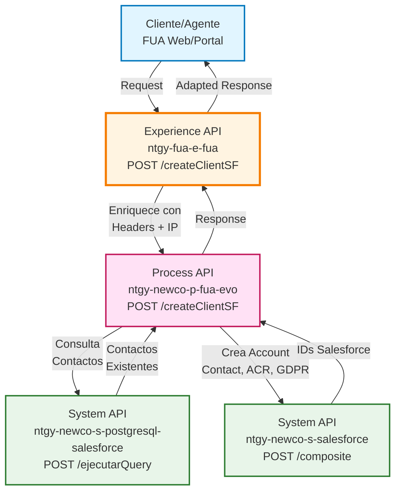
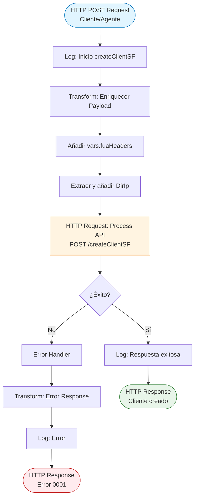
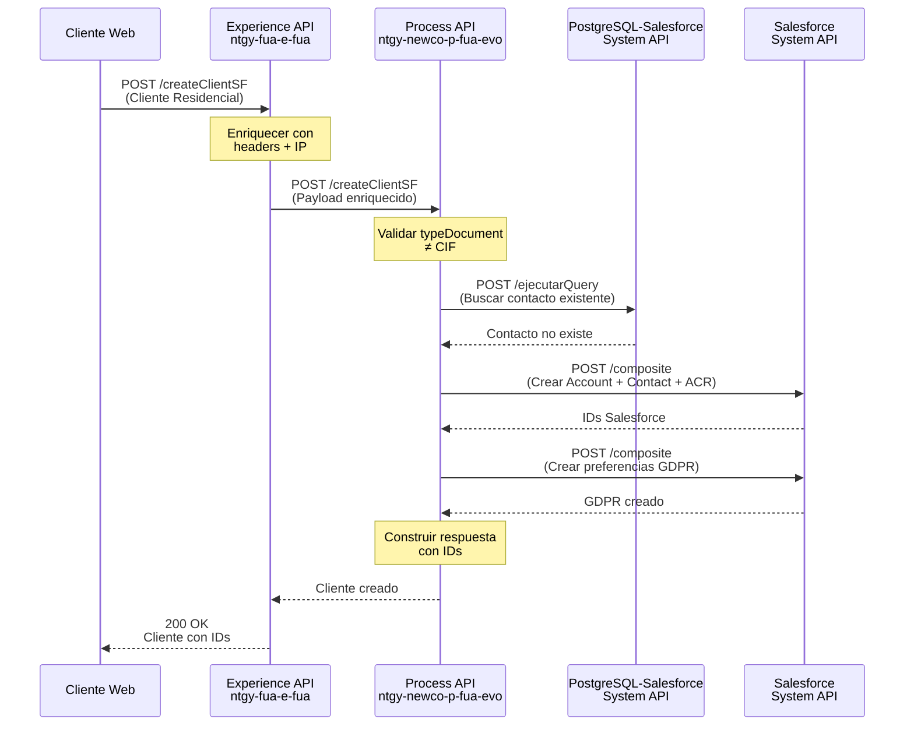
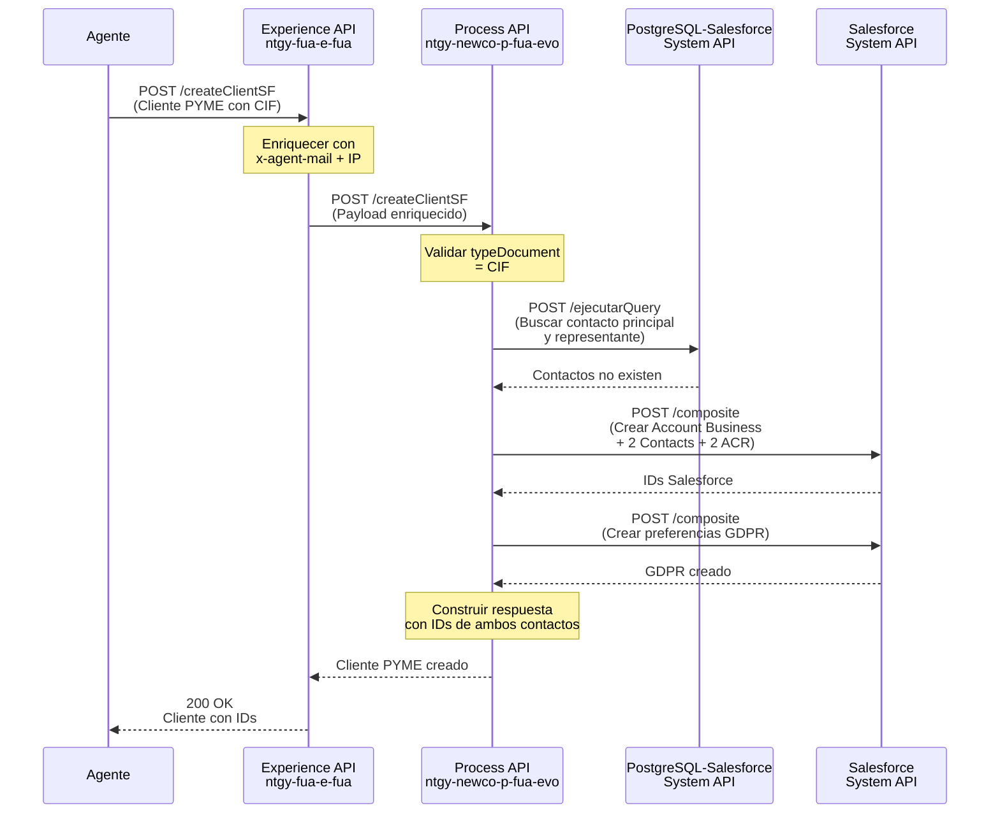
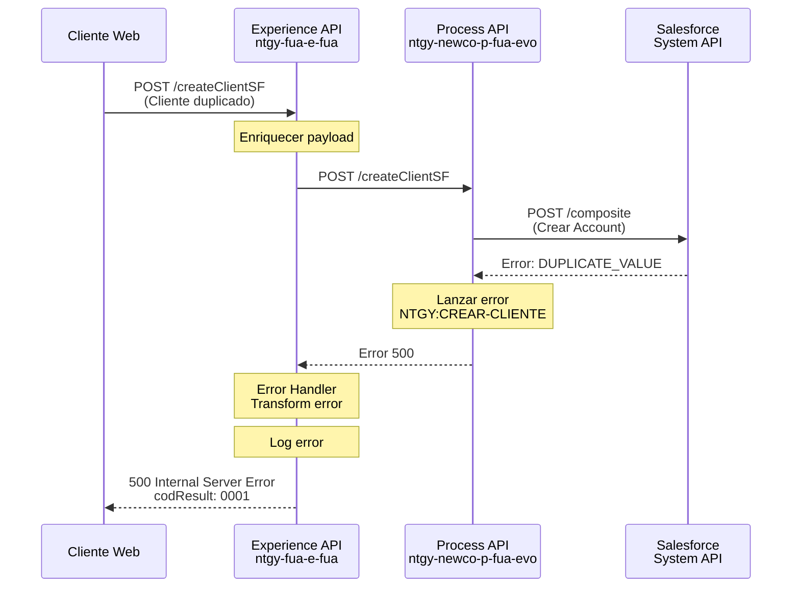
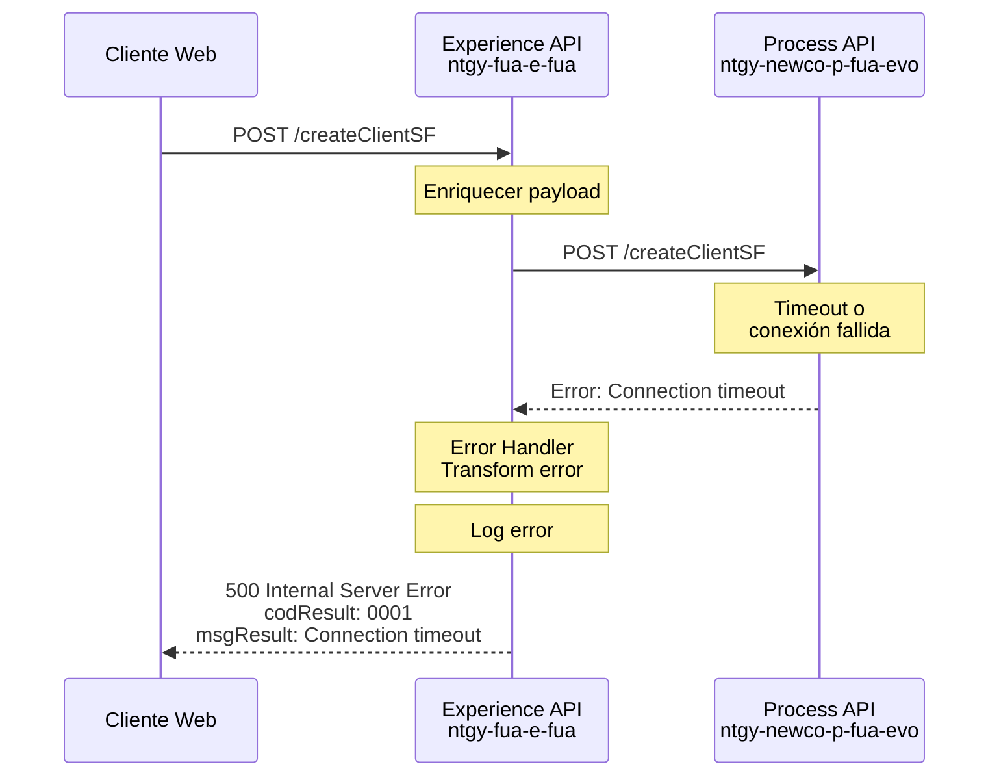

# POST /createClientSF

## 📌 Descripción General

### Propósito del Endpoint

Este endpoint permite crear un nuevo cliente en Salesforce desde el **Frontal Único de Atención (FUA)**, adaptando la experiencia según el canal de acceso (web o agente). El endpoint gestiona tanto clientes residenciales como empresariales (PYME), aplicando lógica diferenciada según el tipo de documento proporcionado.

### Tipo de API

**Capa:** Experience API (API-Led Connectivity)

**Función:** Adaptación de experiencia para canales web y agente del Frontal Único de Atención

### Patrón de Integración

**Tipo:** Pass-Through con Enriquecimiento de Datos

**Descripción:** Este Experience API actúa como un **pass-through** que enriquece el payload del cliente con información contextual (headers FUA, dirección IP) antes de delegar toda la lógica de negocio al Process API. **No transforma la estructura del cliente**, solo añade metadatos del canal. Actúa como punto de entrada unificado para la creación de clientes desde múltiples canales.

**Responsabilidades:**
- ✅ Enriquecer payload con headers FUA (`x-user-id`, `x-contact-id`, `x-agent-mail`)
- ✅ Extraer y añadir dirección IP del cliente (`DirIp`)
- ✅ Estandarizar respuestas de error (código `0001`)
- ❌ NO valida tipo de documento (CIF vs residencial)
- ❌ NO crea registros en Salesforce
- ❌ NO transforma estructura de datos del cliente

**Delegación:** Toda la lógica de negocio (validación de CIF, consulta de contactos existentes, creación en Salesforce, gestión de GDPR) se delega al Process API `ntgy-newco-p-fua-evo`.

### Arquitectura API-Led Connectivity



---

## 💼 Propósito del Negocio

### Casos de Uso Principales

1. **Alta de Cliente Residencial desde Portal Web**
   - Cliente se registra en el portal FUA con sus datos personales
   - Sistema valida documento (DNI/NIE) y crea perfil en Salesforce
   - Se establecen preferencias GDPR según selección del cliente

2. **Alta de Cliente PYME desde Portal de Agente**
   - Agente registra empresa con CIF y datos del representante legal
   - Sistema crea Account tipo "Business" con dos contactos (principal y representante)
   - Se gestionan relaciones AccountContactRelation para ambos contactos

3. **Actualización de Cliente Existente**
   - Si el contacto ya existe en Salesforce, se actualiza en lugar de crear duplicado
   - Se mantiene la trazabilidad del usuario que realiza la operación

### 📱 Canal y Audiencia

#### Canal de Consumo

**Canal:** Web / Agente

**Características del Canal:**
- **Plataforma**: Portal web del Frontal Único de Atención (FUA)
- **Dispositivos**: Navegadores web (desktop y móvil)
- **Conectividad**: Requiere conexión estable para operaciones en Salesforce
- **Experiencia de Usuario**: Formularios de registro con validación en tiempo real

#### Audiencia Objetivo

**Usuarios Finales:**
- **Clientes Residenciales**: Personas físicas que se registran en el portal FUA para gestionar sus servicios energéticos
- **Agentes de Atención al Cliente**: Personal de Naturgy que registra clientes empresariales (PYME) en nombre de los mismos

**Contexto de Uso:**
- **Registro Inicial**: Primer contacto del cliente con el portal FUA
- **Gestión de Representantes**: Empresas que necesitan designar representantes legales
- **Actualización de Datos**: Modificación de información de contacto existente

#### Adaptaciones del Canal

**Optimizaciones Aplicadas:**
- **Enriquecimiento de Datos**: Añade headers FUA y dirección IP del cliente automáticamente
- **Validación de Origen**: Identifica si la operación es realizada por cliente o agente mediante headers
- **Formato de Respuesta**: Estructura completa del cliente con IDs de Salesforce para uso inmediato
- **Manejo de Errores**: Respuestas estandarizadas con código `0001` para errores

### 🔗 Endpoints Dependientes

Este Experience API consume el siguiente Process API:

| Process API | Endpoint | Método | Propósito |
|-------------|----------|--------|-----------|
| `ntgy-newco-p-fua-evo` | `/createClientSF` | POST | Orquesta la creación de cliente en Salesforce con validación de contactos existentes y gestión de preferencias GDPR |

### Contexto Empresarial

- **Dominio:** Gestión de Clientes - Frontal Único de Atención
- **Sector:** Energía - Utilities
- **División:** Naturgy España - NewCo
- **Canal:** Web/Agente

### Stakeholders

- **Clientes Residenciales**: Necesitan registrarse en el portal FUA para acceder a servicios de autogestión
- **Clientes Empresariales (PYME)**: Requieren registro con representante legal para gestión de contratos
- **Agentes de Atención al Cliente**: Necesitan herramienta eficiente para registrar clientes empresariales
- **Equipo de CRM**: Requiere datos consistentes y completos en Salesforce

### Valor de Negocio

- **Reducción de Duplicados**: Valida existencia de contactos antes de crear nuevos registros
- **Cumplimiento GDPR**: Gestiona preferencias de privacidad desde el momento del registro
- **Trazabilidad**: Registra quién creó el cliente (cliente autoservicio o agente)
- **Experiencia Unificada**: Mismo endpoint para clientes residenciales y empresariales

---

## 🔧 Especificación Técnica

### URLs por Ambiente

| Ambiente | URL Base | URL Completa |
|----------|----------|--------------|
| **Local** | `http://localhost:8081` | `http://localhost:8081/fua/api/createClientSF` |
| **Development** | `https://ntgy-fua-e-fua-dev.de-c1.cloudhub.io` | `https://ntgy-fua-e-fua-dev.de-c1.cloudhub.io/fua/api/createClientSF` |
| **UAT** | `https://ntgy-fua-e-fua-uat.de-c1.cloudhub.io` | `https://ntgy-fua-e-fua-uat.de-c1.cloudhub.io/fua/api/createClientSF` |
| **Production** | `https://ntgy-fua-e-fua-pro.de-c1.cloudhub.io` | `https://ntgy-fua-e-fua-pro.de-c1.cloudhub.io/fua/api/createClientSF` |

### Método HTTP

```
POST /fua/api/createClientSF
```

### 🎯 Consideraciones del Canal

#### Limitaciones del Canal

| Aspecto | Limitación | Razón |
|---------|------------|-------|
| **Timeout** | 60 segundos | Operaciones complejas en Salesforce (Account + Contact + ACR + GDPR) |
| **Tamaño de Respuesta** | ~5 KB | Estructura completa del cliente con contactos |
| **Rate Limiting** | Según API Manager | Protección de recursos de Salesforce |
| **Validación** | Síncrona | Feedback inmediato al usuario sobre errores |

#### Campos Específicos del Canal

**Campos Añadidos por el Experience API:**

| Campo | Tipo | Descripción | Razón |
|-------|------|-------------|-------|
| `DirIp` | String | Dirección IP del cliente | Trazabilidad y cumplimiento GDPR |
| `x-user-id` | String (header) | ID del usuario agente | Identificar quién creó el cliente |
| `x-contact-id` | String (header) | ID del contacto cliente | Identificar cliente en autoservicio |
| `x-agent-mail` | String (header) | Email del agente | Trazabilidad de operaciones de agente |

### Parámetros de Entrada

#### Headers

| Header | Tipo | Requerido | Descripción |
|--------|------|-----------|-------------|
| `Content-Type` | String | ✅ Sí | Debe ser `application/json` |
| `x-user-id` | String | ❌ No | ID del usuario agente (si aplica) |
| `x-contact-id` | String | ❌ No | ID del contacto cliente (si aplica) |
| `x-agent-mail` | String | ❌ No | Email del agente (si aplica) |

#### Body - Cliente Residencial

```json
{
  "name": "Juan",
  "apellido1": "García",
  "apellido2": "López",
  "email": "juan.garcia@example.com",
  "phone": "34612345678",
  "document": "12345678A",
  "typeDocument": "DNI",
  "nacionalidad": "ES",
  "idioma": "Castellano",
  "birthdate": "1985-05-15",
  "treatment": "Sr.",
  "gdprPreferences": {
    "keepData": true,
    "commercial": false,
    "dataTransfer": false,
    "communications": true,
    "profile": true,
    "advertising": false,
    "survey": false,
    "market": false
  }
}
```

#### Body - Cliente PYME

```json
{
  "name": "Empresa Ejemplo SL",
  "email": "contacto@empresaejemplo.com",
  "phone": "34912345678",
  "document": "B12345678",
  "typeDocument": "CIF",
  "energy": "Electricidad",
  "idioma": "Castellano",
  "channel": "Email",
  "scheduleId": "Mañana",
  "representante": {
    "name": "María",
    "apellido1": "Rodríguez",
    "apellido2": "Sánchez",
    "email": "maria.rodriguez@empresaejemplo.com",
    "phone": "34623456789",
    "phone2": "34913456789",
    "document": "87654321B",
    "typeDocument": "DNI",
    "nacionalidad": "ES",
    "channel": "Teléfono",
    "scheduleId": "Tarde"
  },
  "gdprPreferences": {
    "keepData": true,
    "commercial": true,
    "dataTransfer": false,
    "communications": true,
    "profile": true,
    "advertising": true,
    "survey": true,
    "market": false
  }
}
```

#### Campos del Request

**Campos Comunes:**

| Campo | Tipo | Requerido | Descripción |
|-------|------|-----------|-------------|
| `name` | String | ✅ Sí | Nombre (persona) o razón social (empresa) |
| `email` | String | ✅ Sí | Email de contacto |
| `phone` | String | ✅ Sí | Teléfono (formato: prefijo + número) |
| `document` | String | ✅ Sí | Número de documento |
| `typeDocument` | String | ✅ Sí | Tipo: DNI, NIE, CIF, etc. |
| `idioma` | String | ✅ Sí | Idioma preferido: Castellano, Catalán, Euskera, Gallego, Inglés |
| `gdprPreferences` | Object | ✅ Sí | Preferencias de privacidad GDPR |

**Campos Residencial:**

| Campo | Tipo | Requerido | Descripción |
|-------|------|-----------|-------------|
| `apellido1` | String | ✅ Sí | Primer apellido |
| `apellido2` | String | ❌ No | Segundo apellido |
| `nacionalidad` | String | ✅ Sí | Código de país (ej: ES) |
| `birthdate` | String | ❌ No | Fecha de nacimiento (formato: YYYY-MM-DD) |
| `treatment` | String | ❌ No | Tratamiento: Sr., Sra., etc. |

**Campos PYME:**

| Campo | Tipo | Requerido | Descripción |
|-------|------|-----------|-------------|
| `energy` | String | ✅ Sí | Tipo de energía: Electricidad, Gas |
| `channel` | String | ✅ Sí | Canal preferente de contacto |
| `scheduleId` | String | ✅ Sí | Horario preferente |
| `representante` | Object | ✅ Sí | Datos del representante legal |

**Objeto representante:**

| Campo | Tipo | Requerido | Descripción |
|-------|------|-----------|-------------|
| `name` | String | ✅ Sí | Nombre del representante |
| `apellido1` | String | ✅ Sí | Primer apellido |
| `apellido2` | String | ❌ No | Segundo apellido |
| `email` | String | ✅ Sí | Email del representante |
| `phone` | String | ✅ Sí | Teléfono principal |
| `phone2` | String | ❌ No | Teléfono secundario |
| `document` | String | ✅ Sí | Documento del representante |
| `typeDocument` | String | ✅ Sí | Tipo de documento |
| `nacionalidad` | String | ✅ Sí | Nacionalidad |
| `channel` | String | ✅ Sí | Canal preferente |
| `scheduleId` | String | ✅ Sí | Horario preferente |

**Objeto gdprPreferences:**

| Campo | Tipo | Descripción |
|-------|------|-------------|
| `keepData` | Boolean | Conservación de datos |
| `commercial` | Boolean | Comunicaciones comerciales |
| `dataTransfer` | Boolean | Cesión de datos |
| `communications` | Boolean | Comunicaciones generales |
| `profile` | Boolean | Elaboración de perfiles |
| `advertising` | Boolean | Publicidad |
| `survey` | Boolean | Encuestas |
| `market` | Boolean | Estudios de mercado |

### Respuestas

#### Respuesta Exitosa (200 OK)

```json
{
  "result": {
    "codResult": "0000",
    "msgResult": "No hay error"
  },
  "client": {
    "clientId": "0015I00000XYZ123ABC",
    "clientType": null,
    "addressId": "",
    "isIndividualClient": true,
    "name": "Juan",
    "email": "juan.garcia@example.com",
    "phone": "34612345678",
    "surname": "García",
    "surname2": "López",
    "docTypeId": "dni",
    "docNumber": "12345678A",
    "nationalityId": "ES",
    "birthDate": "1985-05-15",
    "businessName": "",
    "cnae": "",
    "idEnergyUseType": null,
    "preferredLanguage": "es",
    "areacliente": false,
    "bypassSign": false,
    "naturgyManagement": false,
    "mainManagement": {
      "name": null,
      "phone": null,
      "email": null
    },
    "backUpManagement": {
      "name": null,
      "phone": null,
      "email": null
    },
    "gdprPreferences": {
      "keepData": true,
      "commercial": false,
      "dataTransfer": false,
      "communications": true,
      "profile": true,
      "advertising": false,
      "survey": false,
      "market": false
    },
    "contacts": [
      {
        "contactId": "0035I00000ABC456DEF",
        "clientId": "0015I00000XYZ123ABC",
        "name": "Juan",
        "surname": "García",
        "surname2": "López",
        "docTypeId": "dni",
        "docNumber": "12345678A",
        "nationalityId": "ES",
        "birthdate": "1985-05-15",
        "scheduleId": null,
        "preferredPhone": {
          "prefix": "346",
          "number": "12345678"
        },
        "phone2": {
          "prefix": "346",
          "number": "12345678"
        },
        "channel": null,
        "preferredEmail": "juan.garcia@example.com",
        "mailStatus": null,
        "isValidated": true,
        "vlocity_cmt__Type__c": "01",
        "isHolder": null,
        "isPreferred": true,
        "representationTypeId": "holder"
      }
    ],
    "address": {
      "zipCode": "",
      "province": "",
      "city": "",
      "way": "",
      "number": "",
      "floor": "",
      "door": "",
      "portal": "",
      "stairs": "",
      "provinceCode": "",
      "codMunIne": "",
      "premiseTypeCode": null,
      "viaId": null
    }
  }
}
```

#### Respuesta de Error (500 Internal Server Error)

```json
{
  "result": {
    "codResult": "0001",
    "msgResult": "Error al crear cliente en Salesforce: DUPLICATE_VALUE"
  }
}
```

#### Códigos de Respuesta

| Código | Descripción |
|--------|-------------|
| `200` | Cliente creado exitosamente |
| `400` | Request inválido (campos faltantes o formato incorrecto) |
| `500` | Error interno del servidor o error en Salesforce |

#### Códigos de Resultado

| Código | Descripción |
|--------|-------------|
| `0000` | Operación exitosa |
| `0001` | Error en la operación |

### Autenticación

- **Tipo:** OAuth 2.0 (gestionado por API Manager)
- **Scope:** Acceso a operaciones de creación de clientes
- **Headers adicionales:** `x-user-id`, `x-contact-id`, `x-agent-mail` para trazabilidad

### Timeouts

| Tipo | Valor | Razón |
|------|-------|-------|
| **Request Timeout** | 60 segundos | Operaciones complejas en Salesforce (múltiples composite requests) |
| **Connection Timeout** | 30 segundos | Establecimiento de conexión con Process API |

---

## 🏗️ Implementación Técnica

### Arquitectura del Flow



### Transformaciones de Canal

#### Transformación 1: Enriquecimiento de Payload

**Ubicación:** Experience API - `post-create-client-sf.xml` (líneas 13-28)

**Propósito:** Enriquecer el payload del cliente con información contextual del canal FUA

**Lógica de Transformación:**

```dataweave
%dw 2.2
import * from dw::core::Strings
output application/json
---
payload
++
vars.fuaHeaders 
++ 
{
    "DirIp": substringBefore(substringAfter(attributes.remoteAddress,"/"),":")
}
```

**Campos Añadidos:**

| Campo Original | Campo Añadido | Transformación |
|----------------|---------------|----------------|
| `attributes.remoteAddress` | `DirIp` | Extrae IP del formato "/127.0.0.1:12345" → "127.0.0.1" |
| `vars.fuaHeaders` | Headers FUA | Añade headers de contexto (x-user-id, x-contact-id, x-agent-mail) |

**Ejemplo de Transformación:**

**Input (payload original):**
```json
{
  "name": "Juan",
  "email": "juan@example.com",
  "document": "12345678A"
}
```

**Output (payload enriquecido):**
```json
{
  "name": "Juan",
  "email": "juan@example.com",
  "document": "12345678A",
  "x-user-id": "user123",
  "x-contact-id": "contact456",
  "DirIp": "192.168.1.100"
}
```

#### Transformación 2: Respuesta de Error

**Ubicación:** Experience API - `post-create-client-sf.xml` (líneas 32-44)

**Propósito:** Estandarizar respuestas de error con código 0001

**Lógica de Transformación:**

```dataweave
%dw 2.0
output application/json
---
{
  "result": {
    "codResult": "0001",
    "msgResult": error.description as String replace /\"/ with("")
  }
}
```

### Patrones de Diseño

**Patrón:** Enriquecimiento de Datos (Data Enrichment)

**Justificación:** 
- El Experience API añade contexto del canal (IP, headers FUA) antes de delegar al Process API
- Permite trazabilidad completa de las operaciones
- Separa responsabilidades: Experience API gestiona canal, Process API gestiona lógica de negocio

**Patrón:** Pass-Through con Enriquecimiento

**Justificación:**
- No transforma la estructura del cliente, solo añade metadatos
- Mantiene la simplicidad del Experience API
- Toda la lógica compleja (validación de CIF, creación en Salesforce) está en el Process API

### Diagramas de Secuencia

#### 1. Flujo Normal de Éxito - Cliente Residencial



#### 2. Flujo Normal de Éxito - Cliente PYME



#### 3. Flujo con Error de Negocio



#### 4. Flujo con Error Técnico



### Optimizaciones del Canal

**1. Enriquecimiento Automático de Datos**
- Extracción automática de IP del cliente desde `attributes.remoteAddress`
- Propagación de headers FUA sin intervención del cliente
- Reduce complejidad en el cliente (frontend)

**2. Manejo de Errores Estandarizado**
- Todos los errores se transforman a formato consistente con código `0001`
- Mensajes de error descriptivos para debugging
- Logging completo de errores para trazabilidad

**3. Timeout Optimizado**
- 60 segundos para operaciones complejas en Salesforce
- Permite completar múltiples composite requests sin timeout prematuro

### Manejo de Errores

**Error Handler Global:**

```xml
<error-handler>
  <on-error-propagate enableNotifications="true" logException="true">
    <ee:transform>
      <!-- Transformar error a formato estándar -->
      <ee:set-payload>
        {
          "result": {
            "codResult": "0001",
            "msgResult": error.description
          }
        }
      </ee:set-payload>
    </ee:transform>
    <logger level="ERROR" message="Error en createClientSF"/>
  </on-error-propagate>
</error-handler>
```

**Tipos de Errores Manejados:**

| Tipo de Error | Código | Acción |
|---------------|--------|--------|
| Error de Salesforce | 0001 | Transformar y propagar mensaje de Salesforce |
| Timeout de Process API | 0001 | Mensaje: "Connection timeout" |
| Error de validación | 0001 | Mensaje descriptivo del error |
| Error genérico | 0001 | Descripción del error capturado |

---

## 💻 Ejemplos de Uso

### Ejemplo 1: Crear Cliente Residencial desde Portal Web

#### cURL

```bash
curl -X POST "https://ntgy-fua-e-fua-pro.de-c1.cloudhub.io/fua/api/createClientSF" \
  -H "Content-Type: application/json" \
  -H "client_id: YOUR_CLIENT_ID" \
  -d '{
    "name": "Juan",
    "apellido1": "García",
    "apellido2": "López",
    "email": "juan.garcia@example.com",
    "phone": "34612345678",
    "document": "12345678A",
    "typeDocument": "DNI",
    "nacionalidad": "ES",
    "idioma": "Castellano",
    "birthdate": "1985-05-15",
    "treatment": "Sr.",
    "gdprPreferences": {
      "keepData": true,
      "commercial": false,
      "dataTransfer": false,
      "communications": true,
      "profile": true,
      "advertising": false,
      "survey": false,
      "market": false
    }
  }'
```

#### Respuesta (200 OK)

```json
{
  "result": {
    "codResult": "0000",
    "msgResult": "No hay error"
  },
  "client": {
    "clientId": "0015I00000XYZ123ABC",
    "isIndividualClient": true,
    "name": "Juan",
    "email": "juan.garcia@example.com",
    "phone": "34612345678",
    "surname": "García",
    "surname2": "López",
    "docTypeId": "dni",
    "docNumber": "12345678A",
    "nationalityId": "ES",
    "birthDate": "1985-05-15",
    "preferredLanguage": "es",
    "contacts": [
      {
        "contactId": "0035I00000ABC456DEF",
        "clientId": "0015I00000XYZ123ABC",
        "name": "Juan",
        "surname": "García",
        "surname2": "López",
        "isPreferred": true,
        "representationTypeId": "holder"
      }
    ]
  }
}
```

---

### Ejemplo 2: Crear Cliente PYME desde Portal de Agente

#### cURL

```bash
curl -X POST "https://ntgy-fua-e-fua-pro.de-c1.cloudhub.io/fua/api/createClientSF" \
  -H "Content-Type: application/json" \
  -H "client_id: YOUR_CLIENT_ID" \
  -H "x-user-id: agent123" \
  -H "x-agent-mail: agente@naturgy.com" \
  -d '{
    "name": "Empresa Ejemplo SL",
    "email": "contacto@empresaejemplo.com",
    "phone": "34912345678",
    "document": "B12345678",
    "typeDocument": "CIF",
    "energy": "Electricidad",
    "idioma": "Castellano",
    "channel": "Email",
    "scheduleId": "Mañana",
    "representante": {
      "name": "María",
      "apellido1": "Rodríguez",
      "apellido2": "Sánchez",
      "email": "maria.rodriguez@empresaejemplo.com",
      "phone": "34623456789",
      "phone2": "34913456789",
      "document": "87654321B",
      "typeDocument": "DNI",
      "nacionalidad": "ES",
      "channel": "Teléfono",
      "scheduleId": "Tarde"
    },
    "gdprPreferences": {
      "keepData": true,
      "commercial": true,
      "dataTransfer": false,
      "communications": true,
      "profile": true,
      "advertising": true,
      "survey": true,
      "market": false
    }
  }'
```

#### Respuesta (200 OK)

```json
{
  "result": {
    "codResult": "0000",
    "msgResult": "No hay error"
  },
  "client": {
    "clientId": "0015I00000XYZ789GHI",
    "isIndividualClient": false,
    "name": "Empresa Ejemplo SL",
    "email": "contacto@empresaejemplo.com",
    "phone": "34912345678",
    "docTypeId": "cif",
    "docNumber": "B12345678",
    "preferredLanguage": "es",
    "contacts": [
      {
        "contactId": "0035I00000DEF123GHI",
        "clientId": "0015I00000XYZ789GHI",
        "name": "Empresa Ejemplo SL",
        "vlocity_cmt__Type__c": "01",
        "isPreferred": true,
        "representationTypeId": "holder"
      },
      {
        "contactId": "0035I00000JKL456MNO",
        "clientId": "0015I00000XYZ789GHI",
        "name": "María",
        "surname": "Rodríguez",
        "surname2": "Sánchez",
        "vlocity_cmt__Type__c": "03",
        "isPreferred": false,
        "representationTypeId": "holder"
      }
    ]
  }
}
```

---

### Ejemplo 3: JavaScript (Frontend Web)

```javascript
async function crearClienteResidencial() {
  const clienteData = {
    name: "Juan",
    apellido1: "García",
    apellido2: "López",
    email: "juan.garcia@example.com",
    phone: "34612345678",
    document: "12345678A",
    typeDocument: "DNI",
    nacionalidad: "ES",
    idioma: "Castellano",
    birthdate: "1985-05-15",
    treatment: "Sr.",
    gdprPreferences: {
      keepData: true,
      commercial: false,
      dataTransfer: false,
      communications: true,
      profile: true,
      advertising: false,
      survey: false,
      market: false
    }
  };

  try {
    const response = await fetch(
      'https://ntgy-fua-e-fua-pro.de-c1.cloudhub.io/fua/api/createClientSF',
      {
        method: 'POST',
        headers: {
          'Content-Type': 'application/json',
          'client_id': 'YOUR_CLIENT_ID'
        },
        body: JSON.stringify(clienteData)
      }
    );

    const data = await response.json();
    
    if (data.result.codResult === "0000") {
      console.log('Cliente creado exitosamente:', data.client.clientId);
      console.log('Contact ID:', data.client.contacts[0].contactId);
      return data.client;
    } else {
      console.error('Error al crear cliente:', data.result.msgResult);
      throw new Error(data.result.msgResult);
    }
  } catch (error) {
    console.error('Error en la petición:', error);
    throw error;
  }
}

// Uso
crearClienteResidencial()
  .then(cliente => {
    console.log('Cliente registrado:', cliente);
  })
  .catch(error => {
    console.error('Fallo en el registro:', error);
  });
```

---

### Ejemplo 4: Python

```python
import requests
import json

def crear_cliente_pyme():
    """
    Crea un cliente PYME en Salesforce desde el portal de agente
    """
    url = "https://ntgy-fua-e-fua-pro.de-c1.cloudhub.io/fua/api/createClientSF"
    
    headers = {
        "Content-Type": "application/json",
        "client_id": "YOUR_CLIENT_ID",
        "x-user-id": "agent123",
        "x-agent-mail": "agente@naturgy.com"
    }
    
    cliente_data = {
        "name": "Empresa Ejemplo SL",
        "email": "contacto@empresaejemplo.com",
        "phone": "34912345678",
        "document": "B12345678",
        "typeDocument": "CIF",
        "energy": "Electricidad",
        "idioma": "Castellano",
        "channel": "Email",
        "scheduleId": "Mañana",
        "representante": {
            "name": "María",
            "apellido1": "Rodríguez",
            "apellido2": "Sánchez",
            "email": "maria.rodriguez@empresaejemplo.com",
            "phone": "34623456789",
            "phone2": "34913456789",
            "document": "87654321B",
            "typeDocument": "DNI",
            "nacionalidad": "ES",
            "channel": "Teléfono",
            "scheduleId": "Tarde"
        },
        "gdprPreferences": {
            "keepData": True,
            "commercial": True,
            "dataTransfer": False,
            "communications": True,
            "profile": True,
            "advertising": True,
            "survey": True,
            "market": False
        }
    }
    
    try:
        response = requests.post(url, headers=headers, json=cliente_data)
        response.raise_for_status()
        
        data = response.json()
        
        if data["result"]["codResult"] == "0000":
            print(f"Cliente PYME creado exitosamente")
            print(f"Client ID: {data['client']['clientId']}")
            print(f"Contacto Principal: {data['client']['contacts'][0]['contactId']}")
            print(f"Contacto Representante: {data['client']['contacts'][1]['contactId']}")
            return data["client"]
        else:
            print(f"Error: {data['result']['msgResult']}")
            return None
            
    except requests.exceptions.RequestException as e:
        print(f"Error en la petición: {e}")
        return None

# Uso
if __name__ == "__main__":
    cliente = crear_cliente_pyme()
    if cliente:
        print(json.dumps(cliente, indent=2))
```

---

### Ejemplo 5: Respuesta de Error - Cliente Duplicado

#### Request

```bash
curl -X POST "https://ntgy-fua-e-fua-pro.de-c1.cloudhub.io/fua/api/createClientSF" \
  -H "Content-Type: application/json" \
  -H "client_id: YOUR_CLIENT_ID" \
  -d '{
    "name": "Juan",
    "apellido1": "García",
    "email": "juan.garcia@example.com",
    "phone": "34612345678",
    "document": "12345678A",
    "typeDocument": "DNI",
    "nacionalidad": "ES",
    "idioma": "Castellano"
  }'
```

#### Respuesta (500 Internal Server Error)

```json
{
  "result": {
    "codResult": "0001",
    "msgResult": "Error al crear cliente en Salesforce: DUPLICATE_VALUE: duplicate value found: NewCo_DocumentNumber__c duplicates value on record with id: 0035I00000ABC456"
  }
}
```

---

### Ejemplo 6: Respuesta de Error - Timeout

#### Request

```bash
curl -X POST "https://ntgy-fua-e-fua-pro.de-c1.cloudhub.io/fua/api/createClientSF" \
  -H "Content-Type: application/json" \
  -H "client_id: YOUR_CLIENT_ID" \
  -d '{
    "name": "Test Cliente",
    "email": "test@example.com",
    "phone": "34600000000",
    "document": "00000000T",
    "typeDocument": "DNI",
    "nacionalidad": "ES",
    "idioma": "Castellano"
  }'
```

#### Respuesta (500 Internal Server Error)

```json
{
  "result": {
    "codResult": "0001",
    "msgResult": "HTTP:TIMEOUT - Timeout exceeded when consuming operation"
  }
}
```

---

## 📋 Notas Adicionales

### Consideraciones de Implementación

1. **Validación de Documentos:**
   - El sistema valida automáticamente si el documento es CIF para determinar si es cliente PYME
   - Para PYME (CIF), el campo `representante` es obligatorio
   - Para residenciales, los campos `apellido1` y `nacionalidad` son obligatorios

2. **Gestión de Contactos Existentes:**
   - El Process API verifica si el contacto ya existe antes de crear uno nuevo
   - Si existe, actualiza el contacto en lugar de crear duplicado
   - Mantiene la integridad referencial en Salesforce

3. **Preferencias GDPR:**
   - Se crean registros individuales en Salesforce para cada preferencia
   - Cada preferencia tiene un código único (00-07)
   - Se registra la IP y el canal de modificación

4. **Trazabilidad:**
   - El campo `DirIp` captura la IP del cliente automáticamente
   - Los headers `x-user-id` y `x-agent-mail` identifican quién creó el cliente
   - Toda la información se propaga al Process API para auditoría

### Mejores Prácticas

1. **Manejo de Errores:**
   - Siempre verificar el campo `result.codResult` en la respuesta
   - Código `0000` indica éxito, `0001` indica error
   - Implementar retry logic para errores de timeout

2. **Validación en Frontend:**
   - Validar formato de email antes de enviar
   - Validar formato de teléfono (prefijo + número)
   - Validar formato de documento según tipo

3. **Seguridad:**
   - Nunca exponer `client_id` en código frontend público
   - Usar variables de entorno para credenciales
   - Implementar rate limiting en el cliente

4. **Performance:**
   - El endpoint puede tardar hasta 60 segundos en responder
   - Implementar indicadores de carga en la UI
   - Considerar operaciones asíncronas para mejor UX
