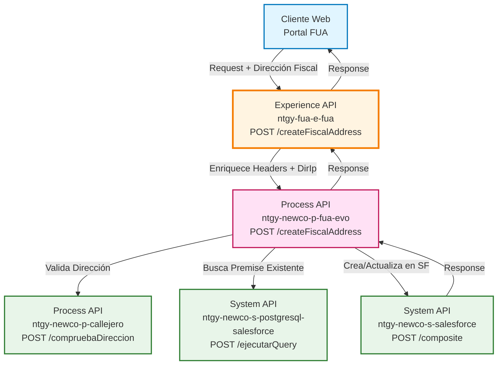
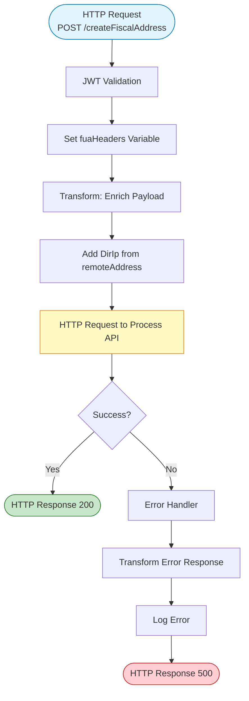
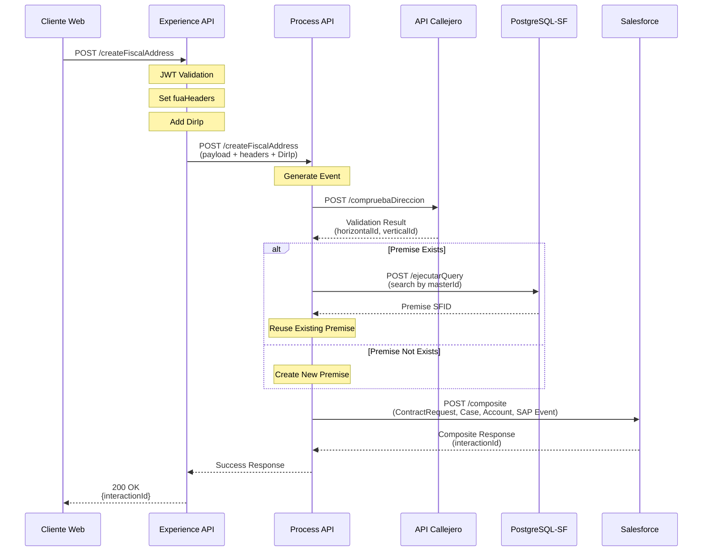
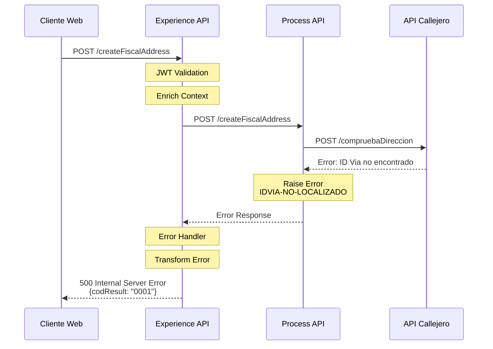
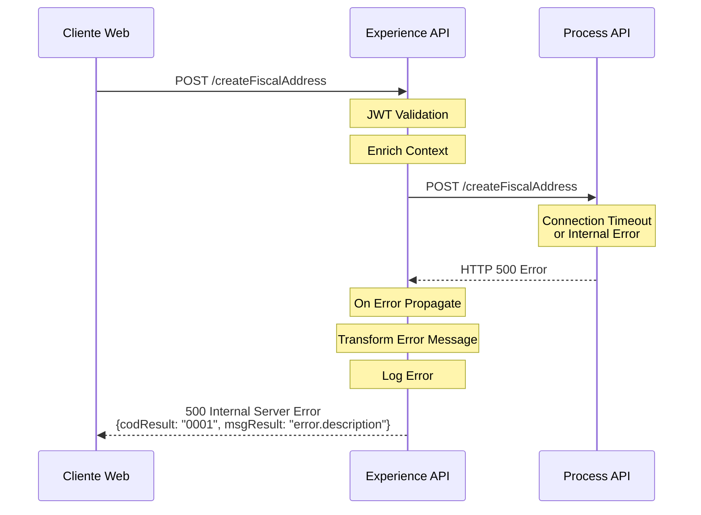

# POST /createFiscalAddress

## 📌 Descripción General

### Propósito del Endpoint

Este endpoint permite crear o actualizar la dirección fiscal de un cliente en el sistema Salesforce. Realiza una validación previa de la dirección en el callejero municipal, gestiona la creación o reutilización de premises (localizaciones físicas) en Salesforce, y genera automáticamente los casos de gestión y eventos de integración con SAP ISU necesarios para el proceso de cambio de dirección fiscal.

### Tipo de API

**Capa:** Experience API (API-Led Connectivity)

**Función:** Adaptación de experiencia para canal web del portal FUA (Frontal Único de Atención)

### Patrón de Integración

**Tipo:** Orquestación con Enriquecimiento de Headers

**Descripción:** El Experience API enriquece la petición con headers de contexto FUA (x-client-id, x-user-id, x-interaction-id, etc.) y la dirección IP del cliente, delegando la lógica de negocio completa al Process API.

### Arquitectura API-Led Connectivity



---

## 💼 Propósito del Negocio

### Casos de Uso Principales

1. **Cambio de Dirección Fiscal por Cliente**
   - Cliente accede al portal FUA y solicita cambio de dirección fiscal
   - Sistema valida la dirección en callejero municipal
   - Se crea automáticamente caso de gestión y evento de sincronización con SAP

2. **Cambio de Dirección Fiscal por Agente**
   - Agente de atención al cliente realiza cambio de dirección fiscal en nombre del cliente
   - Sistema registra quién realizó el cambio (x-user-id)
   - Se vincula a la interacción del call center (x-interaction-id)

3. **Actualización de Dirección Fiscal en Proceso de Alta**
   - Durante proceso de alta de cliente, se establece dirección fiscal
   - Sistema crea premise nueva o reutiliza existente según validación de callejero
   - Se genera evento para sincronización con SAP ISU

### 📱 Canal y Audiencia

#### Canal de Consumo

**Canal:** Web

**Características del Canal:**
- **Plataforma**: Portal FUA (Frontal Único de Atención) - Aplicación web responsive
- **Dispositivos**: Desktop y tablets
- **Conectividad**: Requiere conexión estable para validación en tiempo real
- **Experiencia de Usuario**: Formulario de dirección con validación en callejero

#### Audiencia Objetivo

**Usuarios Finales:**
- **Clientes Residenciales y Empresariales**: Necesitan actualizar su dirección fiscal para facturación
- **Agentes de Atención al Cliente**: Realizan cambios de dirección fiscal en nombre de clientes durante llamadas

**Contexto de Uso:**
- **Autoservicio Web**: Cliente accede a su área personal y actualiza dirección fiscal
- **Atención Telefónica**: Agente actualiza dirección fiscal durante llamada con cliente

#### Adaptaciones del Canal

**Optimizaciones Aplicadas:**
- **Enriquecimiento de Headers**: Se añaden automáticamente headers de contexto FUA (x-client-id, x-user-id, x-interaction-id, x-user-role, x-agent-mail, x-contact-id)
- **Captura de IP**: Se añade la dirección IP del cliente (DirIp) para auditoría
- **Formato de Respuesta**: Respuesta simplificada con código de resultado y ID de interacción
- **Timeout Extendido**: 60 segundos para permitir validaciones y operaciones en Salesforce

### 🔗 Endpoints Dependientes

Este Experience API consume el siguiente Process API:

| Process API | Endpoint | Método | Propósito |
|-------------|----------|--------|-----------|
| `ntgy-newco-p-fua-evo` | `/createFiscalAddress` | POST | Orquesta el proceso completo de creación/actualización de dirección fiscal: validación en callejero, gestión de premises, creación de casos de gestión y eventos de integración SAP |

### Contexto Empresarial

- **Dominio:** Gestión de Clientes y Direcciones
- **Sector:** Energía - Utilities
- **División:** Naturgy España - NewCo
- **Canal:** Portal Web FUA (Frontal Único de Atención)

### Stakeholders

- **Clientes Finales**: Necesitan actualizar su dirección fiscal para recibir facturas correctamente
- **Agentes de Atención al Cliente**: Requieren herramienta para gestionar cambios de dirección fiscal
- **Departamento de Facturación**: Necesita direcciones fiscales actualizadas para emisión de facturas
- **Equipo de Integración SAP**: Requiere eventos de sincronización para actualizar SAP ISU

### Valor de Negocio

- **Autoservicio**: Permite a clientes actualizar su dirección fiscal sin llamar al call center
- **Trazabilidad**: Registro completo de quién, cuándo y desde dónde se realizó el cambio
- **Calidad de Datos**: Validación automática en callejero municipal garantiza direcciones correctas
- **Integración Automática**: Sincronización automática con SAP ISU mediante eventos
- **Eficiencia Operativa**: Reducción de errores en direcciones fiscales y mejora en entrega de facturas

---

## 🔧 Especificación Técnica

### URLs por Ambiente

| Ambiente | URL Base | URL Completa |
|----------|----------|--------------|
| **Local** | `http://localhost:8081` | `http://localhost:8081/fua/api/createFiscalAddress` |
| **Development** | `https://ntgy-fua-e-fua-dev.de-c1.cloudhub.io` | `https://ntgy-fua-e-fua-dev.de-c1.cloudhub.io/fua/api/createFiscalAddress` |
| **UAT** | `https://ntgy-fua-e-fua-cc.de-c1.cloudhub.io` | `https://ntgy-fua-e-fua-cc.de-c1.cloudhub.io/fua/api/createFiscalAddress` |
| **Production** | `https://ntgy-fua-e-fua-pro.de-c1.cloudhub.io` | `https://ntgy-fua-e-fua-pro.de-c1.cloudhub.io/fua/api/createFiscalAddress` |

### Método HTTP

```
POST /fua/api/createFiscalAddress
```

### 🎯 Consideraciones del Canal

#### Limitaciones del Canal

| Aspecto | Limitación | Razón |
|---------|------------|-------|
| **Timeout** | 60 segundos | Proceso complejo que incluye validación en callejero, consultas a BD y operaciones en Salesforce |
| **Rate Limiting** | Según política API Gateway | Protección contra abuso |
| **Tamaño de Request** | 10 MB máximo | Suficiente para datos de dirección fiscal |

#### Campos Específicos del Canal

**Campos Añadidos por el Experience API:**

| Campo | Tipo | Descripción | Razón |
|-------|------|-------------|-------|
| `DirIp` | String | Dirección IP del cliente | Auditoría y trazabilidad de cambios |

**Headers Enriquecidos Automáticamente:**

| Header | Tipo | Descripción | Origen |
|--------|------|-------------|--------|
| `x-client-id` | String | ID del cliente en Salesforce | Sesión FUA |
| `x-user-id` | String | ID del usuario/agente | Sesión FUA |
| `x-contact-id` | String | ID del contacto | Sesión FUA |
| `x-interaction-id` | String | ID de interacción (opcional) | Call center |
| `x-user-role` | String | Rol del usuario (newcoAgent/customer) | Sesión FUA |
| `x-agent-mail` | String | Email del agente (opcional) | Sesión FUA |
| `traceparent` | String | Trace ID para correlación | Tracing distribuido |

### Parámetros de Entrada

#### Headers Requeridos

| Header | Tipo | Requerido | Descripción |
|--------|------|-----------|-------------|
| `Content-Type` | String | Sí | Debe ser `application/json` |
| `x-client-id` | String | Sí | ID del cliente en Salesforce |
| `x-contact-id` | String | Sí | ID del contacto en Salesforce |

#### Headers Opcionales

| Header | Tipo | Descripción |
|--------|------|-------------|
| `x-user-id` | String | ID del usuario/agente (si es agente) |
| `x-interaction-id` | String | ID de interacción del call center |
| `x-user-role` | String | Rol del usuario (newcoAgent/customer) |
| `x-agent-mail` | String | Email del agente |
| `traceparent` | String | Trace ID para correlación distribuida |

#### Body (JSON)

```json
{
  "fiscalAddress": {
    "wayId": "string",
    "wayTypeId": "string",
    "way": "string",
    "number": "string",
    "portal": "string",
    "stairs": "string",
    "floor": "string",
    "door": "string",
    "zipCode": "string",
    "city": "string",
    "province": "string",
    "codMunIne": "string"
  },
  "addressId": "string"
}
```

**Descripción de Campos:**

| Campo | Tipo | Requerido | Descripción |
|-------|------|-----------|-------------|
| `fiscalAddress` | Object | Sí | Objeto con datos de la dirección fiscal |
| `fiscalAddress.wayId` | String | Sí | ID de la vía en el callejero municipal |
| `fiscalAddress.wayTypeId` | String | Sí | Tipo de vía (Calle, Avenida, Plaza, etc.) |
| `fiscalAddress.way` | String | Sí | Nombre de la vía |
| `fiscalAddress.number` | String | Sí | Número de la dirección |
| `fiscalAddress.portal` | String | No | Portal del edificio |
| `fiscalAddress.stairs` | String | No | Escalera |
| `fiscalAddress.floor` | String | No | Piso |
| `fiscalAddress.door` | String | No | Puerta |
| `fiscalAddress.zipCode` | String | Sí | Código postal |
| `fiscalAddress.city` | String | Sí | Ciudad/Localidad |
| `fiscalAddress.province` | String | Sí | Provincia |
| `fiscalAddress.codMunIne` | String | Sí | Código INE del municipio |
| `addressId` | String | No | ID de dirección (si existe) |

### Respuestas

#### 200 OK - Éxito

```json
{
  "result": {
    "codResult": "0000",
    "msgResult": "No hay error"
  },
  "interactionId": "5003X000001AbCdQAK"
}
```

**Descripción de Campos de Respuesta:**

| Campo | Tipo | Descripción |
|-------|------|-------------|
| `result` | Object | Objeto con resultado de la operación |
| `result.codResult` | String | Código de resultado ("0000" = éxito) |
| `result.msgResult` | String | Mensaje descriptivo del resultado |
| `interactionId` | String | ID del caso de gestión creado en Salesforce |

#### 500 Internal Server Error

```json
{
  "result": {
    "codResult": "0001",
    "msgResult": "Error description"
  }
}
```

### Autenticación

- **Tipo:** OAuth 2.0 + API Gateway
- **Validación:** JWT token validado por el Experience API
- **Headers de Sesión:** x-client-id, x-contact-id requeridos

### Timeouts

| Tipo | Valor | Razón |
|------|-------|-------|
| **Request Timeout** | 60 segundos | Proceso complejo con múltiples validaciones y operaciones en Salesforce |
| **Connection Timeout** | 60 segundos | Configurado en HTTP connector del Process API |

---

## 🏗️ Implementación Técnica

### Arquitectura del Flow



### Transformaciones de Canal

**Enriquecimiento de Payload:**

El Experience API enriquece el payload original con:

1. **Headers FUA** (vars.fuaHeaders):
   - x-interaction-id
   - x-interaction-origin
   - x-user-id
   - x-client-id
   - x-client-doc-number
   - x-client-code
   - x-origin
   - x-user-role
   - traceparent
   - x-agent-mail
   - x-language
   - x-contact-id

2. **Dirección IP del Cliente** (DirIp):
   - Extraída de `attributes.remoteAddress`
   - Formato: Se extrae la IP entre "/" y ":"

**Código de Transformación (líneas 643-651 de post-create-fiscal-address.xml):**

```dataweave
%dw 2.2
import * from dw::core::Strings
output application/json
---
payload
++ 
vars.fuaHeaders 
++
{
    "DirIp": substringBefore(substringAfter(attributes.remoteAddress,"/"),":")
}
```

### Delegación al Process API

**Configuración HTTP Request:**

- **Config Ref:** `HTTP_FUA_PROCESS_NEWCO_EVO`
- **Method:** POST
- **Path:** `/createFiscalAddress`
- **Host:** `${newco-p-fua-evo.host}` (mule-worker-internal-ntgy-newco-p-fua-evo.de-c1.cloudhub.io)
- **Port:** `${newco-p-fua-evo.port}` (8091)
- **Timeout:** `${newco-p-fua-evo.timeout}` (60000 ms)

**Ubicación en código:** Línea 652 de post-create-fiscal-address.xml

### Patrones de Diseño

**Patrón:** Pass-Through con Enriquecimiento de Contexto

**Justificación:** 
- El Experience API no implementa lógica de negocio
- Su responsabilidad es enriquecer el contexto de la petición con información de sesión FUA
- Toda la lógica de validación, creación de premises y casos está en el Process API
- Permite reutilizar el Process API desde otros canales (móvil, voz) con diferentes contextos

### Diagramas de Secuencia

#### 1. Flujo Normal de Éxito



#### 2. Flujo con Error de Validación de Dirección



#### 3. Flujo con Error Técnico



### Manejo de Errores

**Error Handler (líneas 653-665 de post-create-fiscal-address.xml):**

```xml
<error-handler>
    <on-error-propagate enableNotifications="true" logException="true">
        <ee:transform>
            <ee:set-payload>
                %dw 2.0
                output application/json
                ---
                {
                    "result": {
                        "codResult": "0001",
                        "msgResult": error.description as String replace /"/ with("")
                    }
                }
            </ee:set-payload>
        </ee:transform>
        <logger level="ERROR" message='Error en createFiscalAddress'/>
    </on-error-propagate>
</error-handler>
```

**Estrategia:**
- Captura cualquier error del Process API
- Transforma el error a formato estándar con codResult "0001"
- Elimina comillas dobles del mensaje de error para evitar problemas de JSON
- Registra el error en logs para troubleshooting
- Propaga el error al cliente con HTTP 500

---

## 💻 Ejemplos de Uso

### Ejemplo 1: Cambio de Dirección Fiscal por Cliente

#### cURL

```bash
curl -X POST "https://ntgy-fua-e-fua-pro.de-c1.cloudhub.io/fua/api/createFiscalAddress" \
  -H "Content-Type: application/json" \
  -H "Authorization: Bearer YOUR_JWT_TOKEN" \
  -H "x-client-id: 0013X00000AbCdEQAV" \
  -H "x-contact-id: 0033X00000XyzAbQAJ" \
  -H "x-user-role: customer" \
  -d '{
    "fiscalAddress": {
      "wayId": "280790001234",
      "wayTypeId": "CL",
      "way": "Gran Vía",
      "number": "28",
      "portal": "A",
      "stairs": "1",
      "floor": "3",
      "door": "B",
      "zipCode": "28013",
      "city": "Madrid",
      "province": "Madrid",
      "codMunIne": "28079"
    },
    "addressId": ""
  }'
```

#### Respuesta (200 OK)

```json
{
  "result": {
    "codResult": "0000",
    "msgResult": "No hay error"
  },
  "interactionId": "5003X000001AbCdQAK"
}
```

### Ejemplo 2: Cambio de Dirección Fiscal por Agente

#### cURL

```bash
curl -X POST "https://ntgy-fua-e-fua-pro.de-c1.cloudhub.io/fua/api/createFiscalAddress" \
  -H "Content-Type: application/json" \
  -H "Authorization: Bearer YOUR_JWT_TOKEN" \
  -H "x-client-id: 0013X00000AbCdEQAV" \
  -H "x-contact-id: 0033X00000XyzAbQAJ" \
  -H "x-user-id: 0053X00000AgentXYZ" \
  -H "x-user-role: newcoAgent" \
  -H "x-agent-mail: agente@naturgy.com" \
  -H "x-interaction-id: 5003X00000InteractionXYZ" \
  -d '{
    "fiscalAddress": {
      "wayId": "080193005678",
      "wayTypeId": "AV",
      "way": "Diagonal",
      "number": "525",
      "portal": "",
      "stairs": "",
      "floor": "5",
      "door": "1",
      "zipCode": "08029",
      "city": "Barcelona",
      "province": "Barcelona",
      "codMunIne": "08019"
    },
    "addressId": ""
  }'
```

#### Respuesta (200 OK)

```json
{
  "result": {
    "codResult": "0000",
    "msgResult": "No hay error"
  },
  "interactionId": "5003X000001XyzAbQAK"
}
```

### Ejemplo 3: JavaScript (Frontend Web)

```javascript
async function createFiscalAddress(fiscalAddressData) {
  try {
    const response = await fetch('https://ntgy-fua-e-fua-pro.de-c1.cloudhub.io/fua/api/createFiscalAddress', {
      method: 'POST',
      headers: {
        'Content-Type': 'application/json',
        'Authorization': `Bearer ${sessionStorage.getItem('jwt_token')}`,
        'x-client-id': sessionStorage.getItem('client_id'),
        'x-contact-id': sessionStorage.getItem('contact_id'),
        'x-user-role': 'customer'
      },
      body: JSON.stringify({
        fiscalAddress: fiscalAddressData,
        addressId: ''
      })
    });

    if (!response.ok) {
      throw new Error(`HTTP error! status: ${response.status}`);
    }

    const data = await response.json();
    
    if (data.result.codResult === '0000') {
      console.log('Dirección fiscal actualizada correctamente');
      console.log('ID de caso de gestión:', data.interactionId);
      return data;
    } else {
      console.error('Error al actualizar dirección fiscal:', data.result.msgResult);
      throw new Error(data.result.msgResult);
    }
  } catch (error) {
    console.error('Error en la petición:', error);
    throw error;
  }
}

// Uso
const nuevaDireccion = {
  wayId: '280790001234',
  wayTypeId: 'CL',
  way: 'Gran Vía',
  number: '28',
  portal: 'A',
  stairs: '1',
  floor: '3',
  door: 'B',
  zipCode: '28013',
  city: 'Madrid',
  province: 'Madrid',
  codMunIne: '28079'
};

createFiscalAddress(nuevaDireccion)
  .then(result => {
    alert('Dirección fiscal actualizada correctamente');
  })
  .catch(error => {
    alert('Error al actualizar dirección fiscal: ' + error.message);
  });
```

### Ejemplo 4: Error - Dirección No Válida

#### Request

```bash
curl -X POST "https://ntgy-fua-e-fua-pro.de-c1.cloudhub.io/fua/api/createFiscalAddress" \
  -H "Content-Type: application/json" \
  -H "Authorization: Bearer YOUR_JWT_TOKEN" \
  -H "x-client-id: 0013X00000AbCdEQAV" \
  -H "x-contact-id: 0033X00000XyzAbQAJ" \
  -d '{
    "fiscalAddress": {
      "wayId": "999999999999",
      "wayTypeId": "CL",
      "way": "Calle Inexistente",
      "number": "999",
      "zipCode": "99999",
      "city": "Ciudad Inexistente",
      "province": "Provincia Inexistente",
      "codMunIne": "99999"
    }
  }'
```

#### Respuesta (500 Internal Server Error)

```json
{
  "result": {
    "codResult": "0001",
    "msgResult": "Id via no encontrado en callejero"
  }
}
```

### Ejemplo 5: Python

```python
import requests
import json

def create_fiscal_address(jwt_token, client_id, contact_id, fiscal_address_data):
    """
    Crea o actualiza la dirección fiscal de un cliente
    
    Args:
        jwt_token (str): Token JWT de autenticación
        client_id (str): ID del cliente en Salesforce
        contact_id (str): ID del contacto en Salesforce
        fiscal_address_data (dict): Datos de la dirección fiscal
    
    Returns:
        dict: Respuesta del API con interactionId
    """
    url = 'https://ntgy-fua-e-fua-pro.de-c1.cloudhub.io/fua/api/createFiscalAddress'
    
    headers = {
        'Content-Type': 'application/json',
        'Authorization': f'Bearer {jwt_token}',
        'x-client-id': client_id,
        'x-contact-id': contact_id,
        'x-user-role': 'customer'
    }
    
    payload = {
        'fiscalAddress': fiscal_address_data,
        'addressId': ''
    }
    
    try:
        response = requests.post(url, headers=headers, json=payload, timeout=60)
        response.raise_for_status()
        
        data = response.json()
        
        if data['result']['codResult'] == '0000':
            print(f"✓ Dirección fiscal actualizada correctamente")
            print(f"  ID de caso de gestión: {data['interactionId']}")
            return data
        else:
            print(f"✗ Error: {data['result']['msgResult']}")
            return None
            
    except requests.exceptions.Timeout:
        print("✗ Error: Timeout en la petición (>60s)")
        return None
    except requests.exceptions.RequestException as e:
        print(f"✗ Error en la petición: {str(e)}")
        return None

# Ejemplo de uso
if __name__ == '__main__':
    # Datos de ejemplo
    jwt_token = 'eyJhbGciOiJIUzI1NiIsInR5cCI6IkpXVCJ9...'
    client_id = '0013X00000AbCdEQAV'
    contact_id = '0033X00000XyzAbQAJ'
    
    nueva_direccion = {
        'wayId': '280790001234',
        'wayTypeId': 'CL',
        'way': 'Gran Vía',
        'number': '28',
        'portal': 'A',
        'stairs': '1',
        'floor': '3',
        'door': 'B',
        'zipCode': '28013',
        'city': 'Madrid',
        'province': 'Madrid',
        'codMunIne': '28079'
    }
    
    # Ejecutar
    result = create_fiscal_address(jwt_token, client_id, contact_id, nueva_direccion)
    
    if result:
        print(f"\n✓ Proceso completado exitosamente")
        print(f"  Puede consultar el caso de gestión con ID: {result['interactionId']}")
```
