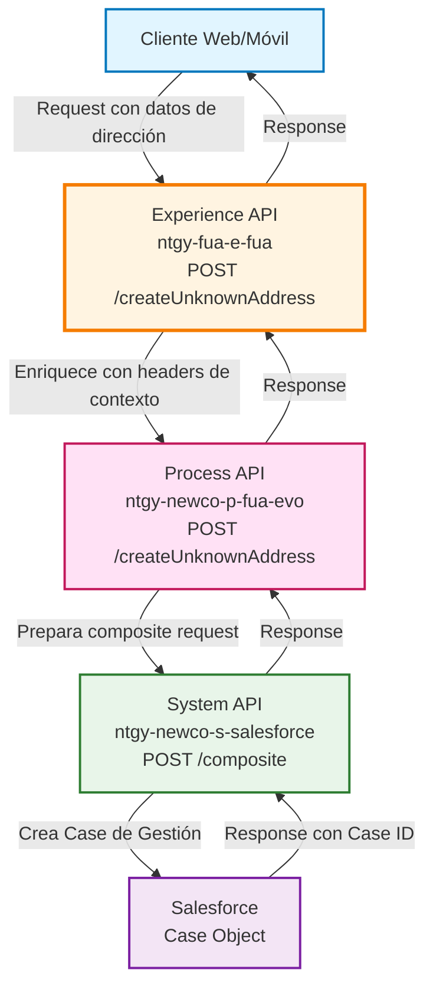
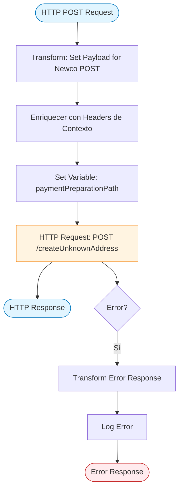
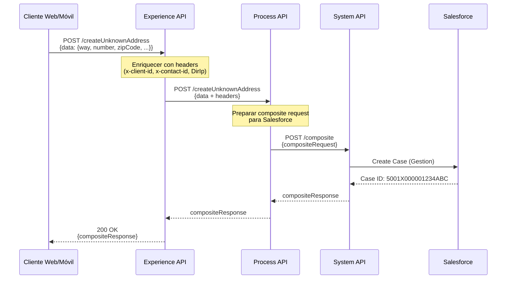
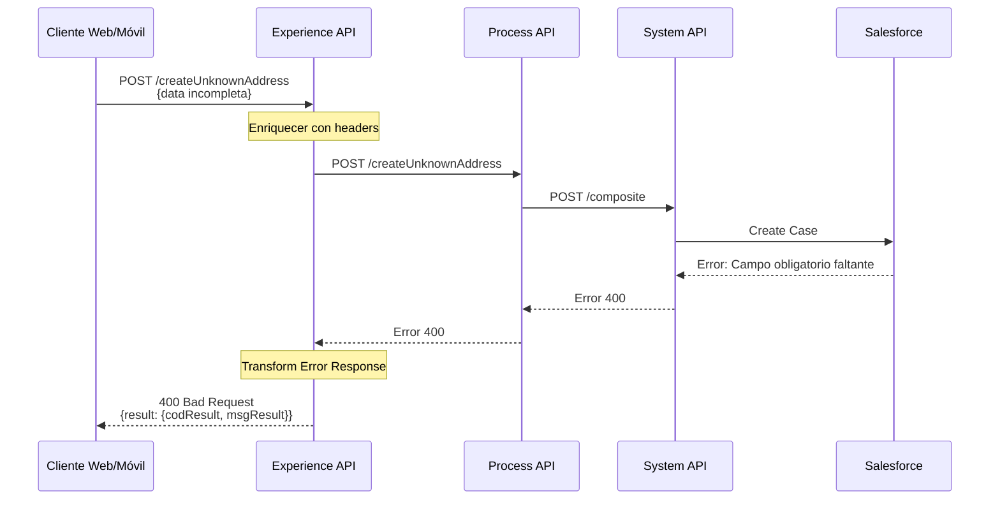
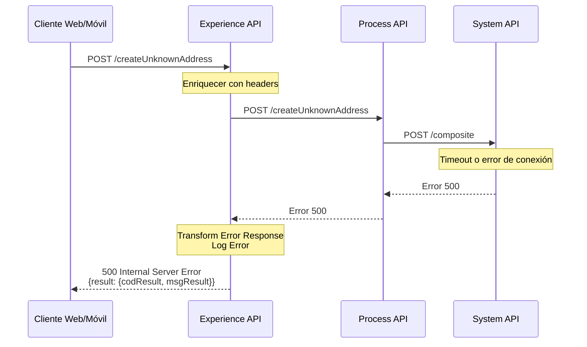

# POST /createUnknownAddress

## 📌 Descripción General

### Propósito del Endpoint

Este endpoint permite crear un caso de gestión en Salesforce cuando un cliente reporta una dirección que no se encuentra en el sistema. Captura la información de la dirección desconocida y genera un caso para su posterior validación y resolución por parte del equipo de gestión.

### Tipo de API

**Capa:** Experience API (API-Led Connectivity)

**Función:** Adaptación de experiencia para canales web y móvil, enriqueciendo la petición con información de contexto del usuario (cliente, contacto, agente, IP) antes de invocar el Process API.

### Patrón de Integración

**Tipo:** Pass-Through con Enriquecimiento de Headers

**Descripción:** El Experience API enriquece el payload con headers de contexto (x-client-id, x-contact-id, x-user-id, DirIp) y delega la lógica de negocio al Process API, que a su vez crea el caso en Salesforce mediante el System API.

### Arquitectura API-Led Connectivity



---

## 💼 Propósito del Negocio

### Casos de Uso Principales

1. **Reporte de Dirección Desconocida**
   - El cliente introduce una dirección que no existe en el sistema de callejero
   - Se captura toda la información proporcionada por el cliente
   - Se genera un caso de gestión para validación manual

2. **Seguimiento de Incidencias de Direcciones**
   - Permite al equipo de gestión identificar direcciones problemáticas
   - Facilita la actualización del sistema de callejero
   - Mejora la calidad de datos de direcciones

3. **Gestión de Casos de Atención al Cliente**
   - Crea un registro formal de la incidencia
   - Permite seguimiento del estado de resolución
   - Vincula el caso con el cliente y el agente (si aplica)

### 📱 Canal y Audiencia

#### Canal de Consumo

**Canal:** Web / Móvil

**Características del Canal:**
- **Plataforma**: Portal FUA (Frontal Único de Atención) y aplicaciones móviles
- **Dispositivos**: Navegadores web y dispositivos móviles iOS/Android
- **Conectividad**: Requiere conexión a internet estable
- **Experiencia de Usuario**: Formulario de captura de dirección con validación en tiempo real

#### Audiencia Objetivo

**Usuarios Finales:**
- **Clientes Naturgy**: Clientes que necesitan reportar una dirección no encontrada en el sistema
- **Agentes de Atención al Cliente**: Personal de call center que asiste a clientes con problemas de direcciones

**Contexto de Uso:**
- **Escenario 1**: Cliente intenta registrar una dirección nueva y no la encuentra en el autocompletado
- **Escenario 2**: Agente ayuda a un cliente a reportar una dirección incorrecta o inexistente

#### Adaptaciones del Canal

**Optimizaciones Aplicadas:**
- **Enriquecimiento de Contexto**: Añade automáticamente información del usuario (cliente, contacto, agente, IP)
- **Formato de Respuesta**: Respuesta simplificada con resultado de la operación
- **Validación de Entrada**: Validación de campos obligatorios antes de enviar al Process API
- **Manejo de Errores**: Respuestas de error adaptadas para mostrar al usuario final

### 🔗 Endpoints Dependientes

Este Experience API consume el siguiente Process API:

| Process API | Endpoint | Método | Propósito |
|-------------|----------|--------|-----------|
| `ntgy-newco-p-fua-evo` | `/createUnknownAddress` | POST | Orquesta la creación del caso de gestión en Salesforce con datos de dirección desconocida |

### Contexto Empresarial

- **Dominio:** Gestión de Casos y Atención al Cliente
- **Sector:** Energía - Utilities
- **División:** Naturgy España - NewCo
- **Canal:** Web/Móvil

### Stakeholders

- **Clientes Naturgy**: Necesitan reportar direcciones no encontradas en el sistema
- **Agentes de Call Center**: Asisten a clientes en el reporte de direcciones problemáticas
- **Equipo de Gestión de Datos**: Valida y actualiza el sistema de callejero con las direcciones reportadas
- **Equipo de Atención al Cliente**: Gestiona y resuelve los casos creados

### Valor de Negocio

- **Mejora de Calidad de Datos**: Identifica y corrige direcciones faltantes o incorrectas en el sistema
- **Experiencia del Cliente**: Permite a los clientes reportar problemas de forma sencilla sin necesidad de llamar
- **Eficiencia Operativa**: Centraliza el reporte de direcciones problemáticas en un único flujo
- **Trazabilidad**: Cada reporte genera un caso con seguimiento completo en Salesforce

---

## 🔧 Especificación Técnica

### URLs por Ambiente

| Ambiente | URL Base | URL Completa |
|----------|----------|--------------|
| **Local** | `http://localhost:8081` | `http://localhost:8081/fua/api/createUnknownAddress` |
| **Development** | `https://ntgy-fua-e-fua-dev.de-c1.cloudhub.io` | `https://ntgy-fua-e-fua-dev.de-c1.cloudhub.io/fua/api/createUnknownAddress` |
| **UAT** | `https://ntgy-fua-e-fua-uat.de-c1.cloudhub.io` | `https://ntgy-fua-e-fua-uat.de-c1.cloudhub.io/fua/api/createUnknownAddress` |
| **Production** | `https://ntgy-fua-e-fua-pro.de-c1.cloudhub.io` | `https://ntgy-fua-e-fua-pro.de-c1.cloudhub.io/fua/api/createUnknownAddress` |

### Método HTTP

```
POST /fua/api/createUnknownAddress
```

### 🎯 Consideraciones del Canal

#### Limitaciones del Canal

| Aspecto | Limitación | Razón |
|---------|------------|-------|
| **Timeout** | 60 segundos | Tiempo suficiente para crear el caso en Salesforce |
| **Tamaño de Respuesta** | 10 KB máximo | Respuesta simple con resultado de la operación |
| **Rate Limiting** | 100 requests/minuto | Protección contra uso excesivo |

#### Campos Específicos del Canal

**Campos Añadidos por el Experience API:**

| Campo | Tipo | Descripción | Razón |
|-------|------|-------------|-------|
| `x-client-id` | string | ID del cliente en Salesforce | Vincula el caso con el cliente |
| `x-contact-id` | string | ID del contacto en Salesforce | Identifica el contacto específico |
| `x-user-id` | string | ID del usuario/agente (opcional) | Identifica al agente si es asistido |
| `DirIp` | string | Dirección IP del cliente | Trazabilidad y seguridad |

### Parámetros de Entrada

#### Headers Requeridos

| Header | Tipo | Obligatorio | Descripción |
|--------|------|-------------|-------------|
| `Content-Type` | string | ✅ | Debe ser `application/json` |
| `x-client-id` | string | ✅ | ID del cliente en Salesforce |
| `x-contact-id` | string | ✅ | ID del contacto en Salesforce |
| `x-user-id` | string | ❌ | ID del usuario/agente (solo si es asistido) |
| `x-user-role` | string | ❌ | Rol del usuario (newcoAgent o customer) |
| `x-agent-mail` | string | ❌ | Email del agente (solo si es asistido) |

#### Body (application/json)

```json
{
  "data": {
    "way": "string",           // Nombre de la vía (ej: "Calle Mayor")
    "number": "string",        // Número de la vía (ej: "123")
    "portal": "string",        // Portal (opcional)
    "zipCode": "string",       // Código postal (ej: "28001")
    "stairs": "string",        // Escalera (opcional)
    "floor": "string",         // Piso (opcional)
    "door": "string",          // Puerta (opcional)
    "city": "string",          // Localidad (ej: "Madrid")
    "province": "string",      // Provincia (ej: "Madrid")
    "wayTypeId": "string"      // Tipo de vía (ej: "CALLE", "AVENIDA")
  }
}
```

**Campos Obligatorios:**
- `data.way`: Nombre de la vía
- `data.number`: Número de la vía
- `data.zipCode`: Código postal
- `data.city`: Localidad
- `data.province`: Provincia
- `data.wayTypeId`: Tipo de vía

**Campos Opcionales:**
- `data.portal`: Portal del edificio
- `data.stairs`: Escalera
- `data.floor`: Piso
- `data.door`: Puerta

### Respuestas

#### Respuesta Exitosa (200 OK)

```json
{
  "compositeResponse": [
    {
      "body": {
        "id": "5001X000001234ABC",
        "success": true,
        "errors": []
      },
      "httpHeaders": {
        "Location": "/services/data/v52.0/sobjects/Case/5001X000001234ABC"
      },
      "httpStatusCode": 201,
      "referenceId": "refCaseGestion"
    }
  ]
}
```

**Campos de Respuesta:**

| Campo | Tipo | Descripción |
|-------|------|-------------|
| `compositeResponse[0].body.id` | string | ID del caso creado en Salesforce |
| `compositeResponse[0].body.success` | boolean | Indica si la operación fue exitosa |
| `compositeResponse[0].httpStatusCode` | number | Código HTTP de la operación (201 = creado) |
| `compositeResponse[0].referenceId` | string | Referencia del caso ("refCaseGestion") |

#### Respuesta de Error (400 Bad Request)

```json
{
  "result": {
    "codResult": "0001",
    "msgResult": "Error en la validación de datos"
  }
}
```

#### Respuesta de Error (500 Internal Server Error)

```json
{
  "result": {
    "codResult": "0001",
    "msgResult": "Error interno del servidor"
  }
}
```

### Autenticación

- **Tipo:** OAuth 2.0
- **Scope:** Requiere autenticación de usuario
- **Headers:** Token de acceso en header `Authorization`

### Timeouts

| Tipo | Valor | Razón |
|------|-------|-------|
| **Request Timeout** | 60 segundos | Tiempo suficiente para la creación del caso en Salesforce |
| **Connection Timeout** | 30 segundos | Tiempo de establecimiento de conexión |

---

## 🏗️ Implementación Técnica

### Arquitectura del Flow



### Transformaciones de Canal

**Transformación de Entrada (Experience → Process):**

El Experience API enriquece el payload original con información de contexto:

```dataweave
%dw 2.2
import * from dw::core::Strings
output application/json
---
payload
++ 
vars.fuaHeaders 
++
{
    "DirIp": substringBefore(substringAfter(attributes.remoteAddress,"/"),":")
}
```

**Campos Añadidos:**

| Campo Original | Campo Enriquecido | Transformación |
|----------------|-------------------|----------------|
| `payload.data` | `payload.data` | Pass-through sin modificación |
| N/A | `x-client-id` | Extraído de `vars.fuaHeaders` |
| N/A | `x-contact-id` | Extraído de `vars.fuaHeaders` |
| N/A | `x-user-id` | Extraído de `vars.fuaHeaders` (opcional) |
| N/A | `DirIp` | Extraído de `attributes.remoteAddress` |

**Variable Adicional:**

```dataweave
%dw 2.0
output text/plain
---
if ( attributes.headers['x-user-role'] == "newcoAgent" ) "/paymentPreparation/agent"
else "/paymentPreparation/customer"
```

Esta variable determina la ruta de preparación de pago según el rol del usuario.

### Patrones de Diseño

**Patrón:** Enriquecimiento de Contexto (Context Enrichment Pattern)

**Justificación:** El Experience API añade información de contexto del usuario (cliente, contacto, agente, IP) que es necesaria para la creación del caso en Salesforce, pero que no debe ser responsabilidad del cliente proporcionar.

### Diagramas de Secuencia

#### 1. Flujo Normal de Éxito



#### 2. Flujo con Error de Negocio



#### 3. Flujo con Error Técnico



### Optimizaciones del Canal

**1. Enriquecimiento Automático de Contexto:**
- El Experience API añade automáticamente información del usuario sin requerir que el cliente la proporcione
- Reduce la complejidad del cliente y mejora la seguridad

**2. Manejo de Errores Simplificado:**
- Transforma errores técnicos en mensajes comprensibles para el usuario final
- Formato de error consistente en toda la aplicación

**3. Logging de Errores:**
- Registra errores con nivel ERROR para facilitar troubleshooting
- Incluye el mensaje de error completo para análisis

### Manejo de Errores

**Error Handler Global:**

```xml
<error-handler>
    <on-error-propagate enableNotifications="true" logException="true">
        <ee:transform>
            <ee:set-payload>
                {
                    "result": {
                        "codResult": "0001",
                        "msgResult": error.description as String replace /\"/ with("")
                    }
                }
            </ee:set-payload>
        </ee:transform>
        <logger level="ERROR" message='Error en createUnknownAddress'/>
    </on-error-propagate>
</error-handler>
```

**Tipos de Errores Manejados:**

| Tipo de Error | Código | Descripción | Acción |
|---------------|--------|-------------|--------|
| Validación | 0001 | Datos de entrada inválidos | Retornar 400 con mensaje descriptivo |
| Timeout | 0001 | Timeout en llamada al Process API | Retornar 500 con mensaje de error |
| Salesforce | 0001 | Error al crear caso en Salesforce | Retornar 500 con mensaje de error |
| Conexión | 0001 | Error de conexión con Process API | Retornar 500 con mensaje de error |

---

## 💻 Ejemplos de Uso

### Ejemplo 1: Llamada Exitosa desde Cliente Web

#### cURL

```bash
curl -X POST "https://ntgy-fua-e-fua-pro.de-c1.cloudhub.io/fua/api/createUnknownAddress" \
  -H "Content-Type: application/json" \
  -H "Authorization: Bearer YOUR_ACCESS_TOKEN" \
  -H "x-client-id: 0011X00000ABCDE" \
  -H "x-contact-id: 0031X00000FGHIJ" \
  -d '{
    "data": {
      "way": "Calle Mayor",
      "number": "123",
      "portal": "A",
      "zipCode": "28001",
      "stairs": "1",
      "floor": "3",
      "door": "B",
      "city": "Madrid",
      "province": "Madrid",
      "wayTypeId": "CALLE"
    }
  }'
```

#### Respuesta (200 OK)

```json
{
  "compositeResponse": [
    {
      "body": {
        "id": "5001X000001234ABC",
        "success": true,
        "errors": []
      },
      "httpHeaders": {
        "Location": "/services/data/v52.0/sobjects/Case/5001X000001234ABC"
      },
      "httpStatusCode": 201,
      "referenceId": "refCaseGestion"
    }
  ]
}
```

### Ejemplo 2: Llamada desde Agente de Call Center

#### cURL

```bash
curl -X POST "https://ntgy-fua-e-fua-pro.de-c1.cloudhub.io/fua/api/createUnknownAddress" \
  -H "Content-Type: application/json" \
  -H "Authorization: Bearer YOUR_ACCESS_TOKEN" \
  -H "x-client-id: 0011X00000ABCDE" \
  -H "x-contact-id: 0031X00000FGHIJ" \
  -H "x-user-id: 0051X00000KLMNO" \
  -H "x-user-role: newcoAgent" \
  -H "x-agent-mail: agente@naturgy.com" \
  -d '{
    "data": {
      "way": "Avenida de la Constitución",
      "number": "45",
      "zipCode": "41001",
      "city": "Sevilla",
      "province": "Sevilla",
      "wayTypeId": "AVENIDA"
    }
  }'
```

#### Respuesta (200 OK)

```json
{
  "compositeResponse": [
    {
      "body": {
        "id": "5001X000005678XYZ",
        "success": true,
        "errors": []
      },
      "httpHeaders": {
        "Location": "/services/data/v52.0/sobjects/Case/5001X000005678XYZ"
      },
      "httpStatusCode": 201,
      "referenceId": "refCaseGestion"
    }
  ]
}
```

### Ejemplo 3: JavaScript (para Web)

```javascript
const createUnknownAddress = async (addressData) => {
  const response = await fetch('https://ntgy-fua-e-fua-pro.de-c1.cloudhub.io/fua/api/createUnknownAddress', {
    method: 'POST',
    headers: {
      'Content-Type': 'application/json',
      'Authorization': `Bearer ${accessToken}`,
      'x-client-id': clientId,
      'x-contact-id': contactId
    },
    body: JSON.stringify({
      data: {
        way: addressData.way,
        number: addressData.number,
        portal: addressData.portal,
        zipCode: addressData.zipCode,
        stairs: addressData.stairs,
        floor: addressData.floor,
        door: addressData.door,
        city: addressData.city,
        province: addressData.province,
        wayTypeId: addressData.wayTypeId
      }
    })
  });

  if (!response.ok) {
    const error = await response.json();
    throw new Error(error.result.msgResult);
  }

  const data = await response.json();
  return data.compositeResponse[0].body.id; // Retorna el Case ID
};

// Uso
try {
  const caseId = await createUnknownAddress({
    way: 'Calle Mayor',
    number: '123',
    portal: 'A',
    zipCode: '28001',
    stairs: '1',
    floor: '3',
    door: 'B',
    city: 'Madrid',
    province: 'Madrid',
    wayTypeId: 'CALLE'
  });
  console.log('Caso creado con ID:', caseId);
} catch (error) {
  console.error('Error al crear caso:', error.message);
}
```

### Ejemplo 4: Error - Datos Incompletos

#### Request

```bash
curl -X POST "https://ntgy-fua-e-fua-pro.de-c1.cloudhub.io/fua/api/createUnknownAddress" \
  -H "Content-Type: application/json" \
  -H "Authorization: Bearer YOUR_ACCESS_TOKEN" \
  -H "x-client-id: 0011X00000ABCDE" \
  -H "x-contact-id: 0031X00000FGHIJ" \
  -d '{
    "data": {
      "way": "Calle Mayor",
      "zipCode": "28001"
    }
  }'
```

#### Respuesta (400 Bad Request)

```json
{
  "result": {
    "codResult": "0001",
    "msgResult": "Campo obligatorio faltante: number"
  }
}
```

### Ejemplo 5: Python

```python
import requests
import json

def create_unknown_address(access_token, client_id, contact_id, address_data):
    """
    Crea un caso de gestión para una dirección desconocida
    
    Args:
        access_token (str): Token de acceso OAuth
        client_id (str): ID del cliente en Salesforce
        contact_id (str): ID del contacto en Salesforce
        address_data (dict): Datos de la dirección
        
    Returns:
        str: ID del caso creado
    """
    url = 'https://ntgy-fua-e-fua-pro.de-c1.cloudhub.io/fua/api/createUnknownAddress'
    
    headers = {
        'Content-Type': 'application/json',
        'Authorization': f'Bearer {access_token}',
        'x-client-id': client_id,
        'x-contact-id': contact_id
    }
    
    payload = {
        'data': address_data
    }
    
    response = requests.post(url, headers=headers, json=payload)
    
    if response.status_code == 200:
        data = response.json()
        return data['compositeResponse'][0]['body']['id']
    else:
        error_data = response.json()
        raise Exception(f"Error {response.status_code}: {error_data['result']['msgResult']}")

# Uso
try:
    case_id = create_unknown_address(
        access_token='YOUR_ACCESS_TOKEN',
        client_id='0011X00000ABCDE',
        contact_id='0031X00000FGHIJ',
        address_data={
            'way': 'Calle Mayor',
            'number': '123',
            'portal': 'A',
            'zipCode': '28001',
            'stairs': '1',
            'floor': '3',
            'door': 'B',
            'city': 'Madrid',
            'province': 'Madrid',
            'wayTypeId': 'CALLE'
        }
    )
    print(f'Caso creado con ID: {case_id}')
except Exception as e:
    print(f'Error al crear caso: {str(e)}')
```
