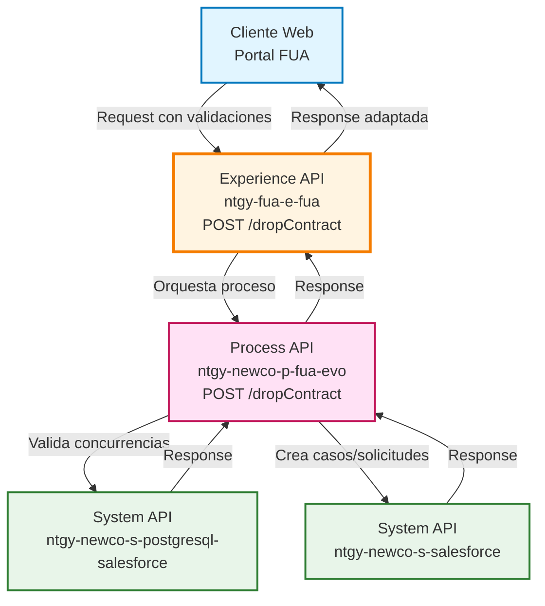
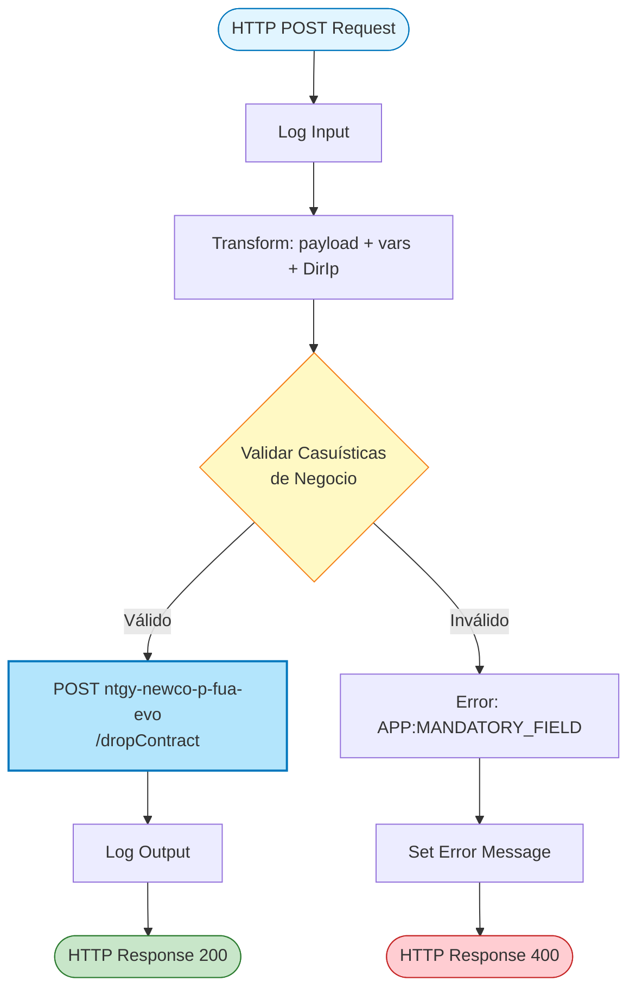
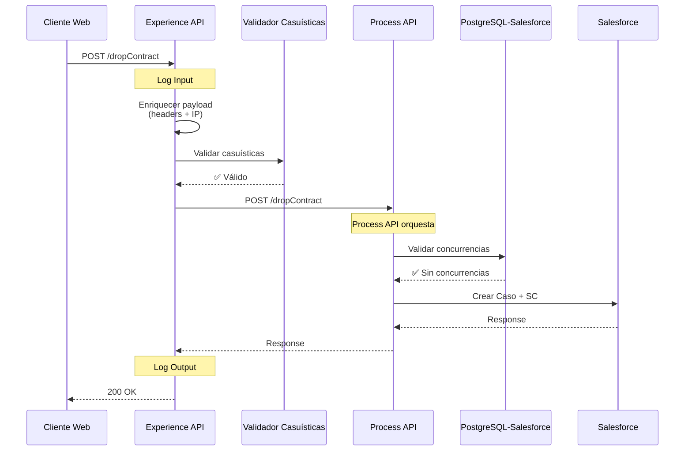
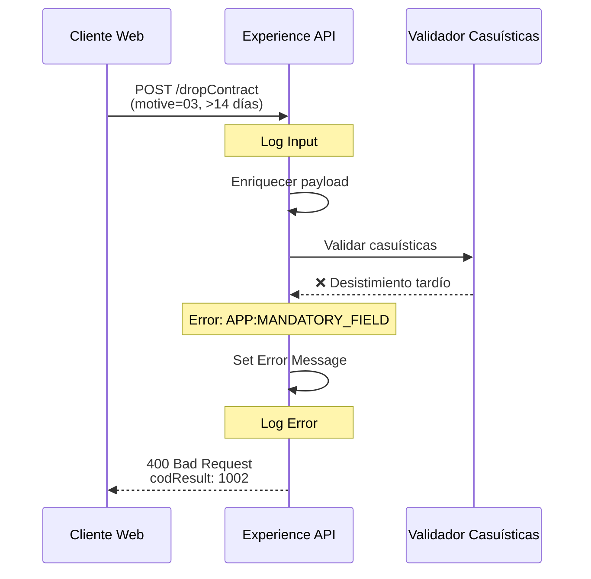
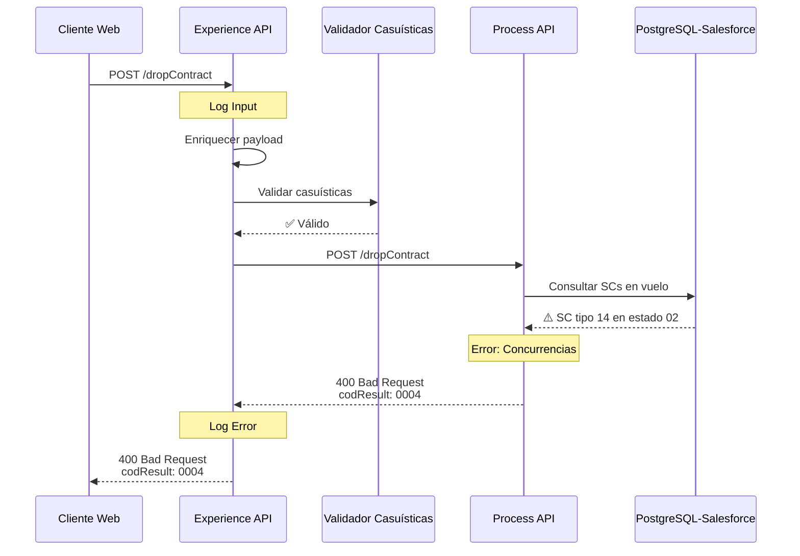
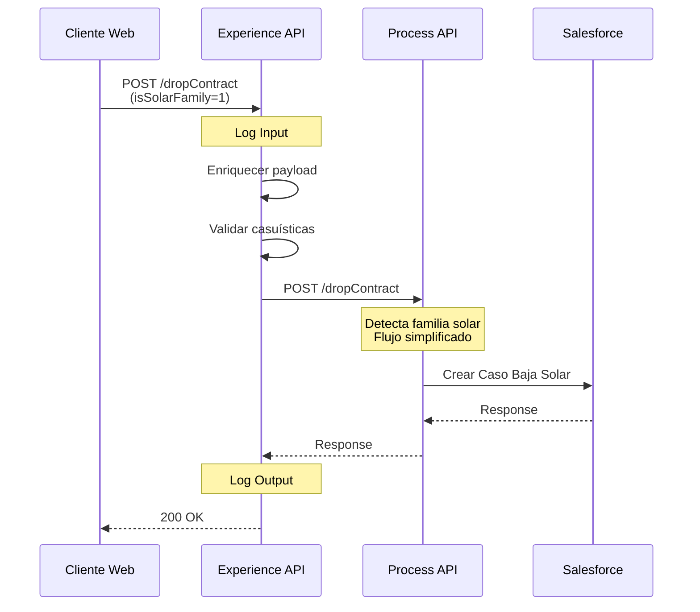

# POST /dropContract

## 📌 Descripción General

### Propósito del Endpoint

Este endpoint gestiona múltiples escenarios de baja y cancelación de contratos energéticos en el ecosistema Naturgy. Actúa como punto de entrada unificado para diferentes tipos de operaciones de baja, incluyendo reposiciones, desistimientos, ceses de suministro, anulaciones y bajas de servicios adicionales (SVA) y contratos solares.

### Tipo de API

**Capa:** Experience API (API-Led Connectivity)

**Función:** Orquestación y validación de procesos de baja de contratos para el portal FUA (Frontal Único de Atención)

### Patrón de Integración

**Tipo:** Orquestación con Validación de Negocio

**Descripción:** El endpoint realiza validaciones complejas de casuísticas de negocio antes de orquestar la llamada al Process API, que a su vez gestiona la creación de casos y solicitudes en Salesforce.

### Arquitectura API-Led Connectivity



---

## 💼 Propósito del Negocio

### Casos de Uso Principales

1. **Reposición de Contrato (Motivos 01, 02, 05)**
   - Devolución de contrato activo a la comercializadora anterior
   - Gestión de errores de contratación o ventas fraudulentas
   - Recuperación de contratos inactivos
   - **Beneficio:** Permite corregir errores contractuales y gestionar reclamaciones

2. **Desistimiento de Contrato (Motivo 03)**
   - Baja voluntaria del cliente dentro del período de desistimiento
   - Aplicable a contratos pendientes o activos recientes
   - **Beneficio:** Cumple con normativa de protección al consumidor

3. **Cese de Suministro (Motivo 04)**
   - Finalización definitiva del suministro energético
   - Solo para contratos activos de energía
   - **Beneficio:** Gestiona el fin de la relación contractual

4. **Baja de Servicios Adicionales (SVA)**
   - Cancelación de servicios no energéticos
   - Tratamiento diferenciado de servicios adicionales
   - **Beneficio:** Flexibilidad en la gestión de servicios complementarios

5. **Baja de Contratos Solares**
   - Proceso específico para contratos de energía solar
   - Flujo simplificado para familia solar
   - **Beneficio:** Gestión especializada de productos renovables

### 📱 Canal y Audiencia

#### Canal de Consumo

**Canal:** Web

**Características del Canal:**
- **Plataforma**: Portal web FUA (Frontal Único de Atención)
- **Dispositivos**: Desktop y responsive para tablets
- **Conectividad**: Requiere conexión estable para validaciones complejas
- **Experiencia de Usuario**: Proceso guiado con validaciones en tiempo real

#### Audiencia Objetivo

**Usuarios Finales:**
- **Clientes Residenciales**: Gestión de bajas de contratos de luz, gas y servicios
- **Clientes PYMES**: Gestión de bajas con validaciones específicas por tipo de CIF
- **Agentes de Atención al Cliente**: Procesamiento de solicitudes de baja en nombre del cliente

**Contexto de Uso:**
- **Autoservicio Web**: Cliente solicita baja desde su área privada
- **Gestión Asistida**: Agente procesa baja durante llamada telefónica
- **Reclamaciones**: Gestión de errores contractuales o ventas fraudulentas

#### Adaptaciones del Canal

**Optimizaciones Aplicadas:**
- **Validación Previa**: Validaciones de casuísticas antes de enviar al Process API
- **Validación de Concurrencias**: Verifica que no existan solicitudes en vuelo
- **Enriquecimiento de Headers**: Añade información de contexto (IP, headers FUA)
- **Manejo de Errores Específico**: Mensajes de error adaptados al contexto web

### 🔗 Endpoints Dependientes

Este Experience API consume el siguiente Process API:

| API | Endpoint | Método | Propósito |
|-----|----------|--------|-----------|
| `ntgy-newco-p-fua-evo` | `/dropContract` | POST | Orquesta el proceso completo de baja/cancelación incluyendo validación de concurrencias, creación de casos y solicitudes en Salesforce |

**Nota:** La validación de concurrencias (consulta a `ntgy-newco-s-postgresql-salesforce`) se realiza dentro del Process API, no directamente desde esta Experience API.

### Contexto Empresarial

- **Dominio:** Gestión de Contratos y Servicios Energéticos
- **Sector:** Energía - Utilities
- **División:** Naturgy España - NewCo
- **Canal:** Web (Portal FUA)

### Stakeholders

- **Clientes Finales**: Necesitan gestionar bajas de contratos de forma ágil y transparente
- **Agentes de Atención al Cliente**: Requieren herramientas para procesar bajas asistidas
- **Departamento Legal**: Asegura cumplimiento normativo en desistimientos
- **Operaciones**: Gestiona el flujo de trabajo de bajas y ceses

### Valor de Negocio

- **Cumplimiento Normativo**: Garantiza el derecho de desistimiento del consumidor
- **Eficiencia Operativa**: Automatiza validaciones complejas de casuísticas
- **Prevención de Errores**: Valida concurrencias para evitar solicitudes duplicadas
- **Trazabilidad**: Registra todas las operaciones de baja en Salesforce
- **Flexibilidad**: Soporta múltiples escenarios de baja con un único endpoint

---

## 🔧 Especificación Técnica

### URLs por Ambiente

| Ambiente | URL Base | URL Completa |
|----------|----------|--------------|
| **Local** | `http://localhost:8081` | `http://localhost:8081/fua/api/dropContract` |
| **Development** | `https://ntgy-fua-e-fua-dev.de-c1.cloudhub.io` | `https://ntgy-fua-e-fua-dev.de-c1.cloudhub.io/fua/api/dropContract` |
| **UAT** | `https://ntgy-fua-e-fua-uat.de-c1.cloudhub.io` | `https://ntgy-fua-e-fua-uat.de-c1.cloudhub.io/fua/api/dropContract` |
| **Production** | `https://ntgy-fua-e-fua-pro.de-c1.cloudhub.io` | `https://ntgy-fua-e-fua-pro.de-c1.cloudhub.io/fua/api/dropContract` |

### Método HTTP

```
POST /fua/api/dropContract
```

### 🎯 Consideraciones del Canal

#### Limitaciones del Canal

| Aspecto | Limitación | Razón |
|---------|------------|-------|
| **Timeout** | 60 segundos | Proceso complejo con múltiples validaciones y llamadas a Salesforce |
| **Validaciones Previas** | Obligatorias | Evita llamadas innecesarias al Process API |
| **Concurrencia** | Validación estricta | Previene solicitudes duplicadas o conflictivas |

#### Campos Específicos del Canal

**Campos Añadidos por el Experience API:**

| Campo | Tipo | Descripción | Razón |
|-------|------|-------------|-------|
| `DirIp` | string | Dirección IP del cliente | Trazabilidad y auditoría de operaciones |
| `x-*` headers | object | Headers de contexto FUA | Propagación de información de sesión |

### Parámetros de Entrada

#### Headers Requeridos

| Header | Tipo | Obligatorio | Descripción |
|--------|------|-------------|-------------|
| `Content-Type` | string | ✅ | Debe ser `application/json` |
| `x-interaction-id` | string | ⚠️ | ID de interacción (caso padre en Salesforce) |
| `x-interaction-origin` | string | ⚠️ | Origen de la interacción |
| `x-user-id` | string | ⚠️ | ID del usuario en Salesforce |
| `x-client-id` | string | ⚠️ | ID del cliente en Salesforce |
| `x-client-doc-number` | string | ⚠️ | Número de documento del cliente |
| `x-client-code` | string | ⚠️ | Código del cliente (NIF/CIF) |
| `x-contact-id` | string | ⚠️ | ID del contacto en Salesforce |
| `x-agent-mail` | string | ❌ | Email del agente (si es gestión asistida) |
| `traceparent` | string | ⚠️ | Trace ID para correlación distribuida |

#### Body Parameters

```json
{
  "contractId": "string",           // ✅ Obligatorio - ID del contrato en Salesforce
  "contractAccountId": "string",    // ✅ Obligatorio - ID de cuenta contrato
  "cups": "string",                 // ✅ Obligatorio - CUPS del punto de suministro
  "motive": "string",               // ✅ Obligatorio - Motivo de baja (01-05)
  "contractStatus": "string",       // ✅ Obligatorio - Estado del contrato (01/02)
  "signatureDate": "string",        // ✅ Obligatorio - Fecha de firma (yyyy-MM-dd)
  "productTypeFamily": "string",    // ✅ Obligatorio - Familia de producto (luz/gas/servicios)
  "isSolarFamily": "string",        // ✅ Obligatorio - Indicador familia solar (0/1)
  "isIndividualClient": "boolean"   // ✅ Obligatorio - Tipo de cliente (true=particular, false=empresa)
}
```

#### Valores Permitidos

**motive (Motivo de Baja):**
- `"01"` - Reclamación condiciones contractuales
- `"02"` - Cruce de CUPS
- `"03"` - Baja/Cancelar (desistimiento)
- `"04"` - Cese de suministro
- `"05"` - Recuperación (uso interno)

**contractStatus (Estado del Contrato):**
- `"01"` - Pendiente
- `"02"` - Activo

**productTypeFamily (Familia de Producto):**
- `"luz"` - Electricidad
- `"gas"` - Gas natural
- `"servicios"` - Servicios adicionales (SVA)

**isSolarFamily:**
- `"0"` - No es contrato solar
- `"1"` - Es contrato solar

### Respuestas

#### 200 OK - Éxito

```json
{
  "result": {
    "codResult": "0000",
    "msgResult": "No hay error"
  }
}
```

#### 400 Bad Request - Error de Validación

```json
{
  "result": {
    "codResult": "1002",
    "msgResult": "El campo productTypeFamily debe contener los valores --> luz, gas o servicios"
  }
}
```

**Códigos de Error de Validación:**

| Código | Mensaje | Causa |
|--------|---------|-------|
| `1002` | Campo productTypeFamily inválido | Valor no permitido en familia de producto |
| `1002` | Campo motive inválido | Motivo de baja no válido (debe ser 01-05) |
| `1002` | Campo contractStatus inválido | Estado de contrato no válido (debe ser 01/02) |
| `1002` | Campo signatureDate formato incorrecto | Fecha no cumple formato yyyy-MM-dd |
| `1002` | No se puede actuar con desistimiento | Validación de casuística fallida |
| `1002` | Fecha firma superior a 365 días | Reposición no permitida para contratos antiguos |
| `1002` | Cliente en estado pendiente | Cese no permitido para contratos pendientes |

#### 400 Bad Request - Concurrencias

```json
{
  "result": {
    "codResult": "0004",
    "msgResult": "Existen concurrencias"
  }
}
```

**Descripción:** Existen solicitudes de cambio (SCs) en vuelo para el contrato que impiden procesar la baja.

#### 500 Internal Server Error

```json
{
  "result": {
    "codResult": "0001",
    "msgResult": "Error en el procesamiento de la solicitud"
  }
}
```

### Autenticación

- **Tipo:** OAuth 2.0 (gestionado por API Gateway)
- **Validación:** JWT token en header `Authorization`
- **Scope:** Requiere permisos de gestión de contratos

### Timeouts

| Tipo | Valor | Razón |
|------|-------|-------|
| **Request Timeout** | 60 segundos | Proceso complejo con validaciones y múltiples llamadas |
| **Connection Timeout** | 30 segundos | Tiempo máximo para establecer conexión |

---

## 🏗️ Implementación Técnica

### Arquitectura del Flow



**Nota:** La validación de concurrencias y la lógica de creación de casos/solicitudes se ejecutan dentro del Process API `ntgy-newco-p-fua-evo`.

### Validaciones de Casuísticas de Negocio

El endpoint implementa validaciones complejas basadas en la combinación de:
- **Motivo de baja** (motive)
- **Estado del contrato** (contractStatus)
- **Fecha de firma** (signatureDate)
- **Familia de producto** (productTypeFamily)
- **Tipo de cliente** (isIndividualClient)

#### Matriz de Validaciones

| Validación | Condición | Mensaje de Error |
|------------|-----------|------------------|
| **Familia de Producto** | productTypeFamily not in ["luz", "gas", "servicios"] | "El campo productTypeFamily debe contener los valores --> luz, gas o servicios" |
| **Motivo** | motive not in ["01", "02", "03", "04", "05"] | "El campo motive debe contener los valores --> 01, 02, 03, 04 o 05" |
| **Estado Contrato** | contractStatus not in ["01", "02"] | "El campo contractStatus debe contener los valores --> 01, 02" |
| **Formato Fecha** | signatureDate no cumple yyyy-MM-dd | "El campo signatureDate debe contener el formato aaaa-MM-dd" |
| **Desistimiento Tardío** | motive=03 AND activo AND >14 días AND luz/gas | "No se puede actuar con: Quiero baja del contrato, para un cliente activo con fecha de firma > 14 y luz/gas" |
| **Reposición Antigua** | motive=01/02 AND >365 días | "No se puede actuar con: Error de contratacion o Venta fraudulenta, para un cliente con fecha firma superior a 365" |
| **Cese Inválido** | motive=04 AND (pendiente OR servicios) | "No se puede actuar con: Quiero cesar el contrato, para un cliente en estado pendiente o un cliente activo no energía" |

### Validación de Concurrencias

**Nota:** La validación de concurrencias se realiza dentro del **Process API** `ntgy-newco-p-fua-evo`, no en esta Experience API.

El Process API consulta la tabla `acn_obj_contractrequest__c` en Salesforce para verificar si existen solicitudes de cambio (SCs) en vuelo que puedan generar conflictos con la operación de baja solicitada.

**Tipos de SC que se validan:**
- `14` - Cambio de titular
- `16` - Cambio de producto
- `22` - Reposición
- `02` - Activación

**Estados bloqueantes:**
- `01` - Pendiente
- `02` - En proceso
- `03` - En validación

Si se detectan concurrencias, el Process API retorna un error `codResult: 0004` que la Experience API propaga al cliente.

### Transformaciones de Datos

#### Transformación 1: Enriquecimiento de Payload

**Ubicación:** Línea 52 del archivo `post-dropContract.xml`

```dataweave
%dw 2.2
import * from dw::core::Strings
output application/json
---
payload
++ 
vars.fuaHeaders 
++
{
    "DirIp": substringBefore(substringAfter(attributes.remoteAddress,"/"),":")
}
```

**Propósito:** Combina el payload original con los headers FUA y añade la dirección IP del cliente.

#### Transformación 2: Validación de Casuísticas

**Ubicación:** Línea 58 del archivo `post-dropContract.xml`

**Lógica Implementada:**
```dataweave
var fechaContrato = daysBetween(payload.signatureDate as Date {format: "yyyy-MM-dd"}, now() as Date)

fun controlError() = 
   if(payload.isSolarFamily == "0")(
     // Validaciones de familia de producto
     if(not (["luz", "gas", "servicios"] contains payload.productTypeFamily))
        { "result": { "codResult": "1002", "msgResult": "..." } }
     // Validaciones de motivo
     else if(not (["01", "02", "03", "04","05"] contains payload.motive))
        { "result": { "codResult": "1002", "msgResult": "..." } }
     // ... más validaciones
   )
   else null
```

### Patrones de Diseño

**Patrón:** Validation Pipeline con Early Return

**Justificación:** 
- Valida casuísticas de negocio antes de realizar llamadas costosas
- Previene solicitudes inválidas al Process API
- Mejora la experiencia del usuario con mensajes de error específicos

**Patrón:** Concurrency Check

**Justificación:**
- Evita conflictos con solicitudes en proceso
- Garantiza integridad de datos en Salesforce
- Previene duplicados y estados inconsistentes

### Diagramas de Secuencia

#### 1. Flujo Normal de Éxito



#### 2. Flujo con Error de Casuística



#### 3. Flujo con Concurrencias (Detectadas en Process API)



#### 4. Flujo Contrato Solar



### Manejo de Errores

#### Error Handler 1: APP:MANDATORY_FIELD

**Trigger:** Validación de casuísticas fallida

**Respuesta:**
```json
{
  "result": {
    "codResult": "1002",
    "msgResult": "[Mensaje específico de la validación]"
  }
}
```

**HTTP Status:** 400 Bad Request

#### Error Handler 2: NTGY:DROPCONTRACT

**Trigger:** Concurrencias detectadas

**Respuesta:**
```json
{
  "result": {
    "codResult": "0004",
    "msgResult": "Existen concurrencias"
  }
}
```

**HTTP Status:** 400 Bad Request

#### Error Handler 3: General

**Trigger:** Cualquier otro error

**Respuesta:**
```json
{
  "result": {
    "codResult": "0001",
    "msgResult": "[Descripción del error]"
  }
}
```

**HTTP Status:** 500 Internal Server Error

---

## 💻 Ejemplos de Uso

### Ejemplo 1: Reposición por Error de Contratación (Motivo 01)

#### Request

```bash
curl -X POST "https://ntgy-fua-e-fua-pro.de-c1.cloudhub.io/fua/api/dropContract" \
  -H "Content-Type: application/json" \
  -H "Authorization: Bearer YOUR_TOKEN" \
  -H "x-interaction-id: 5003X00001AbCdEQAV" \
  -H "x-client-id: 0013X00001XyZwQAV" \
  -H "x-client-code: 12345678A" \
  -H "x-contact-id: 0033X00001XyZwQAV" \
  -H "traceparent: 00-4bf92f3577b34da6a3ce929d0e0e4736-00f067aa0ba902b7-01" \
  -d '{
    "contractId": "8007Y0000031FbfQAE",
    "contractAccountId": "0017Y00001XyZwQAV",
    "cups": "ES0021000002155819PA",
    "motive": "01",
    "contractStatus": "02",
    "signatureDate": "2026-09-15",
    "productTypeFamily": "luz",
    "isSolarFamily": "0",
    "isIndividualClient": true
  }'
```

#### Response (200 OK)

```json
{
  "result": {
    "codResult": "0000",
    "msgResult": "No hay error"
  }
}
```

### Ejemplo 2: Desistimiento de Contrato (Motivo 03)

#### Request

```bash
curl -X POST "https://ntgy-fua-e-fua-pro.de-c1.cloudhub.io/fua/api/dropContract" \
  -H "Content-Type: application/json" \
  -H "Authorization: Bearer YOUR_TOKEN" \
  -H "x-interaction-id: 5003X00001AbCdEQAV" \
  -H "x-client-id: 0013X00001XyZwQAV" \
  -H "x-client-code: 87654321B" \
  -H "x-contact-id: 0033X00001XyZwQAV" \
  -d '{
    "contractId": "8007Y0000031FbgQAE",
    "contractAccountId": "0017Y00001XyZwRAV",
    "cups": "ES0031000003266920QB",
    "motive": "03",
    "contractStatus": "01",
    "signatureDate": "2026-10-10",
    "productTypeFamily": "gas",
    "isSolarFamily": "0",
    "isIndividualClient": true
  }'
```

#### Response (200 OK)

```json
{
  "result": {
    "codResult": "0000",
    "msgResult": "No hay error"
  }
}
```

### Ejemplo 3: Cese de Suministro (Motivo 04)

#### Request

```bash
curl -X POST "https://ntgy-fua-e-fua-pro.de-c1.cloudhub.io/fua/api/dropContract" \
  -H "Content-Type: application/json" \
  -H "Authorization: Bearer YOUR_TOKEN" \
  -H "x-interaction-id: 5003X00001AbCdEQAV" \
  -H "x-client-id: 0013X00001XyZwQAV" \
  -H "x-client-code: B12345678" \
  -H "x-contact-id: 0033X00001XyZwQAV" \
  -d '{
    "contractId": "8007Y0000031FbhQAE",
    "contractAccountId": "0017Y00001XyZwSAV",
    "cups": "ES0041000004377031RC",
    "motive": "04",
    "contractStatus": "02",
    "signatureDate": "2025-05-20",
    "productTypeFamily": "luz",
    "isSolarFamily": "0",
    "isIndividualClient": false
  }'
```

#### Response (200 OK)

```json
{
  "result": {
    "codResult": "0000",
    "msgResult": "No hay error"
  }
}
```

### Ejemplo 4: Baja de Servicio SVA (Motivo 03)

#### Request

```bash
curl -X POST "https://ntgy-fua-e-fua-pro.de-c1.cloudhub.io/fua/api/dropContract" \
  -H "Content-Type: application/json" \
  -H "Authorization: Bearer YOUR_TOKEN" \
  -H "x-interaction-id: 5003X00001AbCdEQAV" \
  -H "x-client-id: 0013X00001XyZwQAV" \
  -H "x-client-code: 23456789C" \
  -H "x-contact-id: 0033X00001XyZwQAV" \
  -d '{
    "contractId": "8007Y0000031FbiQAE",
    "contractAccountId": "0017Y00001XyZwTAV",
    "cups": "N/A",
    "motive": "03",
    "contractStatus": "02",
    "signatureDate": "2026-09-01",
    "productTypeFamily": "servicios",
    "isSolarFamily": "0",
    "isIndividualClient": true
  }'
```

#### Response (200 OK)

```json
{
  "result": {
    "codResult": "0000",
    "msgResult": "No hay error"
  }
}
```

### Ejemplo 5: Baja de Contrato Solar

#### Request

```bash
curl -X POST "https://ntgy-fua-e-fua-pro.de-c1.cloudhub.io/fua/api/dropContract" \
  -H "Content-Type: application/json" \
  -H "Authorization: Bearer YOUR_TOKEN" \
  -H "x-interaction-id: 5003X00001AbCdEQAV" \
  -H "x-client-id: 0013X00001XyZwQAV" \
  -H "x-client-code: 34567890D" \
  -H "x-contact-id: 0033X00001XyZwQAV" \
  -d '{
    "contractId": "8007Y0000031FbjQAE",
    "contractAccountId": "0017Y00001XyZwUAV",
    "cups": "ES0051000005488142SD",
    "motive": "03",
    "contractStatus": "02",
    "signatureDate": "2026-08-15",
    "productTypeFamily": "luz",
    "isSolarFamily": "1",
    "isIndividualClient": true
  }'
```

#### Response (200 OK)

```json
{
  "result": {
    "codResult": "0000",
    "msgResult": "No hay error"
  }
}
```

### Ejemplo 6: Error - Validación de Casuística (Desistimiento Tardío)

#### Request

```bash
curl -X POST "https://ntgy-fua-e-fua-pro.de-c1.cloudhub.io/fua/api/dropContract" \
  -H "Content-Type: application/json" \
  -H "Authorization: Bearer YOUR_TOKEN" \
  -H "x-interaction-id: 5003X00001AbCdEQAV" \
  -H "x-client-id: 0013X00001XyZwQAV" \
  -H "x-client-code: 45678901E" \
  -H "x-contact-id: 0033X00001XyZwQAV" \
  -d '{
    "contractId": "8007Y0000031FbkQAE",
    "contractAccountId": "0017Y00001XyZwVAV",
    "cups": "ES0061000006599253TE",
    "motive": "03",
    "contractStatus": "02",
    "signatureDate": "2026-09-01",
    "productTypeFamily": "luz",
    "isSolarFamily": "0",
    "isIndividualClient": true
  }'
```

#### Response (400 Bad Request)

```json
{
  "result": {
    "codResult": "1002",
    "msgResult": "No se puede actuar con: Quiero baja del contrato, para un cliente activo con fecha de firma > 14 y luz/gas"
  }
}
```

### Ejemplo 7: Error - Concurrencias Detectadas

#### Request

```bash
curl -X POST "https://ntgy-fua-e-fua-pro.de-c1.cloudhub.io/fua/api/dropContract" \
  -H "Content-Type: application/json" \
  -H "Authorization: Bearer YOUR_TOKEN" \
  -H "x-interaction-id: 5003X00001AbCdEQAV" \
  -H "x-client-id: 0013X00001XyZwQAV" \
  -H "x-client-code: 56789012F" \
  -H "x-contact-id: 0033X00001XyZwQAV" \
  -d '{
    "contractId": "8007Y0000031FblQAE",
    "contractAccountId": "0017Y00001XyZwWAV",
    "cups": "ES0071000007600364UF",
    "motive": "01",
    "contractStatus": "02",
    "signatureDate": "2026-09-20",
    "productTypeFamily": "gas",
    "isSolarFamily": "0",
    "isIndividualClient": true
  }'
```

#### Response (400 Bad Request)

```json
{
  "result": {
    "codResult": "0004",
    "msgResult": "Existen concurrencias"
  }
}
```

**Nota:** Este error ocurre cuando existe una solicitud de cambio (SC) en vuelo para el contrato, como un cambio de titular o cambio de producto en proceso.

### Ejemplo 8: JavaScript (Fetch API)

```javascript
const dropContract = async () => {
  try {
    const response = await fetch('https://ntgy-fua-e-fua-pro.de-c1.cloudhub.io/fua/api/dropContract', {
      method: 'POST',
      headers: {
        'Content-Type': 'application/json',
        'Authorization': 'Bearer YOUR_TOKEN',
        'x-interaction-id': '5003X00001AbCdEQAV',
        'x-client-id': '0013X00001XyZwQAV',
        'x-client-code': '12345678A',
        'x-contact-id': '0033X00001XyZwQAV',
        'traceparent': '00-4bf92f3577b34da6a3ce929d0e0e4736-00f067aa0ba902b7-01'
      },
      body: JSON.stringify({
        contractId: '8007Y0000031FbfQAE',
        contractAccountId: '0017Y00001XyZwQAV',
        cups: 'ES0021000002155819PA',
        motive: '01',
        contractStatus: '02',
        signatureDate: '2026-09-15',
        productTypeFamily: 'luz',
        isSolarFamily: '0',
        isIndividualClient: true
      })
    });

    const data = await response.json();
    
    if (response.ok) {
      console.log('Baja procesada correctamente:', data);
      return data;
    } else {
      console.error('Error en la baja:', data);
      throw new Error(data.result.msgResult);
    }
  } catch (error) {
    console.error('Error de conexión:', error);
    throw error;
  }
};

// Uso
dropContract()
  .then(result => console.log('Resultado:', result))
  .catch(error => console.error('Error:', error));
```

### Ejemplo 9: Python (Requests)

```python
import requests
import json
from datetime import datetime

def drop_contract(contract_data, headers):
    """
    Procesa una baja de contrato
    
    Args:
        contract_data: Diccionario con los datos del contrato
        headers: Diccionario con los headers de autenticación
    
    Returns:
        Response JSON del API
    """
    url = 'https://ntgy-fua-e-fua-pro.de-c1.cloudhub.io/fua/api/dropContract'
    
    try:
        response = requests.post(
            url,
            headers=headers,
            json=contract_data,
            timeout=60
        )
        
        response.raise_for_status()
        return response.json()
        
    except requests.exceptions.HTTPError as e:
        error_data = response.json()
        print(f"Error HTTP {response.status_code}: {error_data['result']['msgResult']}")
        raise
    except requests.exceptions.Timeout:
        print("Timeout: La solicitud tardó más de 60 segundos")
        raise
    except requests.exceptions.RequestException as e:
        print(f"Error de conexión: {str(e)}")
        raise

# Ejemplo de uso
headers = {
    'Content-Type': 'application/json',
    'Authorization': 'Bearer YOUR_TOKEN',
    'x-interaction-id': '5003X00001AbCdEQAV',
    'x-client-id': '0013X00001XyZwQAV',
    'x-client-code': '12345678A',
    'x-contact-id': '0033X00001XyZwQAV',
    'traceparent': '00-4bf92f3577b34da6a3ce929d0e0e4736-00f067aa0ba902b7-01'
}

contract_data = {
    'contractId': '8007Y0000031FbfQAE',
    'contractAccountId': '0017Y00001XyZwQAV',
    'cups': 'ES0021000002155819PA',
    'motive': '01',
    'contractStatus': '02',
    'signatureDate': '2026-09-15',
    'productTypeFamily': 'luz',
    'isSolarFamily': '0',
    'isIndividualClient': True
}

try:
    result = drop_contract(contract_data, headers)
    print(f"Baja procesada: {result['result']['msgResult']}")
except Exception as e:
    print(f"Error procesando baja: {str(e)}")
```

### Ejemplo 10: Java (Spring RestTemplate)

```java
import org.springframework.http.*;
import org.springframework.web.client.RestTemplate;
import org.springframework.web.client.HttpClientErrorException;
import java.util.HashMap;
import java.util.Map;

public class DropContractClient {
    
    private final RestTemplate restTemplate;
    private final String baseUrl = "https://ntgy-fua-e-fua-pro.de-c1.cloudhub.io/fua/api";
    
    public DropContractClient() {
        this.restTemplate = new RestTemplate();
    }
    
    public Map<String, Object> dropContract(Map<String, Object> contractData, String token) {
        String url = baseUrl + "/dropContract";
        
        // Configurar headers
        HttpHeaders headers = new HttpHeaders();
        headers.setContentType(MediaType.APPLICATION_JSON);
        headers.set("Authorization", "Bearer " + token);
        headers.set("x-interaction-id", "5003X00001AbCdEQAV");
        headers.set("x-client-id", "0013X00001XyZwQAV");
        headers.set("x-client-code", "12345678A");
        headers.set("x-contact-id", "0033X00001XyZwQAV");
        headers.set("traceparent", "00-4bf92f3577b34da6a3ce929d0e0e4736-00f067aa0ba902b7-01");
        
        HttpEntity<Map<String, Object>> request = new HttpEntity<>(contractData, headers);
        
        try {
            ResponseEntity<Map> response = restTemplate.exchange(
                url,
                HttpMethod.POST,
                request,
                Map.class
            );
            
            return response.getBody();
            
        } catch (HttpClientErrorException e) {
            System.err.println("Error HTTP " + e.getStatusCode() + ": " + e.getResponseBodyAsString());
            throw e;
        } catch (Exception e) {
            System.err.println("Error procesando baja: " + e.getMessage());
            throw e;
        }
    }
    
    public static void main(String[] args) {
        DropContractClient client = new DropContractClient();
        
        // Preparar datos del contrato
        Map<String, Object> contractData = new HashMap<>();
        contractData.put("contractId", "8007Y0000031FbfQAE");
        contractData.put("contractAccountId", "0017Y00001XyZwQAV");
        contractData.put("cups", "ES0021000002155819PA");
        contractData.put("motive", "01");
        contractData.put("contractStatus", "02");
        contractData.put("signatureDate", "2026-09-15");
        contractData.put("productTypeFamily", "luz");
        contractData.put("isSolarFamily", "0");
        contractData.put("isIndividualClient", true);
        
        try {
            Map<String, Object> result = client.dropContract(contractData, "YOUR_TOKEN");
            System.out.println("Baja procesada correctamente: " + result);
        } catch (Exception e) {
            System.err.println("Error: " + e.getMessage());
        }
    }
}
```
