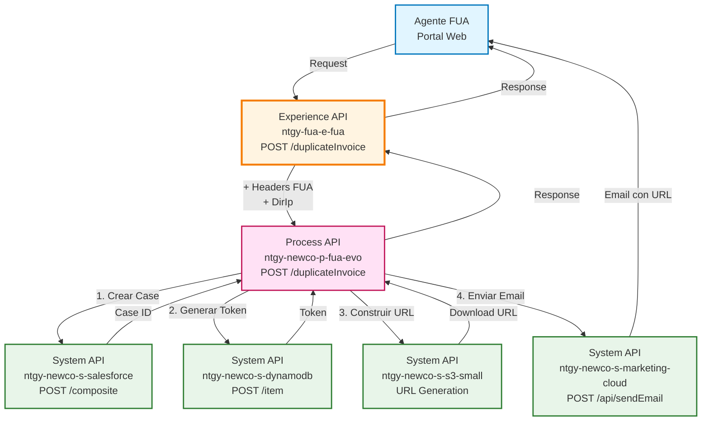
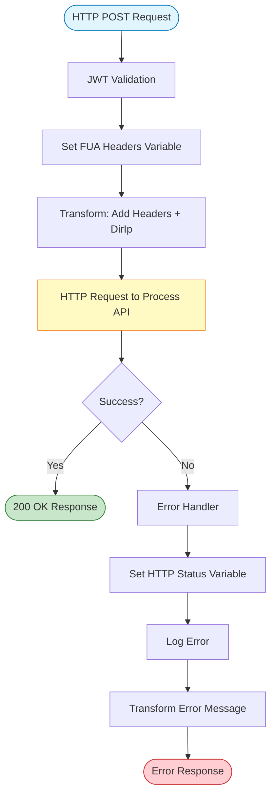
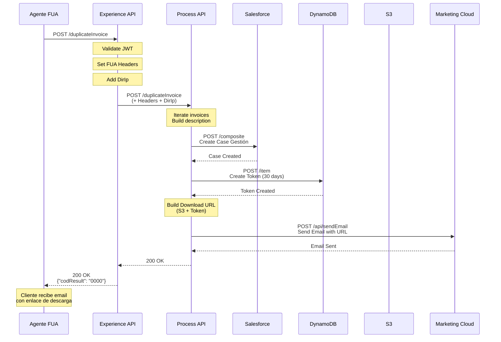
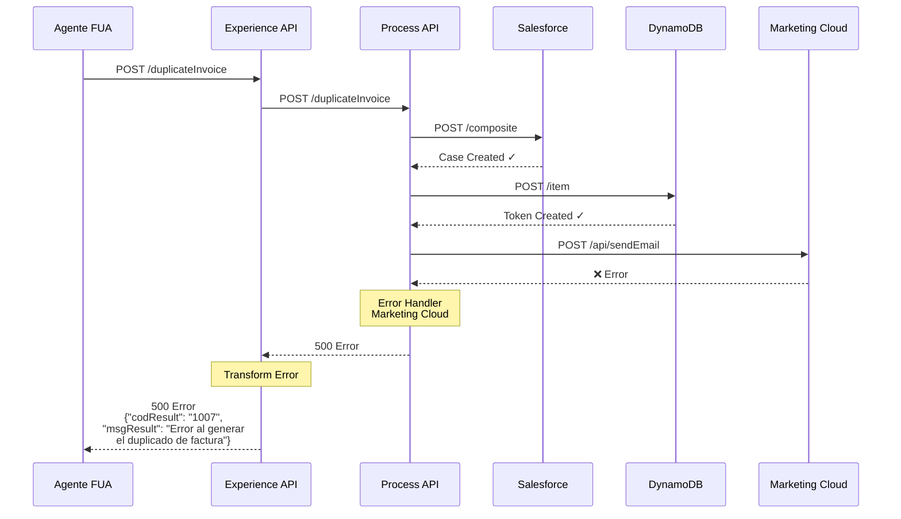
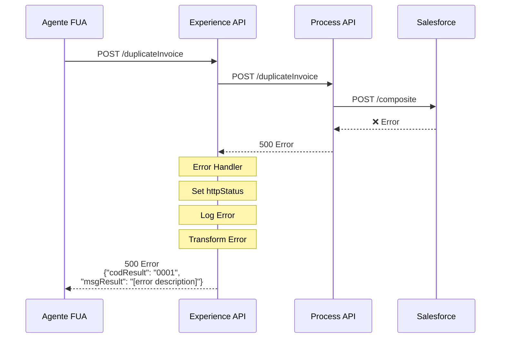

# POST /duplicateInvoice

## 📌 Descripción General

### Propósito del Endpoint

Este endpoint permite a los agentes del FUA solicitar el envío de duplicados de facturas a los clientes por correo electrónico. El proceso incluye la creación de un caso de gestión en Salesforce, la generación de un token temporal seguro en DynamoDB para la descarga del PDF, y el envío automático del email con el enlace de descarga a través de Marketing Cloud.

### Tipo de API

**Capa:** Experience API (API-Led Connectivity)

**Función:** Orquestación de canal web para agentes de atención al cliente

### Patrón de Integración

**Tipo:** Orquestación con Transformación de Canal

**Descripción:** El Experience API agrega headers específicos del FUA (x-interaction-id, x-contact-id, x-agent-mail, etc.) y la dirección IP del cliente, luego delega la lógica de negocio completa al Process API que orquesta múltiples System APIs (Salesforce, DynamoDB, S3, Marketing Cloud).

### Arquitectura API-Led Connectivity



---

## 💼 Propósito del Negocio

### Casos de Uso Principales

1. **Solicitud de Duplicado de Factura por Agente**
   - Un agente del call center solicita el envío de duplicados de facturas al cliente
   - El sistema genera un enlace seguro con token temporal (30 días de validez)
   - El cliente recibe el email con el enlace para descargar sus facturas

2. **Registro de Gestión en CRM**
   - Cada solicitud crea un Case de tipo "Gestión" en Salesforce
   - Se registra el desglose de facturas solicitadas y la razón
   - Se vincula al caso de interacción padre para trazabilidad completa

3. **Descarga Segura de Documentos**
   - Se genera un token único en DynamoDB con fecha de expiración
   - El token permite acceso controlado al documento en S3
   - El sistema valida el token antes de permitir la descarga

### 📱 Canal y Audiencia

#### Canal de Consumo

**Canal:** Web (Portal de Agentes FUA)

**Características del Canal:**
- **Plataforma**: Portal web de atención al cliente
- **Dispositivos**: Estaciones de trabajo de agentes
- **Conectividad**: Red corporativa de alta velocidad
- **Experiencia de Usuario**: Interfaz optimizada para gestión rápida de solicitudes

#### Audiencia Objetivo

**Usuarios Finales:**
- **Agentes de Atención al Cliente**: Personal del call center que gestiona solicitudes de clientes
- **Supervisores de Atención**: Personal que supervisa y valida gestiones

**Contexto de Uso:**
- **Llamada Telefónica**: Cliente solicita duplicado de factura durante llamada
- **Chat en Vivo**: Cliente solicita duplicado a través de chat
- **Gestión Proactiva**: Agente identifica necesidad y ofrece el servicio

#### Adaptaciones del Canal

**Optimizaciones Aplicadas:**
- **Headers FUA**: Se agregan headers específicos del contexto FUA (x-interaction-id, x-contact-id, x-agent-mail, x-user-id)
- **Dirección IP**: Se captura y envía la IP del cliente para auditoría
- **Timeout Extendido**: 60 segundos para permitir la orquestación completa
- **Manejo de Errores**: Transformación específica de errores para el contexto del agente

### 🔗 Endpoints Dependientes

Este Experience API consume el siguiente Process API:

| Process API | Endpoint | Método | Propósito |
|-------------|----------|--------|-----------|
| `ntgy-newco-p-fua-evo` | `/duplicateInvoice` | POST | Orquestación completa del proceso de duplicado de facturas con integración a Salesforce, DynamoDB, S3 y Marketing Cloud |

### Contexto Empresarial

- **Dominio:** Facturación y Atención al Cliente
- **Sector:** Energía - Utilities
- **División:** Naturgy España - NewCo
- **Canal:** Web (Portal de Agentes)

### Stakeholders

- **Agentes de Atención al Cliente**: Necesitan una forma rápida de enviar duplicados de facturas a clientes
- **Clientes Finales**: Reciben sus facturas por email de forma segura
- **Supervisores de Calidad**: Requieren trazabilidad completa de las gestiones
- **Equipo de Cumplimiento**: Necesitan auditoría de accesos a documentos

### Valor de Negocio

- **Mejora de Experiencia del Cliente**: Envío inmediato de facturas sin esperas
- **Eficiencia Operativa**: Automatización completa del proceso de duplicado
- **Seguridad**: Tokens temporales con expiración para acceso controlado
- **Trazabilidad**: Registro completo en Salesforce de cada solicitud
- **Reducción de Costes**: Eliminación de envíos postales de duplicados

---

## 🔧 Especificación Técnica

### URLs por Ambiente

| Ambiente | URL Base | URL Completa |
|----------|----------|--------------|
| **Local** | `http://localhost:8081` | `http://localhost:8081/fua/api/duplicateInvoice` |
| **Development** | `https://ntgy-fua-e-fua-dev.de-c1.cloudhub.io` | `https://ntgy-fua-e-fua-dev.de-c1.cloudhub.io/fua/api/duplicateInvoice` |
| **Production** | `https://ntgy-fua-e-fua-pro.de-c1.cloudhub.io` | `https://ntgy-fua-e-fua-pro.de-c1.cloudhub.io/fua/api/duplicateInvoice` |

### Método HTTP

```
POST /fua/api/duplicateInvoice
```

### 🎯 Consideraciones del Canal

#### Limitaciones del Canal

| Aspecto | Limitación | Razón |
|---------|------------|-------|
| **Timeout** | 60 segundos | Permite completar la orquestación de 4 System APIs |
| **Rate Limiting** | Por configuración API Manager | Protección contra uso excesivo |
| **Tamaño de Request** | ~10 KB | Incluye lista de facturas y datos de contacto |

#### Campos Específicos del Canal

**Campos Añadidos por el Experience API:**

| Campo | Tipo | Descripción | Razón |
|-------|------|-------------|-------|
| `x-interaction-id` | String (Header) | ID del caso de interacción en Salesforce | Trazabilidad de la gestión |
| `x-contact-id` | String (Header) | ID del contacto en Salesforce | Identificación del cliente |
| `x-client-id` | String (Header) | ID del cliente (Account) en Salesforce | Identificación de la cuenta |
| `x-agent-mail` | String (Header) | Email del agente que realiza la gestión | Auditoría y seguimiento |
| `x-user-id` | String (Header) | ID del usuario/agente en el sistema | Identificación del creador |
| `DirIp` | String (Body) | Dirección IP del cliente | Auditoría de seguridad |

### Parámetros de Entrada

#### Headers Requeridos

| Header | Tipo | Obligatorio | Descripción |
|--------|------|-------------|-------------|
| `Content-Type` | String | ✅ | Debe ser `application/json` |
| `x-interaction-id` | String | ✅ | ID del caso de interacción padre en Salesforce |
| `x-contact-id` | String | ✅ | ID del contacto en Salesforce |
| `x-client-id` | String | ✅ | ID del cliente (Account) en Salesforce |
| `x-agent-mail` | String | ⚠️ | Email del agente (opcional pero recomendado) |
| `x-user-id` | String | ⚠️ | ID del usuario/agente (se usa x-contact-id si no está presente) |

#### Body (JSON)

```json
{
  "preferredContact": {
    "contactId": "string",
    "docNumber": "string",
    "preferredEmail": "string"
  },
  "sendType": "string",
  "reason": "string",
  "duplicateInvoicesRelationList": {
    "invoicesList": [
      [
        {
          "invoiceId": "string",
          "amount": "number",
          "pdfDocumentId": "string"
        }
      ]
    ]
  }
}
```

> **⚠️ Nota sobre la Estructura:** `invoicesList` es un array de arrays, donde cada elemento es un array que contiene un objeto de factura. Esta estructura es requerida por el Process API que accede a los datos usando `payload[0]` en el foreach.

**Descripción de Campos:**

| Campo | Tipo | Obligatorio | Descripción |
|-------|------|-------------|-------------|
| `preferredContact` | Object | ✅ | Datos del contacto preferido para el envío |
| `preferredContact.contactId` | String | ✅ | ID del contacto en Salesforce |
| `preferredContact.docNumber` | String | ✅ | Número de documento del contacto (DNI/NIE) |
| `preferredContact.preferredEmail` | String | ✅ | Email donde se enviará el duplicado |
| `sendType` | String | ✅ | Tipo de envío (ej: "email") |
| `reason` | String | ✅ | Razón de la solicitud del duplicado |
| `duplicateInvoicesRelationList` | Object | ✅ | Objeto que contiene la lista de facturas duplicadas |
| `duplicateInvoicesRelationList.invoicesList` | Array | ✅ | Array de arrays, cada elemento contiene un array con un objeto de factura |
| `duplicateInvoicesRelationList.invoicesList[][0].invoiceId` | String | ✅ | ID de la factura |
| `duplicateInvoicesRelationList.invoicesList[][0].amount` | Number | ✅ | Importe de la factura |
| `duplicateInvoicesRelationList.invoicesList[][0].pdfDocumentId` | String | ✅ | ID del documento PDF en S3 (formato: fact_XXXXXXX) |

> **📋 Nota sobre Campos Adicionales del RAML:**
> 
> El RAML define campos adicionales para los objetos `preferredContact` e `invoice` que no son procesados por el backend actual:
> 
> **Campos adicionales en `preferredContact` (no procesados):**
> - `clientId`, `name`, `surname`, `surname2`, `docTypeId`, `nationalityId`, `representationTypeId`, `scheduleId`, `preferredPhone`, `phone2`, `channel`, `isPreferred`, `isValidated`
> 
> **Campos adicionales en `invoice` (no procesados):**
> - `issuedDate`, `billingDate`, `status`, `pendingAmount`, `pendingInvoiceStatus`, `interactiveInvoice`, `productInvoiceRelationList`, `agentConsumptionInfo`, `agentDueInfo`, `periodEnd`, `type`
> 
> **Campos del body principal no procesados:**
> - `sendType` (definido en RAML pero no utilizado en la lógica del Process API)
> 
> Estos campos son opcionales (`required: false`) en el RAML y pueden ser enviados en el request, pero el Process API solo procesa los campos documentados en la tabla anterior.

### Respuestas

#### 200 OK - Éxito

```json
{
  "result": {
    "codResult": "0000",
    "msgResult": "No hay error"
  }
}
```

**Descripción:** El duplicado de factura ha sido procesado exitosamente. El cliente recibirá un email con el enlace de descarga.

#### 500 Internal Server Error - Error en Marketing Cloud

```json
{
  "result": {
    "codResult": "1007",
    "msgResult": "Error al generar el duplicado de factura"
  }
}
```

**Descripción:** Error específico al enviar el email a través de Marketing Cloud. El caso en Salesforce y el token en DynamoDB se crearon correctamente, pero el email no pudo ser enviado.

#### 500 Internal Server Error - Error General

```json
{
  "result": {
    "codResult": "0001",
    "msgResult": "[Descripción del error]"
  }
}
```

**Descripción:** Error general en el procesamiento. Puede ser error en Salesforce, DynamoDB o en la orquestación.

### Autenticación

- **Tipo:** OAuth 2.0 con JWT
- **Validación:** El token JWT se valida en el flow `jwt-validation` antes de procesar la solicitud
- **Roles Permitidos:** Agentes con rol `newcoAgent` o similar

### Timeouts

| Tipo | Valor | Razón |
|------|-------|-------|
| **Request Timeout (Experience → Process)** | 60 segundos | Permite completar la orquestación de múltiples System APIs |
| **Connection Idle Timeout** | 60 segundos | Mantiene conexión activa durante procesamiento |

---

## 🏗️ Implementación Técnica

### Arquitectura del Flow



### Transformaciones de Canal

**Transformación de Request (Experience API):**

El Experience API agrega información de contexto del FUA al payload original:

```dataweave
%dw 2.2
import * from dw::core::Strings
output application/json
---
payload
++ 
vars.fuaHeaders 
++
{
    "DirIp": substringBefore(substringAfter(attributes.remoteAddress,"/"),":")
}
```

**Campos Agregados:**

| Campo Original | Campo Agregado | Transformación |
|----------------|----------------|----------------|
| N/A | `x-interaction-id` | Extraído de headers |
| N/A | `x-contact-id` | Extraído de headers |
| N/A | `x-client-id` | Extraído de headers |
| N/A | `x-agent-mail` | Extraído de headers |
| N/A | `x-user-id` | Extraído de headers |
| `attributes.remoteAddress` | `DirIp` | Extracción de IP del formato "/IP:puerto" |

**Lógica de Transformación de Headers FUA:**

```dataweave
%dw 2.2
output application/java
---
{
    ("x-interaction-id": attributes.headers['x-interaction-id']) if (attributes.headers['x-interaction-id'] != "null" and !isEmpty(attributes.headers['x-interaction-id'])),
    ("x-contact-id": attributes.headers['x-contact-id']) if (attributes.headers['x-contact-id'] != "null" and !isEmpty(attributes.headers['x-contact-id'])),
    ("x-client-id": attributes.headers['x-client-id']) if (attributes.headers['x-client-id'] != "null" and !isEmpty(attributes.headers['x-client-id'])),
    ("x-agent-mail": attributes.headers['x-agent-mail']) if (attributes.headers['x-agent-mail'] != "null" and !isEmpty(attributes.headers['x-agent-mail'])),
    ("x-user-id": attributes.headers['x-user-id']) if (attributes.headers['x-user-id'] != "null" and !isEmpty(attributes.headers['x-user-id']))
}
```

### Patrones de Diseño

**Patrón:** Pass-Through con Enriquecimiento de Contexto

**Justificación:** El Experience API no modifica la lógica de negocio, solo agrega información de contexto del canal (headers FUA y dirección IP) antes de delegar al Process API. Esto permite:
- Separación clara de responsabilidades
- Reutilización del Process API por otros canales
- Trazabilidad completa de la gestión
- Auditoría de seguridad con IP del cliente

### Diagramas de Secuencia

#### 1. Flujo Normal de Éxito



#### 2. Flujo con Error de Marketing Cloud



#### 3. Flujo con Error Técnico General



### Lógica del Process API (Orquestación Completa)

El Process API `ntgy-newco-p-fua-evo` realiza la siguiente orquestación:

#### Paso 1: Iteración sobre Facturas

```dataweave
// For Each sobre duplicateInvoicesRelationList.invoicesList
// Construye descripción concatenando: invoiceId:amount;
vars.descriptionParam ++ vars.invoiceNumAmount
```

**Resultado:** `"12345:150.50;67890:200.75;"`

#### Paso 2: Creación de Case en Salesforce

```json
{
  "allOrNone": true,
  "collateSubrequests": false,
  "compositeRequest": [
    {
      "method": "POST",
      "url": "/services/data/v52.0/sobjects/Case",
      "referenceId": "refCaseGestion",
      "body": {
        "NewCo_Recordtype__c": "Gestion",
        "AccountId": "[x-client-id]",
        "ContactId": "[x-contact-id]",
        "Origin": "FUA",
        "Description": "[invoiceId:amount;...] + reason",
        "NewCo_Creado_por__c": "[x-user-id or x-contact-id]",
        "ParentId": "[x-interaction-id]",
        "NewCo_Ip__c": "213.94.15.86",
        "NewCo_CorrelationId__c": "[correlationId]",
        "acn_fld_Tittle__r": {
          "NewCo_ExternalId__c": "DuplicadoFactura"
        }
      }
    }
  ]
}
```

#### Paso 3: Generación de Token en DynamoDB

```dataweave
var expirationDate = ((now() + |P30D|) >> "CET") as String {format: "dd-MM-yyyy HH:mm:ss"}
var pdfDocumentId = (vars.entryPayload.duplicateInvoicesRelationList.invoicesList flatMap $.pdfDocumentId)[0]
---
{
  "token": uuid(),
  "tokenExpirationDate": expirationDate,
  "docId": pdfDocumentId,
  "nif": vars.entryPayload.preferredContact.docNumber,
  "invoiceNumber": (vars.entryPayload.duplicateInvoicesRelationList.invoicesList flatMap $.invoiceId)[0],
  "documentType": "03.01",
  ("s3File": true) if((try(() -> fromBase64(pdfDocumentId)) orElse pdfDocumentId) startsWith "fact_")
}
```

**Tabla DynamoDB:** `ntgy-dydb-documents-token`

#### Paso 4: Construcción de URL de Descarga

```dataweave
p('s-s3-small.downloadUrl') ++ "qt=" ++ vars.dynEntry.token ++ "&documentId=" ++ vars.dynEntry.docId ++ "&checkToken=Yes"
```

**Ejemplo de URL:** `https://s3.amazonaws.com/bucket/download?qt=abc123-token&documentId=fact_12345.pdf&checkToken=Yes`

#### Paso 5: Envío de Email vía Marketing Cloud

```json
{
  "ContactKey": "[contactId]",
  "EventDefinitionKey": "[journey.EventDefinitionKey]",
  "Data": {
    "SubscriberKey": "[contactId]",
    "Email": "[preferredEmail]",
    "URL": "[urlDescarga]"
  }
}
```

**Query Params:** `?credenciales=impresion`

### Manejo de Errores

#### Error Handler del Experience API

```dataweave
%dw 2.0
output application/json
---
if ( !isEmpty(error.errorMessage.payload) ) 
  error.errorMessage.payload
else 
{
  "result": {
    "codResult": "0001",
    "msgResult": error.description as String replace /\"/ with("")
  }
}
```

**Lógica:**
1. Si el error del Process API tiene payload, se propaga tal cual
2. Si no, se construye respuesta estándar con código "0001"
3. Se establece `httpStatus` variable con el código de error
4. Se registra en logs para auditoría

#### Error Handler Específico de Marketing Cloud (Process API)

```dataweave
{
  "result": {
    "codResult": "1007",
    "msgResult": "Error al generar el duplicado de factura"
  }
}
```

**Nota:** Este error se produce solo cuando falla el envío del email. El Case en Salesforce y el token en DynamoDB ya fueron creados exitosamente.

### Optimizaciones del Canal

1. **Timeout Extendido:** 60 segundos para permitir la orquestación completa de 4 System APIs
2. **Headers Contextuales:** Agregación automática de headers FUA para trazabilidad
3. **Captura de IP:** Extracción automática de la IP del cliente para auditoría
4. **Error Handling Específico:** Transformación de errores adaptada al contexto del agente

---

## 💻 Ejemplos de Uso

### Ejemplo 1: Solicitud Exitosa de Duplicado de Factura

#### cURL

```bash
curl -X POST "https://ntgy-fua-e-fua-pro.de-c1.cloudhub.io/fua/api/duplicateInvoice" \
  -H "Content-Type: application/json" \
  -H "Authorization: Bearer YOUR_JWT_TOKEN" \
  -H "x-interaction-id: 5005I00000ABC123" \
  -H "x-contact-id: 0035I00000DEF456" \
  -H "x-client-id: 0015I00000GHI789" \
  -H "x-agent-mail: agente@naturgy.com" \
  -H "x-user-id: 0055I00000JKL012" \
  -d '{
    "preferredContact": {
      "contactId": "0035I00000DEF456",
      "docNumber": "12345678A",
      "preferredEmail": "cliente@example.com"
    },
    "sendType": "email",
    "reason": "Cliente solicita duplicado de facturas del último trimestre",
    "duplicateInvoicesRelationList": [
      {
        "address": "Calle Mayor 123, Madrid",
        "invoicesList": [
          {
            "invoiceId": "FAC2024001",
            "amount": 150.50,
            "pdfDocumentId": "fact_FAC2024001_encoded_base64"
          },
          {
            "invoiceId": "FAC2024002",
            "amount": 200.75,
            "pdfDocumentId": "fact_FAC2024002_encoded_base64"
          }
        ]
      }
    ]
  }'
```

#### Respuesta (200 OK)

```json
{
  "result": {
    "codResult": "0000",
    "msgResult": "No hay error"
  }
}
```

**Descripción:** El proceso se completó exitosamente. El cliente recibirá un email con el enlace de descarga de las facturas.

---

### Ejemplo 2: Error en Marketing Cloud

#### cURL

```bash
curl -X POST "https://ntgy-fua-e-fua-pro.de-c1.cloudhub.io/fua/api/duplicateInvoice" \
  -H "Content-Type: application/json" \
  -H "Authorization: Bearer YOUR_JWT_TOKEN" \
  -H "x-interaction-id: 5005I00000ABC123" \
  -H "x-contact-id: 0035I00000DEF456" \
  -H "x-client-id: 0015I00000GHI789" \
  -H "x-agent-mail: agente@naturgy.com" \
  -d '{
    "preferredContact": {
      "contactId": "0035I00000DEF456",
      "docNumber": "12345678A",
      "preferredEmail": "email_invalido@"
    },
    "sendType": "email",
    "reason": "Solicitud de duplicado",
    "duplicateInvoicesRelationList": [
      {
        "address": "Calle Mayor 123",
        "invoicesList": [
          {
            "invoiceId": "FAC2024001",
            "amount": 150.50,
            "pdfDocumentId": "fact_FAC2024001"
          }
        ]
      }
    ]
  }'
```

#### Respuesta (500 Internal Server Error)

```json
{
  "result": {
    "codResult": "1007",
    "msgResult": "Error al generar el duplicado de factura"
  }
}
```

**Descripción:** El caso en Salesforce y el token en DynamoDB se crearon correctamente, pero el envío del email falló (posiblemente por email inválido).

---

### Ejemplo 3: JavaScript (Frontend del Portal FUA)

```javascript
async function solicitarDuplicadoFactura(facturas, contacto, razon) {
  const headers = {
    'Content-Type': 'application/json',
    'Authorization': `Bearer ${sessionStorage.getItem('jwt_token')}`,
    'x-interaction-id': sessionStorage.getItem('interaction_id'),
    'x-contact-id': contacto.id,
    'x-client-id': contacto.accountId,
    'x-agent-mail': sessionStorage.getItem('agent_email'),
    'x-user-id': sessionStorage.getItem('user_id')
  };

  const body = {
    preferredContact: {
      contactId: contacto.id,
      docNumber: contacto.docNumber,
      preferredEmail: contacto.email
    },
    sendType: 'email',
    reason: razon,
    duplicateInvoicesRelationList: [
      {
        address: contacto.address,
        invoicesList: facturas.map(f => ({
          invoiceId: f.id,
          amount: f.amount,
          pdfDocumentId: f.pdfId
        }))
      }
    ]
  };

  try {
    const response = await fetch(
      'https://ntgy-fua-e-fua-pro.de-c1.cloudhub.io/fua/api/duplicateInvoice',
      {
        method: 'POST',
        headers: headers,
        body: JSON.stringify(body)
      }
    );

    const data = await response.json();

    if (data.result.codResult === '0000') {
      console.log('✅ Duplicado enviado exitosamente');
      return { success: true, message: 'Email enviado al cliente' };
    } else {
      console.error('❌ Error:', data.result.msgResult);
      return { success: false, message: data.result.msgResult };
    }
  } catch (error) {
    console.error('❌ Error de red:', error);
    return { success: false, message: 'Error de conexión' };
  }
}

// Uso
const facturas = [
  { id: 'FAC2024001', amount: 150.50, pdfId: 'fact_FAC2024001' },
  { id: 'FAC2024002', amount: 200.75, pdfId: 'fact_FAC2024002' }
];

const contacto = {
  id: '0035I00000DEF456',
  accountId: '0015I00000GHI789',
  docNumber: '12345678A',
  email: 'cliente@example.com',
  address: 'Calle Mayor 123, Madrid'
};

const resultado = await solicitarDuplicadoFactura(
  facturas,
  contacto,
  'Cliente solicita duplicado del último trimestre'
);
```

---

### Ejemplo 4: Python (Script de Automatización)

```python
import requests
import json

def solicitar_duplicado_factura(
    jwt_token,
    interaction_id,
    contact_id,
    client_id,
    agent_email,
    user_id,
    contacto,
    facturas,
    razon
):
    """
    Solicita el envío de duplicado de facturas a través del FUA.
    
    Args:
        jwt_token: Token JWT de autenticación
        interaction_id: ID del caso de interacción
        contact_id: ID del contacto en Salesforce
        client_id: ID del cliente (Account) en Salesforce
        agent_email: Email del agente
        user_id: ID del usuario/agente
        contacto: Dict con datos del contacto
        facturas: Lista de facturas a enviar
        razon: Razón de la solicitud
    
    Returns:
        Dict con resultado de la operación
    """
    url = 'https://ntgy-fua-e-fua-pro.de-c1.cloudhub.io/fua/api/duplicateInvoice'
    
    headers = {
        'Content-Type': 'application/json',
        'Authorization': f'Bearer {jwt_token}',
        'x-interaction-id': interaction_id,
        'x-contact-id': contact_id,
        'x-client-id': client_id,
        'x-agent-mail': agent_email,
        'x-user-id': user_id
    }
    
    payload = {
        'preferredContact': {
            'contactId': contacto['id'],
            'docNumber': contacto['docNumber'],
            'preferredEmail': contacto['email']
        },
        'sendType': 'email',
        'reason': razon,
        'duplicateInvoicesRelationList': [
            {
                'address': contacto['address'],
                'invoicesList': [
                    {
                        'invoiceId': f['id'],
                        'amount': f['amount'],
                        'pdfDocumentId': f['pdfId']
                    }
                    for f in facturas
                ]
            }
        ]
    }
    
    try:
        response = requests.post(url, headers=headers, json=payload, timeout=65)
        data = response.json()
        
        if data['result']['codResult'] == '0000':
            print('✅ Duplicado enviado exitosamente')
            return {
                'success': True,
                'message': 'Email enviado al cliente',
                'data': data
            }
        else:
            print(f"❌ Error: {data['result']['msgResult']}")
            return {
                'success': False,
                'message': data['result']['msgResult'],
                'code': data['result']['codResult']
            }
            
    except requests.exceptions.Timeout:
        print('❌ Timeout: La solicitud tardó más de 65 segundos')
        return {
            'success': False,
            'message': 'Timeout en la solicitud'
        }
    except requests.exceptions.RequestException as e:
        print(f'❌ Error de red: {e}')
        return {
            'success': False,
            'message': f'Error de conexión: {str(e)}'
        }

# Ejemplo de uso
if __name__ == '__main__':
    # Datos de ejemplo
    contacto = {
        'id': '0035I00000DEF456',
        'docNumber': '12345678A',
        'email': 'cliente@example.com',
        'address': 'Calle Mayor 123, Madrid'
    }
    
    facturas = [
        {
            'id': 'FAC2024001',
            'amount': 150.50,
            'pdfId': 'fact_FAC2024001_encoded'
        },
        {
            'id': 'FAC2024002',
            'amount': 200.75,
            'pdfId': 'fact_FAC2024002_encoded'
        }
    ]
    
    resultado = solicitar_duplicado_factura(
        jwt_token='eyJhbGciOiJIUzI1NiIsInR5cCI6IkpXVCJ9...',
        interaction_id='5005I00000ABC123',
        contact_id='0035I00000DEF456',
        client_id='0015I00000GHI789',
        agent_email='agente@naturgy.com',
        user_id='0055I00000JKL012',
        contacto=contacto,
        facturas=facturas,
        razon='Cliente solicita duplicado del último trimestre'
    )
    
    print(json.dumps(resultado, indent=2))
```

---

### Ejemplo 5: Respuesta de Error General

#### Request

```bash
curl -X POST "https://ntgy-fua-e-fua-pro.de-c1.cloudhub.io/fua/api/duplicateInvoice" \
  -H "Content-Type: application/json" \
  -H "Authorization: Bearer INVALID_TOKEN" \
  -H "x-interaction-id: 5005I00000ABC123" \
  -H "x-contact-id: 0035I00000DEF456" \
  -H "x-client-id: 0015I00000GHI789" \
  -d '{
    "preferredContact": {
      "contactId": "0035I00000DEF456",
      "docNumber": "12345678A",
      "preferredEmail": "cliente@example.com"
    },
    "sendType": "email",
    "reason": "Solicitud de duplicado",
    "duplicateInvoicesRelationList": []
  }'
```

#### Respuesta (500 Internal Server Error)

```json
{
  "result": {
    "codResult": "0001",
    "msgResult": "Error en la validación del token JWT"
  }
}
```

**Descripción:** Error general en el procesamiento, en este caso por token JWT inválido.
