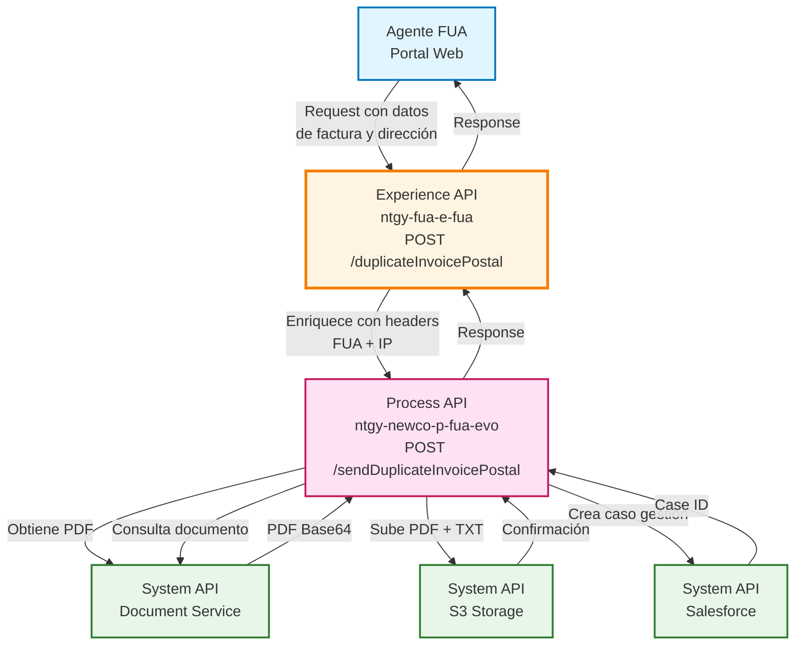
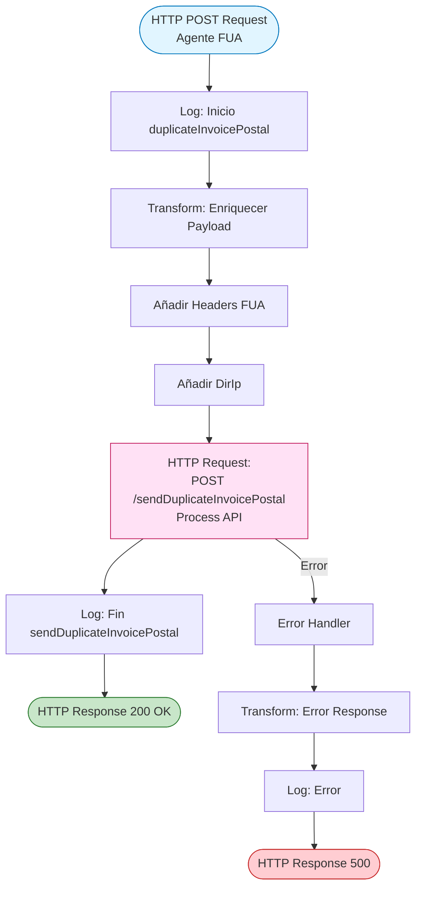
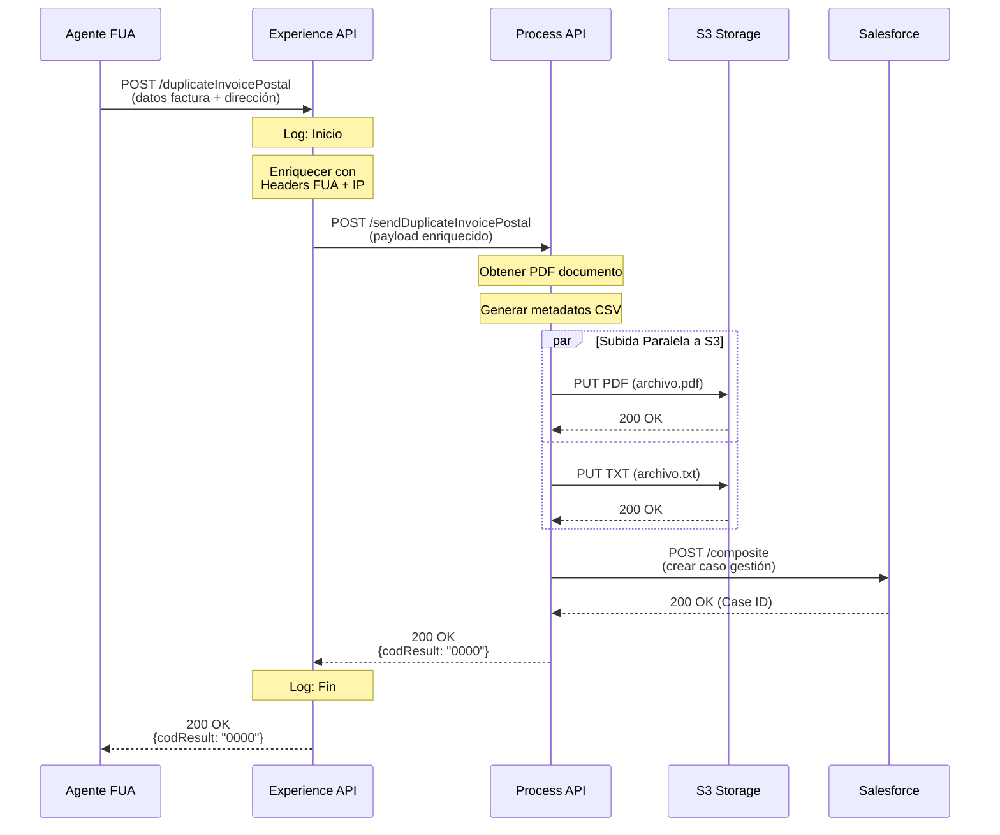
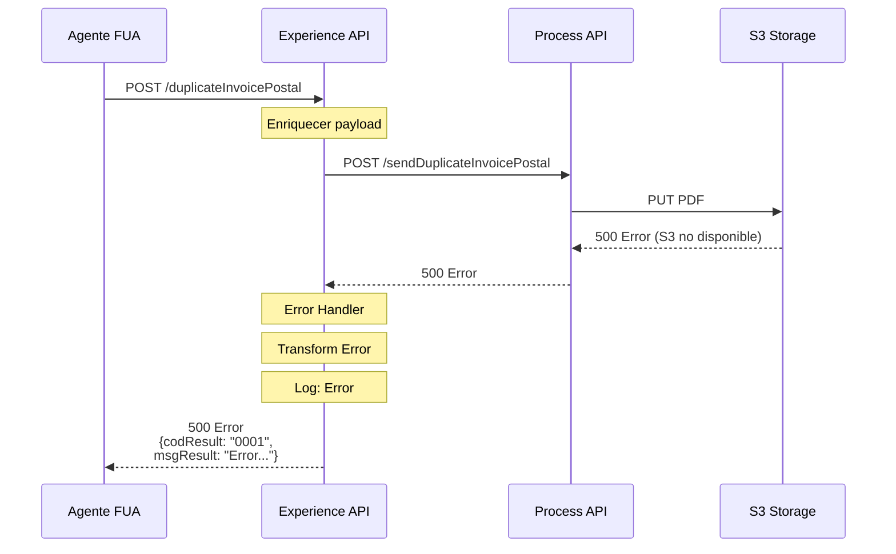
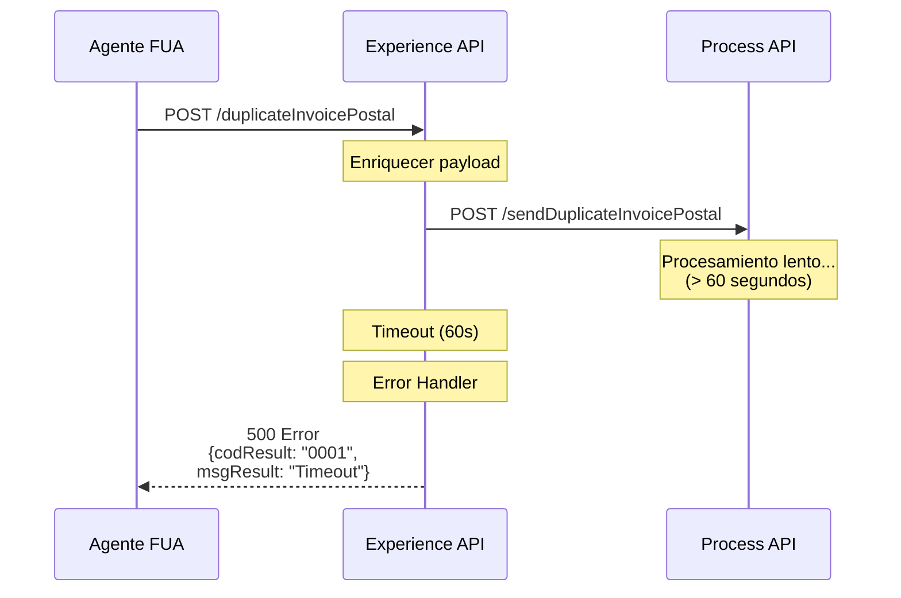

# POST /duplicateInvoicePostal

## 📌 Descripción General

### Propósito del Endpoint

Este endpoint permite a los agentes del FUA (Frontal Único de Atención) solicitar el envío de duplicados de facturas por correo postal a los clientes. El proceso incluye la obtención del documento PDF, la generación de metadatos para el envío postal, la subida de archivos a S3 y la creación de un caso de gestión en Salesforce para el seguimiento.

### Tipo de API

**Capa:** Experience API (API-Led Connectivity)

**Función:** Adaptación de experiencia para canal de agentes FUA, proporcionando una interfaz simplificada para solicitar envíos postales de facturas.

### Patrón de Integración

**Tipo:** Pass-Through con Enriquecimiento de Headers

**Descripción:** El Experience API recibe la solicitud del agente, enriquece el payload con headers FUA y la dirección IP del solicitante, y delega el procesamiento completo al Process API. No transforma la estructura de datos, solo añade contexto operacional.

### Arquitectura API-Led Connectivity



---

## 💼 Propósito del Negocio

### Casos de Uso Principales

1. **Solicitud de Duplicado por Pérdida de Factura**
   - El cliente contacta al agente porque no recibió o perdió su factura
   - El agente solicita el envío de un duplicado por correo postal
   - Se genera automáticamente un caso de seguimiento en Salesforce

2. **Envío de Factura a Dirección Alternativa**
   - El cliente solicita recibir una copia de la factura en una dirección diferente
   - El agente especifica la dirección postal de destino
   - El sistema gestiona el envío con marca de agua "Duplicado"

3. **Gestión de Reclamaciones de Facturación**
   - Como parte de la resolución de una reclamación, se envía copia física de la factura
   - El agente documenta el envío en el caso de interacción
   - Se mantiene trazabilidad completa del proceso

### 📱 Canal y Audiencia

#### Canal de Consumo

**Canal:** Agente FUA (Portal Web de Atención al Cliente)

**Características del Canal:**
- **Plataforma**: Portal web interno de Naturgy para agentes de atención al cliente
- **Dispositivos**: Estaciones de trabajo de escritorio con navegadores modernos
- **Conectividad**: Red corporativa interna con alta disponibilidad
- **Experiencia de Usuario**: Interfaz optimizada para operaciones rápidas y eficientes

#### Audiencia Objetivo

**Usuarios Finales:**
- **Agentes de Call Center**: Personal de atención telefónica que gestiona solicitudes de clientes
  - Necesitan procesar solicitudes de duplicados de forma rápida
  - Requieren confirmación inmediata del envío
  - Deben poder especificar direcciones alternativas
  
- **Agentes de Oficinas Comerciales**: Personal de atención presencial
  - Gestionan solicitudes de clientes que acuden en persona
  - Necesitan validar direcciones postales en tiempo real
  - Requieren trazabilidad del envío para seguimiento

**Contexto de Uso:**
- **Atención Telefónica**: Cliente llama solicitando duplicado de factura
- **Atención Presencial**: Cliente acude a oficina comercial para solicitar copia física
- **Gestión de Reclamaciones**: Como parte de la resolución de incidencias de facturación

#### Adaptaciones del Canal

**Optimizaciones Aplicadas:**
- **Enriquecimiento de Contexto**: Se añaden automáticamente headers FUA (usuario, contacto, cliente, interacción)
- **Captura de IP**: Se registra la IP del agente para auditoría
- **Validación de Sesión**: Se verifica que el agente esté autenticado y autorizado
- **Timeout Extendido**: 60 segundos para permitir procesamiento completo del envío

### 🔗 Endpoints Dependientes

Este Experience API consume el siguiente Process API:

| Process API | Endpoint | Método | Propósito |
|-------------|----------|--------|-----------|
| `ntgy-newco-p-fua-evo` | `/sendDuplicateInvoicePostal` | POST | Orquesta el proceso completo: obtención del PDF del documento, generación de metadatos, subida paralela a S3 (PDF + TXT), y creación de caso de gestión en Salesforce |

### Contexto Empresarial

- **Dominio:** Gestión Documental y Atención al Cliente
- **Sector:** Energía - Utilities
- **División:** Naturgy España - NewCo
- **Canal:** Agente FUA (Portal Web Interno)

### Stakeholders

- **Agentes de Atención al Cliente**: Necesitan herramienta eficiente para gestionar solicitudes de duplicados
- **Clientes de Naturgy**: Requieren recibir copias físicas de sus facturas de forma confiable
- **Departamento de Facturación**: Necesita trazabilidad de todos los envíos de duplicados
- **Área de Calidad**: Requiere seguimiento de casos para métricas de servicio

### Valor de Negocio

- **Mejora de Experiencia del Cliente**: Proceso automatizado y rápido para solicitar duplicados
- **Reducción de Tiempos**: Eliminación de procesos manuales de gestión de envíos postales
- **Trazabilidad Completa**: Registro automático en Salesforce de todas las solicitudes
- **Optimización de Costes**: Gestión centralizada de envíos postales a través de proveedor único
- **Cumplimiento Normativo**: Registro de todas las comunicaciones con el cliente

---

## 🔧 Especificación Técnica

### URLs por Ambiente

| Ambiente | URL Base | URL Completa |
|----------|----------|--------------|
| **Local** | `http://localhost:8081` | `http://localhost:8081/fua/api/duplicateInvoicePostal` |
| **Development** | `https://ntgy-fua-e-fua-dev.de-c1.cloudhub.io` | `https://ntgy-fua-e-fua-dev.de-c1.cloudhub.io/fua/api/duplicateInvoicePostal` |
| **Production** | `https://ntgy-fua-e-fua-pro.de-c1.cloudhub.io` | `https://ntgy-fua-e-fua-pro.de-c1.cloudhub.io/fua/api/duplicateInvoicePostal` |

### Método HTTP

```
POST /fua/api/duplicateInvoicePostal
```

### 🎯 Consideraciones del Canal

#### Limitaciones del Canal

| Aspecto | Limitación | Razón |
|---------|------------|-------|
| **Timeout** | 60 segundos | Proceso completo incluye obtención de PDF, subida a S3 y creación de caso en Salesforce |
| **Tamaño de Respuesta** | < 5 KB | Respuesta simple con código de resultado |
| **Rate Limiting** | 100 requests/minuto por agente | Prevenir uso indebido y garantizar disponibilidad |
| **Concurrencia** | 1 solicitud a la vez por sesión | Evitar duplicados accidentales |

#### Campos Específicos del Canal

**Campos Añadidos por el Experience API:**

| Campo | Tipo | Descripción | Razón |
|-------|------|-------------|-------|
| `DirIp` | String | Dirección IP del agente | Auditoría y seguridad - trazabilidad de solicitudes |

**Headers FUA Propagados:**

| Header | Descripción | Obligatorio |
|--------|-------------|-------------|
| `x-client-id` | ID del cliente en Salesforce | Sí |
| `x-contact-id` | ID del contacto en Salesforce | Sí |
| `x-interaction-id` | ID del caso de interacción padre | Sí |
| `x-user-id` | ID del agente que realiza la solicitud | Sí |
| `x-agent-mail` | Email del agente para Salesforce | Sí |

### Parámetros de Entrada

#### Headers Requeridos

| Header | Tipo | Obligatorio | Descripción |
|--------|------|-------------|-------------|
| `Content-Type` | String | Sí | Debe ser `application/json` |
| `x-client-id` | String | Sí | ID del cliente en Salesforce (AccountId) |
| `x-contact-id` | String | Sí | ID del contacto en Salesforce (ContactId) |
| `x-interaction-id` | String | Sí | ID del caso de interacción padre |
| `x-user-id` | String | Sí | ID del agente logado en el FUA |
| `x-agent-mail` | String | Sí | Email del agente para registro en Salesforce |

#### Body (JSON)

| Campo | Tipo | Obligatorio | Descripción | Ejemplo |
|-------|------|-------------|-------------|---------|
| `pdfDocumentType` | String | Sí | Tipo de documento PDF a obtener | `"INVOICE"` |
| `docNumber` | String | No | Número de documento (si aplica) | `"DOC123456"` |
| `documentId` | String | Sí | ID del documento en el sistema | `"INV-2024-001234"` |
| `name` | String | No | Nombre del destinatario | `"Juan"` |
| `surname` | String\|null | No | Primer apellido del destinatario | `"García"` |
| `surname2` | String\|null | No | Segundo apellido del destinatario | `"López"` |
| `fullAddress` | String | No | Dirección completa de envío | `"Calle Mayor 123, 3º A"` |
| `zipCode` | String | No | Código postal | `"28013"` |
| `town` | String | No | Localidad | `"Madrid"` |
| `city` | String | No | Provincia | `"Madrid"` |
| `invoiceId` | String | No | ID de la factura | `"INV-001234"` |
| `invoiceNum` | String | No | Número de factura | `"2024001234"` |
| `contactId` | String | No | ID del contacto (redundante con header) | `"003XXXXXXXXXXXXXXX"` |
| `clientId` | String | No | ID del cliente (redundante con header) | `"001XXXXXXXXXXXXXXX"` |

**Nota sobre Campos Opcionales:** Aunque muchos campos están marcados como opcionales en el RAML, el Process API los requiere para generar correctamente los metadatos del envío postal. Se recomienda enviar todos los campos de dirección postal.

### Respuestas

#### 200 OK - Solicitud Procesada Exitosamente

```json
{
  "result": {
    "codResult": "0000",
    "msgResult": "OK"
  }
}
```

**Descripción:** El duplicado de factura ha sido procesado correctamente. El PDF y los metadatos se han subido a S3, y se ha creado el caso de gestión en Salesforce.

#### 500 Internal Server Error - Error en el Procesamiento

```json
{
  "result": {
    "codResult": "0001",
    "msgResult": "Error al procesar la solicitud: [descripción del error]"
  }
}
```

**Descripción:** Ha ocurrido un error durante el procesamiento. Puede ser por:
- Error al obtener el PDF del documento
- Error al subir archivos a S3
- Error al crear el caso en Salesforce
- Timeout en alguna de las operaciones

### Autenticación

- **Tipo:** OAuth 2.0 (gestionado por API Gateway)
- **Scope:** Acceso de agente FUA
- **Headers Adicionales:** Headers FUA para contexto de sesión

### Timeouts

| Tipo | Valor | Razón |
|------|-------|-------|
| **Request Timeout** | 60 segundos | Proceso completo incluye múltiples operaciones: obtención de PDF, subida a S3 (2 archivos en paralelo), y creación de caso en Salesforce |
| **Connection Timeout** | 60 segundos | Alineado con timeout del Process API |

---

## 🏗️ Implementación Técnica

### Arquitectura del Flow



### Transformaciones de Canal

**Transformación de Enriquecimiento (DataWeave):**

```dataweave
%dw 2.2
import * from dw::core::Strings
output application/json
---
payload
++
vars.fuaHeaders
++
{
    "DirIp": substringBefore(substringAfter(attributes.remoteAddress,"/"),":")
}
```

**Descripción de la Transformación:**

| Operación | Descripción | Propósito |
|-----------|-------------|-----------|
| `payload ++` | Mantiene todos los campos del request original | Preservar datos de factura y dirección postal |
| `vars.fuaHeaders ++` | Añade headers FUA al payload | Proporcionar contexto de sesión al Process API |
| `DirIp` | Extrae IP del atributo `remoteAddress` | Auditoría - registrar IP del agente solicitante |

**Headers FUA Incluidos:**
- `x-client-id`: ID del cliente
- `x-contact-id`: ID del contacto
- `x-interaction-id`: ID del caso de interacción
- `x-user-id`: ID del agente
- `x-agent-mail`: Email del agente

**Transformación de Error (DataWeave):**

```dataweave
%dw 2.0
output application/json
---
{
  "result": {
    "codResult": "0001",
    "msgResult": error.description as String replace /\"/ with("")
  }
}
```

**Descripción:** Convierte cualquier error en un formato estándar, eliminando comillas del mensaje de error para evitar problemas de parsing JSON.

### Patrones de Diseño

**Patrón:** Pass-Through con Enriquecimiento de Contexto

**Justificación:** 
- El Experience API no necesita transformar la estructura de datos de negocio
- Solo añade contexto operacional (headers FUA + IP) requerido por el Process API
- Mantiene la simplicidad y reduce latencia
- Facilita el mantenimiento al centralizar la lógica de negocio en el Process API

### Diagramas de Secuencia

#### 1. Flujo Normal de Éxito



#### 2. Flujo con Error en Process API



#### 3. Flujo con Timeout



### Configuración del Conector HTTP

**Configuración del Process API (global.xml):**

```xml
<http:request-config 
    name="HTTP_FUA_PROCESS_NEWCO_EVO" 
    basePath="/api" 
    responseTimeout="${newco-p-fua-evo.timeout}">
    <http:request-connection 
        host="${newco-p-fua-evo.host}" 
        port="${newco-p-fua-evo.port}" 
        connectionIdleTimeout="${newco-p-fua-evo.timeout}"/>
</http:request-config>
```

**Propiedades (e-fua-pro-config.yaml):**

```yaml
newco-p-fua-evo:
  host: "mule-worker-internal-ntgy-newco-p-fua-evo.de-c1.cloudhub.io"
  port: "8091"
  timeout: "60000"  # 60 segundos
```

### Manejo de Errores

**Estrategia de Error Handling:**

```xml
<error-handler>
    <on-error-propagate 
        enableNotifications="true" 
        logException="true">
        <ee:transform doc:name="Set Error Message">
            <ee:message>
                <ee:set-payload><![CDATA[
                    %dw 2.0
                    output application/json
                    ---
                    {
                        "result": {
                            "codResult": "0001",
                            "msgResult": error.description as String replace /\"/ with("")
                        }
                    }
                ]]></ee:set-payload>
            </ee:message>
        </ee:transform>
        <logger level="ERROR" message="Error en duplicateInvoicePostal"/>
    </on-error-propagate>
</error-handler>
```

**Tipos de Errores Manejados:**

| Tipo de Error | Código | Acción |
|---------------|--------|--------|
| Error de Conectividad | 0001 | Log + Response estándar |
| Timeout | 0001 | Log + Response estándar |
| Error de Validación | 0001 | Log + Response estándar |
| Error del Process API | 0001 | Propagar mensaje original |

**Logging:**

- **Nivel DEBUG**: Inicio y fin del flow con payload completo
- **Nivel ERROR**: Cualquier excepción con descripción detallada
- **Formato**: JSON estructurado para facilitar análisis

---

## 💻 Ejemplos de Uso

### Ejemplo 1: Solicitud Completa Exitosa

#### cURL

```bash
curl -X POST "https://ntgy-fua-e-fua-pro.de-c1.cloudhub.io/fua/api/duplicateInvoicePostal" \
  -H "Content-Type: application/json" \
  -H "x-client-id: 001XXXXXXXXXXXXXXX" \
  -H "x-contact-id: 003XXXXXXXXXXXXXXX" \
  -H "x-interaction-id: 500XXXXXXXXXXXXXXX" \
  -H "x-user-id: 005XXXXXXXXXXXXXXX" \
  -H "x-agent-mail: agente@naturgy.com" \
  -H "Authorization: Bearer YOUR_ACCESS_TOKEN" \
  -d '{
    "pdfDocumentType": "INVOICE",
    "documentId": "INV-2024-001234",
    "docNumber": "2024001234",
    "name": "Juan",
    "surname": "García",
    "surname2": "López",
    "fullAddress": "Calle Mayor 123, 3º A",
    "zipCode": "28013",
    "town": "Madrid",
    "city": "Madrid",
    "invoiceId": "INV-001234",
    "invoiceNum": "2024001234",
    "contactId": "003XXXXXXXXXXXXXXX",
    "clientId": "001XXXXXXXXXXXXXXX"
  }'
```

#### Respuesta (200 OK)

```json
{
  "result": {
    "codResult": "0000",
    "msgResult": "OK"
  }
}
```

**Descripción:** El duplicado de factura ha sido procesado exitosamente. El PDF y los metadatos se han subido a S3, y se ha creado el caso de gestión en Salesforce.

### Ejemplo 2: Solicitud Mínima (Solo Campos Obligatorios)

#### cURL

```bash
curl -X POST "https://ntgy-fua-e-fua-pro.de-c1.cloudhub.io/fua/api/duplicateInvoicePostal" \
  -H "Content-Type: application/json" \
  -H "x-client-id: 001XXXXXXXXXXXXXXX" \
  -H "x-contact-id: 003XXXXXXXXXXXXXXX" \
  -H "x-interaction-id: 500XXXXXXXXXXXXXXX" \
  -H "x-user-id: 005XXXXXXXXXXXXXXX" \
  -H "x-agent-mail: agente@naturgy.com" \
  -H "Authorization: Bearer YOUR_ACCESS_TOKEN" \
  -d '{
    "pdfDocumentType": "INVOICE",
    "documentId": "INV-2024-001234"
  }'
```

**Nota:** Aunque esta es una solicitud válida según el RAML, el Process API puede requerir campos adicionales de dirección postal para completar el envío.

### Ejemplo 3: JavaScript (para Portal Web de Agentes)

```javascript
async function solicitarDuplicadoFacturaPostal(facturaData) {
  try {
    const response = await fetch(
      'https://ntgy-fua-e-fua-pro.de-c1.cloudhub.io/fua/api/duplicateInvoicePostal',
      {
        method: 'POST',
        headers: {
          'Content-Type': 'application/json',
          'x-client-id': facturaData.clientId,
          'x-contact-id': facturaData.contactId,
          'x-interaction-id': facturaData.interactionId,
          'x-user-id': getCurrentUserId(),
          'x-agent-mail': getCurrentUserEmail(),
          'Authorization': `Bearer ${getAccessToken()}`
        },
        body: JSON.stringify({
          pdfDocumentType: 'INVOICE',
          documentId: facturaData.documentId,
          docNumber: facturaData.invoiceNum,
          name: facturaData.customerName,
          surname: facturaData.customerSurname1,
          surname2: facturaData.customerSurname2,
          fullAddress: facturaData.address,
          zipCode: facturaData.zipCode,
          town: facturaData.town,
          city: facturaData.city,
          invoiceId: facturaData.invoiceId,
          invoiceNum: facturaData.invoiceNum,
          contactId: facturaData.contactId,
          clientId: facturaData.clientId
        })
      }
    );

    const result = await response.json();
    
    if (result.result.codResult === '0000') {
      console.log('Duplicado de factura solicitado exitosamente');
      showSuccessMessage('El duplicado será enviado por correo postal');
      return true;
    } else {
      console.error('Error al solicitar duplicado:', result.result.msgResult);
      showErrorMessage(result.result.msgResult);
      return false;
    }
  } catch (error) {
    console.error('Error de conexión:', error);
    showErrorMessage('Error al conectar con el servidor');
    return false;
  }
}

// Funciones auxiliares (implementar según el contexto del portal)
function getCurrentUserId() {
  return sessionStorage.getItem('userId');
}

function getCurrentUserEmail() {
  return sessionStorage.getItem('userEmail');
}

function getAccessToken() {
  return sessionStorage.getItem('accessToken');
}

function showSuccessMessage(message) {
  // Implementar según UI del portal
  alert(message);
}

function showErrorMessage(message) {
  // Implementar según UI del portal
  alert('Error: ' + message);
}
```

### Ejemplo 4: Respuesta de Error

#### Request

```bash
curl -X POST "https://ntgy-fua-e-fua-pro.de-c1.cloudhub.io/fua/api/duplicateInvoicePostal" \
  -H "Content-Type: application/json" \
  -H "x-client-id: 001XXXXXXXXXXXXXXX" \
  -H "x-contact-id: 003XXXXXXXXXXXXXXX" \
  -H "x-interaction-id: 500XXXXXXXXXXXXXXX" \
  -H "x-user-id: 005XXXXXXXXXXXXXXX" \
  -H "x-agent-mail: agente@naturgy.com" \
  -H "Authorization: Bearer YOUR_ACCESS_TOKEN" \
  -d '{
    "pdfDocumentType": "INVOICE",
    "documentId": "INVALID_ID"
  }'
```

#### Respuesta (500 Internal Server Error)

```json
{
  "result": {
    "codResult": "0001",
    "msgResult": "Error al obtener el documento: Document not found"
  }
}
```

**Descripción:** El documento especificado no existe o no está disponible en el sistema.

### Ejemplo 5: Python (para Scripts de Automatización)

```python
import requests
import json

def solicitar_duplicado_factura_postal(
    document_id,
    client_id,
    contact_id,
    interaction_id,
    user_id,
    agent_email,
    customer_data,
    access_token
):
    """
    Solicita el envío de un duplicado de factura por correo postal.
    
    Args:
        document_id (str): ID del documento
        client_id (str): ID del cliente en Salesforce
        contact_id (str): ID del contacto en Salesforce
        interaction_id (str): ID del caso de interacción
        user_id (str): ID del agente
        agent_email (str): Email del agente
        customer_data (dict): Datos del cliente y dirección postal
        access_token (str): Token de autenticación
        
    Returns:
        dict: Respuesta del API con resultado de la operación
    """
    url = "https://ntgy-fua-e-fua-pro.de-c1.cloudhub.io/fua/api/duplicateInvoicePostal"
    
    headers = {
        "Content-Type": "application/json",
        "x-client-id": client_id,
        "x-contact-id": contact_id,
        "x-interaction-id": interaction_id,
        "x-user-id": user_id,
        "x-agent-mail": agent_email,
        "Authorization": f"Bearer {access_token}"
    }
    
    payload = {
        "pdfDocumentType": "INVOICE",
        "documentId": document_id,
        "docNumber": customer_data.get("docNumber"),
        "name": customer_data.get("name"),
        "surname": customer_data.get("surname"),
        "surname2": customer_data.get("surname2"),
        "fullAddress": customer_data.get("fullAddress"),
        "zipCode": customer_data.get("zipCode"),
        "town": customer_data.get("town"),
        "city": customer_data.get("city"),
        "invoiceId": customer_data.get("invoiceId"),
        "invoiceNum": customer_data.get("invoiceNum"),
        "contactId": contact_id,
        "clientId": client_id
    }
    
    try:
        response = requests.post(url, headers=headers, json=payload, timeout=65)
        response.raise_for_status()
        
        result = response.json()
        
        if result.get("result", {}).get("codResult") == "0000":
            print("✓ Duplicado de factura solicitado exitosamente")
            return result
        else:
            print(f"✗ Error: {result.get('result', {}).get('msgResult')}")
            return result
            
    except requests.exceptions.Timeout:
        print("✗ Error: Timeout al conectar con el servidor")
        return {"result": {"codResult": "0001", "msgResult": "Timeout"}}
    except requests.exceptions.RequestException as e:
        print(f"✗ Error de conexión: {str(e)}")
        return {"result": {"codResult": "0001", "msgResult": str(e)}}

# Ejemplo de uso
if __name__ == "__main__":
    customer_data = {
        "docNumber": "2024001234",
        "name": "Juan",
        "surname": "García",
        "surname2": "López",
        "fullAddress": "Calle Mayor 123, 3º A",
        "zipCode": "28013",
        "town": "Madrid",
        "city": "Madrid",
        "invoiceId": "INV-001234",
        "invoiceNum": "2024001234"
    }
    
    result = solicitar_duplicado_factura_postal(
        document_id="INV-2024-001234",
        client_id="001XXXXXXXXXXXXXXX",
        contact_id="003XXXXXXXXXXXXXXX",
        interaction_id="500XXXXXXXXXXXXXXX",
        user_id="005XXXXXXXXXXXXXXX",
        agent_email="agente@naturgy.com",
        customer_data=customer_data,
        access_token="YOUR_ACCESS_TOKEN"
    )
    
    print(json.dumps(result, indent=2))
```

### Ejemplo 6: Manejo de Errores Comunes

#### Error: Documento No Encontrado

```json
{
  "result": {
    "codResult": "0001",
    "msgResult": "Error al obtener el documento: Document not found"
  }
}
```

**Solución:** Verificar que el `documentId` sea correcto y que el documento exista en el sistema.

#### Error: Fallo en Subida a S3

```json
{
  "result": {
    "codResult": "0001",
    "msgResult": "Error al subir archivo a S3: Access Denied"
  }
}
```

**Solución:** Problema de configuración de permisos en S3. Contactar con el equipo de infraestructura.

#### Error: Timeout

```json
{
  "result": {
    "codResult": "0001",
    "msgResult": "Timeout waiting for response"
  }
}
```

**Solución:** El proceso tardó más de 60 segundos. Verificar el estado del Process API y los servicios downstream (S3, Salesforce).
