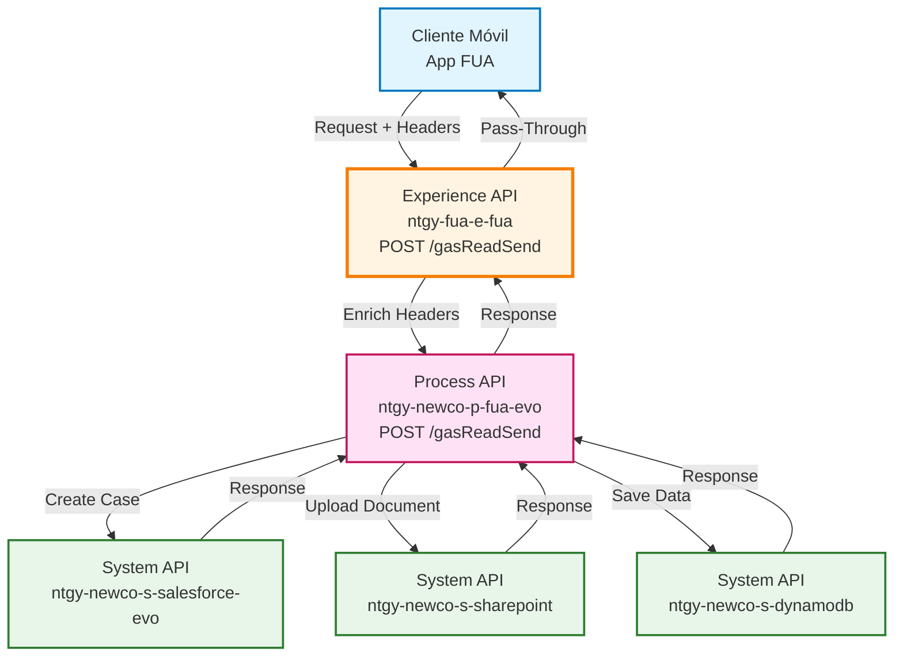
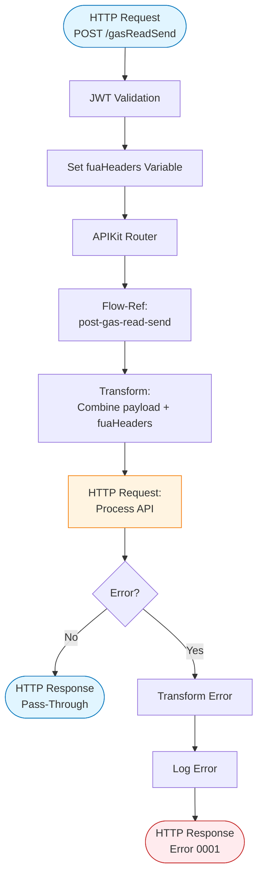
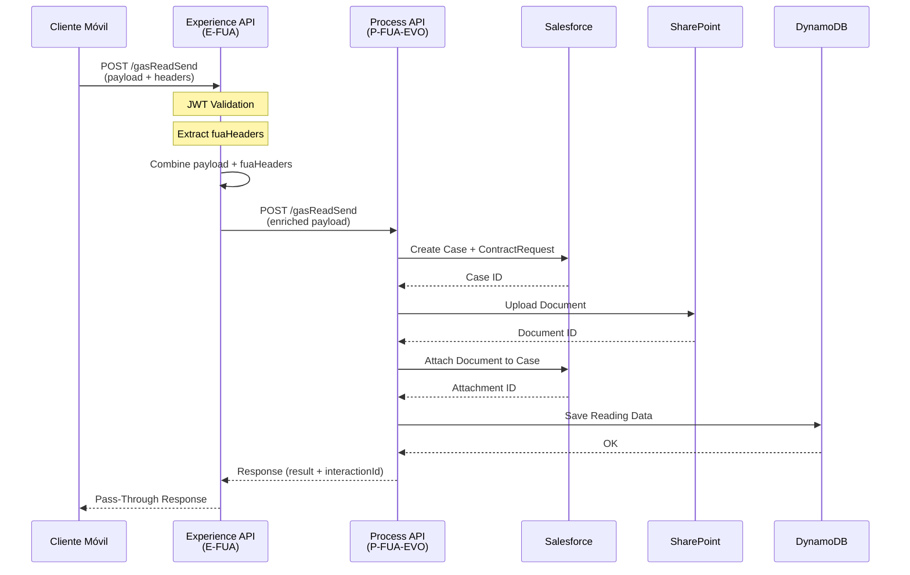
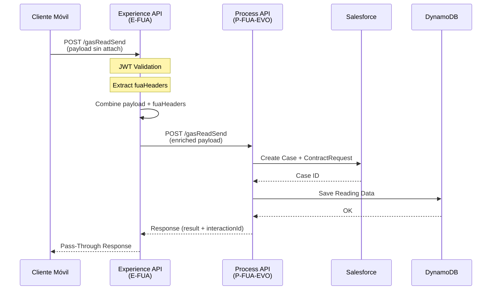
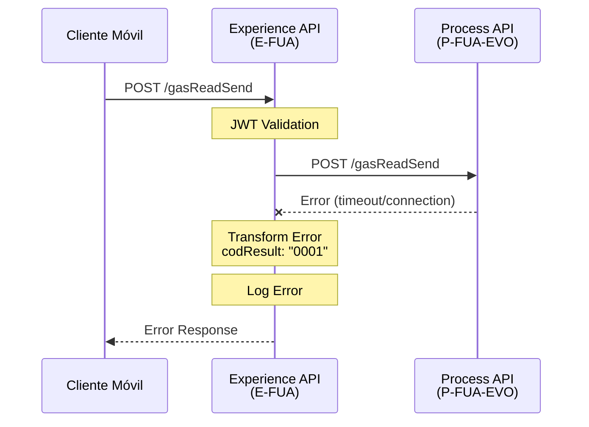

# POST /gasReadSend

## 📌 Descripción General

### Propósito del Endpoint

Este endpoint permite a los clientes enviar la lectura de su contador de gas desde la aplicación móvil FUA (Frontal Único de Atención). Actúa como punto de entrada del canal móvil, enriqueciendo la petición con headers de contexto FUA antes de delegar el procesamiento al Process API correspondiente.

### Tipo de API

**Capa:** Experience API (API-Led Connectivity)

**Función:** Adaptación de experiencia para canal móvil con enriquecimiento de contexto

### Patrón de Integración

**Tipo:** Pass-Through con Enriquecimiento de Headers

**Descripción:** Este Experience API no transforma la respuesta del Process API. Su función principal es:
- Enriquecer la petición con headers de contexto FUA (`vars.fuaHeaders`)
- Delegar el procesamiento completo al Process API `ntgy-newco-p-fua-evo`
- Devolver la respuesta del Process API sin modificaciones

### Arquitectura API-Led Connectivity



---

## 💼 Propósito del Negocio

### Casos de Uso Principales

1. **Envío de Lectura de Gas por Cliente**
   - El cliente toma una foto de su contador de gas desde la app móvil
   - Envía la lectura junto con la imagen del contador
   - El sistema registra la lectura y crea un caso de gestión en Salesforce

2. **Autogestión de Lecturas**
   - Reduce la necesidad de visitas técnicas para toma de lecturas
   - Permite al cliente gestionar sus lecturas de forma autónoma
   - Mejora la precisión de la facturación basada en consumo real

3. **Trazabilidad de Lecturas**
   - Cada lectura genera un caso de gestión con ID único (interactionId)
   - Se almacena evidencia fotográfica del contador
   - Se registra la información en DynamoDB para auditoría

### 📱 Canal y Audiencia

#### Canal de Consumo

**Canal:** Mobile (Aplicación Móvil FUA)

**Características del Canal:**
- **Plataforma**: iOS y Android
- **Dispositivos**: Smartphones con cámara
- **Conectividad**: Requiere conexión a internet para envío
- **Experiencia de Usuario**: Captura de foto + envío de lectura en un solo flujo

#### Audiencia Objetivo

**Usuarios Finales:**
- **Clientes Residenciales**: Clientes con suministro de gas que desean enviar sus lecturas
- **Clientes Empresariales**: Empresas que gestionan sus suministros de gas

**Contexto de Uso:**
- **Periodo de Lectura**: Cuando el cliente recibe notificación de periodo de lectura
- **Facturación**: Para asegurar facturación basada en consumo real
- **Autogestión**: Como parte de la gestión autónoma de suministros

#### Adaptaciones del Canal

**Optimizaciones Aplicadas:**
- **Enriquecimiento de Headers**: Se añaden headers de contexto FUA automáticamente
- **Gestión de Adjuntos**: Soporte para envío de imagen del contador
- **Timeout Extendido**: 60 segundos para permitir procesamiento de imagen
- **Trazabilidad**: Cada petición incluye traceparent para seguimiento

### 🔗 Endpoints Dependientes

Este Experience API consume el siguiente Process API:

| Process API | Endpoint | Método | Propósito |
|-------------|----------|--------|-----------|
| `ntgy-newco-p-fua-evo` | `/gasReadSend` | POST | Orquestación completa del proceso de envío de lectura (creación de caso en Salesforce, adjunto de archivo, registro en DynamoDB) |

### Contexto Empresarial

- **Dominio:** Autoservicio de Clientes - Gestión de Suministros
- **Sector:** Energía - Utilities
- **División:** Naturgy España - NewCo
- **Canal:** Aplicación Móvil FUA

### Stakeholders

- **Clientes Finales**: Necesitan enviar lecturas de gas de forma sencilla desde su móvil
- **Departamento de Facturación**: Requiere lecturas reales para facturación precisa
- **Atención al Cliente**: Reduce consultas sobre lecturas estimadas
- **Operaciones**: Reduce costes de visitas técnicas para toma de lecturas

### Valor de Negocio

- **Reducción de Costes**: Menos visitas técnicas para toma de lecturas
- **Mejora de Precisión**: Facturación basada en consumo real vs estimado
- **Satisfacción del Cliente**: Autogestión y control sobre sus lecturas
- **Eficiencia Operativa**: Automatización del proceso de captura de lecturas

---

## 🔧 Especificación Técnica

### URLs por Ambiente

| Ambiente | URL Base | URL Completa |
|----------|----------|--------------|
| **Local** | `http://localhost:8081` | `http://localhost:8081/fua/api/gasReadSend` |
| **Development** | `https://ntgy-fua-e-fua-dev.de-c1.cloudhub.io` | `https://ntgy-fua-e-fua-dev.de-c1.cloudhub.io/fua/api/gasReadSend` |
| **Production** | `https://ntgy-fua-e-fua-pro.de-c1.cloudhub.io` | `https://ntgy-fua-e-fua-pro.de-c1.cloudhub.io/fua/api/gasReadSend` |

### Método HTTP

```
POST /fua/api/gasReadSend
```

### 🎯 Consideraciones del Canal

#### Limitaciones del Canal

| Aspecto | Limitación | Razón |
|---------|------------|-------|
| **Timeout** | 60 segundos | Procesamiento de imagen y múltiples llamadas a Salesforce |
| **Tamaño de Imagen** | Según límites de Salesforce | Almacenamiento en Salesforce y SharePoint |
| **Formato de Imagen** | PDF, JPG, JPEG, PNG, DOC, DOCX, ZIP, XLS, XLSX, ODT, TXT, CSV | Formatos soportados por el sistema de gestión documental |

#### Headers Específicos del Canal (FUA)

**Headers Enriquecidos Automáticamente:**

El Experience API enriquece automáticamente la petición con los siguientes headers de contexto FUA (cuando están presentes):

| Header | Tipo | Descripción | Obligatorio |
|--------|------|-------------|-------------|
| `x-interaction-id` | string | ID de interacción para trazabilidad | No |
| `x-interaction-origin` | string | Origen de la interacción | No |
| `x-user-id` | string | ID del usuario autenticado | No |
| `x-client-id` | string | ID del cliente en Salesforce | Sí |
| `x-client-doc-number` | string | Número de documento del cliente | Sí |
| `x-client-code` | string | Código del cliente | No |
| `x-origin` | string | Origen de la petición | No |
| `x-user-role` | string | Rol del usuario | No |
| `traceparent` | string | Header de trazabilidad distribuida | No |
| `x-agent-mail` | string | Email del agente (si aplica) | No |
| `x-language` | string | Idioma preferido | No |
| `x-contact-id` | string | ID del contacto en Salesforce | No |
| `x-access-token` | string | Token de acceso OAuth | Sí |
| `x-trading-company` | string | Compañía comercializadora | No |

### Parámetros de Entrada

#### Request Body

**Content-Type:** `application/json`

| Campo | Tipo | Descripción | Obligatorio |
|-------|------|-------------|-------------|
| `contractId` | string | ID del contrato de suministro | Sí |
| `cups` | string | Código CUPS del punto de suministro | Sí |
| `read` | string | Valor de la lectura del contador | Sí |
| `attach` | object | Archivo adjunto con imagen del contador | No |
| `attach.file` | string | Contenido del archivo en base64 | No |
| `attach.fileNameWithExtension` | string | Nombre del archivo con extensión | No |
| `contactId` | string | ID del contacto preferente (necesario para Salesforce) | No |

**Ejemplo de Request Body:**

```json
{
  "contractId": "8001234567890",
  "cups": "ES0021000000000001JN0F",
  "read": "12345",
  "attach": {
    "file": "base64_encoded_image_content",
    "fileNameWithExtension": "lectura_gas.jpg"
  },
  "contactId": "0031234567890"
}
```

### Respuestas

#### Response 200 (Éxito)

**Content-Type:** `application/json`

⚠️ **Nota:** Este Experience API NO transforma la respuesta del Process API. La estructura de respuesta es la misma que devuelve el Process API `ntgy-newco-p-fua-evo`.

**Estructura de Respuesta:**

| Campo | Tipo | Descripción |
|-------|------|-------------|
| `result` | object | Objeto con resultado de la operación |
| `result.codResult` | string | Código de resultado ("0000" = éxito) |
| `result.msgResult` | string | Mensaje descriptivo del resultado |
| `interactionId` | string | ID del caso de gestión creado en Salesforce |

**Ejemplo de Response 200:**

```json
{
  "result": {
    "codResult": "0000",
    "msgResult": "No hay error"
  },
  "interactionId": "5001234567890ABC"
}
```

#### Response 500 (Error)

**Content-Type:** `application/json`

**Estructura de Error:**

```json
{
  "result": {
    "codResult": "0001",
    "msgResult": "Descripción del error"
  }
}
```

**Códigos de Error Comunes:**

| Código | Descripción |
|--------|-------------|
| `0001` | Error general en el procesamiento |

### Autenticación

- **Tipo:** OAuth 2.0 con JWT
- **Header:** `x-access-token`
- **Validación:** El token se valida mediante el flow `jwt-validation` antes de procesar la petición

### Timeouts

| Tipo | Valor | Razón |
|------|-------|-------|
| **Request Timeout** | 60 segundos | Optimizado para procesamiento de imagen y múltiples operaciones en Salesforce |

---

## 🏗️ Implementación Técnica

### Arquitectura del Flow



### Transformaciones de Canal

**Enriquecimiento de Headers:**

El Experience API combina el payload original con los headers de contexto FUA:

```dataweave
%dw 2.0
output application/json
---
payload
++ 
vars.fuaHeaders
```

**Headers FUA Incluidos:**

Los siguientes headers se extraen de la petición HTTP y se añaden al payload:

- `x-interaction-id`
- `x-interaction-origin`
- `x-user-id`
- `x-client-id`
- `x-client-doc-number`
- `x-client-code`
- `x-origin`
- `x-user-role`
- `traceparent`
- `x-agent-mail`
- `x-language`
- `x-contact-id`

**⚠️ Importante:** Este Experience API NO transforma la respuesta del Process API. La respuesta se devuelve tal cual.

Para el schema completo de la respuesta, consultar:
📖 **Process API: `ntgy-newco-p-fua-evo` endpoint `/gasReadSend`**

### Patrones de Diseño

**Patrón:** Pass-Through con Enriquecimiento de Contexto

**Justificación:** 
- El canal móvil requiere contexto adicional (headers FUA) que no está en el payload
- La lógica de negocio compleja se mantiene en el Process API
- El Experience API se enfoca en la adaptación del canal, no en transformación de datos

### Diagramas de Secuencia

#### 1. Flujo Normal de Éxito (Con Adjunto)



#### 2. Flujo Normal de Éxito (Sin Adjunto)



#### 3. Flujo con Error



### Configuración HTTP

**HTTP Request Configuration:**

```xml
<http:request 
    method="POST" 
    config-ref="HTTP_FUA_PROCESS_NEWCO_EVO" 
    path="/gasReadSend"
    responseTimeout="60000">
    <http:body><![CDATA[#[payload]]]></http:body>
</http:request>
```

**Configuración del Conector:**

- **Config Name:** `HTTP_FUA_PROCESS_NEWCO_EVO`
- **Host:** `mule-worker-internal-ntgy-newco-p-fua-evo.de-c1.cloudhub.io`
- **Port:** `8091`
- **Base Path:** `/api`
- **Timeout:** `60000` ms (60 segundos)

### Manejo de Errores

**Error Handler:**

Cuando ocurre un error en la llamada al Process API, el Experience API:

1. Captura el error con `on-error-propagate`
2. Transforma el error a formato estándar:
   ```json
   {
     "result": {
       "codResult": "0001",
       "msgResult": "Descripción del error"
     }
   }
   ```
3. Registra el error en los logs
4. Devuelve respuesta HTTP 500

**Tipos de Errores Manejados:**

- **Timeout:** Cuando el Process API no responde en 60 segundos
- **Connection Error:** Cuando no se puede conectar al Process API
- **HTTP Error:** Cuando el Process API devuelve un error HTTP

---

## 💻 Ejemplos de Uso

### Ejemplo 1: Llamada Exitosa con Adjunto desde App Móvil

#### cURL

```bash
curl -X POST "https://ntgy-fua-e-fua-pro.de-c1.cloudhub.io/fua/api/gasReadSend" \
  -H "Content-Type: application/json" \
  -H "x-client-id: 0011234567890ABC" \
  -H "x-client-doc-number: 12345678A" \
  -H "x-access-token: eyJhbGciOiJIUzI1NiIsInR5cCI6IkpXVCJ9..." \
  -H "x-contact-id: 0031234567890DEF" \
  -H "traceparent: 00-0af7651916cd43dd8448eb211c80319c-b7ad6b7169203331-01" \
  -d '{
    "contractId": "8001234567890",
    "cups": "ES0021000000000001JN0F",
    "read": "12345",
    "attach": {
      "file": "iVBORw0KGgoAAAANSUhEUgAAAAEAAAABCAYAAAAfFcSJAAAADUlEQVR42mNk+M9QDwADhgGAWjR9awAAAABJRU5ErkJggg==",
      "fileNameWithExtension": "lectura_gas_enero_2026.jpg"
    },
    "contactId": "0031234567890DEF"
  }'
```

#### Respuesta (200 OK)

```json
{
  "result": {
    "codResult": "0000",
    "msgResult": "No hay error"
  },
  "interactionId": "5001234567890ABC"
}
```

### Ejemplo 2: Llamada Exitosa sin Adjunto

#### JavaScript (React Native / Mobile App)

```javascript
const sendGasReading = async (contractId, cups, readValue) => {
  try {
    const response = await fetch(
      'https://ntgy-fua-e-fua-pro.de-c1.cloudhub.io/fua/api/gasReadSend',
      {
        method: 'POST',
        headers: {
          'Content-Type': 'application/json',
          'x-client-id': userContext.clientId,
          'x-client-doc-number': userContext.docNumber,
          'x-access-token': authToken,
          'x-contact-id': userContext.contactId,
          'traceparent': generateTraceparent()
        },
        body: JSON.stringify({
          contractId: contractId,
          cups: cups,
          read: readValue,
          contactId: userContext.contactId
        })
      }
    );

    const data = await response.json();
    
    if (data.result.codResult === '0000') {
      console.log('Lectura enviada exitosamente');
      console.log('ID de caso:', data.interactionId);
      return data.interactionId;
    } else {
      console.error('Error al enviar lectura:', data.result.msgResult);
      throw new Error(data.result.msgResult);
    }
  } catch (error) {
    console.error('Error de conexión:', error);
    throw error;
  }
};

// Uso
const interactionId = await sendGasReading(
  '8001234567890',
  'ES0021000000000001JN0F',
  '12345'
);
```

#### Respuesta (200 OK)

```json
{
  "result": {
    "codResult": "0000",
    "msgResult": "No hay error"
  },
  "interactionId": "5001234567890XYZ"
}
```

### Ejemplo 3: Python (Testing/Automation)

```python
import requests
import base64
import json

def send_gas_reading(contract_id, cups, read_value, image_path=None):
    """
    Envía una lectura de gas al sistema FUA
    
    Args:
        contract_id: ID del contrato
        cups: Código CUPS del suministro
        read_value: Valor de la lectura
        image_path: Ruta opcional a la imagen del contador
    
    Returns:
        dict: Respuesta del API con interactionId
    """
    url = 'https://ntgy-fua-e-fua-pro.de-c1.cloudhub.io/fua/api/gasReadSend'
    
    headers = {
        'Content-Type': 'application/json',
        'x-client-id': '0011234567890ABC',
        'x-client-doc-number': '12345678A',
        'x-access-token': 'your_jwt_token_here',
        'x-contact-id': '0031234567890DEF'
    }
    
    payload = {
        'contractId': contract_id,
        'cups': cups,
        'read': read_value,
        'contactId': '0031234567890DEF'
    }
    
    # Si se proporciona imagen, añadirla al payload
    if image_path:
        with open(image_path, 'rb') as image_file:
            image_base64 = base64.b64encode(image_file.read()).decode('utf-8')
            payload['attach'] = {
                'file': image_base64,
                'fileNameWithExtension': image_path.split('/')[-1]
            }
    
    response = requests.post(url, headers=headers, json=payload)
    
    if response.status_code == 200:
        data = response.json()
        if data['result']['codResult'] == '0000':
            print(f"✓ Lectura enviada exitosamente")
            print(f"  Interaction ID: {data['interactionId']}")
            return data
        else:
            print(f"✗ Error: {data['result']['msgResult']}")
            return None
    else:
        print(f"✗ Error HTTP {response.status_code}")
        return None

# Uso
result = send_gas_reading(
    contract_id='8001234567890',
    cups='ES0021000000000001JN0F',
    read_value='12345',
    image_path='./contador_gas.jpg'
)
```

### Ejemplo 4: Error - Token Inválido

#### Request

```bash
curl -X POST "https://ntgy-fua-e-fua-pro.de-c1.cloudhub.io/fua/api/gasReadSend" \
  -H "Content-Type: application/json" \
  -H "x-client-id: 0011234567890ABC" \
  -H "x-client-doc-number: 12345678A" \
  -H "x-access-token: invalid_token" \
  -d '{
    "contractId": "8001234567890",
    "cups": "ES0021000000000001JN0F",
    "read": "12345"
  }'
```

#### Respuesta (401 Unauthorized)

```json
{
  "error": "Unauthorized",
  "message": "Invalid or expired token"
}
```

### Ejemplo 5: Error - Timeout del Process API

#### Respuesta (500 Internal Server Error)

```json
{
  "result": {
    "codResult": "0001",
    "msgResult": "HTTP:TIMEOUT - The request exceeded the configured timeout"
  }
}
```

### Ejemplo 6: Integración Completa en App Móvil (React Native)

```javascript
import React, { useState } from 'react';
import { View, Button, Text, Image } from 'react-native';
import { launchCamera } from 'react-native-image-picker';

const GasReadingScreen = ({ contract, userContext, authToken }) => {
  const [reading, setReading] = useState('');
  const [photo, setPhoto] = useState(null);
  const [loading, setLoading] = useState(false);
  const [result, setResult] = useState(null);

  const takePhoto = () => {
    launchCamera({ mediaType: 'photo', quality: 0.8 }, (response) => {
      if (response.assets && response.assets[0]) {
        setPhoto(response.assets[0]);
      }
    });
  };

  const sendReading = async () => {
    setLoading(true);
    try {
      const payload = {
        contractId: contract.id,
        cups: contract.cups,
        read: reading,
        contactId: userContext.contactId
      };

      // Añadir foto si existe
      if (photo) {
        payload.attach = {
          file: photo.base64,
          fileNameWithExtension: photo.fileName
        };
      }

      const response = await fetch(
        'https://ntgy-fua-e-fua-pro.de-c1.cloudhub.io/fua/api/gasReadSend',
        {
          method: 'POST',
          headers: {
            'Content-Type': 'application/json',
            'x-client-id': userContext.clientId,
            'x-client-doc-number': userContext.docNumber,
            'x-access-token': authToken,
            'x-contact-id': userContext.contactId
          },
          body: JSON.stringify(payload)
        }
      );

      const data = await response.json();
      setResult(data);

      if (data.result.codResult === '0000') {
        // Mostrar éxito
        alert(`Lectura enviada correctamente. ID: ${data.interactionId}`);
      } else {
        // Mostrar error
        alert(`Error: ${data.result.msgResult}`);
      }
    } catch (error) {
      alert('Error de conexión. Por favor, inténtelo de nuevo.');
    } finally {
      setLoading(false);
    }
  };

  return (
    <View>
      <Text>Contrato: {contract.id}</Text>
      <Text>CUPS: {contract.cups}</Text>
      
      <Button title="Tomar Foto del Contador" onPress={takePhoto} />
      {photo && <Image source={{ uri: photo.uri }} style={{ width: 200, height: 200 }} />}
      
      <TextInput
        placeholder="Ingrese la lectura"
        value={reading}
        onChangeText={setReading}
        keyboardType="numeric"
      />
      
      <Button
        title={loading ? "Enviando..." : "Enviar Lectura"}
        onPress={sendReading}
        disabled={loading || !reading}
      />
      
      {result && (
        <Text>
          {result.result.codResult === '0000'
            ? `✓ Enviado. ID: ${result.interactionId}`
            : `✗ Error: ${result.result.msgResult}`}
        </Text>
      )}
    </View>
  );
};

export default GasReadingScreen;