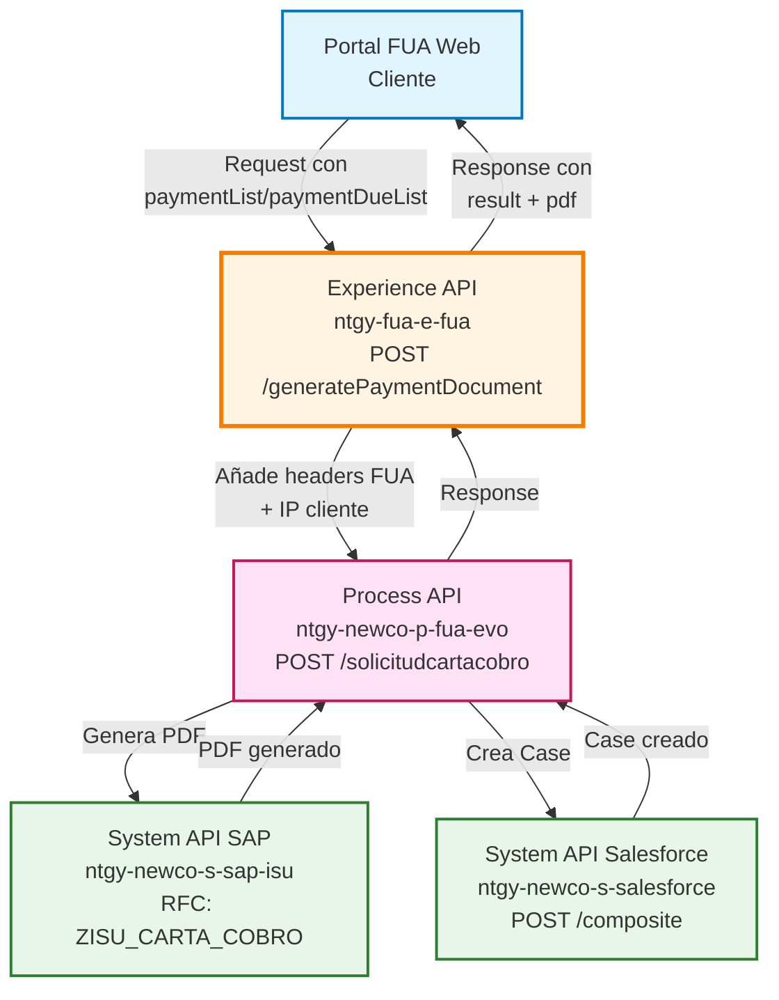
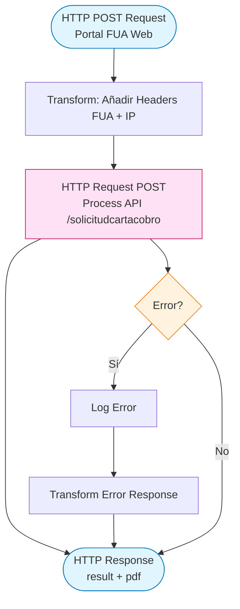
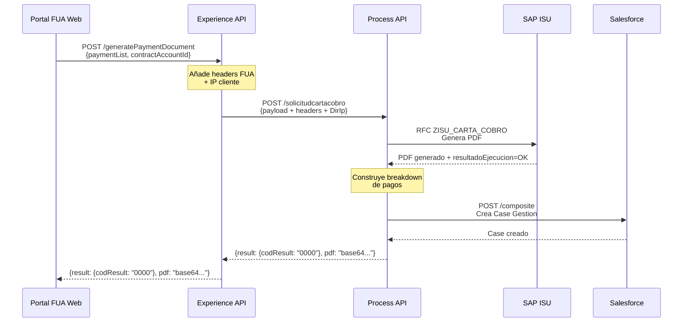
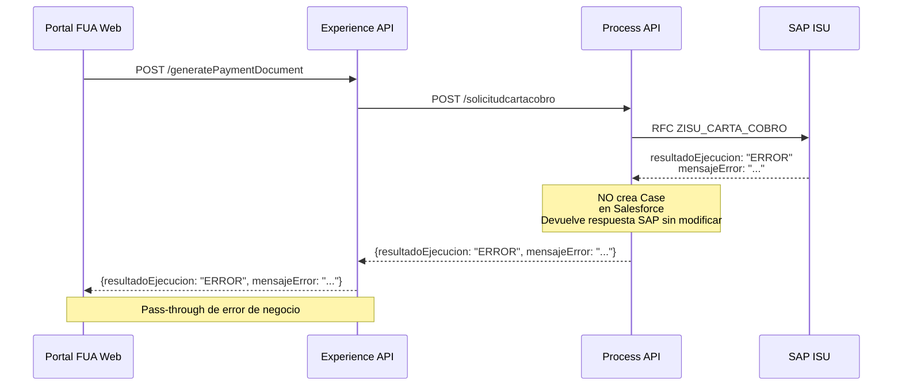
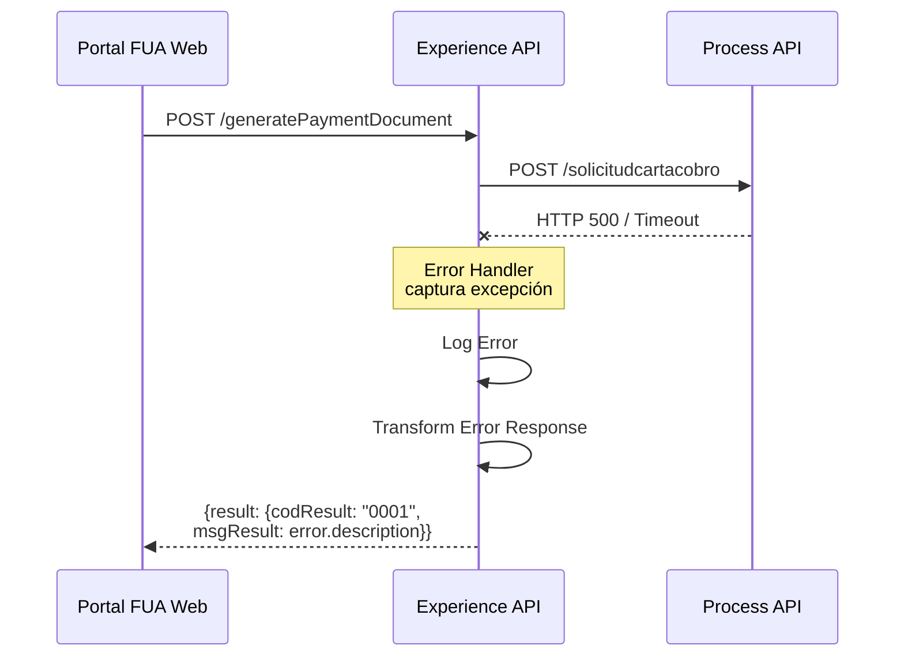

# POST /generatePaymentDocument

## 📌 Descripción General

### Propósito del Endpoint

Este endpoint genera un documento de carta de cobro para facilitar el pago de facturas pendientes o cuotas de fraccionamiento. Orquesta la validación en SAP ISU, la generación del documento PDF y la creación de un Case de gestión en Salesforce para el seguimiento del proceso de pago.

### Tipo de API

**Capa:** Experience API (API-Led Connectivity)

**Función:** Adaptación de experiencia para canal web del portal FUA (Frontal Único de Atención)

### Patrón de Integración

**Tipo:** Orquestación con Enriquecimiento de Contexto y Transformación de Errores

**Descripción:** Adapta la solicitud del portal web añadiendo contexto de headers FUA y dirección IP del cliente. Delega la orquestación completa a la Process API que coordina las operaciones con SAP ISU y Salesforce. Transforma los errores técnicos a un formato estándar comprensible para el usuario web.

### Arquitectura API-Led Connectivity



---

## 💼 Propósito del Negocio

### Casos de Uso Principales

1. **Generación de Carta de Cobro para Facturas Pendientes**
   - El cliente solicita un documento oficial para realizar el pago de facturas pendientes
   - Se genera un PDF con el detalle de las facturas y el importe total a pagar
   - Se crea un Case en Salesforce para seguimiento del proceso de pago

2. **Generación de Carta de Cobro para Cuotas de Fraccionamiento**
   - El cliente solicita un documento para pagar cuotas de un plan de fraccionamiento
   - Se genera un PDF con el detalle de las cuotas y el importe total
   - Se registra la solicitud en Salesforce para trazabilidad

3. **Solicitud Mixta (Facturas + Cuotas)**
   - El cliente puede solicitar un documento que incluya tanto facturas como cuotas
   - Se consolida toda la información en un único documento de pago
   - Se mantiene el registro completo en Salesforce

### 📱 Canal y Audiencia

#### Canal de Consumo

**Canal:** Web

**Características del Canal:**
- **Plataforma**: Portal FUA (Frontal Único de Atención) web
- **Dispositivos**: Desktop y tablets
- **Conectividad**: Conexión estable requerida para generación de PDF
- **Experiencia de Usuario**: Interfaz de autoservicio para gestión de pagos

#### Audiencia Objetivo

**Usuarios Finales:**
- **Clientes Residenciales**: Clientes con facturas pendientes que necesitan un documento oficial para realizar el pago
- **Clientes Empresariales**: Empresas que requieren documentación formal para sus procesos de pago
- **Agentes de Atención al Cliente**: Personal que asiste a clientes en la generación de documentos de pago

**Contexto de Uso:**
- **Gestión de Deuda**: Cliente con facturas pendientes que desea regularizar su situación
- **Planificación de Pagos**: Cliente que necesita documentación para organizar sus pagos
- **Fraccionamientos**: Cliente con plan de fraccionamiento activo que necesita documento de pago

#### Adaptaciones del Canal

**Optimizaciones Aplicadas:**
- **Enriquecimiento de Contexto**: Se añaden headers FUA (x-client-id, x-contact-id, x-user-id) y dirección IP del cliente
- **Formato de Respuesta**: Respuesta optimizada para visualización web con estructura result + pdf
- **Manejo de Errores**: Transformación de errores técnicos a mensajes comprensibles para el usuario web

### 🔗 Endpoints Dependientes

Este Experience API consume el siguiente Process API:

| Process API | Endpoint | Método | Propósito |
|-------------|----------|--------|-----------|
| `ntgy-newco-p-fua-evo` | `/solicitudcartacobro` | POST | Orquestación completa: validación en SAP ISU, generación de PDF y creación de Case en Salesforce |

### Contexto Empresarial

- **Dominio:** Gestión de Pagos y Cobros
- **Sector:** Energía - Utilities
- **División:** Naturgy España - NewCo
- **Canal:** Portal Web FUA

### Stakeholders

- **Clientes Finales**: Necesitan documentación oficial para realizar pagos de facturas o cuotas
- **Departamento de Cobros**: Requiere trazabilidad de las solicitudes de documentos de pago
- **Agentes de Atención al Cliente**: Necesitan herramientas para asistir a clientes en gestión de pagos
- **Departamento de Sistemas**: Responsable de la integración entre portal web, SAP ISU y Salesforce

### Valor de Negocio

- **Facilita el Pago**: Proporciona documentación oficial que facilita el proceso de pago para el cliente
- **Trazabilidad Completa**: Registro en Salesforce de todas las solicitudes de documentos de pago
- **Reducción de Llamadas**: Los clientes pueden generar sus propios documentos sin necesidad de contactar con atención al cliente
- **Mejora de Cobros**: Facilita la regularización de deudas al proporcionar documentación clara y oficial

---

## 🔧 Especificación Técnica

### URLs por Ambiente

| Ambiente | URL Base | URL Completa |
|----------|----------|--------------|
| **Local** | `http://localhost:8081` | `http://localhost:8081/fua/api/generatePaymentDocument` |
| **Development** | `https://ntgy-fua-e-fua-dev.de-c1.cloudhub.io` | `https://ntgy-fua-e-fua-dev.de-c1.cloudhub.io/fua/api/generatePaymentDocument` |
| **Production** | `https://ntgy-fua-e-fua-pro.de-c1.cloudhub.io` | `https://ntgy-fua-e-fua-pro.de-c1.cloudhub.io/fua/api/generatePaymentDocument` |

### Método HTTP

```
POST /fua/api/generatePaymentDocument
```

### 🎯 Consideraciones del Canal

#### Limitaciones del Canal

| Aspecto | Limitación | Razón |
|---------|------------|-------|
| **Timeout** | 60 segundos | Generación de PDF en SAP puede tomar tiempo |
| **Tamaño de Respuesta** | 5 MB máximo | Documento PDF incluido en respuesta |
| **Rate Limiting** | 10 requests/minuto por usuario | Prevenir abuso del servicio de generación de documentos |

#### Campos Específicos del Canal

**Campos Añadidos por el Experience API:**

| Campo | Tipo | Descripción | Razón |
|-------|------|-------------|-------|
| `DirIp` | string | Dirección IP del cliente | Trazabilidad y auditoría de solicitudes |
| `x-client-id` | string (header) | ID del cliente en Salesforce | Contexto de autenticación FUA |
| `x-contact-id` | string (header) | ID del contacto en Salesforce | Contexto de usuario FUA |
| `x-user-id` | string (header) | ID del usuario/agente | Identificación de quien genera la solicitud |
| `x-agent-mail` | string (header) | Email del agente | Se propaga a Salesforce para asignación de Case |

**Campos Requeridos del Cliente:**

| Campo | Tipo | Descripción | Uso en Process API |
|-------|------|-------------|-------------------|
| `channel` | string | Canal de pago | Se registra en Salesforce (NewCo_PaymentChannel__c) |
| `ParentId` | string | ID del Case padre | Se usa para relacionar Cases en Salesforce |

### Parámetros de Entrada

#### Headers

| Header | Tipo | Obligatorio | Descripción |
|--------|------|-------------|-------------|
| `Content-Type` | string | Sí | Debe ser `application/json` |
| `x-client-id` | string | Sí | ID del cliente en Salesforce |
| `x-contact-id` | string | Sí | ID del contacto en Salesforce |
| `x-user-id` | string | No | ID del usuario/agente (si aplica) |
| `x-agent-mail` | string | No | Email del agente (solo cuando es un agente quien genera la solicitud) |

#### Body (application/json)

```json
{
  "paymentList": [
    {
      "invoiceId": "string",
      "amount": number
    }
  ],
  "paymentDueList": [
    {
      "numRef": "string",
      "amount": number,
      "numberDue": "string"
    }
  ],
  "contractAccountId": "string",
  "emailChannel": "string",
  "phoneChannel": "string",
  "channel": "string",
  "ParentId": "string"
}
```

**Campos del Body:**

| Campo | Tipo | Obligatorio | Descripción |
|-------|------|-------------|-------------|
| `paymentList` | array | No* | Lista de facturas a pagar |
| `paymentList[].invoiceId` | string | Sí | ID de la factura |
| `paymentList[].amount` | number | Sí | Importe de la factura |
| `paymentDueList` | array | No* | Lista de cuotas de fraccionamiento a pagar |
| `paymentDueList[].numRef` | string | Sí | Número de referencia de la cuota |
| `paymentDueList[].amount` | number | Sí | Importe de la cuota |
| `paymentDueList[].numberDue` | string | No | Número de cuota (default: "0000") |
| `contractAccountId` | string | Sí | ID del Contract Account |
| `emailChannel` | string | No | Email para notificaciones |
| `phoneChannel` | string | No | Teléfono para notificaciones |
| `channel` | string | Sí | Canal de pago (ej: "web", "mobile", "agente") |
| `ParentId` | string | No | ID del Case padre en Salesforce (si la solicitud está relacionada con un Case existente) |

**Nota:** Al menos uno de `paymentList` o `paymentDueList` debe estar presente.

### Respuestas

#### Respuesta Exitosa (200 OK)

**Nota:** La respuesta exitosa proviene directamente de Salesforce (composite response) y puede variar según la operación. La estructura típica es:

```json
{
  "compositeResponse": [
    {
      "body": {
        "id": "500XXXXXXXXXXXXXXX",
        "success": true,
        "errors": []
      },
      "httpHeaders": {
        "Location": "/services/data/v52.0/sobjects/Case/500XXXXXXXXXXXXXXX"
      },
      "httpStatusCode": 201,
      "referenceId": "refCaseGestion"
    }
  ]
}
```

**Campos de Respuesta Exitosa:**

| Campo | Tipo | Descripción |
|-------|------|-------------|
| `compositeResponse` | array | Array de respuestas del composite request de Salesforce |
| `compositeResponse[].body` | object | Cuerpo de la respuesta |
| `compositeResponse[].body.id` | string | ID del Case creado en Salesforce |
| `compositeResponse[].body.success` | boolean | Indica si la operación fue exitosa |
| `compositeResponse[].httpStatusCode` | number | Código HTTP de la operación (201 = creado) |
| `compositeResponse[].referenceId` | string | ID de referencia del request ("refCaseGestion") |

#### Respuesta de Error de SAP (200 OK con error de negocio)

Cuando SAP devuelve un error de negocio (`resultadoEjecucion != "OK"`), la Process API devuelve la respuesta de SAP sin modificar:

```json
{
  "resultadoEjecucion": "ERROR",
  "mensajeError": "Descripción del error de SAP",
  // ... otros campos de SAP
}
```

#### Respuesta de Error Técnico (500 Internal Server Error)

Cuando hay un error técnico (timeout, conexión, etc.), la Experience API transforma el error:

```json
{
  "result": {
    "codResult": "0001",
    "msgResult": "Descripción del error técnico"
  }
}
```

### Autenticación

- **Tipo:** OAuth 2.0 con headers FUA
- **Headers Requeridos:** `x-client-id`, `x-contact-id`
- **Validación:** El sistema valida que el cliente tenga permisos para generar documentos de pago

### Timeouts

| Tipo | Valor | Razón |
|------|-------|-------|
| **Request Timeout** | 60 segundos | Optimizado para generación de PDF en SAP ISU |
| **Connection Timeout** | 30 segundos | Tiempo para establecer conexión con Process API |

---

## 🏗️ Implementación Técnica

### Arquitectura del Flow



### Transformaciones de Canal

**Transformación de Entrada (Experience API → Process API):**

| Campo Original (Request) | Campo Transformado | Transformación |
|--------------------------|-------------------|----------------|
| `payload` | `payload` | Pass-through completo del body |
| `attributes.headers` | `vars.fuaHeaders` | Extracción de headers FUA |
| `attributes.remoteAddress` | `DirIp` | Extracción de IP del cliente |

**Lógica de Transformación:**

```dataweave
%dw 2.2
import * from dw::core::Strings
output application/json
---
payload
++ 
vars.fuaHeaders 
++
{
    "DirIp": substringBefore(substringAfter(attributes.remoteAddress,"/"),":")
}
```

**Explicación:**
- Se mantiene todo el payload original (facturas y cuotas)
- Se añaden los headers FUA (x-client-id, x-contact-id, x-user-id)
- Se extrae la dirección IP del cliente desde `attributes.remoteAddress`

**Transformación de Salida:**

⚠️ **Transformación Condicional de Respuesta:**

La Experience API maneja tres escenarios de respuesta:

**1. Respuesta Exitosa (SAP OK + Salesforce OK):**
- Process API devuelve directamente la respuesta de Salesforce (composite response)
- Experience API la pasa sin modificar al cliente
- Incluye: ID del Case creado, estado de la operación

**2. Respuesta de Error de Negocio (SAP ERROR):**
- Process API devuelve la respuesta de SAP sin modificar (línea 112-119 del Process)
- Experience API la pasa sin modificar al cliente
- Incluye: `resultadoEjecucion: "ERROR"` y mensaje de error de SAP

**3. Respuesta de Error Técnico:**
- Experience API captura la excepción en su error handler
- Transforma a formato estándar:
```dataweave
{
    "result": {
        "codResult": "0001",
        "msgResult": error.description as String replace /\"/ with("")
    }
}
```
- Esta transformación solo aplica a errores técnicos (timeouts, conexiones, etc.)

### Patrones de Diseño

**Patrón:** Enriquecimiento de Contexto con Transformación de Errores

**Justificación:** 
- El Experience API actúa como un proxy inteligente que añade contexto del canal web (headers FUA + IP)
- No modifica la lógica de negocio, que es responsabilidad de la Process API
- Transforma errores técnicos a formato estándar comprensible para usuarios web
- Facilita la trazabilidad al incluir información del cliente y su sesión web
- Mantiene la respuesta exitosa de Salesforce sin modificación para preservar toda la información del Case creado

### Diagramas de Secuencia

#### 1. Flujo Normal de Éxito



#### 2. Flujo con Error de Negocio SAP



#### 3. Flujo con Error Técnico



### Manejo de Errores

**Error Handler en Experience API:**

```xml
<error-handler>
    <on-error-propagate>
        <logger level="ERROR" message='Error en generatePaymentDocument'/>
        <ee:transform>
            <ee:set-payload>
                {
                    "result": {
                        "codResult": "0001",
                        "msgResult": error.description
                    }
                }
            </ee:set-payload>
        </ee:transform>
    </on-error-propagate>
</error-handler>
```

**Tipos de Errores Manejados:**

| Tipo de Error | Origen | Estructura de Respuesta | Transformación |
|---------------|--------|------------------------|----------------|
| **Error de Negocio SAP** | SAP ISU | `{resultadoEjecucion: "ERROR", mensajeError: "..."}` | ❌ Sin transformación (pass-through) |
| **Error Técnico** | Experience API | `{result: {codResult: "0001", msgResult: "..."}}` | ✅ Transformado por error handler |
| **Timeout Process API** | Experience API | `{result: {codResult: "0001", msgResult: "Timeout exceeded"}}` | ✅ Transformado por error handler |
| **Error de Conexión** | Experience API | `{result: {codResult: "0001", msgResult: "Connection error"}}` | ✅ Transformado por error handler |

---

## 💻 Ejemplos de Uso

### Ejemplo 1: Solicitud de Carta de Cobro para Facturas

#### cURL

```bash
curl -X POST "https://ntgy-fua-e-fua-pro.de-c1.cloudhub.io/fua/api/generatePaymentDocument" \
  -H "Content-Type: application/json" \
  -H "x-client-id: 0011234567890ABC" \
  -H "x-contact-id: 0031234567890DEF" \
  -H "x-user-id: 0051234567890GHI" \
  -d '{
    "paymentList": [
      {
        "invoiceId": "9012345678",
        "amount": 125.50
      },
      {
        "invoiceId": "9012345679",
        "amount": 87.30
      }
    ],
    "contractAccountId": "200123456",
    "emailChannel": "cliente@example.com",
    "phoneChannel": "+34612345678",
    "channel": "web"
  }'
```

#### Respuesta (200 OK)

```json
{
  "compositeResponse": [
    {
      "body": {
        "id": "500XXXXXXXXXXXXXXX",
        "success": true,
        "errors": []
      },
      "httpHeaders": {
        "Location": "/services/data/v52.0/sobjects/Case/500XXXXXXXXXXXXXXX"
      },
      "httpStatusCode": 201,
      "referenceId": "refCaseGestion"
    }
  ]
}
```

### Ejemplo 2: Solicitud de Carta de Cobro para Cuotas de Fraccionamiento

#### cURL

```bash
curl -X POST "https://ntgy-fua-e-fua-pro.de-c1.cloudhub.io/fua/api/generatePaymentDocument" \
  -H "Content-Type: application/json" \
  -H "x-client-id: 0011234567890ABC" \
  -H "x-contact-id: 0031234567890DEF" \
  -d '{
    "paymentDueList": [
      {
        "numRef": "FRAC123456",
        "amount": 50.00,
        "numberDue": "0001"
      },
      {
        "numRef": "FRAC123456",
        "amount": 50.00,
        "numberDue": "0002"
      }
    ],
    "contractAccountId": "200123456",
    "emailChannel": "cliente@example.com",
    "channel": "web"
  }'
```

#### Respuesta (200 OK)

```json
{
  "result": {
    "codResult": "0000",
    "msgResult": "No hay error"
  },
  "pdf": "JVBERi0xLjQKJeLjz9MKMyAwIG9iago8PC9UeXBlL1BhZ2UvUGFyZW50IDIgMCBSL1Jlc291cmNlczw8L0ZvbnQ8PC9GMSA1IDAgUj4+Pj4vTWVkaWFCb3hbMCAwIDU5NSA4NDJdL0NvbnRlbnRzIDQgMCBSPj4KZW5kb2JqCjQgMCBvYmoKPDwvTGVuZ3RoIDQ0Pj4Kc3RyZWFtCkJUCi9GMSA..."
}
```

### Ejemplo 3: Solicitud Mixta (Facturas + Cuotas)

#### JavaScript (Fetch API)

```javascript
const response = await fetch('https://ntgy-fua-e-fua-pro.de-c1.cloudhub.io/fua/api/generatePaymentDocument', {
  method: 'POST',
  headers: {
    'Content-Type': 'application/json',
    'x-client-id': '0011234567890ABC',
    'x-contact-id': '0031234567890DEF'
  },
  body: JSON.stringify({
    paymentList: [
      {
        invoiceId: '9012345678',
        amount: 125.50
      }
    ],
    paymentDueList: [
      {
        numRef: 'FRAC123456',
        amount: 50.00,
        numberDue: '0001'
      }
    ],
    "contractAccountId": "200123456",
    "emailChannel": "cliente@example.com",
    "phoneChannel": "+34612345678",
    "channel": "web"
  })
});

const data = await response.json();

// Verificar si es respuesta exitosa de Salesforce
if (data.compositeResponse && data.compositeResponse[0].body.success) {
  const caseId = data.compositeResponse[0].body.id;
  console.log('Case creado exitosamente:', caseId);
  alert(`Solicitud de carta de cobro creada. Case ID: ${caseId}`);
}
// Verificar si es error de negocio de SAP
else if (data.resultadoEjecucion === 'ERROR') {
  console.error('Error de SAP:', data.mensajeError);
  alert(`Error: ${data.mensajeError}`);
}
// Error técnico transformado por Experience API
else if (data.result && data.result.codResult === '0001') {
  console.error('Error técnico:', data.result.msgResult);
  alert(`Error técnico: ${data.result.msgResult}`);
}
```

### Ejemplo 4: Manejo de Error de Negocio SAP

#### cURL

```bash
curl -X POST "https://ntgy-fua-e-fua-pro.de-c1.cloudhub.io/fua/api/generatePaymentDocument" \
  -H "Content-Type: application/json" \
  -H "x-client-id: 0011234567890ABC" \
  -H "x-contact-id: 0031234567890DEF" \
  -d '{
    "paymentList": [
      {
        "invoiceId": "INVALID_ID",
        "amount": 125.50
      }
    ],
    "contractAccountId": "200123456",
    "channel": "web"
  }'
```

#### Respuesta de Error de SAP (200 OK)

```json
{
  "resultadoEjecucion": "ERROR",
  "mensajeError": "Factura no encontrada en SAP ISU",
  "codigoError": "SAP_001"
}
```

**Nota:** Esta es la respuesta real de SAP que se devuelve sin modificar (pass-through).

### Ejemplo 5: Python

```python
import requests
import base64

url = "https://ntgy-fua-e-fua-pro.de-c1.cloudhub.io/fua/api/generatePaymentDocument"

headers = {
    'Content-Type': 'application/json',
    'x-client-id': '0011234567890ABC',
    'x-contact-id': '0031234567890DEF'
}

payload = {
    "paymentList": [
        {
            "invoiceId": "9012345678",
            "amount": 125.50
        }
    ],
    "contractAccountId": "200123456",
    "emailChannel": "cliente@example.com",
    "channel": "web"
}

response = requests.post(url, json=payload, headers=headers)
data = response.json()

# Verificar respuesta exitosa de Salesforce
if 'compositeResponse' in data and data['compositeResponse'][0]['body']['success']:
    case_id = data['compositeResponse'][0]['body']['id']
    print(f"Case creado exitosamente: {case_id}")
# Verificar error de negocio de SAP
elif 'resultadoEjecucion' in data and data['resultadoEjecucion'] == 'ERROR':
    print(f"Error de SAP: {data.get('mensajeError', 'Error desconocido')}")
# Verificar error técnico transformado
elif 'result' in data and data['result'].get('codResult') == '0001':
    print(f"Error técnico: {data['result']['msgResult']}")
else:
    print("Error desconocido")
