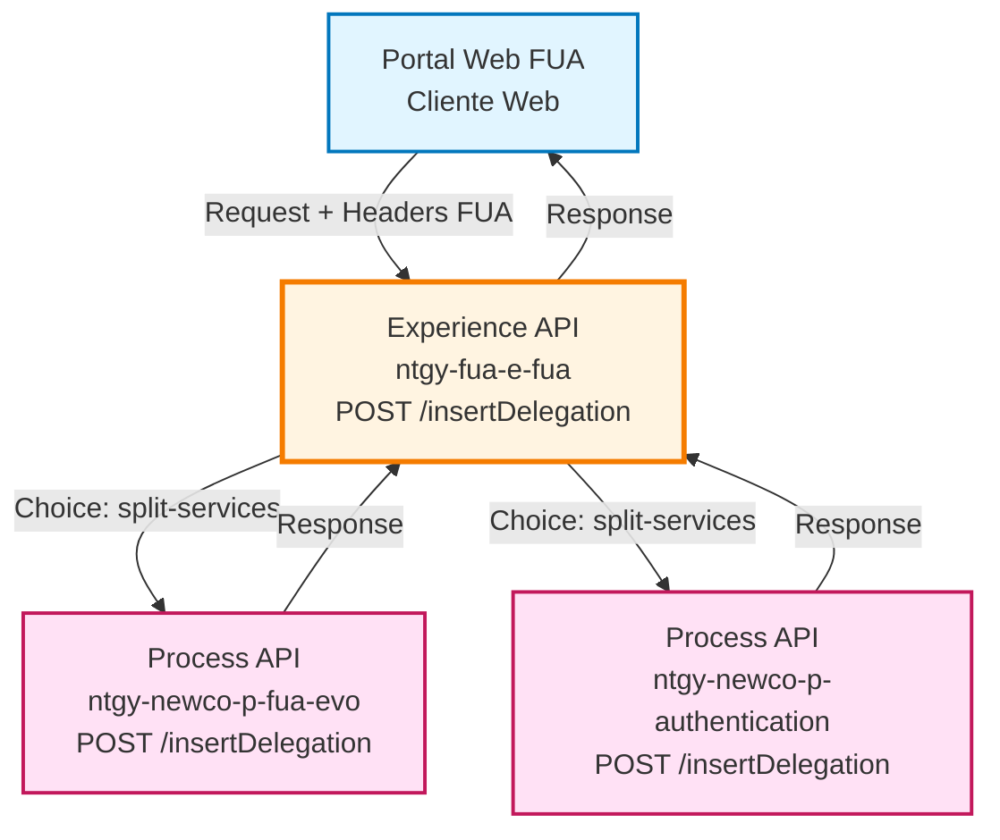
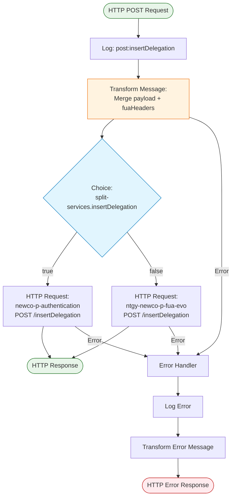
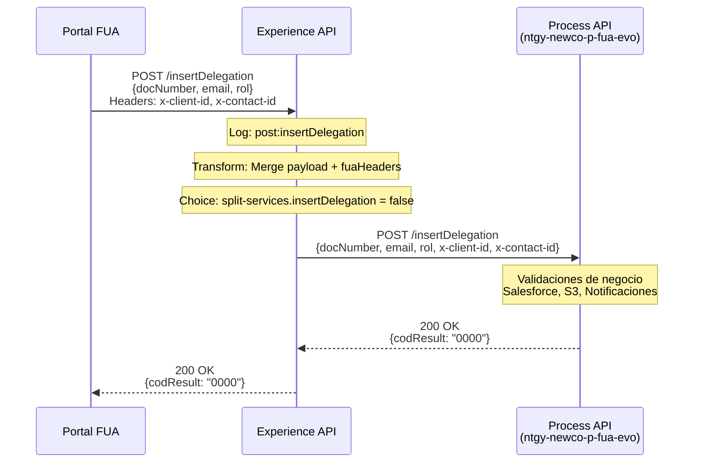
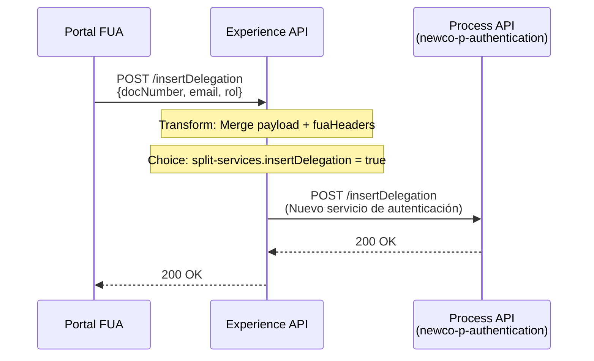
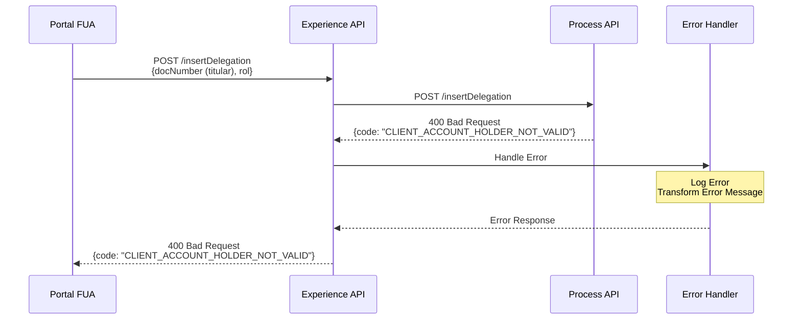

# POST /insertDelegation

## 📌 Descripción General

### Propósito del Endpoint

Este endpoint del Experience API orquesta el proceso de invitación de usuarios autorizados con asignación de roles y delegaciones en el portal FUA. Actúa como **pass-through inteligente** que:

1. **Agrega headers FUA** al payload de entrada (`x-client-id`, `x-contact-id`, etc.)
2. **Enruta dinámicamente** al Process API correspondiente según configuración
3. **Delega toda la lógica de negocio** al Process API

### Tipo de API

**Capa:** Experience API (API-Led Connectivity)

**Función:** Orquestación y enrutamiento con agregación de contexto FUA

### Patrón de Integración

**Tipo:** Pass-Through con Enrutamiento Dinámico (Dynamic Routing Pass-Through)

**Descripción:** Agrega headers de contexto FUA al payload y enruta la petición al Process API correspondiente mediante un `<choice>` basado en la propiedad `split-services.insertDelegation`.

### Arquitectura API-Led Connectivity



---

## 💼 Propósito del Negocio

### Casos de Uso Principales

1. **Invitación de Usuario Autorizado desde Portal FUA**
   - El titular accede al portal web FUA
   - Solicita asignar un rol a un usuario autorizado
   - El Experience API agrega el contexto de sesión (headers FUA)
   - **Beneficio:** Experiencia unificada en el portal web

2. **Enrutamiento Dinámico según Configuración**
   - Permite cambiar el backend sin modificar el frontend
   - Soporta migración gradual a nuevo servicio de autenticación
   - **Beneficio:** Flexibilidad operativa y despliegues sin downtime

3. **Agregación de Contexto de Sesión**
   - Enriquece el payload con información de la sesión FUA
   - Evita que el frontend tenga que enviar headers duplicados en el body
   - **Beneficio:** Simplificación del cliente y seguridad mejorada

### 📱 Canal y Audiencia

#### Canal de Consumo

**Canal:** Web (Portal FUA)

**Características del Canal:**
- **Plataforma**: Portal web de autoservicio FUA
- **Dispositivos**: Navegadores web (desktop y responsive)
- **Conectividad**: Conexión estable requerida
- **Experiencia de Usuario**: Interfaz web con formularios de delegación

#### Audiencia Objetivo

**Usuarios Finales:**
- **Titulares de Cuenta**: Clientes de Naturgy que gestionan usuarios autorizados
- **Administradores de Cuenta**: Usuarios con permisos para asignar roles

**Contexto de Uso:**
- **Gestión de Delegaciones**: Asignación de roles a familiares, empleados o representantes
- **Autoservicio**: Operación desde el área privada del portal FUA

#### Adaptaciones del Canal

**Optimizaciones Aplicadas:**
- **Agregación de Headers**: Merge automático de headers FUA con el payload
- **Enrutamiento Transparente**: El frontend no necesita conocer el backend específico
- **Manejo de Errores Unificado**: Errores del Process API propagados sin transformación

### 🔗 Endpoints Dependientes

Este Experience API consume los siguientes Process APIs:

| Process API | Endpoint | Método | Propósito |
|-------------|----------|--------|-----------|
| `ntgy-newco-p-fua-evo` | `/insertDelegation` | POST | **[Por defecto]** Procesa la lógica completa de delegación (validaciones, Salesforce, S3, notificaciones) |
| `ntgy-newco-p-authentication` | `/insertDelegation` | POST | **[Alternativo]** Nuevo servicio de autenticación (si `split-services.insertDelegation = true`) |

**📖 Para la lógica de negocio completa, consultar:**
- [POST /insertDelegation - Process API ntgy-newco-p-fua-evo](../ntgy-newco-p-fua-evo/POST-insertDelegation.md)

### Contexto Empresarial

- **Dominio:** Gestión de Usuarios y Permisos
- **Sector:** Energía - Utilities
- **División:** Naturgy España - FUA Portal
- **Canal:** Web (Portal de Autoservicio)

### Stakeholders

- **Titulares de Cuenta**: Asignan roles a usuarios autorizados desde el portal
- **Equipo de Desarrollo Frontend**: Consume este endpoint desde el portal FUA
- **Equipo de Operaciones**: Gestiona el enrutamiento dinámico mediante configuración

### Valor de Negocio

- **Simplificación del Frontend**: El portal no necesita gestionar headers complejos
- **Flexibilidad Operativa**: Cambio de backend sin modificar el frontend
- **Migración Sin Downtime**: Soporte para migración gradual a nuevos servicios
- **Experiencia Unificada**: Interfaz consistente independiente del backend

---

## 🔧 Especificación Técnica

### URLs por Ambiente

| Ambiente | URL Base | URL Completa |
|----------|----------|--------------|
| **Local** | `http://localhost:8081` | `http://localhost:8081/fua/api/insertDelegation` |
| **Development** | `https://ntgy-fua-e-fua-dev.us-e2.cloudhub.io` | `https://ntgy-fua-e-fua-dev.us-e2.cloudhub.io/fua/api/insertDelegation` |
| **UAT** | `https://ntgy-fua-e-fua-uat.us-e2.cloudhub.io` | `https://ntgy-fua-e-fua-uat.us-e2.cloudhub.io/fua/api/insertDelegation` |
| **Production** | `https://ntgy-fua-e-fua-pro.us-e2.cloudhub.io` | `https://ntgy-fua-e-fua-pro.us-e2.cloudhub.io/fua/api/insertDelegation` |

### Método HTTP

```
POST /fua/api/insertDelegation
```

### 🎯 Consideraciones del Canal

#### Limitaciones del Canal

| Aspecto | Limitación | Razón |
|---------|------------|-------|
| **Timeout** | 90 segundos | Proceso completo incluye subida de documentos a S3 |
| **Tamaño de Respuesta** | 10 KB máximo | Respuesta simple de confirmación |
| **Rate Limiting** | 10 requests/minuto por usuario | Prevención de abuso en asignación de roles |

#### Campos Específicos del Canal

**Campos Añadidos por el Experience API:**

Este Experience API **NO añade campos nuevos**, solo agrega los headers FUA al payload:

| Header FUA | Agregado al Payload | Descripción |
|------------|---------------------|-------------|
| `x-client-id` | ✅ Sí | ID de la cuenta (Account ID en Salesforce) |
| `x-contact-id` | ✅ Sí | ID del contacto del titular |
| `x-user-id` | ✅ Sí | ID del usuario en sesión |
| Otros headers FUA | ✅ Sí | Contexto completo de la sesión |

**Campos Omitidos del Process API:**

⚠️ **Este Experience API NO omite campos** - Es un pass-through completo.

### Parámetros de Entrada

#### Request Headers (Requeridos)

| Header | Tipo | Requerido | Descripción |
|--------|------|-----------|-------------|
| `x-client-id` | string | ✅ Sí | ID de la cuenta (Account ID en Salesforce) |
| `x-contact-id` | string | ✅ Sí | ID del contacto del titular |
| `Content-Type` | string | ✅ Sí | `application/json` |
| `client_id` | string | ✅ Sí | Client ID de Anypoint Platform |
| `client_secret` | string | ✅ Sí | Client Secret de Anypoint Platform |

#### Request Body (application/json)

**⚠️ Para el schema completo, consultar:**
📖 **[POST /insertDelegation - Process API ntgy-newco-p-fua-evo](../ntgy-newco-p-fua-evo/POST-insertDelegation.md)**

**Campos principales:**

| Campo | Tipo | Requerido | Descripción |
|-------|------|-----------|-------------|
| `docNumber` | string | ⚠️ Opcional | Número de documento del usuario autorizado |
| `email` | string | ⚠️ Opcional | Email del usuario autorizado |
| `rol` | string | ⚠️ Opcional | Código del rol a asignar (ej: "03", "06") |
| `legalFile` | array | ⚠️ Condicional | Array de documentos legales (requerido para roles 06 y 03) |

**Ejemplo de Request:**

```json
{
  "docNumber": "12345678A",
  "email": "autorizado@example.com",
  "rol": "06",
  "legalFile": [
    {
      "file": "JVBERi0xLjQKJeLjz9MK...",
      "fileNameWithExtension": "poder_legal.pdf"
    }
  ]
}
```

### Respuestas

#### ✅ 200 OK - Delegación Creada Exitosamente

```json
{
  "result": {
    "codResult": "0000",
    "msgResult": "No hay error"
  }
}
```

#### ❌ Errores

**⚠️ Para códigos de error completos, consultar:**
📖 **[POST /insertDelegation - Process API ntgy-newco-p-fua-evo](../ntgy-newco-p-fua-evo/POST-insertDelegation.md)**

**Errores principales:**
- `400 Bad Request`: Titular no válido, validaciones fallidas
- `409 Conflict`: Delegación ya existe
- `500 Internal Server Error`: Error en sistemas backend

### Autenticación

- **Tipo:** Client ID & Client Secret (Anypoint Platform)
- **Ubicación:** Headers HTTP

### Timeouts

| Tipo | Valor |
|------|-------|
| **Request Timeout** | 90 segundos |
| **Connection Timeout** | 10 segundos |

---

## 🏗️ Implementación Técnica

### Arquitectura del Flow



### Transformaciones DataWeave

#### 1. Transformación: Merge Payload + FUA Headers

**Ubicación en código:** Línea 7-14 del flow XML

```dataweave
%dw 2.0
output application/json
---
payload ++ vars.fuaHeaders
```

**Propósito:** Agrega los headers FUA (almacenados en `vars.fuaHeaders`) al payload de entrada.

**Ejemplo de Transformación:**

**Input (payload):**
```json
{
  "docNumber": "12345678A",
  "email": "autorizado@example.com",
  "rol": "06"
}
```

**Input (vars.fuaHeaders):**
```json
{
  "x-client-id": "0011234567890ABCDE",
  "x-contact-id": "0031234567890ABCDE",
  "x-user-id": "user123"
}
```

**Output (merged):**
```json
{
  "docNumber": "12345678A",
  "email": "autorizado@example.com",
  "rol": "06",
  "x-client-id": "0011234567890ABCDE",
  "x-contact-id": "0031234567890ABCDE",
  "x-user-id": "user123"
}
```

#### 2. Enrutamiento Dinámico: Choice

**Ubicación en código:** Línea 15-23 del flow XML

```xml
<choice doc:name="Choice">
    <when expression="#[(Mule::p('split-services.insertDelegation') as Boolean default false)]">
        <http:request method="POST" 
                      config-ref="HTTP_Request_newco-p-authentication" 
                      path="/insertDelegation" />
    </when>
    <otherwise>
        <http:request method="POST" 
                      config-ref="HTTP_FUA_PROCESS_NEWCO_EVO" 
                      path="/insertDelegation" />
    </otherwise>
</choice>
```

**Lógica de Enrutamiento:**

| Condición | Backend Seleccionado | Configuración |
|-----------|---------------------|---------------|
| `split-services.insertDelegation = true` | `ntgy-newco-p-authentication` | Nuevo servicio de autenticación |
| `split-services.insertDelegation = false` (default) | `ntgy-newco-p-fua-evo` | Servicio actual (por defecto) |

**Configuración en Properties:**

```yaml
# e-fua-pro-config.yaml
split-services:
  insertDelegation: "false"  # Por defecto usa ntgy-newco-p-fua-evo
```

### Transformaciones de Canal

⚠️ **Este Experience API NO transforma la respuesta del Process API.**

**Es un pass-through completo:**
- ✅ Request: Agrega headers FUA al payload
- ✅ Response: Retorna la respuesta del Process API sin modificaciones

Para el schema completo de request/response, consultar:
📖 **Process API: `ntgy-newco-p-fua-evo` endpoint `/insertDelegation`**

### Patrones de Diseño

**Patrón:** Dynamic Routing Pass-Through (Enrutamiento Dinámico con Pass-Through)

**Justificación:** 
- Permite cambiar el backend sin modificar el frontend
- Soporta migración gradual a nuevos servicios
- Mantiene la simplicidad del Experience API
- Facilita pruebas A/B y despliegues canary

**Patrón Secundario:** Context Enrichment (Enriquecimiento de Contexto)

**Justificación:**
- Agrega contexto de sesión FUA al payload
- Evita duplicación de información en el frontend
- Mejora la seguridad al centralizar la gestión de headers

### Diagramas de Secuencia

#### 1. Flujo Normal de Éxito (Backend por Defecto)



#### 2. Flujo con Enrutamiento Alternativo



#### 3. Flujo con Error de Negocio



### Optimizaciones del Canal

**Optimizaciones Aplicadas:**

1. **Agregación de Headers**: Evita que el frontend tenga que duplicar información
2. **Enrutamiento Dinámico**: Permite cambios de backend sin modificar el frontend
3. **Pass-Through Completo**: Minimiza latencia al no transformar la respuesta
4. **Error Propagation**: Errores del Process API se propagan sin transformación

### Manejo de Errores

#### Estrategia de Error Handling

**Error Handler:** Propagación de errores del Process API

**Ubicación en código:** Línea 24-40 del flow XML

```xml
<error-handler>
    <on-error-propagate enableNotifications="true" logException="true">
        <logger level="ERROR" message='#[if (!isEmpty(error.errorMessage.payload)) 
                                          error.errorMessage.payload
                                        else 
                                          {
                                            "result": {
                                              "codResult": "0005",
                                              "msgResult": error.description as String replace /\"/ with("")
                                            }
                                          }]' />
        <ee:transform>
            <ee:set-payload><![CDATA[%dw 2.0
output application/json
---
if (!isEmpty(error.errorMessage.payload)) 
  error.errorMessage.payload
else 
  {
    "result": {
      "codResult": "0005",
      "msgResult": "KO"
    }
  }]]></ee:set-payload>
        </ee:transform>
    </on-error-propagate>
</error-handler>
```

**Lógica de Manejo de Errores:**

1. **Si el Process API retorna error estructurado**: Propaga el error tal cual
2. **Si el error no tiene payload**: Construye error genérico con código "0005"

**Tipos de Errores Propagados:**

| Tipo de Error | Origen | Acción |
|---------------|--------|--------|
| **Errores de Negocio** | Process API | Propagación sin modificación |
| **Errores de Validación** | Process API | Propagación sin modificación |
| **Errores de Sistema** | Process API o Conectividad | Transformación a error genérico "0005" |

**Política de Reintentos:**

- **No hay reintentos** en el Experience API
- Los reintentos se gestionan en el Process API

---

## 💻 Ejemplos de Uso

### Ejemplo 1: Asignación de Representante Legal desde Portal FUA

#### cURL

```bash
curl -X POST "https://ntgy-fua-e-fua-dev.us-e2.cloudhub.io/fua/api/insertDelegation" \
  -H "Content-Type: application/json" \
  -H "client_id: YOUR_CLIENT_ID" \
  -H "client_secret: YOUR_CLIENT_SECRET" \
  -H "x-client-id: 0011234567890ABCDE" \
  -H "x-contact-id: 0031234567890ABCDE" \
  -d '{
    "docNumber": "12345678A",
    "email": "representante@example.com",
    "rol": "06",
    "legalFile": [
      {
        "file": "JVBERi0xLjQKJeLjz9MK...",
        "fileNameWithExtension": "poder_legal.pdf"
      }
    ]
  }'
```

#### Respuesta (200 OK)

```json
{
  "result": {
    "codResult": "0000",
    "msgResult": "No hay error"
  }
}
```

### Ejemplo 2: JavaScript (Frontend Portal FUA)

```javascript
async function asignarDelegacion(delegacionData, documentos) {
  try {
    // Convertir documentos a base64
    const legalFile = await Promise.all(
      documentos.map(async (doc) => ({
        file: await convertirABase64(doc.file),
        fileNameWithExtension: doc.name
      }))
    );
    
    const response = await fetch('https://ntgy-fua-e-fua-dev.us-e2.cloudhub.io/fua/api/insertDelegation', {
      method: 'POST',
      headers: {
        'Content-Type': 'application/json',
        'client_id': 'YOUR_CLIENT_ID',
        'client_secret': 'YOUR_CLIENT_SECRET',
        'x-client-id': sessionStorage.getItem('clientId'),
        'x-contact-id': sessionStorage.getItem('contactId')
      },
      body: JSON.stringify({
        docNumber: delegacionData.docNumber,
        email: delegacionData.email,
        rol: delegacionData.rol,
        legalFile: legalFile
      })
    });
    
    if (!response.ok) {
      const error = await response.json();
      throw new Error(error.message || 'Error al asignar delegación');
    }
    
    const data = await response.json();
    console.log('Delegación asignada exitosamente:', data);
    return data;
    
  } catch (error) {
    console.error('Error:', error);
    throw error;
  }
}

// Uso
const delegacion = {
  docNumber: '12345678A',
  email: 'representante@example.com',
  rol: '06'
};

const documentos = [
  { file: fileBlob1, name: 'poder_legal.pdf' },
  { file: fileBlob2, name: 'dni_representante.pdf' }
];

asignarDelegacion(delegacion, documentos)
  .then(result => {
    alert('Delegación asignada correctamente');
  })
  .catch(error => {
    alert('Error al asignar delegación: ' + error.message);
  });
```

### Ejemplo 3: Error - Titular No Válido

#### cURL

```bash
curl -X POST "https://ntgy-fua-e-fua-dev.us-e2.cloudhub.io/fua/api/insertDelegation" \
  -H "Content-Type: application/json" \
  -H "client_id: YOUR_CLIENT_ID" \
  -H "client_secret: YOUR_CLIENT_SECRET" \
  -H "x-client-id: 0011234567890ABCDE" \
  -H "x-contact-id: 0031234567890ABCDE" \
  -d '{
    "docNumber": "11111111A",
    "email": "titular@example.com",
    "rol": "03"
  }'
```

#### Respuesta (400 Bad Request)

```json
{
  "code": "APP:CLIENT_ACCOUNT_HOLDER_NOT_VALID",
  "message": "No se puede asignar delegación a un titular de cuenta",
  "details": "El usuario con rol '01' (Titular) no puede recibir delegaciones"
}
```

### Ejemplo 4: Python (Testing/Automation)

```python
import requests
import base64

def asignar_delegacion(doc_number, email, rol, client_id, contact_id, documentos=None):
    """
    Asigna una delegación a un usuario autorizado
    
    Args:
        doc_number: Número de documento del autorizado
        email: Email del autorizado
        rol: Código del rol (ej: "06", "03")
        client_id: ID de la cuenta
        contact_id: ID del contacto titular
        documentos: Lista de tuplas (file_path, file_name) para roles 06 y 03
    """
    url = "https://ntgy-fua-e-fua-dev.us-e2.cloudhub.io/fua/api/insertDelegation"
    
    headers = {
        "Content-Type": "application/json",
        "client_id": "YOUR_CLIENT_ID",
        "client_secret": "YOUR_CLIENT_SECRET",
        "x-client-id": client_id,
        "x-contact-id": contact_id
    }
    
    payload = {
        "docNumber": doc_number,
        "email": email,
        "rol": rol
    }
    
    # Si hay documentos, convertir a base64
    if documentos:
        legal_files = []
        for file_path, file_name in documentos:
            with open(file_path, 'rb') as f:
                file_content = base64.b64encode(f.read()).decode('utf-8')
                legal_files.append({
                    "file": file_content,
                    "fileNameWithExtension": file_name
                })
        payload["legalFile"] = legal_files
    
    response = requests.post(url, json=payload, headers=headers)
    
    if response.status_code == 200:
        print(f"✅ Delegación asignada exitosamente")
        return response.json()
    else:
        print(f"❌ Error: {response.status_code}")
        print(response.json())
        return None

# Ejemplo de uso
if __name__ == "__main__":
    # Asignación de representante legal con documentación
    result = asignar_delegacion(
        doc_number="12345678A",
        email="representante@example.com",
        rol="06",
        client_id="0011234567890ABCDE",
        contact_id="0031234567890ABCDE",
        documentos=[
            ("./poder_legal.pdf", "poder_legal.pdf"),
            ("./dni_representante.pdf", "dni_representante.pdf")
        ]
    )
    
    if result:
        print(f"Resultado: {result}")
```

**Resultado del Proceso:**
- ✅ Headers FUA agregados al payload
- ✅ Enrutamiento al Process API correcto
- ✅ Lógica de negocio ejecutada en Process API
- ✅ Respuesta propagada sin transformación
