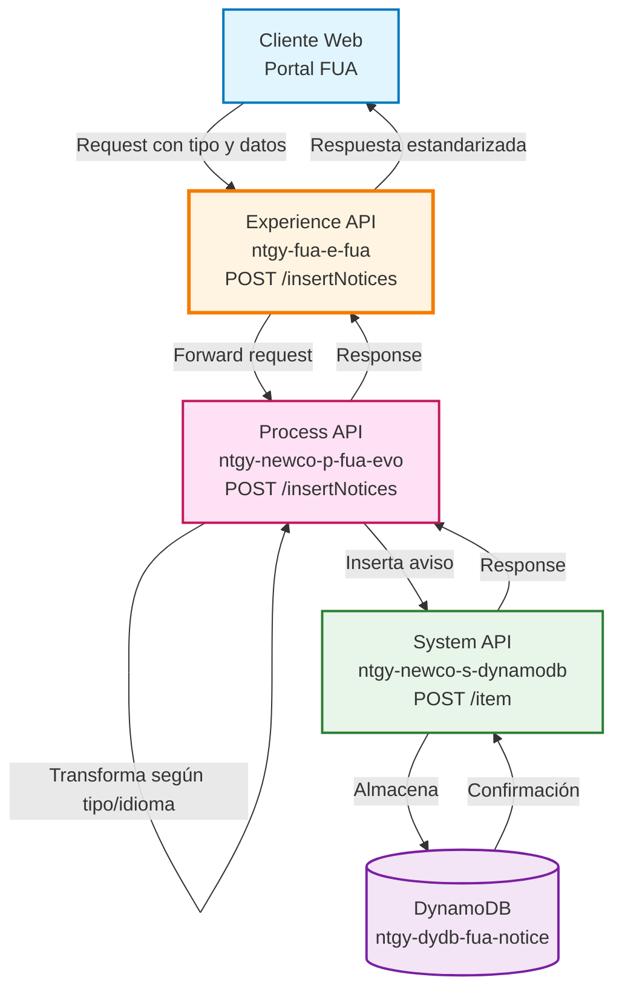
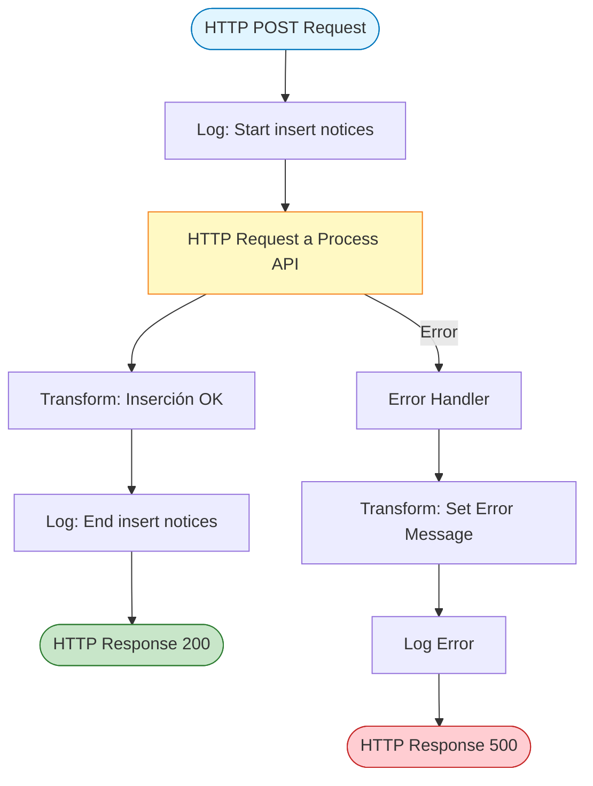
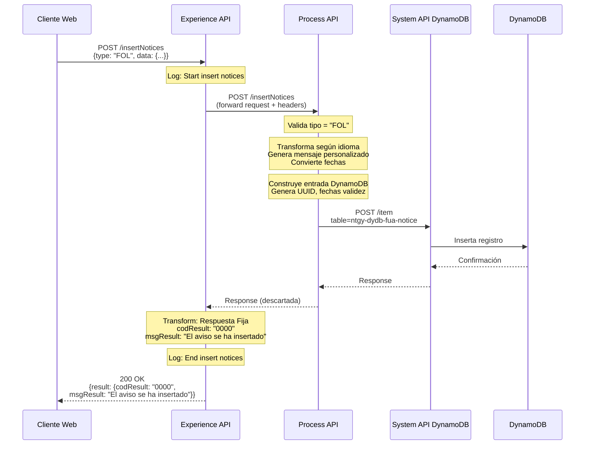
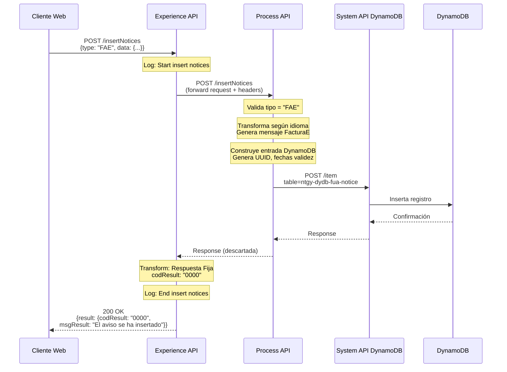
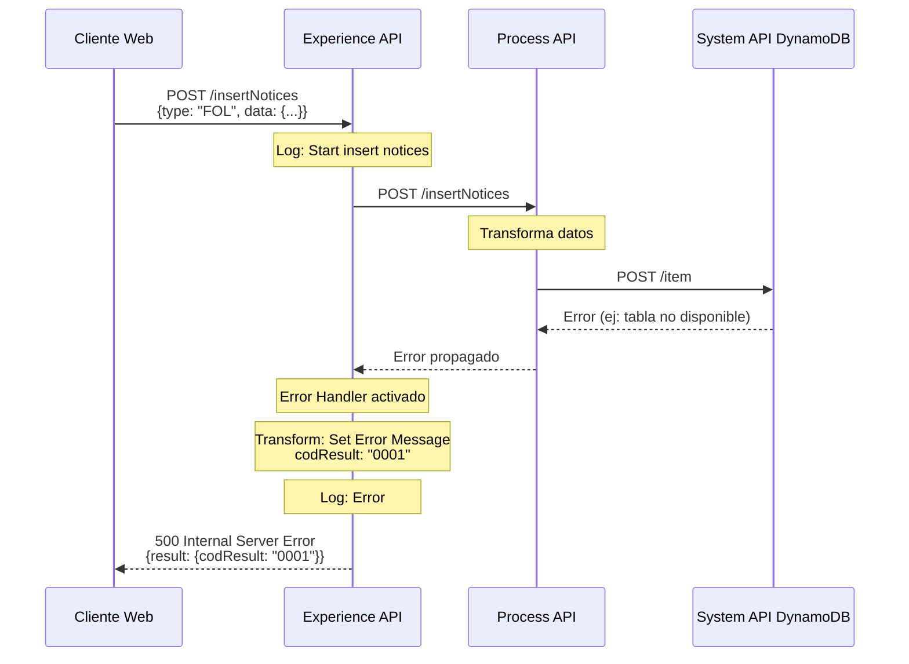

# POST /insertNotices

## 📌 Descripción General

### Propósito del Endpoint

Este endpoint permite la inserción manual de avisos/notificaciones para clientes del sistema FUA (Frontal Único de Atención). Soporta diferentes tipos de avisos (FOL - Factura Online, FAE - FacturaE) con mensajes personalizados en múltiples idiomas (ES, EN, CA, Z2-Euskera, Z3-Gallego). Los avisos se almacenan en DynamoDB y tienen una validez de 90 días.

### Tipo de API

**Capa:** Experience API (API-Led Connectivity)

**Función:** Adaptación de experiencia para canal web - Orquestación de inserción de avisos

### Patrón de Integración

**Tipo:** Orquestación con Transformación de Respuesta Fija

**Descripción:** El Experience API invoca al Process API para el procesamiento y almacenamiento en DynamoDB, pero **siempre devuelve una respuesta estandarizada fija** independientemente de la respuesta del Process API. La respuesta del System API (DynamoDB) no se propaga al cliente.

### Arquitectura API-Led Connectivity



---

## 💼 Propósito del Negocio

### Casos de Uso Principales

1. **Notificación de Nueva Factura Online (FOL)**
   - Inserción automática de aviso cuando se genera una nueva factura online
   - Incluye fecha de emisión y fecha estimada de cobro
   - Proporciona enlace directo a la factura

2. **Notificación de Nueva FacturaE (FAE)**
   - Aviso de disponibilidad de nueva FacturaE
   - Informa sobre acceso a través de la plataforma
   - Notificación por email complementaria

3. **Avisos Personalizados Multiidioma**
   - Generación automática de mensajes según idioma del cliente
   - Soporte para 5 idiomas (ES, EN, CA, Z2, Z3)
   - Adaptación de formato de fechas según idioma

### 📱 Canal y Audiencia

#### Canal de Consumo

**Canal:** Web

**Características del Canal:**
- **Plataforma**: Portal web FUA (Frontal Único de Atención)
- **Dispositivos**: Navegadores web (desktop y móvil)
- **Conectividad**: Requiere conexión estable para inserción
- **Experiencia de Usuario**: Inserción transparente, confirmación inmediata

#### Audiencia Objetivo

**Usuarios Finales:**
- **Sistemas Automatizados**: Procesos batch que generan facturas y necesitan notificar a clientes
- **Administradores FUA**: Personal que gestiona avisos manuales para clientes específicos
- **Sistemas de Facturación**: Integración con sistemas que emiten facturas online y FacturaE

**Contexto de Uso:**
- **Generación de Facturas**: Inserción automática tras emisión de factura
- **Comunicaciones Especiales**: Avisos manuales para situaciones específicas

#### Adaptaciones del Canal

**Optimizaciones Aplicadas:**
- **Estandarización de Respuesta**: Respuesta simplificada con código de resultado
- **Timeout Extendido**: 60 segundos para permitir procesamiento completo
- **Validación de Entrada**: Verificación de tipo de aviso antes de procesamiento

### 🔗 Endpoints Dependientes

Este Experience API consume los siguientes Process APIs:

| Process API | Endpoint | Método | Propósito |
|-------------|----------|--------|-----------|
| `ntgy-newco-p-fua-evo` | `/insertNotices` | POST | Procesamiento de avisos con transformaciones multiidioma y almacenamiento en DynamoDB |

### Contexto Empresarial

- **Dominio:** Gestión de Notificaciones y Comunicaciones con Clientes
- **Sector:** Energía - Utilities
- **División:** Naturgy España - NewCo
- **Canal:** Web

### Stakeholders

- **Sistemas de Facturación**: Necesitan notificar automáticamente a clientes sobre nuevas facturas
- **Equipo de Atención al Cliente**: Requieren capacidad de insertar avisos manuales
- **Clientes Finales**: Reciben notificaciones sobre eventos importantes en su cuenta

### Valor de Negocio

- **Comunicación Proactiva**: Notificación inmediata a clientes sobre eventos relevantes
- **Reducción de Consultas**: Clientes informados reducen llamadas al call center
- **Experiencia Multiidioma**: Comunicación en idioma preferido del cliente
- **Trazabilidad**: Registro completo de avisos enviados con validez temporal

---

## 🔧 Especificación Técnica

### URLs por Ambiente

| Ambiente | URL Base | URL Completa |
|----------|----------|--------------|
| **Local** | `http://localhost:8081` | `http://localhost:8081/fua/api/insertNotices` |
| **Development** | `https://e-fua-dev.de-c1.cloudhub.io` | `https://e-fua-dev.de-c1.cloudhub.io/fua/api/insertNotices` |
| **Production** | `https://e-fua-pro.de-c1.cloudhub.io` | `https://e-fua-pro.de-c1.cloudhub.io/fua/api/insertNotices` |

### Método HTTP

```
POST /fua/api/insertNotices
```

### 🎯 Consideraciones del Canal

#### Limitaciones del Canal

| Aspecto | Limitación | Razón |
|---------|------------|-------|
| **Timeout** | 60 segundos | Permite procesamiento completo de transformaciones y almacenamiento |
| **Tamaño de Payload** | 10 KB máximo | Avisos contienen solo texto y metadatos |
| **Rate Limiting** | 100 requests/minuto | Protección contra inserción masiva no controlada |

#### Campos Específicos del Canal

**Campos Añadidos por el Process API:**

| Campo | Tipo | Descripción | Razón |
|-------|------|-------------|-------|
| `NOTICE_ID` | String (UUID) | Identificador único del aviso | Generado automáticamente si no se proporciona |
| `START_DATE` | String (yyyy/MM/dd) | Fecha de inicio de validez | Calculado como fecha actual |
| `END_DATE` | String (yyyy/MM/dd) | Fecha de fin de validez | Calculado como fecha actual + 90 días |
| `READ` | Boolean | Estado de lectura | Inicializado en false |
| `DELETE` | Boolean | Estado de eliminación | Inicializado en false |

### Parámetros de Entrada

#### Headers

| Header | Tipo | Requerido | Descripción |
|--------|------|-----------|-------------|
| `Content-Type` | String | Sí | Debe ser `application/json` |
| `x-client-code` | String | No | Código del cliente (alternativa a nif en payload) |

#### Body (application/json)

**Estructura Base:**

```json
{
  "type": "FOL | FAE",
  "data": {
    // Campos específicos según tipo
  }
}
```

**Para tipo FOL (Factura Online):**

| Campo | Tipo | Requerido | Descripción |
|-------|------|-----------|-------------|
| `type` | String | Sí | Debe ser "FOL" |
| `data.nif` | String | Sí | NIF del cliente |
| `data.idioma` | String | Sí | Código de idioma (ES, EN, CA, Z2, Z3) |
| `data.fec_emi` | String | Sí | Fecha de emisión (dd/MM/yyyy o yyyy/MM/dd según idioma) |
| `data.fec_car` | String | No | Fecha estimada de cobro (dd/MM/yyyy o yyyy/MM/dd según idioma) |
| `data.url` | String | Sí | URL de la factura online |
| `data.dirSuministro` | String | Sí | Dirección de suministro |

**Para tipo FAE (FacturaE):**

| Campo | Tipo | Requerido | Descripción |
|-------|------|-----------|-------------|
| `type` | String | Sí | Debe ser "FAE" |
| `data.nif` | String | Sí | NIF del cliente |
| `data.idioma` | String | Sí | Código de idioma (ES, EN, CA, Z2, Z3) |

### Respuestas

#### 200 OK - Inserción Exitosa

**⚠️ IMPORTANTE:** Esta es la **única respuesta posible en caso de éxito**, independientemente del tipo de aviso (FOL o FAE) o del contenido insertado.

```json
{
  "result": {
    "codResult": "0000",
    "msgResult": "El aviso se ha insertado"
  }
}
```

**Nota:** El Experience API **no devuelve** el item completo de DynamoDB (NOTICE_ID, fechas, etc.). Solo confirma que la inserción fue exitosa.

#### 500 Internal Server Error - Error en Inserción

```json
{
  "result": {
    "codResult": "0001",
    "msgResult": "Descripción del error"
  }
}
```

### Autenticación

- **Tipo:** OAuth 2.0 (heredado del API Gateway)
- **Validación:** JWT token en header Authorization

### Timeouts

| Tipo | Valor | Razón |
|------|-------|-------|
| **Request Timeout** | 60 segundos | Permite procesamiento completo de transformaciones multiidioma y almacenamiento |
| **Connection Idle Timeout** | 60 segundos | Mantiene conexión estable durante procesamiento |

---

## 🏗️ Implementación Técnica

### Arquitectura del Flow



### Transformaciones de Canal

**El Experience API NO transforma el request** - Lo envía tal cual al Process API.

**⚠️ IMPORTANTE: Transformación de Response (Experience API)**

El Experience API **SIEMPRE devuelve una respuesta fija** independientemente de lo que retorne el Process API:

```dataweave
%dw 2.0
output application/json
---
{
  "result": {
    "codResult": "0000",
    "msgResult": "El aviso se ha insertado"
  }
}
```

**Nota Crítica:** 
- La respuesta del Process API (que contiene el item completo de DynamoDB) **se descarta**
- El Process API termina con un logger y no devuelve respuesta estructurada
- El cliente **siempre recibe el mismo mensaje de éxito** si no hay errores
- Solo en caso de error se propaga el error con código "0001"

**Transformaciones en Process API:**

El Process API realiza transformaciones complejas según el tipo de aviso:

#### 1. Transformación para FOL (Factura Online)

**Lógica de Transformación de Fechas:**
- Si idioma es Z2 (Euskera): Convierte fechas de formato yyyy/MM/dd a dd/MM/yyyy
- Otros idiomas: Mantiene formato dd/MM/yyyy
- Validación de formato de fecha de cobro con regex

**Generación de Mensajes Multiidioma:**

| Idioma | Título | Texto Base |
|--------|--------|------------|
| ES | "Tu nueva factura online ya está disponible" | Incluye fecha de cobro si está disponible |
| EN | "Your new online invoice is now available" | Incluye fecha de cobro si está disponible |
| CA | "La teva nova factura en línia ja està disponible" | Incluye fecha de cobro si está disponible |
| Z2 | "Zure lineako faktura berria eskuragarri dago orain" | Incluye fecha de cobro si está disponible |
| Z3 | "A túa nova factura en liña xa está dispoñible" | Incluye fecha de cobro si está disponible |

#### 2. Transformación para FAE (FacturaE)

**Generación de Mensajes Multiidioma:**

| Idioma | Título | Texto |
|--------|--------|-------|
| ES | "Tu nueva FacturaE ya está disponible" | "Recibirás un email informándote de la nueva FacturaE..." |
| EN | "Your new FacturaE is now available" | "You'll receive an email informing you..." |
| CA | "La teva nova FacturaE ja està disponible" | "Rebràs un email informant-te..." |
| Z2 | "Zure FacturaE berria eskuragarri dago orain" | "FacturaE berriaren berri emango dizun..." |
| Z3 | "Zure FacturaE berria eskuragarri dago orain" | "FacturaE berriaren berri emango dizun..." |

#### 3. Construcción de Entrada DynamoDB

```dataweave
{
    "CLIENT_CODE": attributes.queryParams.'x-client-code' default payload.nif,
    "TYPE": payload.'type',
    "TEXT": payload.text,
    "TITLE": payload.title,
    "VISIBILITY": payload.visibility,
    "NOTICE_ID": payload.noticeId default uuid(),
    "READ": payload.read default false,
    "DELETE": payload.delete default false,
    "VALIDITY": payload.validity,
    "START_DATE": payload.startDate,
    "END_DATE": payload.endDate,
    "IDIOMA": payload.idioma,
    "DIRSUMINISTRO": payload.dirSuministro,
    "URL": payload.url
}
```

### Patrones de Diseño

**Patrón:** Fire-and-Forget con Respuesta Estandarizada

**Justificación:** 
- El Experience API invoca al Process API y espera su ejecución
- Sin embargo, **descarta la respuesta del Process API** y devuelve un mensaje fijo
- Esto simplifica la interfaz del cliente: solo necesita saber si hubo éxito o error
- El cliente no necesita procesar la estructura completa del item de DynamoDB
- Patrón común en operaciones de escritura donde el cliente solo necesita confirmación

### Diagramas de Secuencia

#### 1. Flujo Normal de Éxito - Inserción FOL



#### 2. Flujo Normal de Éxito - Inserción FAE



#### 3. Flujo con Error de Inserción



### Optimizaciones del Canal

1. **Respuesta Simplificada**: El Experience API **descarta la respuesta del Process API** y devuelve un mensaje fijo, simplificando la interfaz del cliente
2. **Confirmación Binaria**: El cliente solo recibe éxito (codResult: "0000") o error (codResult: "0001"), sin detalles del item creado
3. **Logging Detallado**: Logs en inicio y fin para trazabilidad completa
4. **Timeout Extendido**: 60 segundos para permitir procesamiento completo sin interrupciones

### Manejo de Errores

**Error Handler en Experience API:**

```xml
<error-handler>
    <on-error-propagate>
        <ee:transform doc:name="Set Error Message">
            <ee:set-payload>
                {
                    "result": {
                        "codResult": "0001",
                        "msgResult": error.description as String replace /"/ with("")
                    }
                }
            </ee:set-payload>
        </ee:transform>
        <logger level="ERROR" message="Error en inserción de aviso"/>
    </on-error-propagate>
</error-handler>
```

**Tipos de Errores Manejados:**
- **Errores de Conectividad**: Timeout o fallo de conexión con Process API
- **Errores de Validación**: Tipo de aviso no soportado
- **Errores de DynamoDB**: Fallo en almacenamiento (propagado desde System API)

---

## 💻 Ejemplos de Uso

### Ejemplo 1: Inserción de Aviso FOL (Factura Online) - Español

#### cURL

```bash
curl -X POST "https://e-fua-pro.de-c1.cloudhub.io/fua/api/insertNotices" \
  -H "Content-Type: application/json" \
  -H "Authorization: Bearer YOUR_JWT_TOKEN" \
  -H "x-client-code: 12345678A" \
  -d '{
    "type": "FOL",
    "data": {
      "nif": "12345678A",
      "idioma": "ES",
      "fec_emi": "15/01/2026",
      "fec_car": "28/01/2026",
      "url": "https://factura.naturgy.es/12345",
      "dirSuministro": "Calle Mayor 123, Madrid"
    }
  }'
```

#### Respuesta (200 OK)

```json
{
  "result": {
    "codResult": "0000",
    "msgResult": "El aviso se ha insertado"
  }
}
```

### Ejemplo 2: Inserción de Aviso FOL - Euskera (Z2)

#### cURL

```bash
curl -X POST "https://e-fua-pro.de-c1.cloudhub.io/fua/api/insertNotices" \
  -H "Content-Type: application/json" \
  -H "Authorization: Bearer YOUR_JWT_TOKEN" \
  -d '{
    "type": "FOL",
    "data": {
      "nif": "87654321B",
      "idioma": "Z2",
      "fec_emi": "2026/01/15",
      "fec_car": "2026/01/28",
      "url": "https://factura.naturgy.es/67890",
      "dirSuministro": "Kalea 456, Bilbao"
    }
  }'
```

#### Respuesta (200 OK)

```json
{
  "result": {
    "codResult": "0000",
    "msgResult": "El aviso se ha insertado"
  }
}
```

**Nota:** Para idioma Z2 (Euskera), las fechas se proporcionan en formato yyyy/MM/dd y se convierten automáticamente a dd/MM/yyyy en el mensaje.

### Ejemplo 3: Inserción de Aviso FAE (FacturaE) - Inglés

#### cURL

```bash
curl -X POST "https://e-fua-pro.de-c1.cloudhub.io/fua/api/insertNotices" \
  -H "Content-Type: application/json" \
  -H "Authorization: Bearer YOUR_JWT_TOKEN" \
  -d '{
    "type": "FAE",
    "data": {
      "nif": "11223344C",
      "idioma": "EN"
    }
  }'
```

#### Respuesta (200 OK)

```json
{
  "result": {
    "codResult": "0000",
    "msgResult": "El aviso se ha insertado"
  }
}
```

### Ejemplo 4: Error - Fallo en Inserción

#### cURL

```bash
curl -X POST "https://e-fua-pro.de-c1.cloudhub.io/fua/api/insertNotices" \
  -H "Content-Type: application/json" \
  -H "Authorization: Bearer YOUR_JWT_TOKEN" \
  -d '{
    "type": "FOL",
    "data": {
      "nif": "99999999Z",
      "idioma": "ES",
      "fec_emi": "15/01/2026",
      "url": "https://factura.naturgy.es/error",
      "dirSuministro": "Dirección Test"
    }
  }'
```

#### Respuesta (500 Internal Server Error)

```json
{
  "result": {
    "codResult": "0001",
    "msgResult": "Error al insertar en DynamoDB: tabla no disponible"
  }
}
```

### Ejemplo 5: JavaScript (Fetch API)

```javascript
const insertNotice = async () => {
  const response = await fetch('https://e-fua-pro.de-c1.cloudhub.io/fua/api/insertNotices', {
    method: 'POST',
    headers: {
      'Content-Type': 'application/json',
      'Authorization': 'Bearer YOUR_JWT_TOKEN',
      'x-client-code': '12345678A'
    },
    body: JSON.stringify({
      type: 'FOL',
      data: {
        nif: '12345678A',
        idioma: 'ES',
        fec_emi: '15/01/2026',
        fec_car: '28/01/2026',
        url: 'https://factura.naturgy.es/12345',
        dirSuministro: 'Calle Mayor 123, Madrid'
      }
    })
  });

  const data = await response.json();
  
  if (data.result.codResult === '0000') {
    console.log('Aviso insertado correctamente');
  } else {
    console.error('Error al insertar aviso:', data.result.msgResult);
  }
};

insertNotice();
```

### Ejemplo 6: Python (requests)

```python
import requests

url = 'https://e-fua-pro.de-c1.cloudhub.io/fua/api/insertNotices'
headers = {
    'Content-Type': 'application/json',
    'Authorization': 'Bearer YOUR_JWT_TOKEN',
    'x-client-code': '12345678A'
}
payload = {
    'type': 'FAE',
    'data': {
        'nif': '12345678A',
        'idioma': 'CA'
    }
}

response = requests.post(url, json=payload, headers=headers)
data = response.json()

if data['result']['codResult'] == '0000':
    print('Aviso insertado correctamente')
else:
    print(f"Error: {data['result']['msgResult']}")
```

### Ejemplo 7: Inserción con Fecha de Cobro Vacía

#### cURL

```bash
curl -X POST "https://e-fua-pro.de-c1.cloudhub.io/fua/api/insertNotices" \
  -H "Content-Type: application/json" \
  -H "Authorization: Bearer YOUR_JWT_TOKEN" \
  -d '{
    "type": "FOL",
    "data": {
      "nif": "55667788D",
      "idioma": "CA",
      "fec_emi": "15/01/2026",
      "fec_car": "",
      "url": "https://factura.naturgy.es/55667",
      "dirSuministro": "Carrer Principal 789, Barcelona"
    }
  }'
```

**Nota:** Cuando `fec_car` está vacío, el mensaje generado no incluye la fecha estimada de cobro.

#### Respuesta (200 OK)

```json
{
  "result": {
    "codResult": "0000",
    "msgResult": "El aviso se ha insertado"
  }
}