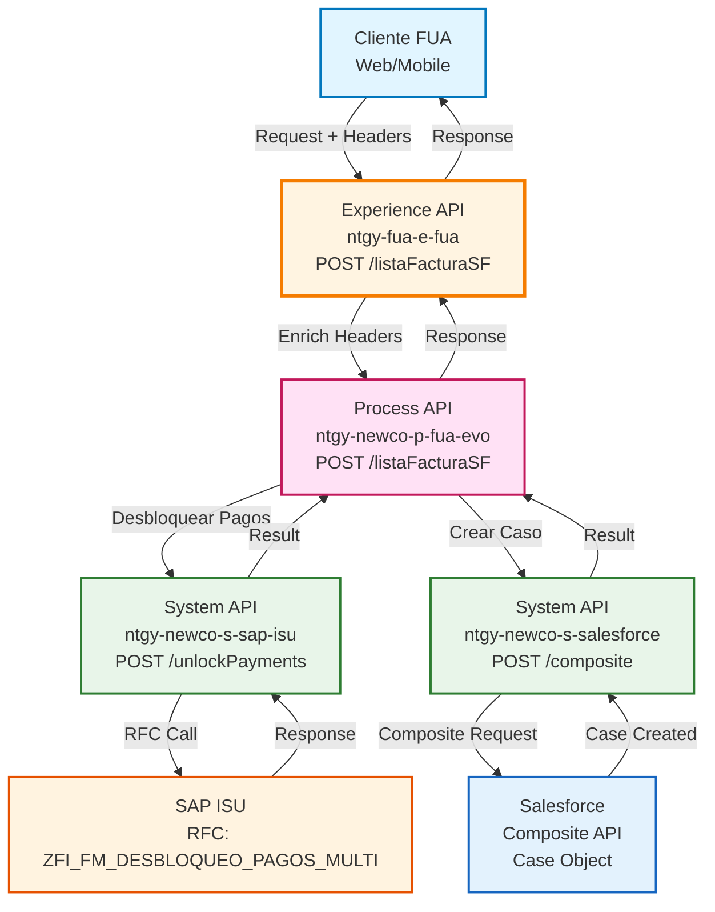
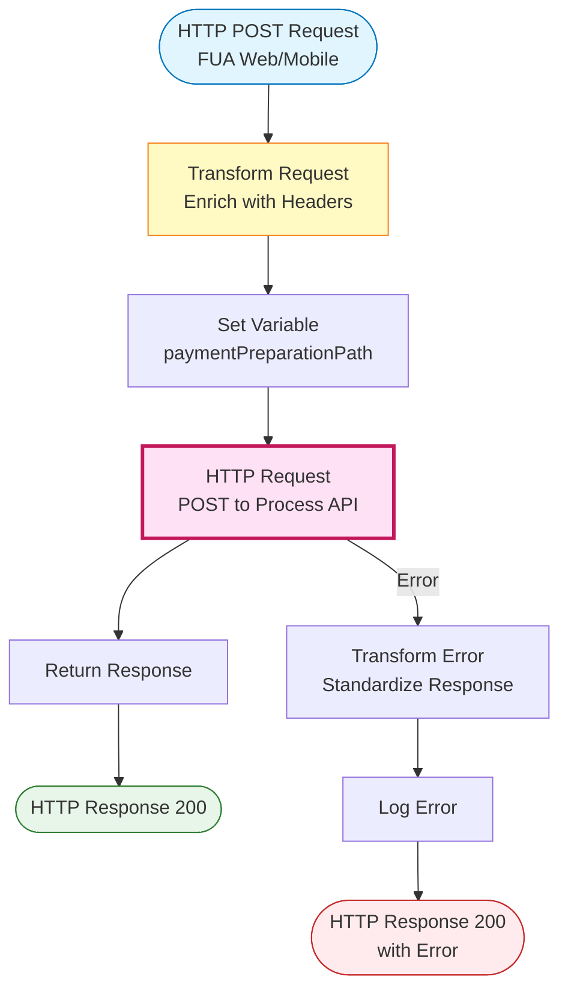
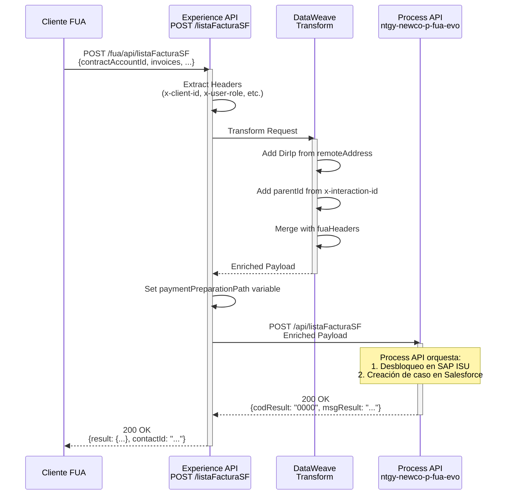
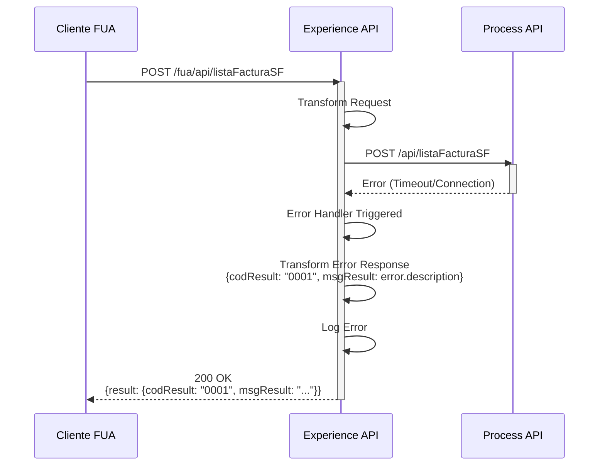
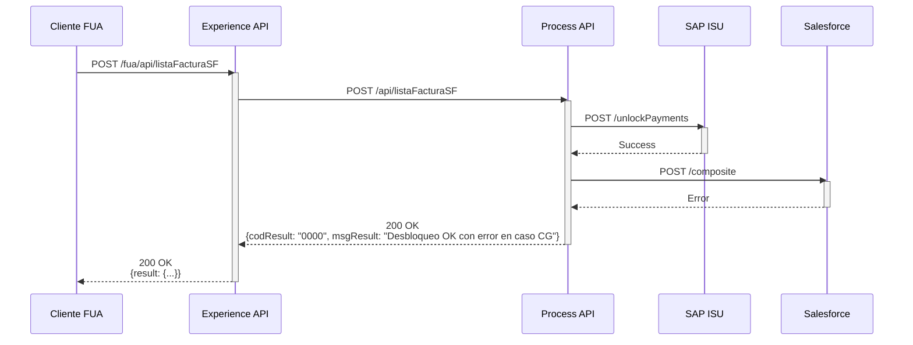

# POST /listaFacturaSF

## 📌 Descripción General

### Propósito del Endpoint

Envía una lista de facturas a Salesforce para crear un caso de gestión, desbloqueando previamente los pagos asociados en SAP ISU. Este endpoint forma parte del proceso de preparación de pagos en el FUA (Front Único de Atención), permitiendo a clientes y agentes gestionar facturas pendientes y crear casos de seguimiento.

El endpoint soporta:
- **Desbloqueo Automático de Pagos**: Libera pagos bloqueados en SAP ISU antes de crear el caso
- **Creación de Caso en Salesforce**: Genera un caso de gestión con toda la información de las facturas
- **Soporte Multi-Rol**: Funciona tanto para clientes como para agentes (con diferentes flujos)
- **Trazabilidad Completa**: Incluye correlation ID y tracking de la operación

### Tipo de API

**Capa:** Experience API (API-Led Connectivity)

**Función:** Adaptación de experiencia para canales web y móvil del FUA, orquestando la llamada al Process API que gestiona la lógica de negocio.

### Patrón de Integración

**Tipo:** Pass-Through con Enriquecimiento de Headers

**Descripción:** El Experience API recibe la solicitud del cliente, enriquece el payload con headers de contexto (IP, interaction ID, headers FUA), y delega la lógica de negocio al Process API. La respuesta del Process API se retorna directamente al cliente.

### Arquitectura API-Led Connectivity



---

## 💼 Propósito del Negocio

### Casos de Uso Principales

1. **Preparación de Pago de Facturas con Caso de Seguimiento**
   - Un cliente tiene facturas pendientes que desea pagar
   - Necesita crear un caso en Salesforce para seguimiento
   - El sistema desbloquea los pagos en SAP ISU y crea el caso automáticamente

2. **Gestión de Facturas por Agente**
   - Un agente de atención al cliente gestiona facturas de un cliente
   - Necesita desbloquear pagos y crear un caso de gestión
   - El sistema identifica el rol de agente y ajusta el flujo

3. **Resolución de Incidencias de Pago**
   - Un cliente reporta problemas con facturas bloqueadas
   - El agente necesita desbloquear y crear caso de seguimiento
   - El sistema procesa ambas operaciones en una sola transacción

### 📱 Canal y Audiencia

#### Canal de Consumo

**Canal:** Web y Mobile (FUA)

**Características del Canal:**
- **Plataforma**: Portal web FUA y aplicación móvil
- **Dispositivos**: Desktop, tablets, smartphones
- **Conectividad**: Requiere conexión estable (timeout 60s)
- **Experiencia de Usuario**: Operación crítica con feedback inmediato

#### Audiencia Objetivo

**Usuarios Finales:**
- **Clientes Residenciales**: Gestionan sus facturas y pagos de energía
- **Clientes Empresariales**: Gestionan múltiples contratos y facturas
- **Agentes de Atención al Cliente**: Asisten a clientes con problemas de pago

**Contexto de Uso:**
- **Autoservicio**: Cliente gestiona sus propias facturas desde el portal
- **Atención Asistida**: Agente ayuda al cliente en tiempo real
- **Resolución de Incidencias**: Gestión de problemas de pago bloqueados

#### Adaptaciones del Canal

**Optimizaciones Aplicadas:**
- **Enriquecimiento de Contexto**: Añade IP del cliente y correlation ID
- **Identificación de Rol**: Diferencia entre cliente y agente mediante headers
- **Timeout Extendido**: 60 segundos para operaciones complejas en backend
- **Manejo de Errores**: Respuestas estandarizadas para el canal

### 🔗 Endpoints Dependientes

Este Experience API consume el siguiente Process API:

| Process API | Endpoint | Método | Propósito |
|-------------|----------|--------|-----------|
| `ntgy-newco-p-fua-evo` | `/listaFacturaSF` | POST | Orquesta el desbloqueo de pagos en SAP ISU y creación de caso de gestión en Salesforce |

**Nota:** El Process API internamente consume:
- `ntgy-newco-s-sap-isu` → `POST /unlockPayments` (desbloqueo de pagos)
- `ntgy-newco-s-salesforce` → `POST /composite` (creación de caso)

### Contexto Empresarial

- **Dominio:** Gestión de Cobros y Atención al Cliente
- **Sector:** Energía - Utilities
- **División:** Naturgy España - NewCo
- **Canal:** FUA (Front Único de Atención) - Web/Mobile

### Stakeholders

- **Clientes de Energía**: Necesitan gestionar sus facturas y pagos de forma ágil
- **Agentes de Atención al Cliente**: Requieren herramientas para resolver incidencias de pago
- **Departamento de Cobros**: Necesita trazabilidad de operaciones de desbloqueo
- **Departamento de CRM**: Gestiona los casos creados en Salesforce

### Valor de Negocio

- **Experiencia de Usuario Mejorada**: Operación unificada que simplifica la gestión de facturas
- **Reducción de Tiempos**: Automatiza desbloqueo + creación de caso en una sola llamada
- **Trazabilidad**: Correlation ID permite seguimiento end-to-end de la operación
- **Flexibilidad**: Soporta tanto autoservicio como atención asistida

---

## 🔧 Especificación Técnica

### URLs por Ambiente

| Ambiente | URL Base | URL Completa |
|----------|----------|--------------|
| **Local** | `http://localhost:8081` | `http://localhost:8081/fua/api/listaFacturaSF` |
| **Development** | `https://ntgy-fua-e-fua-dev.de-c1.cloudhub.io` | `https://ntgy-fua-e-fua-dev.de-c1.cloudhub.io/fua/api/listaFacturaSF` |
| **UAT** | `https://ntgy-fua-e-fua-uat.de-c1.cloudhub.io` | `https://ntgy-fua-e-fua-uat.de-c1.cloudhub.io/fua/api/listaFacturaSF` |
| **Production** | `https://ntgy-fua-e-fua-pro.de-c1.cloudhub.io` | `https://ntgy-fua-e-fua-pro.de-c1.cloudhub.io/fua/api/listaFacturaSF` |

### Método HTTP

```
POST /fua/api/listaFacturaSF
```

### 🎯 Consideraciones del Canal

#### Limitaciones del Canal

| Aspecto | Limitación | Razón |
|---------|------------|-------|
| **Timeout** | 60 segundos | Operaciones complejas en SAP ISU y Salesforce |
| **Rate Limiting** | Según política API Manager | Protección del backend |
| **Tamaño de Request** | 1 MB máximo | Límite de payload para facturas |

#### Campos Específicos del Canal

**Campos Añadidos por el Experience API:**

| Campo | Tipo | Descripción | Razón |
|-------|------|-------------|-------|
| `DirIp` | string | Dirección IP del cliente | Trazabilidad y auditoría |
| `parentId` | string | ID de interacción padre | Correlación de operaciones |

**Headers Propagados:**

| Header | Descripción | Origen |
|--------|-------------|--------|
| `x-client-id` | ID del cliente | Header de entrada |
| `x-contact-id` | ID del contacto | Header de entrada |
| `x-user-id` | ID del usuario/agente | Header de entrada |
| `x-user-role` | Rol del usuario (customer/newcoAgent) | Header de entrada |
| `x-interaction-id` | ID de interacción | Header de entrada |

### Parámetros de Entrada

#### Headers HTTP

| Header | Tipo | Requerido | Descripción | Ejemplo |
|--------|------|-----------|-------------|---------|
| `Content-Type` | string | ✅ Sí | Tipo de contenido | `application/json` |
| `x-client-id` | string | ✅ Sí | ID del cliente en el sistema | `"1234567890"` |
| `x-contact-id` | string | ❌ No | ID del contacto en Salesforce | `"003XXXXXXXXXXXXXXX"` |
| `x-user-id` | string | ❌ No | ID del usuario/agente | `"005XXXXXXXXXXXXXXX"` |
| `x-user-role` | string | ❌ No | Rol del usuario | `"customer"` o `"newcoAgent"` |
| `x-interaction-id` | string | ❌ No | ID de interacción para correlación | `"uuid-1234-5678"` |

#### Query Parameters

| Parámetro | Tipo | Requerido | Descripción | Ejemplo |
|-----------|------|-----------|-------------|---------|
| `remoteAddress` | string | ❌ No | Dirección remota del cliente | `"/192.168.1.100:54321"` |

#### Body Parameters

El body debe contener un objeto JSON con la información de las facturas:

| Campo | Tipo | Requerido | Descripción | Ejemplo |
|-------|------|-----------|-------------|---------|
| `contractAccountId` | string | ✅ Sí | ID de la cuenta contrato | `"1234567890"` |
| `contactId` | string | ❌ No | ID del contacto en Salesforce | `"003XXXXXXXXXXXXXXX"` |
| `invoices` | array | ❌ No | Lista de facturas a procesar | Ver estructura abajo |
| `invoices[].invoiceId` | string | ❌ No | ID de la factura | `"1900000123"` |
| `invoices[].invoiceATRid` | string | ❌ No | ID ATR de la factura | `"ATR123456"` |
| `emailChannel` | string | ❌ No | Canal de email | `"email@example.com"` |
| `reasonSelected` | string | ❌ No | Razón seleccionada | `"Problema de pago"` |
| `invoiceId` | string | ❌ No | ID de factura individual | `"1900000123"` |
| `managementType` | string | ❌ No | Tipo de gestión | `"NPB"` |
| `comments` | string | ❌ No | Comentarios adicionales | `"Cliente solicita..."` |

**Ejemplo de Request Body:**

```json
{
  "contractAccountId": "1234567890",
  "contactId": "003XXXXXXXXXXXXXXX",
  "invoices": [
    {
      "invoiceId": "1900000123",
      "invoiceATRid": "ATR123456"
    }
  ],
  "emailChannel": "cliente@example.com",
  "reasonSelected": "Problema de pago",
  "managementType": "NPB",
  "comments": "Cliente solicita desbloqueo de facturas"
}
```

### Respuestas

#### Respuesta Exitosa (200 OK)

```json
{
  "result": {
    "codResult": "0000",
    "msgResult": "Ejecución correcta"
  },
  "contactId": "003XXXXXXXXXXXXXXX"
}
```

**Campos de Respuesta:**

| Campo | Tipo | Descripción |
|-------|------|-------------|
| `result.codResult` | string | Código de resultado (`"0000"` = éxito) |
| `result.msgResult` | string | Mensaje descriptivo del resultado |
| `contactId` | string | ID del contacto en Salesforce |

#### Respuesta con Error Parcial (200 OK)

Cuando el desbloqueo en SAP es exitoso pero falla la creación del caso en Salesforce:

```json
{
  "result": {
    "codResult": "0000",
    "msgResult": "Se ha realizado el desbloqueo en SAP con error en la creación del caso CG"
  }
}
```

#### Respuesta de Error (200 OK con error)

```json
{
  "result": {
    "codResult": "0001",
    "msgResult": "Error en el procesamiento: [descripción del error]"
  }
}
```

### Códigos de Estado HTTP

| Código | Descripción | Cuándo Ocurre |
|--------|-------------|---------------|
| `200` | OK | Operación procesada (éxito o error de negocio) |
| `400` | Bad Request | Parámetros de entrada inválidos |
| `401` | Unauthorized | Credenciales inválidas |
| `500` | Internal Server Error | Error técnico en el procesamiento |
| `503` | Service Unavailable | Process API no disponible |

### Autenticación

- **Tipo:** OAuth 2.0 (gestionado por API Manager)
- **Headers Requeridos:** Según configuración de API Manager

### Timeouts

| Tipo | Valor | Razón |
|------|-------|-------|
| **Request Timeout** | 60 segundos | Operaciones complejas en SAP ISU y Salesforce |
| **Connection Timeout** | 10 segundos | Tiempo para establecer conexión con Process API |

---

## 🏗️ Implementación Técnica

### Arquitectura del Flow



### Transformaciones de Canal

**Transformación de Request (DataWeave Inline):**

El Experience API enriquece el payload con información de contexto:

```dataweave
%dw 2.0
import * from dw::core::Strings
output application/json
---
payload
++ 
vars.fuaHeaders 
++
{
    "DirIp": substringBefore(substringAfter(attributes.remoteAddress,"/"),":"),
    "parentId": (if (attributes.headers['x-interaction-id'] != "null" and !isEmpty(attributes.headers['x-interaction-id'])) 
                 attributes.headers['x-interaction-id'] 
                 else null)
}
```

**Mapeo de Campos:**

| Campo Original | Campo Enriquecido | Transformación |
|----------------|-------------------|----------------|
| `payload.*` | `payload.*` | Pass-through de todos los campos |
| `vars.fuaHeaders` | Headers FUA | Propagación de headers de contexto |
| `attributes.remoteAddress` | `DirIp` | Extracción de IP del cliente |
| `attributes.headers['x-interaction-id']` | `parentId` | Correlation ID para trazabilidad |

**Variable de Path Condicional:**

```dataweave
%dw 2.0
output text/plain
---
if ( attributes.headers['x-user-role'] == "newcoAgent" ) "/paymentPreparation/agent"
else "/paymentPreparation/customer"
```

**Nota:** Esta variable se calcula pero no se utiliza en la llamada actual (el path es fijo `/listaFacturaSF`).

### Patrones de Diseño

**Patrón:** Pass-Through con Enriquecimiento de Contexto

**Justificación:** 
- El Experience API no contiene lógica de negocio
- Su responsabilidad es adaptar el request para el canal (web/mobile)
- Enriquece con información de contexto (IP, correlation ID)
- Delega toda la lógica al Process API

### Diagramas de Secuencia

#### 1. Flujo Normal de Éxito



#### 2. Flujo con Error en Process API



#### 3. Flujo con Error Parcial (SAP OK, Salesforce Error)



### Configuración HTTP Request

**Connector:** `HTTP_FUA_PROCESS_NEWCO_EVO`

**Configuración:**
```xml
<http:request 
    method="POST" 
    doc:name="Request" 
    config-ref="HTTP_FUA_PROCESS_NEWCO_EVO" 
    path="/listaFacturaSF"/>
```

**Properties (e-fua-pro-config.yaml):**
```yaml
newco-p-fua-evo:
  host: "mule-worker-internal-ntgy-newco-p-fua-evo.de-c1.cloudhub.io"
  port: "8091"
  timeout: "60000"
```

### Manejo de Errores

#### Estrategia de Error Handling

**Error Handler Global:**

```xml
<error-handler>
    <on-error-propagate enableNotifications="true" logException="true">
        <ee:transform doc:name="Transform Message">
            <ee:message>
                <ee:set-payload><![CDATA[%dw 2.0
output application/json
---
{
    "result": {
        "codResult": "0001",
        "msgResult": error.description as String replace /\"/ with("")
    }
}]]></ee:set-payload>
            </ee:message>
        </ee:transform>
        <logger level="ERROR" doc:name="Error" message='...' />
    </on-error-propagate>
</error-handler>
```

**Tipos de Errores Manejados:**

1. **Errores de Conexión al Process API**
   - Timeout de conexión
   - Process API no disponible
   - Respuesta: `{codResult: "0001", msgResult: "Error de conexión"}`

2. **Errores de Transformación**
   - Error en DataWeave
   - Campos faltantes
   - Respuesta: `{codResult: "0001", msgResult: "Error de transformación"}`

3. **Errores de Negocio del Process API**
   - Propagados directamente al cliente
   - Formato estándar mantenido

---

## 💻 Ejemplos de Uso

### Ejemplo 1: Llamada Exitosa desde Cliente

#### cURL

```bash
curl -X POST "https://ntgy-fua-e-fua-dev.de-c1.cloudhub.io/fua/api/listaFacturaSF?remoteAddress=/192.168.1.100:54321" \
  -H "Content-Type: application/json" \
  -H "x-client-id: 1234567890" \
  -H "x-contact-id: 003XXXXXXXXXXXXXXX" \
  -H "x-user-role: customer" \
  -H "x-interaction-id: uuid-1234-5678-90ab-cdef" \
  -d '{
    "contractAccountId": "1234567890",
    "contactId": "003XXXXXXXXXXXXXXX",
    "invoices": [
      {
        "invoiceId": "1900000123",
        "invoiceATRid": "ATR123456"
      }
    ],
    "emailChannel": "cliente@example.com",
    "managementType": "NPB",
    "comments": "Cliente solicita desbloqueo de facturas"
  }'
```

#### Respuesta (200 OK)

```json
{
  "result": {
    "codResult": "0000",
    "msgResult": "Ejecución correcta"
  },
  "contactId": "003XXXXXXXXXXXXXXX"
}
```

---

### Ejemplo 2: Llamada desde Agente

#### cURL

```bash
curl -X POST "https://ntgy-fua-e-fua-dev.de-c1.cloudhub.io/fua/api/listaFacturaSF" \
  -H "Content-Type: application/json" \
  -H "x-client-id: 1234567890" \
  -H "x-contact-id: 003XXXXXXXXXXXXXXX" \
  -H "x-user-id: 005YYYYYYYYYYYYYYY" \
  -H "x-user-role: newcoAgent" \
  -H "x-interaction-id: uuid-agent-1234" \
  -d '{
    "contractAccountId": "1234567890",
    "invoices": [
      {
        "invoiceId": "1900000123"
      },
      {
        "invoiceId": "1900000124"
      }
    ],
    "emailChannel": "agente@naturgy.com",
    "reasonSelected": "Incidencia de pago",
    "comments": "Agente gestiona desbloqueo por incidencia reportada"
  }'
```

#### Respuesta (200 OK)

```json
{
  "result": {
    "codResult": "0000",
    "msgResult": "Ejecución correcta"
  },
  "contactId": "003XXXXXXXXXXXXXXX"
}
```

---

### Ejemplo 3: Error Parcial (SAP OK, Salesforce Error)

#### cURL

```bash
curl -X POST "https://ntgy-fua-e-fua-dev.de-c1.cloudhub.io/fua/api/listaFacturaSF" \
  -H "Content-Type: application/json" \
  -H "x-client-id: 1234567890" \
  -d '{
    "contractAccountId": "1234567890",
    "invoices": [
      {
        "invoiceId": "1900000123"
      }
    ]
  }'
```

#### Respuesta (200 OK con Error Parcial)

```json
{
  "result": {
    "codResult": "0000",
    "msgResult": "Se ha realizado el desbloqueo en SAP con error en la creación del caso CG"
  }
}
```

---

### Ejemplo 4: JavaScript (Fetch API)

```javascript
const enviarFacturasSalesforce = async (contractAccountId, invoices, headers) => {
  const url = 'https://ntgy-fua-e-fua-dev.de-c1.cloudhub.io/fua/api/listaFacturaSF';
  
  const requestBody = {
    contractAccountId: contractAccountId,
    invoices: invoices,
    emailChannel: headers.email,
    managementType: 'NPB'
  };

  try {
    const response = await fetch(url, {
      method: 'POST',
      headers: {
        'Content-Type': 'application/json',
        'x-client-id': headers.clientId,
        'x-contact-id': headers.contactId,
        'x-user-role': headers.userRole || 'customer',
        'x-interaction-id': headers.interactionId || generateUUID()
      },
      body: JSON.stringify(requestBody)
    });

    const data = await response.json();
    
    if (data.result.codResult === '0000') {
      console.log('✅ Operación exitosa:', data.result.msgResult);
      return { success: true, data };
    } else {
      console.error('❌ Error de negocio:', data.result.msgResult);
      return { success: false, data };
    }
    
  } catch (error) {
    console.error('❌ Error técnico:', error);
    throw error;
  }
};

// Función auxiliar para generar UUID
function generateUUID() {
  return 'xxxxxxxx-xxxx-4xxx-yxxx-xxxxxxxxxxxx'.replace(/[xy]/g, function(c) {
    const r = Math.random() * 16 | 0;
    const v = c === 'x' ? r : (r & 0x3 | 0x8);
    return v.toString(16);
  });
}

// Uso
const contractAccountId = '1234567890';
const invoices = [
  {
    invoiceId: '1900000123',
    invoiceATRid: 'ATR123456'
  }
];

const headers = {
  clientId: '1234567890',
  contactId: '003XXXXXXXXXXXXXXX',
  email: 'cliente@example.com',
  userRole: 'customer',
  interactionId: 'uuid-1234-5678'
};

enviarFacturasSalesforce(contractAccountId, invoices, headers)
  .then(result => {
    if (result.success) {
      console.log('Facturas enviadas correctamente');
      console.log('Contact ID:', result.data.contactId);
    }
  });
```

---

### Ejemplo 5: Python (requests)

```python
import requests
import json
import uuid

def enviar_facturas_salesforce(contract_account_id, invoices, headers):
    """
    Envía facturas a Salesforce para crear caso de gestión
    
    Args:
        contract_account_id (str): ID de la cuenta contrato
        invoices (list): Lista de facturas a procesar
        headers (dict): Headers de contexto (client_id, contact_id, etc.)
        
    Returns:
        dict: Respuesta del API
    """
    url = 'https://ntgy-fua-e-fua-dev.de-c1.cloudhub.io/fua/api/listaFacturaSF'
    
    request_headers = {
        'Content-Type': 'application/json',
        'x-client-id': headers.get('client_id'),
        'x-contact-id': headers.get('contact_id', ''),
        'x-user-role': headers.get('user_role', 'customer'),
        'x-interaction-id': headers.get('interaction_id', str(uuid.uuid4()))
    }
    
    data = {
        'contractAccountId': contract_account_id,
        'invoices': invoices,
        'emailChannel': headers.get('email'),
        'managementType': 'NPB'
    }
    
    try:
        response = requests.post(url, headers=request_headers, json=data, timeout=60)
        response.raise_for_status()
        
        result = response.json()
        
        if result.get('result', {}).get('codResult') == '0000':
            print(f'✅ Operación exitosa: {result["result"]["msgResult"]}')
            return {'success': True, 'data': result}
        else:
            print(f'❌ Error: {result["result"]["msgResult"]}')
            return {'success': False, 'data': result}
        
    except requests.exceptions.HTTPError as http_err:
        print(f'❌ Error HTTP: {http_err}')
        raise
    except Exception as err:
        print(f'❌ Error: {err}')
        raise

# Uso
contract_account_id = '1234567890'
invoices = [
    {
        'invoiceId': '1900000123',
        'invoiceATRid': 'ATR123456'
    }
]

headers = {
    'client_id': '1234567890',
    'contact_id': '003XXXXXXXXXXXXXXX',
    'email': 'cliente@example.com',
    'user_role': 'customer'
}

result = enviar_facturas_salesforce(contract_account_id, invoices, headers)
if result['success']:
    print('Facturas enviadas correctamente')
    print(f'Contact ID: {result["data"].get("contactId")}')
```

---

### Ejemplo 6: Java (Spring RestTemplate)

```java
import org.springframework.http.*;
import org.springframework.web.client.RestTemplate;
import java.util.*;

public class ListaFacturaSFClient {
    
    private static final String API_URL = "https://ntgy-fua-e-fua-dev.de-c1.cloudhub.io/fua/api/listaFacturaSF";
    
    public static Map<String, Object> enviarFacturasSalesforce(
            String contractAccountId, 
            List<Map<String, String>> invoices,
            Map<String, String> contextHeaders) {
        
        RestTemplate restTemplate = new RestTemplate();
        
        // Preparar headers
        HttpHeaders headers = new HttpHeaders();
        headers.setContentType(MediaType.APPLICATION_JSON);
        headers.set("x-client-id", contextHeaders.get("clientId"));
        headers.set("x-contact-id", contextHeaders.getOrDefault("contactId", ""));
        headers.set("x-user-role", contextHeaders.getOrDefault("userRole", "customer"));
        headers.set("x-interaction-id", contextHeaders.getOrDefault("interactionId", UUID.randomUUID().toString()));
        
        // Preparar body
        Map<String, Object> requestBody = new HashMap<>();
        requestBody.put("contractAccountId", contractAccountId);
        requestBody.put("invoices", invoices);
        requestBody.put("emailChannel", contextHeaders.get("email"));
        requestBody.put("managementType", "NPB");
        
        HttpEntity<Map<String, Object>> request = new HttpEntity<>(requestBody, headers);
        
        try {
            ResponseEntity<Map> response = restTemplate.exchange(
                API_URL,
                HttpMethod.POST,
                request,
                Map.class
            );
            
            Map<String, Object> result = response.getBody();
            Map<String, Object> resultData = (Map<String, Object>) result.get("result");
            
            if ("0000".equals(resultData.get("codResult"))) {
                System.out.println("✅ Operación exitosa: " + resultData.get("msgResult"));
                return result;
            } else {
                System.err.println("❌ Error de negocio: " + resultData.get("msgResult"));
                return result;
            }
            
        } catch (Exception e) {
            System.err.println("❌ Error técnico: " + e.getMessage());
            throw e;
        }
    }
    
    public static void main(String[] args) {
        // Preparar datos
        String contractAccountId = "1234567890";
        
        List<Map<String, String>> invoices = new ArrayList<>();
        Map<String, String> invoice = new HashMap<>();
        invoice.put("invoiceId", "1900000123");
        invoice.put("invoiceATRid", "ATR123456");
        invoices.add(invoice);
        
        Map<String, String> contextHeaders = new HashMap<>();
        contextHeaders.put("clientId", "1234567890");
        contextHeaders.put("contactId", "003XXXXXXXXXXXXXXX");
        contextHeaders.put("email", "cliente@example.com");
        contextHeaders.put("userRole", "customer");
        
        // Ejecutar
        Map<String, Object> result = enviarFacturasSalesforce(contractAccountId, invoices, contextHeaders);
        System.out.println("Contact ID: " + result.get("contactId"));
    }
}
```
