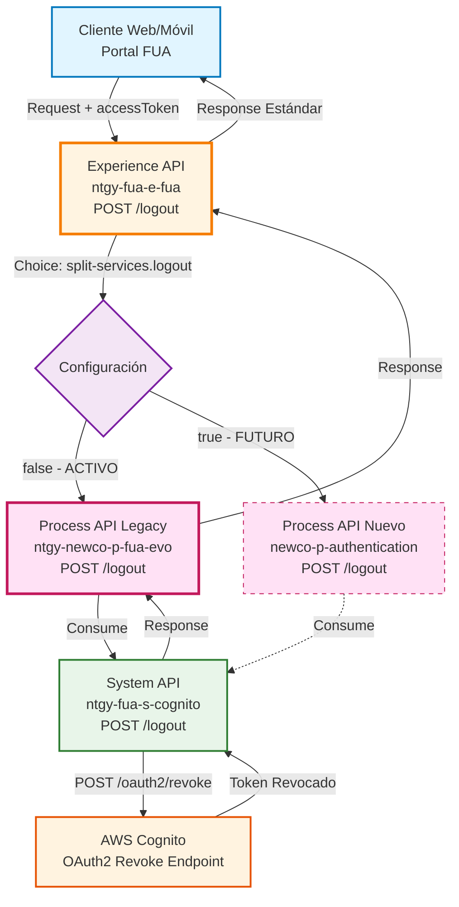
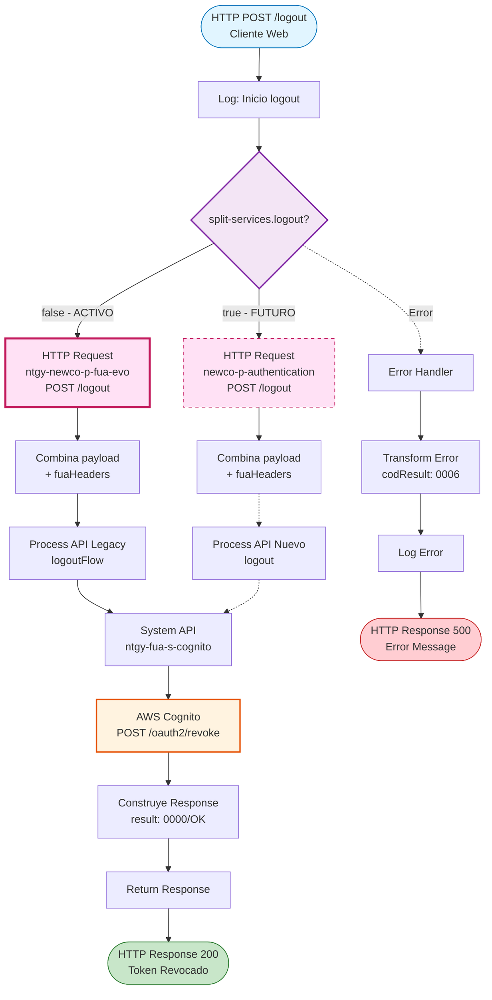
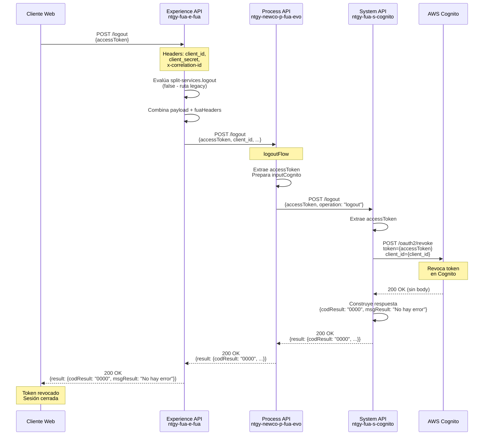
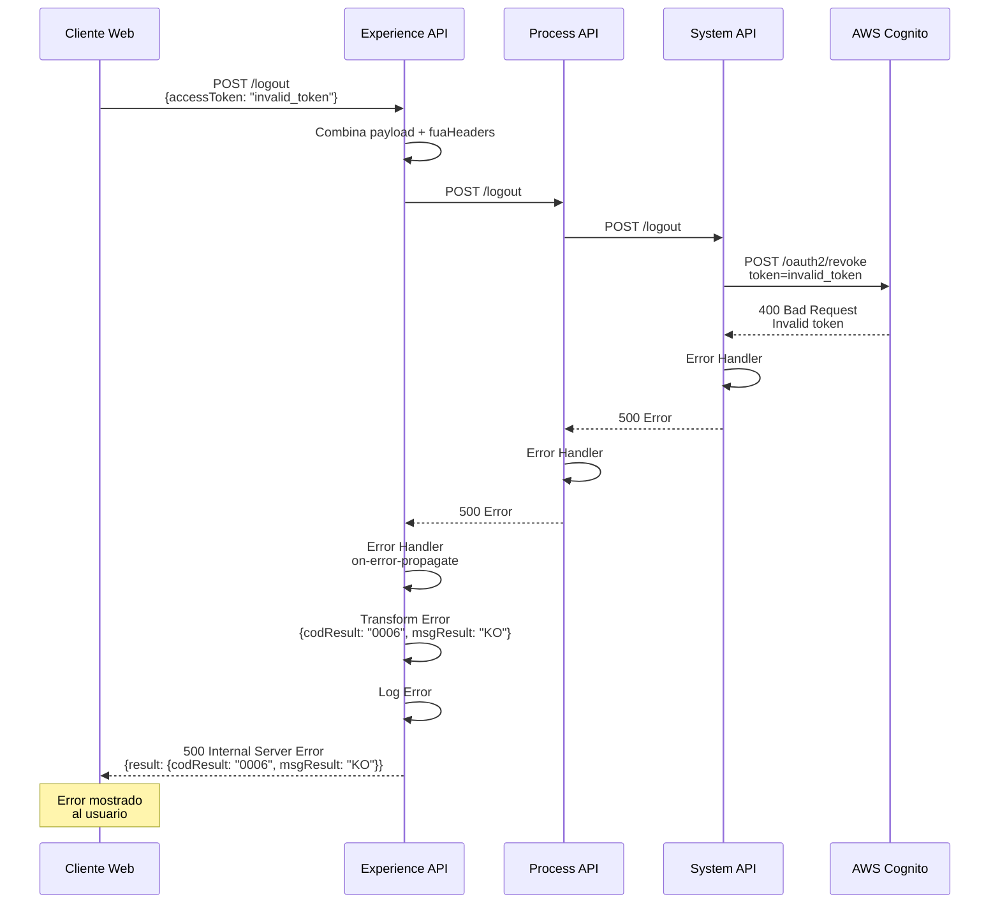
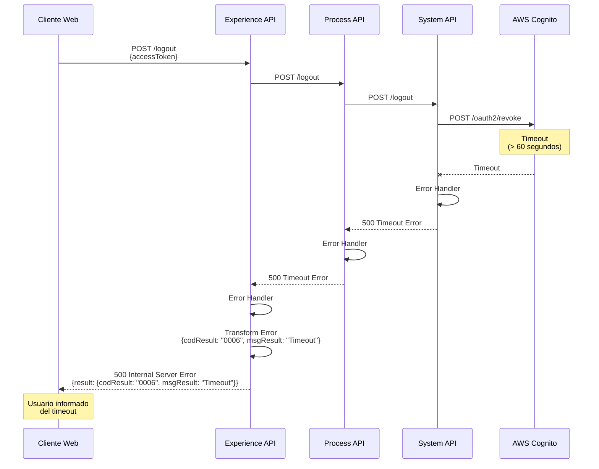

# POST /logout

## 📌 Descripción General

### Propósito del Endpoint

Cierra la sesión del usuario de forma segura revocando el token de acceso OAuth 2.0 en AWS Cognito. Este endpoint garantiza que el token no pueda ser utilizado nuevamente después del logout, cumpliendo con los estándares de seguridad OAuth 2.0 y las mejores prácticas de gestión de sesiones.

### Tipo de API

**Capa:** Experience API (API-Led Connectivity)

**Función:** Orquestación de cierre de sesión con enrutamiento condicional basado en estrategia de migración

### Patrón de Integración

**Tipo:** Pass-Through con Enrutamiento Condicional

**Descripción:** Este Experience API actúa como orquestador que:
- Recibe la solicitud de logout del cliente
- Combina el payload con headers de autenticación (fuaHeaders)
- Enruta la petición al Process API correspondiente según configuración
- Retorna la respuesta estándar sin transformación

**Estrategia de Migración:**
El endpoint implementa un patrón de enrutamiento condicional basado en la property `split-services.logout`:
- **Ruta Legacy (Actual):** `split-services.logout = false` → `ntgy-newco-p-fua-evo` (activa)
- **Ruta Nueva (Futura):** `split-services.logout = true` → `newco-p-authentication` (preparada)

### Arquitectura API-Led Connectivity



---

## 💼 Propósito del Negocio

### Casos de Uso Principales

1. **Cierre de Sesión Voluntario**
   - Usuario cierra sesión desde el portal FUA
   - Garantiza que el token no pueda ser reutilizado
   - Protege la cuenta del usuario en dispositivos compartidos

2. **Cierre de Sesión por Timeout**
   - Sistema cierra sesión automáticamente tras inactividad
   - Previene accesos no autorizados en sesiones abandonadas
   - Cumple con políticas de seguridad corporativas

3. **Cierre de Sesión por Cambio de Contraseña**
   - Invalida tokens existentes tras cambio de credenciales
   - Fuerza re-autenticación con nuevas credenciales
   - Protege contra uso de tokens comprometidos

4. **Cierre de Sesión Remoto**
   - Permite al usuario cerrar sesión desde otro dispositivo
   - Útil en casos de pérdida o robo de dispositivo
   - Mejora el control de seguridad del usuario

### 📱 Canal y Audiencia

#### Canal de Consumo

**Canal:** Web

**Características del Canal:**
- **Plataforma**: Portal FUA (Frontal Único de Atención)
- **Dispositivos**: Desktop, Tablet, Mobile Web
- **Conectividad**: Requiere conexión activa para revocación
- **Experiencia de Usuario**: Cierre de sesión inmediato con feedback visual

#### Audiencia Objetivo

**Usuarios Finales:**
- **Clientes Residenciales**: Usuarios del portal de autoservicio
- **Clientes Empresariales**: Gestores de cuentas corporativas
- **Agentes de Call Center**: Personal de atención al cliente

**Contexto de Uso:**
- **Finalización de Gestión**: Usuario completa sus tareas y cierra sesión
- **Cambio de Usuario**: En dispositivos compartidos o públicos
- **Medida de Seguridad**: Ante sospecha de compromiso de credenciales

#### Adaptaciones del Canal

**Optimizaciones Aplicadas:**
- **Simplificación de Datos**: Solo requiere accessToken
- **Formato de Respuesta**: Respuesta estándar result (codResult/msgResult)
- **Timeout**: 60 segundos para garantizar revocación completa
- **Headers de Seguridad**: Incluye client_id, client_secret, x-correlation-id

### 🔗 Endpoints Dependientes

Este Experience API consume el siguiente Process API:

| Process API | Endpoint | Método | Propósito |
|-------------|----------|--------|-----------|
| `ntgy-newco-p-fua-evo` | `/logout` | POST | Orquestación de logout con revocación de token en AWS Cognito (ruta legacy activa) |

**Nota:** Existe una ruta alternativa preparada (`newco-p-authentication`) que se activará cuando `split-services.logout = true`.

### Contexto Empresarial

- **Dominio:** Gestión de Autenticación y Sesiones
- **Sector:** Energía - Utilities
- **División:** Naturgy España - NewCo
- **Canal:** Web (Portal FUA)

### Stakeholders

- **Clientes de Energía**: Requieren cierre de sesión seguro para proteger sus datos
- **Equipo de Seguridad**: Garantiza cumplimiento de políticas de seguridad OAuth 2.0
- **Equipo de Desarrollo**: Mantiene la infraestructura de autenticación
- **Compliance Officer**: Asegura cumplimiento GDPR y normativas de protección de datos

### Valor de Negocio

- **Seguridad Mejorada**: Previene accesos no autorizados mediante revocación efectiva de tokens
- **Cumplimiento Normativo**: Cumple con GDPR, OWASP y estándares OAuth 2.0
- **Confianza del Cliente**: Proporciona control total sobre sus sesiones activas
- **Reducción de Riesgos**: Minimiza exposición ante pérdida o robo de dispositivos
- **Flexibilidad Arquitectónica**: Permite migración gradual entre servicios de autenticación

---

## 🔧 Especificación Técnica

### URLs por Ambiente

| Ambiente | URL Base | URL Completa |
|----------|----------|--------------|
| **Local** | `http://localhost:8081` | `http://localhost:8081/fua/api/logout` |
| **Development** | `https://ntgy-fua-e-fua-dev.de-c1.cloudhub.io` | `https://ntgy-fua-e-fua-dev.de-c1.cloudhub.io/fua/api/logout` |
| **Production** | `https://ntgy-fua-e-fua-pro.de-c1.cloudhub.io` | `https://ntgy-fua-e-fua-pro.de-c1.cloudhub.io/fua/api/logout` |

### Método HTTP

```
POST /fua/api/logout
```

### 🎯 Consideraciones del Canal

#### Limitaciones del Canal

| Aspecto | Limitación | Razón |
|---------|------------|-------|
| **Timeout** | 60 segundos | Garantiza tiempo suficiente para revocación en AWS Cognito |
| **Tamaño de Request** | < 1 KB | Solo contiene accessToken |
| **Rate Limiting** | No aplica | Operación de cierre de sesión no requiere limitación |
| **Reintentos** | No recomendado | La revocación es idempotente pero no requiere reintentos |

#### Headers Requeridos

**Headers de Autenticación OAuth 2.0:**

| Header | Tipo | Obligatorio | Descripción |
|--------|------|-------------|-------------|
| `client_id` | string | ✅ Sí | Identificador del cliente OAuth 2.0 |
| `client_secret` | string | ✅ Sí | Secreto del cliente OAuth 2.0 |
| `x-correlation-id` | string | ✅ Sí | ID de correlación para trazabilidad |
| `Content-Type` | string | ✅ Sí | Debe ser `application/json` |

**Nota:** Estos headers se combinan con el payload en `vars.fuaHeaders` antes de enviar al Process API.

### Parámetros de Entrada

#### Request Body

**Content-Type:** `application/json`

**Estructura:**

```json
{
  "accessToken": "string"
}
```

**Campos:**

| Campo | Tipo | Obligatorio | Descripción | Ejemplo |
|-------|------|-------------|-------------|---------|
| `accessToken` | string | ✅ Sí | Token de acceso OAuth 2.0 a revocar | `"eyJraWQiOiJ..."` |

**Validaciones:**
- `accessToken` no puede estar vacío
- `accessToken` debe ser un token JWT válido de AWS Cognito

### Respuestas

#### Respuesta Exitosa (200 OK)

**Content-Type:** `application/json`

**Estructura:**

```json
{
  "result": {
    "codResult": "0000",
    "msgResult": "No hay error"
  }
}
```

**Campos:**

| Campo | Tipo | Descripción |
|-------|------|-------------|
| `result` | object | Objeto contenedor de la respuesta |
| `result.codResult` | string | Código de resultado: `"0000"` indica éxito |
| `result.msgResult` | string | Mensaje descriptivo: `"No hay error"` |

#### Respuesta de Error (500 Internal Server Error)

**Content-Type:** `application/json`

**Estructura:**

```json
{
  "result": {
    "codResult": "0006",
    "msgResult": "KO"
  }
}
```

**Campos:**

| Campo | Tipo | Descripción |
|-------|------|-------------|
| `result` | object | Objeto contenedor de la respuesta |
| `result.codResult` | string | Código de error: `"0006"` indica error general |
| `result.msgResult` | string | Mensaje de error o descripción del problema |

**Códigos de Error:**

| Código | Descripción | Causa Común |
|--------|-------------|-------------|
| `0006` | Error general | Token inválido, expirado, o error en AWS Cognito |

### Autenticación

- **Tipo:** OAuth 2.0 Client Credentials
- **Headers Requeridos:** `client_id`, `client_secret`
- **Validación:** Los credentials se validan en el Process API antes de llamar a AWS Cognito

### Timeouts

| Tipo | Valor | Razón |
|------|-------|-------|
| **Request Timeout (E-API → P-API)** | 60 segundos | Configurado en `newco-p-fua-evo.timeout` |
| **Connection Idle Timeout** | 60 segundos | Mantiene conexión activa durante revocación |

---

## 🏗️ Implementación Técnica

### Arquitectura del Flow



### Transformaciones de Canal

**Este Experience API NO transforma la respuesta del Process API.**

El endpoint actúa como pass-through, combinando únicamente el payload con los headers de autenticación:

```dataweave
%dw 2.0
output application/json
---
payload ++ vars.fuaHeaders
```

**Donde `vars.fuaHeaders` contiene:**

```json
{
  "client_id": "valor_del_header",
  "client_secret": "valor_del_header",
  "x-correlation-id": "valor_del_header"
}
```

Para el schema completo de la respuesta, consultar:
📖 **Process API: `ntgy-newco-p-fua-evo` endpoint `/logout`**

### Patrones de Diseño

**Patrón:** Strategy Pattern con Enrutamiento Condicional

**Justificación:** 
- Permite migración gradual entre servicios de autenticación
- Facilita rollback en caso de problemas con el nuevo servicio
- Mantiene compatibilidad durante el período de transición
- Reduce riesgo mediante despliegue controlado

**Implementación:**
```xml
<choice>
  <when expression="#[(Mule::p('split-services.logout') as Boolean default false)]">
    <!-- Ruta Nueva: newco-p-authentication -->
  </when>
  <otherwise>
    <!-- Ruta Legacy: ntgy-newco-p-fua-evo (ACTIVA) -->
  </otherwise>
</choice>
```

### Diagramas de Secuencia

#### 1. Flujo Normal de Éxito (Ruta Legacy Activa)



#### 2. Flujo con Error de Token Inválido



#### 3. Flujo con Timeout



### Lógica de Enrutamiento

**Property de Configuración:**

```yaml
# e-fua-pro-config.yaml (línea 85)
split-services:
  logout: "false"  # Ruta legacy activa
```

**Lógica de Decisión:**

```dataweave
%dw 2.0
---
if (Mule::p('split-services.logout') as Boolean default false)
  // Ruta Nueva: newco-p-authentication
  "https://ntgy-newco-p-authentication-vx8fhl.internal-6bnlu3.irl-e1.cloudhub.io:443/api/v1/logout"
else
  // Ruta Legacy: ntgy-newco-p-fua-evo (ACTIVA)
  "https://mule-worker-internal-ntgy-newco-p-fua-evo.de-c1.cloudhub.io:8091/api/logout"
```

**Configuración de Conectores:**

| Conector | Host | Port | Protocol | Timeout |
|----------|------|------|----------|---------|
| `HTTP_FUA_PROCESS_NEWCO_EVO` | `mule-worker-internal-ntgy-newco-p-fua-evo.de-c1.cloudhub.io` | 8091 | HTTP | 60000ms |
| `HTTP_Request_newco-p-authentication` | `ntgy-newco-p-authentication-vx8fhl.internal-6bnlu3.irl-e1.cloudhub.io` | 443 | HTTPS | 600000ms |

### Manejo de Errores

**Error Handler Configuration:**

```xml
<error-handler>
  <on-error-propagate enableNotifications="true" logException="true">
    <ee:transform doc:name="Set Error Message">
      <ee:set-payload>
        %dw 2.0
        output application/json
        ---
        if (!isEmpty(error.errorMessage.payload)) 
          error.errorMessage.payload
        else {
          "result": {
            "codResult": "0006",
            "msgResult": "KO"
          }
        }
      </ee:set-payload>
    </ee:transform>
    <logger level="ERROR" message="Error en logout"/>
  </on-error-propagate>
</error-handler>
```

**Estrategia:**
1. **Preserva payload de error** si existe del Process API
2. **Genera error estándar** si no hay payload (código 0006)
3. **Registra error** en logs para troubleshooting
4. **Propaga error** al cliente con formato estándar

**Tipos de Errores Manejados:**
- Errores de conectividad con Process API
- Timeouts en llamadas downstream
- Errores de validación de token
- Errores de AWS Cognito
- Errores inesperados del sistema

---

## 💻 Ejemplos de Uso

### Ejemplo 1: Llamada Exitosa desde Portal Web

#### cURL

```bash
curl -X POST "https://ntgy-fua-e-fua-pro.de-c1.cloudhub.io/fua/api/logout" \
  -H "Content-Type: application/json" \
  -H "client_id: your_client_id" \
  -H "client_secret: your_client_secret" \
  -H "x-correlation-id: 550e8400-e29b-41d4-a716-446655440000" \
  -d '{
    "accessToken": "eyJraWQiOiJxNnJPRkVyXC9cL0pUbjBcL0pKT0lqb0lqb0lqb0lqb0lqb0lqb0lqb0lqbz0iLCJhbGciOiJSUzI1NiJ9..."
  }'
```

#### Respuesta (200 OK)

```json
{
  "result": {
    "codResult": "0000",
    "msgResult": "No hay error"
  }
}
```

**Interpretación:**
- Token revocado exitosamente en AWS Cognito
- Sesión cerrada correctamente
- Usuario puede proceder con logout en frontend

---

### Ejemplo 2: Error con Token Inválido

#### cURL

```bash
curl -X POST "https://ntgy-fua-e-fua-pro.de-c1.cloudhub.io/fua/api/logout" \
  -H "Content-Type: application/json" \
  -H "client_id: your_client_id" \
  -H "client_secret: your_client_secret" \
  -H "x-correlation-id: 550e8400-e29b-41d4-a716-446655440001" \
  -d '{
    "accessToken": "invalid_token_12345"
  }'
```

#### Respuesta (500 Internal Server Error)

```json
{
  "result": {
    "codResult": "0006",
    "msgResult": "KO"
  }
}
```

**Interpretación:**
- Token no válido o ya revocado
- AWS Cognito rechazó la revocación
- Usuario debe ser informado del error

---

### Ejemplo 3: JavaScript (Fetch API)

```javascript
/**
 * Cierra la sesión del usuario revocando el token en AWS Cognito
 * @param {string} accessToken - Token de acceso OAuth 2.0
 * @param {string} clientId - Client ID de OAuth 2.0
 * @param {string} clientSecret - Client Secret de OAuth 2.0
 * @returns {Promise<Object>} Resultado del logout
 */
async function logout(accessToken, clientId, clientSecret) {
  const correlationId = generateUUID(); // Función para generar UUID
  
  try {
    const response = await fetch('https://ntgy-fua-e-fua-pro.de-c1.cloudhub.io/fua/api/logout', {
      method: 'POST',
      headers: {
        'Content-Type': 'application/json',
        'client_id': clientId,
        'client_secret': clientSecret,
        'x-correlation-id': correlationId
      },
      body: JSON.stringify({
        accessToken: accessToken
      })
    });
    
    const data = await response.json();
    
    if (response.ok && data.result.codResult === '0000') {
      console.log('Logout exitoso:', data.result.msgResult);
      // Limpiar localStorage/sessionStorage
      localStorage.removeItem('accessToken');
      localStorage.removeItem('refreshToken');
      // Redirigir a página de login
      window.location.href = '/login';
      return data;
    } else {
      console.error('Error en logout:', data.result.msgResult);
      throw new Error(`Logout failed: ${data.result.msgResult}`);
    }
  } catch (error) {
    console.error('Error de red en logout:', error);
    // Limpiar tokens localmente aunque falle la revocación
    localStorage.removeItem('accessToken');
    localStorage.removeItem('refreshToken');
    throw error;
  }
}

// Función auxiliar para generar UUID
function generateUUID() {
  return 'xxxxxxxx-xxxx-4xxx-yxxx-xxxxxxxxxxxx'.replace(/[xy]/g, function(c) {
    const r = Math.random() * 16 | 0;
    const v = c === 'x' ? r : (r & 0x3 | 0x8);
    return v.toString(16);
  });
}

// Uso
const token = localStorage.getItem('accessToken');
const clientId = 'your_client_id';
const clientSecret = 'your_client_secret';

logout(token, clientId, clientSecret)
  .then(result => console.log('Usuario desconectado'))
  .catch(error => console.error('Error al desconectar:', error));
```

---

### Ejemplo 4: Python (Requests)

```python
import requests
import uuid
import json

def logout(access_token: str, client_id: str, client_secret: str) -> dict:
    """
    Cierra la sesión del usuario revocando el token en AWS Cognito
    
    Args:
        access_token: Token de acceso OAuth 2.0
        client_id: Client ID de OAuth 2.0
        client_secret: Client Secret de OAuth 2.0
    
    Returns:
        dict: Resultado del logout
    
    Raises:
        requests.exceptions.RequestException: Si hay error en la petición
    """
    url = 'https://ntgy-fua-e-fua-pro.de-c1.cloudhub.io/fua/api/logout'
    correlation_id = str(uuid.uuid4())
    
    headers = {
        'Content-Type': 'application/json',
        'client_id': client_id,
        'client_secret': client_secret,
        'x-correlation-id': correlation_id
    }
    
    payload = {
        'accessToken': access_token
    }
    
    try:
        response = requests.post(
            url,
            headers=headers,
            json=payload,
            timeout=60  # Timeout de 60 segundos
        )
        
        data = response.json()
        
        if response.status_code == 200 and data['result']['codResult'] == '0000':
            print(f"Logout exitoso: {data['result']['msgResult']}")
            # Limpiar tokens almacenados
            # clear_stored_tokens()
            return data
        else:
            print(f"Error en logout: {data['result']['msgResult']}")
            raise Exception(f"Logout failed: {data['result']['msgResult']}")
            
    except requests.exceptions.Timeout:
        print("Timeout en logout - revocando tokens localmente")
        # clear_stored_tokens()
        raise
    except requests.exceptions.RequestException as e:
        print(f"Error de red en logout: {e}")