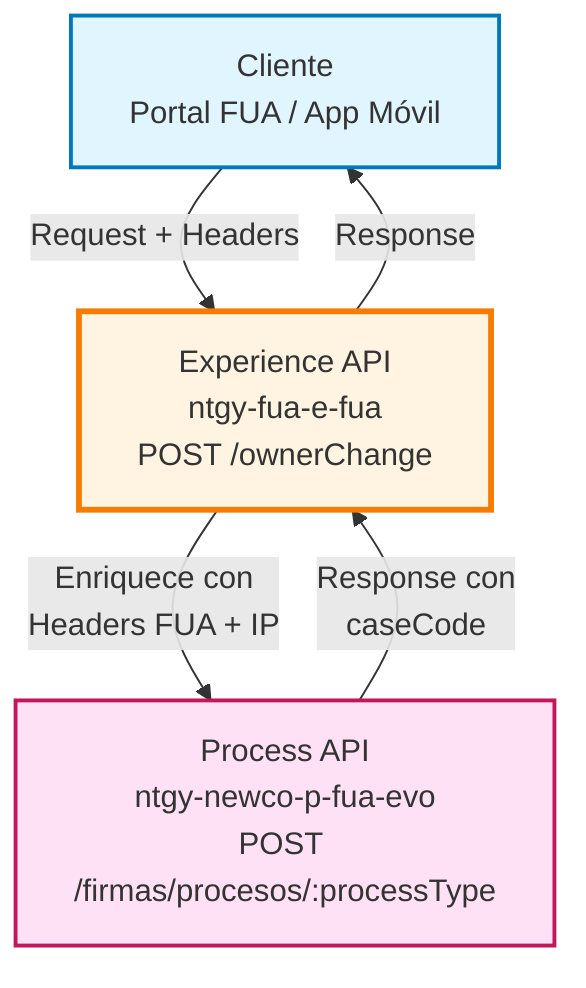
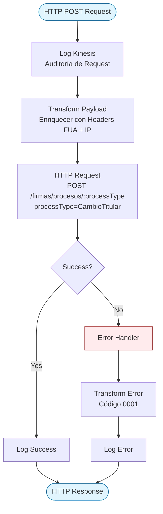
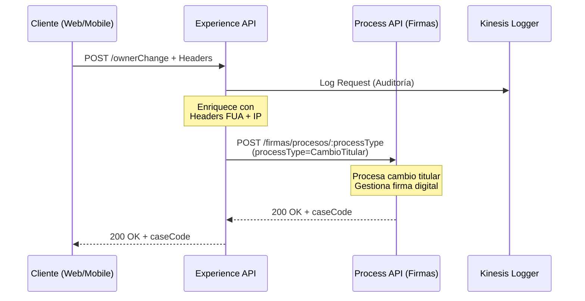
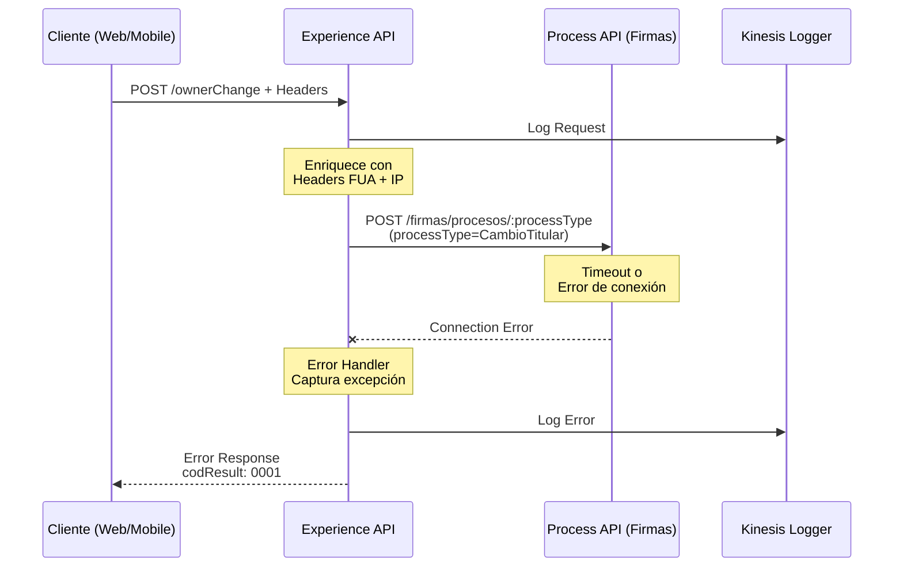

# POST /ownerChange

## 📌 Descripción General

### Propósito del Endpoint

Este endpoint permite iniciar el proceso de cambio de titular de un contrato de energía, gestionando la transferencia de titularidad entre un cliente actual y un nuevo titular. El proceso incluye la gestión de firma digital, subrogación de deuda opcional, y la coordinación con el Process API de firmas para completar el trámite.

### Tipo de API

**Capa:** Experience API (API-Led Connectivity)

**Función:** Orquestación de cambio de titular con adaptación para canales web y móvil

### Patrón de Integración

**Tipo:** Orquestación con Enriquecimiento de Datos

**Descripción:** El Experience API enriquece la solicitud con headers de contexto FUA y la dirección IP del cliente antes de invocar el Process API de firmas. Actúa como punto de entrada unificado para los canales digitales.

### Arquitectura API-Led Connectivity



---

## 💼 Propósito del Negocio

### Casos de Uso Principales

1. **Cambio de Titular con Subrogación de Deuda**
   - Cliente actual transfiere contrato a nuevo titular
   - Nuevo titular asume la deuda pendiente del contrato
   - Proceso de firma digital para ambas partes

2. **Cambio de Titular sin Deuda**
   - Transferencia de contrato sin deuda pendiente
   - Firma digital del nuevo titular
   - Mantenimiento de condiciones contractuales

3. **Cambio de Titular con Selección de Contratos**
   - Cliente con múltiples contratos selecciona cuáles transferir
   - Gestión individual de cada contrato en el cambio
   - Firma digital para los contratos seleccionados

### 📱 Canal y Audiencia

#### Canal de Consumo

**Canal:** Web y Mobile

**Características del Canal:**
- **Plataforma**: Portal FUA (web) y aplicación móvil Naturgy
- **Dispositivos**: Desktop, tablets, smartphones
- **Conectividad**: Requiere conexión estable para proceso de firma
- **Experiencia de Usuario**: Proceso guiado paso a paso con validaciones

#### Audiencia Objetivo

**Usuarios Finales:**
- **Cliente Actual (Titular Saliente)**: Propietario actual del contrato que desea transferir la titularidad
- **Nuevo Titular (Titular Entrante)**: Persona que asumirá la titularidad del contrato

**Contexto de Uso:**
- **Mudanza**: Cliente se muda y transfiere contrato al nuevo ocupante
- **Cambio de Propietario**: Venta o traspaso de propiedad
- **Reorganización Familiar**: Cambios en la estructura familiar o empresarial

#### Adaptaciones del Canal

**Optimizaciones Aplicadas:**
- **Enriquecimiento de Headers**: Añade headers FUA para trazabilidad (x-interaction-id, x-user-id, x-client-id, etc.)
- **Captura de IP**: Incluye dirección IP del cliente para auditoría
- **Formato de Respuesta**: Mantiene estructura simple con código de caso
- **Timeout Extendido**: 60 segundos para permitir procesamiento de firma

### 🔗 Endpoints Dependientes

Este Experience API consume el siguiente Process API:

| Process API | Endpoint | Método | Propósito |
|-------------|----------|--------|-----------|
| `ntgy-newco-p-fua-evo` | `/firmas/procesos/:processType` | POST | Procesa solicitudes de firma digital (processType=CambioTitular para cambio de titular) |

### Contexto Empresarial

- **Dominio:** Gestión de Contratos y Clientes
- **Sector:** Energía - Utilities
- **División:** Naturgy España - NewCo
- **Canal:** Web y Móvil

### Stakeholders

- **Clientes Residenciales**: Necesitan proceso simple y rápido para cambio de titular
- **Clientes Empresariales**: Requieren gestión de múltiples contratos
- **Departamento Legal**: Necesita trazabilidad completa del proceso de firma
- **Atención al Cliente**: Requiere visibilidad del estado del proceso

### Valor de Negocio

- **Digitalización**: Elimina necesidad de trámites presenciales o por correo
- **Reducción de Tiempos**: Proceso de cambio de titular en minutos vs días
- **Trazabilidad**: Registro completo de cada paso del proceso
- **Cumplimiento Legal**: Firma digital con validez legal
- **Mejora de Experiencia**: Proceso autoservicio 24/7

---

## 🔧 Especificación Técnica

### URLs por Ambiente

| Ambiente | URL Base | URL Completa |
|----------|----------|--------------|
| **Local** | `http://localhost:8081` | `http://localhost:8081/fua/api/ownerChange` |
| **Development** | `https://ntgy-fua-e-fua-dev.de-c1.cloudhub.io` | `https://ntgy-fua-e-fua-dev.de-c1.cloudhub.io/fua/api/ownerChange` |
| **Production** | `https://ntgy-fua-e-fua-pro.de-c1.cloudhub.io` | `https://ntgy-fua-e-fua-pro.de-c1.cloudhub.io/fua/api/ownerChange` |

### Método HTTP

```
POST /fua/api/ownerChange
```

### 🎯 Consideraciones del Canal

#### Limitaciones del Canal

| Aspecto | Limitación | Razón |
|---------|------------|-------|
| **Timeout** | 60 segundos | Proceso de firma puede requerir tiempo de procesamiento |
| **Rate Limiting** | Según política API Gateway | Protección contra abuso |
| **Autenticación** | OAuth 2.0 requerido | Seguridad y trazabilidad |

#### Campos Específicos del Canal

**Campos Añadidos por el Experience API:**

| Campo | Tipo | Descripción | Razón |
|-------|------|-------------|-------|
| `DirIp` | string | Dirección IP del cliente | Auditoría y seguridad |
| Headers FUA | object | Headers de contexto (x-interaction-id, x-user-id, etc.) | Trazabilidad end-to-end |

### Parámetros de Entrada

#### Headers Requeridos

| Header | Tipo | Descripción | Ejemplo |
|--------|------|-------------|---------|
| `Content-Type` | string | Tipo de contenido | `application/json` |
| `x-interaction-id` | string | ID de interacción para trazabilidad | `550e8400-e29b-41d4-a716-446655440000` |
| `x-interaction-origin` | string | Origen de la interacción | `FUA_WEB` |
| `x-user-id` | string | ID del usuario autenticado | `user123` |
| `x-client-id` | string | ID del cliente | `client456` |
| `x-client-doc-number` | string | Número de documento del cliente | `12345678A` |
| `x-client-code` | string | Código del cliente | `CC789` |
| `x-origin` | string | Origen de la petición | `WEB` |
| `x-user-role` | string | Rol del usuario | `customer` |

#### Body (application/json)

```json
{
  "oldClientId": "string",
  "newClientId": "string",
  "refNum": "string",
  "orderItemIdList": ["string"],
  "contractIdList": [
    {
      "contractId": "string"
    }
  ],
  "startDate": "2024-01-01",
  "bankAccount": {
    "iban": "string",
    "accountHolder": "string"
  },
  "signType": "email",
  "durationContract": 12,
  "orderId": "string",
  "checkPending": true,
  "contactPhone": "string",
  "checkSubrrogation": true,
  "addressId": "string",
  "pendingAmount": 150.50
}
```

#### Descripción de Campos del Body

| Campo | Tipo | Requerido | Descripción |
|-------|------|-----------|-------------|
| `oldClientId` | string | Sí | ID del cliente titular actual |
| `newClientId` | string | Sí | ID del nuevo titular |
| `refNum` | string | Sí | Número de referencia del proceso |
| `orderItemIdList` | string[] | No | Array con IDs de contratos a mantener |
| `contractIdList` | array | No | Array con objetos de IDs de contratos |
| `startDate` | date | Sí | Fecha efectiva del cambio de titular |
| `bankAccount` | object | Sí | Datos bancarios del nuevo titular |
| `signType` | string | Sí | Tipo de firma: "email" o "sms" |
| `durationContract` | number | Sí | Duración del contrato en meses |
| `orderId` | string | No | ID de la orden (solo NewCo) |
| `checkPending` | boolean | No | Indicador de asumir deuda |
| `contactPhone` | string | No | Teléfono para proceso de firma |
| `checkSubrrogation` | boolean | No | Indicador de subrogación |
| `addressId` | string | No | ID de dirección del contrato |
| `pendingAmount` | number | No | Cantidad total de deuda a subrogar |

### Respuestas

#### 200 OK - Éxito

```json
{
  "result": {
    "codResult": "0000",
    "msgResult": "No hay error"
  },
  "caseCode": "1233"
}
```

**Descripción de Campos:**

| Campo | Tipo | Descripción |
|-------|------|-------------|
| `result.codResult` | string | Código de resultado ("0000" = éxito) |
| `result.msgResult` | string | Mensaje descriptivo del resultado |
| `caseCode` | string | Código del caso creado para seguimiento |

#### 400 Bad Request - Error de Validación

```json
{
  "result": {
    "codResult": "0001",
    "msgResult": "Error en validación de datos"
  }
}
```

#### 500 Internal Server Error - Error del Servidor

```json
{
  "result": {
    "codResult": "0001",
    "msgResult": "Error interno del servidor"
  }
}
```

### Autenticación

- **Tipo:** OAuth 2.0
- **Scope:** Requiere autenticación de usuario
- **Headers:** Token en header `Authorization` (gestionado por API Gateway)

### Timeouts

| Tipo | Valor | Razón |
|------|-------|-------|
| **Request Timeout** | 60 segundos | Proceso de firma puede requerir tiempo de procesamiento en backend |
| **Connection Timeout** | 60 segundos | Configurado en HTTP connector para Process API |

---

## 🏗️ Implementación Técnica

### Arquitectura del Flow



### Ubicación del Código Fuente

**Archivo Principal:** `e-fua.xml` (línea 379-381)
```xml
<flow name="post:\ownerChange:application\json:e-fua-config">
    <flow-ref doc:name="post-owner-change" name="post-owner-changeFlow" />
</flow>
```

**Archivo de Implementación:** `implementation/post-owner-change.xml` (línea 1-48)

### Transformaciones de Canal

#### Transformación de Entrada (Request)

**Archivo:** `implementation/post-owner-change.xml` (líneas 13-26)

```dataweave
%dw 2.2
import * from dw::core::Strings
output application/json
---
payload
++ 
vars.fuaHeaders 
++
{
    "DirIp": substringBefore(substringAfter(attributes.remoteAddress,"/"),":")
}
```

**Descripción de la Transformación:**

| Campo Original | Campo Añadido | Transformación |
|----------------|---------------|----------------|
| `payload` | - | Mantiene todos los campos del request original |
| - | `vars.fuaHeaders` | Añade headers FUA (x-interaction-id, x-user-id, etc.) |
| `attributes.remoteAddress` | `DirIp` | Extrae IP del cliente desde remoteAddress |

**Lógica de Extracción de IP:**
- `attributes.remoteAddress` tiene formato: `/127.0.0.1:12345`
- `substringAfter(..., "/")` → `127.0.0.1:12345`
- `substringBefore(..., ":")` → `127.0.0.1`

#### Variables FUA Headers

**Definición:** `e-fua.xml` (líneas 15-37)

Headers incluidos en `vars.fuaHeaders`:
- `x-interaction-id`: ID de interacción
- `x-interaction-origin`: Origen de la interacción
- `x-user-id`: ID del usuario
- `x-client-id`: ID del cliente
- `x-client-doc-number`: Número de documento
- `x-client-code`: Código del cliente
- `x-origin`: Origen de la petición
- `x-user-role`: Rol del usuario
- `traceparent`: Trazabilidad distribuida
- `x-agent-mail`: Email del agente (si aplica)
- `x-language`: Idioma
- `x-contact-id`: ID de contacto

### Llamada al Process API

**Configuración HTTP:** `global.xml` (líneas 30-32)

```xml
<http:request-config name="HTTP_FUA_PROCESS_NEWCO_EVO" 
    basePath="/api" 
    responseTimeout="${newco-p-fua-evo.timeout}">
    <http:request-connection 
        host="${newco-p-fua-evo.host}" 
        port="${newco-p-fua-evo.port}" 
        connectionIdleTimeout="${newco-p-fua-evo.timeout}"/>
</http:request-config>
```

**Request HTTP:** `implementation/post-owner-change.xml` (líneas 27-33)

```xml
<http:request method="POST" 
    config-ref="HTTP_FUA_PROCESS_NEWCO_EVO" 
    path="/firmas/procesos/{processType}" 
    outputMimeType="application/json" 
    outputEncoding="UTF-8" 
    sendBodyMode="ALWAYS">
    <http:uri-params>
        {"processType": "CambioTitular"}
    </http:uri-params>
</http:request>
```

**Explicación del Path Parametrizado:**
- El path usa un **URI parameter** `{processType}` que se reemplaza dinámicamente
- En este caso, el valor es `"CambioTitular"` para el proceso de cambio de titular
- El path final construido es: `/firmas/procesos/CambioTitular`
- El Process API puede manejar diferentes tipos de procesos de firma usando el mismo endpoint base

**Propiedades de Configuración:** `e-fua-pro-config.yaml` (líneas 25-28)

```yaml
newco-p-fua-evo:
  host: "mule-worker-internal-ntgy-newco-p-fua-evo.de-c1.cloudhub.io"
  port: "8091"
  timeout: "60000"
```

### Patrones de Diseño

**Patrón:** Orquestación con Enriquecimiento de Contexto

**Justificación:** 
- El Experience API actúa como punto de entrada unificado
- Enriquece la solicitud con contexto de sesión y auditoría
- Delega la lógica de negocio al Process API
- Mantiene separación de responsabilidades entre capas

### Diagramas de Secuencia

#### 1. Flujo Normal de Éxito



#### 2. Flujo con Error de Negocio


#### 3. Flujo con Error Técnico



### Logging y Auditoría

#### Logger Kinesis

**Ubicación:** `implementation/post-owner-change.xml` (líneas 7-12)

```xml
<logger level="INFO" doc:name="LoggerKinesis" category="kinesisLogger">
```

**Contenido del Log:**
```dataweave
{
    headers: {
        method: attributes.method,
        requestUri: attributes.requestUri,
        correlationId: correlationId
    },
    message: {
        payload: payload
    }
}
```

### Manejo de Errores

**Error Handler:** `implementation/post-owner-change.xml` (líneas 34-48)

```xml
<error-handler>
    <on-error-propagate enableNotifications="true" logException="true">
        <ee:transform>
            <ee:set-payload>
                {
                    "result": {
                        "codResult": "0001",
                        "msgResult": error.description as String replace /"/ with("")
                    }
                }
            </ee:set-payload>
        </ee:transform>
        <logger level="INFO" message="Error Response"/>
    </on-error-propagate>
</error-handler>
```

**Estrategia de Manejo:**
- Captura cualquier error del Process API
- Transforma a formato estándar con código 0001
- Elimina comillas del mensaje de error
- Registra el error para auditoría
- Propaga el error al cliente con estructura consistente

---

## 💻 Ejemplos de Uso

### Ejemplo 1: Cambio de Titular con Subrogación de Deuda

#### cURL

```bash
curl -X POST "https://ntgy-fua-e-fua-pro.de-c1.cloudhub.io/fua/api/ownerChange" \
  -H "Content-Type: application/json" \
  -H "x-interaction-id: 550e8400-e29b-41d4-a716-446655440000" \
  -H "x-interaction-origin: FUA_WEB" \
  -H "x-user-id: user123" \
  -H "x-client-id: client456" \
  -H "x-client-doc-number: 12345678A" \
  -H "x-client-code: CC789" \
  -H "x-origin: WEB" \
  -H "x-user-role: customer" \
  -d '{
    "oldClientId": "0015I00000VxYZ1QAN",
    "newClientId": "0015I00000VxYZ2QAN",
    "refNum": "REF123456",
    "contractIdList": [
      {
        "contractId": "8007Y0000031FbfQAE"
      }
    ],
    "startDate": "2024-02-01",
    "bankAccount": {
      "iban": "ES9121000418450200051332",
      "accountHolder": "Juan Pérez García"
    },
    "signType": "email",
    "durationContract": 12,
    "checkPending": true,
    "checkSubrrogation": true,
    "contactPhone": "+34600123456",
    "pendingAmount": 150.50
  }'
```

#### Respuesta (200 OK)

```json
{
  "result": {
    "codResult": "0000",
    "msgResult": "No hay error"
  },
  "caseCode": "CASE-2024-001234"
}
```

### Ejemplo 2: Cambio de Titular sin Deuda

#### JavaScript (React/Vue)

```javascript
const ownerChange = async () => {
  try {
    const response = await fetch(
      'https://ntgy-fua-e-fua-pro.de-c1.cloudhub.io/fua/api/ownerChange',
      {
        method: 'POST',
        headers: {
          'Content-Type': 'application/json',
          'x-interaction-id': generateUUID(),
          'x-interaction-origin': 'FUA_WEB',
          'x-user-id': currentUser.id,
          'x-client-id': currentClient.id,
          'x-client-doc-number': currentClient.docNumber,
          'x-client-code': currentClient.code,
          'x-origin': 'WEB',
          'x-user-role': 'customer'
        },
        body: JSON.stringify({
          oldClientId: '0015I00000VxYZ1QAN',
          newClientId: '0015I00000VxYZ2QAN',
          refNum: 'REF123456',
          contractIdList: [
            { contractId: '8007Y0000031FbfQAE' }
          ],
          startDate: '2024-02-01',
          bankAccount: {
            iban: 'ES9121000418450200051332',
            accountHolder: 'Juan Pérez García'
          },
          signType: 'email',
          durationContract: 12,
          checkPending: false,
          checkSubrrogation: false,
          contactPhone: '+34600123456'
        })
      }
    );

    const data = await response.json();
    
    if (data.result.codResult === '0000') {
      console.log('Cambio de titular iniciado:', data.caseCode);
      // Redirigir a página de seguimiento
      window.location.href = `/seguimiento/${data.caseCode}`;
    } else {
      console.error('Error:', data.result.msgResult);
    }
  } catch (error) {
    console.error('Error de conexión:', error);
  }
};
```

### Ejemplo 3: Python (Backend Integration)

```python
import requests
import uuid

def iniciar_cambio_titular(old_client_id, new_client_id, contract_id, start_date):
    url = 'https://ntgy-fua-e-fua-pro.de-c1.cloudhub.io/fua/api/ownerChange'
    
    headers = {
        'Content-Type': 'application/json',
        'x-interaction-id': str(uuid.uuid4()),
        'x-interaction-origin': 'FUA_WEB',
        'x-user-id': 'user123',
        'x-client-id': old_client_id,
        'x-client-doc-number': '12345678A',
        'x-client-code': 'CC789',
        'x-origin': 'WEB',
        'x-user-role': 'customer'
    }
    
    payload = {
        'oldClientId': old_client_id,
        'newClientId': new_client_id,
        'refNum': 'REF123456',
        'contractIdList': [
            {'contractId': contract_id}
        ],
        'startDate': start_date,
        'bankAccount': {
            'iban': 'ES9121000418450200051332',
            'accountHolder': 'Juan Pérez García'
        },
        'signType': 'email',
        'durationContract': 12,
        'checkPending': False,
        'checkSubrrogation': False,
        'contactPhone': '+34600123456'
    }
    
    try:
        response = requests.post(url, headers=headers, json=payload)
        response.raise_for_status()
        
        data = response.json()
        
        if data['result']['codResult'] == '0000':
            print(f"Cambio de titular iniciado exitosamente")
            print(f"Código de caso: {data['caseCode']}")
            return data['caseCode']
        else:
            print(f"Error: {data['result']['msgResult']}")
            return None
            
    except requests.exceptions.RequestException as e:
        print(f"Error de conexión: {e}")
        return None

# Ejemplo de uso
case_code = iniciar_cambio_titular(
    old_client_id='0015I00000VxYZ1QAN',
    new_client_id='0015I00000VxYZ2QAN',
    contract_id='8007Y0000031FbfQAE',
    start_date='2024-02-01'
)
```

### Ejemplo 4: Respuesta de Error

#### Request con Datos Inválidos

```bash
curl -X POST "https://ntgy-fua-e-fua-pro.de-c1.cloudhub.io/fua/api/ownerChange" \
  -H "Content-Type: application/json" \
  -H "x-interaction-id: 550e8400-e29b-41d4-a716-446655440000" \
  -H "x-user-id: user123" \
  -d '{
    "oldClientId": "INVALID_ID",
    "newClientId": "0015I00000VxYZ2QAN"
  }'
```

#### Respuesta (Error)

```json
{
  "result": {
    "codResult": "0001",
    "msgResult": "Cliente titular actual no encontrado"
  }
}
```
