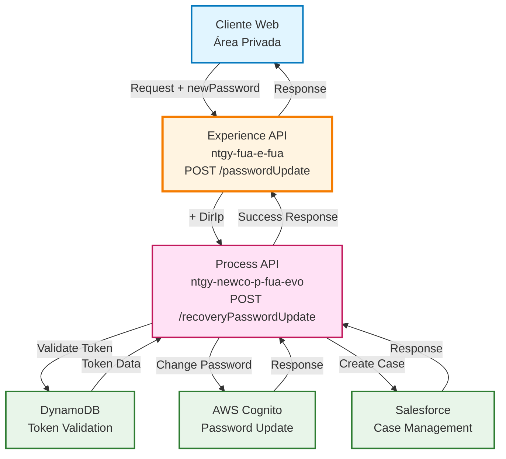
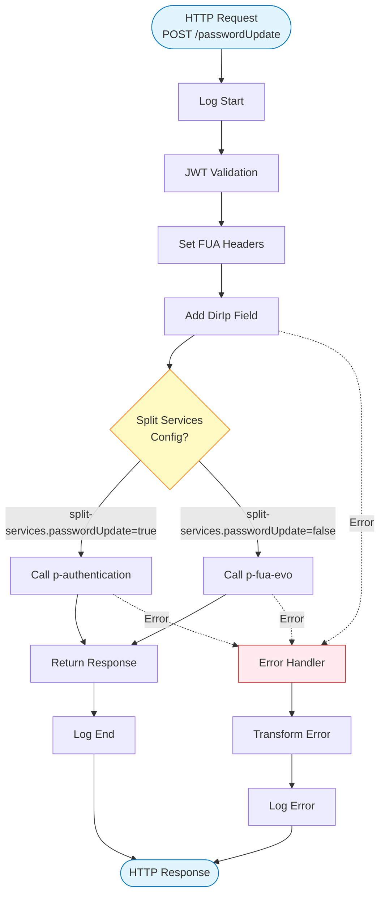
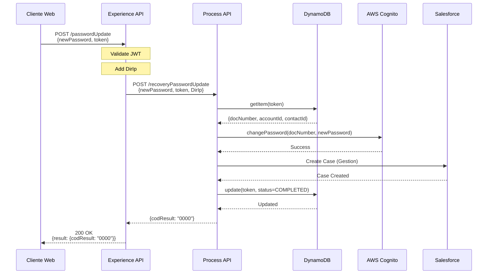
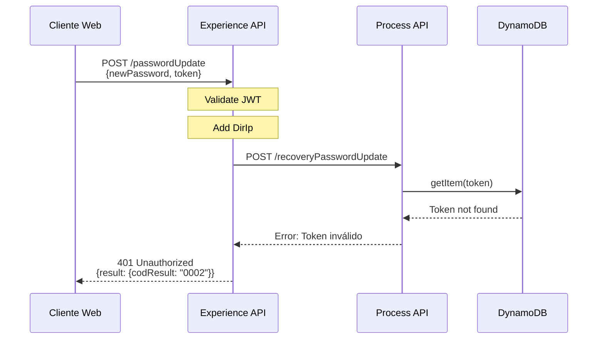
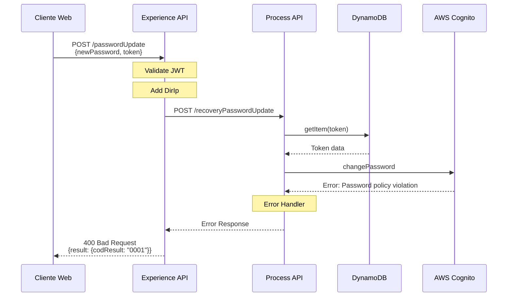

# POST /passwordUpdate

## 📌 Descripción General

### Propósito del Endpoint

Este endpoint permite a los usuarios autenticados cambiar su contraseña desde el área privada del portal FUA. El proceso incluye validación del token de sesión, actualización en AWS Cognito y registro de la operación en Salesforce.

### Tipo de API

**Capa:** Experience API (API-Led Connectivity)

**Función:** Orquestación de cambio de contraseña con validación de seguridad y sincronización multi-sistema

### Patrón de Integración

**Tipo:** Orquestación con Transformación

**Descripción:** El Experience API agrega información de contexto (dirección IP del cliente) y orquesta la llamada al Process API que gestiona la actualización de contraseña en AWS Cognito, validación de token en DynamoDB y registro de caso en Salesforce.

### Arquitectura API-Led Connectivity



---

## 💼 Propósito del Negocio

### Casos de Uso Principales

1. **Cambio de Contraseña desde Área Privada**
   - Usuario autenticado desea cambiar su contraseña por seguridad
   - Proceso seguro con validación de token de sesión
   - Actualización inmediata en sistema de autenticación

2. **Gestión de Seguridad de Cuenta**
   - Permite al usuario mantener la seguridad de su cuenta
   - Registro de cambios para auditoría
   - Creación automática de caso de gestión en Salesforce

3. **Autoservicio de Cliente**
   - Reduce carga en call center
   - Proceso inmediato sin intervención de agentes
   - Disponible 24/7 desde el portal web

### 📱 Canal y Audiencia

#### Canal de Consumo

**Canal:** Web

**Características del Canal:**
- **Plataforma**: Portal FUA (Frontal Único de Atención)
- **Dispositivos**: Desktop y navegadores web
- **Conectividad**: Requiere conexión estable para operación de seguridad
- **Experiencia de Usuario**: Proceso guiado con validación en tiempo real

#### Audiencia Objetivo

**Usuarios Finales:**
- **Clientes Autenticados**: Usuarios con sesión activa en el portal FUA que desean cambiar su contraseña
- **Clientes de Energía**: Clientes residenciales y empresariales de Naturgy

**Contexto de Uso:**
- **Cambio Preventivo**: Usuario desea actualizar contraseña por seguridad
- **Cambio Reactivo**: Usuario sospecha compromiso de cuenta
- **Cambio Periódico**: Usuario actualiza contraseña como buena práctica

#### Adaptaciones del Canal

**Optimizaciones Aplicadas:**
- **Agregación de Contexto**: Se añade dirección IP del cliente para auditoría
- **Validación de Sesión**: Verificación de headers de autenticación
- **Timeout Extendido**: 60 segundos para operaciones de seguridad
- **Respuesta Simplificada**: Solo resultado de operación sin detalles técnicos

### 🔗 Endpoints Dependientes

Este Experience API consume el siguiente Process API:

| Process API | Endpoint | Método | Propósito |
|-------------|----------|--------|-----------|
| `ntgy-newco-p-fua-evo` | `/recoveryPasswordUpdate` | POST | Actualización de contraseña con validación de token y sincronización con Cognito |

**Nota:** El Process API internamente consume:
- **AWS DynamoDB**: Validación y actualización de token de registro
- **AWS Cognito**: Cambio de contraseña del usuario
- **Salesforce**: Creación de caso de gestión (opcional)

### Contexto Empresarial

- **Dominio:** Autoservicio de Clientes - Gestión de Seguridad
- **Sector:** Energía - Utilities
- **División:** Naturgy España - NewCo
- **Canal:** Portal Web FUA

### Stakeholders

- **Clientes Finales**: Necesitan gestionar la seguridad de sus cuentas de forma autónoma
- **Equipo de Seguridad**: Requiere auditoría de cambios de contraseña
- **Equipo de Atención al Cliente**: Beneficiado por reducción de llamadas de cambio de contraseña

### Valor de Negocio

- **Autoservicio**: Permite a clientes gestionar su seguridad sin intervención de agentes
- **Reducción de Costos**: Disminuye carga en call center para operaciones de cambio de contraseña
- **Seguridad**: Proceso seguro con validación de token y registro de auditoría
- **Disponibilidad**: Servicio 24/7 sin dependencia de horarios de atención

---

## 🔧 Especificación Técnica

### URLs por Ambiente

| Ambiente | URL Base | URL Completa |
|----------|----------|--------------|
| **Local** | `http://localhost:8081` | `http://localhost:8081/fua/api/passwordUpdate` |
| **Development** | `https://ntgy-fua-e-fua-dev.de-c1.cloudhub.io` | `https://ntgy-fua-e-fua-dev.de-c1.cloudhub.io/fua/api/passwordUpdate` |
| **Production** | `https://ntgy-fua-e-fua-pro.de-c1.cloudhub.io` | `https://ntgy-fua-e-fua-pro.de-c1.cloudhub.io/fua/api/passwordUpdate` |

### Método HTTP

```
POST /fua/api/passwordUpdate
```

### 🎯 Consideraciones del Canal

#### Limitaciones del Canal

| Aspecto | Limitación | Razón |
|---------|------------|-------|
| **Timeout** | 60 segundos | Operación de seguridad que involucra múltiples sistemas |
| **Rate Limiting** | Por usuario | Prevención de ataques de fuerza bruta |
| **Autenticación** | Obligatoria | Operación sensible requiere sesión activa |

#### Campos Específicos del Canal

**Campos Añadidos por el Experience API:**

| Campo | Tipo | Descripción | Razón |
|-------|------|-------------|-------|
| `DirIp` | string | Dirección IP del cliente | Auditoría y seguridad - registro de origen de cambio |

**Campos del Request:**

| Campo | Tipo | Obligatorio | Descripción |
|-------|------|-------------|-------------|
| `newPassword` | string | Sí | Nueva contraseña del usuario |
| `clientType` | string | No | Tipo de cliente (opcional) |
| `token` | string | Sí | Token de validación de sesión |

### Headers Requeridos

| Header | Tipo | Obligatorio | Descripción |
|--------|------|-------------|-------------|
| `Content-Type` | string | Sí | Debe ser `application/json` |
| `x-client-doc-number` | string | Sí | Número de documento del cliente |
| `x-access-token` | string | Sí | Token de acceso OAuth 2.0 |
| `x-user-role` | string | Sí | Rol del usuario |
| `x-client-id` | string | No | ID del cliente |
| `x-interaction-id` | string | No | ID de interacción para trazabilidad |
| `x-user-id` | string | No | ID del usuario |
| `x-language` | string | No | Idioma preferido |
| `x-client-code` | string | No | Código del cliente |
| `x-origin` | string | No | Origen de la petición |
| `x-trading-company` | string | No | Compañía comercializadora |

### Request Body

```json
{
  "newPassword": "string",
  "clientType": "string",
  "token": "string"
}
```

**Ejemplo de Request:**

```json
{
  "newPassword": "NewSecureP@ssw0rd123",
  "clientType": "residential",
  "token": "eyJhbGciOiJIUzI1NiIsInR5cCI6IkpXVCJ9..."
}
```

### Respuestas

#### 200 OK - Contraseña Actualizada

```json
{
  "result": {
    "codResult": "0000",
    "msgResult": "No hay error"
  }
}
```

#### 400 Bad Request - Datos Inválidos

```json
{
  "result": {
    "codResult": "0001",
    "msgResult": "Datos de entrada inválidos"
  }
}
```

#### 401 Unauthorized - Token Inválido

```json
{
  "result": {
    "codResult": "0002",
    "msgResult": "Token de sesión inválido o expirado"
  }
}
```

#### 500 Internal Server Error

```json
{
  "result": {
    "codResult": "0001",
    "msgResult": "Error interno del servidor"
  }
}
```

### Autenticación

- **Tipo:** OAuth 2.0 con JWT
- **Header:** `x-access-token`
- **Validación:** JWT validation flow antes del procesamiento

### Timeouts

| Tipo | Valor | Razón |
|------|-------|-------|
| **Request Timeout** | 60 segundos | Operación de seguridad multi-sistema (DynamoDB + Cognito + Salesforce) |
| **Connection Idle Timeout** | 60 segundos | Mantiene conexión para operaciones largas |

---

## 🏗️ Implementación Técnica

### Arquitectura del Flow



### Transformaciones de Canal

**Transformación de Entrada (Experience API):**

El Experience API agrega el campo `DirIp` extraído de la dirección remota del cliente:

```dataweave
%dw 2.0
import * from dw::core::Strings
output application/json
---
payload
++ 
{
    "DirIp": substringBefore(substringAfter(attributes.remoteAddress,"/"),":")
}
```

| Campo Original | Campo Agregado | Transformación |
|----------------|----------------|----------------|
| `attributes.remoteAddress` | `DirIp` | Extrae IP del formato "/127.0.0.1:port" |

**Transformación en Process API:**

El Process API realiza las siguientes transformaciones:

1. **Validación de Token (DynamoDB):**
```dataweave
{
  "key": "token",
  "keyValue": vars.entryPayload.token,
  "table": p('fua-s-dynamo.tables.tableRegistration'),
  "operationDynamo": "getItem"
}
```

2. **Cambio de Contraseña (Cognito):**
```dataweave
{
  "username": vars.dynamoItem.item.docNumber,
  "newPassword": vars.newPassword,
  "operation": "changePassword"
}
```

3. **Creación de Caso (Salesforce - Opcional):**
```dataweave
{
  "body": {
    "allOrNone": true,
    "collateSubrequests": false,
    "compositeRequest": [
      {
        "method": "POST",
        "url": "/services/data/v52.0/sobjects/Case",
        "referenceId": "refCaseGestion",
        "body": {
          "NewCo_Recordtype__c": "Gestion",
          "AccountId": vars.dynamoItem.item.accountId,
          "ContactId": vars.dynamoItem.item.contactId,
          "Priority": "02",
          "Origin": "FUA",
          "Status": "06",
          "acn_fld_Tittle__r": {
            "NewCo_ExternalId__c": "ModificacionContrasena"
          }
        }
      }
    ]
  },
  "operationSalesforce": "composite"
}
```

### Patrones de Diseño

**Patrón:** Content-Based Router con Feature Toggle

**Justificación:** 
- Permite cambiar dinámicamente entre dos implementaciones del Process API
- Facilita migraciones y pruebas A/B
- Configuración mediante property `split-services.passwordUpdate`

**Implementación:**

```xml
<choice>
  <when expression="#[(Mule::p('split-services.passwordUpdate') as Boolean default false)]">
    <http:request config-ref="HTTP_Request_newco-p-authentication" path="/passwordUpdate" />
  </when>
  <otherwise>
    <http:request config-ref="HTTP_FUA_PROCESS_NEWCO_EVO" path="/recoveryPasswordUpdate" />
  </otherwise>
</choice>
```

### Diagramas de Secuencia

#### 1. Flujo Normal de Éxito



#### 2. Flujo con Token Inválido



#### 3. Flujo con Error en Cognito



### Configuración de Conectores

**Experience API - HTTP Request Configuration:**

```yaml
# Configuración para Process API (p-fua-evo)
HTTP_FUA_PROCESS_NEWCO_EVO:
  host: "mule-worker-internal-ntgy-newco-p-fua-evo.de-c1.cloudhub.io"
  port: "8091"
  basePath: "/api"
  timeout: "60000"
  connectionIdleTimeout: "60000"

# Configuración alternativa (p-authentication)
HTTP_Request_newco-p-authentication:
  protocol: "HTTPS"
  host: "ntgy-newco-p-authentication-vx8fhl.internal-6bnlu3.irl-e1.cloudhub.io"
  port: "443"
  basePath: "/api/v1"
  timeout: "600000"
```

**Feature Toggle:**

```yaml
split-services:
  passwordUpdate: "false"  # false = usa p-fua-evo, true = usa p-authentication
```

### Manejo de Errores

**Error Handler del Experience API:**

```dataweave
%dw 2.0
output application/json
---
if (!isEmpty(error.errorMessage.payload)) 
  error.errorMessage.payload
else 
{
  "result": {
    "codResult": "0001",
    "msgResult": error.description as String replace /\"/ with("")
  }
}
```

**Tipos de Errores Manejados:**

| Error Type | HTTP Status | Descripción |
|------------|-------------|-------------|
| `APIKIT:BAD_REQUEST` | 400 | Datos de entrada inválidos |
| `HTTP:UNAUTHORIZED` | 401 | Token inválido o expirado |
| `HTTP:TIMEOUT` | 504 | Timeout en llamada a Process API |
| `ANY` | 500 | Error genérico del servidor |

### Optimizaciones del Canal

1. **Agregación de Contexto:**
   - Extracción automática de IP del cliente
   - Propagación de headers de trazabilidad

2. **Validación de Seguridad:**
   - JWT validation antes del procesamiento
   - Validación de headers obligatorios

3. **Timeout Extendido:**
   - 60 segundos para operaciones de seguridad
   - Permite completar flujo multi-sistema

4. **Feature Toggle:**
   - Permite cambiar implementación sin redespliegue
   - Facilita migraciones y rollbacks

---

## 💻 Ejemplos de Uso

### Ejemplo 1: Cambio de Contraseña Exitoso

#### cURL

```bash
curl -X POST "https://ntgy-fua-e-fua-pro.de-c1.cloudhub.io/fua/api/passwordUpdate" \
  -H "Content-Type: application/json" \
  -H "x-client-doc-number: 12345678A" \
  -H "x-access-token: eyJhbGciOiJIUzI1NiIsInR5cCI6IkpXVCJ9..." \
  -H "x-user-role: customer" \
  -H "x-interaction-id: 550e8400-e29b-41d4-a716-446655440000" \
  -d '{
    "newPassword": "NewSecureP@ssw0rd123",
    "clientType": "residential",
    "token": "abc123def456ghi789"
  }'
```

#### Respuesta (200 OK)

```json
{
  "result": {
    "codResult": "0000",
    "msgResult": "No hay error"
  }
}
```

### Ejemplo 2: JavaScript (Portal Web)

```javascript
async function changePassword(newPassword, token) {
  try {
    const response = await fetch('https://ntgy-fua-e-fua-pro.de-c1.cloudhub.io/fua/api/passwordUpdate', {
      method: 'POST',
      headers: {
        'Content-Type': 'application/json',
        'x-client-doc-number': sessionStorage.getItem('clientDocNumber'),
        'x-access-token': sessionStorage.getItem('accessToken'),
        'x-user-role': 'customer',
        'x-interaction-id': generateUUID()
      },
      body: JSON.stringify({
        newPassword: newPassword,
        clientType: 'residential',
        token: token
      })
    });

    const data = await response.json();
    
    if (data.result.codResult === '0000') {
      console.log('Contraseña actualizada exitosamente');
      return { success: true };
    } else {
      console.error('Error al actualizar contraseña:', data.result.msgResult);
      return { success: false, error: data.result.msgResult };
    }
  } catch (error) {
    console.error('Error de red:', error);
    return { success: false, error: 'Error de conexión' };
  }
}

function generateUUID() {
  return 'xxxxxxxx-xxxx-4xxx-yxxx-xxxxxxxxxxxx'.replace(/[xy]/g, function(c) {
    const r = Math.random() * 16 | 0;
    const v = c === 'x' ? r : (r & 0x3 | 0x8);
    return v.toString(16);
  });
}

// Uso
changePassword('NewSecureP@ssw0rd123', 'abc123def456ghi789')
  .then(result => {
    if (result.success) {
      alert('Contraseña actualizada correctamente');
      window.location.href = '/login';
    } else {
      alert('Error: ' + result.error);
    }
  });
```

### Ejemplo 3: Python

```python
import requests
import uuid

def change_password(new_password, token, client_doc_number, access_token):
    """
    Cambia la contraseña del usuario en el portal FUA
    
    Args:
        new_password (str): Nueva contraseña
        token (str): Token de validación
        client_doc_number (str): Número de documento del cliente
        access_token (str): Token de acceso OAuth 2.0
    
    Returns:
        dict: Resultado de la operación
    """
    url = 'https://ntgy-fua-e-fua-pro.de-c1.cloudhub.io/fua/api/passwordUpdate'
    
    headers = {
        'Content-Type': 'application/json',
        'x-client-doc-number': client_doc_number,
        'x-access-token': access_token,
        'x-user-role': 'customer',
        'x-interaction-id': str(uuid.uuid4())
    }
    
    payload = {
        'newPassword': new_password,
        'clientType': 'residential',
        'token': token
    }
    
    try:
        response = requests.post(url, json=payload, headers=headers, timeout=60)
        response.raise_for_status()
        
        data = response.json()
        
        if data['result']['codResult'] == '0000':
            return {
                'success': True,
                'message': 'Contraseña actualizada exitosamente'
            }
        else:
            return {
                'success': False,
                'error': data['result']['msgResult']
            }
            
    except requests.exceptions.Timeout:
        return {
            'success': False,
            'error': 'Timeout: La operación tardó demasiado'
        }
    except requests.exceptions.RequestException as e:
        return {
            'success': False,
            'error': f'Error de conexión: {str(e)}'
        }

# Uso
result = change_password(
    new_password='NewSecureP@ssw0rd123',
    token='abc123def456ghi789',
    client_doc_number='12345678A',
    access_token='eyJhbGciOiJIUzI1NiIsInR5cCI6IkpXVCJ9...'
)

if result['success']:
    print(result['message'])
else:
    print(f"Error: {result['error']}")
```

### Ejemplo 4: Error - Token Inválido

#### Request

```bash
curl -X POST "https://ntgy-fua-e-fua-pro.de-c1.cloudhub.io/fua/api/passwordUpdate" \
  -H "Content-Type: application/json" \
  -H "x-client-doc-number: 12345678A" \
  -H "x-access-token: eyJhbGciOiJIUzI1NiIsInR5cCI6IkpXVCJ9..." \
  -H "x-user-role: customer" \
  -d '{
    "newPassword": "NewSecureP@ssw0rd123",
    "token": "invalid_token_xyz"
  }'
```

#### Respuesta (401 Unauthorized)

```json
{
  "result": {
    "codResult": "0002",
    "msgResult": "Token de sesión inválido o expirado"
  }
}
```

### Ejemplo 5: Error - Contraseña No Cumple Política

#### Request

```bash
curl -X POST "https://ntgy-fua-e-fua-pro.de-c1.cloudhub.io/fua/api/passwordUpdate" \
  -H "Content-Type: application/json" \
  -H "x-client-doc-number: 12345678A" \
  -H "x-access-token: eyJhbGciOiJIUzI1NiIsInR5cCI6IkpXVCJ9..." \
  -H "x-user-role: customer" \
  -d '{
    "newPassword": "123",
    "token": "abc123def456ghi789"
  }'
```

#### Respuesta (400 Bad Request)

```json
{
  "result": {
    "codResult": "0001",
    "msgResult": "La contraseña no cumple con los requisitos de seguridad"
  }
}