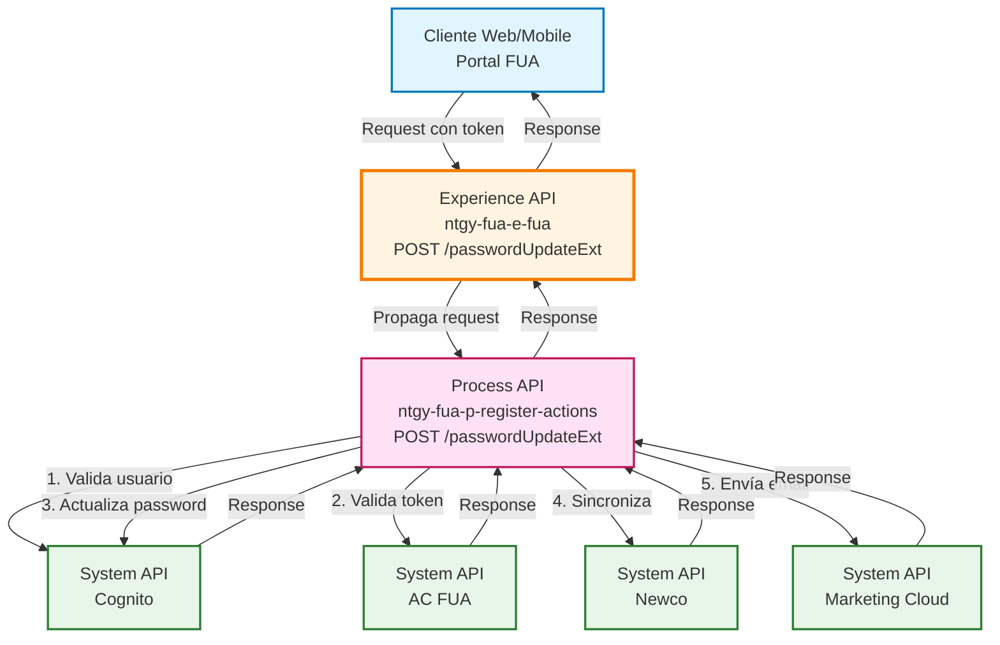
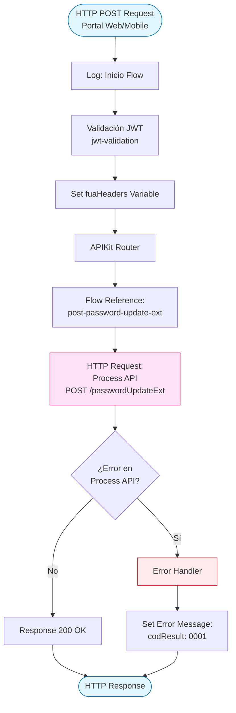
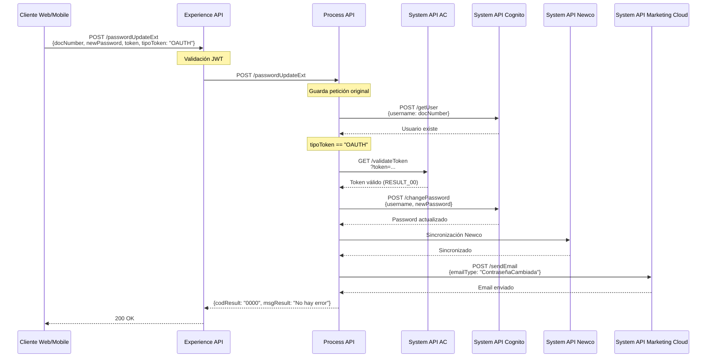
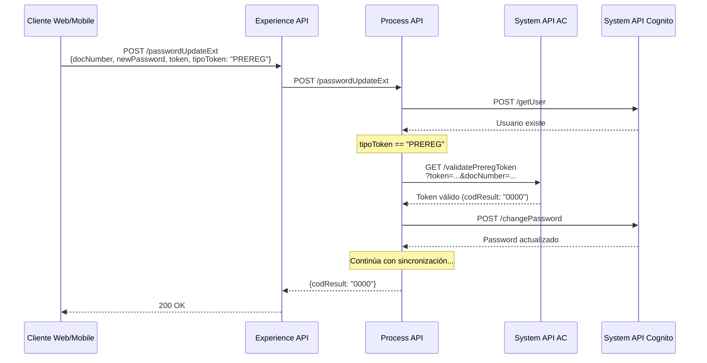
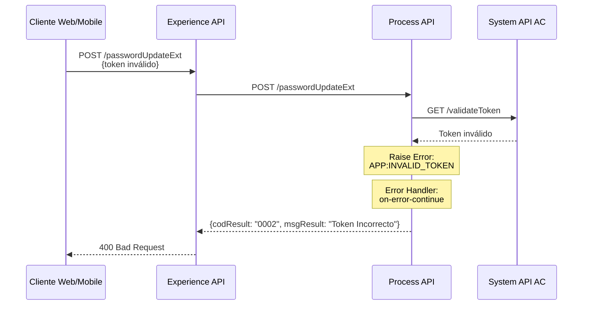
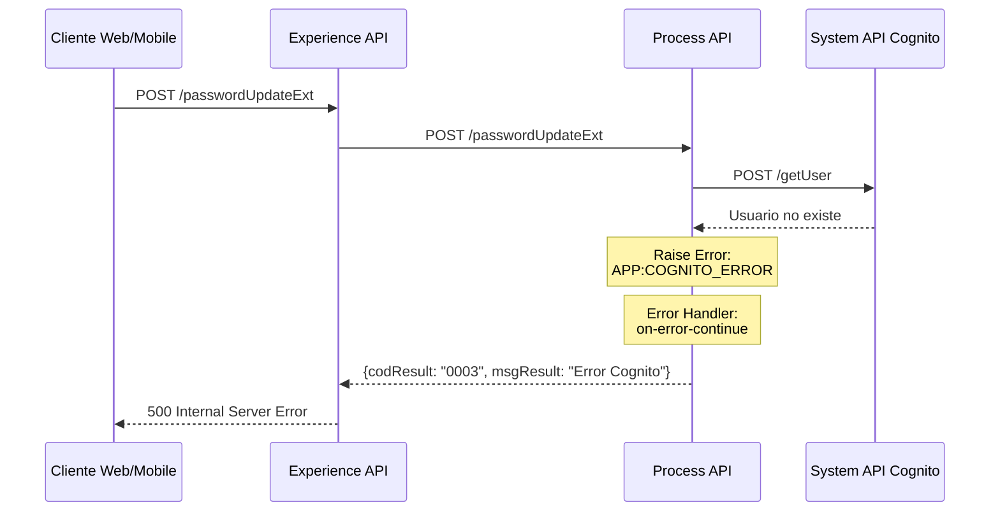
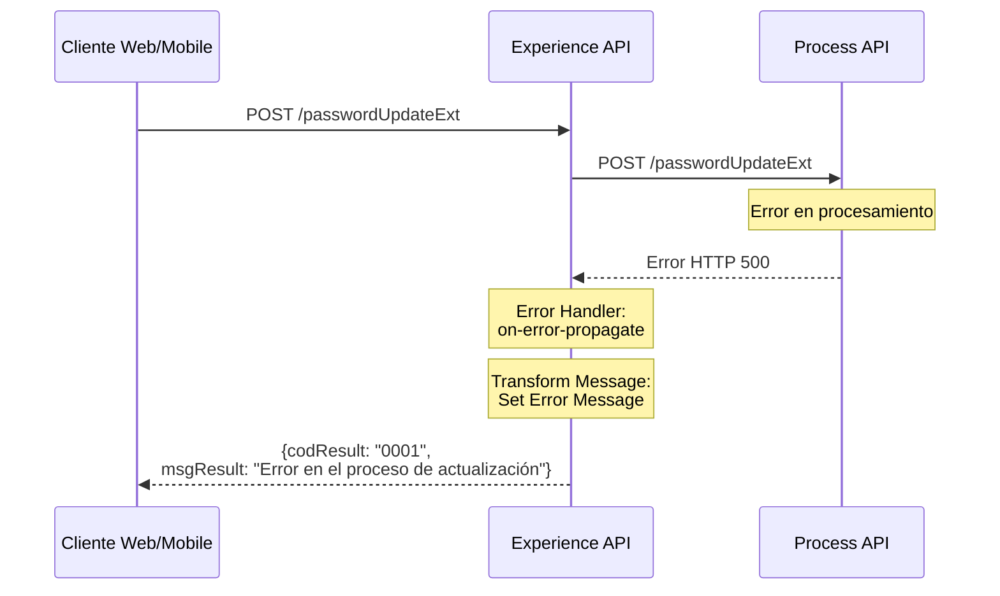

# POST /passwordUpdateExt

## 📌 Descripción General

### Propósito del Endpoint

Este endpoint permite a usuarios mixtos (Imperial/Newco) actualizar su contraseña de forma segura, validando previamente un token de autenticación (OAuth o Pre-registro) y sincronizando el cambio en múltiples sistemas (Cognito y Newco). Está diseñado específicamente para usuarios que necesitan mantener sincronizadas sus credenciales entre plataformas.

### Tipo de API

**Capa:** Experience API (API-Led Connectivity)

**Función:** Orquestación de cambio de contraseña con validación de seguridad y sincronización multi-sistema

### Patrón de Integración

**Tipo:** Pass-Through con Orquestación

**Descripción:** El Experience API actúa como punto de entrada único para el cambio de contraseña, delegando toda la lógica de validación, actualización y sincronización al Process API. No realiza transformaciones de datos, simplemente propaga la petición y respuesta.

### Arquitectura API-Led Connectivity



---

## 💼 Propósito del Negocio

### Casos de Uso Principales

1. **Cambio de Contraseña con Token OAuth**
   - Usuario autenticado desea cambiar su contraseña desde el portal web o app móvil
   - Se valida el token OAuth activo antes de permitir el cambio
   - Garantiza que solo usuarios autenticados puedan cambiar su contraseña

2. **Cambio de Contraseña con Token de Pre-registro**
   - Usuario en proceso de registro necesita establecer su contraseña
   - Se valida el token de pre-registro temporal
   - Permite completar el proceso de registro de forma segura

3. **Sincronización de Contraseña entre Sistemas**
   - Usuario mixto (con presencia en Imperial y Newco) cambia su contraseña
   - El sistema sincroniza automáticamente en Cognito y Newco
   - Garantiza experiencia unificada sin necesidad de múltiples cambios

### 📱 Canal y Audiencia

#### Canal de Consumo

**Canal:** Web y Mobile

**Características del Canal:**
- **Plataforma**: Portal FUA (Frontal Único de Atención) web y aplicaciones móviles iOS/Android
- **Dispositivos**: Navegadores web modernos, smartphones y tablets
- **Conectividad**: Requiere conexión a internet estable para validación de tokens
- **Experiencia de Usuario**: Formulario de cambio de contraseña con validación en tiempo real

#### Audiencia Objetivo

**Usuarios Finales:**
- **Clientes Residenciales**: Usuarios del portal de autoservicio que necesitan cambiar su contraseña
- **Clientes Empresariales**: Usuarios corporativos con acceso al portal de gestión
- **Usuarios en Registro**: Nuevos clientes completando el proceso de alta

**Contexto de Uso:**
- **Cambio de Contraseña Voluntario**: Usuario decide actualizar su contraseña por seguridad
- **Recuperación de Contraseña**: Usuario completa el proceso de recuperación estableciendo nueva contraseña
- **Finalización de Registro**: Nuevo usuario establece su contraseña inicial

#### Adaptaciones del Canal

**Optimizaciones Aplicadas:**
- **Simplificación de Datos**: Solo se requieren campos esenciales (docNumber, newPassword, token, tipoToken)
- **Formato de Respuesta**: Respuesta simple con código de resultado para fácil interpretación en UI
- **Validación de Seguridad**: Validación de token antes de permitir cambio
- **Feedback Inmediato**: Respuesta rápida con códigos de error específicos

### 🔗 Endpoints Dependientes

Este Experience API consume el siguiente Process API:

| Process API | Endpoint | Método | Propósito |
|-------------|----------|--------|-----------|
| `ntgy-fua-p-register-actions` | `/passwordUpdateExt` | POST | Orquestación del cambio de contraseña con validación de tokens y sincronización multi-sistema |

### Contexto Empresarial

- **Dominio:** Gestión de Usuarios y Autenticación
- **Sector:** Energía - Utilities
- **División:** Naturgy España - NewCo
- **Canal:** Web y Mobile (Portal FUA)

### Stakeholders

- **Clientes Finales**: Necesitan cambiar su contraseña de forma segura y sencilla
- **Equipo de Seguridad**: Requiere validación robusta de tokens antes de cambios de credenciales
- **Equipo de Soporte**: Necesita códigos de error claros para asistir a usuarios
- **Equipo de Desarrollo Frontend**: Requiere API simple y predecible para integración

### Valor de Negocio

- **Seguridad Mejorada**: Validación de tokens garantiza que solo usuarios autorizados cambien contraseñas
- **Experiencia Unificada**: Sincronización automática entre sistemas evita inconsistencias
- **Reducción de Soporte**: Proceso automatizado reduce llamadas al call center
- **Cumplimiento Normativo**: Implementa mejores prácticas de seguridad en gestión de credenciales

---

## 🔧 Especificación Técnica

### URLs por Ambiente

| Ambiente | URL Base | URL Completa |
|----------|----------|--------------|
| **Local** | `http://localhost:8081` | `http://localhost:8081/fua/api/passwordUpdateExt` |
| **Development** | `https://ntgy-fua-e-fua-dev.de-c1.cloudhub.io` | `https://ntgy-fua-e-fua-dev.de-c1.cloudhub.io/fua/api/passwordUpdateExt` |
| **Production** | `https://ntgy-fua-e-fua-pro.de-c1.cloudhub.io` | `https://ntgy-fua-e-fua-pro.de-c1.cloudhub.io/fua/api/passwordUpdateExt` |

### Método HTTP

```
POST /fua/api/passwordUpdateExt
```

### 🎯 Consideraciones del Canal

#### Limitaciones del Canal

| Aspecto | Limitación | Razón |
|---------|------------|-------|
| **Timeout** | 30 segundos | Tiempo suficiente para validación de token y actualización en múltiples sistemas |
| **Rate Limiting** | Según política de API Gateway | Prevención de ataques de fuerza bruta |
| **Tamaño de Request** | < 1 KB | Request contiene solo campos de texto simples |
| **Validación de Token** | Token debe ser válido y no expirado | Seguridad crítica para cambio de credenciales |

#### Campos Específicos del Canal

**Campos Requeridos por el Experience API:**

| Campo | Tipo | Descripción | Validación |
|-------|------|-------------|------------|
| `docNumber` | string | Número de documento del usuario | Obligatorio, formato DNI/NIE |
| `newPassword` | string | Nueva contraseña a establecer | Obligatorio, debe cumplir política de contraseñas |
| `token` | string | Token de autenticación (OAuth o Pre-registro) | Obligatorio, debe ser válido |
| `tipoToken` | string | Tipo de token: "OAUTH" o "PREREG" | Obligatorio, valores permitidos: OAUTH, PREREG |

### Parámetros de Entrada

#### Headers

| Header | Tipo | Obligatorio | Descripción |
|--------|------|-------------|-------------|
| `Content-Type` | string | Sí | Debe ser `application/json` |
| `x-client-id` | string | No | ID del cliente para trazabilidad |
| `x-interaction-id` | string | No | ID de interacción para correlación de logs |

#### Body (application/json)

```json
{
  "docNumber": "string",
  "newPassword": "string",
  "token": "string",
  "tipoToken": "string"
}
```

**Descripción de Campos:**

| Campo | Tipo | Obligatorio | Descripción | Ejemplo |
|-------|------|-------------|-------------|---------|
| `docNumber` | string | Sí | Número de documento del usuario (DNI/NIE) | "12345678A" |
| `newPassword` | string | Sí | Nueva contraseña (debe cumplir política de seguridad) | "NuevaPass123!" |
| `token` | string | Sí | Token de autenticación válido | "eyJhbGciOiJIUzI1NiIs..." |
| `tipoToken` | string | Sí | Tipo de token: "OAUTH" o "PREREG" | "OAUTH" |

### Respuestas

#### Respuesta Exitosa (200 OK)

```json
{
  "result": {
    "codResult": "0000",
    "msgResult": "No hay error"
  }
}
```

**Descripción de Campos:**

| Campo | Tipo | Descripción |
|-------|------|-------------|
| `result.codResult` | string | Código de resultado: "0000" indica éxito |
| `result.msgResult` | string | Mensaje descriptivo del resultado |

#### Respuestas de Error

**Error 400 - Tipo de Token Incorrecto**

```json
{
  "result": {
    "codResult": "0001",
    "msgResult": "Tipo Token Incorrecto"
  }
}
```

**Error 400 - Token Inválido**

```json
{
  "result": {
    "codResult": "0002",
    "msgResult": "Token Incorrecto"
  }
}
```

**Error 500 - Error en Cognito**

```json
{
  "result": {
    "codResult": "0003",
    "msgResult": "Error Cognito"
  }
}
```

**Error 500 - Error en Process API**

```json
{
  "result": {
    "codResult": "0001",
    "msgResult": "Error en el proceso de actualización"
  }
}
```

#### Códigos de Estado HTTP

| Código | Descripción | Cuándo Ocurre |
|--------|-------------|---------------|
| `200` | OK | Contraseña actualizada exitosamente |
| `400` | Bad Request | Token inválido o tipo de token incorrecto |
| `500` | Internal Server Error | Error en Cognito o en el proceso de actualización |

### Autenticación

- **Tipo:** Token-based (OAuth 2.0 o Token de Pre-registro)
- **Ubicación:** Body del request (campo `token`)
- **Validación:** El token se valida en el Process API antes de permitir el cambio de contraseña

### Timeouts

| Tipo | Valor | Razón |
|------|-------|-------|
| **Request Timeout** | 30 segundos | Tiempo suficiente para validación de token, actualización en Cognito, sincronización con Newco y envío de email |
| **Connection Timeout** | 30 segundos | Configurado en HTTP_API_ProcesoAccionesRegistro |

---

## 🏗️ Implementación Técnica

### Arquitectura del Flow



### Transformaciones de Canal

⚠️ **Este Experience API NO transforma la respuesta del Process API.**

**Patrón:** Pass-Through

El Experience API actúa como un proxy simple que:
1. Recibe el request del cliente
2. Valida el JWT (si está configurado)
3. Propaga el request al Process API sin modificaciones
4. Retorna la respuesta del Process API sin transformaciones

Para el schema completo y la lógica de negocio, consultar:
📖 **Process API: `ntgy-fua-p-register-actions` endpoint `/passwordUpdateExt`**

### Patrones de Diseño

**Patrón:** API Gateway con Pass-Through

**Justificación:** 
- El Experience API actúa como punto de entrada único para el canal web/mobile
- Toda la lógica de validación, orquestación y sincronización se delega al Process API
- Permite evolucionar la lógica de negocio sin afectar la interfaz del cliente
- Facilita la implementación de políticas de seguridad y rate limiting a nivel de gateway

### Diagramas de Secuencia

#### 1. Flujo Normal de Éxito (Token OAuth)



#### 2. Flujo con Token de Pre-registro



#### 3. Flujo con Error - Token Inválido



#### 4. Flujo con Error - Usuario No Existe en Cognito



#### 5. Flujo con Error en Process API



### Configuración del Conector HTTP

**Conector:** `HTTP_API_ProcesoAccionesRegistro`

**Configuración:**
```xml
<http:request-config 
    name="HTTP_API_ProcesoAccionesRegistro"
    basePath="/api"
    responseTimeout="${p-register-actions.timeout}">
    <http:request-connection 
        host="${p-register-actions.host}"
        port="${p-register-actions.port}"
        connectionIdleTimeout="${p-register-actions.timeout}" />
</http:request-config>
```

**Propiedades (Producción):**
- **Host:** `mule-worker-internal-ntgy-fua-p-register-actions.de-c1.cloudhub.io`
- **Port:** `8091`
- **Timeout:** `30000` ms (30 segundos)
- **Base Path:** `/api`

### Manejo de Errores

#### Error Handler del Experience API

El Experience API implementa un error handler simple que captura errores del Process API:

```xml
<error-handler>
    <on-error-propagate type="ANY">
        <logger level="INFO" message="Error en la llamada a api proceso"/>
        <ee:transform doc:name="Set Error Message">
            <ee:set-payload>
                {
                    "result": {
                        "codResult": "0001",
                        "msgResult": "Error en el proceso de actualización"
                    }
                }
            </ee:set-payload>
        </ee:transform>
    </on-error-propagate>
</error-handler>
```

#### Tipos de Errores Manejados

| Tipo de Error | Código | Mensaje | HTTP Status |
|---------------|--------|---------|-------------|
| Tipo de token incorrecto | 0001 | Tipo Token Incorrecto | 400 |
| Token inválido | 0002 | Token Incorrecto | 400 |
| Error en Cognito | 0003 | Error Cognito | 500 |
| Error genérico en Process API | 0001 | Error en el proceso de actualización | 500 |

**Nota:** Los errores específicos (0001, 0002, 0003) son manejados por el Process API. El Experience API solo captura errores de comunicación con el Process API.

### Validación de Seguridad

#### Validación JWT (jwt-validation)

Antes de procesar el request, el Experience API ejecuta un flow de validación JWT:

```xml
<flow-ref doc:name="jwt-validation" name="jwt-validation" />
```

Este flow valida:
- Token JWT válido en headers
- Token no expirado
- Permisos adecuados para el endpoint

#### Headers de Contexto (fuaHeaders)

El Experience API extrae y propaga headers de contexto al Process API:

```dataweave
{
    ("x-interaction-id": attributes.headers['x-interaction-id']),
    ("x-interaction-origin": attributes.headers['x-interaction-origin']),
    ("x-user-id": attributes.headers['x-user-id']),
    ("x-client-id": attributes.headers['x-client-id']),
    ("x-client-doc-number": attributes.headers['x-client-doc-number']),
    ("x-client-code": attributes.headers['x-client-code']),
    ("x-origin": attributes.headers['x-origin']),
    ("x-user-role": attributes.headers['x-user-role']),
    ("traceparent": attributes.headers['traceparent']),
    ("x-agent-mail": attributes.headers['x-agent-mail']),
    ("x-language": attributes.headers['x-language']),
    ("x-contact-id": attributes.headers['x-contact-id'])
}
```

Estos headers permiten:
- Trazabilidad de requests
- Correlación de logs
- Identificación de usuario y cliente
- Soporte multiidioma

---

## 💻 Ejemplos de Uso

### Ejemplo 1: Cambio de Contraseña con Token OAuth

#### Request

```bash
curl -X POST "https://ntgy-fua-e-fua-pro.de-c1.cloudhub.io/fua/api/passwordUpdateExt" \
  -H "Content-Type: application/json" \
  -H "x-client-id: web-portal" \
  -H "x-interaction-id: 12345-67890-abcde" \
  -d '{
    "docNumber": "12345678A",
    "newPassword": "NuevaPass123!",
    "token": "eyJhbGciOiJIUzI1NiIsInR5cCI6IkpXVCJ9...",
    "tipoToken": "OAUTH"
  }'
```

#### Response (200 OK)

```json
{
  "result": {
    "codResult": "0000",
    "msgResult": "No hay error"
  }
}
```

**Descripción:** El usuario autenticado con token OAuth cambia exitosamente su contraseña. El sistema valida el token, actualiza la contraseña en Cognito, sincroniza con Newco y envía un email de confirmación.

---

### Ejemplo 2: Cambio de Contraseña con Token de Pre-registro

#### Request

```bash
curl -X POST "https://ntgy-fua-e-fua-pro.de-c1.cloudhub.io/fua/api/passwordUpdateExt" \
  -H "Content-Type: application/json" \
  -H "x-client-id: mobile-app" \
  -d '{
    "docNumber": "98765432B",
    "newPassword": "MiPassword456!",
    "token": "prereg-token-abc123xyz",
    "tipoToken": "PREREG"
  }'
```

#### Response (200 OK)

```json
{
  "result": {
    "codResult": "0000",
    "msgResult": "No hay error"
  }
}
```

**Descripción:** Usuario en proceso de registro establece su contraseña inicial usando un token de pre-registro temporal.

---

### Ejemplo 3: Error - Tipo de Token Incorrecto

#### Request

```bash
curl -X POST "https://ntgy-fua-e-fua-pro.de-c1.cloudhub.io/fua/api/passwordUpdateExt" \
  -H "Content-Type: application/json" \
  -d '{
    "docNumber": "12345678A",
    "newPassword": "NuevaPass123!",
    "token": "some-token",
    "tipoToken": "INVALID_TYPE"
  }'
```

#### Response (400 Bad Request)

```json
{
  "result": {
    "codResult": "0001",
    "msgResult": "Tipo Token Incorrecto"
  }
}
```

**Descripción:** El tipo de token proporcionado no es válido. Solo se aceptan "OAUTH" o "PREREG".

---

### Ejemplo 4: Error - Token Inválido

#### Request

```bash
curl -X POST "https://ntgy-fua-e-fua-pro.de-c1.cloudhub.io/fua/api/passwordUpdateExt" \
  -H "Content-Type: application/json" \
  -d '{
    "docNumber": "12345678A",
    "newPassword": "NuevaPass123!",
    "token": "expired-or-invalid-token",
    "tipoToken": "OAUTH"
  }'
```

#### Response (400 Bad Request)

```json
{
  "result": {
    "codResult": "0002",
    "msgResult": "Token Incorrecto"
  }
}
```

**Descripción:** El token proporcionado es inválido o ha expirado. El usuario debe autenticarse nuevamente.

---

### Ejemplo 5: Error - Usuario No Existe en Cognito

#### Request

```bash
curl -X POST "https://ntgy-fua-e-fua-pro.de-c1.cloudhub.io/fua/api/passwordUpdateExt" \
  -H "Content-Type: application/json" \
  -d '{
    "docNumber": "99999999Z",
    "newPassword": "NuevaPass123!",
    "token": "valid-token",
    "tipoToken": "OAUTH"
  }'
```

#### Response (500 Internal Server Error)

```json
{
  "result": {
    "codResult": "0003",
    "msgResult": "Error Cognito"
  }
}
```

**Descripción:** El usuario no existe en Cognito o hubo un error al consultar/actualizar el usuario.

---

### Ejemplo 6: JavaScript (Frontend Web)

```javascript
async function cambiarContrasena(docNumber, newPassword, token, tipoToken) {
  try {
    const response = await fetch('https://ntgy-fua-e-fua-pro.de-c1.cloudhub.io/fua/api/passwordUpdateExt', {
      method: 'POST',
      headers: {
        'Content-Type': 'application/json',
        'x-client-id': 'web-portal',
        'x-interaction-id': generateInteractionId()
      },
      body: JSON.stringify({
        docNumber,
        newPassword,
        token,
        tipoToken
      })
    });

    const data = await response.json();

    if (data.result.codResult === '0000') {
      console.log('Contraseña actualizada exitosamente');
      return { success: true, message: 'Contraseña actualizada' };
    } else {
      console.error('Error al actualizar contraseña:', data.result.msgResult);
      return { success: false, message: data.result.msgResult };
    }
  } catch (error) {
    console.error('Error de red:', error);
    return { success: false, message: 'Error de conexión' };
  }
}

function generateInteractionId() {
  return `${Date.now()}-${Math.random().toString(36).substr(2, 9)}`;
}

// Uso
cambiarContrasena('12345678A', 'NuevaPass123!', 'oauth-token', 'OAUTH')
  .then(result => {
    if (result.success) {
      alert('Contraseña actualizada correctamente');
    } else {
      alert(`Error: ${result.message}`);
    }
  });
```

---

### Ejemplo 7: Python (Testing/Automation)

```python
import requests
import json
from datetime import datetime

def cambiar