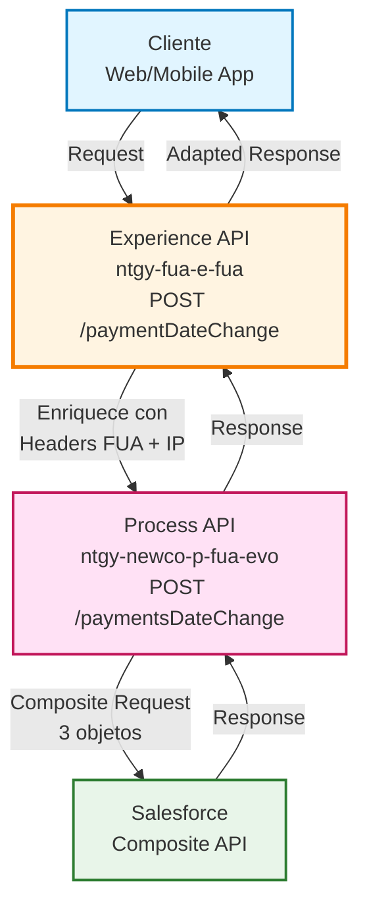
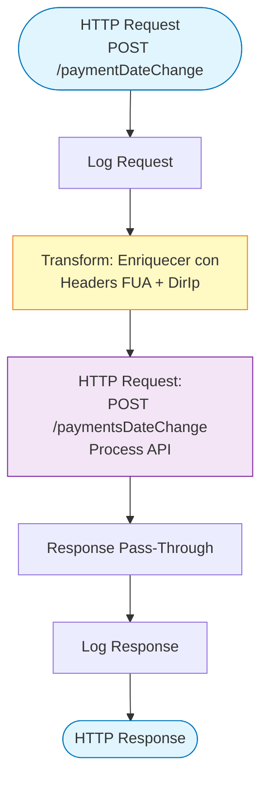
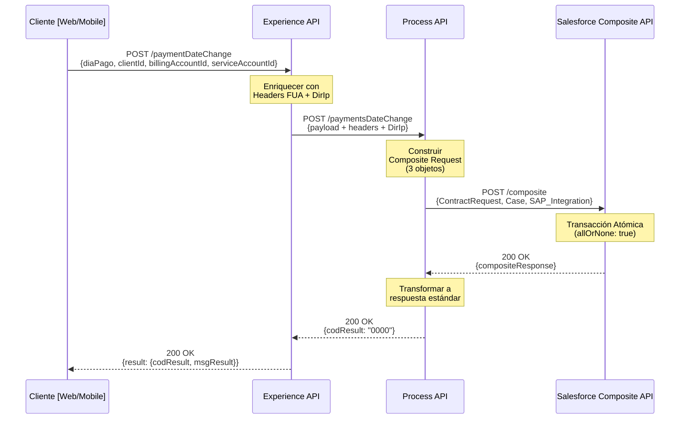
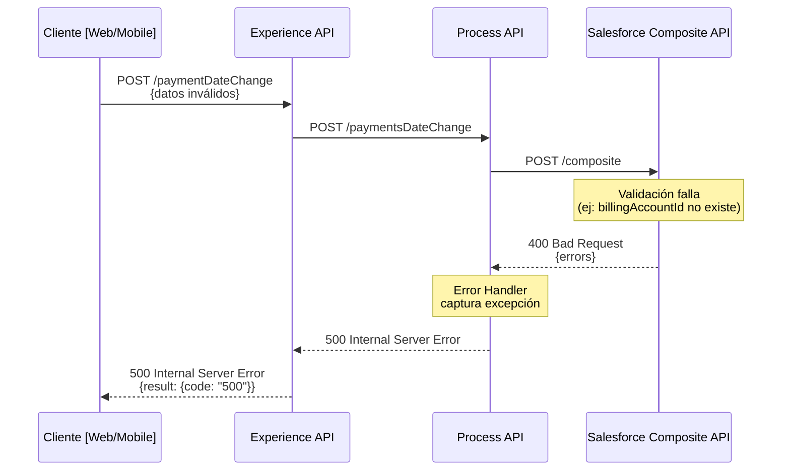
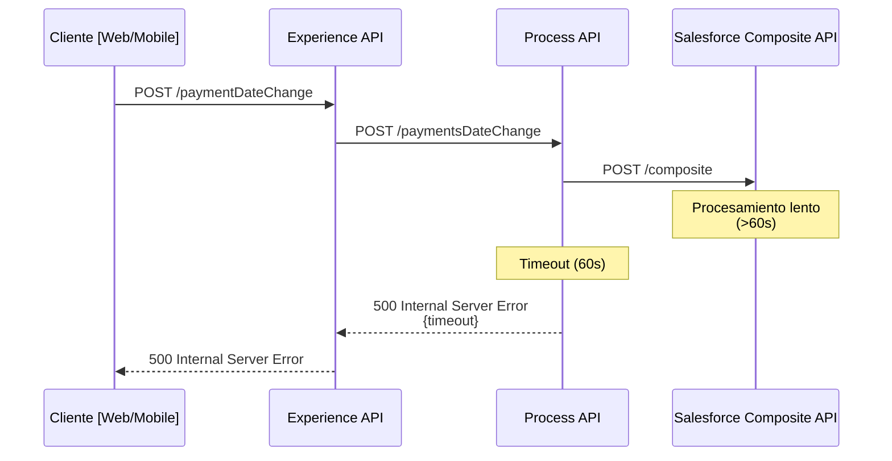

# POST /paymentDateChange

## 📌 Descripción General

### Propósito del Endpoint

Este endpoint permite a los clientes cambiar el día fijo de pago de su cuenta de facturación. El proceso crea una solicitud de contratación (ContractRequest), un caso de gestión (Case) y un registro de integración SAP en Salesforce mediante una única transacción atómica usando el Composite API.

### Tipo de API

**Capa:** Experience API (API-Led Connectivity)

**Función:** Adaptación de experiencia para canales web y móvil, enriqueciendo la petición con información de contexto (headers FUA, dirección IP) antes de delegar al Process API.

### Patrón de Integración

**Tipo:** Pass-Through con Enriquecimiento de Datos

**Descripción:** El Experience API enriquece el payload con headers FUA y la dirección IP del cliente, luego delega la lógica de negocio al Process API que orquesta la creación de múltiples objetos en Salesforce mediante Composite API.

### Arquitectura API-Led Connectivity



---

## 💼 Propósito del Negocio

### Casos de Uso Principales

1. **Cambio de Fecha de Pago por Cliente**
   - Cliente solicita cambiar el día del mes en que se realiza el cargo de su factura
   - Mejora la gestión de flujo de caja del cliente
   - Reduce incidencias de impagos por desajustes de fechas

2. **Cambio de Fecha de Pago por Agente**
   - Agente de atención al cliente realiza el cambio en nombre del cliente
   - Agiliza la resolución de solicitudes telefónicas
   - Mejora la experiencia del cliente en el call center

3. **Registro de Auditoría**
   - Cada cambio queda registrado con trazabilidad completa
   - Se registra quién realizó el cambio (cliente o agente)
   - Se captura la IP de origen para seguridad

### 📱 Canal y Audiencia

#### Canal de Consumo

**Canal:** Web / Mobile

**Características del Canal:**
- **Plataforma**: Portal FUA (Frontal Único de Atención) y aplicaciones móviles
- **Dispositivos**: Navegadores web modernos, iOS, Android
- **Conectividad**: Requiere conexión estable para transacción en Salesforce
- **Experiencia de Usuario**: Proceso simple de un solo paso con confirmación inmediata

#### Audiencia Objetivo

**Usuarios Finales:**
- **Clientes Residenciales**: Necesitan ajustar fecha de pago a su calendario de ingresos
- **Clientes Empresariales**: Requieren sincronizar pagos con ciclos de facturación internos
- **Agentes de Call Center**: Realizan cambios en nombre de clientes durante llamadas

**Contexto de Uso:**
- **Autoservicio Web/Móvil**: Cliente realiza el cambio de forma autónoma
- **Asistencia Telefónica**: Agente realiza el cambio durante la llamada con el cliente

#### Adaptaciones del Canal

**Optimizaciones Aplicadas:**
- **Enriquecimiento de Contexto**: Añade headers FUA (x-user-id, x-client-id, x-contact-id, x-interaction-id, x-agent-mail)
- **Captura de IP**: Registra la dirección IP del cliente para auditoría
- **Simplificación de Respuesta**: Devuelve respuesta simple de éxito/error
- **Transacción Atómica**: Usa Composite API para garantizar consistencia (todo o nada)

### 🔗 Endpoints Dependientes

Este Experience API consume el siguiente Process API:

| Process API | Endpoint | Método | Propósito |
|-------------|----------|--------|-----------|
| `ntgy-newco-p-fua-evo` | `/paymentsDateChange` | POST | Orquesta la creación de solicitud de contratación, caso de gestión e integración SAP en Salesforce mediante Composite API |

**Objetos Salesforce Creados (vía Composite API):**
1. **acn_obj_ContractRequest__c**: Solicitud de cambio de día de pago
2. **Case**: Caso de gestión para seguimiento
3. **NewCo_SAP_Integration__c**: Registro de evento para integración con SAP

### Contexto Empresarial

- **Dominio:** Gestión de Pagos y Facturación
- **Sector:** Energía - Utilities
- **División:** Naturgy España - NewCo
- **Canal:** Web/Móvil

### Stakeholders

- **Clientes Finales**: Necesitan flexibilidad en la gestión de sus pagos
- **Agentes de Atención al Cliente**: Requieren herramientas para resolver solicitudes rápidamente
- **Departamento de Facturación**: Necesita trazabilidad de cambios en condiciones de pago
- **Equipo de Integración SAP**: Requiere notificación de cambios para sincronización

### Valor de Negocio

- **Reducción de Impagos**: Permite a clientes ajustar fechas de pago a su flujo de caja
- **Mejora de Experiencia**: Autoservicio reduce necesidad de llamadas al call center
- **Eficiencia Operativa**: Proceso automatizado reduce intervención manual
- **Trazabilidad Completa**: Auditoría de todos los cambios con información de contexto
- **Consistencia de Datos**: Transacción atómica garantiza integridad en Salesforce

---

## 🔧 Especificación Técnica

### URLs por Ambiente

| Ambiente | URL Base | URL Completa |
|----------|----------|--------------|
| **Local** | `http://localhost:8081` | `http://localhost:8081/fua/api/paymentDateChange` |
| **Development** | `https://ntgy-fua-e-fua-dev.de-c1.cloudhub.io` | `https://ntgy-fua-e-fua-dev.de-c1.cloudhub.io/fua/api/paymentDateChange` |
| **Production** | `https://ntgy-fua-e-fua-pro.de-c1.cloudhub.io` | `https://ntgy-fua-e-fua-pro.de-c1.cloudhub.io/fua/api/paymentDateChange` |

### Método HTTP

```
POST /fua/api/paymentDateChange
```

### 🎯 Consideraciones del Canal

#### Limitaciones del Canal

| Aspecto | Limitación | Razón |
|---------|------------|-------|
| **Timeout** | 60 segundos | Tiempo necesario para transacción Composite en Salesforce |
| **Rate Limiting** | Según políticas de API Gateway | Protección contra abuso |
| **Transaccionalidad** | Atómica (todo o nada) | Composite API garantiza consistencia |

#### Campos Específicos del Canal

**Campos Añadidos por el Experience API:**

| Campo | Tipo | Descripción | Razón |
|-------|------|-------------|-------|
| `DirIp` | string | Dirección IP del cliente | Auditoría y seguridad |
| `x-user-id` | string (header) | ID del usuario autenticado | Trazabilidad de quién realiza el cambio |
| `x-client-id` | string (header) | ID del cliente (Account) | Asociación con cuenta Salesforce |
| `x-contact-id` | string (header) | ID del contacto | Identificación del contacto en Salesforce |
| `x-interaction-id` | string (header) | ID de interacción (opcional) | Vinculación con caso padre si existe |
| `x-agent-mail` | string (header) | Email del agente (opcional) | Identificación del agente en cambios asistidos |

### Parámetros de Entrada

#### Headers Requeridos

| Header | Tipo | Requerido | Descripción |
|--------|------|-----------|-------------|
| `Content-Type` | string | Sí | Debe ser `application/json` |
| `x-user-id` | string | Condicional | ID del usuario (requerido si no es agente) |
| `x-client-id` | string | Sí | ID del cliente (Account en Salesforce) |
| `x-contact-id` | string | Sí | ID del contacto en Salesforce |
| `x-interaction-id` | string | No | ID de interacción para vincular con caso padre |
| `x-agent-mail` | string | No | Email del agente (si es cambio asistido) |

#### Body Parameters

| Campo | Tipo | Requerido | Descripción | Validaciones |
|-------|------|-----------|-------------|--------------|
| `diaPago` | string | Sí | Día del mes para realizar el pago | Valores válidos: "1" a "31" |
| `clientId` | string | Sí | Identificador del cliente | Debe existir en el sistema |
| `billingAccountId` | string | Sí | ID de la cuenta de facturación | Debe existir en Salesforce |
| `serviceAccountId` | string | Sí | ID de la cuenta de servicio | Debe existir en Salesforce |

#### Ejemplo de Request

```json
{
  "diaPago": "15",
  "clientId": "0015I00000ABC123",
  "billingAccountId": "BA-12345",
  "serviceAccountId": "SA-67890"
}
```

### Respuestas

#### 200 OK - Éxito

**Descripción:** El cambio de fecha de pago se procesó correctamente. Se crearon los objetos en Salesforce.

**Body:**

```json
{
  "result": {
    "codResult": "0000",
    "msgResult": "Ejecución correcta"
  }
}
```

#### 500 Internal Server Error

**Descripción:** Error en el procesamiento de la solicitud. Puede ser por fallo en Salesforce o error de validación.

**Body:**

```json
{
  "result": {
    "code": "500",
    "message": "Internal server error",
    "level": "ERROR"
  }
}
```

**Causas Comunes:**
- Fallo en la transacción Composite de Salesforce
- Datos inválidos (billingAccountId o serviceAccountId no existen)
- Timeout en la comunicación con Salesforce
- Error de autenticación con Salesforce

### Autenticación

- **Tipo:** OAuth 2.0 (gestionado por API Gateway)
- **Headers Adicionales:** Headers FUA para contexto de usuario

### Timeouts

| Tipo | Valor | Razón |
|------|-------|-------|
| **Experience API → Process API** | 60 segundos | Tiempo para transacción Composite en Salesforce |
| **Process API → Salesforce** | 60 segundos | Tiempo para ejecutar Composite API (3 objetos) |

---

## 🏗️ Implementación Técnica

### Arquitectura del Flow



### Transformaciones de Canal

#### Transformación de Enriquecimiento (Experience API)

**Archivo:** `post-payment-dateChangeFlow.xml` (inline)

**Lógica:**

```dataweave
%dw 2.0
import * from dw::core::Strings
output application/json
---
payload
++
vars.fuaHeaders 
++ 
{
    "DirIp": substringBefore(substringAfter(attributes.remoteAddress,"/"),":")
}
```

**Campos Añadidos:**
- `DirIp`: Dirección IP extraída de `attributes.remoteAddress`
- Headers FUA: `x-user-id`, `x-client-id`, `x-contact-id`, `x-interaction-id`, `x-agent-mail`

#### Transformación en Process API

**Archivo:** `paymentsDateChange.xml` (inline)

**Crea Composite Request con 3 objetos:**

1. **acn_obj_ContractRequest__c** (Solicitud de Contratación):
```dataweave
{
  "NewCo_BillingAccount__c": payload.billingAccountId,
  "NewCo_ServiceAccount__c": payload.serviceAccountId,
  "NewCo_Recordtype__c": "acn_rt_Without_Switching",
  "acn_fld_Sctype__c": "03",
  "acn_fld_Category__c": "58",
  "NewCo_DiaFijodePago__c": payload.diaPago,
  "acn_fld_Status__c": "06",
  "NewCo_Creado_por__c": if(payload.'x-user-id' != null) 
                          payload.'x-user-id' 
                          else payload.clientId
}
```

2. **Case** (Caso de Gestión):
```dataweave
{
  "NewCo_Recordtype__c": "Gestion",
  "AccountId": payload.'x-client-id',
  "ContactId": payload.'x-contact-id',
  "Status": "06",
  "Priority": "02",
  "Origin": "FUA",
  ("OwnerId": payload."x-user-id") if(!isEmpty(payload."x-user-id")),
  ("ParentId": payload."x-interaction-id") if(payload."x-interaction-id"?),
  "vlocity_cmt__ServiceAccountId__c": payload.serviceAccountId,
  "vlocity_cmt__BillingAccountId__c": payload.billingAccountId,
  "acn_fld_Tittle__r": {
    "NewCo_ExternalId__c": "DiaFijoPagoCambiado"
  },
  "Subject": "Cambio de día fijo de pago",
  "Description": "Cambio de día fijo de pago",
  "acn_fld_ContractRequest__c": "@{refSolContratacion.id}",
  "NewCo_Creado_por__c": if(payload.'x-user-id' != null) 
                          payload.'x-user-id' 
                          else payload.'x-contact-id',
  "NewCo_Ip__c": payload.DirIp,
  "NewCo_CorrelationId__c": correlationId
}
```

3. **NewCo_SAP_Integration__c** (Integración SAP):
```dataweave
{
  "NewCo_fld_EventName__c": "MetodoPagoDiaFijoPagoCambiado",
  "NewCo_fld_Account__c": payload.'x-client-id',
  "NewCo_BillingAccount__c": payload.billingAccountId
}
```

### Patrones de Diseño

**Patrón:** Composite API Pattern + Enrichment Pattern

**Justificación:** 
- **Composite API**: Permite crear múltiples objetos relacionados en una sola transacción atómica
- **Enrichment**: Experience API añade contexto de canal (IP, headers FUA) sin modificar la lógica de negocio
- **Transaccionalidad**: `"allOrNone": true` garantiza que todos los objetos se crean o ninguno

### Diagramas de Secuencia

#### 1. Flujo Normal de Éxito



#### 2. Flujo con Error de Negocio



#### 3. Flujo con Timeout



### Objetos Salesforce Creados

#### 1. acn_obj_ContractRequest__c (Solicitud de Contratación)

| Campo | Valor | Descripción |
|-------|-------|-------------|
| `NewCo_BillingAccount__c` | `{billingAccountId}` | Referencia a cuenta de facturación |
| `NewCo_ServiceAccount__c` | `{serviceAccountId}` | Referencia a cuenta de servicio |
| `NewCo_Recordtype__c` | `"acn_rt_Without_Switching"` | Tipo de registro (sin switching) |
| `acn_fld_Sctype__c` | `"03"` | Tipo de solicitud |
| `acn_fld_Category__c` | `"58"` | Categoría: Cambio de día de pago |
| `NewCo_DiaFijodePago__c` | `{diaPago}` | **Nuevo día de pago** |
| `acn_fld_Status__c` | `"06"` | Estado: Procesado |
| `NewCo_Creado_por__c` | `{x-user-id o clientId}` | Quién creó la solicitud |

#### 2. Case (Caso de Gestión)

| Campo | Valor | Descripción |
|-------|-------|-------------|
| `NewCo_Recordtype__c` | `"Gestion"` | Tipo de caso |
| `AccountId` | `{x-client-id}` | Cliente asociado |
| `ContactId` | `{x-contact-id}` | Contacto asociado |
| `Status` | `"06"` | Estado del caso |
| `Priority` | `"02"` | Prioridad |
| `Origin` | `"FUA"` | Origen: Portal FUA |
| `Subject` | `"Cambio de día fijo de pago"` | Asunto del caso |
| `acn_fld_ContractRequest__c` | `@{refSolContratacion.id}` | Referencia a solicitud creada |
| `NewCo_Ip__c` | `{DirIp}` | IP del cliente |
| `NewCo_CorrelationId__c` | `{correlationId}` | ID de correlación |

#### 3. NewCo_SAP_Integration__c (Integración SAP)

| Campo | Valor | Descripción |
|-------|-------|-------------|
| `NewCo_fld_EventName__c` | `"MetodoPagoDiaFijoPagoCambiado"` | Nombre del evento |
| `NewCo_fld_Account__c` | `{x-client-id}` | Cliente asociado |
| `NewCo_BillingAccount__c` | `{billingAccountId}` | Cuenta de facturación |

### Manejo de Errores

**Error Handler en Process API:**

```xml
<error-handler>
    <on-error-continue>
        <raise-error type="NTGY: INTERNAL-SERVER-ERROR" 
                     description="Internal server error"/>
    </on-error-continue>
</error-handler>
```

**Estrategia:**
- Cualquier error en Salesforce se captura y se convierte en error 500
- La transacción Composite garantiza rollback automático si falla algún objeto
- Se registra el error en logs para troubleshooting

---

## 💻 Ejemplos de Uso

### Ejemplo 1: Cambio de Fecha de Pago por Cliente (Web)

#### cURL

```bash
curl -X POST "https://ntgy-fua-e-fua-pro.de-c1.cloudhub.io/fua/api/paymentDateChange" \
  -H "Content-Type: application/json" \
  -H "x-user-id: 0055I000000ABC123" \
  -H "x-client-id: 0015I000000XYZ789" \
  -H "x-contact-id: 0035I000000DEF456" \
  -H "Authorization: Bearer YOUR_ACCESS_TOKEN" \
  -d '{
    "diaPago": "15",
    "clientId": "0015I000000XYZ789",
    "billingAccountId": "BA-12345",
    "serviceAccountId": "SA-67890"
  }'
```

#### Respuesta (200 OK)

```json
{
  "result": {
    "codResult": "0000",
    "msgResult": "Ejecución correcta"
  }
}
```

### Ejemplo 2: Cambio de Fecha de Pago por Agente (Call Center)

#### cURL

```bash
curl -X POST "https://ntgy-fua-e-fua-pro.de-c1.cloudhub.io/fua/api/paymentDateChange" \
  -H "Content-Type: application/json" \
  -H "x-client-id: 0015I000000XYZ789" \
  -H "x-contact-id: 0035I000000DEF456" \
  -H "x-agent-mail: agente@naturgy.com" \
  -H "x-interaction-id: INT-98765" \
  -H "Authorization: Bearer YOUR_ACCESS_TOKEN" \
  -d '{
    "diaPago": "5",
    "clientId": "0015I000000XYZ789",
    "billingAccountId": "BA-12345",
    "serviceAccountId": "SA-67890"
  }'
```

#### Respuesta (200 OK)

```json
{
  "result": {
    "codResult": "0000",
    "msgResult": "Ejecución correcta"
  }
}
```

**Nota:** En este caso, el agente realiza el cambio y se vincula con una interacción existente (x-interaction-id).

### Ejemplo 3: JavaScript (React/Angular)

```javascript
const changePaymentDate = async (paymentData, userContext) => {
  try {
    const response = await fetch(
      'https://ntgy-fua-e-fua-pro.de-c1.cloudhub.io/fua/api/paymentDateChange',
      {
        method: 'POST',
        headers: {
          'Content-Type': 'application/json',
          'x-user-id': userContext.userId,
          'x-client-id': userContext.clientId,
          'x-contact-id': userContext.contactId,
          'Authorization': `Bearer ${userContext.accessToken}`
        },
        body: JSON.stringify({
          diaPago: paymentData.newPaymentDay,
          clientId: userContext.clientId,
          billingAccountId: paymentData.billingAccountId,
          serviceAccountId: paymentData.serviceAccountId
        })
      }
    );

    const result = await response.json();
    
    if (result.result.codResult === '0000') {
      console.log('Fecha de pago actualizada correctamente');
      return { success: true, data: result };
    } else {
      console.error('Error al actualizar fecha de pago:', result);
      return { success: false, error: result };
    }
  } catch (error) {
    console.error('Error de red:', error);
    return { success: false, error: error.message };
  }
};

// Uso
const userContext = {
  userId: '0055I000000ABC123',
  clientId: '0015I000000XYZ789',
  contactId: '0035I000000DEF456',
  accessToken: 'your_access_token'
};

const paymentData = {
  newPaymentDay: '15',
  billingAccountId: 'BA-12345',
  serviceAccountId: 'SA-67890'
};

changePaymentDate(paymentData, userContext);
```

### Ejemplo 4: Error - Cuenta de Facturación No Existe

#### Request

```bash
curl -X POST "https://ntgy-fua-e-fua-pro.de-c1.cloudhub.io/fua/api/paymentDateChange" \
  -H "Content-Type: application/json" \
  -H "x-user-id: 0055I000000ABC123" \
  -H "x-client-id: 0015I000000XYZ789" \
  -H "x-contact-id: 0035I000000DEF456" \
  -H "Authorization: Bearer YOUR_ACCESS_TOKEN" \
  -d '{
    "diaPago": "15",
    "clientId": "0015I000000XYZ789",
    "billingAccountId": "BA-INVALID",
    "serviceAccountId": "SA-67890"
  }'
```

#### Respuesta (500 Internal Server Error)

```json
{
  "result": {
    "code": "500",
    "message": "Internal server error",
    "level": "ERROR"
  }
}
```

### Ejemplo 5: Python

```python
import requests
import json

def change_payment_date(payment_data, user_context):
    """
    Cambia la fecha de pago de una cuenta de facturación
    
    Args:
        payment_data: Dict con diaPago, billingAccountId, serviceAccountId
        user_context: Dict con userId, clientId, contactId, accessToken
    
    Returns:
        Dict con resultado de la operación
    """
    url = "https://ntgy-fua-e-fua-pro.de-c1.cloudhub.io/fua/api/paymentDateChange"
    
    headers = {
        "Content-Type": "application/json",
        "x-user-id": user_context["userId"],
        "x-client-id": user_context["clientId"],
        "x-contact-id": user_context["contactId"],
        "Authorization": f"Bearer {user_context['accessToken']}"
    }
    
    payload = {
        "diaPago": payment_data["newPaymentDay"],
        "clientId": user_context["clientId"],
        "billingAccountId": payment_data["billingAccountId"],
        "serviceAccountId": payment_data["serviceAccountId"]
    }
    
    try:
        response = requests.post(url, headers=headers, json=payload, timeout=60)
        result = response.json()
        
        if response.status_code == 200 and result["result"]["codResult"] == "0000":
            print("✅ Fecha de pago actualizada correctamente")
            return {"success": True, "data": result}
        else:
            print(f"❌ Error al actualizar fecha de pago: {result}")
            return {"success": False, "error": result}
    
    except requests.exceptions.Timeout:
        print("❌ Timeout en la solicitud")
        return {"success": False, "error": "Timeout"}
    except Exception as e:
        print(f"❌ Error: {str(e)}")
        return {"success": False, "error": str(e)}

# Uso
user_context = {
    "userId": "0055I000000ABC123",
    "clientId": "0015I000000XYZ789",
    "contactId": "0035I000000DEF456",
    "accessToken": "your_access_token"
}

payment_data = {
    "newPaymentDay": "15",
    "billingAccountId": "BA-12345",
    "serviceAccountId": "SA-67890"
}

result = change_payment_date(payment_data, user_context)
print(result)
```
