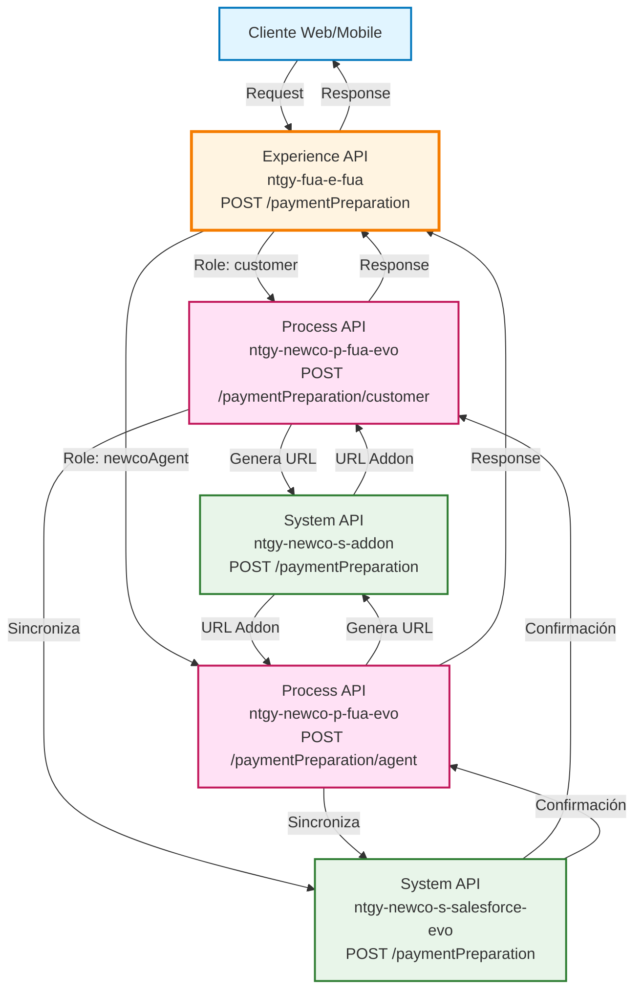
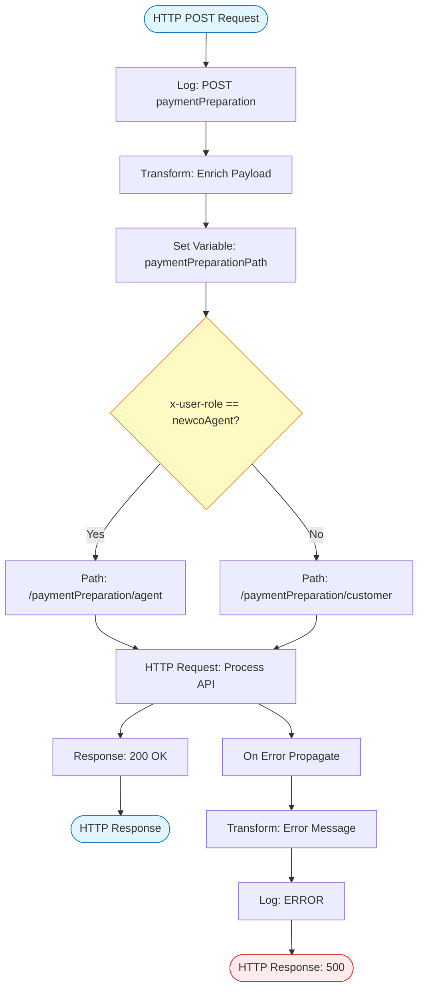
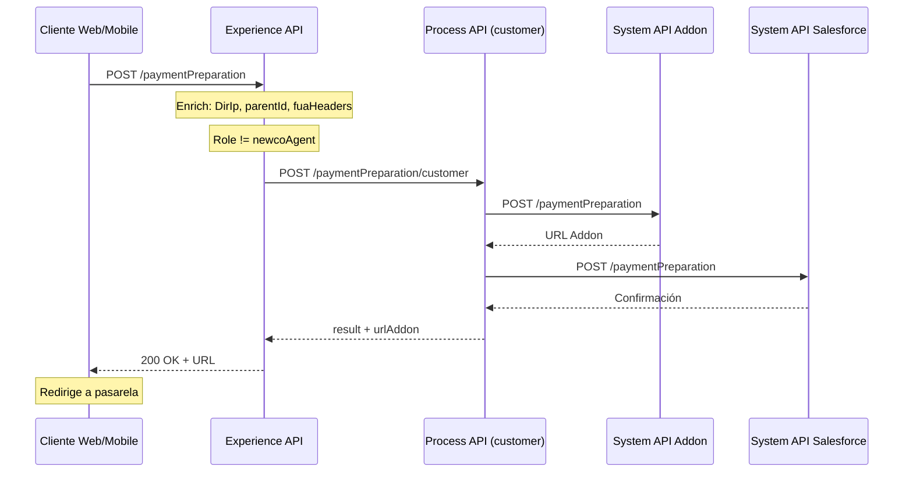
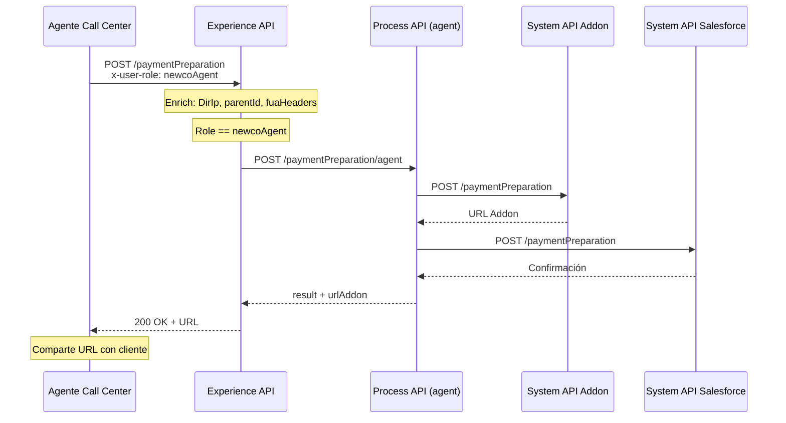
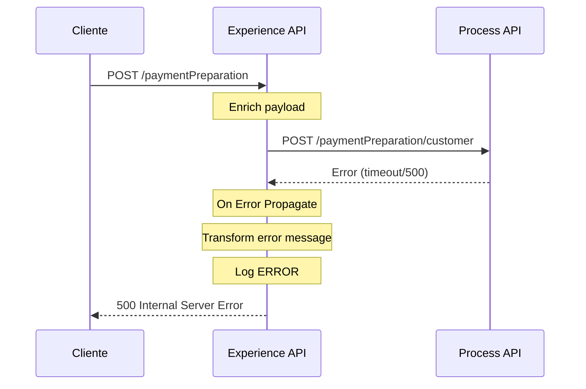

# POST /paymentPreparation

## 📌 Descripción General

### Propósito del Endpoint

Este endpoint prepara el proceso de pago para clientes de Naturgy, generando una URL de pasarela de pago (Addon) y sincronizando la información con Salesforce. Actúa como punto de entrada unificado para iniciar transacciones de pago tanto de facturas como de cuotas de fraccionamiento, adaptando el flujo según el rol del usuario (cliente o agente).

### Tipo de API

**Capa:** Experience API (API-Led Connectivity)

**Función:** Orquestación de preparación de pagos con enriquecimiento de contexto

### Patrón de Integración

**Tipo:** Pass-Through con Enriquecimiento de Headers

**Descripción:** El endpoint actúa como pass-through hacia el Process API, enriqueciendo el payload con información de contexto (headers FUA, dirección IP, ID de interacción padre) y aplicando routing condicional basado en el rol del usuario.

### Arquitectura API-Led Connectivity



---

## 💼 Propósito del Negocio

### Casos de Uso Principales

1. **Pago de Facturas Pendientes**
   - Cliente selecciona una o varias facturas para pagar
   - Sistema genera URL de pasarela de pago con el importe total
   - Cliente es redirigido a la pasarela para completar el pago

2. **Pago de Cuotas de Fraccionamiento**
   - Cliente selecciona cuotas específicas de un fraccionamiento
   - Sistema calcula el importe total de las cuotas seleccionadas
   - Genera URL de pasarela con información del fraccionamiento

3. **Gestión de Pagos por Agentes**
   - Agente de call center inicia proceso de pago en nombre del cliente
   - Sistema aplica flujo específico para agentes con validaciones adicionales
   - Genera URL que el agente puede compartir con el cliente

### 📱 Canal y Audiencia

#### Canal de Consumo

**Canal:** Web | Mobile

**Características del Canal:**
- **Plataforma**: Portal FUA (Frontal Único de Atención) y aplicaciones móviles
- **Dispositivos**: Desktop, tablets, smartphones
- **Conectividad**: Requiere conexión estable para redirección a pasarela
- **Experiencia de Usuario**: Flujo de pago optimizado con mínimos pasos

#### Audiencia Objetivo

**Usuarios Finales:**
- **Clientes Residenciales**: Pago de facturas de energía desde autoservicio
- **Clientes Business**: Gestión de pagos de múltiples contratos
- **Agentes de Call Center**: Asistencia en procesos de pago telefónico

**Contexto de Uso:**
- **Pago Inmediato**: Cliente necesita pagar facturas vencidas o próximas a vencer
- **Fraccionamiento**: Cliente gestiona pagos de cuotas de un plan de fraccionamiento
- **Asistencia Telefónica**: Agente ayuda al cliente a iniciar proceso de pago

#### Adaptaciones del Canal

**Optimizaciones Aplicadas:**
- **Enriquecimiento de Contexto**: Añade headers FUA, dirección IP y parentId para trazabilidad
- **Routing Condicional**: Selecciona ruta Process API según rol del usuario
- **Timeout Extendido**: 60 segundos para permitir procesamiento de pasarela
- **Manejo de Errores**: Respuesta estandarizada con códigos de error claros

### 🔗 Endpoints Dependientes

Este Experience API consume los siguientes Process APIs:

| Process API | Endpoint | Método | Propósito |
|-------------|----------|--------|-----------|
| `ntgy-newco-p-fua-evo` | `/paymentPreparation/customer` | POST | Preparación de pago para clientes (rol no-agente) |
| `ntgy-newco-p-fua-evo` | `/paymentPreparation/agent` | POST | Preparación de pago para agentes (rol newcoAgent) |

**Nota:** Ambas rutas del Process API consumen los mismos System APIs:
- `ntgy-newco-s-addon` (POST /paymentPreparation) - Generación de URL de pasarela
- `ntgy-newco-s-salesforce-evo` (POST /paymentPreparation) - Sincronización de datos

### Contexto Empresarial

- **Dominio:** Gestión de Pagos y Facturación
- **Sector:** Energía - Utilities
- **División:** Naturgy España - NewCo
- **Canal:** Web/Móvil

### Stakeholders

- **Clientes de Energía**: Necesitan pagar facturas de forma rápida y segura
- **Agentes de Call Center**: Requieren herramientas para asistir en pagos telefónicos
- **Departamento de Tesorería**: Necesita trazabilidad de intentos de pago
- **Equipo de CRM**: Requiere sincronización de eventos de pago en Salesforce

### Valor de Negocio

- **Reducción de Morosidad**: Facilita el pago inmediato de facturas pendientes
- **Mejora de Experiencia**: Proceso de pago simplificado y unificado
- **Trazabilidad Completa**: Registro de todos los intentos de pago en Salesforce
- **Flexibilidad de Pago**: Soporte para pago de facturas individuales o fraccionamientos

---

## 🔧 Especificación Técnica

### URLs por Ambiente

| Ambiente | URL Base | URL Completa |
|----------|----------|--------------|
| **Local** | `http://localhost:8081` | `http://localhost:8081/fua/api/paymentPreparation` |
| **Development** | `https://ntgy-fua-e-fua-dev.de-c1.cloudhub.io` | `https://ntgy-fua-e-fua-dev.de-c1.cloudhub.io/fua/api/paymentPreparation` |
| **Production** | `https://ntgy-fua-e-fua-pro.de-c1.cloudhub.io` | `https://ntgy-fua-e-fua-pro.de-c1.cloudhub.io/fua/api/paymentPreparation` |

### Método HTTP

```
POST /fua/api/paymentPreparation
```

### 🎯 Consideraciones del Canal

#### Limitaciones del Canal

| Aspecto | Limitación | Razón |
|---------|------------|-------|
| **Timeout** | 60 segundos | Procesamiento de pasarela de pago puede ser lento |
| **Tamaño de Respuesta** | ~2 KB | Respuesta contiene solo result y URL |
| **Rate Limiting** | Según API Gateway | Protección contra abuso |
| **Concurrencia** | Alta | Múltiples usuarios pueden pagar simultáneamente |

#### Campos Específicos del Canal

**Campos Añadidos por el Experience API:**

| Campo | Tipo | Descripción | Razón |
|-------|------|-------------|-------|
| `DirIp` | String | Dirección IP del cliente | Trazabilidad y seguridad |
| `parentId` | String | ID de interacción padre (x-interaction-id) | Correlación de trazas |
| `fuaHeaders` | Object | Headers del contexto FUA | Información de sesión y usuario |

**Campos Omitidos del Process API:**

Este endpoint NO omite campos del Process API, actúa como pass-through completo.

### Parámetros de Entrada

#### Headers Requeridos

| Header | Tipo | Obligatorio | Descripción |
|--------|------|-------------|-------------|
| `Content-Type` | String | Sí | Debe ser `application/json` |
| `x-user-role` | String | Sí | Rol del usuario (`newcoAgent` o cualquier otro) |
| `x-interaction-id` | String | No | ID de interacción para trazabilidad |

#### Body Parameters

```json
{
  "language": "string",
  "paymentList": [
    {
      "invoiceId": "string",
      "amount": number
    }
  ],
  "paymentDueList": [
    {
      "numRef": "string",
      "numberDue": "string",
      "amount": number
    }
  ],
  "channel": "string",
  "emailChannel": "string",
  "contactId": "string",
  "phoneChannel": "string",
  "hasConfirmation": boolean,
  "phoneConfirmation": "string",
  "errorUrl": "string",
  "successUrl": "string"
}
```

#### Descripción de Campos

| Campo | Tipo | Obligatorio | Descripción |
|-------|------|-------------|-------------|
| `language` | String | Sí | Idioma de la comunicación (ej: "es", "ca") |
| `paymentList` | Array | No* | Lista de facturas a pagar |
| `paymentList[].invoiceId` | String | Sí | ID de la factura |
| `paymentList[].amount` | Number | Sí | Importe a pagar de la factura |
| `paymentDueList` | Array | No* | Lista de cuotas de fraccionamiento a pagar |
| `paymentDueList[].numRef` | String | Sí | Identificador del fraccionamiento (opbel) |
| `paymentDueList[].numberDue` | String | No | Número de cuota (ordinal 1, 2, 3...) |
| `paymentDueList[].amount` | Number | Sí | Importe de la cuota |
| `channel` | String | Sí | Canal de comunicación (ej: "web", "mobile") |
| `emailChannel` | String | No | Email para notificaciones |
| `contactId` | String | No | ID del contacto en Salesforce |
| `phoneChannel` | String | No | Teléfono para notificaciones |
| `hasConfirmation` | Boolean | No | Indica si requiere confirmación |
| `phoneConfirmation` | String | No | Teléfono de confirmación |
| `errorUrl` | String | No | URL de redirección en caso de error |
| `successUrl` | String | No | URL de redirección en caso de éxito |

**Nota:** Debe proporcionarse al menos `paymentList` O `paymentDueList`, no ambos vacíos.

### Respuestas

#### Respuesta Exitosa (200 OK)

```json
{
  "result": {
    "codResult": "0000",
    "msgResult": "OK"
  },
  "urlAddon": "https://pasarela.addon.com/payment?token=abc123..."
}
```

| Campo | Tipo | Descripción |
|-------|------|-------------|
| `result` | Object | Objeto con resultado de la operación |
| `result.codResult` | String | Código de resultado ("0000" = éxito) |
| `result.msgResult` | String | Mensaje descriptivo del resultado |
| `urlAddon` | String | URL de la pasarela de pago Addon |

#### Respuesta de Error (500 Internal Server Error)

```json
{
  "result": {
    "codResult": "0001",
    "msgResult": "Error al generar URL de pago: [detalle del error]"
  }
}
```

| Campo | Tipo | Descripción |
|-------|------|-------------|
| `result.codResult` | String | Código de error ("0001" = error general) |
| `result.msgResult` | String | Descripción del error |

#### Códigos de Estado HTTP

| Código | Descripción | Cuándo Ocurre |
|--------|-------------|---------------|
| `200` | OK | Preparación de pago exitosa |
| `400` | Bad Request | Parámetros inválidos o faltantes |
| `500` | Internal Server Error | Error en Process API o System APIs |
| `503` | Service Unavailable | Process API no disponible |

### Autenticación

- **Tipo:** OAuth 2.0 (gestionado por API Gateway)
- **Headers:** `client_id`, `client_secret` (según configuración de API Manager)
- **Roles:** Validación de rol mediante header `x-user-role`

### Timeouts

| Tipo | Valor | Razón |
|------|-------|-------|
| **Request Timeout** | 60 segundos | Procesamiento de pasarela puede ser lento |
| **Connection Idle Timeout** | 60 segundos | Mantener conexión durante procesamiento |

---

## 🏗️ Implementación Técnica

### Arquitectura del Flow



### Transformaciones de Canal

#### Transformación de Entrada (Enriquecimiento)

**Archivo:** Inline en `post-payment-preparation.xml`

**Lógica DataWeave:**

```dataweave
%dw 2.2
import * from dw::core::Strings
output application/json
---
payload
++ 
vars.fuaHeaders 
++
{
    "DirIp": substringBefore(substringAfter(attributes.remoteAddress,"/"),":"),
    "parentId": (if (attributes.headers['x-interaction-id'] != "null" and !isEmpty(attributes.headers['x-interaction-id'])) 
                 attributes.headers['x-interaction-id'] 
                 else null)
}
```

**Campos Añadidos:**

| Campo Original | Campo Enriquecido | Transformación |
|----------------|-------------------|----------------|
| `payload` | `payload` | Pass-through completo |
| N/A | `vars.fuaHeaders` | Headers del contexto FUA (usuario, sesión, etc.) |
| `attributes.remoteAddress` | `DirIp` | Extrae IP del formato "/IP:puerto" |
| `attributes.headers['x-interaction-id']` | `parentId` | Copia si existe y no es "null" |

#### Determinación de Ruta

**Variable:** `paymentPreparationPath`

```dataweave
%dw 2.0
output text/plain
---
if ( attributes.headers['x-user-role'] == "newcoAgent" ) "/paymentPreparation/agent"
else
"/paymentPreparation/customer"
```

**Lógica:**
- Si `x-user-role` es `"newcoAgent"` → Ruta: `/paymentPreparation/agent`
- Cualquier otro valor → Ruta: `/paymentPreparation/customer`

#### Transformación de Error

**Lógica DataWeave:**

```dataweave
%dw 2.0
output application/json
---
{
    "result": {
        "codResult": "0001",
        "msgResult": error.description as String replace /\"/ with("")
    }
}
```

**Campos de Error:**

| Campo | Valor | Descripción |
|-------|-------|-------------|
| `result.codResult` | "0001" | Código de error estándar |
| `result.msgResult` | `error.description` | Descripción del error sin comillas |

### Patrones de Diseño

**Patrón:** Content-Based Router con Enriquecimiento de Contexto

**Justificación:** 
- Permite routing dinámico basado en rol del usuario
- Enriquece el payload con información de contexto necesaria para trazabilidad
- Mantiene separación de responsabilidades entre canales (agente vs cliente)

### Diagramas de Secuencia

#### 1. Flujo Normal de Éxito (Cliente)



#### 2. Flujo Normal de Éxito (Agente)



#### 3. Flujo con Error Técnico



### Configuración HTTP

**Connector:** `HTTP_FUA_PROCESS_NEWCO_EVO`

**Configuración (global.xml):**

```xml
<http:request-config 
    name="HTTP_FUA_PROCESS_NEWCO_EVO" 
    basePath="/api" 
    responseTimeout="${newco-p-fua-evo.timeout}">
    <http:request-connection 
        host="${newco-p-fua-evo.host}" 
        port="${newco-p-fua-evo.port}" 
        connectionIdleTimeout="${newco-p-fua-evo.timeout}"/>
</http:request-config>
```

**Properties (e-fua-pro-config.yaml):**

```yaml
newco-p-fua-evo:
  host: "mule-worker-internal-ntgy-newco-p-fua-evo.de-c1.cloudhub.io"
  port: "8091"
  timeout: "60000"
```

### Manejo de Errores

**Estrategia:** On Error Propagate

**Comportamiento:**
1. Captura cualquier error del Process API
2. Transforma el error a formato estándar
3. Registra el error en logs (nivel ERROR)
4. Propaga el error al cliente con código 500

**Estructura de Error:**

```json
{
    "result": {
        "codResult": "0001",
        "msgResult": "[Descripción del error sin comillas]"
    }
}
```

### Optimizaciones del Canal

1. **Timeout Extendido**: 60 segundos para permitir procesamiento de pasarela
2. **Enriquecimiento Eficiente**: Transformación inline sin archivos externos
3. **Routing Condicional**: Evita lógica duplicada en Process API
4. **Logging Estructurado**: Facilita troubleshooting y auditoría

---

## 💻 Ejemplos de Uso

### Ejemplo 1: Pago de Factura Individual (Cliente)

#### cURL

```bash
curl -X POST "https://ntgy-fua-e-fua-pro.de-c1.cloudhub.io/fua/api/paymentPreparation" \
  -H "Content-Type: application/json" \
  -H "x-user-role: customer" \
  -H "x-interaction-id: 12345-67890-abcde" \
  -H "client_id: YOUR_CLIENT_ID" \
  -d '{
    "language": "es",
    "paymentList": [
      {
        "invoiceId": "INV-2024-001",
        "amount": 125.50
      }
    ],
    "channel": "web",
    "emailChannel": "cliente@example.com",
    "contactId": "003XXXXXXXXXXXXXXX",
    "successUrl": "https://portal.naturgy.es/payment/success",
    "errorUrl": "https://portal.naturgy.es/payment/error"
  }'
```

#### Respuesta (200 OK)

```json
{
  "result": {
    "codResult": "0000",
    "msgResult": "OK"
  },
  "urlAddon": "https://pasarela.addon.com/payment?token=eyJhbGciOiJIUzI1NiIsInR5cCI6IkpXVCJ9..."
}
```

### Ejemplo 2: Pago de Múltiples Facturas (Cliente)

#### JavaScript (Fetch API)

```javascript
const paymentData = {
  language: "es",
  paymentList: [
    { invoiceId: "INV-2024-001", amount: 125.50 },
    { invoiceId: "INV-2024-002", amount: 98.75 },
    { invoiceId: "INV-2024-003", amount: 150.00 }
  ],
  channel: "web",
  emailChannel: "cliente@example.com",
  contactId: "003XXXXXXXXXXXXXXX",
  successUrl: "https://portal.naturgy.es/payment/success",
  errorUrl: "https://portal.naturgy.es/payment/error"
};

const response = await fetch('https://ntgy-fua-e-fua-pro.de-c1.cloudhub.io/fua/api/paymentPreparation', {
  method: 'POST',
  headers: {
    'Content-Type': 'application/json',
    'x-user-role': 'customer',
    'x-interaction-id': '12345-67890-abcde',
    'client_id': 'YOUR_CLIENT_ID'
  },
  body: JSON.stringify(paymentData)
});

const result = await response.json();
console.log('URL de pago:', result.urlAddon);

// Redirigir al usuario a la pasarela
window.location.href = result.urlAddon;
```

### Ejemplo 3: Pago de Cuotas de Fraccionamiento (Cliente)

#### Python

```python
import requests

payment_data = {
    "language": "es",
    "paymentDueList": [
        {
            "numRef": "FRAC-2024-001",
            "numberDue": "1",
            "amount": 50.00
        },
        {
            "numRef": "FRAC-2024-001",
            "numberDue": "2",
            "amount": 50.00
        }
    ],
    "channel": "mobile",
    "emailChannel": "cliente@example.com",
    "contactId": "003XXXXXXXXXXXXXXX",
    "phoneChannel": "+34600123456",
    "hasConfirmation": True,
    "phoneConfirmation": "+34600123456",
    "successUrl": "https://app.naturgy.es/payment/success",
    "errorUrl": "https://app.naturgy.es/payment/error"
}

response = requests.post(
    'https://ntgy-fua-e-fua-pro.de-c1.cloudhub.io/fua/api/paymentPreparation',
    headers={
        'Content-Type': 'application/json',
        'x-user-role': 'customer',
        'x-interaction-id': '12345-67890-abcde',
        'client_id': 'YOUR_CLIENT_ID'
    },
    json=payment_data
)

result = response.json()
print(f"Código resultado: {result['result']['codResult']}")
print(f"URL de pago: {result['urlAddon']}")
```

#### Respuesta (200 OK)

```json
{
  "result": {
    "codResult": "0000",
    "msgResult": "OK"
  },
  "urlAddon": "https://pasarela.addon.com/payment?token=eyJhbGciOiJIUzI1NiIsInR5cCI6IkpXVCJ9..."
}
```

### Ejemplo 4: Pago Iniciado por Agente

#### cURL

```bash
curl -X POST "https://ntgy-fua-e-fua-pro.de-c1.cloudhub.io/fua/api/paymentPreparation" \
  -H "Content-Type: application/json" \
  -H "x-user-role: newcoAgent" \
  -H "x-interaction-id: agent-12345-67890" \
  -H "client_id: YOUR_CLIENT_ID" \
  -d '{
    "language": "es",
    "paymentList": [
      {
        "invoiceId": "INV-2024-005",
        "amount": 200.00
      }
    ],
    "channel": "voice",
    "emailChannel": "cliente@example.com",
    "contactId": "003XXXXXXXXXXXXXXX",
    "phoneChannel": "+34600123456",
    "successUrl": "https://portal.naturgy.es/payment/success",
    "errorUrl": "https://portal.naturgy.es/payment/error"
  }'
```

#### Respuesta (200 OK)

```json
{
  "result": {
    "codResult": "0000",
    "msgResult": "OK"
  },
  "urlAddon": "https://pasarela.addon.com/payment?token=eyJhbGciOiJIUzI1NiIsInR5cCI6IkpXVCJ9..."
}
```

**Nota:** El agente puede copiar la URL y enviarla al cliente por email o SMS.

### Ejemplo 5: Error - Timeout del Process API

#### Respuesta (500 Internal Server Error)

```json
{
  "result": {
    "codResult": "0001",
    "msgResult": "HTTP:TIMEOUT - Timeout exceeded"
  }
}
```

### Ejemplo 6: Error - Parámetros Inválidos

#### Request con Error

```bash
curl -X POST "https://ntgy-fua-e-fua-pro.de-c1.cloudhub.io/fua/api/paymentPreparation" \
  -H "Content-Type: application/json" \
  -H "x-user-role: customer" \
  -d '{
    "language": "es",
    "channel": "web"
  }'
```

#### Respuesta (400 Bad Request)

```json
{
  "result": {
    "codResult": "0001",
    "msgResult": "Debe proporcionar al menos paymentList o paymentDueList"
  }
}
```
