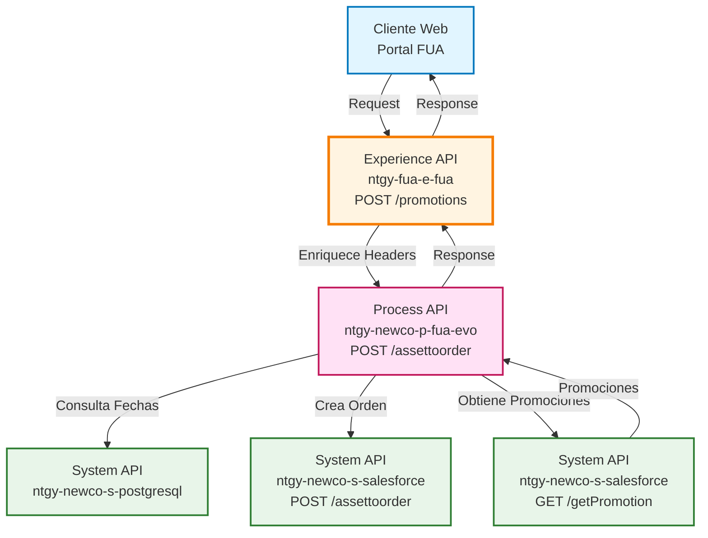
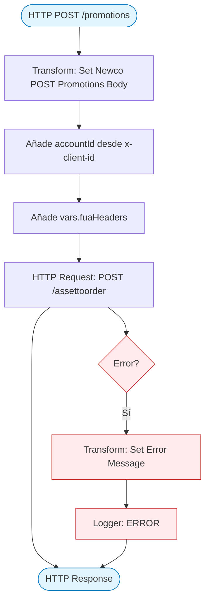
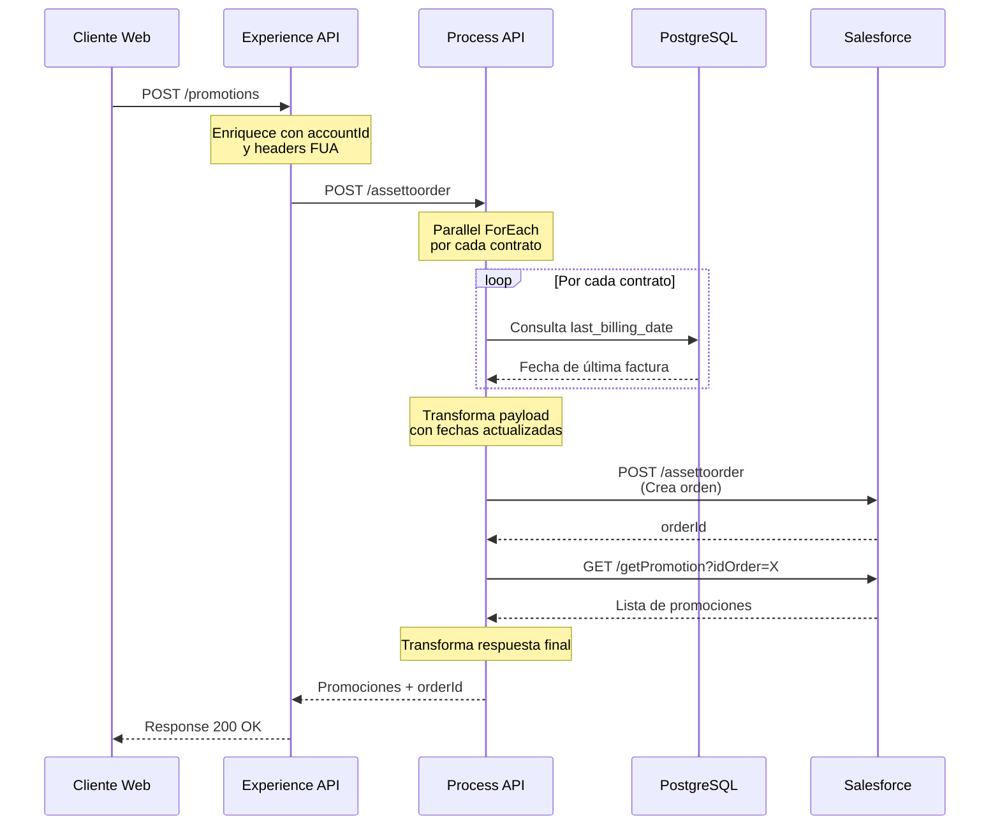
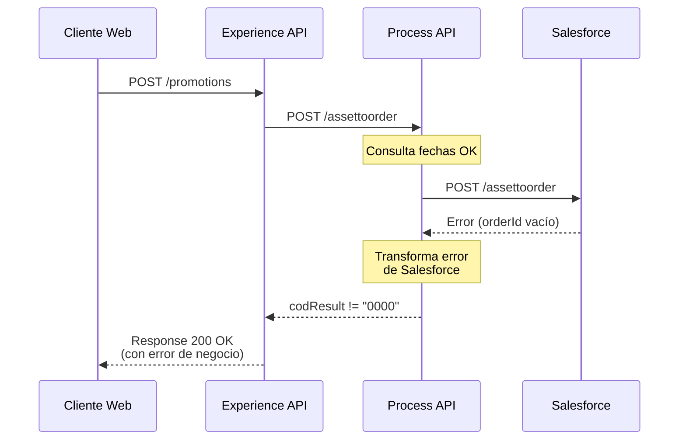
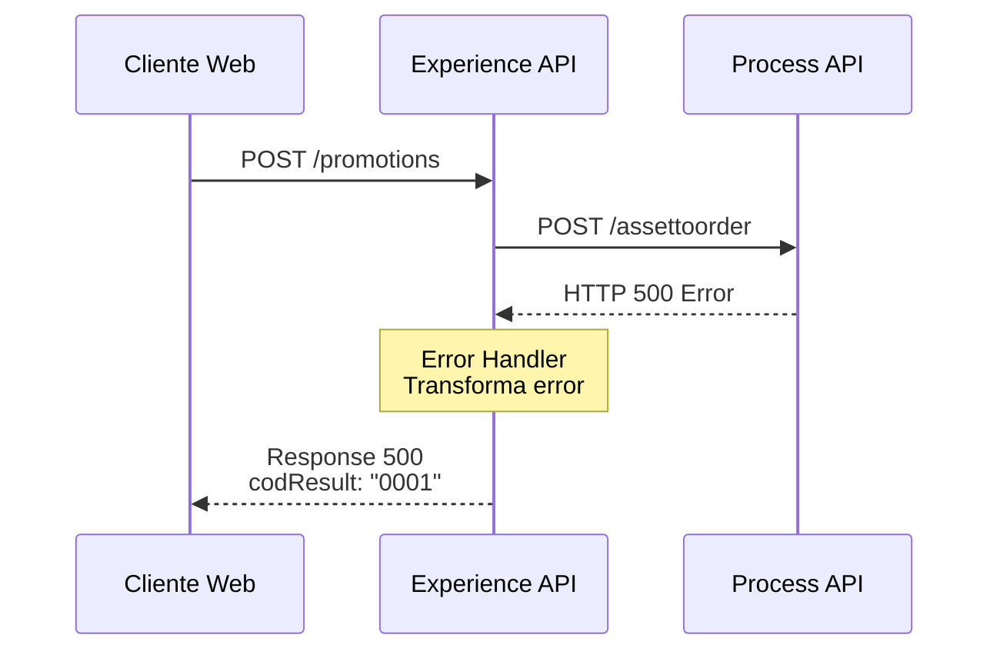

# POST /promotions

## 📌 Descripción General

### Propósito del Endpoint

Este endpoint obtiene las promociones disponibles para una cuenta contrato específica mediante la creación de una orden en Salesforce. El proceso incluye la consulta de fechas de última facturación en PostgreSQL y la posterior obtención de promociones asociadas a la orden creada.

### Tipo de API

**Capa:** Experience API (API-Led Connectivity)

**Función:** Adaptación de experiencia para canal web del portal FUA (Frontal Único de Atención)

### Patrón de Integración

**Tipo:** Orquestación con Enriquecimiento de Datos

**Descripción:** El Experience API enriquece el request con headers FUA y el accountId del cliente, luego delega la orquestación completa al Process API que coordina múltiples System APIs (PostgreSQL y Salesforce).

### Arquitectura API-Led Connectivity



---

## 💼 Propósito del Negocio

### Casos de Uso Principales

1. **Consulta de Promociones Disponibles**
   - El cliente consulta qué promociones puede aplicar a sus contratos
   - Se valida elegibilidad basada en fechas de facturación
   - Se crea una orden en Salesforce para tracking del proceso

2. **Validación de Elegibilidad**
   - Se consultan las fechas de última facturación de cada contrato
   - Se determina la fecha efectiva para aplicar promociones
   - Se valida que los contratos cumplan requisitos

3. **Preparación para Aplicación de Promociones**
   - Se genera un orderId que será usado posteriormente
   - Se obtiene el listado completo de promociones aplicables
   - Se prepara el contexto para el siguiente paso (checkout)

### 📱 Canal y Audiencia

#### Canal de Consumo

**Canal:** Web

**Características del Canal:**
- **Plataforma**: Portal FUA (Frontal Único de Atención)
- **Dispositivos**: Navegadores web (desktop y mobile)
- **Conectividad**: Requiere conexión estable para proceso completo
- **Experiencia de Usuario**: Proceso multi-paso con feedback visual

#### Audiencia Objetivo

**Usuarios Finales:**
- **Clientes Newco**: Clientes del sistema moderno de Naturgy que desean consultar promociones disponibles
- **Agentes de Atención**: Personal de call center que asiste a clientes en la consulta de promociones

**Contexto de Uso:**
- **Autoservicio Web**: Cliente navega el portal FUA y consulta promociones disponibles
- **Asistencia Telefónica**: Agente consulta promociones mientras atiende al cliente

#### Adaptaciones del Canal

**Optimizaciones Aplicadas:**
- **Enriquecimiento de Headers**: Se añaden headers FUA (x-client-id, x-interaction-id, etc.)
- **Timeout Extendido**: 60 segundos para permitir procesamiento completo
- **Manejo de Errores**: Transformación de errores técnicos a mensajes amigables

### 🔗 Endpoints Dependientes

Este Experience API consume el siguiente Process API:

| Process API | Endpoint | Método | Propósito |
|-------------|----------|--------|-----------|
| `ntgy-newco-p-fua-evo` | `/assettoorder` | POST | Orquesta el proceso completo: consulta fechas en PostgreSQL, crea orden en Salesforce y obtiene promociones |

**Flujo del Process API:**
1. Consulta paralela de fechas de última facturación (PostgreSQL)
2. Transformación de payload con fechas actualizadas
3. Creación de orden en Salesforce (assetToOrder)
4. Obtención de promociones asociadas (getPromotion)
5. Transformación de respuesta final

### Contexto Empresarial

- **Dominio:** Gestión de Promociones y Descuentos
- **Sector:** Energía - Utilities
- **División:** Naturgy España - NewCo
- **Canal:** Web (Portal FUA)

### Stakeholders

- **Clientes Newco**: Necesitan conocer promociones disponibles para optimizar costos
- **Equipo Comercial**: Requiere visibilidad de promociones aplicadas para seguimiento
- **Salesforce**: Sistema de registro de órdenes y promociones

### Valor de Negocio

- **Transparencia**: Cliente conoce todas las promociones disponibles antes de aplicarlas
- **Trazabilidad**: Cada consulta genera una orden en Salesforce para auditoría
- **Optimización**: Cliente puede comparar promociones y elegir la más conveniente
- **Automatización**: Proceso completamente automatizado sin intervención manual

---

## 🔧 Especificación Técnica

### URLs por Ambiente

| Ambiente | URL Base | URL Completa |
|----------|----------|--------------|
| **Local** | `http://localhost:8081` | `http://localhost:8081/fua/api/promotions` |
| **Development** | `https://ntgy-fua-e-fua-dev.de-c1.cloudhub.io` | `https://ntgy-fua-e-fua-dev.de-c1.cloudhub.io/fua/api/promotions` |
| **Production** | `https://ntgy-fua-e-fua-pro.de-c1.cloudhub.io` | `https://ntgy-fua-e-fua-pro.de-c1.cloudhub.io/fua/api/promotions` |

### Método HTTP

```
POST /fua/api/promotions
```

### 🎯 Consideraciones del Canal

#### Limitaciones del Canal

| Aspecto | Limitación | Razón |
|---------|------------|-------|
| **Timeout** | 60 segundos | Proceso complejo con múltiples llamadas a System APIs |
| **Rate Limiting** | Según política API Gateway | Protección del sistema |
| **Contratos Simultáneos** | Máximo 3 en paralelo | Configuración del parallel-foreach en Process API |

#### Campos Específicos del Canal

**Campos Añadidos por el Experience API:**

| Campo | Tipo | Descripción | Razón |
|-------|------|-------------|-------|
| `accountId` | string | ID de cuenta del cliente | Extraído del header x-client-id para identificación en Salesforce |

**Headers FUA Propagados:**

El Experience API propaga los siguientes headers al Process API:
- `x-interaction-id`: ID de interacción para trazabilidad
- `x-interaction-origin`: Origen de la interacción
- `x-user-id`: ID del usuario
- `x-client-id`: ID del cliente (usado para accountId)
- `x-client-doc-number`: Número de documento del cliente
- `x-client-code`: Código del cliente
- `x-origin`: Origen de la petición
- `x-user-role`: Rol del usuario
- `traceparent`: Trazabilidad distribuida
- `x-agent-mail`: Email del agente (si aplica)
- `x-language`: Idioma preferido
- `x-contact-id`: ID de contacto

### Parámetros de Entrada

#### Headers Requeridos

| Header | Tipo | Requerido | Descripción |
|--------|------|-----------|-------------|
| `Content-Type` | string | Sí | Debe ser `application/json` |
| `x-client-id` | string | Sí | ID del cliente (usado para accountId) |
| `x-interaction-id` | string | No | ID de interacción para trazabilidad |
| `x-user-role` | string | No | Rol del usuario (customer, agent, etc.) |

#### Body (JSON)

```json
{
  "billingAccountId": "string",
  "serviceAccountId": "string",
  "contactId": "string",
  "contractLastDatePromoList": [
    {
      "contractNumber": "string",
      "assetId": "string",
      "startDate": "string (formato: dd/MM/yyyy)"
    }
  ]
}
```

**Campos del Body:**

| Campo | Tipo | Requerido | Descripción |
|-------|------|-----------|-------------|
| `billingAccountId` | string | Sí | ID de la cuenta de facturación |
| `serviceAccountId` | string | Sí | ID de la cuenta de servicio |
| `contactId` | string | Sí | ID del contacto preferente (necesario para Salesforce) |
| `contractLastDatePromoList` | array | Sí | Lista de contratos con sus fechas de inicio |
| `contractLastDatePromoList[].contractNumber` | string | Sí | Número del contrato |
| `contractLastDatePromoList[].assetId` | string | Sí | ID del asset en Salesforce |
| `contractLastDatePromoList[].startDate` | string | Sí | Fecha de inicio del contrato (formato: dd/MM/yyyy) |

### Respuestas

#### Respuesta Exitosa (200 OK)

```json
{
  "result": {
    "codResult": "0000",
    "msgResult": "No hay error"
  },
  "orderId": "string",
  "promotionsList": [
    {
      "promotionId": "string",
      "promotionName": "string",
      "promotionDesc": "string"
    }
  ],
  "lastInvoiceMap": [
    {
      "contractNumber": "string",
      "startDate": "string (formato: dd/MM/yyyy)"
    }
  ]
}
```

**Campos de la Respuesta:**

| Campo | Tipo | Descripción |
|-------|------|-------------|
| `result.codResult` | string | Código de resultado ("0000" = éxito) |
| `result.msgResult` | string | Mensaje descriptivo del resultado |
| `orderId` | string | ID de la orden creada en Salesforce |
| `promotionsList` | array | Lista de promociones disponibles |
| `promotionsList[].promotionId` | string | ID de la promoción en Salesforce |
| `promotionsList[].promotionName` | string | Nombre de la promoción |
| `promotionsList[].promotionDesc` | string | Descripción de la promoción |
| `lastInvoiceMap` | array | Mapa de fechas de última factura por contrato |
| `lastInvoiceMap[].contractNumber` | string | Número del contrato |
| `lastInvoiceMap[].startDate` | string | Fecha de última facturación o fecha de inicio |

#### Respuesta de Error (500 Internal Server Error)

```json
{
  "result": {
    "codResult": "0001",
    "msgResult": "Descripción del error"
  }
}
```

#### Respuesta de Error de Negocio (200 OK con error)

Cuando Salesforce no puede crear la orden:

```json
{
  "result": {
    "codResult": "[código_error_salesforce]",
    "msgResult": "[descripción_error_salesforce]"
  }
}
```

### Autenticación

- **Tipo:** OAuth 2.0 (gestionado por API Gateway)
- **Validación:** JWT token validation en el flow principal

### Timeouts

| Tipo | Valor | Razón |
|------|-------|-------|
| **Request Timeout** | 60 segundos | Proceso complejo con múltiples llamadas: PostgreSQL (paralelo) + Salesforce (secuencial) |
| **Connection Idle Timeout** | 60 segundos | Mantiene conexión activa durante procesamiento |

---

## 🏗️ Implementación Técnica

### Arquitectura del Flow



### Transformaciones de Canal

**Transformación de Entrada (Experience → Process):**

| Campo Original (Request) | Campo Transformado | Transformación |
|--------------------------|-------------------|----------------|
| `payload.*` | `payload.*` | Pass-through de todos los campos del body |
| `attributes.headers['x-client-id']` | `accountId` | Extracción del header y añadido al payload |
| `vars.fuaHeaders` | Merge en payload | Añade todos los headers FUA al payload |

**Lógica de Transformación (Experience API):**

```dataweave
%dw 2.0
output application/json
---
payload
++
{
	"accountId": attributes.headers['x-client-id']
}
++ vars.fuaHeaders
```

**Transformación en Process API (AssetToOrderFlow):**

El Process API realiza las siguientes transformaciones:

1. **Consulta Paralela de Fechas** (parallel-foreach):
   - Por cada `contractNumber` en `contractLastDatePromoList`
   - Llama a `lastDateFlow` que consulta PostgreSQL
   - Obtiene `last_billing_date` de cada contrato

2. **Preparación de Payload para Salesforce**:

```dataweave
%dw 2.0
output application/json
var lastBillingDate = (vars.uptDateResponse filter ((item, index) -> !isEmpty(item.last_billing_date))).last_billing_date
var aux = if(!isEmpty(lastBillingDate)) (lastBillingDate orderBy ($))[0] as Date {format:'dd/MM/yyyy'} else null
---
{
	"serviceAccountId": payload.serviceAccountId,
	"billingAccountId": payload.billingAccountId,
	"accountId": payload.accountId,
	"contactId": payload.contactId,
	"effectiveDate": if(!isEmpty(aux)) aux else (payload.contractLastDatePromoList.startDate orderBy ($ as Date))[0] as Date as String {format:'dd/MM/YYYY'},
	"lastInvoiceMap": {
		(payload.contractLastDatePromoList map {
			($.assetId) : if(!isEmpty(vars.invoiceDateContract[$.contractNumber][0].last_billing_date)) 
				vars.invoiceDateContract[$.contractNumber][0].last_billing_date as Date {format:'dd/MM/yyyy'} as String {format:'yyyy-MM-dd'} 
				else $.startDate as Date
		})
	}
}
```

3. **Transformación de Respuesta Final**:

```dataweave
%dw 2.0
output application/json
---
{
	"result": {
		"codResult": "0000",
		"msgResult": "No hay error"
	},
	orderId: payload.idOrder,
	promotionsList: payload.getPromotionsOutput.records map ( record , indexOfRecord ) -> {
		promotionId: record.Id,
		promotionName: record.Name,
		promotionDesc: record.vlocity_cmt__Description__c
	},
	"lastInvoiceMap": vars.entryPayload.contractLastDatePromoList map {
		contractNumber: $.contractNumber,
		startDate:  if(!isEmpty(vars.invoiceDateContract[$.contractNumber][0].last_billing_date)) 
			vars.invoiceDateContract[$.contractNumber][0].last_billing_date 
			else $.startDate as Date
	}
}
```

### Patrones de Diseño

**Patrón:** Orquestación con Enriquecimiento de Datos

**Justificación:** 
- El Experience API enriquece el request con información del contexto (accountId, headers FUA)
- Delega la orquestación completa al Process API
- El Process API coordina múltiples System APIs en un flujo complejo
- Separación clara de responsabilidades entre capas

### Diagramas de Secuencia

#### 1. Flujo Normal de Éxito



#### 2. Flujo con Error en Salesforce



#### 3. Flujo con Error Técnico



### Optimizaciones del Canal

**1. Procesamiento Paralelo:**
- El Process API consulta las fechas de facturación en paralelo (maxConcurrency: 3)
- Reduce el tiempo total de procesamiento

**2. Propagación de Headers:**
- Los headers FUA se propagan automáticamente
- Facilita trazabilidad y debugging

**3. Timeout Extendido:**
- 60 segundos para permitir procesamiento completo
- Apropiado para operación compleja con múltiples System APIs

### Manejo de Errores

**Error Handler en Experience API:**

```xml
<error-handler>
    <on-error-propagate enableNotifications="true" logException="true">
        <ee:transform doc:name="Set Error Message">
            <ee:set-payload>
                %dw 2.0
                output application/json
                ---
                {
                    "result": {
                        "codResult": "0001",
                        "msgResult": error.description as String replace /\"/ with("")
                    }
                }
            </ee:set-payload>
        </ee:transform>
        <logger level="ERROR" message='[Error JSON]'/>
    </on-error-propagate>
</error-handler>
```

**Tipos de Errores:**

| Tipo de Error | Código | Descripción | Acción |
|---------------|--------|-------------|--------|
| Error Técnico | 0001 | Error en comunicación con Process API | Se registra y se devuelve mensaje genérico |
| Error de Negocio | Variable | Error reportado por Salesforce | Se propaga el código y mensaje de Salesforce |
| Timeout | 0001 | Timeout en Process API (>60s) | Se registra y se devuelve error de timeout |

---

## 💻 Ejemplos de Uso

### Ejemplo 1: Llamada Exitosa con Promociones Disponibles

#### cURL

```bash
curl -X POST "https://ntgy-fua-e-fua-pro.de-c1.cloudhub.io/fua/api/promotions" \
  -H "Content-Type: application/json" \
  -H "x-client-id: 12345678" \
  -H "x-interaction-id: int-2024-001" \
  -H "x-user-role: customer" \
  -d '{
    "billingAccountId": "BA123456",
    "serviceAccountId": "SA789012",
    "contactId": "003XXXXXXXXXXXXXXX",
    "contractLastDatePromoList": [
      {
        "contractNumber": "4000123456",
        "assetId": "02iXXXXXXXXXXXXXXX",
        "startDate": "01/01/2024"
      },
      {
        "contractNumber": "4000123457",
        "assetId": "02iYYYYYYYYYYYYYYY",
        "startDate": "15/02/2024"
      }
    ]
  }'
```

#### Respuesta (200 OK)

```json
{
  "result": {
    "codResult": "0000",
    "msgResult": "No hay error"
  },
  "orderId": "801XXXXXXXXXXXXXXX",
  "promotionsList": [
    {
      "promotionId": "01tXXXXXXXXXXXXXXX",
      "promotionName": "Descuento Bienvenida 10%",
      "promotionDesc": "Descuento del 10% en tu primera factura"
    },
    {
      "promotionId": "01tYYYYYYYYYYYYYYY",
      "promotionName": "Promo Verano 2024",
      "promotionDesc": "15% de descuento en consumo de verano"
    }
  ],
  "lastInvoiceMap": [
    {
      "contractNumber": "4000123456",
      "startDate": "2024-03-15"
    },
    {
      "contractNumber": "4000123457",
      "startDate": "2024-02-15"
    }
  ]
}
```

### Ejemplo 2: Error de Negocio (Salesforce no puede crear orden)

#### cURL

```bash
curl -X POST "https://ntgy-fua-e-fua-pro.de-c1.cloudhub.io/fua/api/promotions" \
  -H "Content-Type: application/json" \
  -H "x-client-id: 12345678" \
  -d '{
    "billingAccountId": "BA_INVALID",
    "serviceAccountId": "SA789012",
    "contactId": "003XXXXXXXXXXXXXXX",
    "contractLastDatePromoList": [
      {
        "contractNumber": "4000123456",
        "assetId": "02iXXXXXXXXXXXXXXX",
        "startDate": "01/01/2024"
      }
    ]
  }'
```

#### Respuesta (200 OK con error de negocio)

```json
{
  "result": {
    "codResult": "SF001",
    "msgResult": "Billing Account no encontrado en Salesforce"
  }
}
```

### Ejemplo 3: JavaScript (para Portal Web)

```javascript
async function getPromotions(billingAccountId, serviceAccountId, contactId, contracts) {
  try {
    const response = await fetch('https://ntgy-fua-e-fua-pro.de-c1.cloudhub.io/fua/api/promotions', {
      method: 'POST',
      headers: {
        'Content-Type': 'application/json',
        'x-client-id': localStorage.getItem('clientId'),
        'x-interaction-id': generateInteractionId(),
        'x-user-role': 'customer'
      },
      body: JSON.stringify({
        billingAccountId: billingAccountId,
        serviceAccountId: serviceAccountId,
        contactId: contactId,
        contractLastDatePromoList: contracts.map(c => ({
          contractNumber: c.number,
          assetId: c.assetId,
          startDate: c.startDate
        }))
      })
    });

    const data = await response.json();
    
    if (data.result.codResult === "0000") {
      console.log('Promociones disponibles:', data.promotionsList);
      console.log('Order ID:', data.orderId);
      return data;
    } else {
      console.error('Error de negocio:', data.result.msgResult);
      throw new Error(data.result.msgResult);
    }
  } catch (error) {
    console.error('Error al obtener promociones:', error);
    throw error;
  }
}

// Uso
const contracts = [
  { number: '4000123456', assetId: '02iXXXXXXXXXXXXXXX', startDate: '01/01/2024' },
  { number: '4000123457', assetId: '02iYYYYYYYYYYYYYYY', startDate: '15/02/2024' }
];

getPromotions('BA123456', 'SA789012', '003XXXXXXXXXXXXXXX', contracts)
  .then(data => {
    // Mostrar promociones al usuario
    displayPromotions(data.promotionsList);
  })
  .catch(error => {
    // Mostrar error al usuario
    showError('No se pudieron cargar las promociones');
  });
```

### Ejemplo 4: Python

```python
import requests
import json

def get_promotions(billing_account_id, service_account_id, contact_id, contracts):
    """
    Obtiene las promociones disponibles para una cuenta contrato
    
    Args:
        billing_account_id: ID de la cuenta de facturación
        service_account_id: ID de la cuenta de servicio
        contact_id: ID del contacto en Salesforce
        contracts: Lista de diccionarios con contractNumber, assetId y startDate
    
    Returns:
        dict: Respuesta con promociones disponibles
    """
    url = 'https://ntgy-fua-e-fua-pro.de-c1.cloudhub.io/fua/api/promotions'
    
    headers = {
        'Content-Type': 'application/json',
        'x-client-id': '12345678',
        'x-interaction-id': 'int-2024-001',
        'x-user-role': 'customer'
    }
    
    payload = {
        'billingAccountId': billing_account_id,
        'serviceAccountId': service_account_id,
        'contactId': contact_id,
        'contractLastDatePromoList': contracts
    }
    
    try:
        response = requests.post(url, headers=headers, json=payload, timeout=65)
        response.raise_for_status()
        
        data = response.json()
        
        if data['result']['codResult'] == '0000':
            print(f"Promociones disponibles: {len(data['promotionsList'])}")
            print(f"Order ID: {data['orderId']}")
            return data
        else:
            print(f"Error de negocio: {data['result']['msgResult']}")
            return None
            
    except requests.exceptions.Timeout:
        print("Error: Timeout al obtener promociones")
        return None
    except requests.exceptions.RequestException as e:
        print(f"Error en la petición: {str(e)}")
        return None

# Uso
contracts = [
    {
        'contractNumber': '4000123456',
        'assetId': '02iXXXXXXXXXXXXXXX',
        'startDate': '01/01/2024'
    },
    {
        'contractNumber': '4000123457',
        'assetId': '02iYYYYYYYYYYYYYYY',
        'startDate': '15/02/2024'
    }
]

result = get_promotions('BA123456', 'SA789012', '003XXXXXXXXXXXXXXX', contracts)

if result:
    for promo in result['promotionsList']:
        print(f"- {promo['promotionName']}: {promo['promotionDesc']}")
```
