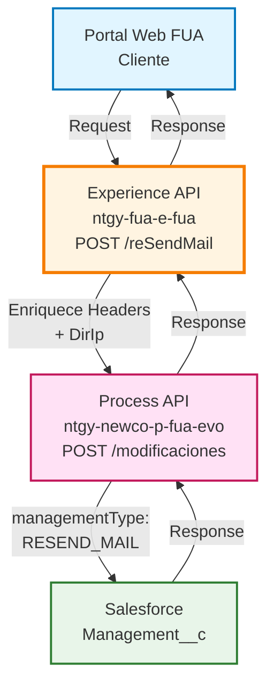
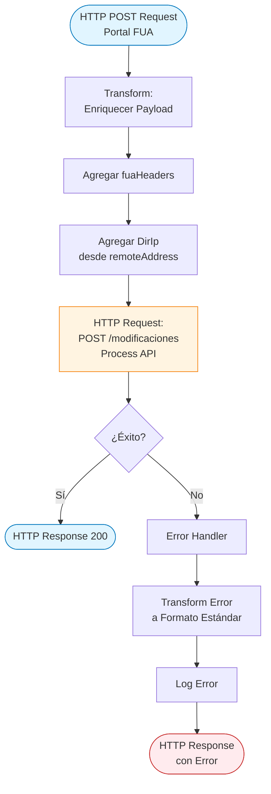
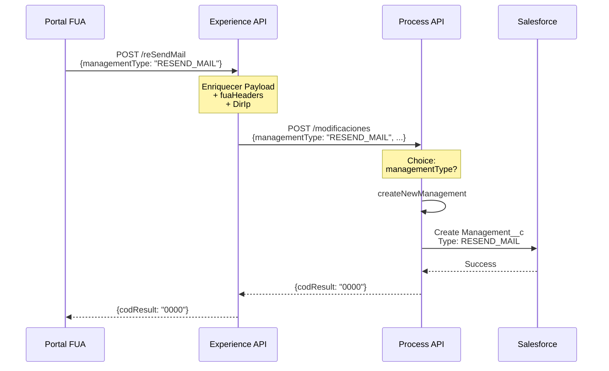
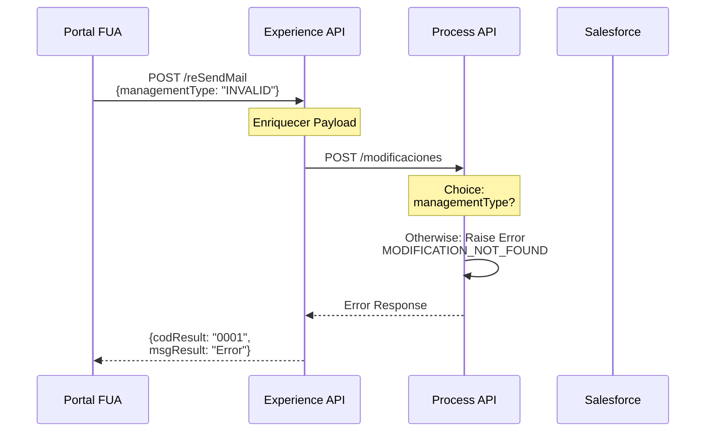
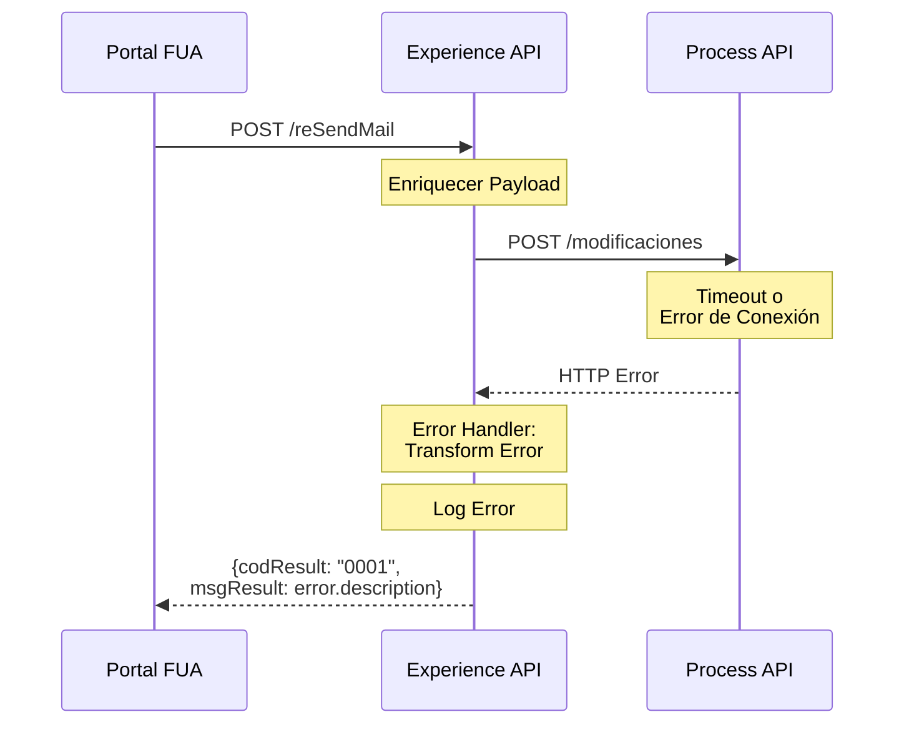

# POST /reSendMail

## 📌 Descripción General

### Propósito del Endpoint

Este endpoint permite reenviar el correo electrónico de confirmación cuando un cliente ha solicitado un cambio de datos de contacto. Actúa como punto de entrada en la capa de Experience API para gestionar el reenvío de comunicaciones relacionadas con modificaciones de datos del cliente.

### Tipo de API

**Capa:** Experience API (API-Led Connectivity)

**Función:** Orquestación de reenvío de comunicaciones de cambio de contacto

### Patrón de Integración

**Tipo:** Pass-Through con Enriquecimiento de Headers

**Descripción:** El endpoint recibe la solicitud del portal web, enriquece el payload con headers de contexto FUA y la dirección IP del cliente, y la reenvía al Process API para su procesamiento.

### Arquitectura API-Led Connectivity



---

## 💼 Propósito del Negocio

### Casos de Uso Principales

1. **Reenvío de Email de Confirmación**
   - Cliente no recibió el email original de cambio de contacto
   - Cliente necesita reenviar la confirmación a una nueva dirección de email
   - Soporte al cliente requiere reenviar la comunicación

2. **Gestión de Modificaciones de Contacto**
   - Registro de la solicitud de reenvío en Salesforce
   - Trazabilidad de comunicaciones enviadas al cliente
   - Auditoría de cambios de datos de contacto

3. **Autoservicio del Cliente**
   - Permite al cliente gestionar sus comunicaciones sin intervención de agentes
   - Mejora la experiencia de usuario en el portal FUA
   - Reduce carga en el call center

### 📱 Canal y Audiencia

#### Canal de Consumo

**Canal:** Web

**Características del Canal:**
- **Plataforma**: Portal Web FUA (Frontal Único de Atención)
- **Dispositivos**: Desktop y navegadores web
- **Conectividad**: Conexión estable requerida
- **Experiencia de Usuario**: Interfaz de autoservicio para gestión de datos de contacto

#### Audiencia Objetivo

**Usuarios Finales:**
- **Clientes Residenciales**: Clientes que han solicitado cambio de datos de contacto y necesitan reenvío del email
- **Clientes Business**: Empresas que gestionan sus datos de contacto

**Contexto de Uso:**
- **Cambio de Email**: Cliente ha cambiado su dirección de email y necesita recibir la confirmación en la nueva
- **Email No Recibido**: Cliente no recibió el email original por problemas de entrega
- **Reenvío Solicitado**: Cliente solicita explícitamente el reenvío de la comunicación

#### Adaptaciones del Canal

**Optimizaciones Aplicadas:**
- **Enriquecimiento de Contexto**: Agrega headers FUA y dirección IP del cliente
- **Formato de Respuesta**: Respuesta estándar con código de resultado
- **Timeout**: 60 segundos para operaciones de Salesforce
- **Manejo de Errores**: Transformación de errores a formato estándar

### 🔗 Endpoints Dependientes

Este Experience API consume el siguiente Process API:

| Process API | Endpoint | Método | Propósito |
|-------------|----------|--------|-----------|
| `ntgy-newco-p-fua-evo` | `/modificaciones` | POST | Procesa la solicitud de reenvío creando una gestión de tipo RESEND_MAIL en Salesforce |

### Contexto Empresarial

- **Dominio:** Gestión de Clientes y Comunicaciones
- **Sector:** Energía - Utilities
- **División:** Naturgy España - NewCo
- **Canal:** Portal Web FUA

### Stakeholders

- **Clientes Finales**: Necesitan recibir confirmaciones de cambios de datos de contacto
- **Equipo de Atención al Cliente**: Requieren trazabilidad de comunicaciones enviadas
- **Equipo de Cumplimiento**: Necesitan auditoría de cambios de datos personales

### Valor de Negocio

- **Mejora de Experiencia**: Permite al cliente gestionar sus comunicaciones de forma autónoma
- **Reducción de Costes**: Disminuye llamadas al call center por emails no recibidos
- **Cumplimiento Normativo**: Mantiene registro de todas las comunicaciones enviadas al cliente
- **Trazabilidad**: Registro completo en Salesforce de todas las solicitudes de reenvío

---

## 🔧 Especificación Técnica

### URLs por Ambiente

| Ambiente | URL Base | URL Completa |
|----------|----------|--------------|
| **Local** | `http://localhost:8081` | `http://localhost:8081/fua/api/reSendMail` |
| **Development** | `https://e-fua-dev.de-c1.cloudhub.io` | `https://e-fua-dev.de-c1.cloudhub.io/fua/api/reSendMail` |
| **Production** | `https://e-fua-pro.de-c1.cloudhub.io` | `https://e-fua-pro.de-c1.cloudhub.io/fua/api/reSendMail` |

### Método HTTP

```
POST /fua/api/reSendMail
```

### 🎯 Consideraciones del Canal

#### Limitaciones del Canal

| Aspecto | Limitación | Razón |
|---------|------------|-------|
| **Timeout** | 60 segundos | Operaciones de Salesforce pueden ser lentas |
| **Rate Limiting** | Según política API Gateway | Protección del sistema |
| **Tamaño de Request** | Estándar HTTP | Payload pequeño con datos de cliente |

#### Campos Específicos del Canal

**Campos Añadidos por el Experience API:**

| Campo | Tipo | Descripción | Razón |
|-------|------|-------------|-------|
| `DirIp` | string | Dirección IP del cliente | Trazabilidad y auditoría de la solicitud |
| `fuaHeaders` | object | Headers de contexto FUA | Información de sesión y contexto del cliente |

### Parámetros de Entrada

#### Headers Requeridos

| Header | Tipo | Descripción | Ejemplo |
|--------|------|-------------|---------|
| `Content-Type` | string | Tipo de contenido | `application/json` |
| `x-client-id` | string | ID del cliente en Salesforce | `"0015I00000XYZ123"` |
| `x-client-code` | string | Código/DNI del cliente | `"12345678A"` |
| `x-access-token` | string | Token de autenticación | `"Bearer eyJ0eXAi..."` |

#### Body (application/json)

**Estructura del Request:**

```json
{
  "managementType": "RESEND_MAIL",
  "contractAccountId": "string",
  "email": "string",
  "clientId": "string",
  "clientCode": "string"
}
```

**Campos del Body:**

| Campo | Tipo | Requerido | Descripción |
|-------|------|-----------|-------------|
| `managementType` | string | Sí | Tipo de gestión, debe ser "RESEND_MAIL" |
| `contractAccountId` | string | Sí | ID de la cuenta contrato |
| `email` | string | Sí | Email al que reenviar la confirmación |
| `clientId` | string | Sí | ID del cliente en Salesforce |
| `clientCode` | string | Sí | DNI/NIF del cliente |

### Respuestas

#### 200 OK - Éxito

**Estructura:**

```json
{
  "result": {
    "codResult": "0000",
    "msgResult": "OK"
  }
}
```

**Campos de la Respuesta:**

| Campo | Tipo | Descripción |
|-------|------|-------------|
| `result` | object | Objeto con el resultado de la operación |
| `result.codResult` | string | Código de resultado ("0000" = éxito) |
| `result.msgResult` | string | Mensaje descriptivo del resultado |

#### 400 Bad Request - Error de Validación

```json
{
  "result": {
    "codResult": "0001",
    "msgResult": "Bad request"
  }
}
```

#### 500 Internal Server Error - Error del Sistema

```json
{
  "result": {
    "codResult": "0001",
    "msgResult": "Error description"
  }
}
```

### Autenticación

- **Tipo:** OAuth 2.0
- **Header:** `x-access-token`
- **Validación:** Token validado por API Gateway

### Timeouts

| Tipo | Valor | Razón |
|------|-------|-------|
| **Request Timeout** | 60 segundos | Operaciones de Salesforce en Process API |
| **Connection Idle Timeout** | 60 segundos | Mantener conexión para operaciones largas |

---

## 🏗️ Implementación Técnica

### Arquitectura del Flow



### Transformaciones de Canal

**Transformación de Entrada (DataWeave):**

```dataweave
%dw 2.2
import * from dw::core::Strings
output application/json
---
payload
++
vars.fuaHeaders 
++ 
{
    "DirIp": substringBefore(substringAfter(attributes.remoteAddress,"/"),":")
}
```

**Descripción de la Transformación:**

| Campo Original | Campo Transformado | Transformación |
|----------------|-------------------|----------------|
| `payload` | `payload` | Pass-through del payload original |
| `vars.fuaHeaders` | Campos de headers | Merge de headers de contexto FUA |
| `attributes.remoteAddress` | `DirIp` | Extracción de IP del cliente |

**Lógica de Extracción de IP:**
1. `attributes.remoteAddress` contiene formato: `/127.0.0.1:12345`
2. `substringAfter(attributes.remoteAddress,"/")` → `127.0.0.1:12345`
3. `substringBefore(...,":")` → `127.0.0.1`

### Patrones de Diseño

**Patrón:** Pass-Through con Enriquecimiento de Contexto

**Justificación:** 
- El Experience API no necesita transformar la lógica de negocio
- Solo agrega información de contexto del canal (headers FUA e IP)
- Delega el procesamiento completo al Process API
- Mantiene la separación de responsabilidades en API-Led Connectivity

### Diagramas de Secuencia

#### 1. Flujo Normal de Éxito



#### 2. Flujo con Error de Negocio



#### 3. Flujo con Error Técnico



### Configuración HTTP

**Connector:** `HTTP_FUA_PROCESS_NEWCO_EVO`

**Configuración:**
```yaml
newco-p-fua-evo:
  host: "mule-worker-internal-ntgy-newco-p-fua-evo.de-c1.cloudhub.io"
  port: "8091"
  basePath: "/api"
  timeout: "60000"
```

**Request Configuration:**
- **Method:** POST
- **Path:** `/modificaciones`
- **Output MIME Type:** `application/json`
- **Output Encoding:** `UTF-8`
- **Send Body Mode:** ALWAYS

### Manejo de Errores

**Error Handler:** `on-error-propagate`

**Transformación de Error (DataWeave):**

```dataweave
%dw 2.0
output application/json
---
if ( !isEmpty(error.errorMessage.payload) ) 
  error.errorMessage.payload
else 
{
  "result": {
    "codResult": "0001",
    "msgResult": error.description as String replace /\"/ with("")
  }
}
```

**Lógica de Manejo:**
1. Si el error tiene payload, retornar el payload del error
2. Si no, construir respuesta estándar con código "0001"
3. Limpiar comillas del mensaje de error
4. Loguear el error con nivel ERROR

**Códigos de Error:**

| Código | Descripción | Origen |
|--------|-------------|--------|
| `0000` | Operación exitosa | Process API |
| `0001` | Error genérico | Experience API (error handler) |
| `MODIFICATION_NOT_FOUND` | Tipo de modificación no encontrado | Process API |

---

## 💻 Ejemplos de Uso

### Ejemplo 1: Reenvío Exitoso de Email

#### cURL

```bash
curl -X POST "https://e-fua-pro.de-c1.cloudhub.io/fua/api/reSendMail" \
  -H "Content-Type: application/json" \
  -H "x-client-id: 0015I00000XYZ123" \
  -H "x-client-code: 12345678A" \
  -H "x-access-token: Bearer eyJ0eXAiOiJKV1QiLCJhbGc..." \
  -d '{
    "managementType": "RESEND_MAIL",
    "contractAccountId": "8001234567890",
    "email": "cliente@example.com",
    "clientId": "0015I00000XYZ123",
    "clientCode": "12345678A"
  }'
```

#### Request Body

```json
{
  "managementType": "RESEND_MAIL",
  "contractAccountId": "8001234567890",
  "email": "cliente@example.com",
  "clientId": "0015I00000XYZ123",
  "clientCode": "12345678A"
}
```

#### Respuesta (200 OK)

```json
{
  "result": {
    "codResult": "0000",
    "msgResult": "OK"
  }
}
```

### Ejemplo 2: JavaScript (Portal Web FUA)

```javascript
async function resendContactEmail(clientData) {
  try {
    const response = await fetch('https://e-fua-pro.de-c1.cloudhub.io/fua/api/reSendMail', {
      method: 'POST',
      headers: {
        'Content-Type': 'application/json',
        'x-client-id': clientData.clientId,
        'x-client-code': clientData.clientCode,
        'x-access-token': `Bearer ${sessionStorage.getItem('accessToken')}`
      },
      body: JSON.stringify({
        managementType: 'RESEND_MAIL',
        contractAccountId: clientData.contractAccountId,
        email: clientData.email,
        clientId: clientData.clientId,
        clientCode: clientData.clientCode
      })
    });

    const data = await response.json();
    
    if (data.result.codResult === '0000') {
      console.log('Email reenviado exitosamente');
      return { success: true, message: 'Email enviado' };
    } else {
      console.error('Error al reenviar email:', data.result.msgResult);
      return { success: false, message: data.result.msgResult };
    }
  } catch (error) {
    console.error('Error de conexión:', error);
    return { success: false, message: 'Error de conexión' };
  }
}

// Uso
const result = await resendContactEmail({
  clientId: '0015I00000XYZ123',
  clientCode: '12345678A',
  contractAccountId: '8001234567890',
  email: 'cliente@example.com'
});
```

### Ejemplo 3: Python

```python
import requests
import json

def resend_contact_email(client_data, access_token):
    """
    Reenvía el email de confirmación de cambio de contacto
    
    Args:
        client_data (dict): Datos del cliente
        access_token (str): Token de autenticación
        
    Returns:
        dict: Resultado de la operación
    """
    url = 'https://e-fua-pro.de-c1.cloudhub.io/fua/api/reSendMail'
    
    headers = {
        'Content-Type': 'application/json',
        'x-client-id': client_data['clientId'],
        'x-client-code': client_data['clientCode'],
        'x-access-token': f'Bearer {access_token}'
    }
    
    payload = {
        'managementType': 'RESEND_MAIL',
        'contractAccountId': client_data['contractAccountId'],
        'email': client_data['email'],
        'clientId': client_data['clientId'],
        'clientCode': client_data['clientCode']
    }
    
    try:
        response = requests.post(url, headers=headers, json=payload, timeout=60)
        response.raise_for_status()
        
        result = response.json()
        
        if result['result']['codResult'] == '0000':
            print('Email reenviado exitosamente')
            return {'success': True, 'data': result}
        else:
            print(f"Error: {result['result']['msgResult']}")
            return {'success': False, 'error': result['result']['msgResult']}
            
    except requests.exceptions.Timeout:
        print('Timeout: La solicitud tardó demasiado')
        return {'success': False, 'error': 'Timeout'}
    except requests.exceptions.RequestException as e:
        print(f'Error de conexión: {e}')
        return {'success': False, 'error': str(e)}

# Uso
client_data = {
    'clientId': '0015I00000XYZ123',
    'clientCode': '12345678A',
    'contractAccountId': '8001234567890',
    'email': 'cliente@example.com'
}

result = resend_contact_email(client_data, 'your_access_token_here')
print(json.dumps(result, indent=2))
```

### Ejemplo 4: Error - Tipo de Modificación Inválido

#### Request

```bash
curl -X POST "https://e-fua-pro.de-c1.cloudhub.io/fua/api/reSendMail" \
  -H "Content-Type: application/json" \
  -H "x-client-id: 0015I00000XYZ123" \
  -H "x-client-code: 12345678A" \
  -H "x-access-token: Bearer eyJ0eXAiOiJKV1QiLCJhbGc..." \
  -d '{
    "managementType": "INVALID_TYPE",
    "contractAccountId": "8001234567890",
    "email": "cliente@example.com"
  }'
```

#### Respuesta (500 Internal Server Error)

```json
{
  "result": {
    "codResult": "0001",
    "msgResult": "La modificacion no se ha encontrado"
  }
}