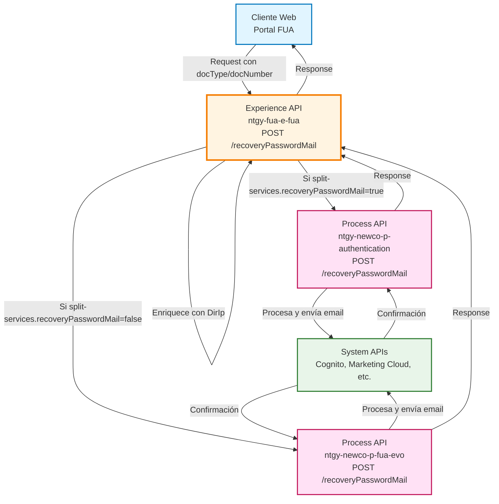
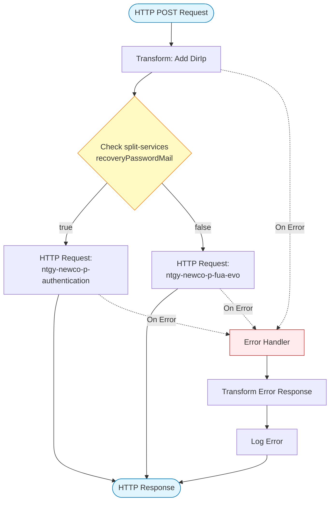
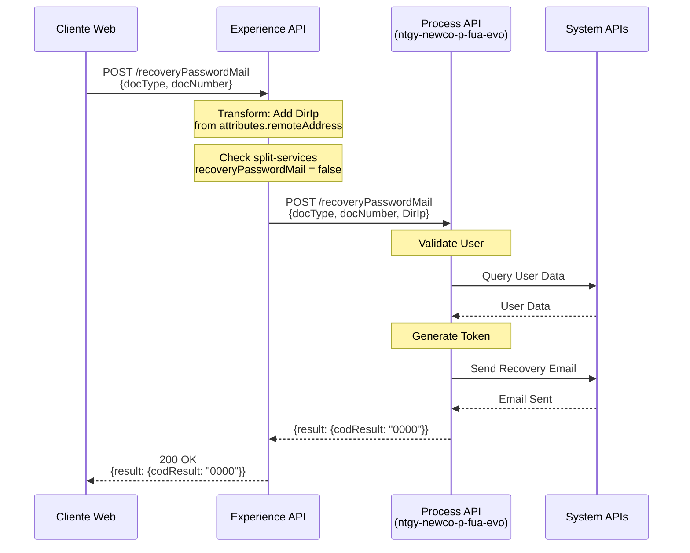
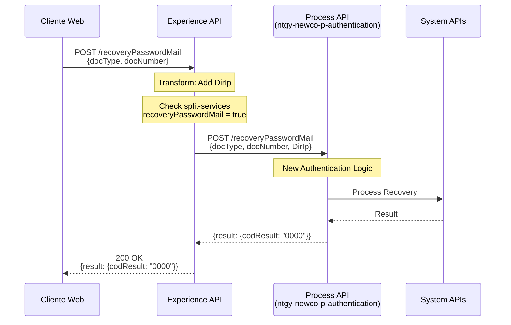
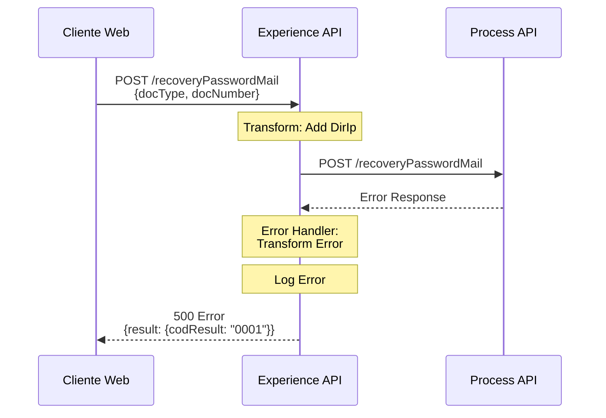

# POST /recoveryPasswordMail

## 📌 Descripción General

### Propósito del Endpoint

Este endpoint permite a los usuarios del portal FUA solicitar la recuperación de su contraseña mediante el envío de un correo electrónico. El sistema valida la identidad del usuario mediante su tipo y número de documento, enriquece la solicitud con la dirección IP del cliente, y delega el procesamiento a un Process API según la configuración de split-services.

### Tipo de API

**Capa:** Experience API (API-Led Connectivity)

**Función:** Orquestación de recuperación de contraseña con enriquecimiento de datos del cliente

### Patrón de Integración

**Tipo:** Pass-Through con Enriquecimiento de Datos

**Descripción:** El endpoint recibe la solicitud del usuario, añade información contextual (dirección IP del cliente), y enruta la petición al Process API correspondiente según la configuración de migración gradual (split-services).

### Arquitectura API-Led Connectivity



---

## 💼 Propósito del Negocio

### Casos de Uso Principales

1. **Recuperación de Contraseña Olvidada**
   - Usuario no puede acceder a su cuenta del portal FUA
   - Solicita recuperación mediante su documento de identidad
   - Recibe email con instrucciones para restablecer contraseña

2. **Autoservicio de Seguridad**
   - Reduce carga en call center al permitir autogestión
   - Mejora experiencia del usuario con proceso automatizado
   - Proporciona recuperación inmediata sin intervención de agentes

3. **Migración Gradual de Servicios**
   - Permite transición controlada entre sistemas legacy y nuevos
   - Configuración flexible mediante split-services
   - Facilita testing A/B y rollback si es necesario

### 📱 Canal y Audiencia

#### Canal de Consumo

**Canal:** Web

**Características del Canal:**
- **Plataforma**: Portal web FUA (Frontal Único de Atención)
- **Dispositivos**: Navegadores web en desktop y mobile
- **Conectividad**: Requiere conexión a internet estable
- **Experiencia de Usuario**: Formulario simple con validación de documento

#### Audiencia Objetivo

**Usuarios Finales:**
- **Clientes Residenciales**: Usuarios que han olvidado su contraseña de acceso al portal
- **Clientes Empresariales**: Usuarios corporativos que necesitan recuperar acceso

**Contexto de Uso:**
- **Escenario 1**: Usuario intenta acceder al portal pero no recuerda su contraseña
- **Escenario 2**: Usuario necesita acceso urgente para consultar facturas o realizar gestiones

#### Adaptaciones del Canal

**Optimizaciones Aplicadas:**
- **Enriquecimiento de Datos**: Añade dirección IP del cliente para auditoría y seguridad
- **Formato de Respuesta**: Respuesta simple con código y mensaje de resultado
- **Timeout**: 60 segundos para permitir procesamiento de email
- **Seguridad**: Captura de IP para prevención de fraude

### 🔗 Endpoints Dependientes

Este Experience API consume los siguientes Process APIs (routing condicional):

| Process API | Endpoint | Método | Propósito |
|-------------|----------|--------|-----------|
| `ntgy-newco-p-fua-evo` | `/recoveryPasswordMail` | POST | Procesamiento de recuperación de contraseña (ruta principal - legacy) |
| `ntgy-newco-p-authentication` | `/recoveryPasswordMail` | POST | Procesamiento de recuperación de contraseña (ruta nueva - migración) |

**Nota:** El routing entre Process APIs se controla mediante la propiedad `split-services.recoveryPasswordMail` en la configuración.

### Contexto Empresarial

- **Dominio:** Autenticación y Seguridad de Usuarios
- **Sector:** Energía - Utilities
- **División:** Naturgy España - Portal FUA
- **Canal:** Web

### Stakeholders

- **Clientes de Energía**: Necesitan acceso rápido y seguro a su cuenta
- **Equipo de Soporte**: Reducción de llamadas por recuperación de contraseña
- **Equipo de Seguridad**: Auditoría de intentos de recuperación mediante IP

### Valor de Negocio

- **Reducción de Costos**: Menos llamadas al call center por recuperación de contraseña
- **Mejora de Experiencia**: Autoservicio inmediato sin esperas
- **Seguridad**: Trazabilidad de solicitudes mediante captura de IP
- **Flexibilidad**: Migración gradual entre sistemas sin impacto al usuario

---

## 🔧 Especificación Técnica

### URLs por Ambiente

| Ambiente | URL Base | URL Completa |
|----------|----------|--------------|
| **Local** | `http://localhost:8081` | `http://localhost:8081/fua/api/recoveryPasswordMail` |
| **Development** | `https://ntgy-fua-e-fua-dev.de-c1.cloudhub.io` | `https://ntgy-fua-e-fua-dev.de-c1.cloudhub.io/fua/api/recoveryPasswordMail` |
| **Production** | `https://ntgy-fua-e-fua-pro.de-c1.cloudhub.io` | `https://ntgy-fua-e-fua-pro.de-c1.cloudhub.io/fua/api/recoveryPasswordMail` |

### Método HTTP

```
POST /fua/api/recoveryPasswordMail
```

### 🎯 Consideraciones del Canal

#### Limitaciones del Canal

| Aspecto | Limitación | Razón |
|---------|------------|-------|
| **Timeout** | 60 segundos | Permite tiempo suficiente para procesamiento y envío de email |
| **Rate Limiting** | Según API Gateway | Prevención de abuso y ataques de fuerza bruta |
| **Tamaño de Request** | Mínimo (< 1 KB) | Solo requiere tipo y número de documento |

#### Campos Específicos del Canal

**Campos Añadidos por el Experience API:**

| Campo | Tipo | Descripción | Razón |
|-------|------|-------------|-------|
| `DirIp` | String | Dirección IP del cliente | Auditoría, seguridad y prevención de fraude |

**Extracción de IP:**
- Se obtiene de `attributes.remoteAddress`
- Se procesa para extraer solo la IP (elimina puerto)
- Formato: `substringBefore(substringAfter(attributes.remoteAddress,"/"),":")`

### Parámetros de Entrada

#### Request Body

**Content-Type:** `application/json`

| Campo | Tipo | Requerido | Descripción | Ejemplo |
|-------|------|-----------|-------------|---------|
| `docType` | String | Sí | Tipo de documento de identidad | `"DNI"`, `"NIE"`, `"CIF"` |
| `docNumber` | String | Sí | Número de documento de identidad | `"12345678A"` |

**Estructura del Request:**

```json
{
  "docType": "string",
  "docNumber": "string"
}
```

**Request Enriquecido (enviado al Process API):**

```json
{
  "docType": "string",
  "docNumber": "string",
  "DirIp": "192.168.1.100"
}
```

### Respuestas

#### Respuesta Exitosa (200 OK)

**Content-Type:** `application/json`

```json
{
  "result": {
    "codResult": "0000",
    "msgResult": "No hay error"
  }
}
```

**Estructura de la Respuesta:**

| Campo | Tipo | Descripción |
|-------|------|-------------|
| `result` | Object | Objeto contenedor del resultado |
| `result.codResult` | String | Código de resultado ("0000" = éxito) |
| `result.msgResult` | String | Mensaje descriptivo del resultado |

#### Respuesta de Error (4xx/5xx)

**Estructura de Error:**

```json
{
  "result": {
    "codResult": "0001",
    "msgResult": "Descripción del error"
  }
}
```

**Códigos de Error Comunes:**

| Código | Descripción | HTTP Status |
|--------|-------------|-------------|
| `0000` | Operación exitosa | 200 |
| `0001` | Error genérico del sistema | 500 |
| `[otros]` | Errores específicos del Process API | Variable |

### Autenticación

- **Tipo:** Client ID/Secret (API Gateway)
- **Header:** `client_id` y `client_secret`
- **Nota:** Este endpoint NO requiere autenticación de usuario (es para recuperación de contraseña)

### Timeouts

| Tipo | Valor | Razón |
|------|-------|-------|
| **Request Timeout** | 60 segundos | Permite procesamiento completo de email y validaciones |
| **Connection Timeout** | 30 segundos | Tiempo suficiente para establecer conexión con Process API |

---

## 🏗️ Implementación Técnica

### Arquitectura del Flow



### Transformaciones de Canal

#### Transformación 1: Enriquecimiento con IP del Cliente

**Ubicación:** `post-recovery-password-mail.xml` (líneas 10-21)

**Propósito:** Añadir dirección IP del cliente para auditoría y seguridad

**Lógica DataWeave:**

```dataweave
%dw 2.0
import * from dw::core::Strings
output application/json
---
payload
++ 
{
    "DirIp": substringBefore(substringAfter(attributes.remoteAddress,"/"),":")
}
```

**Mapeo de Campos:**

| Campo Original | Campo Añadido | Transformación |
|----------------|---------------|----------------|
| `payload.docType` | `docType` | Pass-through |
| `payload.docNumber` | `docNumber` | Pass-through |
| `attributes.remoteAddress` | `DirIp` | Extracción de IP (elimina "/" y puerto) |

**Ejemplo de Transformación:**

```
Input attributes.remoteAddress: "/192.168.1.100:54321"
Output DirIp: "192.168.1.100"
```

### Routing Condicional

**Configuración:** Basada en propiedad `split-services.recoveryPasswordMail`

**Ubicación:** `post-recovery-password-mail.xml` (líneas 22-32)

```xml
<choice>
    <when expression="#[(Mule::p('split-services.recoveryPasswordMail') as Boolean default false)]">
        <!-- Ruta nueva: ntgy-newco-p-authentication -->
        <http:request method="POST" config-ref="HTTP_Request_newco-p-authentication" 
                      path="/recoveryPasswordMail" />
    </when>
    <otherwise>
        <!-- Ruta legacy: ntgy-newco-p-fua-evo -->
        <http:request method="POST" config-ref="HTTP_FUA_PROCESS_NEWCO_EVO" 
                      path="/recoveryPasswordMail" />
    </otherwise>
</choice>
```

**Lógica de Decisión:**

| Valor de Configuración | Process API Seleccionado | Propósito |
|------------------------|---------------------------|-----------|
| `true` | `ntgy-newco-p-authentication` | Sistema nuevo (migración) |
| `false` (default) | `ntgy-newco-p-fua-evo` | Sistema legacy (actual) |

**Configuración Actual (Producción):**
```yaml
split-services:
  recoveryPasswordMail: "false"  # Usando ruta legacy
```

### Patrones de Diseño

**Patrón:** Content-Based Router con Feature Toggle

**Justificación:** 
- Permite migración gradual entre sistemas sin cambios en el cliente
- Facilita rollback inmediato en caso de problemas
- Soporta testing A/B y despliegue canary
- Minimiza riesgo durante transición de arquitectura

### Diagramas de Secuencia

#### 1. Flujo Normal de Éxito (Ruta Legacy)



#### 2. Flujo con Ruta Nueva (Migración)



#### 3. Flujo con Error



### Manejo de Errores

**Ubicación:** `post-recovery-password-mail.xml` (líneas 33-48)

**Estrategia:** Global Error Handler con transformación de errores

```xml
<error-handler>
    <on-error-propagate>
        <ee:transform>
            <!-- Si hay payload de error, usarlo -->
            <!-- Si no, crear estructura estándar -->
            if ( !isEmpty(error.errorMessage.payload) ) 
                error.errorMessage.payload
            else 
            {
                "result": {
                    "codResult": "0001",
                    "msgResult": error.description as String replace /\"/ with("")
                }
            }
        </ee:transform>
        <logger level="ERROR" message="[error details]" />
    </on-error-propagate>
</error-handler>
```

**Tipos de Errores Manejados:**

| Tipo de Error | Acción | Código Resultado |
|---------------|--------|------------------|
| Error del Process API | Propagar payload de error | Variable (del Process API) |
| Error de conectividad | Crear estructura estándar | `0001` |
| Error de transformación | Crear estructura estándar | `0001` |
| Timeout | Crear estructura estándar | `0001` |

### Configuración de Conectores HTTP

#### Conector 1: ntgy-newco-p-fua-evo (Legacy)

**Configuración:** `HTTP_FUA_PROCESS_NEWCO_EVO`

```yaml
newco-p-fua-evo:
  host: "mule-worker-internal-ntgy-newco-p-fua-evo.de-c1.cloudhub.io"
  port: "8091"
  timeout: "60000"
```

#### Conector 2: ntgy-newco-p-authentication (Nuevo)

**Configuración:** `HTTP_Request_newco-p-authentication`

```yaml
p-authentication:
  host: "ntgy-newco-p-authentication-vx8fhl.internal-6bnlu3.irl-e1.cloudhub.io"
  port: "443"
  protocol: "HTTPS"
  timeout: "600000"
  basePath: "/api/v1"
```

---

## 💻 Ejemplos de Uso

### Ejemplo 1: Llamada Exitosa desde Portal Web

#### cURL

```bash
curl -X POST "https://ntgy-fua-e-fua-pro.de-c1.cloudhub.io/fua/api/recoveryPasswordMail" \
  -H "Content-Type: application/json" \
  -H "client_id: YOUR_CLIENT_ID" \
  -H "client_secret: YOUR_CLIENT_SECRET" \
  -d '{
    "docType": "DNI",
    "docNumber": "12345678A"
  }'
```

#### Respuesta (200 OK)

```json
{
  "result": {
    "codResult": "0000",
    "msgResult": "No hay error"
  }
}
```

### Ejemplo 2: JavaScript (Frontend Web)

```javascript
async function requestPasswordRecovery(docType, docNumber) {
  try {
    const response = await fetch('https://ntgy-fua-e-fua-pro.de-c1.cloudhub.io/fua/api/recoveryPasswordMail', {
      method: 'POST',
      headers: {
        'Content-Type': 'application/json',
        'client_id': 'YOUR_CLIENT_ID',
        'client_secret': 'YOUR_CLIENT_SECRET'
      },
      body: JSON.stringify({
        docType: docType,
        docNumber: docNumber
      })
    });

    const data = await response.json();
    
    if (data.result.codResult === '0000') {
      console.log('Email de recuperación enviado exitosamente');
      return { success: true, message: data.result.msgResult };
    } else {
      console.error('Error en recuperación:', data.result.msgResult);
      return { success: false, message: data.result.msgResult };
    }
  } catch (error) {
    console.error('Error de conexión:', error);
    return { success: false, message: 'Error de conexión' };
  }
}

// Uso
requestPasswordRecovery('DNI', '12345678A')
  .then(result => {
    if (result.success) {
      alert('Se ha enviado un email con instrucciones para recuperar tu contraseña');
    } else {
      alert('Error: ' + result.message);
    }
  });
```

### Ejemplo 3: Python

```python
import requests

def request_password_recovery(doc_type, doc_number):
    """
    Solicita recuperación de contraseña para un usuario
    
    Args:
        doc_type (str): Tipo de documento (DNI, NIE, CIF)
        doc_number (str): Número de documento
        
    Returns:
        dict: Resultado de la operación
    """
    url = 'https://ntgy-fua-e-fua-pro.de-c1.cloudhub.io/fua/api/recoveryPasswordMail'
    
    headers = {
        'Content-Type': 'application/json',
        'client_id': 'YOUR_CLIENT_ID',
        'client_secret': 'YOUR_CLIENT_SECRET'
    }
    
    payload = {
        'docType': doc_type,
        'docNumber': doc_number
    }
    
    try:
        response = requests.post(url, json=payload, headers=headers, timeout=60)
        response.raise_for_status()
        
        data = response.json()
        
        if data['result']['codResult'] == '0000':
            print('Email de recuperación enviado exitosamente')
            return {'success': True, 'message': data['result']['msgResult']}
        else:
            print(f"Error: {data['result']['msgResult']}")
            return {'success': False, 'message': data['result']['msgResult']}
            
    except requests.exceptions.Timeout:
        print('Timeout: El servidor tardó demasiado en responder')
        return {'success': False, 'message': 'Timeout'}
    except requests.exceptions.RequestException as e:
        print(f'Error de conexión: {e}')
        return {'success': False, 'message': str(e)}

# Uso
result = request_password_recovery('DNI', '12345678A')
if result['success']:
    print('Operación exitosa')
else:
    print(f"Error: {result['message']}")
```

### Ejemplo 4: Respuesta de Error

#### Request con Usuario No Encontrado

```bash
curl -X POST "https://ntgy-fua-e-fua-pro.de-c1.cloudhub.io/fua/api/recoveryPasswordMail" \
  -H "Content-Type: application/json" \
  -H "client_id: YOUR_CLIENT_ID" \
  -d '{
    "docType": "DNI",
    "docNumber": "99999999Z"
  }'
```

#### Respuesta (500 Internal Server Error)

```json
{
  "result": {
    "codResult": "0001",
    "msgResult": "Usuario no encontrado en el sistema"
  }
}
```

### Ejemplo 5: Testing con Postman

**Configuración de Request:**

```
Method: POST
URL: {{base_url}}/fua/api/recoveryPasswordMail
Headers:
  Content-Type: application/json
  client_id: {{client_id}}
  client_secret: {{client_secret}}

Body (raw JSON):
{
  "docType": "DNI",
  "docNumber": "12345678A"
}

Tests (JavaScript):
pm.test("Status code is 200", function () {
    pm.response.to.have.status(200);
});

pm.test("Response has result object", function () {
    var jsonData = pm.response.json();
    pm.expect(jsonData).to.have.property('result');
});

pm.test("codResult is 0000", function () {
    var jsonData = pm.response.json();
    pm.expect(jsonData.result.codResult).to.eql("0000");
});
```

**Variables de Entorno Postman:**

```json
{
  "base_url": "https://ntgy-fua-e-fua-pro.de-c1.cloudhub.io/fua/api",
  "client_id": "your_client_id_here",
  "client_secret": "your_client_secret_here"
}
```
