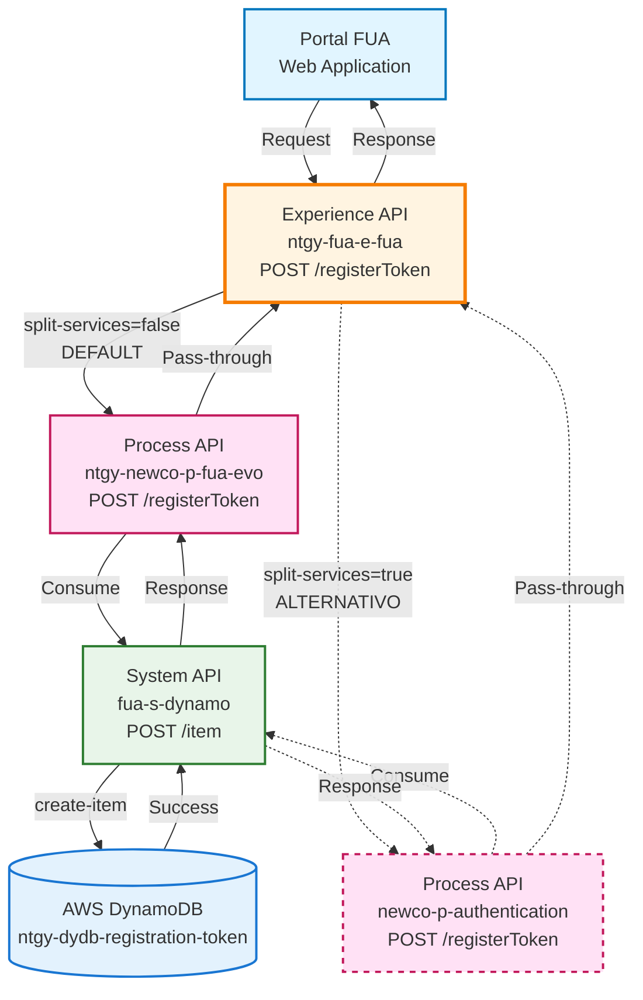
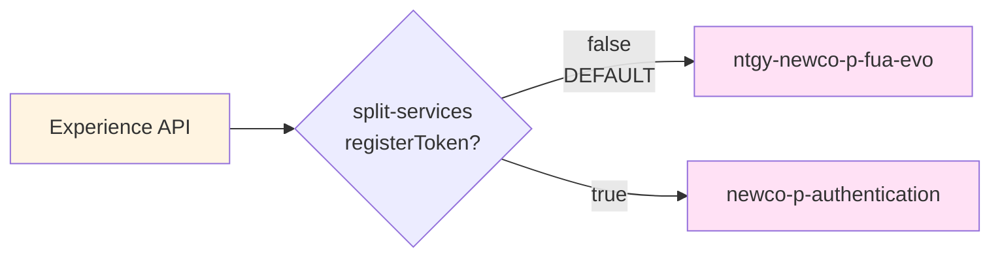
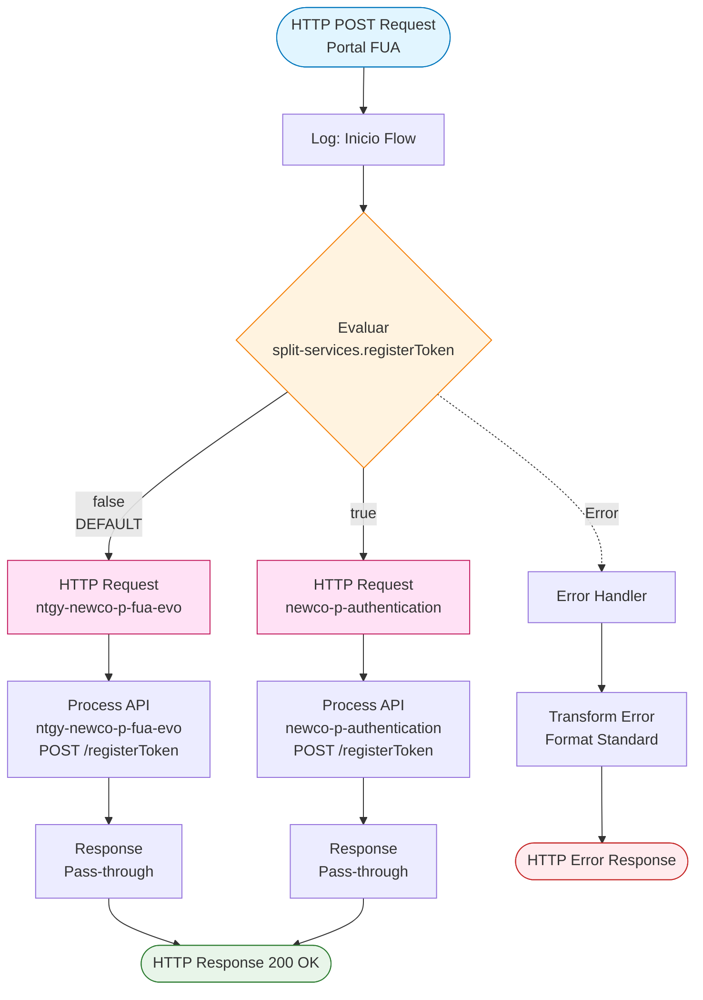
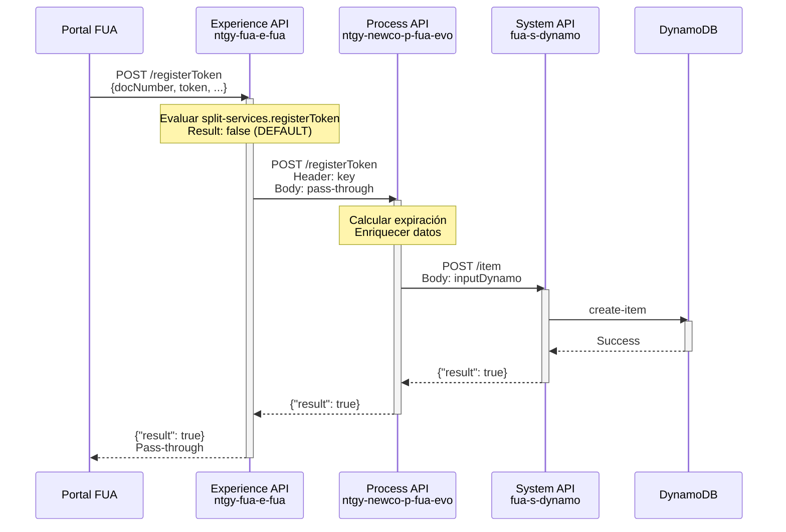
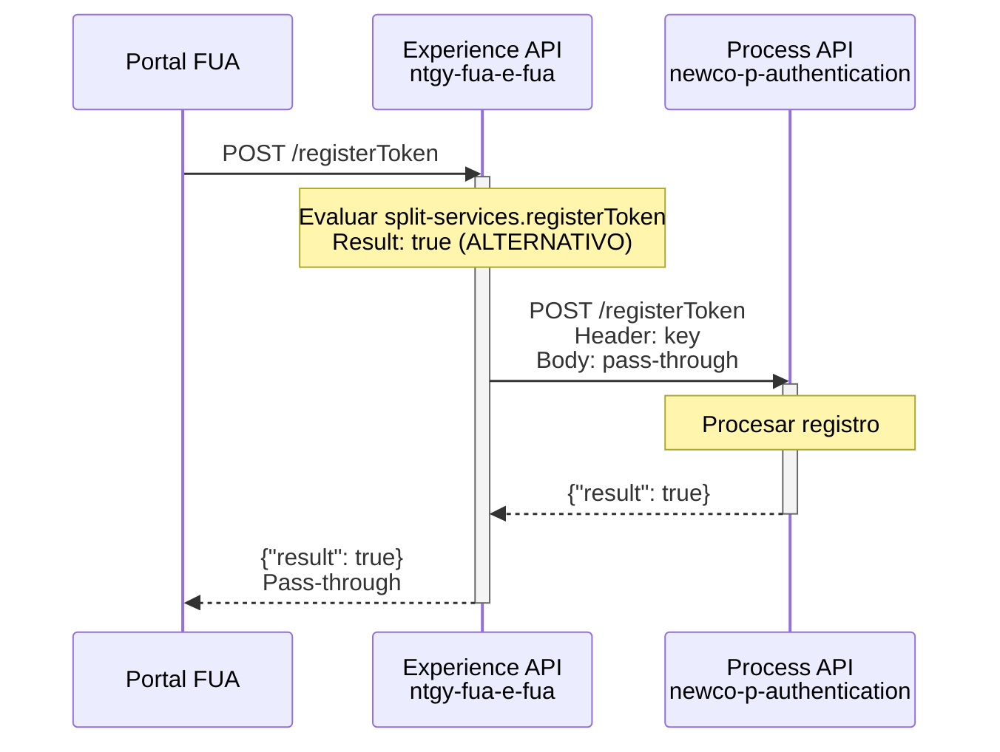
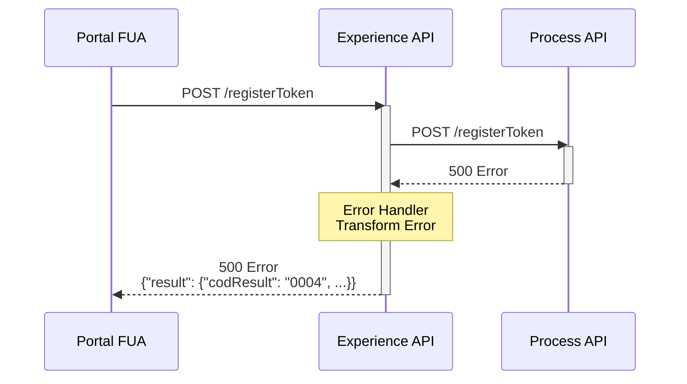

# POST /registerToken

## 📌 Descripción General

### Propósito del Endpoint

Este endpoint del Experience API actúa como **proxy inteligente** para el registro de tokens de pre-registro de clientes. Enruta dinámicamente las solicitudes a diferentes Process APIs según la configuración del sistema, proporcionando una interfaz unificada para el portal FUA independientemente del backend utilizado.

### Tipo de API

**Capa:** Experience API (API-Led Connectivity)

**Función:** Proxy con enrutamiento dinámico basado en configuración

### Patrón de Integración

**Tipo:** Pass-Through con Content-Based Routing

**Descripción:** El Experience API NO transforma los datos. Actúa como un proxy inteligente que:
1. Recibe la solicitud del portal FUA
2. Evalúa la configuración `split-services.registerToken`
3. Enruta a uno de dos Process APIs posibles
4. Devuelve la respuesta sin modificaciones

### Arquitectura API-Led Connectivity



---

## 💼 Propósito del Negocio

### Casos de Uso Principales

1. **Pre-registro de Nuevos Clientes desde Portal Web**
   - Usuario inicia proceso de registro en portal FUA
   - Sistema genera token único de pre-registro
   - Token se almacena con fecha de expiración automática
   - Permite validación posterior del proceso de alta

2. **Flexibilidad de Arquitectura**
   - Permite cambiar el backend de autenticación sin modificar el frontend
   - Facilita migraciones graduales entre sistemas
   - Soporta estrategias de despliegue blue-green

3. **Abstracción de Complejidad**
   - Portal FUA no necesita conocer qué Process API se usa
   - Configuración centralizada del enrutamiento
   - Simplifica la integración del frontend

### 📱 Canal y Audiencia

#### Canal de Consumo

**Canal:** Web

**Características del Canal:**
- **Plataforma**: Portal FUA (Frontal Único de Atención)
- **Dispositivos**: Navegadores web (desktop y móvil)
- **Conectividad**: Conexión estable requerida para registro
- **Experiencia de Usuario**: Proceso de registro paso a paso

#### Audiencia Objetivo

**Usuarios Finales:**
- **Clientes Potenciales**: Usuarios que inician proceso de alta en portal FUA
- **Nuevos Clientes**: Personas que desean contratar servicios de energía

**Contexto de Uso:**
- **Registro Inicial**: Primera vez que el usuario accede al portal
- **Proceso de Alta**: Durante el flujo de onboarding de nuevos clientes
- **Validación de Identidad**: Parte del proceso de verificación de cliente

#### Adaptaciones del Canal

**Optimizaciones Aplicadas:**
- **Pass-Through**: No se aplican transformaciones - respuesta directa del Process API
- **Enrutamiento Transparente**: El canal web no percibe diferencias entre backends
- **Manejo de Errores**: Errores del Process API se propagan al frontend para manejo apropiado

### 🔗 Endpoints Dependientes

Este Experience API consume los siguientes Process APIs (enrutamiento dinámico):

| Process API | Endpoint | Método | Propósito | Condición |
|-------------|----------|--------|-----------|-----------|
| `ntgy-newco-p-fua-evo` | `/registerToken` | POST | Registro de tokens de pre-registro | **DEFAULT** (split-services.registerToken = false) |
| `newco-p-authentication` | `/registerToken` | POST | Registro de tokens de pre-registro | ALTERNATIVO (split-services.registerToken = true) |

**Flujo de Enrutamiento:**



**Nota Importante:** Ambos Process APIs implementan la misma funcionalidad y devuelven la misma estructura de respuesta. La elección entre uno u otro es transparente para el cliente.

### Contexto Empresarial

- **Dominio:** Gestión de Pre-registro de Clientes
- **Sector:** Energía - Utilities
- **División:** Naturgy España - NewCo
- **Canal:** Web (Portal FUA)

### Stakeholders

- **Clientes Potenciales**: Usuarios en proceso de alta en el portal FUA
- **Equipo de Desarrollo Frontend**: Desarrolladores del portal FUA
- **Equipo de Arquitectura**: Responsables de la estrategia de microservicios
- **Equipo de Operaciones**: Gestión de despliegues y migraciones

### Valor de Negocio

- **Flexibilidad Arquitectónica**: Permite cambios de backend sin impacto en frontend
- **Continuidad de Servicio**: Facilita migraciones sin downtime
- **Simplicidad de Integración**: Frontend consume un único endpoint
- **Escalabilidad**: Permite distribuir carga entre diferentes backends

---

## 🔧 Especificación Técnica

### URLs por Ambiente

| Ambiente | URL Base | URL Completa |
|----------|----------|--------------|
| **Local** | `http://localhost:8081` | `http://localhost:8081/fua/api/registerToken` |
| **Development** | `https://ntgy-fua-e-fua-dev.de-c1.cloudhub.io` | `https://ntgy-fua-e-fua-dev.de-c1.cloudhub.io/fua/api/registerToken` |
| **UAT** | `https://ntgy-fua-e-fua-uat.de-c1.cloudhub.io` | `https://ntgy-fua-e-fua-uat.de-c1.cloudhub.io/fua/api/registerToken` |
| **Production** | `https://ntgy-fua-e-fua-pro.de-c1.cloudhub.io` | `https://ntgy-fua-e-fua-pro.de-c1.cloudhub.io/fua/api/registerToken` |

### Método HTTP

```
POST /fua/api/registerToken
```

### 🎯 Consideraciones del Canal

#### Limitaciones del Canal

| Aspecto | Limitación | Razón |
|---------|------------|-------|
| **Timeout** | 30 segundos | Timeout del Process API subyacente |
| **Rate Limiting** | Según configuración CloudHub | Protección contra abuso |
| **Tamaño de Request** | 10 MB máximo | Límite estándar de CloudHub |

#### Configuración de Enrutamiento

**Propiedad de Configuración:**
```yaml
split-services:
  registerToken: false  # false = ntgy-newco-p-fua-evo (DEFAULT)
                        # true = newco-p-authentication
```

**Ubicación:** `e-fua-[env]-config.yaml`

### Headers Requeridos

| Header | Tipo | Obligatorio | Descripción |
|--------|------|-------------|-------------|
| `Content-Type` | string | ✅ Sí | Debe ser `application/json` |
| `key` | string | ✅ Sí | Clave de autenticación para el Process API |

### Parámetros de Entrada

#### Request Body (application/json)

```json
{
  "docNumber": "string",
  "docType": "string",
  "email": "string",
  "name": "string",
  "clientType": "string",
  "operation": "string",
  "token": "string"
}
```

#### Descripción de Campos

| Campo | Tipo | Obligatorio | Descripción |
|-------|------|-------------|-------------|
| `docNumber` | string | ✅ Sí | Número de documento del cliente |
| `docType` | string | ✅ Sí | Tipo de documento (DNI, NIE, CIF, etc.) |
| `email` | string | ❌ No | Email del cliente |
| `name` | string | ❌ No | Nombre del cliente |
| `clientType` | string | ❌ No | Tipo de cliente |
| `operation` | string | ❌ No | Tipo de operación |
| `token` | string | ✅ Sí | Token único de pre-registro |

**Nota:** Los campos exactos pueden variar según el Process API configurado. Consultar documentación del Process API específico para detalles completos.

### Respuestas

#### 200 OK - Registro Exitoso

⚠️ **Pass-Through Response**: El Experience API devuelve la respuesta del Process API sin modificaciones.

**Respuesta Real del Process API:**
```json
{
  "result": true
}
```

**Nota sobre RAML:** El RAML define una estructura diferente (`result.codResult`, `result.msgResult`), pero el código real devuelve `{"result": true}`. Esta documentación refleja la implementación real.

#### 400 Bad Request - Error de Validación

```json
{
  "error": "Datos de entrada inválidos",
  "details": "Campo requerido faltante: docNumber"
}
```

#### 500 Internal Server Error - Error del Sistema

```json
{
  "result": {
    "codResult": "0004",
    "msgResult": "[Descripción del error]"
  }
}
```

**Nota:** Los errores son manejados por el error handler del Experience API y transformados a un formato estándar.

### Autenticación

- **Tipo:** API Key (header `key`)
- **Descripción:** Se requiere una clave de autenticación válida que se propaga al Process API

### Timeouts

| Tipo | Valor | Razón |
|------|-------|-------|
| **Request Timeout** | 30 segundos | Heredado del Process API subyacente |
| **Connection Timeout** | 10 segundos | Configuración estándar de HTTP connector |

---

## 🏗️ Implementación Técnica

### Arquitectura del Flow



### Implementación del Código

**Ubicación:** `src/main/mule/services/login/post-register-token.xml`

```xml
<flow name="post-register-tokenFlow">
    <choice doc:name="Choice">
        <!-- Ruta Alternativa: newco-p-authentication -->
        <when expression="#[(Mule::p('split-services.registerToken') as Boolean default false)]">
            <http:request method="POST" 
                         doc:name="POST Register Token" 
                         config-ref="HTTP_Request_newco-p-authentication" 
                         path="/registerToken">
                <http:headers><![CDATA[#[output application/java
---
{
    "Key" : attributes.headers.key
}]]]></http:headers>
            </http:request>
        </when>
        
        <!-- Ruta Por Defecto: ntgy-newco-p-fua-evo -->
        <otherwise>
            <http:request method="POST" 
                         doc:name="POST Register Token" 
                         config-ref="HTTP_FUA_PROCESS_NEWCO_EVO" 
                         path="/registerToken">
                <http:headers><![CDATA[#[output application/java
---
{
    "Key" : attributes.headers.key
}]]]></http:headers>
            </http:request>
        </otherwise>
    </choice>
    
    <!-- Error Handler -->
    <error-handler>
        <on-error-propagate enableNotifications="true" logException="true">
            <ee:transform doc:name="Set Error Message">
                <ee:set-payload><![CDATA[%dw 2.0
output application/json
---
if ( !isEmpty(error.errorMessage.payload) ) error.errorMessage.payload
else 
{
    "result": {
        "codResult": "0004",
        "msgResult": error.description as String replace /\"/ with("")
    }
}]]></ee:set-payload>
            </ee:transform>
            <logger level="ERROR" doc:name="Error" message="#[payload]"/>
        </on-error-propagate>
    </error-handler>
</flow>
```

### Transformaciones de Canal

⚠️ **Este Experience API NO transforma la respuesta del Process API.**

**Patrón:** Pass-Through Proxy

**Comportamiento:**
- El payload del request se pasa directamente al Process API
- La respuesta del Process API se devuelve sin modificaciones
- Solo se propaga el header `key` para autenticación

Para el schema completo de request/response, consultar:
📖 **Process API: `ntgy-newco-p-fua-evo` endpoint `POST /registerToken`**

### Patrones de Diseño

**Patrón 1: Content-Based Routing**

**Justificación:** Permite enrutamiento dinámico basado en configuración sin modificar código. Facilita:
- Migraciones graduales entre sistemas
- Estrategias de despliegue blue-green
- Testing A/B de diferentes backends

**Patrón 2: Proxy Pattern**

**Justificación:** El Experience API actúa como proxy transparente que:
- Abstrae la complejidad del backend del frontend
- Proporciona un punto único de entrada
- Facilita cambios de arquitectura sin impacto en clientes

**Patrón 3: Header Propagation**

**Justificación:** Propaga el header `key` de autenticación al Process API, manteniendo la seguridad end-to-end.

### Configuración de HTTP Connectors

#### Connector 1: HTTP_FUA_PROCESS_NEWCO_EVO (DEFAULT)

```yaml
newco-p-fua:
  host: "${newco-p-fua.host}"
  port: "${newco-p-fua.port}"
  basePath: "/api"
  timeout: "30000"
```

#### Connector 2: HTTP_Request_newco-p-authentication (ALTERNATIVO)

```yaml
newco-p-authentication:
  host: "${newco-p-authentication.host}"
  port: "${newco-p-authentication.port}"
  basePath: "/api"
  timeout: "30000"
```

### Diagramas de Secuencia

#### 1. Flujo Normal de Éxito (Ruta Por Defecto)



#### 2. Flujo con Ruta Alternativa



#### 3. Flujo con Error del Process API



### Optimizaciones del Canal

**Optimizaciones Aplicadas:**

1. **Pass-Through Directo**
   - No se aplican transformaciones innecesarias
   - Latencia mínima añadida por el Experience API
   - Respuesta directa del Process API

2. **Enrutamiento Eficiente**
   - Evaluación de configuración en memoria
   - Sin consultas externas para determinar ruta
   - Decisión de routing en milisegundos

3. **Propagación de Headers**
   - Solo se propaga el header necesario (`key`)
   - Reduce overhead de comunicación

### Manejo de Errores

**Estrategia:** Error handler global con transformación de errores

**Tipos de Errores Manejados:**

1. **Errores del Process API**
   - Si el Process API devuelve un error en el payload, se propaga tal cual
   - Permite que el frontend maneje errores de negocio específicos

2. **Errores de Conectividad**
   - Timeout en llamada al Process API
   - Error de conexión
   - Se transforma a formato estándar con `codResult: "0004"`

3. **Errores de Configuración**
   - Connector no configurado
   - Propiedad de routing inválida
   - Se transforma a formato estándar

**Respuesta de Error Estandarizada:**

```json
{
  "result": {
    "codResult": "0004",
    "msgResult": "[Descripción del error técnico]"
  }
}
```

**Logging de Errores:**
- Nivel ERROR para todos los errores
- Incluye descripción completa del error
- Facilita troubleshooting en CloudWatch

---

## 💻 Ejemplos de Uso

### Ejemplo 1: Registro Exitoso desde Portal FUA

#### cURL

```bash
curl -X POST "https://ntgy-fua-e-fua-dev.de-c1.cloudhub.io/fua/api/registerToken" \
  -H "Content-Type: application/json" \
  -H "key: YOUR_API_KEY" \
  -d '{
    "docNumber": "12345678A",
    "docType": "DNI",
    "email": "cliente@example.com",
    "name": "Juan Pérez",
    "clientType": "residential",
    "operation": "pre-registration",
    "token": "abc123def456ghi789"
  }'
```

#### Respuesta (200 OK)

```json
{
  "result": true
}
```

**Nota:** Esta es la respuesta REAL del Process API, pasada sin modificaciones por el Experience API.

### Ejemplo 2: JavaScript (Portal FUA - Frontend)

```javascript
const registerToken = async (tokenData) => {
  try {
    const response = await fetch(
      'https://ntgy-fua-e-fua-pro.de-c1.cloudhub.io/fua/api/registerToken',
      {
        method: 'POST',
        headers: {
          'Content-Type': 'application/json',
          'key': process.env.FUA_API_KEY
        },
        body: JSON.stringify({
          docNumber: tokenData.docNumber,
          docType: tokenData.docType,
          email: tokenData.email,
          name: tokenData.name,
          clientType: 'residential',
          operation: 'pre-registration',
          token: tokenData.token
        })
      }
    );

    if (response.ok) {
      const data = await response.json();
      console.log('Token registrado exitosamente:', data);
      return data;
    } else {
      const error = await response.json();
      console.error('Error al registrar token:', error);
      throw new Error(error.result?.msgResult || 'Error desconocido');
    }
  } catch (error) {
    console.error('Error de red:', error);
    throw error;
  }
};

// Uso
registerToken({
  docNumber: '12345678A',
  docType: 'DNI',
  email: 'cliente@example.com',
  name: 'Juan Pérez',
  token: 'abc123def456ghi789'
});
```

### Ejemplo 3: Python (Testing/Automation)

```python
import requests
import json

def register_token(token_data, api_key):
    """
    Registra un token de pre-registro en el sistema FUA
    
    Args:
        token_data: Diccionario con datos del token
        api_key: Clave de API para autenticación
    
    Returns:
        dict: Respuesta del API
    """
    url = 'https://ntgy-fua-e-fua-dev.de-c1.cloudhub.io/fua/api/registerToken'
    
    headers = {
        'Content-Type': 'application/json',
        'key': api_key
    }
    
    payload = {
        'docNumber': token_data['docNumber'],
        'docType': token_data['docType'],
        'email': token_data.get('email', ''),
        'name': token_data.get('name', ''),
        'clientType': token_data.get('clientType', 'residential'),
        'operation': 'pre-registration',
        'token': token_data['token']
    }
    
    try:
        response = requests.post(url, headers=headers, json=payload, timeout=30)
        response.raise_for_status()
        
        result = response.json()
        print(f'Token registrado exitosamente: {result}')
        return result
        
    except requests.exceptions.Timeout:
        print('Error: Timeout al registrar token')
        raise
    except requests.exceptions.HTTPError as e:
        print(f'Error HTTP {response.status_code}: {response.text}')
        raise
    except Exception as e:
        print(f'Error inesperado: {str(e)}')
        raise

# Uso
token_data = {
    'docNumber': '12345678A',
    'docType': 'DNI',
    'email': 'cliente@example.com',
    'name': 'Juan Pérez',
    'token': 'abc123def456ghi789'
}

result = register_token(token_data, 'YOUR_API_KEY')
```

### Ejemplo 4: Error - Campo Requerido Faltante

#### cURL

```bash
curl -X POST "https://ntgy-fua-e-fua-dev.de-c1.cloudhub.io/fua/api/registerToken" \
  -H "Content-Type: application/json" \
  -H "key: YOUR_API_KEY" \
  -d '{
    "docType": "DNI",
    "email": "cliente@example.com"
  }'
```

#### Respuesta (400 Bad Request)

```json
{
  "error": "Datos de entrada inválidos",
  "details": "Campos requeridos faltantes: docNumber, token"
}
```

**Nota:** El error es generado por el Process API y propagado por el Experience API.

### Ejemplo 5: Error - Timeout del Process API

#### Respuesta (500 Internal Server Error)

```json
{
  "result": {
    "codResult": "0004",
    "msgResult": "Timeout exceeded when calling Process API"
  }
}
```

**Nota:** Este error es transformado por el error handler del Experience API cuando el Process API no responde a tiempo.

### Ejemplo 6: Verificación de Configuración de Routing

```bash
# Para verificar qué Process API se está usando, revisar los logs de CloudWatch
# El log mostrará qué ruta del choice se ejecutó

# Verificar configuración actual (requiere acceso a properties)
curl -X GET "https://ntgy-fua-e-fua-dev.de-c1.cloudhub.io/fua/api/health" \
  -H "key: YOUR_API_KEY"
```

**Nota:** La configuración de routing (`split-services.registerToken`) se gestiona a nivel de properties y no es expuesta públicamente por razones de seguridad.