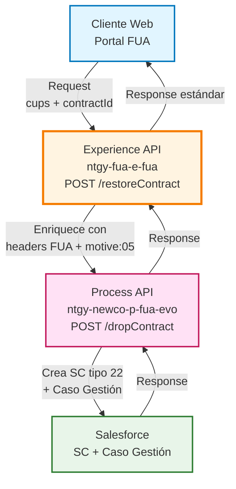
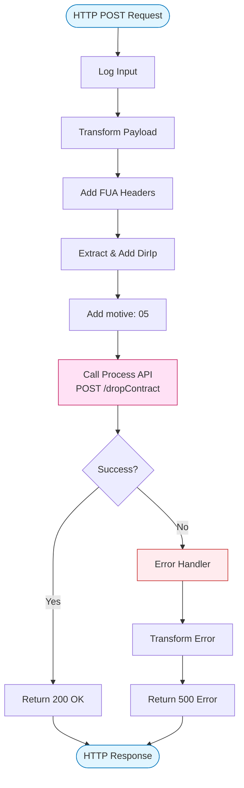
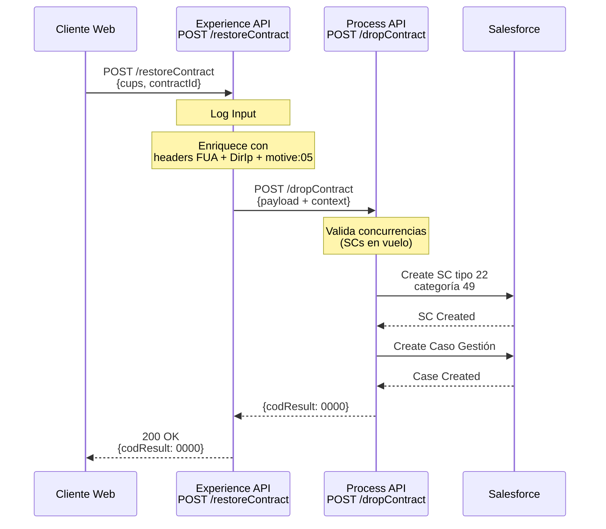
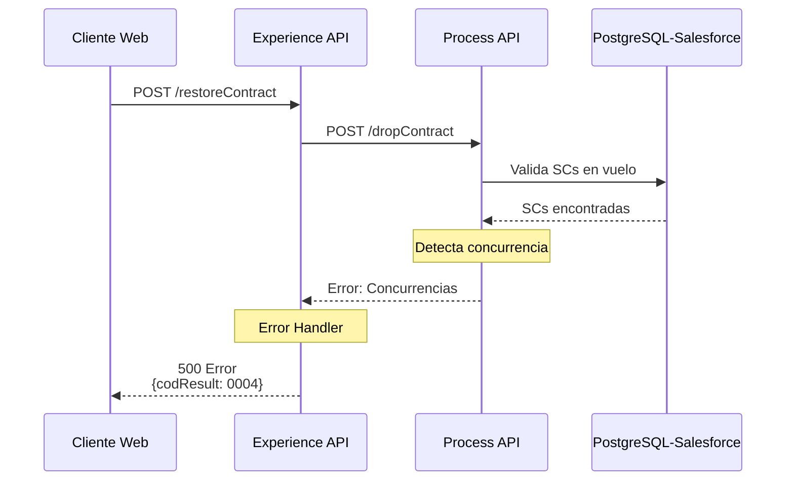
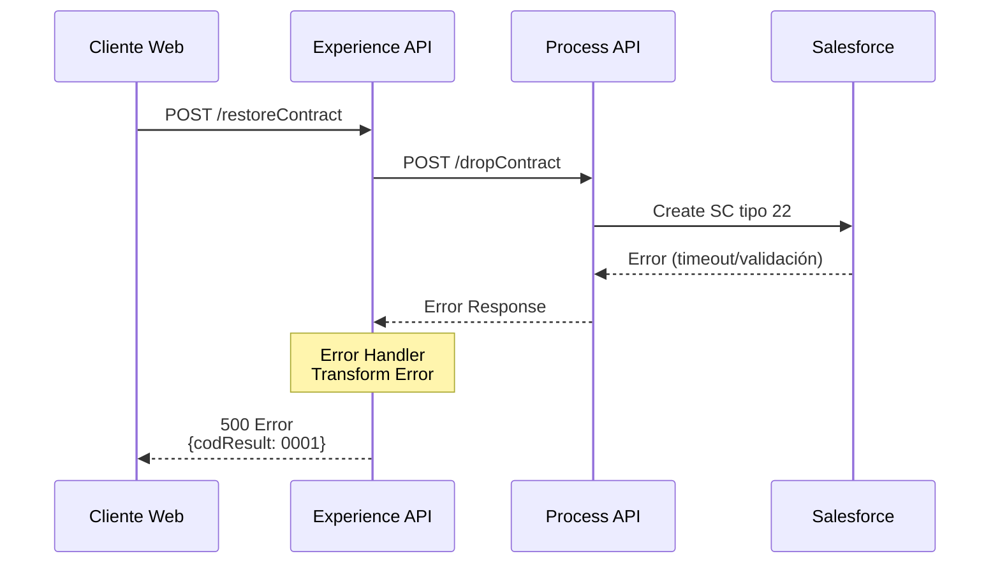

# POST /restoreContract

## 📌 Descripción General

### Propósito del Endpoint

Este endpoint permite a los clientes recuperar contratos que fueron previamente dados de baja, generando una Solicitud de Contratación (SC) tipo 22 con categoría 49 (Recuperación) en Salesforce. El proceso reutiliza la lógica del endpoint `/dropContract` del Process API pero con el motivo hardcodeado "05" que identifica específicamente operaciones de recuperación.

### Tipo de API

**Capa:** Experience API (API-Led Connectivity)

**Función:** Adaptación de experiencia para canal web (FUA - Formulario Único de Alta)

### Patrón de Integración

**Tipo:** Transformación y Enriquecimiento

**Descripción:** El Experience API enriquece el payload del cliente con headers FUA, datos de contexto (DirIp) y el motivo de recuperación ("05") antes de invocar al Process API que orquesta la creación de objetos en Salesforce.

### Arquitectura API-Led Connectivity



---

## 💼 Propósito del Negocio

### Casos de Uso Principales

1. **Recuperación de Contrato por Error**
   - Cliente solicita recuperar un contrato dado de baja por error
   - Se genera SC tipo 22 para reactivar el contrato sin crear uno nuevo
   - Beneficio: Evita duplicación de contratos y mantiene histórico

2. **Reactivación de Servicio**
   - Cliente desea reactivar un servicio previamente cancelado
   - Se crea automáticamente un Caso de Gestión para seguimiento
   - Beneficio: Proceso automatizado con trazabilidad completa

3. **Gestión desde Portal Web**
   - Agentes o clientes pueden solicitar recuperación desde FUA
   - El sistema valida concurrencias antes de procesar
   - Beneficio: Autoservicio con validaciones de negocio

### 📱 Canal y Audiencia

#### Canal de Consumo

**Canal:** Web (FUA - Formulario Único de Alta)

**Características del Canal:**
- **Plataforma**: Portal web de autoservicio Naturgy
- **Dispositivos**: Desktop y tablets
- **Conectividad**: Conexión estable requerida
- **Experiencia de Usuario**: Interfaz guiada con validaciones en tiempo real

#### Audiencia Objetivo

**Usuarios Finales:**
- **Clientes Residenciales**: Clientes que necesitan recuperar contratos dados de baja
- **Agentes de Atención al Cliente**: Personal de call center que gestiona recuperaciones
- **Administradores**: Personal con permisos para operaciones especiales

**Contexto de Uso:**
- **Recuperación Post-Baja**: Cliente se arrepiente de la baja y solicita recuperación
- **Corrección de Errores**: Baja realizada por error que necesita revertirse
- **Reactivación Planificada**: Cliente que dio de baja temporalmente y desea reactivar

#### Adaptaciones del Canal

**Optimizaciones Aplicadas:**
- **Enriquecimiento Automático**: Añade headers FUA y contexto de usuario
- **Extracción de IP**: Captura automáticamente la IP del cliente para auditoría
- **Motivo Hardcodeado**: Fija motive="05" para identificar recuperaciones
- **Manejo de Errores**: Respuestas estandarizadas con códigos de resultado

### 🔗 Endpoints Dependientes

Este Experience API consume el siguiente Process API:

| Process API | Endpoint | Método | Propósito |
|-------------|----------|--------|-----------|
| `ntgy-newco-p-fua-evo` | `/dropContract` | POST | Orquesta la recuperación creando SC tipo 22 (Reposición) con categoría 49 y Caso de Gestión en Salesforce |

**Nota Importante:** Aunque el endpoint del Process API se llama "dropContract", cuando recibe motive="05" ejecuta lógica específica de recuperación, no de baja.

### Contexto Empresarial

- **Dominio:** Gestión de Contratos y Servicios
- **Sector:** Energía - Utilities
- **División:** Naturgy España - NewCo
- **Canal:** Web (FUA)

### Stakeholders

- **Clientes Finales**: Necesitan recuperar contratos dados de baja
- **Agentes de Call Center**: Gestionan solicitudes de recuperación
- **Equipo de Operaciones**: Supervisa el proceso de recuperación
- **Salesforce Administrators**: Gestionan los objetos creados (SC y Casos)

### Valor de Negocio

- **Reducción de Errores**: Permite corregir bajas realizadas por error sin crear nuevos contratos
- **Mejora de Experiencia**: Proceso automatizado y rápido para el cliente
- **Trazabilidad**: Cada recuperación genera un Caso de Gestión para seguimiento
- **Eficiencia Operativa**: Automatización reduce carga de trabajo manual

---

## 🔧 Especificación Técnica

### URLs por Ambiente

| Ambiente | URL Base | URL Completa |
|----------|----------|--------------|
| **Local** | `http://localhost:8081` | `http://localhost:8081/fua/api/restoreContract` |
| **Development** | `https://ntgy-fua-e-fua-dev.us-e2.cloudhub.io` | `https://ntgy-fua-e-fua-dev.us-e2.cloudhub.io/fua/api/restoreContract` |
| **UAT** | `https://ntgy-fua-e-fua-uat.us-e2.cloudhub.io` | `https://ntgy-fua-e-fua-uat.us-e2.cloudhub.io/fua/api/restoreContract` |
| **Production** | `https://ntgy-fua-e-fua-pro.us-e2.cloudhub.io` | `https://ntgy-fua-e-fua-pro.us-e2.cloudhub.io/fua/api/restoreContract` |

### Método HTTP

```
POST /fua/api/restoreContract
```

### 🎯 Consideraciones del Canal

#### Limitaciones del Canal

| Aspecto | Limitación | Razón |
|---------|------------|-------|
| **Timeout** | 60 segundos | Proceso orquestado con múltiples llamadas a Salesforce |
| **Rate Limiting** | Según políticas de API Manager | Protección del backend |
| **Concurrencia** | Validación de SCs en vuelo | Evita conflictos de procesamiento |

#### Campos Específicos del Canal

**Campos Añadidos por el Experience API:**

| Campo | Tipo | Descripción | Razón |
|-------|------|-------------|-------|
| `DirIp` | String | IP del cliente extraída de `attributes.remoteAddress` | Auditoría y trazabilidad |
| `motive` | String | Hardcodeado a "05" | Identifica operación de recuperación |
| Headers FUA | Object | Headers de contexto FUA (x-interaction-id, x-user-id, etc.) | Contexto de usuario y sesión |

### Parámetros de Entrada

#### Headers Requeridos

| Header | Tipo | Obligatorio | Descripción |
|--------|------|-------------|-------------|
| `Content-Type` | String | ✅ | Debe ser `application/json` |
| `x-interaction-id` | String | ✅ | ID de la interacción en Salesforce |
| `x-user-id` | String | ⚠️ | ID del usuario (si está autenticado) |
| `x-client-id` | String | ✅ | ID del cliente en Salesforce |
| `x-client-code` | String | ✅ | Código del cliente (NIF/CIF) |
| `x-contact-id` | String | ✅ | ID del contacto en Salesforce |
| `traceparent` | String | ⚠️ | Trace ID para correlación distribuida |

#### Body (JSON)

```json
{
  "cups": "string",        // CUPS del punto de suministro (obligatorio)
  "contractId": "string"   // ID del contrato a recuperar (obligatorio)
}
```

**Campos del Body:**

| Campo | Tipo | Obligatorio | Descripción | Validaciones |
|-------|------|-------------|-------------|--------------|
| `cups` | String | ✅ | CUPS del punto de suministro | Formato válido de CUPS |
| `contractId` | String | ✅ | ID del contrato en Salesforce | Debe existir en Salesforce |

### Respuestas

#### 200 OK - Recuperación Exitosa

```json
{
  "result": {
    "codResult": "0000",
    "msgResult": "No hay error"
  }
}
```

**Estructura de Respuesta Exitosa:**

| Campo | Tipo | Descripción |
|-------|------|-------------|
| `result` | Object | Objeto con resultado de la operación |
| `result.codResult` | String | Código de resultado ("0000" = éxito) |
| `result.msgResult` | String | Mensaje descriptivo del resultado |

#### 400 Bad Request - Error de Validación

```json
{
  "message": "cups es un campo obligatorio para seguir con la solicitud"
}
```

**Causas Comunes:**
- Campo `cups` faltante o vacío
- Campo `contractId` faltante o vacío
- Headers FUA requeridos faltantes

#### 500 Internal Server Error - Error de Procesamiento

```json
{
  "result": {
    "codResult": "0001",
    "msgResult": "[Descripción del error]"
  }
}
```

**Causas Comunes:**
- Error en llamada al Process API
- Error en Salesforce (SC o Caso no creado)
- Timeout en operación
- Concurrencias detectadas (SCs en vuelo)

#### Códigos de Error Específicos

| Código | Descripción | Acción Recomendada |
|--------|-------------|-------------------|
| `0000` | Operación exitosa | Ninguna |
| `0001` | Error general | Revisar logs y mensaje de error |
| `0004` | Existen concurrencias | Esperar a que se procesen SCs en vuelo |

### Autenticación

- **Tipo:** OAuth 2.0 + JWT Token
- **Validación:** Flow `jwt-validation` ejecutado antes del endpoint
- **Headers:** Token JWT en header `Authorization`

### Timeouts

| Tipo | Valor | Razón |
|------|-------|-------|
| **Request Timeout** | 60 segundos | Proceso orquestado con múltiples operaciones en Salesforce |
| **Process API Timeout** | Configurado en properties | Heredado de configuración HTTP_FUA_PROCESS_NEWCO_EVO |

---

## 🏗️ Implementación Técnica

### Arquitectura del Flow



### Transformaciones de Canal

**Transformación de Enriquecimiento:**

| Campo Original (Request) | Campo Añadido (Process API) | Transformación |
|--------------------------|----------------------------|----------------|
| `payload` | `payload` | Pass-through del body original |
| `attributes.headers` | `vars.fuaHeaders` | Extracción de headers FUA |
| `attributes.remoteAddress` | `DirIp` | Extracción de IP: `substringBefore(substringAfter(attributes.remoteAddress,"/"),":")` |
| N/A | `motive` | Hardcodeado a "05" |

**Lógica de Transformación (DataWeave):**

```dataweave
%dw 2.2
import * from dw::core::Strings
output application/json
---
payload
++ 
vars.fuaHeaders 
++
{
    "DirIp": substringBefore(substringAfter(attributes.remoteAddress,"/"),":"),
    "motive": "05"
}
```

**Explicación de la Transformación:**
1. **Merge del Payload Original**: Mantiene `cups` y `contractId`
2. **Añade Headers FUA**: Contexto de usuario y sesión
3. **Extrae IP del Cliente**: De `attributes.remoteAddress` (formato: "/IP:PORT")
4. **Hardcodea Motivo**: Fija `motive="05"` para identificar recuperación

### Patrones de Diseño

**Patrón:** Enriquecimiento de Contexto (Context Enrichment)

**Justificación:** El Experience API añade contexto específico del canal (headers FUA, IP, motivo) que el Process API necesita para orquestar correctamente la recuperación en Salesforce.

**Patrón:** Reutilización de Lógica (Logic Reuse)

**Justificación:** Reutiliza el endpoint `/dropContract` del Process API pero con un motivo específico ("05") que activa lógica diferente (recuperación en lugar de baja).

### Diagramas de Secuencia

#### 1. Flujo Normal de Éxito



#### 2. Flujo con Error de Concurrencia



#### 3. Flujo con Error Técnico



### Configuración HTTP

**Connector:** `HTTP_FUA_PROCESS_NEWCO_EVO`

**Configuración:**
- **Host**: Configurado en properties por ambiente
- **Port**: Configurado en properties por ambiente
- **Base Path**: `/api`
- **Path**: `/dropContract`
- **Method**: `POST`
- **Timeout**: Configurado en `${newco-p-fua-evo.timeout}`

### Manejo de Errores

**Error Handler Global:**

```xml
<error-handler>
    <on-error-propagate enableNotifications="true" logException="true">
        <ee:transform doc:name="error">
            <ee:set-payload>
                {
                    "result": {
                        "codResult": "0001",
                        "msgResult": error.description as String replace /"/ with("")
                    }
                }
            </ee:set-payload>
        </ee:transform>
        <logger level="INFO" message="Error output: #[payload]"/>
    </on-error-propagate>
</error-handler>
```

**Estrategia:**
1. Captura cualquier error del Process API
2. Transforma a formato estándar con `codResult` y `msgResult`
3. Limpia comillas del mensaje de error
4. Registra en logs para auditoría
5. Retorna 500 con estructura consistente

---

## 💻 Ejemplos de Uso

### Ejemplo 1: Recuperación Exitosa desde Portal Web

#### cURL

```bash
curl -X POST "https://ntgy-fua-e-fua-pro.us-e2.cloudhub.io/fua/api/restoreContract" \
  -H "Content-Type: application/json" \
  -H "Authorization: Bearer YOUR_JWT_TOKEN" \
  -H "x-interaction-id: 5003X000001AbcdQAC" \
  -H "x-user-id: 0053X000001XyZaQAK" \
  -H "x-client-id: 0013X000001AbcdQAC" \
  -H "x-client-code: 12345678A" \
  -H "x-contact-id: 0033X000001AbcdQAC" \
  -H "traceparent: 00-0af7651916cd43dd8448eb211c80319c-b7ad6b7169203331-01" \
  -d '{
    "cups": "ES0021000000000001JN0F",
    "contractId": "8013X000001AbcdQAC"
  }'
```

#### Respuesta (200 OK)

```json
{
  "result": {
    "codResult": "0000",
    "msgResult": "No hay error"
  }
}
```

**Resultado en Salesforce:**
- ✅ SC tipo 22 (Reposición) creada con categoría 49
- ✅ Caso de Gestión creado y vinculado a la SC
- ✅ Caso asignado a cola de automatización

### Ejemplo 2: Error por Campo Obligatorio Faltante

#### cURL

```bash
curl -X POST "https://ntgy-fua-e-fua-pro.us-e2.cloudhub.io/fua/api/restoreContract" \
  -H "Content-Type: application/json" \
  -H "Authorization: Bearer YOUR_JWT_TOKEN" \
  -H "x-interaction-id: 5003X000001AbcdQAC" \
  -H "x-client-id: 0013X000001AbcdQAC" \
  -H "x-client-code: 12345678A" \
  -H "x-contact-id: 0033X000001AbcdQAC" \
  -d '{
    "contractId": "8013X000001AbcdQAC"
  }'
```

#### Respuesta (400 Bad Request)

```json
{
  "message": "cups es un campo obligatorio para seguir con la solicitud"
}
```

### Ejemplo 3: Error por Concurrencias

#### cURL

```bash
curl -X POST "https://ntgy-fua-e-fua-pro.us-e2.cloudhub.io/fua/api/restoreContract" \
  -H "Content-Type: application/json" \
  -H "Authorization: Bearer YOUR_JWT_TOKEN" \
  -H "x-interaction-id: 5003X000001AbcdQAC" \
  -H "x-client-id: 0013X000001AbcdQAC" \
  -H "x-client-code: 12345678A" \
  -H "x-contact-id: 0033X000001AbcdQAC" \
  -d '{
    "cups": "ES0021000000000001JN0F",
    "contractId": "8013X000001AbcdQAC"
  }'
```

#### Respuesta (500 Internal Server Error)

```json
{
  "result": {
    "codResult": "0004",
    "msgResult": "Existen concurrencias"
  }
}
```

**Causa:** Existen SCs en vuelo (estados 01, 02, 03) para el mismo contrato.

**Acción:** Esperar a que se procesen las SCs existentes antes de reintentar.

### Ejemplo 4: JavaScript (Frontend Web)

```javascript
async function recuperarContrato(cups, contractId, headers) {
  try {
    const response = await fetch('https://ntgy-fua-e-fua-pro.us-e2.cloudhub.io/fua/api/restoreContract', {
      method: 'POST',
      headers: {
        'Content-Type': 'application/json',
        'Authorization': `Bearer ${headers.token}`,
        'x-interaction-id': headers.interactionId,
        'x-user-id': headers.userId,
        'x-client-id': headers.clientId,
        'x-client-code': headers.clientCode,
        'x-contact-id': headers.contactId,
        'traceparent': headers.traceparent
      },
      body: JSON.stringify({
        cups: cups,
        contractId: contractId
      })
    });

    const data = await response.json();
    
    if (response.ok && data.result.codResult === '0000') {
      console.log('✅ Contrato recuperado exitosamente');
      return { success: true, data };
    } else {
      console.error('❌ Error al recuperar contrato:', data.result.msgResult);
      return { success: false, error: data.result.msgResult };
    }
  } catch (error) {
    console.error('❌ Error de red:', error);
    return { success: false, error: 'Error de conexión' };
  }
}

// Uso
const resultado = await recuperarContrato(
  'ES0021000000000001JN0F',
  '8013X000001AbcdQAC',
  {
    token: 'eyJhbGciOiJIUzI1NiIsInR5cCI6IkpXVCJ9...',
    interactionId: '5003X000001AbcdQAC',
    userId: '0053X000001XyZaQAK',
    clientId: '0013X000001AbcdQAC',
    clientCode: '12345678A',
    contactId: '0033X000001AbcdQAC',
    traceparent: '00-0af7651916cd43dd8448eb211c80319c-b7ad6b7169203331-01'
  }
);

if (resultado.success) {
  // Mostrar mensaje de éxito al usuario
  alert('Contrato recuperado correctamente');
} else {
  // Mostrar mensaje de error al usuario
  alert(`Error: ${resultado.error}`);
}
```

### Ejemplo 5: Python (Testing/Automation)

```python
import requests
import json

def recuperar_contrato(cups, contract_id, headers):
    """
    Recupera un contrato previamente dado de baja
    
    Args:
        cups (str): CUPS del punto de suministro
        contract_id (str): ID del contrato en Salesforce
        headers (dict): Headers FUA requeridos
    
    Returns:
        dict: Resultado de la operación
    """
    url = 'https://ntgy-fua-e-fua-pro.us-e2.cloudhub.io/fua/api/restoreContract'
    
    request_headers = {
        'Content-Type': 'application/json',
        'Authorization': f"Bearer {headers['token']}",
        'x-interaction-id': headers['interaction_id'],
        'x-user-id': headers.get('user_id', ''),
        'x-client-id': headers['client_id'],
        'x-client-code': headers['client_code'],
        'x-contact-id': headers['contact_id'],
        'traceparent': headers.get('traceparent', '')
    }
    
    payload = {
        'cups': cups,
        'contractId': contract_id
    }
    
    try:
        response = requests.post(url, headers=request_headers, json=payload, timeout=60)
        data = response.json()
        
        if response.status_code == 200 and data['result']['codResult'] == '0000':
            print(f"✅ Contrato {contract_id} recuperado exitosamente")
            return {'success': True, 'data': data}
        else:
            print(f"❌ Error: {data['result']['msgResult']}")
            return {'success': False, 'error': data['result']['msgResult']}
            
    except requests.exceptions.Timeout:
        print("❌ Timeout: La operación tardó más de 60 segundos")
        return {'success': False, 'error': 'Timeout'}
    except requests.exceptions.RequestException as e:
        print(f"❌ Error de conexión: {str(e)}")
        return {'success': False, 'error': str(e)}

# Ejemplo de uso
headers_fua = {
    'token': 'eyJhbGciOiJIUzI1NiIsInR5cCI6IkpXVCJ9...',
    'interaction_id': '5003X000001AbcdQAC',
    'user_id': '0053X000001XyZaQAK',
    'client_id': '0013X000001AbcdQAC',
    'client_code': '12345678A',
    'contact_id': '0033X000001AbcdQAC',
    'traceparent': '00-0af7651916cd43dd8448eb211c80319c-b7ad6b7169203331-01'
}

resultado = recuperar_contrato(
    cups='ES0021000000000001JN0F',
    contract_id='8013X000001AbcdQAC',
    headers=headers_fua
)

if resultado['success']:
    print("Proceso completado correctamente")
else:
    print(f"Error en el proceso: {resultado['error']}")