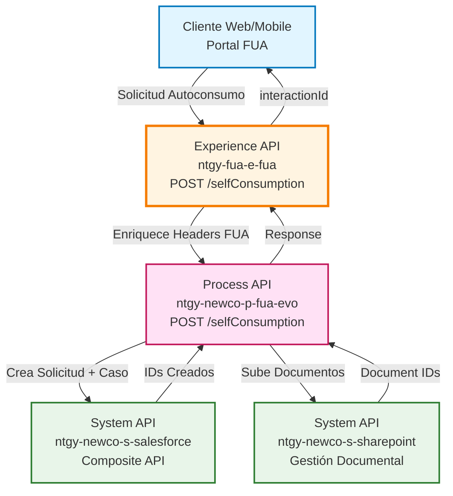
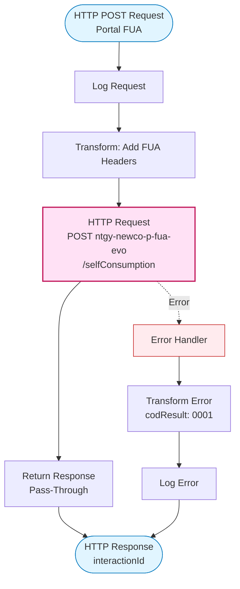
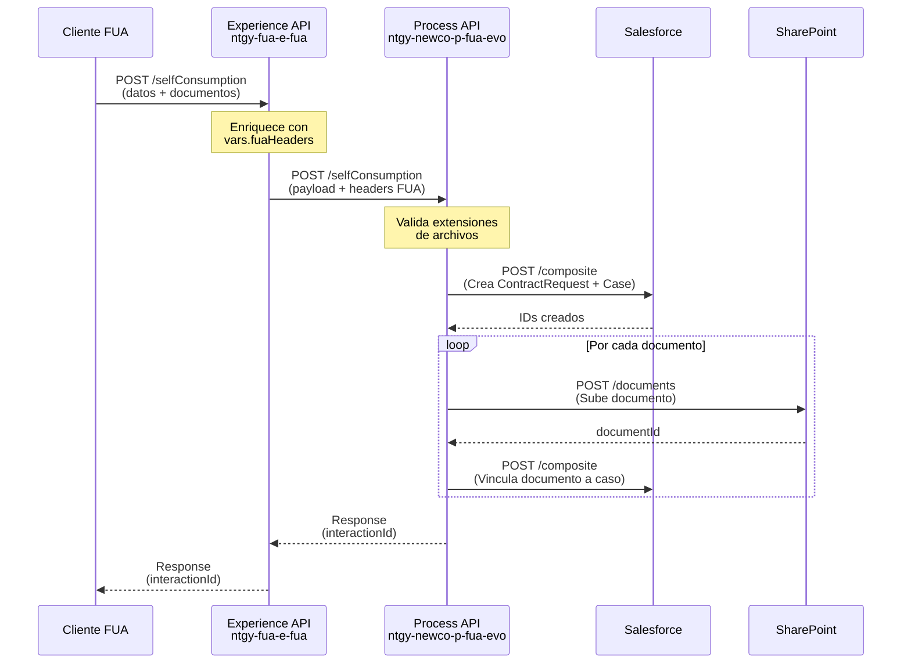
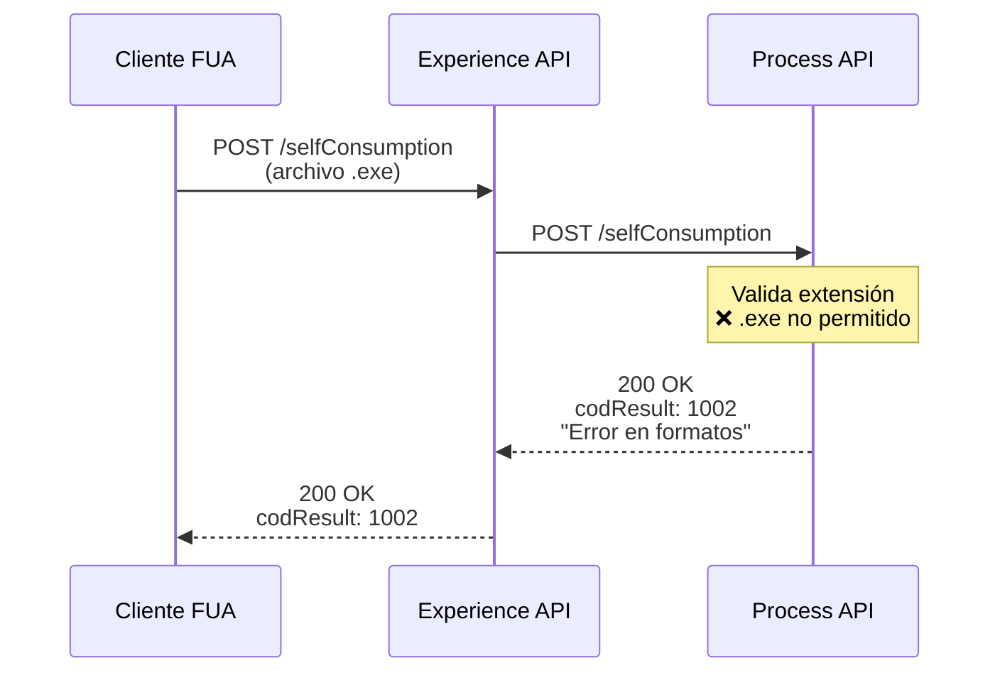
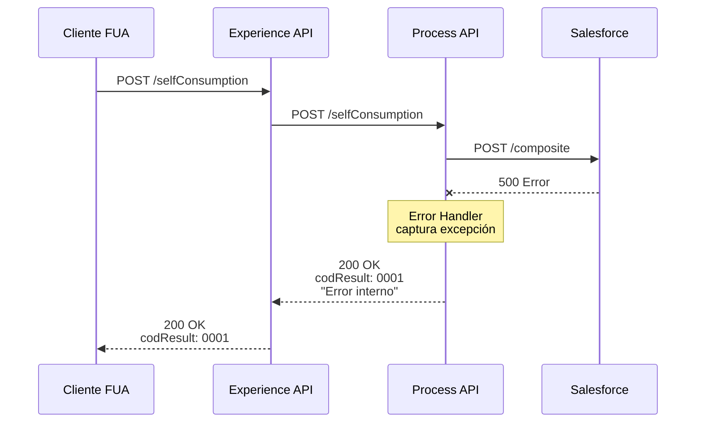

# POST /selfConsumption

## 📌 Descripción General

### Propósito del Endpoint

Este endpoint permite a los clientes de Naturgy solicitar el alta o modificación de una instalación de autoconsumo energético (principalmente fotovoltaico) a través del portal FUA (Frontal Único de Atención). El endpoint orquesta un proceso completo que incluye la creación de una solicitud de contrato en Salesforce, la generación de un caso de gestión, y la subida de documentación técnica requerida a SharePoint.

### Tipo de API

**Capa:** Experience API (API-Led Connectivity)

**Función:** Adaptación de experiencia para canales web y móvil del portal FUA

### Patrón de Integración

**Tipo:** Pass-Through con Enriquecimiento de Headers

**Descripción:** El Experience API recibe la solicitud del cliente, enriquece el payload con headers FUA específicos (`vars.fuaHeaders`) y delega toda la lógica de negocio al Process API `ntgy-newco-p-fua-evo`. La respuesta del Process API se devuelve directamente al cliente sin transformación adicional.

### Arquitectura API-Led Connectivity



---

## 💼 Propósito del Negocio

### Casos de Uso Principales

1. **Alta de Nueva Instalación de Autoconsumo**
   - Cliente solicita dar de alta una instalación fotovoltaica nueva
   - Se crea solicitud de contrato con tipo de autoconsumo específico
   - Se genera caso de gestión para seguimiento del proceso
   - Se adjunta documentación técnica requerida (CIE, contratos, acuerdos)

2. **Modificación de Instalación Existente**
   - Cliente modifica parámetros de instalación de autoconsumo existente
   - Se actualiza potencia instalada, tipo de instalación o configuración
   - Se registra nueva documentación técnica si es necesaria

3. **Gestión Documental Integrada**
   - Subida automática de documentos técnicos a SharePoint
   - Vinculación de documentos al caso de gestión en Salesforce
   - Trazabilidad completa de la documentación del proceso

### 📱 Canal y Audiencia

#### Canal de Consumo

**Canal:** Web y Mobile

**Características del Canal:**
- **Plataforma**: Portal FUA (Frontal Único de Atención)
- **Dispositivos**: Navegadores web (desktop/tablet) y aplicaciones móviles
- **Conectividad**: Requiere conexión estable para subida de documentos
- **Experiencia de Usuario**: Formulario multi-paso con carga de archivos

#### Audiencia Objetivo

**Usuarios Finales:**
- **Clientes Residenciales**: Propietarios de viviendas con instalaciones fotovoltaicas
- **Clientes Empresariales**: Empresas con instalaciones de autoconsumo
- **Comunidades de Propietarios**: Instalaciones colectivas de autoconsumo

**Contexto de Uso:**
- **Solicitud Inicial**: Cliente completa formulario con datos de instalación
- **Carga de Documentos**: Cliente adjunta documentación técnica requerida
- **Seguimiento**: Cliente recibe ID de caso para seguimiento del proceso

#### Adaptaciones del Canal

**Optimizaciones Aplicadas:**
- **Enriquecimiento de Headers**: Se añaden headers FUA específicos (`vars.fuaHeaders`) con información de contexto del usuario
- **Timeout Extendido**: 60 segundos para permitir procesamiento de documentos
- **Manejo de Errores**: Transformación de errores técnicos a mensajes amigables para el usuario

### 🔗 Endpoints Dependientes

Este Experience API consume el siguiente Process API:

| Process API | Endpoint | Método | Propósito |
|-------------|----------|--------|-----------|
| `ntgy-newco-p-fua-evo` | `/selfConsumption` | POST | Orquestación completa del proceso de autoconsumo: creación de solicitud en Salesforce, generación de caso de gestión, validación de documentos y subida a SharePoint |

**Nota:** El Process API a su vez consume múltiples System APIs (Salesforce, SharePoint) para completar el proceso.

### Contexto Empresarial

- **Dominio:** Autoservicio de Clientes - Gestión de Autoconsumo Energético
- **Sector:** Energía - Utilities
- **División:** Naturgy España - NewCo
- **Canal:** Web y Mobile (Portal FUA)

### Stakeholders

- **Clientes de Naturgy**: Solicitan alta/modificación de instalaciones de autoconsumo
- **Departamento de Operaciones**: Gestiona casos de autoconsumo y documentación técnica
- **Distribuidoras Eléctricas**: Reciben documentación técnica para tramitación
- **Equipo de Atención al Cliente**: Realiza seguimiento de solicitudes

### Valor de Negocio

- **Digitalización del Proceso**: Eliminación de trámites presenciales o telefónicos para solicitudes de autoconsumo
- **Reducción de Tiempos**: Proceso automatizado reduce tiempo de tramitación de semanas a días
- **Trazabilidad Completa**: Seguimiento end-to-end del proceso desde solicitud hasta resolución
- **Cumplimiento Normativo**: Gestión documental integrada asegura cumplimiento de requisitos regulatorios
- **Mejora de Experiencia**: Cliente gestiona todo el proceso desde portal web/móvil

---

## 🔧 Especificación Técnica

### URLs por Ambiente

| Ambiente | URL Base | URL Completa |
|----------|----------|--------------|
| **Local** | `http://localhost:8081` | `http://localhost:8081/fua/api/selfConsumption` |
| **Development** | `https://e-fua-dev.de-c1.cloudhub.io` | `https://e-fua-dev.de-c1.cloudhub.io/fua/api/selfConsumption` |
| **UAT** | `https://e-fua-uat.de-c1.cloudhub.io` | `https://e-fua-uat.de-c1.cloudhub.io/fua/api/selfConsumption` |
| **Production** | `https://e-fua-pro.de-c1.cloudhub.io` | `https://e-fua-pro.de-c1.cloudhub.io/fua/api/selfConsumption` |

### Método HTTP

```
POST /fua/api/selfConsumption
```

### 🎯 Consideraciones del Canal

#### Limitaciones del Canal

| Aspecto | Limitación | Razón |
|---------|------------|-------|
| **Timeout** | 60 segundos | Procesamiento de múltiples documentos y llamadas a Salesforce/SharePoint |
| **Tamaño de Archivos** | Según configuración SharePoint | Documentos técnicos (PDF, imágenes) pueden ser de varios MB |
| **Formatos Permitidos** | PDF, DOC, DOCX, PNG, JPG, JPEG, ZIP, XLS, XLSX, ODT, TXT, CSV | Validación de extensiones según propiedad `ntgy-newco-s-sharepoint.files.allowedExtension` |
| **Rate Limiting** | Según políticas API Manager | Protección contra abuso |

#### Campos Específicos del Canal

**Campos Añadidos por el Experience API:**

| Campo | Tipo | Descripción | Razón |
|-------|------|-------------|-------|
| `vars.fuaHeaders` | Object | Headers de contexto FUA (usuario, sesión, trazabilidad) | Enriquecimiento de contexto para auditoría y trazabilidad |

**Nota:** El Experience API NO omite campos del Process API, actúa como pass-through después del enriquecimiento.

### Parámetros de Entrada

#### Headers Requeridos

| Header | Tipo | Obligatorio | Descripción |
|--------|------|-------------|-------------|
| `Content-Type` | string | ✅ | Debe ser `application/json` |
| `x-client-id` | string | ✅ | ID del cliente en Salesforce |
| `x-client-code` | string | ✅ | Código de cliente (NIF/NIE) |
| `x-contact-id` | string | ✅ | ID del contacto en Salesforce |
| `x-user-id` | string | ⚠️ | ID del usuario (agente) si aplica |
| `x-agent-mail` | string | ⚠️ | Email del agente si la solicitud es asistida |
| `x-interaction-id` | string | ⚠️ | ID de interacción padre si existe |
| `traceparent` | string | ✅ | Header de trazabilidad distribuida |

#### Body (application/json)

```json
{
  "type": "string",                    // Tipo de autoconsumo: "11" (Sin Excedentes), "12" (Con Excedentes), "0C", "00"
  "subsection": "string",              // Subsección (opcional)
  "cupsType": "string",                // Tipo de CUPS (opcional)
  "collective": boolean,               // Indica si es instalación colectiva (opcional)
  "contractId": "string",              // ID del contrato en el que se realiza el alta
  "contactId": "string",               // ID del contacto preferente
  "assetId": "string",                 // ID del asset (producto contratado)
  "CUPS": "string",                    // CUPS del punto de suministro
  "proposedChangeDate": "YYYY-MM-DD",  // Fecha propuesta para el cambio
  "newPowerP1": number,                // Nueva potencia P1 (opcional)
  "newPowerP2": number,                // Nueva potencia P2 (opcional)
  "cau": "string",                     // CAU de autoconsumo (opcional)
  "subject": "string",                 // Asunto del caso (opcional)
  "installationPower": {               // Potencia instalada por generador
    "1": number,                       // Potencia generador 1 (opcional)
    "2": number,                       // Potencia generador 2 (opcional)
    "3": number                        // Potencia generador 3 (opcional)
  },
  "datosGenInst": {                    // Tipo de instalación por generador
    "1": "string",                     // Tipo instalación generador 1 (opcional)
    "2": "string",                     // Tipo instalación generador 2 (opcional)
    "3": "string"                      // Tipo instalación generador 3 (opcional)
  },
  "tecGenerador": {                    // Tecnología del generador
    "1": "string",                     // Tecnología generador 1 (opcional)
    "2": "string",                     // Tecnología generador 2 (opcional)
    "3": "string"                      // Tecnología generador 3 (opcional)
  },
  "refCatastro": {                     // Referencia catastral
    "1": "string",                     // Ref. catastral generador 1 (opcional)
    "2": "string",                     // Ref. catastral generador 2 (opcional)
    "3": "string"                      // Ref. catastral generador 3 (opcional)
  },
  "esquemaMedida": {                   // Esquema de medida
    "1": "string",                     // Esquema medida generador 1 (opcional)
    "2": "string",                     // Esquema medida generador 2 (opcional)
    "3": "string"                      // Esquema medida generador 3 (opcional)
  },
  "combustible": {                     // Tipo de combustible
    "1": "string",                     // Combustible generador 1 (opcional)
    "2": "string",                     // Combustible generador 2 (opcional)
    "3": "string"                      // Combustible generador 3 (opcional)
  },
  "ssaa": {                            // Servicios auxiliares
    "1": boolean,                      // SSAA generador 1 (opcional)
    "2": boolean,                      // SSAA generador 2 (opcional)
    "3": boolean                       // SSAA generador 3 (opcional)
  },
  "unicoContrato": {                   // Único contrato
    "1": boolean,                      // Único contrato generador 1 (opcional)
    "2": boolean,                      // Único contrato generador 2 (opcional)
    "3": boolean                       // Único contrato generador 3 (opcional)
  },
  "cieFile": {                         // Certificado de Instalación Eléctrica
    "file": "string (base64)",         // Archivo codificado en base64
    "fileNameWithExtension": "string"  // Nombre del archivo con extensión
  },
  "compensationContractFile": {        // Contrato de compensación
    "file": "string (base64)",
    "fileNameWithExtension": "string"
  },
  "partitionAgreementFile": {          // Acuerdo de reparto
    "file": "string (base64)",
    "fileNameWithExtension": "string"
  },
  "partitionCoefficientFile": {        // Coeficientes de reparto
    "file": "string (base64)",
    "fileNameWithExtension": "string"
  }
}
```

**Notas sobre Documentos:**
- Los archivos son opcionales pero recomendados según tipo de autoconsumo
- Tipos "0C" y "00" NO requieren validación de extensión de archivos
- Otros tipos validan extensiones contra lista permitida en SharePoint
- Documentos se suben a SharePoint y se vinculan al caso en Salesforce

### Respuestas

#### 200 OK - Solicitud Procesada Exitosamente

```json
{
  "result": {
    "codResult": "0000",
    "msgResult": "No hay error"
  },
  "interactionId": "5003X000001AbCdQAK"
}
```

**Campos de Respuesta:**

| Campo | Tipo | Descripción |
|-------|------|-------------|
| `result.codResult` | string | Código de resultado: "0000" = éxito |
| `result.msgResult` | string | Mensaje descriptivo del resultado |
| `interactionId` | string | ID del caso de gestión creado en Salesforce para seguimiento |

#### 400 Bad Request - Error de Validación

```json
{
  "result": {
    "codResult": "1002",
    "msgResult": "Error en los formatos de los ficheros"
  }
}
```

**Causas Comunes:**
- Extensión de archivo no permitida
- Archivo corrupto o no codificado correctamente en base64
- Campos obligatorios faltantes

#### 500 Internal Server Error - Error del Servidor

```json
{
  "result": {
    "codResult": "0001",
    "msgResult": "Error interno del servidor: [descripción del error]"
  }
}
```

**Causas Comunes:**
- Error en llamada a Salesforce
- Error en subida de documentos a SharePoint
- Timeout en Process API

### Autenticación

- **Tipo:** OAuth 2.0 (según esquema RAML)
- **Header:** `Authorization: Bearer {token}`
- **Scope:** Acceso a operaciones de autoconsumo

### Timeouts

| Tipo | Valor | Razón |
|------|-------|-------|
| **Request Timeout** | 60 segundos | Procesamiento de documentos y múltiples llamadas a backend (Salesforce + SharePoint) |
| **Connection Idle Timeout** | 60 segundos | Mantener conexión activa durante procesamiento largo |

---

## 🏗️ Implementación Técnica

### Arquitectura del Flow



### Transformaciones de Canal

**Transformación de Entrada (Experience API):**

El Experience API enriquece el payload con headers FUA antes de llamar al Process API:

```dataweave
%dw 2.0
output application/json
---
payload ++ vars.fuaHeaders
```

**Campos Añadidos:**
- Headers de contexto del usuario (x-client-id, x-contact-id, etc.)
- Headers de trazabilidad (traceparent)
- Headers de sesión y autenticación

**Transformación de Salida:**

⚠️ **Este Experience API NO transforma la respuesta del Process API.**

La respuesta del Process API se devuelve directamente al cliente (pass-through).

Para el schema completo de la respuesta, consultar:
📖 **Process API: `ntgy-newco-p-fua-evo` endpoint `/selfConsumption`**

### Patrones de Diseño

**Patrón:** Pass-Through con Enriquecimiento de Headers

**Justificación:** 
- El Experience API actúa como punto de entrada unificado para el canal FUA
- Toda la lógica de negocio está centralizada en el Process API
- El enriquecimiento de headers permite añadir contexto específico del canal sin duplicar lógica
- Facilita el mantenimiento al tener una única fuente de verdad para la lógica de autoconsumo

### Diagramas de Secuencia

#### 1. Flujo Normal de Éxito



#### 2. Flujo con Error de Validación de Archivos



#### 3. Flujo con Error Técnico



### Optimizaciones del Canal

**Optimizaciones Aplicadas:**

1. **Timeout Extendido**: 60 segundos para permitir procesamiento de múltiples documentos
2. **Connection Pooling**: Reutilización de conexiones HTTP al Process API
3. **Enriquecimiento Eficiente**: Headers FUA se añaden mediante operación de merge (`++`) sin copiar todo el payload

### Manejo de Errores

**Error Handler del Experience API:**

```xml
<error-handler>
    <on-error-propagate enableNotifications="true" logException="true">
        <ee:transform>
            <ee:set-payload>
                {
                    "result": {
                        "codResult": "0001",
                        "msgResult": error.description as String replace /"/ with("")
                    }
                }
            </ee:set-payload>
        </ee:transform>
        <logger level="INFO" message="Error en selfConsumption"/>
    </on-error-propagate>
</error-handler>
```

**Estrategia:**
- Captura cualquier error no manejado (timeout, conexión, etc.)
- Transforma a formato estándar con codResult "0001"
- Registra error para auditoría
- Devuelve respuesta amigable al cliente

**Códigos de Error:**

| Código | Descripción | Origen |
|--------|-------------|--------|
| `0000` | Éxito | Process API |
| `0001` | Error técnico general | Experience API (error handler) |
| `1002` | Error en formato de archivos | Process API (validación) |

---

## 💻 Ejemplos de Uso

### Ejemplo 1: Solicitud de Autoconsumo Sin Excedentes (Tipo 11)

#### cURL

```bash
curl -X POST "https://e-fua-pro.de-c1.cloudhub.io/fua/api/selfConsumption" \
  -H "Content-Type: application/json" \
  -H "Authorization: Bearer YOUR_ACCESS_TOKEN" \
  -H "x-client-id: 0013X00000AbCdQAK" \
  -H "x-client-code: 12345678A" \
  -H "x-contact-id: 0033X00000XyzAbQAJ" \
  -H "traceparent: 00-4bf92f3577b34da6a3ce929d0e0e4736-00f067aa0ba902b7-01" \
  -d '{
    "type": "11",
    "contractId": "8003X000001AbCdQAK",
    "contactId": "0033X00000XyzAbQAJ",
    "assetId": "02i3X000001AbCdQAK",
    "CUPS": "ES0021000000000001JN0F",
    "proposedChangeDate": "2024-12-01",
    "newPowerP1": 5.5,
    "newPowerP2": 3.3,
    "cupsType": "02",
    "subsection": "11",
    "collective": false,
    "installationPower": {
      "1": 5.0
    },
    "datosGenInst": {
      "1": "Fotovoltaica"
    },
    "tecGenerador": {
      "1": "Silicio monocristalino"
    },
    "cieFile": {
      "file": "JVBERi0xLjQKJeLjz9MKMSAwIG9iago8PC9UeXBlL0NhdGFsb2cvUGFnZXMgMiAwIFI+PgplbmRvYmoKMiAwIG9iago8PC9UeXBlL1BhZ2VzL0tpZHNbMyAwIFJdL0NvdW50IDE+PgplbmRvYmoKMyAwIG9iago8PC9UeXBlL1BhZ2UvTWVkaWFCb3hbMCAwIDYxMiA3OTJdL1BhcmVudCAyIDAgUi9SZXNvdXJjZXM8PC9Gb250PDwvRjEgNCAwIFI+Pj4+L0NvbnRlbnRzIDUgMCBSPj4KZW5kb2JqCjQgMCBvYmoKPDwvVHlwZS9Gb250L1N1YnR5cGUvVHlwZTEvQmFzZUZvbnQvSGVsdmV0aWNhPj4KZW5kb2JqCjUgMCBvYmoKPDwvTGVuZ3RoIDQ0Pj4Kc3RyZWFtCkJUCi9GMSA0OCBUZgoxMCA3MDAgVGQKKENJRSBEb2N1bWVudG8pIFRqCkVUCmVuZHN0cmVhbQplbmRvYmoKeHJlZgowIDYKMDAwMDAwMDAwMCA2NTUzNSBmIAowMDAwMDAwMDE1IDAwMDAwIG4gCjAwMDAwMDAwNjQgMDAwMDAgbiAKMDAwMDAwMDEyMSAwMDAwMCBuIAowMDAwMDAwMjQzIDAwMDAwIG4gCjAwMDAwMDAzMTIgMDAwMDAgbiAKdHJhaWxlcgo8PC9TaXplIDYvUm9vdCAxIDAgUj4+CnN0YXJ0eHJlZgo0MDQKJSVFT0YK",
      "fileNameWithExtension": "CIE_Instalacion.pdf"
    }
  }'
```

#### Respuesta (200 OK)

```json
{
  "result": {
    "codResult": "0000",
    "msgResult": "No hay error"
  },
  "interactionId": "5003X000001AbCdQAK"
}
```

### Ejemplo 2: Solicitud con Múltiples Documentos

#### cURL

```bash
curl -X POST "https://e-fua-pro.de-c1.cloudhub.io/fua/api/selfConsumption" \
  -H "Content-Type: application/json" \
  -H "Authorization: Bearer YOUR_ACCESS_TOKEN" \
  -H "x-client-id: 0013X00000AbCdQAK" \
  -H "x-client-code: 12345678A" \
  -H "x-contact-id: 0033X00000XyzAbQAJ" \
  -H "traceparent: 00-4bf92f3577b34da6a3ce929d0e0e4736-00f067aa0ba902b7-01" \
  -d '{
    "type": "12",
    "contractId": "8003X000001AbCdQAK",
    "contactId": "0033X00000XyzAbQAJ",
    "assetId": "02i3X000001AbCdQAK",
    "CUPS": "ES0021000000000001JN0F",
    "proposedChangeDate": "2024-12-01",
    "collective": true,
    "cieFile": {
      "file": "BASE64_ENCODED_PDF",
      "fileNameWithExtension": "CIE_Instalacion.pdf"
    },
    "compensationContractFile": {
      "file": "BASE64_ENCODED_PDF",
      "fileNameWithExtension": "Contrato_Compensacion.pdf"
    },
    "partitionAgreementFile": {
      "file": "BASE64_ENCODED_PDF",
      "fileNameWithExtension": "Acuerdo_Reparto.pdf"
    }
  }'
```

#### Respuesta (200 OK)

```json
{
  "result": {
    "codResult": "0000",
    "msgResult": "No hay error"
  },
  "interactionId": "5003X000001XyzAbQAK"
}
```

### Ejemplo 3: JavaScript (Frontend Web)

```javascript
async function solicitarAutoconsumo(datosAutoconsumo) {
  try {
    const response = await fetch('https://e-fua-pro.de-c1.cloudhub.io/fua/api/selfConsumption', {
      method: 'POST',
      headers: {
        'Content-Type': 'application/json',
        'Authorization': `Bearer ${accessToken}`,
        'x-client-id': clientId,
        'x-client-code': clientCode,
        'x-contact-id': contactId,
        'traceparent': generateTraceparent()
      },
      body: JSON.stringify(datosAutoconsumo)
    });

    const data = await response.json();
    
    if (data.result.codResult === '0000') {
      console.log('Solicitud creada exitosamente');
      console.log('ID de caso:', data.interactionId);
      return data.interactionId;
    } else {
      console.error('Error en solicitud:', data.result.msgResult);
      throw new Error(data.result.msgResult);
    }
  } catch (error) {
    console.error('Error al solicitar autoconsumo:', error);
    throw error;
  }
}

// Uso
const resultado = await solicitarAutoconsumo({
  type: '11',
  contractId: '8003X000001AbCdQAK',
  contactId: '0033X00000XyzAbQAJ',
  assetId: '02i3X000001AbCdQAK',
  CUPS: 'ES0021000000000001JN0F',
  proposedChangeDate: '2024-12-01',
  newPowerP1: 5.5,
  installationPower: { '1': 5.0 },
  cieFile: {
    file: base64EncodedFile,
    fileNameWithExtension: 'CIE_Instalacion.pdf'
  }
});
```

### Ejemplo 4: Error de Validación de Archivos

#### Request con Extensión No Permitida

```bash
curl -X POST "https://e-fua-pro.de-c1.cloudhub.io/fua/api/selfConsumption" \
  -H "Content-Type: application/json" \
  -H "Authorization: Bearer YOUR_ACCESS_TOKEN" \
  -H "x-client-id: 0013X00000AbCdQAK" \
  -H "x-contact-id: 0033X00000XyzAbQAJ" \
  -d '{
    "type": "11",
    "contractId": "8003X000001AbCdQAK",
    "CUPS": "ES0021000000000001JN0F",
    "cieFile": {
      "file": "BASE64_ENCODED_FILE",
      "fileNameWithExtension": "documento.exe"
    }
  }'
```

#### Respuesta (200 OK con Error)

```json
{
  "result": {
    "codResult": "1002",
    "msgResult": "Error en los formatos de los ficheros"
  }
}
```

### Ejemplo 5: Python

```python
import requests
import base64
import json

def solicitar_autoconsumo(datos_autoconsumo, access_token, headers_fua):
    """
    Solicita alta de autoconsumo en Naturgy
    
    Args:
        datos_autoconsumo: Diccionario con datos de la solicitud
        access_token: Token de autenticación OAuth 2.0
        headers_fua: Headers específicos de FUA (client-id, contact-id, etc.)
    
    Returns:
        str: ID del caso de gestión creado
    """
    url = 'https://e-fua-pro.de-c1.cloudhub.io/fua/api/selfConsumption'
    
    headers = {
        'Content-Type': 'application/json',
        'Authorization': f'Bearer {access_token}',
        **headers_fua
    }
    
    try:
        response = requests.post(url, headers=headers, json=datos_autoconsumo, timeout=60)
        response.raise_for_status()
        
        data = response.json()
        
        if data['result']['codResult'] == '0000':
            print(f"Solicitud creada exitosamente")
            print(f"ID de caso: {data['interactionId']}")
            return data['interactionId']
        else:
            print(f"Error: {data['result']['msgResult']}")
            raise Exception(data['result']['msgResult'])
            
    except requests.exceptions.Timeout:
        print("Error: Timeout en la solicitud (>60s)")
        raise
    except requests.exceptions.RequestException as e:
        print(f"Error en la petición: {e}")
        raise

# Uso
with open('CIE_Instalacion.pdf', 'rb') as f:
    cie_base64 = base64.b64encode(f.read()).decode('utf-8')

datos = {
    'type': '11',
    'contractId': '8003X000001AbCdQAK',
    'contactId': '0033X00000XyzAbQAJ',
    'assetId': '02i3X000001AbCdQAK',
    'CUPS': 'ES0021000000000001JN0F',
    'proposedChangeDate': '2024-12-01',
    'newPowerP1': 5.5,
    'installationPower': {'1': 5.0},
    'cieFile': {
        'file': cie_base64,
        'fileNameWithExtension': 'CIE_Instalacion.pdf'
    }
}

headers_fua = {
    'x-client-id': '0013X00000AbCdQAK',
    'x-client-code': '12345678A',
    'x-contact-id': '0033X00000XyzAbQAJ',
    'traceparent': '00-4bf92f3577b34da6a3ce929d0e0e4736-00f067aa0ba902b7-01'
}

case_id = solicitar_autoconsumo(datos, 'YOUR_ACCESS_TOKEN', headers_fua)
```

---

## 📋 Notas Adicionales

### Tipos de Autoconsumo

| Código | Descripción | Validación de Archivos |
|--------|-------------|------------------------|
| `11` | Sin Excedentes | ✅ Valida extensiones |
| `12` | Con Excedentes | ✅ Valida extensiones |
| `0C` | Tipo especial C | ❌ NO valida extensiones |
| `00` | Tipo especial 0 | ❌ NO valida extensiones |

### Documentos Requeridos por Tipo

**Autoconsumo Sin Excedentes (11):**
- CIE (Certificado de Instalación Eléctrica) - Obligatorio

**Autoconsumo Con Excedentes (12):**
- CIE - Obligatorio
- Contrato de Compensación - Recomendado
- Acuerdo de Reparto (si es colectivo) - Obligatorio para colectivos
- Coeficientes de Reparto (si es colectivo) - Obligatorio para colectivos

### Extensiones de Archivo Permitidas

- **Documentos**: PDF, DOC, DOCX, ODT, TXT
- **Imágenes**: PNG, JPG, JPEG
- **Hojas de Cálculo**: XLS, XLSX, CSV
- **Comprimidos**: ZIP
- **Otros**: MP3, AFP

### Consideraciones de Rendimiento

- **Tamaño Máximo Recomendado por Archivo**: 5 MB
- **Número Máximo de Archivos**: 4 (CIE, compensación, acuerdo, coeficientes)
- **Tiempo de Procesamiento Estimado**: 10-30 segundos
- **Timeout Configurado**: 60 segundos

### Trazabilidad y Auditoría

El endpoint registra:
- **Evento de Inicio**: Generación de evento en sistema de eventos
- **Validación de Archivos**: Log de validación de extensiones
- **Creación en Salesforce**: IDs de ContractRequest y Case creados
- **Subida de Documentos**: Document IDs de SharePoint
- **Vinculación**: IDs de CaseAttachments en Salesforce
- **Respuesta Final**: interactionId para seguimiento

### Troubleshooting

**Problema: Timeout después de 60 segundos**
- **Causa**: Archivos muy grandes o problemas de conectividad con SharePoint
- **Solución**: Reducir tamaño de archivos, verificar conectividad

**Problema: Error 1002 - Formato de archivo**
- **Causa**: Extensión no permitida o archivo corrupto
- **Solución**: Verificar extensión en lista permitida, validar codificación base64

**Problema: Error 0001 - Error interno**
- **Causa**: Error en Salesforce o SharePoint
- **Solución**: Revisar logs, verificar conectividad con backends, reintentar

### Mejores Prácticas

1. **Validar Archivos en Frontend**: Validar extensiones antes de enviar para mejor UX
2. **Comprimir Archivos**: Usar compresión para reducir tamaño y tiempo de transmisión
3. **Implementar Retry Logic**: Reintentar en caso de timeout o errores transitorios
4. **Mostrar Progreso**: Indicar al usuario que el proceso puede tardar hasta 60 segundos
5. **Guardar interactionId**: Almacenar el ID de caso para seguimiento posterior
