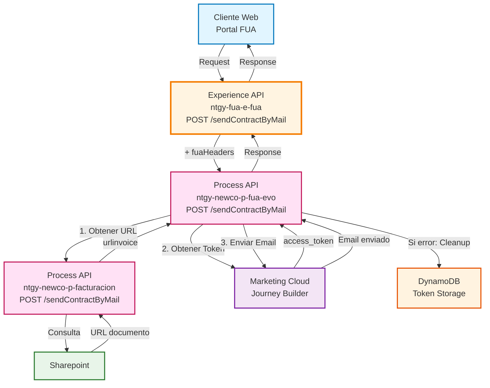
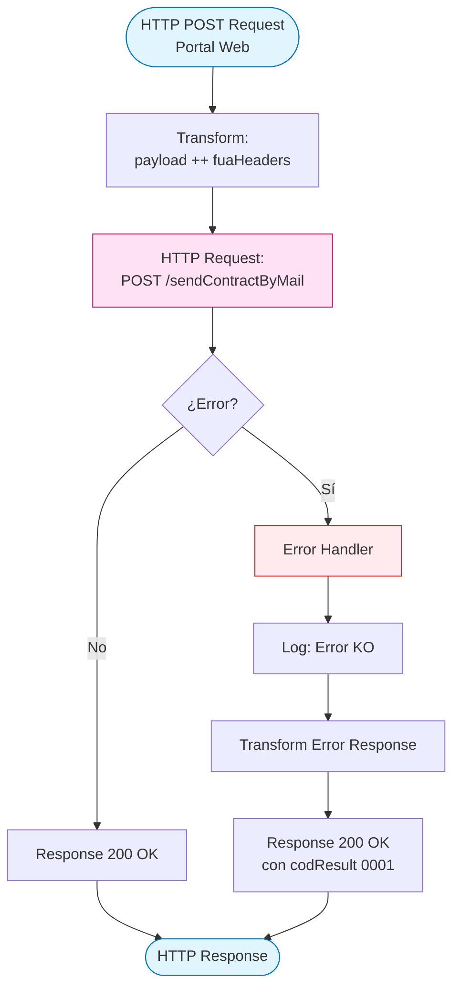
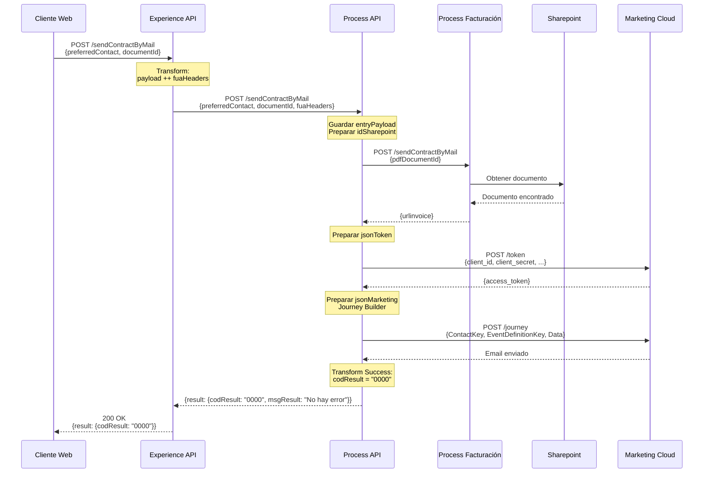
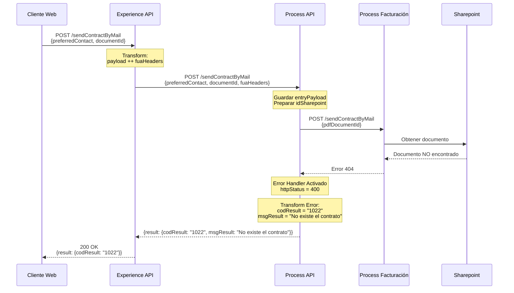
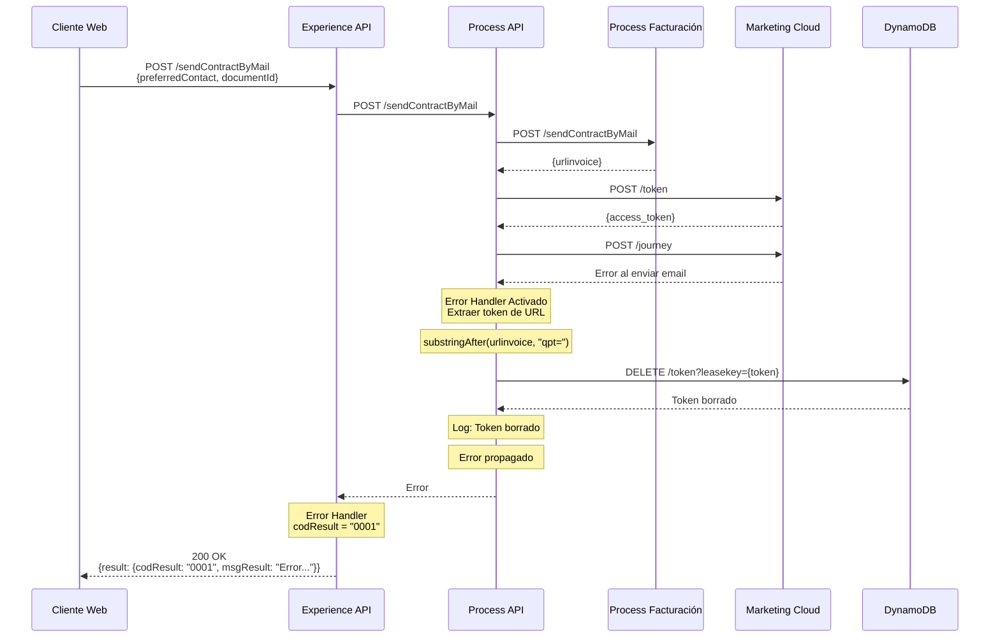

# POST /sendContractByMail

## 📌 Descripción General

### Propósito del Endpoint

Este endpoint permite enviar una copia del contrato por email al contacto preferente del cliente. El proceso obtiene el documento desde Sharepoint a través del Process API de Facturación y utiliza Salesforce Marketing Cloud Journey Builder para enviar el email con el enlace al documento.

### Tipo de API

**Capa:** Experience API (API-Led Connectivity)

**Función:** Orquestación de envío de documentos contractuales por email para canal web

### Patrón de Integración

**Tipo:** Orquestación con Transformación

**Descripción:** El Experience API recibe la solicitud del cliente, añade headers de contexto FUA, y delega al Process API que coordina la obtención del documento y el envío del email mediante Marketing Cloud.

### Arquitectura API-Led Connectivity



---

## 💼 Propósito del Negocio

### Casos de Uso Principales

1. **Envío de Documentación Contractual**
   - Cliente solicita recibir una copia de su contrato por email
   - Sistema obtiene el documento desde Sharepoint
   - Email se envía automáticamente con enlace al documento

2. **Comunicación Digital con Clientes**
   - Automatización de envío de documentos legales
   - Reducción de envíos postales
   - Mejora de la experiencia del cliente con acceso inmediato

3. **Gestión de Documentos**
   - Integración con sistema de gestión documental (Sharepoint)
   - Trazabilidad de envíos mediante Marketing Cloud
   - Tokens temporales para acceso seguro a documentos

### 📱 Canal y Audiencia

#### Canal de Consumo

**Canal:** Web

**Características del Canal:**
- **Plataforma**: Portal web FUA (Frontal Único de Atención)
- **Dispositivos**: Navegadores web (desktop y mobile)
- **Conectividad**: Conexión estable requerida para proceso de envío
- **Experiencia de Usuario**: Solicitud de envío con confirmación inmediata

#### Audiencia Objetivo

**Usuarios Finales:**
- **Clientes Residenciales**: Clientes que necesitan copia de su contrato
- **Clientes Empresariales**: Empresas que requieren documentación contractual

**Contexto de Uso:**
- **Solicitud de Documentación**: Cliente necesita copia del contrato
- **Gestión de Archivos**: Cliente prefiere recibir documentos por email
- **Acceso Remoto**: Cliente no puede acceder físicamente a documentos

#### Adaptaciones del Canal

**Optimizaciones Aplicadas:**
- **Simplificación de Datos**: Solo se envían contactId, email y documentId
- **Formato de Respuesta**: Respuesta estándar con código de resultado
- **Manejo de Errores**: Errores transformados a formato amigable para el usuario web
- **Headers FUA**: Añadidos automáticamente por el Experience API

### 🔗 Endpoints Dependientes

Este Experience API consume el siguiente Process API:

| Process API | Endpoint | Método | Propósito |
|-------------|----------|--------|-----------|
| `ntgy-newco-p-fua-evo` | `/sendContractByMail` | POST | Obtiene URL del documento desde Sharepoint y envía email con el enlace mediante Marketing Cloud Journey Builder |

### Contexto Empresarial

- **Dominio:** Gestión de Documentos y Comunicaciones
- **Sector:** Energía - Utilities
- **División:** Naturgy España - NewCo
- **Canal:** Web (Portal FUA)

### Stakeholders

- **Clientes Finales**: Usuarios que solicitan copias de sus contratos
- **Equipo de Atención al Cliente**: Gestiona solicitudes de documentación
- **Equipo de Marketing**: Administra plantillas de email en Marketing Cloud
- **Equipo de Sistemas**: Mantiene integración con Sharepoint y Marketing Cloud

### Valor de Negocio

- **Automatización**: Proceso completamente automatizado de envío de documentos
- **Reducción de Costes**: Eliminación de envíos postales
- **Experiencia del Cliente**: Acceso inmediato a documentación contractual
- **Trazabilidad**: Registro completo de envíos en Marketing Cloud
- **Seguridad**: Tokens temporales para acceso controlado a documentos

---

## 🔧 Especificación Técnica

### URLs por Ambiente

| Ambiente | URL Base | URL Completa |
|----------|----------|--------------|
| **Local** | `http://localhost:8081` | `http://localhost:8081/fua/api/sendContractByMail` |
| **Development** | `https://ntgy-fua-e-fua-dev.de-c1.cloudhub.io` | `https://ntgy-fua-e-fua-dev.de-c1.cloudhub.io/fua/api/sendContractByMail` |
| **UAT** | `https://ntgy-fua-e-fua-cc.de-c1.cloudhub.io` | `https://ntgy-fua-e-fua-cc.de-c1.cloudhub.io/fua/api/sendContractByMail` |
| **Production** | `https://ntgy-fua-e-fua-pro.de-c1.cloudhub.io` | `https://ntgy-fua-e-fua-pro.de-c1.cloudhub.io/fua/api/sendContractByMail` |

### Método HTTP

```
POST /fua/api/sendContractByMail
```

### 🎯 Consideraciones del Canal

#### Limitaciones del Canal

| Aspecto | Limitación | Razón |
|---------|------------|-------|
| **Timeout** | 60 segundos | Proceso con múltiples llamadas externas (Facturación + Marketing Cloud) |
| **Tamaño de Request** | 10 KB máximo | Solo se envían IDs y datos de contacto |
| **Rate Limiting** | 50 requests/minuto | Protección contra uso excesivo y límites de Marketing Cloud |
| **Sincronía** | Síncrono | Requiere confirmación inmediata del envío |

#### Campos Específicos del Canal

**Campos Añadidos por el Experience API:**

| Campo | Tipo | Descripción | Razón |
|-------|------|-------------|-------|
| `fuaHeaders` | Object | Headers de contexto FUA | Trazabilidad y autenticación en Process API |

**Campos del Request Original:**

| Campo | Tipo | Descripción |
|-------|------|-------------|
| `preferredContact` | Object | Información del contacto preferente |
| `preferredContact.contactId` | String | ID del contacto en Salesforce |
| `preferredContact.preferredEmail` | String | Email del contacto |
| `documentId` | String | ID del documento en Sharepoint |

### Parámetros de Entrada

#### Headers

| Header | Tipo | Requerido | Descripción |
|--------|------|-----------|-------------|
| `Content-Type` | String | ✅ Sí | Debe ser `application/json` |
| `client_id` | String | ✅ Sí | Client ID para autenticación OAuth 2.0 |
| `Authorization` | String | ✅ Sí | Token Bearer para autenticación |

#### Body (JSON)

```json
{
  "preferredContact": {
    "contactId": "string",
    "preferredEmail": "string"
  },
  "documentId": "string"
}
```

**Campos del Body:**

| Campo | Tipo | Requerido | Descripción | Ejemplo |
|-------|------|-----------|-------------|---------|
| `preferredContact` | Object | ✅ Sí | Objeto con información del contacto | - |
| `preferredContact.contactId` | String | ✅ Sí | ID del contacto en Salesforce | `"0035I000002ABC1QAM"` |
| `preferredContact.preferredEmail` | String | ✅ Sí | Email del contacto preferente | `"cliente@example.com"` |
| `documentId` | String | ✅ Sí | ID del documento en Sharepoint | `"DOC123456"` |

### Respuestas

#### 200 OK - Éxito

**Descripción:** El email se envió correctamente con el enlace al documento.

```json
{
  "result": {
    "codResult": "0000",
    "msgResult": "No hay error"
  }
}
```

**Estructura de Respuesta:**

| Campo | Tipo | Descripción |
|-------|------|-------------|
| `result` | Object | Objeto con el resultado de la operación |
| `result.codResult` | String | Código de resultado (`"0000"` = éxito) |
| `result.msgResult` | String | Mensaje descriptivo del resultado |

#### 200 OK - Error de Negocio (Documento No Existe)

**Descripción:** El documento no existe en Sharepoint.

```json
{
  "result": {
    "codResult": "1022",
    "msgResult": "No existe el contrato"
  }
}
```

#### 500 Internal Server Error

**Descripción:** Error técnico durante el procesamiento.

```json
{
  "result": {
    "codResult": "0001",
    "msgResult": "Error al procesar la solicitud: [descripción del error]"
  }
}
```

### Códigos de Estado HTTP

| Código | Descripción | Cuándo Ocurre |
|--------|-------------|---------------|
| `200` | OK | Solicitud procesada (éxito o error de negocio) |
| `400` | Bad Request | Request malformado o parámetros inválidos |
| `401` | Unauthorized | Token de autenticación inválido o expirado |
| `500` | Internal Server Error | Error técnico en el procesamiento |
| `503` | Service Unavailable | Process API, Facturación o Marketing Cloud no disponible |

### Códigos de Resultado Específicos

| Código | Significado | Descripción |
|--------|-------------|-------------|
| `0000` | Éxito | Email enviado correctamente |
| `0001` | Error Técnico | Error en el procesamiento (timeout, conexión, etc.) |
| `1022` | Documento No Existe | El documento no se encuentra en Sharepoint |

### Autenticación

- **Tipo:** OAuth 2.0 con Client Credentials
- **Headers Requeridos:**
  - `client_id`: Client ID proporcionado por API Manager
  - `Authorization`: Bearer token obtenido del servidor OAuth

### Timeouts

| Tipo | Valor | Razón |
|------|-------|-------|
| **Request Timeout** | 60 segundos | Proceso con múltiples llamadas externas (Facturación + Marketing Cloud token + Journey) |
| **Connection Timeout** | 30 segundos | Tiempo máximo para establecer conexión con Process API |

---

## 🏗️ Implementación Técnica

### Arquitectura del Flow



### Flujo Detallado del Process API (sendContractByMailFlow)

```mermaid
flowchart TD
    Start([Request del Experience API]) --> LogEntry[Log: Inicio flujo]
    LogEntry --> SavePayload[Guardar vars.entryPayload]
    SavePayload --> PrepareDoc[Preparar vars.idSharepoint<br/>{pdfDocumentId}]
    PrepareDoc --> TryDoc[Try: Obtener Documento]
    
    TryDoc --> CallFact[HTTP POST:<br/>p-facturacion/sendContractByMail]
    CallFact --> DocSuccess{¿Éxito?}
    
    DocSuccess -->|Sí| PrepareToken[Preparar jsonToken<br/>Marketing Cloud]
    DocSuccess -->|No| ErrorDoc[Error Handler:<br/>httpStatus = 400<br/>codResult = 1022]
    
    PrepareToken --> TryMC[Try: Marketing Cloud]
    TryMC --> GetToken[HTTP POST:<br/>Marketing Cloud Token]
    GetToken --> PrepareJourney[Preparar jsonMarketing<br/>Journey Builder]
    PrepareJourney --> SendEmail[HTTP POST:<br/>Marketing Cloud Journey]
    SendEmail --> MCSuccess{¿Éxito?}
    
    MCSuccess -->|Sí| TransformSuccess[Transform Success:<br/>codResult = 0000]
    MCSuccess -->|No| ErrorMC[Error Handler:<br/>Extraer token de URL]
    
    ErrorMC --> DeleteToken[HTTP DELETE:<br/>DynamoDB token]
    DeleteToken --> LogCleanup[Log: Token borrado]
    
    TransformSuccess --> LogExit[Log: Fin flujo]
    ErrorDoc --> LogExit
    LogCleanup --> LogExit
    
    LogExit --> End([Response al Experience API])
    
    style Start fill:#e1f5ff,stroke:#0277bd
    style End fill:#e1f5ff,stroke:#0277bd
    style CallFact fill:#ffe1f5,stroke:#c2185b
    style GetToken fill:#f3e5f5,stroke:#7b1fa2
    style SendEmail fill:#f3e5f5,stroke:#7b1fa2
    style DeleteToken fill:#fff3e0,stroke:#e65100
    style DocSuccess fill:#fff9c4,stroke:#f57f17
    style MCSuccess fill:#fff9c4,stroke:#f57f17
```

### Transformaciones de Datos

#### Transformación 1: Experience API → Process API

**Ubicación:** `post-send-contract-by-mailFlow` (Experience API, línea 8-15)

**Operación:** Añadir headers FUA al payload

```dataweave
%dw 2.2
output application/json
---
payload ++ vars.fuaHeaders
```

**Descripción:** El Experience API combina el payload original con los headers de contexto FUA antes de enviar al Process API.

#### Transformación 2: Process API → Facturación

**Ubicación:** `sendContractByMailFlow` (Process API, línea 14-20)

**Operación:** Preparar request para obtener documento

```dataweave
%dw 2.0
output application/json
---
{
  "pdfDocumentId": vars.entryPayload.documentId
}
```

**Mapeo de Campos:**

| Campo Origen (Experience) | Campo Destino (Facturación) | Transformación |
|---------------------------|------------------------------|----------------|
| `documentId` | `pdfDocumentId` | Renombrado |

#### Transformación 3: Preparar Token Marketing Cloud

**Ubicación:** `sendContractByMailFlow` (Process API, línea 48-55)

**Operación:** Preparar credenciales para obtener token OAuth

```dataweave
%dw 2.0
output application/json
---
{
  "client_id": p('marketingCloud.token.client_id'),
  "client_secret": p('secure::marketingCloud.token.client_secret'),
  "account_id": p('marketingCloud.token.account_id'),
  "grant_type": "client_credentials"
}
```

**Descripción:** Obtiene credenciales desde properties seguras para autenticación en Marketing Cloud.

#### Transformación 4: Preparar Journey Marketing Cloud

**Ubicación:** `sendContractByMailFlow` (Process API, línea 62-72)

**Operación:** Preparar datos para envío de email mediante Journey Builder

```dataweave
%dw 2.0
output application/json
---
{
  "ContactKey": vars.entryPayload.preferredContact.contactId,
  "EventDefinitionKey": p('marketingCloud.journey.EventDefKeyAltaSubrog'),
  "Data": {
    "SubscriberKey": vars.entryPayload.preferredContact.contactId,
    "Email": vars.entryPayload.preferredContact.preferredEmail,
    "URL": payload.urlinvoice
  }
}
```

**Mapeo de Campos:**

| Campo Origen | Campo Destino (Marketing Cloud) | Transformación |
|--------------|--------------------------------|----------------|
| `preferredContact.contactId` | `ContactKey` | Directo |
| `preferredContact.contactId` | `Data.SubscriberKey` | Directo |
| `preferredContact.preferredEmail` | `Data.Email` | Directo |
| `payload.urlinvoice` | `Data.URL` | URL del documento desde Facturación |

#### Transformación 5: Response Exitoso

**Ubicación:** `sendContractByMailFlow` (Process API, línea 103-110)

**Operación:** Transformar respuesta exitosa

```dataweave
%dw 2.0
output application/json
---
{
  "result": {
    "codResult": "0000",
    "msgResult": "No hay error"
  }
}
```

#### Transformación 6: Error Handler (Experience API)

**Ubicación:** `post-send-contract-by-mailFlow` error handler (línea 19-31)

**Operación:** Transformar excepciones técnicas

```dataweave
%dw 2.0
output application/json
---
{
  "result": {
    "codResult": "0001",
    "msgResult": error.description as String replace /\"/ with("")
  }
}
```

**Descripción:** Captura cualquier error técnico y lo transforma a formato estándar, eliminando comillas de la descripción del error.

#### Transformación 7: Error Documento No Existe

**Ubicación:** `sendContractByMailFlow` error handler (línea 36-44)

**Operación:** Transformar error cuando el documento no existe

```dataweave
%dw 2.0
output application/json
---
{
  "result": {
    "codResult": "1022",
    "msgResult": "No existe el contrato"
  }
}
```

#### Transformación 8: Cleanup de Token (Error Marketing Cloud)

**Ubicación:** `sendContractByMailFlow` error handler Marketing Cloud (línea 78-84)

**Operación:** Extraer token de URL para cleanup

```dataweave
%dw 2.0
import * from dw::core::Strings
output application/java
---
substringAfter(payload.urlinvoice, "qpt=")
```

**Descripción:** Extrae el token de la URL del documento para borrarlo de DynamoDB en caso de error al enviar el email.

### Patrones de Diseño

**Patrón:** Orquestación con Manejo de Errores y Cleanup

**Justificación:** 
- El Experience API actúa como punto de entrada único para el canal web
- Añade contexto (fuaHeaders) antes de delegar al Process API
- El Process API coordina múltiples llamadas externas (Facturación + Marketing Cloud)
- Implementa cleanup de tokens en caso de error para evitar tokens huérfanos
- Manejo de errores en ambas capas para garantizar respuestas consistentes

### Diagramas de Secuencia

#### 1. Flujo Normal de Éxito



#### 2. Flujo con Error de Negocio (Documento No Existe)



#### 3. Flujo con Error en Marketing Cloud y Cleanup



### Lógica de Negocio

#### 1. Obtención del Documento

**Ubicación:** `sendContractByMailFlow` (línea 21-45)

**Proceso:**
1. Prepara request con `pdfDocumentId` desde `documentId`
2. Llama a Process API Facturación
3. Recibe `urlinvoice` (URL del documento en Sharepoint)
4. Si falla: Activa error handler con código 1022

**Error Handler:**
- Establece `httpStatus = 400`
- Crea variable `errorDynamo` con código 1022
- Mensaje: "No existe el contrato"

#### 2. Autenticación Marketing Cloud

**Ubicación:** `sendContractByMailFlow` (línea 48-55)

**Proceso:**
1. Prepara credenciales OAuth desde properties seguras
2. Obtiene token de Marketing Cloud
3. Token se usa para enviar email

**Credenciales:**
- `client_id`: ID de la aplicación
- `client_secret`: Secret seguro (encriptado)
- `account_id`: ID de la cuenta de Marketing Cloud
- `grant_type`: "client_credentials"

#### 3. Envío de Email mediante Journey Builder

**Ubicación:** `sendContractByMailFlow` (línea 62-77)

**Proceso:**
1. Prepara datos del journey con:
   - `ContactKey`: ID del contacto
   - `EventDefinitionKey`: ID del journey configurado
   - `Data`: Email, SubscriberKey y URL del documento
2. Envía request a Marketing Cloud Journey API
3. Marketing Cloud ejecuta el journey y envía el email

**Journey Builder:**
- Utiliza plantilla de email preconfigurada
- Incluye URL del documento en el email
- Registra el envío para trazabilidad

#### 4. Cleanup de Tokens en Caso de Error

**Ubicación:** `sendContractByMailFlow` error handler (línea 78-91)

**Proceso:**
1. Si falla el envío del email
2. Extrae el token de la URL del documento
3. Borra el token de DynamoDB
4. Registra en log: "Token borrado"

**Rationale:**
- Evita tokens huérfanos en DynamoDB
- Libera recursos
- Mantiene limpieza de datos

### Manejo de Errores

#### Error Handler del Experience API

**Ubicación:** `post-send-contract-by-mailFlow` (línea 19-31)

**Tipo:** `on-error-propagate`

**Comportamiento:**
1. Captura cualquier error durante el procesamiento
2. Registra el error en logs con nivel ERROR
3. Transforma el error a formato estándar
4. Retorna respuesta 200 OK con `codResult = "0001"`

**Código del Error Handler:**

```xml
<on-error-propagate enableNotifications="true" logException="true">
    <logger level="ERROR" message='{"result": {"codResult": "0001", "msgResult": error.description}}'/>
    <ee:transform>
        <ee:set-payload>
            {
                "result": {
                    "codResult": "0001",
                    "msgResult": error.description as String replace /\"/ with("")
                }
            }
        </ee:set-payload>
    </ee:transform>
</on-error-propagate>
```

#### Error Handler del Process API (Documento No Existe)

**Ubicación:** `sendContractByMailFlow` (línea 32-45)

**Tipo:** `on-error-propagate` dentro de `<try>`

**Comportamiento:**
1. Captura error al obtener documento de Facturación
2. Establece `httpStatus = 400`
3. Crea variable `errorDynamo` con código 1022
4. Registra en log el error

**Código del Error Handler:**

```xml
<on-error-propagate enableNotifications="true" logException="true">
    <set-variable value="400" variableName="httpStatus"/>
    <ee:transform>
        <ee:set-variable variableName="errorDynamo">
            {
                "result": {
                    "codResult": "1022",
                    "msgResult": "No existe el contrato"
                }
            }
        </ee:set-variable>
    </ee:transform>
    <logger level="INFO" message="#[vars.errorDynamo]"/>
</on-error-propagate>
```

#### Error Handler del Process API (Marketing Cloud)

**Ubicación:** `sendContractByMailFlow` (línea 78-91)

**Tipo:** `on-error-propagate` dentro de `<try>` de Marketing Cloud

**Comportamiento:**
1. Captura error al enviar email mediante Marketing Cloud
2. Extrae token de la URL del documento
3. Borra el token de DynamoDB para cleanup
4. Registra en log: "Token borrado"
5. Propaga el error

**Código del Error Handler:**

```xml
<on-error-propagate enableNotifications="true" logException="true">
    <ee:transform>
        <ee:set-variable variableName="tokenFact">
            substringAfter(payload.urlinvoice, "qpt=")
        </ee:set-variable>
    </ee:transform>
    <http:request method="DELETE" config-ref="HTTP_Request_configuration_ntgy_newco_s_dynamodb" 
                  path="${ntgy-newco-s-dynamodb.functions.tokeDelete}">
        <http:query-params>
            {"leasekey": vars.tokenFact}
        </http:query-params>
    </http:request>
    <logger level="INFO" message="Token borrado"/>
</on-error-propagate>
```

### Configuración de Conectores

#### HTTP Request Configuration (Experience API)

**Nombre:** `HTTP_FUA_PROCESS_NEWCO_EVO`

**Configuración:**
- **Host:** `${newco-p-fua-evo.host}`
- **Port:** `${newco-p-fua-evo.port}`
- **Base Path:** `/api`
- **Timeout:** `${newco-p-fua-evo.timeout}` (60000 ms = 60 segundos)

**Propiedades (Production):**
```yaml
newco-p-fua-evo:
  host: "mule-worker-internal-ntgy-newco-p-fua-evo.de-c1.cloudhub.io"
  port: "8091"
  timeout: "60000"
```

---

## 💻 Ejemplos de Uso

### Ejemplo 1: Llamada Exitosa desde Portal Web

#### cURL

```bash
curl -X POST "https://ntgy-fua-e-fua-pro.de-c1.cloudhub.io/fua/api/sendContractByMail" \
  -H "Content-Type: application/json" \
  -H "client_id: YOUR_CLIENT_ID" \
  -H "Authorization: Bearer YOUR_ACCESS_TOKEN" \
  -d '{
    "preferredContact": {
      "contactId": "0035I000002ABC1QAM",
      "preferredEmail": "cliente@example.com"
    },
    "documentId": "DOC123456"
  }'
```

#### Request Body

```json
{
  "preferredContact": {
    "contactId": "0035I000002ABC1QAM",
    "preferredEmail": "cliente@example.com"
  },
  "documentId": "DOC123456"
}
```

#### Response (200 OK)

```json
{
  "result": {
    "codResult": "0000",
    "msgResult": "No hay error"
  }
}
```

### Ejemplo 2: Error de Negocio - Documento No Existe

#### cURL

```bash
curl -X POST "https://ntgy-fua-e-fua-pro.de-c1.cloudhub.io/fua/api/sendContractByMail" \
  -H "Content-Type: application/json" \
  -H "client_id: YOUR_CLIENT_ID" \
  -H "Authorization: Bearer YOUR_ACCESS_TOKEN" \
  -d '{
    "preferredContact": {
      "contactId": "0035I000002ABC1QAM",
      "preferredEmail": "cliente@example.com"
    },
    "documentId": "DOC_INEXISTENTE"
  }'
```

#### Response (200 OK - Error de Negocio)

```json
{
  "result": {
    "codResult": "1022",
    "msgResult": "No existe el contrato"
  }
}
```

### Ejemplo 3: JavaScript (para Aplicación Web)

```javascript
async function sendContractByMail(contactId, email, documentId) {
  try {
    const response = await fetch('https://ntgy-fua-e-fua-pro.de-c1.cloudhub.io/fua/api/sendContractByMail', {
      method: 'POST',
      headers: {
        'Content-Type': 'application/json',
        'client_id': 'YOUR_CLIENT_ID',
        'Authorization': `Bearer ${accessToken}`
      },
      body: JSON.stringify({
        preferredContact: {
          contactId: contactId,
          preferredEmail: email
        },
        documentId: documentId
      })
    });

    const data = await response.json();
    
    if (data.result.codResult === '0000') {
      console.log('Email enviado con éxito');
      return { success: true, data: data };
    } else if (data.result.codResult === '1022') {
      console.error('Documento no existe:', data.result.msgResult);
      return { success: false, error: 'Documento no encontrado' };
    } else {
      console.error('Error al enviar email:', data.result.msgResult);
      return { success: false, error: data.result.msgResult };
    }
  } catch (error) {
    console.error('Error de conexión:', error);
    return { success: false, error: 'Error de conexión' };
  }
}

// Uso
const result = await sendContractByMail('0035I000002ABC1QAM', 'cliente@example.com', 'DOC123456');
if (result.success) {
  showSuccessMessage('Email enviado correctamente. Revise su bandeja de entrada.');
} else {
  showErrorMessage(result.error);
}
```

### Ejemplo 4: Python

```python
import requests
import json

def send_contract_by_mail(contact_id, email, document_id, access_token):
    """
    Envía una copia del contrato por email
    
    Args:
        contact_id (str): ID del contacto en Salesforce
        email (str): Email del contacto
        document_id (str): ID del documento en Sharepoint
        access_token (str): Token de acceso OAuth 2.0
    
    Returns:
        dict: Respuesta del API
    """
    url = 'https://ntgy-fua-e-fua-pro.de-c1.cloudhub.io/fua/api/sendContractByMail'
    
    headers = {
        'Content-Type': 'application/json',
        'client_id': 'YOUR_CLIENT_ID',
        'Authorization': f'Bearer {access_token}'
    }
    
    payload = {
        'preferredContact': {
            'contactId': contact_id,
            'preferredEmail': email
        },
        'documentId': document_id
    }
    
    try:
        response = requests.post(url, headers=headers, json=payload, timeout=60)
        response.raise_for_status()
        
        data = response.json()
        
        if data['result']['codResult'] == '0000':
            print('Email enviado con éxito')
            return {'success': True, 'data': data}
        elif data['result']['codResult'] == '1022':
            print(f"Documento no existe: {data['result']['msgResult']}")
            return {'success': False, 'error': 'Documento no encontrado', 'code': '1022'}
        else:
            print(f"Error al enviar email: {data['result']['msgResult']}")
            return {'success': False, 'error': data['result']['msgResult']}
            
    except requests.exceptions.Timeout:
        print('Error: Timeout al conectar con el API')
        return {'success': False, 'error': 'Timeout'}
    except requests.exceptions.RequestException as e:
        print(f'Error de conexión: {str(e)}')
        return {'success': False, 'error': str(e)}

# Uso
result = send_contract_by_mail('0035I000002ABC1QAM', 'cliente@example.com', 'DOC123456', 'your_access_token')
if result['success']:
    print('Email enviado correctamente')
else:
    print(f"Error: {result['error']}")
```

### Ejemplo 5: Error Técnico - Timeout

#### cURL

```bash
curl -X POST "https://ntgy-fua-e-fua-pro.de-c1.cloudhub.io/fua/api/sendContractByMail" \
  -H "Content-Type: application/json" \
  -H "client_id: YOUR_CLIENT_ID" \
  -H "Authorization: Bearer YOUR_ACCESS_TOKEN" \
  -d '{
    "preferredContact": {
      "contactId": "0035I000002ABC1QAM",
      "preferredEmail": "cliente@example.com"
    },
    "documentId": "DOC123456"
  }' \
  --max-time 60
```

#### Response (200 OK - Error Técnico)

```json
{
  "result": {
    "codResult": "0001",
    "msgResult": "HTTP POST on resource 'https://mule-worker-internal-ntgy-newco-p-fua-evo.de-c1.cloudhub.io:8091/api/sendContractByMail' failed: timeout exceeded."
  }
}
```
