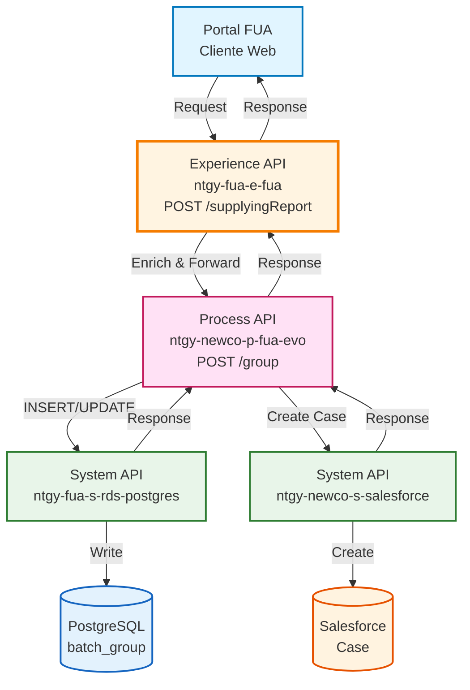
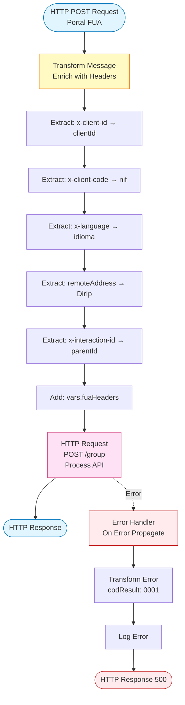
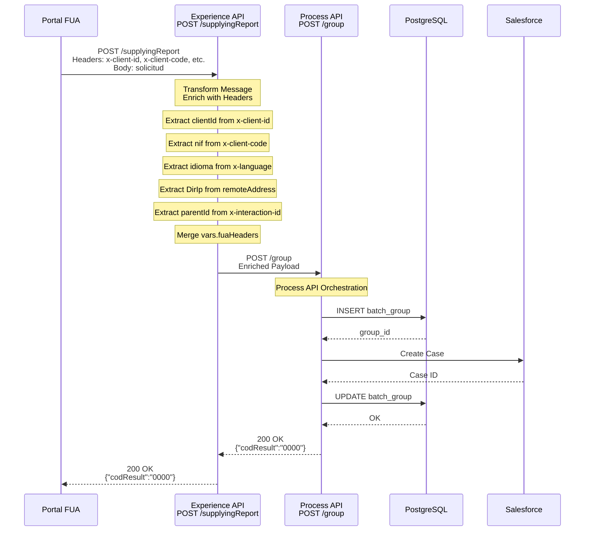
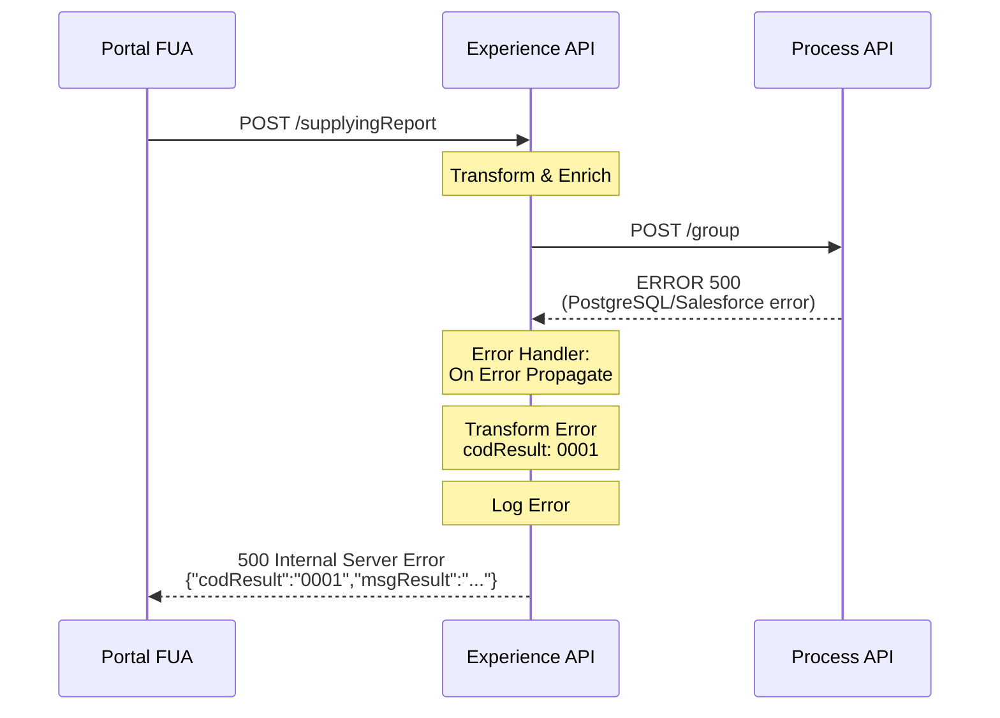
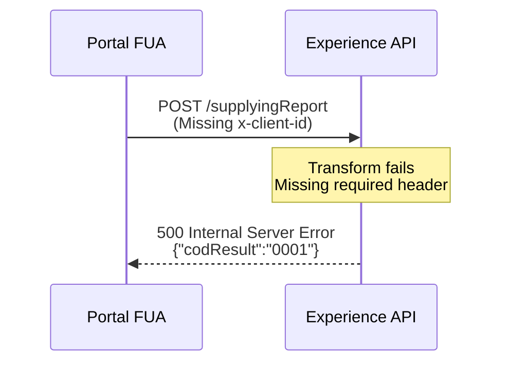

# POST /supplyingReport

## 📌 Descripción General

### Propósito del Endpoint

Este endpoint permite a los clientes del portal FUA crear solicitudes de agrupación de CUPS (Código Universal de Punto de Suministro) para generar informes consolidados de facturación. Actúa como punto de entrada del canal FUA, enriqueciendo la petición con información de contexto (headers, IP del cliente) antes de delegar la orquestación al Process API.

### Tipo de API

**Capa:** Experience API (API-Led Connectivity)

**Función:** Adaptación de experiencia para canal FUA (Frontal Único de Atención)

### Patrón de Integración

**Tipo:** Pass-Through con Enriquecimiento de Headers

**Descripción:** Este endpoint actúa como proxy enriquecido que:
1. Recibe la solicitud del portal FUA
2. Enriquece el payload con headers de contexto (client_id, nif, idioma, IP, interaction_id)
3. Añade headers FUA adicionales desde variables
4. Delega la orquestación completa al Process API

### Arquitectura API-Led Connectivity



---

## 💼 Propósito del Negocio

### Casos de Uso Principales

1. **Solicitud de Agrupador de Facturas desde Portal FUA**
   - Cliente accede al portal FUA y solicita un informe consolidado de facturas
   - Sistema captura contexto del cliente (IP, idioma, identificadores)
   - Beneficio: Experiencia personalizada con trazabilidad completa de la solicitud

2. **Enriquecimiento de Contexto para Auditoría**
   - Experience API captura información del cliente y sesión
   - Añade metadatos de interacción para seguimiento
   - Beneficio: Trazabilidad completa de solicitudes para auditoría y soporte

3. **Delegación de Orquestación Compleja**
   - Experience API delega lógica de negocio al Process API
   - Mantiene separación de responsabilidades por capas
   - Beneficio: Arquitectura limpia y mantenible

### 📱 Canal y Audiencia

#### Canal de Consumo

**Canal:** FUA (Frontal Único de Atención)

**Características del Canal:**
- **Plataforma**: Portal web de autoservicio para clientes
- **Dispositivos**: Navegadores web (desktop y móvil)
- **Conectividad**: Conexión estable requerida
- **Experiencia de Usuario**: Interfaz web responsive

#### Audiencia Objetivo

**Usuarios Finales:**
- **Clientes Residenciales**: Solicitan informes de facturación para gestión personal
- **Clientes Empresariales**: Requieren consolidación de facturas para contabilidad

**Contexto de Uso:**
- **Autoservicio**: Cliente gestiona sus solicitudes sin intervención de agentes
- **Gestión de Facturas**: Necesidad de informes consolidados por períodos

#### Adaptaciones del Canal

**Optimizaciones Aplicadas:**
- **Enriquecimiento de Headers**: Añade client_id, nif, idioma, IP del cliente
- **Captura de Interacción**: Registra interaction_id para trazabilidad
- **Formato de Respuesta**: Respuesta estándar simplificada para el portal
- **Manejo de Errores**: Transformación de errores a formato amigable

### 🔗 Endpoints Dependientes

Este Experience API consume el siguiente Process API:

| Process API | Endpoint | Método | Propósito |
|-------------|----------|--------|-----------|
| `ntgy-newco-p-fua-evo` | `/group` | POST | Orquesta la creación completa del agrupador (PostgreSQL + Salesforce) |

### Contexto Empresarial

- **Dominio:** Autoservicio de Clientes - Gestión de Facturación
- **Sector:** Energía - Utilities
- **División:** Naturgy España - NewCo
- **Canal:** FUA (Portal Web)

### Stakeholders

- **Clientes Finales**: Solicitan informes consolidados de facturación
- **Equipo de Facturación**: Procesa las solicitudes de agrupadores
- **Equipo de Soporte**: Realiza seguimiento mediante Salesforce

### Valor de Negocio

- **Autoservicio**: Reduce carga en call center al permitir solicitudes online
- **Trazabilidad**: Captura completa de contexto para auditoría
- **Experiencia Unificada**: Portal FUA como punto único de acceso
- **Eficiencia Operativa**: Automatización del proceso de solicitud

---

## 🔧 Especificación Técnica

### URLs por Ambiente

| Ambiente | URL Base | URL Completa |
|----------|----------|--------------|
| **Local** | `http://localhost:8081` | `http://localhost:8081/fua/api/supplyingReport` |
| **Development** | `https://ntgy-fua-e-fua-dev.us-e2.cloudhub.io` | `https://ntgy-fua-e-fua-dev.us-e2.cloudhub.io/fua/api/supplyingReport` |
| **UAT** | `https://ntgy-fua-e-fua-uat.us-e2.cloudhub.io` | `https://ntgy-fua-e-fua-uat.us-e2.cloudhub.io/fua/api/supplyingReport` |
| **Production** | `https://ntgy-fua-e-fua-pro.us-e2.cloudhub.io` | `https://ntgy-fua-e-fua-pro.us-e2.cloudhub.io/fua/api/supplyingReport` |

### Método HTTP

```
POST /fua/api/supplyingReport
```

### 🎯 Consideraciones del Canal

#### Limitaciones del Canal

| Aspecto | Limitación | Razón |
|---------|------------|-------|
| **Timeout** | 60 segundos | Proceso de orquestación puede ser largo |
| **Tamaño de Respuesta** | Respuesta estándar pequeña | Solo confirmación, no datos |
| **Rate Limiting** | Según configuración API Manager | Protección del sistema |

#### Campos Específicos del Canal

**Campos Añadidos por el Experience API:**

| Campo | Tipo | Descripción | Razón |
|-------|------|-------------|-------|
| `clientId` | string | ID del cliente desde header x-client-id | Identificación del cliente |
| `nif` | string | NIF desde header x-client-code | Validación de identidad |
| `idioma` | string | Idioma desde header x-language | Personalización |
| `DirIp` | string | IP del cliente extraída de remoteAddress | Auditoría y seguridad |
| `parentId` | string | ID de interacción desde x-interaction-id | Trazabilidad |
| `fuaHeaders` | object | Headers adicionales FUA desde variables | Contexto adicional |

### Parámetros de Entrada

#### Headers Requeridos

| Header | Tipo | Descripción | Ejemplo |
|--------|------|-------------|---------|
| `x-client-id` | string | ID del cliente en Salesforce | "0011X00000ABC123" |
| `x-client-code` | string | NIF/CIF del cliente | "12345678A" |
| `x-language` | string | Idioma del cliente (ES/CA/EN) | "ES" |
| `x-interaction-id` | string | ID de interacción (opcional) | "INT-2024-001" |
| `Content-Type` | string | Tipo de contenido | "application/json" |

#### Request Body (application/json)

```json
{
  "email": "string",
  "dateFrom": "string",
  "dateTo": "string",
  "name": "string",
  "contactId": "string",
  "cupTypeId": number,
  "billingAccountDataList": [
    {
      "invoiceTypeId": "string",
      "invoiceNumber": "string",
      "address": "string"
    }
  ]
}
```

#### Campos Obligatorios del Body

| Campo | Tipo | Descripción | Ejemplo |
|-------|------|-------------|---------|
| `email` | string | Email del cliente | "cliente@example.com" |
| `dateFrom` | string | Fecha inicio período (MM/DD/YYYY) | "01/01/2024" |
| `dateTo` | string | Fecha fin período (MM/DD/YYYY) | "12/31/2024" |
| `name` | string | Nombre del cliente | "Juan Pérez" |
| `contactId` | string | ID del contacto en Salesforce | "0031X00000XYZ789" |
| `cupTypeId` | number | Tipo de suministro (1=Electricidad, 2=Gas) | 1 |
| `billingAccountDataList` | array | Lista de facturas a agrupar | Ver estructura abajo |

#### Estructura de billingAccountDataList

| Campo | Tipo | Descripción | Ejemplo |
|-------|------|-------------|---------|
| `invoiceTypeId` | string | Tipo de factura | "REGULAR" |
| `invoiceNumber` | string | Número de factura | "FAC-2024-001" |
| `address` | string | Dirección de suministro | "Calle Mayor 123, Madrid" |

### Respuestas

#### 200 OK - Solicitud Creada Exitosamente

```json
{
  "result": {
    "codResult": "0000",
    "msgResult": "No hay error"
  }
}
```

**Descripción:** La solicitud de agrupador se ha creado correctamente en el Process API.

#### 500 Internal Server Error - Error del Sistema

```json
{
  "result": {
    "codResult": "0001",
    "msgResult": "Error description"
  }
}
```

**Descripción:** Error en el procesamiento de la solicitud (puede ser del Process API o sistemas downstream).

### Autenticación

- **Tipo:** Client ID & Client Secret (Anypoint Platform)
- **Headers Requeridos:**
  - `client_id`: ID de la aplicación cliente
  - `client_secret`: Secret de la aplicación cliente

### Timeouts

| Tipo | Valor | Razón |
|------|-------|-------|
| **Request Timeout** | 60 segundos | Permite completar orquestación en Process API |
| **Connection Timeout** | 30 segundos | Tiempo estándar de conexión |

### Validaciones

- ✅ Headers `x-client-id`, `x-client-code`, `x-language` deben estar presentes
- ✅ Todos los campos obligatorios del body deben estar presentes
- ✅ `email` debe tener formato válido
- ✅ `dateFrom` y `dateTo` deben ser fechas válidas
- ✅ `cupTypeId` debe ser 1 o 2
- ✅ `billingAccountDataList` no puede estar vacío

---

## 🏗️ Implementación Técnica

### Arquitectura del Flow



### Transformaciones de Canal

#### Transformación: Enriquecimiento de Payload (Líneas 13-28)

| Campo Original (Request) | Campo Añadido (Process API) | Transformación |
|--------------------------|----------------------------|----------------|
| `payload` | `payload` | Pass-through completo |
| `attributes.headers['x-client-id']` | `clientId` | Extracción de header |
| `attributes.headers['x-client-code']` | `nif` | Extracción de header |
| `attributes.headers['x-language']` | `idioma` | Extracción de header |
| `attributes.remoteAddress` | `DirIp` | Extracción y parsing de IP |
| `attributes.headers['x-interaction-id']` | `parentId` | Condicional: si existe y != "null" |
| `vars.fuaHeaders` | `fuaHeaders` | Merge de headers adicionales |

**Lógica de Transformación:**

```dataweave
%dw 2.2
import * from dw::core::Strings
output application/json
---
payload
++
{
    "clientId": attributes.headers['x-client-id'],
    "nif": attributes.headers['x-client-code'],
    "idioma": attributes.headers['x-language'],
    "DirIp": substringBefore(substringAfter(attributes.remoteAddress,"/"),":"),
    "parentId": (if (attributes.headers['x-interaction-id'] != "null" and !isEmpty(attributes.headers['x-interaction-id'])) attributes.headers['x-interaction-id'] else null)
}
++ vars.fuaHeaders
```

**Lógica Especial:**

1. **Extracción de IP**: Usa `substringBefore` y `substringAfter` para extraer IP de formato `/127.0.0.1:12345`
2. **parentId Condicional**: Solo añade si el header existe, no es "null" y no está vacío
3. **Merge de Headers**: Combina payload original + campos extraídos + headers FUA adicionales

### Patrones de Diseño

**Patrón:** Proxy Enriquecido (Enriched Proxy)

**Justificación:** 
- Añade contexto del canal sin modificar la lógica de negocio
- Mantiene separación de responsabilidades entre capas
- Permite evolución independiente del Process API

**Patrón:** Header Propagation

**Justificación:**
- Propaga información de contexto a través de las capas
- Facilita trazabilidad y auditoría
- Permite personalización basada en cliente

### Diagramas de Secuencia

#### 1. Flujo Normal de Éxito



#### 2. Flujo con Error en Process API



#### 3. Flujo con Headers Faltantes



### Optimizaciones del Canal

**Optimizaciones Aplicadas:**

1. **Enriquecimiento Eficiente**: Usa operador `++` de DataWeave para merge rápido
2. **Extracción de IP Optimizada**: Parsing directo sin regex para mejor performance
3. **Validación Condicional**: Solo añade parentId si existe, evita nulls innecesarios
4. **Pass-Through**: No modifica payload original, solo añade campos

### Manejo de Errores

#### Estrategia de Error Handling

**Error Handler:** `On Error Propagate`

**Comportamiento:**

1. **Captura cualquier error** del Process API o transformación
2. **Transforma el error** a formato estándar:
   ```json
   {
     "result": {
       "codResult": "0001",
       "msgResult": "error.description"
     }
   }
   ```
3. **Registra el error** en logs con nivel ERROR
4. **Propaga el error** al cliente con status 500

**Tipos de Errores Manejados:**

- **HTTP:CONNECTIVITY**: Error de conexión con Process API
- **HTTP:TIMEOUT**: Timeout en llamada al Process API
- **EXPRESSION**: Error en transformación DataWeave (headers faltantes)
- **Cualquier otro error**: Capturado y transformado genéricamente

**Transformación de Error (Líneas 32-43):**

```dataweave
%dw 2.0
output application/json
---
{
    "result": {
        "codResult": "0001",
        "msgResult": error.description as String replace /\"/ with("")
    }
}
```

**Lógica Especial:**
- Elimina comillas dobles del mensaje de error para evitar problemas de parsing
- Convierte error.description a String para asegurar formato correcto

---

## 💻 Ejemplos de Uso

### Ejemplo 1: Llamada Exitosa desde Portal FUA

#### cURL

```bash
curl -X POST "https://ntgy-fua-e-fua-dev.us-e2.cloudhub.io/fua/api/supplyingReport" \
  -H "Content-Type: application/json" \
  -H "x-client-id: 0011X00000ABC123" \
  -H "x-client-code: 12345678A" \
  -H "x-language: ES" \
  -H "x-interaction-id: INT-2024-001" \
  -H "client_id: YOUR_CLIENT_ID" \
  -H "client_secret: YOUR_CLIENT_SECRET" \
  -d '{
    "email": "juan.perez@example.com",
    "dateFrom": "01/01/2024",
    "dateTo": "12/31/2024",
    "name": "Juan Pérez",
    "contactId": "0031X00000XYZ789",
    "cupTypeId": 1,
    "billingAccountDataList": [
      {
        "invoiceTypeId": "REGULAR",
        "invoiceNumber": "FAC-2024-001",
        "address": "Calle Mayor 123, Madrid"
      },
      {
        "invoiceTypeId": "REGULAR",
        "invoiceNumber": "FAC-2024-002",
        "address": "Calle Mayor 123, Madrid"
      }
    ]
  }'
```

#### Respuesta (200 OK)

```json
{
  "result": {
    "codResult": "0000",
    "msgResult": "No hay error"
  }
}
```

**Payload Enviado al Process API (enriquecido):**

```json
{
  "email": "juan.perez@example.com",
  "dateFrom": "01/01/2024",
  "dateTo": "12/31/2024",
  "name": "Juan Pérez",
  "contactId": "0031X00000XYZ789",
  "cupTypeId": 1,
  "billingAccountDataList": [
    {
      "invoiceTypeId": "REGULAR",
      "invoiceNumber": "FAC-2024-001",
      "address": "Calle Mayor 123, Madrid"
    },
    {
      "invoiceTypeId": "REGULAR",
      "invoiceNumber": "FAC-2024-002",
      "address": "Calle Mayor 123, Madrid"
    }
  ],
  "clientId": "0011X00000ABC123",
  "nif": "12345678A",
  "idioma": "ES",
  "DirIp": "192.168.1.100",
  "parentId": "INT-2024-001"
}
```

---

### Ejemplo 2: JavaScript (Fetch API) - Portal FUA

```javascript
const createSupplyingReport = async (reportData) => {
  const response = await fetch('https://ntgy-fua-e-fua-dev.us-e2.cloudhub.io/fua/api/supplyingReport', {
    method: 'POST',
    headers: {
      'Content-Type': 'application/json',
      'x-client-id': sessionStorage.getItem('clientId'),
      'x-client-code': sessionStorage.getItem('nif'),
      'x-language': sessionStorage.getItem('language') || 'ES',
      'x-interaction-id': generateInteractionId(),
      'client_id': 'YOUR_CLIENT_ID',
      'client_secret': 'YOUR_CLIENT_SECRET'
    },
    body: JSON.stringify(reportData)
  });

  const data = await response.json();
  
  if (response.ok && data.result.codResult === '0000') {
    console.log('Solicitud creada exitosamente');
    return { success: true, data };
  } else {
    console.error('Error al crear solicitud:', data.result.msgResult);
    return { success: false, error: data.result.msgResult };
  }
};

// Función auxiliar para generar interaction ID
function generateInteractionId() {
  return `INT-${Date.now()}-${Math.random().toString(36).substr(2, 9)}`;
}

// Uso en el portal FUA
const reportData = {
  email: 'cliente@example.com',
  dateFrom: '01/01/2024',
  dateTo: '12/31/2024',
  name: 'Cliente Ejemplo',
  contactId: '0031X00000XYZ789',
  cupTypeId: 1,
  billingAccountDataList: [
    {
      invoiceTypeId: 'REGULAR',
      invoiceNumber: 'FAC-2024-001',
      address: 'Calle Ejemplo 123, Madrid'
    }
  ]
};

createSupplyingReport(reportData)
  .then(result => {
    if (result.success) {
      showSuccessMessage('Solicitud creada correctamente');
    } else {
      showErrorMessage(result.error);
    }
  })
  .catch(error => {
    console.error('Error inesperado:', error);
    showErrorMessage('Error al procesar la solicitud');
  });
```

---

### Ejemplo 3: Python (Requests) - Integración Externa

```python
import requests
import json
from datetime import datetime

def create_supplying_report(client_info, report_data):
    """
    Crea una solicitud de agrupador de facturas en el portal FUA
    
    Args:
        client_info: Información del cliente (clientId, nif, language)
        report_data: Datos de la solicitud (email, fechas, facturas)
    
    Returns:
        dict: Resultado de la operación
    """
    url = 'https://ntgy-fua-e-fua-dev.us-e2.cloudhub.io/fua/api/supplyingReport'
    
    headers = {
        'Content-Type': 'application/json',
        'x-client-id': client_info['client_id'],
        'x-client-code': client_info['nif'],
        'x-language': client_info.get('language', 'ES'),
        'x-interaction-id': f"INT-{datetime.now().timestamp()}",
        'client_id': 'YOUR_CLIENT_ID',
        'client_secret': 'YOUR_CLIENT_SECRET'
    }
    
    payload = {
        'email': report_data['email'],
        'dateFrom': report_data['date_from'],
        'dateTo': report_data['date_to'],
        'name': report_data['name'],
        'contactId': report_data['contact_id'],
        'cupTypeId': report_data['cup_type'],
        'billingAccountDataList': report_data['invoices']
    }
    
    try:
        response = requests.post(url, headers=headers, json=payload, timeout=60)
        response.raise_for_status()
        
        result = response.json()
        
        if result.get('result', {}).get('codResult') == '0000':
            print(f"✅ Solicitud creada exitosamente")
            return {'success': True, 'data': result}
        else:
            error_msg = result.get('result', {}).get('msgResult', 'Error desconocido')
            print(f"❌ Error: {error_msg}")
            return {'success': False, 'error': error_msg}
            
    except requests.exceptions.HTTPError as http_err:
        print(f"❌ Error HTTP: {http_err}")
        print(f"Respuesta: {response.text}")
        return {'success': False, 'error': str(http_err)}
    except requests.exceptions.Timeout:
        print("❌ Error: Timeout al conectar con el servidor")
        return {'success': False, 'error': 'Timeout'}
    except Exception as err:
        print(f"❌ Error inesperado: {err}")
        return {'success': False, 'error': str(err)}

# Ejemplo de uso
client_info = {
    'client_id': '0011X00000ABC123',
    'nif': '12345678A',
    'language': 'ES'
}

report_data = {
    'email': 'cliente@example.com',
    'date_from': '01/01/2024',
    'date_to': '12/31/2024',
    'name': 'Cliente Ejemplo',
    'contact_id': '0031X00000XYZ789',
    'cup_type': 1,
    'invoices': [
        {
            'invoiceTypeId': 'REGULAR',
            'invoiceNumber': 'FAC-2024-001',
            'address': 'Calle Ejemplo 123, Madrid'
        },
        {
            'invoiceTypeId': 'REGULAR',
            'invoiceNumber': 'FAC-2024-002',
            'address': 'Calle Ejemplo 123, Madrid'
        }
    ]
}

result = create_supplying_report(client_info, report_data)
```

---

### Ejemplo 4: Error - Headers Faltantes

#### Request

```bash
curl -X POST "https://ntgy-fua-e-fua-dev.us-e2.cloudhub.io/fua/api/supplyingReport" \
  -H "Content-Type: application/json" \
  -H "client_id: YOUR_CLIENT_ID" \
  -H "client_secret: YOUR_CLIENT_SECRET" \
  -d '{
    "email": "cliente@example.com",
    "dateFrom": "01/01/2024",
    "dateTo": "12/31/2024",
    "name": "Cliente Ejemplo",
    "contactId": "0031X00000XYZ789",
    "cupTypeId": 1,
    "billingAccountDataList": []
  }'
```

#### Response (500 Internal Server Error)

```json
{
  "result": {
    "codResult": "0001",
    "msgResult": "Cannot coerce Null (null) to String"
  }
}
```

**Causa:** Headers requeridos `x-client-id`, `x-client-code` o `x-language` no están presentes.

---

### Ejemplo 5: Error - Process API No Disponible

#### Response (500 Internal Server Error)

```json
{
  "result": {
    "codResult": "0001",
    "msgResult": "HTTP POST on resource 'https://ntgy-newco-p-fua-evo-dev.us-e2.cloudhub.io:443/api/group' failed: Connection timeout."
  }
}
```

**Causa:** El Process API no está disponible o hay problemas de conectividad.
