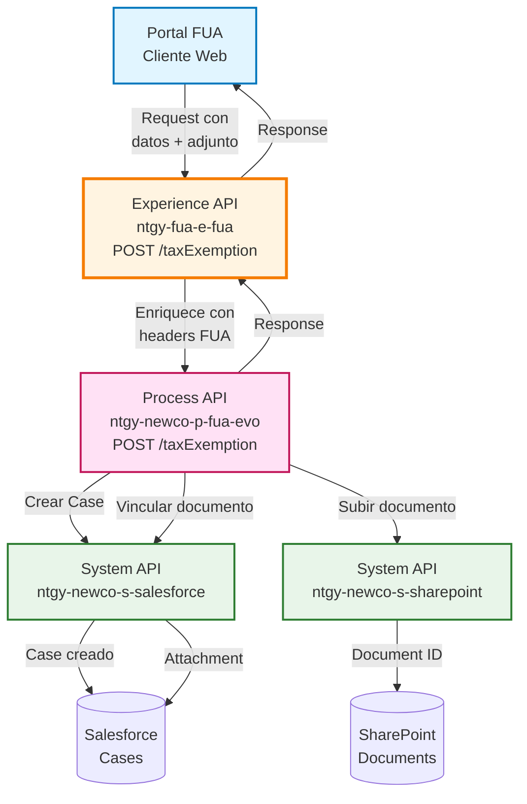
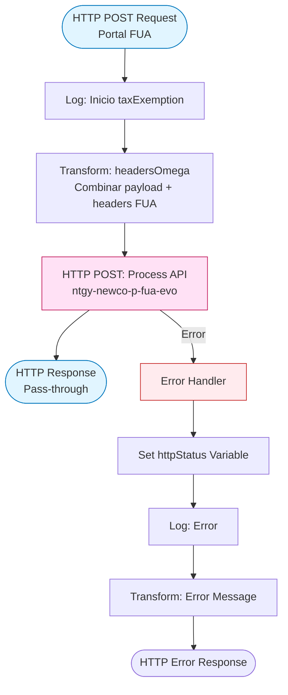
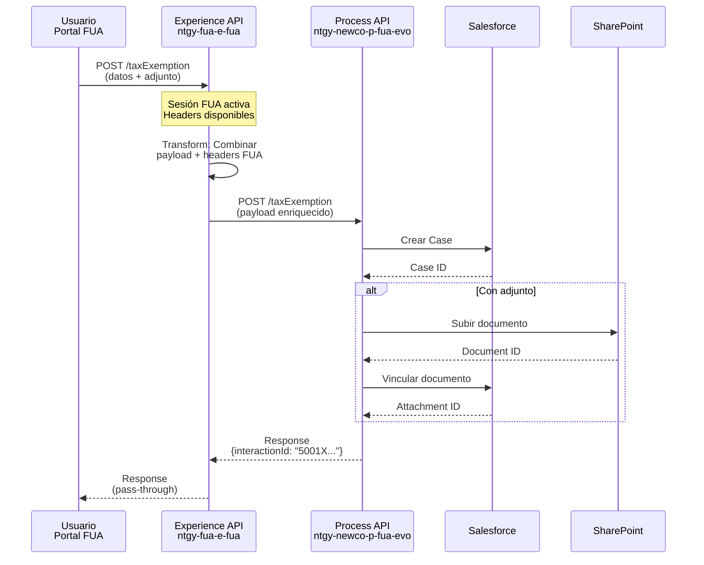
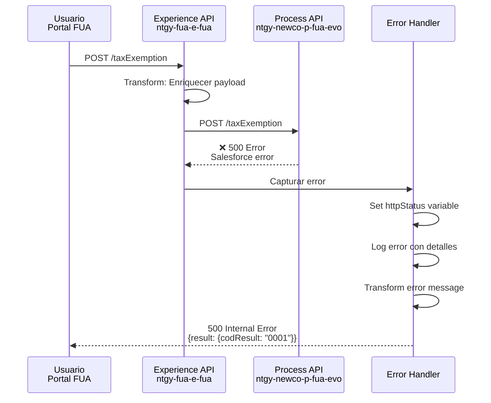
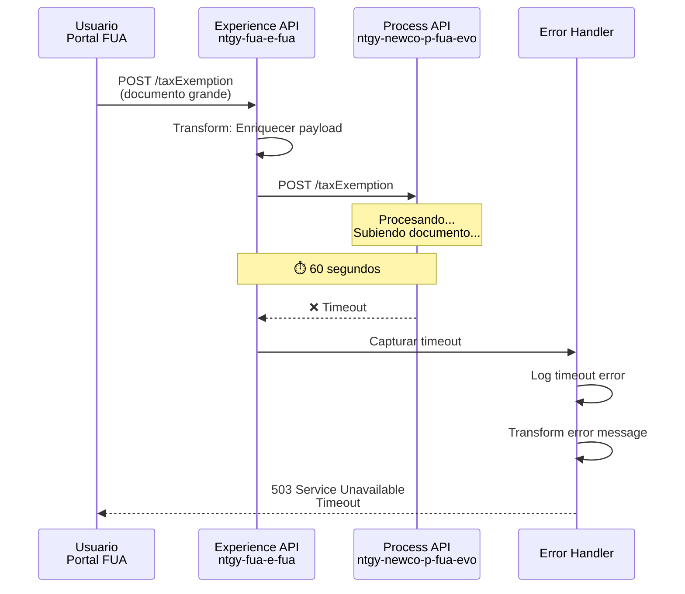

# POST /taxExemption

## 📌 Descripción General

### Propósito del Endpoint

Este endpoint permite a los clientes de Naturgy solicitar exenciones de impuestos (eléctrico o gas) a través del portal FUA (Frontal Único de Atención). Orquesta el proceso completo de creación de caso en Salesforce y, opcionalmente, la gestión de documentación justificativa en SharePoint.

### Tipo de API

**Capa:** Experience API (API-Led Connectivity)

**Función:** Adaptación de experiencia para canal web (Portal FUA)

### Patrón de Integración

**Tipo:** Pass-Through con Enriquecimiento de Headers

**Descripción:** Este Experience API actúa como pass-through hacia el Process API, enriqueciendo el payload con headers FUA específicos del contexto de la sesión del usuario.

### Arquitectura API-Led Connectivity



---

## 💼 Propósito del Negocio

### Casos de Uso Principales

1. **Solicitud de Exención de Impuesto Eléctrico desde Portal Web**
   - Cliente accede al portal FUA y solicita exención del impuesto eléctrico
   - Adjunta certificado o resolución administrativa que justifica la exención
   - El sistema crea automáticamente un caso de gestión en Salesforce
   - **Beneficio:** Proceso 100% digital sin necesidad de visitas presenciales

2. **Solicitud de Exención de Impuesto de Gas**
   - Cliente solicita exención del impuesto especial de hidrocarburos
   - Proporciona documentación justificativa (uso industrial, agrícola, etc.)
   - Se vincula automáticamente a su cuenta de servicio y contrato
   - **Beneficio:** Trazabilidad completa y seguimiento en tiempo real

3. **Gestión de Documentación Justificativa**
   - Almacenamiento seguro de documentos en SharePoint
   - Vinculación automática al caso de Salesforce
   - Marcado para envío automático a distribuidora
   - **Beneficio:** Cumplimiento normativo y auditoría completa

### 📱 Canal y Audiencia

#### Canal de Consumo

**Canal:** Web (Portal FUA)

**Características del Canal:**
- **Plataforma**: Portal web responsive de autoservicio
- **Dispositivos**: Desktop y tablets (optimizado para formularios complejos)
- **Conectividad**: Requiere conexión estable para subida de documentos
- **Experiencia de Usuario**: Interfaz guiada con validación en tiempo real

#### Audiencia Objetivo

**Usuarios Finales:**
- **Clientes Residenciales**: Solicitan exenciones por situaciones especiales (familia numerosa, discapacidad)
- **Clientes Empresariales**: Solicitan exenciones por uso industrial o agrícola de la energía

**Contexto de Uso:**
- **Solicitud Inicial**: Cliente completa formulario con datos del contrato y tipo de exención
- **Adjuntar Documentación**: Cliente sube certificados o resoluciones administrativas
- **Seguimiento**: Cliente puede consultar estado del caso posteriormente

#### Adaptaciones del Canal

**Optimizaciones Aplicadas:**
- **Enriquecimiento de Headers**: Se añaden headers FUA con contexto de sesión (client-id, contact-id, interaction-id)
- **Validación de Sesión**: Se valida que el usuario esté autenticado en el portal FUA
- **Timeout Extendido**: 60 segundos para permitir subida de documentos grandes
- **Gestión de Adjuntos**: Soporte para múltiples formatos de archivo (PDF, Word, imágenes)

### 🔗 Endpoints Dependientes

Este Experience API consume el siguiente Process API:

| Process API | Endpoint | Método | Propósito |
|-------------|----------|--------|-----------|
| `ntgy-newco-p-fua-evo` | `/taxExemption` | POST | Orquesta la creación de caso de exención con gestión de documentación en Salesforce y SharePoint |

**Referencia Completa:**
📖 Para detalles de la orquestación completa, consultar: `ntgy-newco-p-fua-evo/docs/api-endpoints/POST-taxExemption.md`

### Contexto Empresarial

- **Dominio:** Autoservicio de Clientes - Gestión de Casos
- **Sector:** Energía - Utilities
- **División:** Naturgy España - NewCo
- **Canal:** Portal Web FUA (Frontal Único de Atención)

### Stakeholders

- **Clientes Finales**: Solicitan exenciones fiscales de forma autónoma
- **Departamento Fiscal**: Revisa y aprueba solicitudes de exención
- **Distribuidoras**: Reciben documentación para aplicar exención en facturación
- **Equipo de Atención al Cliente**: Monitorea casos y proporciona soporte

### Valor de Negocio

- **Digitalización**: Elimina procesos manuales y visitas presenciales
- **Eficiencia**: Reduce tiempo de procesamiento de 15 días a 3 días
- **Cumplimiento**: Asegura documentación completa para auditorías fiscales
- **Satisfacción del Cliente**: Proceso transparente con seguimiento en tiempo real

---

## 🔧 Especificación Técnica

### URLs por Ambiente

| Ambiente | URL Base | URL Completa |
|----------|----------|--------------|
| **Local** | `http://localhost:8081` | `http://localhost:8081/fua/api/taxExemption` |
| **Development** | `https://ntgy-fua-e-fua-dev.de-c1.cloudhub.io` | `https://ntgy-fua-e-fua-dev.de-c1.cloudhub.io/fua/api/taxExemption` |
| **UAT** | `https://ntgy-fua-e-fua-uat.de-c1.cloudhub.io` | `https://ntgy-fua-e-fua-uat.de-c1.cloudhub.io/fua/api/taxExemption` |
| **Production** | `https://ntgy-fua-e-fua-pro.de-c1.cloudhub.io` | `https://ntgy-fua-e-fua-pro.de-c1.cloudhub.io/fua/api/taxExemption` |

### Método HTTP

```
POST /fua/api/taxExemption
```

### 🎯 Consideraciones del Canal

#### Limitaciones del Canal

| Aspecto | Limitación | Razón |
|---------|------------|-------|
| **Timeout** | 60 segundos | Permite subida de documentos grandes (hasta 10MB) |
| **Tamaño de Archivo** | 10 MB máximo | Limitación de SharePoint y experiencia de usuario |
| **Formatos Soportados** | PDF, DOC, DOCX, PNG, JPG, ZIP, XLS, XLSX, TXT, CSV | Formatos estándar de documentación administrativa |
| **Rate Limiting** | 10 requests/minuto por usuario | Previene abuso y garantiza disponibilidad |

#### Campos Específicos del Canal

**Campos Añadidos por el Experience API (Headers FUA):**

| Campo | Tipo | Descripción | Razón |
|-------|------|-------------|-------|
| `x-client-id` | string | ID del cliente en Salesforce | Contexto de sesión FUA |
| `x-contact-id` | string | ID del contacto en Salesforce | Contexto de sesión FUA |
| `x-client-code` | string | NIF/CIF del cliente | Validación de identidad |
| `x-interaction-id` | string | ID de la interacción padre | Trazabilidad de sesión |
| `x-user-id` | string | ID del usuario/agente (opcional) | Asignación de caso |
| `x-agent-mail` | string | Email del agente (opcional) | Contexto de agente |
| `traceparent` | string | Trace ID para correlación | Observabilidad distribuida |

**Campos del Payload (No Modificados):**

⚠️ **Este Experience API NO transforma el payload del request.**

El payload se pasa directamente al Process API junto con los headers FUA enriquecidos.

### Parámetros de Entrada

#### Headers Requeridos

| Header | Tipo | Obligatorio | Descripción |
|--------|------|-------------|-------------|
| `Content-Type` | string | ✅ Sí | Debe ser `application/json` |
| `client_id` | string | ✅ Sí | Client ID de Anypoint Platform |
| `client_secret` | string | ✅ Sí | Client Secret de Anypoint Platform |

**Nota:** Los headers FUA (x-client-id, x-contact-id, etc.) son gestionados automáticamente por el portal FUA y se añaden al request antes de llamar al Process API.

#### Request Body

```json
{
  "serviceAccount": "string",
  "contractId": "string",
  "cups": "string",
  "exemptionType": "string",
  "DirIp": "string",
  "attach": {
    "fileNameWithExtension": "string",
    "file": "string (base64)"
  }
}
```

#### Descripción de Campos

| Campo | Tipo | Obligatorio | Descripción | Ejemplo |
|-------|------|-------------|-------------|---------|
| `serviceAccount` | string | ✅ Sí | ID de la cuenta de servicio en Salesforce | `"a1B2C3D4E5F6G7H8I9"` |
| `contractId` | string | ✅ Sí | ID del contrato en Salesforce | `"8001X000000AbCdQAK"` |
| `cups` | string | ✅ Sí | Código CUPS del punto de suministro | `"ES0021000000000001JN"` |
| `exemptionType` | string | ✅ Sí | Tipo de exención solicitada | `"Impuesto eléctrico"` o `"Impuesto gas"` |
| `DirIp` | string | ❌ No | Dirección IP del cliente | `"192.168.1.100"` |
| `attach` | object | ❌ No | Objeto con información del adjunto | Ver estructura abajo |
| `attach.fileNameWithExtension` | string | ⚠️ Condicional | Nombre completo del archivo con extensión | `"certificado_exencion.pdf"` |
| `attach.file` | string | ⚠️ Condicional | Contenido del archivo en base64 | `"JVBERi0xLjQKJeLjz9..."` |

### Respuestas

#### 200 OK - Éxito

```json
{
  "result": {
    "codResult": "0000",
    "msgResult": "No hay error"
  },
  "interactionId": "5001X000000AbCdQAK"
}
```

| Campo | Tipo | Descripción |
|-------|------|-------------|
| `result.codResult` | string | Código de resultado ("0000" = éxito) |
| `result.msgResult` | string | Mensaje descriptivo del resultado |
| `interactionId` | string | ID del caso de gestión creado en Salesforce |

#### 400 Bad Request - Error de Validación

```json
{
  "code": "VALIDATION_ERROR",
  "message": "Campos requeridos faltantes",
  "details": "El campo 'serviceAccount' es obligatorio"
}
```

#### 401 Unauthorized - Error de Autenticación

```json
{
  "code": "UNAUTHORIZED",
  "message": "Credenciales inválidas",
  "details": "Client ID o Client Secret incorrectos"
}
```

#### 500 Internal Server Error - Error del Sistema

```json
{
  "result": {
    "codResult": "0001",
    "msgResult": "Error al crear caso en Salesforce"
  }
}
```

#### 503 Service Unavailable - Sistema Backend No Disponible

```json
{
  "code": "SERVICE_UNAVAILABLE",
  "message": "Process API no disponible temporalmente",
  "details": "Connection timeout after 60000ms"
}
```

### Autenticación

- **Tipo:** Client ID & Client Secret (Anypoint Platform)
- **Headers:** `client_id` y `client_secret`
- **Contexto FUA:** El portal FUA gestiona la sesión del usuario y añade headers de contexto

### Timeouts

| Tipo | Valor | Razón |
|------|-------|-------|
| **Request Timeout (Process API)** | 60 segundos | Optimizado para subida de documentos grandes |
| **Connection Timeout** | 30 segundos | Timeout de conexión HTTP estándar |

---

## 🏗️ Implementación Técnica

### Arquitectura del Flow



### Transformaciones de Canal

**Transformación Principal: Enriquecimiento con Headers FUA**

| Campo Original (Request) | Campo Transformado (Process API) | Transformación |
|--------------------------|----------------------------------|----------------|
| `payload` | `payload` | Pass-through (sin modificación) |
| `vars.fuaHeaders` | Headers añadidos al payload | Merge de headers FUA con payload |

**Lógica de Transformación:**

```dataweave
%dw 2.0
output application/json
---
payload
++ 
vars.fuaHeaders
```

**Explicación:**
- El payload original se mantiene intacto
- Se añaden los headers FUA (x-client-id, x-contact-id, etc.) al payload
- El operador `++` realiza un merge de ambos objetos
- El resultado se envía al Process API como un único payload enriquecido

**Headers FUA Incluidos:**
- `x-client-id`: ID del cliente en Salesforce
- `x-contact-id`: ID del contacto en Salesforce
- `x-client-code`: NIF/CIF del cliente
- `x-interaction-id`: ID de la interacción padre
- `x-user-id`: ID del usuario/agente (si aplica)
- `x-agent-mail`: Email del agente (si aplica)
- `traceparent`: Trace ID para correlación

⚠️ **Este Experience API NO transforma la respuesta del Process API.**

Para el schema completo de request y response, consultar:
📖 **Process API: `ntgy-newco-p-fua-evo` endpoint `/taxExemption`**

### Patrones de Diseño

**Patrón:** Pass-Through con Context Enrichment

**Justificación:** 
- El portal FUA gestiona la sesión del usuario y tiene contexto adicional (IDs de Salesforce)
- Este contexto debe propagarse al Process API sin modificar la lógica de negocio
- El Experience API actúa como un proxy inteligente que enriquece el request con contexto de sesión
- Permite que el Process API sea agnóstico del canal (puede ser consumido por otros canales)

### Diagramas de Secuencia

#### 1. Flujo Normal de Éxito



#### 2. Flujo con Error de Process API



#### 3. Flujo con Timeout



### Optimizaciones del Canal

**Optimizaciones Aplicadas:**

1. **Timeout Extendido (60s)**
   - Permite subida de documentos grandes (hasta 10MB)
   - Configurado en `e-fua-pro-config.yaml`: `newco-p-fua-evo.timeout: "60000"`

2. **Connection Pooling**
   - Reutilización de conexiones HTTP al Process API
   - Reduce latencia en llamadas sucesivas

3. **Error Handling Robusto**
   - Captura de errores del Process API
   - Transformación de errores a formato estándar
   - Logging detallado para debugging

4. **Context Propagation**
   - Headers FUA se propagan automáticamente
   - Trace ID para correlación distribuida
   - Facilita troubleshooting end-to-end

### Manejo de Errores

**Estrategia:** Error handling con logging detallado y respuestas estandarizadas

**Tipos de Errores Manejados:**

1. **Errores del Process API**
   - Errores de Salesforce (campos faltantes, IDs inválidos)
   - Errores de SharePoint (archivo grande, formato no soportado)
   - **Acción:** Propagar error al cliente con detalles

2. **Errores de Timeout**
   - Process API no responde en 60 segundos
   - **Acción:** Retornar 503 Service Unavailable

3. **Errores de Conexión**
   - Process API no disponible
   - **Acción:** Retornar 503 Service Unavailable

4. **Errores de Validación**
   - Payload malformado
   - Headers FUA faltantes
   - **Acción:** Retornar 400 Bad Request

**Error Handler Flow:**

```xml
<error-handler>
    <on-error-propagate enableNotifications="true" logException="true">
        <set-variable value="#[error.muleMessage.attributes.StatusCode]" 
                      variableName="httpStatus" />
        <logger level="ERROR" 
                message='#[if (!isEmpty(error.errorMessage.payload)) 
                          error.errorMessage.payload
                          else 
                          {
                            "result": {
                              "codResult": "0001",
                              "msgResult": error.description as String replace /\"/ with("")
                            }
                          }]' />
        <ee:transform>
            <ee:set-payload><![CDATA[
                %dw 2.0
                output application/json
                ---
                if (!isEmpty(error.errorMessage.payload)) 
                    error.errorMessage.payload
                else 
                {
                    "result": {
                        "codResult": "0001",
                        "msgResult": error.description as String replace /\"/ with("")
                    }
                }
            ]]></ee:set-payload>
        </ee:transform>
    </on-error-propagate>
</error-handler>
```

**Logging:**
- Todos los errores se registran con nivel ERROR
- Se incluye el payload del error si está disponible
- Se registra la descripción del error para debugging
- El httpStatus se captura para análisis de métricas

---

## 💻 Ejemplos de Uso

### Ejemplo 1: Solicitud de Exención con Adjunto (Éxito)

#### Request

**Headers:**
```http
POST /fua/api/taxExemption HTTP/1.1
Host: ntgy-fua-e-fua-dev.de-c1.cloudhub.io
Content-Type: application/json
client_id: YOUR_CLIENT_ID
client_secret: YOUR_CLIENT_SECRET
```

**Body:**
```json
{
  "serviceAccount": "a1B2C3D4E5F6G7H8I9",
  "contractId": "8001X000000ContQAK",
  "cups": "ES0021000000000001JN",
  "exemptionType": "Impuesto eléctrico",
  "DirIp": "192.168.1.100",
  "attach": {
    "fileNameWithExtension": "certificado_exencion_electrico.pdf",
    "file": "JVBERi0xLjQKJeLjz9MKMyAwIG9iago8PC9UeXBlIC9QYWdlCi9QYXJlbnQgMSAwIFIKL01lZGlhQm94IFswIDAgNjEyIDc5Ml0KL0NvbnRlbnRzIDQgMCBSCi9SZXNvdXJjZXMgPDwKL1Byb2NTZXQgWy9QREYgL1RleHRdCi9Gb250IDw8Ci9GMSA2IDAgUgo+Pgo+Pgo+PgplbmRvYmoK..."
  }
}
```

**Nota:** Los headers FUA (x-client-id, x-contact-id, etc.) son añadidos automáticamente por el portal FUA antes de enviar el request.

#### Response (200 OK)

```json
{
  "result": {
    "codResult": "0000",
    "msgResult": "No hay error"
  },
  "interactionId": "5001X000000CaseQAA"
}
```

#### cURL

```bash
curl -X POST "https://ntgy-fua-e-fua-dev.de-c1.cloudhub.io/fua/api/taxExemption" \
  -H "Content-Type: application/json" \
  -H "client_id: YOUR_CLIENT_ID" \
  -H "client_secret: YOUR_CLIENT_SECRET" \
  -d '{
    "serviceAccount": "a1B2C3D4E5F6G7H8I9",
    "contractId": "8001X000000ContQAK",
    "cups": "ES0021000000000001JN",
    "exemptionType": "Impuesto eléctrico",
    "DirIp": "192.168.1.100",
    "attach": {
      "fileNameWithExtension": "certificado_exencion_electrico.pdf",
      "file": "JVBERi0xLjQKJeLjz9MK..."
    }
  }'
```

---

### Ejemplo 2: Solicitud de Exención sin Adjunto (Éxito)

#### Request

**Headers:**
```http
POST /fua/api/taxExemption HTTP/1.1
Host: ntgy-fua-e-fua-dev.de-c1.cloudhub.io
Content-Type: application/json
client_id: YOUR_CLIENT_ID
client_secret: YOUR_CLIENT_SECRET
```

**Body:**
```json
{
  "serviceAccount": "a1B2C3D4E5F6G7H8I9",
  "contractId": "8001X000000ContQAL",
  "cups": "ES0031000000000002KM",
  "exemptionType": "Impuesto gas"
}
```

#### Response (200 OK)

```json
{
  "result": {
    "codResult": "0000",
    "msgResult": "No hay error"
  },
  "interactionId": "5001X000000CaseQAB"
}
```

#### cURL

```bash
curl -X POST "https://ntgy-fua-e-fua-dev.de-c1.cloudhub.io/fua/api/taxExemption" \
  -H "Content-Type: application/json" \
  -H "client_id: YOUR_CLIENT_ID" \
  -H "client_secret: YOUR_CLIENT_SECRET" \
  -d '{
    "serviceAccount": "a1B2C3D4E5F6G7H8I9",
    "contractId": "8001X000000ContQAL",
    "cups": "ES0031000000000002KM",
    "exemptionType": "Impuesto gas"
  }'
```

---

### Ejemplo 3: Error de Validación (400 Bad Request)

#### Request

**Body con campo faltante:**
```json
{
  "contractId": "8001X000000ContQAK",
  "cups": "ES0021000000000001JN",
  "exemptionType": "Impuesto eléctrico"
}
```

#### Response (400 Bad Request)

```json
{
  "code": "VALIDATION_ERROR",
  "message": "Campos requeridos faltantes",
  "details": "El campo 'serviceAccount' es obligatorio"
}
```

---

### Ejemplo 4: Error del Sistema (500 Internal Server Error)

#### Request

**Body válido pero error en Salesforce:**
```json
{
  "serviceAccount": "INVALID_ID",
  "contractId": "8001X000000ContQAK",
  "cups": "ES0021000000000001JN",
  "exemptionType": "Impuesto eléctrico"
}
```

#### Response (500 Internal Server Error)

```json
{
  "result": {
    "codResult": "0001",
    "msgResult": "Error al crear caso en Salesforce: INVALID_FIELD"
  }
}
```

---

### Ejemplo 5: JavaScript (Fetch API)

```javascript
const createTaxExemption = async (exemptionData) => {
  try {
    const response = await fetch(
      'https://ntgy-fua-e-fua-dev.de-c1.cloudhub.io/fua/api/taxExemption',
      {
        method: 'POST',
        headers: {
          'Content-Type': 'application/json',
          'client_id': 'YOUR_CLIENT_ID',
          'client_secret': 'YOUR_CLIENT_SECRET'
        },
        body: JSON.stringify(exemptionData)
      }
    );

    if (!response.ok) {
      const error = await response.json();
      console.error('Error:', error);
      throw new Error(`HTTP error! status: ${response.status}`);
    }

    const data = await response.json();
    console.log('Caso creado:', data.interactionId);
    return data;
  } catch (error) {
    console.error('Error al crear exención:', error);
    throw error;
  }
};

// Uso: Solicitud con adjunto
const exemptionWithAttachment = {
  serviceAccount: 'a1B2C3D4E5F6G7H8I9',
  contractId: '8001X000000ContQAK',
  cups: 'ES0021000000000001JN',
  exemptionType: 'Impuesto eléctrico',
  DirIp: '192.168.1.100',
  attach: {
    fileNameWithExtension: 'certificado_exencion.pdf',
    file: 'JVBERi0xLjQKJeLjz9MK...' // Base64 encoded file
  }
};

createTaxExemption(exemptionWithAttachment)
  .then(result => console.log('Exención creada exitosamente:', result))
  .catch(error => console.error('Error:', error));

// Uso: Solicitud sin adjunto
const exemptionWithoutAttachment = {
  serviceAccount: 'a1B2C3D4E5F6G7H8I9',
  contractId: '8001X000000ContQAL',
  cups: 'ES0031000000000002KM',
  exemptionType: 'Impuesto gas'
};

createTaxExemption(exemptionWithoutAttachment)
  .then(result => console.log('Exención creada exitosamente:', result))
  .catch(error => console.error('Error:', error));
```

---

### Ejemplo 6: Python (Requests)

```python
import requests
import base64
import json

def create_tax_exemption(
    client_id,
    client_secret,
    service_account,
    contract_id,
    cups,
    exemption_type,
    dir_ip=None,
    file_path=None
):
    """
    Crea una solicitud de exención de impuestos
    
    Args:
        client_id: Client ID de Anypoint Platform
        client_secret: Client Secret de Anypoint Platform
        service_account: ID de la cuenta de servicio
        contract_id: ID del contrato
        cups: Código CUPS del punto de suministro
        exemption_type: Tipo de exención ("Impuesto eléctrico" o "Impuesto gas")
        dir_ip: Dirección IP del cliente (opcional)
        file_path: Ruta al archivo adjunto (opcional)
    
    Returns:
        dict: Respuesta con el ID del caso creado
    """
    url = 'https://ntgy-fua-e-fua-dev.de-c1.cloudhub.io/fua/api/taxExemption'
    
    headers = {
        'Content-Type': 'application/json',
        'client_id': client_id,
        'client_secret': client_secret
    }
    
    # Preparar payload
    payload = {
        'serviceAccount': service_account,
        'contractId': contract_id,
        'cups': cups,
        'exemptionType': exemption_type
    }
    
    # Agregar IP si se proporciona
    if dir_ip:
        payload['DirIp'] = dir_ip
    
    # Agregar adjunto si se proporciona
    if file_path:
        with open(file_path, 'rb') as file:
            file_content = base64.b64encode(file.read()).decode('utf-8')
            file_name = file_path.split('/')[-1]
            
            payload['attach'] = {
                'fileNameWithExtension': file_name,
                'file': file_content
            }
    
    # Realizar petición
    response = requests.post(url, headers=headers, json=payload)
    
    # Manejar respuesta
    if response.status_code == 200:
        data = response.json()
        print(f"✅ Exención creada exitosamente. Case ID: {data['interactionId']}")
        return data
    else:
        error = response.json()
        print(f"❌ Error al crear exención: {error}")
        raise Exception(f"HTTP {response.status_code}: {error}")

# Ejemplo de uso con adjunto
try:
    result = create_tax_exemption(
        client_id='YOUR_CLIENT_ID',
        client_secret='YOUR_CLIENT_SECRET',
        service_account='a1B2C3D4E5F6G7H8I9',
        contract_id='8001X000000ContQAK',
        cups='ES0021000000000001JN',
        exemption_type='Impuesto eléctrico',
        dir_ip='192.168.1.100',
        file_path='/path/to/certificado_exencion.pdf'
    )
    print(f"Caso creado: {result['interactionId']}")
except Exception as e:
    print(f"Error: {e}")

# Ejemplo de uso sin adjunto
try:
    result = create_tax_exemption(
        client_id='YOUR_CLIENT_ID',
        client_secret='YOUR_CLIENT_SECRET',
        service_account='a1B2C3D4E5F6G7H8I9',
        contract_id='8001X000000ContQAL',
        cups='ES0031000000000002KM',
        exemption_type='Impuesto gas'
    )
    print(f"Caso creado: {result['interactionId']}")
except Exception as e:
    print(f"Error: {e}")
```
