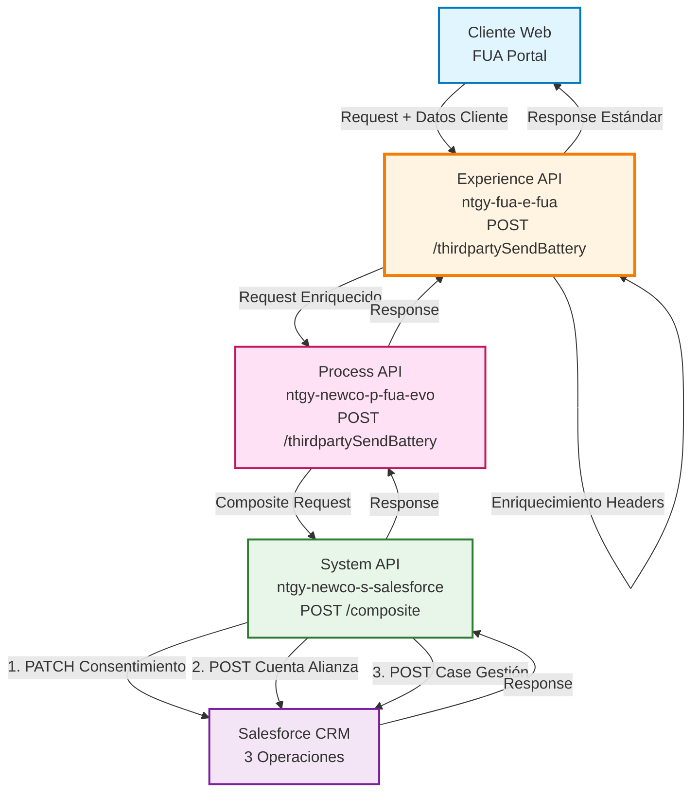
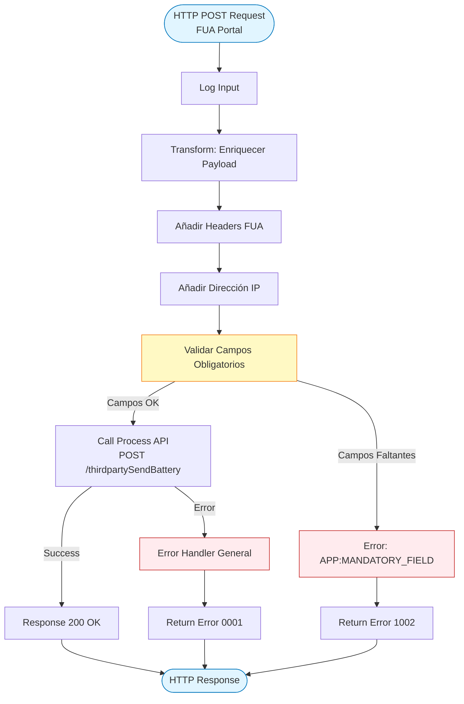
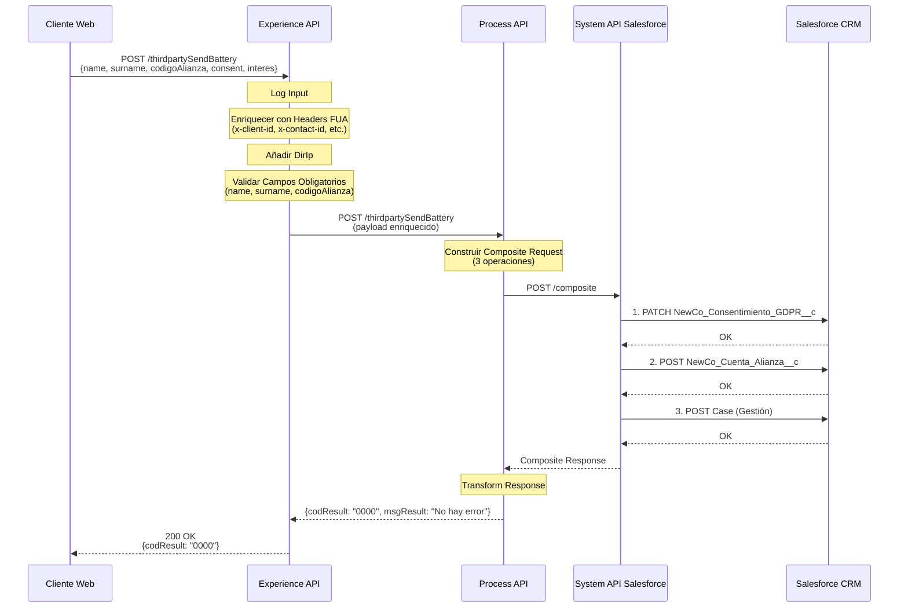
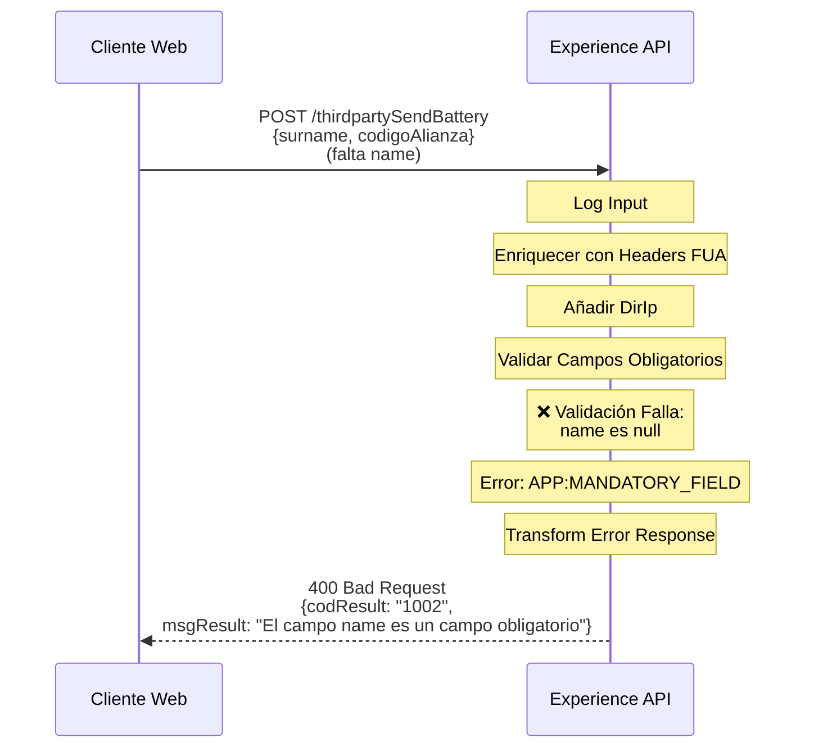
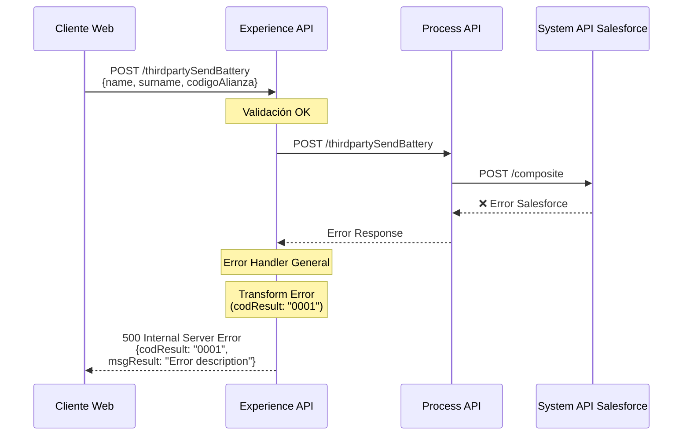
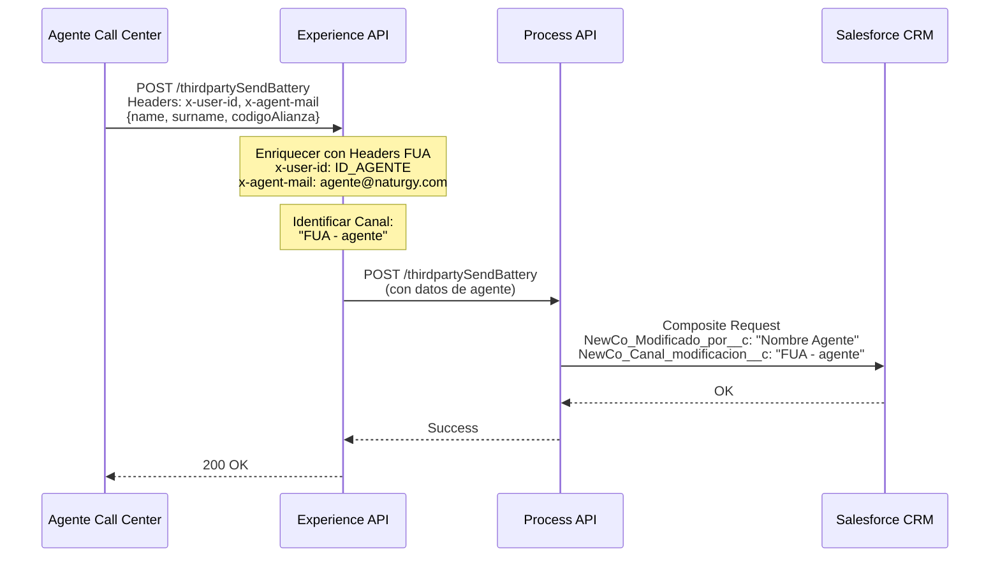

# POST /thirdpartySendBattery

## 📌 Descripción General

### Propósito del Endpoint

Registra el consentimiento GDPR del cliente y su interés en participar en alianzas de terceros relacionadas con baterías. Este endpoint permite a los clientes (o agentes en su nombre) expresar su consentimiento para compartir datos con terceros y su interés en productos/servicios de alianzas comerciales, cumpliendo con las normativas GDPR.

### Tipo de API

**Capa:** Experience API (API-Led Connectivity)

**Función:** Adaptación de experiencia para canal web (FUA - Frontal Único de Atención)

### Patrón de Integración

**Tipo:** Pass-Through con Enriquecimiento de Headers

**Descripción:** El Experience API enriquece el payload con headers FUA (x-client-id, x-contact-id, x-user-id, x-agent-mail, x-user-role) y la dirección IP del cliente, valida campos obligatorios, y delega la orquestación completa al Process API.

### Arquitectura API-Led Connectivity



---

## 💼 Propósito del Negocio

### Casos de Uso Principales

1. **Registro de Consentimiento GDPR por Cliente**
   - Cliente accede al portal FUA y acepta compartir sus datos con terceros
   - Se registra el consentimiento con trazabilidad completa (IP, canal, fecha)
   - Cumplimiento con normativas GDPR de protección de datos

2. **Registro de Interés en Alianzas por Cliente**
   - Cliente expresa interés en productos/servicios de alianzas (ej: baterías)
   - Se crea registro de cuenta alianza para seguimiento comercial
   - Se genera caso de gestión para procesamiento de la solicitud

3. **Registro de Consentimiento/Interés por Agente**
   - Agente de call center registra consentimiento/interés en nombre del cliente
   - Se identifica al agente mediante x-user-id y x-agent-mail
   - Trazabilidad completa de quién realizó la acción

### 📱 Canal y Audiencia

#### Canal de Consumo

**Canal:** Web (FUA - Frontal Único de Atención)

**Características del Canal:**
- **Plataforma**: Portal web de autoservicio para clientes Naturgy
- **Dispositivos**: Navegadores web (desktop y mobile)
- **Conectividad**: Conexión estable requerida para operaciones en Salesforce
- **Experiencia de Usuario**: Formulario de consentimiento con validación en tiempo real

#### Audiencia Objetivo

**Usuarios Finales:**
- **Clientes Naturgy**: Clientes residenciales que desean participar en alianzas de terceros
- **Agentes de Call Center**: Personal de atención al cliente que registra consentimientos en nombre de clientes

**Contexto de Uso:**
- **Autoservicio Web**: Cliente accede al portal FUA y gestiona sus consentimientos
- **Atención Telefónica**: Agente registra consentimiento durante llamada con cliente

#### Adaptaciones del Canal

**Optimizaciones Aplicadas:**
- **Enriquecimiento de Headers**: Se añaden headers FUA (x-client-id, x-contact-id, x-user-id, x-agent-mail, x-user-role)
- **Captura de IP**: Se extrae y añade la dirección IP del cliente para trazabilidad GDPR
- **Validación de Campos**: Validación de campos obligatorios antes de invocar Process API
- **Manejo de Errores**: Respuestas de error estandarizadas con códigos específicos

### 🔗 Endpoints Dependientes

Este Experience API consume el siguiente Process API:

| Process API | Endpoint | Método | Propósito |
|-------------|----------|--------|-----------|
| `ntgy-newco-p-fua-evo` | `/thirdpartySendBattery` | POST | Orquesta el registro de consentimiento GDPR e interés en Salesforce mediante Composite API con 3 operaciones: actualización de consentimiento, creación de cuenta alianza y creación de caso de gestión |

### Contexto Empresarial

- **Dominio:** Gestión de Consentimientos GDPR y Alianzas Comerciales
- **Sector:** Energía - Utilities
- **División:** Naturgy España - NewCo
- **Canal:** Web (FUA)

### Stakeholders

- **Clientes Naturgy**: Necesitan gestionar sus consentimientos GDPR y expresar interés en alianzas
- **Departamento Legal/Compliance**: Requiere trazabilidad completa de consentimientos para cumplimiento GDPR
- **Departamento Comercial**: Necesita registros de interés para seguimiento de oportunidades de alianzas
- **Agentes de Call Center**: Requieren herramienta para registrar consentimientos en nombre de clientes

### Valor de Negocio

- **Cumplimiento GDPR**: Registro auditable de consentimientos con trazabilidad completa (IP, fecha, canal, usuario)
- **Generación de Leads**: Captura de interés en alianzas para seguimiento comercial
- **Trazabilidad Completa**: Registro de quién, cuándo y desde dónde se otorgó el consentimiento
- **Automatización**: Creación automática de casos de gestión para procesamiento de solicitudes

---

## 🔧 Especificación Técnica

### URLs por Ambiente

| Ambiente | URL Base | URL Completa |
|----------|----------|--------------|
| **Local** | `http://localhost:8081` | `http://localhost:8081/fua/api/thirdpartySendBattery` |
| **Development** | `https://ntgy-fua-e-fua-dev.de-c1.cloudhub.io` | `https://ntgy-fua-e-fua-dev.de-c1.cloudhub.io/fua/api/thirdpartySendBattery` |
| **UAT** | `https://ntgy-fua-e-fua-uat.de-c1.cloudhub.io` | `https://ntgy-fua-e-fua-uat.de-c1.cloudhub.io/fua/api/thirdpartySendBattery` |
| **Production** | `https://ntgy-fua-e-fua-pro.de-c1.cloudhub.io` | `https://ntgy-fua-e-fua-pro.de-c1.cloudhub.io/fua/api/thirdpartySendBattery` |

### Método HTTP

```
POST /fua/api/thirdpartySendBattery
```

### 🎯 Consideraciones del Canal

#### Limitaciones del Canal

| Aspecto | Limitación | Razón |
|---------|------------|-------|
| **Timeout** | 60 segundos | Operaciones múltiples en Salesforce (3 operaciones composite) |
| **Rate Limiting** | Según políticas API Gateway | Protección del backend Salesforce |
| **Campos Obligatorios** | name, surname, codigoAlianza | Validación GDPR y trazabilidad |

#### Campos Específicos del Canal

**Campos Añadidos por el Experience API:**

| Campo | Tipo | Descripción | Razón |
|-------|------|-------------|-------|
| `x-client-id` | String | ID del cliente en Salesforce | Identificación del cliente (de headers FUA) |
| `x-contact-id` | String | ID del contacto en Salesforce | Identificación del contacto (de headers FUA) |
| `x-user-id` | String | ID del usuario/agente | Trazabilidad de quién realiza la acción |
| `x-agent-mail` | String | Email del agente | Identificación del agente en Salesforce |
| `x-user-role` | String | Rol del usuario | Diferenciación cliente/agente |
| `DirIp` | String | Dirección IP del cliente | Cumplimiento GDPR - trazabilidad |

### Parámetros de Entrada

#### Headers

| Header | Tipo | Obligatorio | Descripción |
|--------|------|-------------|-------------|
| `Content-Type` | String | Sí | Debe ser `application/json` |
| `x-client-id` | String | Sí | ID del cliente en Salesforce (Account ID) |
| `x-contact-id` | String | Sí | ID del contacto en Salesforce |
| `x-user-id` | String | No | ID del usuario/agente (si es agente) |
| `x-agent-mail` | String | No | Email del agente (si es agente) |
| `x-user-role` | String | Sí | Rol del usuario (cliente/agente) |

#### Body (JSON)

| Campo | Tipo | Obligatorio | Descripción | Ejemplo |
|-------|------|-------------|-------------|---------|
| `name` | String | Sí | Nombre del cliente | `"Juan"` |
| `surname` | String | Sí | Apellidos del cliente | `"García López"` |
| `codigoAlianza` | String | Sí | Código de la alianza | `"AL001"` |
| `consent` | Boolean | No | Consentimiento GDPR (true/false) | `true` |
| `interes` | Boolean | No | Interés en la alianza (true/false) | `true` |

**Ejemplo de Request Body:**

```json
{
  "name": "Juan",
  "surname": "García López",
  "codigoAlianza": "AL001",
  "consent": true,
  "interes": true
}
```

### Respuestas

#### Respuesta Exitosa (200 OK)

```json
{
  "result": {
    "codResult": "0000",
    "msgResult": "No hay error"
  }
}
```

#### Respuesta de Error - Campos Obligatorios Faltantes (400 Bad Request)

**Código de Error:** `1002`

**Ejemplo - Falta campo name:**

```json
{
  "result": {
    "codResult": "1002",
    "msgResult": "El campo name es un campo obligatorio"
  }
}
```

**Ejemplo - Falta campo surname:**

```json
{
  "result": {
    "codResult": "1002",
    "msgResult": "El campo surname es un campo obligatorio"
  }
}
```

**Ejemplo - Falta campo codigoAlianza:**

```json
{
  "result": {
    "codResult": "1002",
    "msgResult": "El campo codigoAlianza es un campo obligatorio"
  }
}
```

#### Respuesta de Error General (500 Internal Server Error)

**Código de Error:** `0001`

```json
{
  "result": {
    "codResult": "0001",
    "msgResult": "Error en el procesamiento de la solicitud"
  }
}
```

### Códigos de Estado HTTP

| Código | Descripción | Cuándo se usa |
|--------|-------------|---------------|
| `200` | OK | Consentimiento e interés registrados exitosamente |
| `400` | Bad Request | Campos obligatorios faltantes (codResult: 1002) |
| `401` | Unauthorized | Error de autenticación |
| `403` | Forbidden | Error de autorización |
| `404` | Not Found | Recurso no encontrado |
| `500` | Internal Server Error | Error en el procesamiento (codResult: 0001) |

### Autenticación

- **Tipo:** OAuth 2.0 (gestionado por API Gateway)
- **Headers Requeridos:** Headers FUA (x-client-id, x-contact-id, x-user-role)

### Timeouts

| Tipo | Valor | Razón |
|------|-------|-------|
| **Request Timeout** | 60 segundos | Operaciones múltiples en Salesforce (3 operaciones composite) |

---

## 🏗️ Implementación Técnica

### Arquitectura del Flow



### Transformaciones de Canal

#### Enriquecimiento del Payload (Experience API)

**Transformación DataWeave (líneas 362-374 alliances.xml):**

```dataweave
%dw 2.2
import * from dw::core::Strings
output application/json
---
payload
++ 
vars.fuaHeaders 
++
{
    "DirIp": substringBefore(substringAfter(attributes.remoteAddress,"/"),":")
}
```

**Campos Añadidos:**

| Campo Original | Campo Añadido | Transformación |
|----------------|---------------|----------------|
| N/A | `x-client-id` | De `vars.fuaHeaders` |
| N/A | `x-contact-id` | De `vars.fuaHeaders` |
| N/A | `x-user-id` | De `vars.fuaHeaders` |
| N/A | `x-agent-mail` | De `vars.fuaHeaders` |
| N/A | `x-user-role` | De `vars.fuaHeaders` |
| `attributes.remoteAddress` | `DirIp` | Extracción de IP: `substringBefore(substringAfter(attributes.remoteAddress,"/"),":")` |

#### Validación de Campos Obligatorios

**Lógica de Validación (líneas 377-401 alliances.xml):**

```dataweave
%dw 2.0
output application/json

// Función para controlar errores
fun controlError() = 
    if(payload.name == null)
        "result": {
            "codResult": "1002",
            "msgResult": "El campo name es un campo obligatorio"
        }
    else if(payload.surname == null)
        "result": {
            "codResult": "1002",
            "msgResult": "El campo surname es un campo obligatorio"
        }
    else if(payload.codigoAlianza == null)
        "result": {
            "codResult": "1002",
            "msgResult": "El campo codigoAlianza es un campo obligatorio"
        }
    else null

---
controlError()
```

**Campos Validados:**
1. `name` - Nombre del cliente (obligatorio)
2. `surname` - Apellidos del cliente (obligatorio)
3. `codigoAlianza` - Código de la alianza (obligatorio)

### Patrones de Diseño

**Patrón:** Pass-Through con Enriquecimiento y Validación

**Justificación:** 
- El Experience API no transforma la lógica de negocio, solo enriquece con contexto del canal (headers FUA, IP)
- Valida campos obligatorios antes de invocar Process API para evitar llamadas innecesarias
- Delega toda la orquestación de Salesforce al Process API

### Diagramas de Secuencia

#### 1. Flujo Normal de Éxito (Cliente Web)



#### 2. Flujo con Error de Validación (Campos Obligatorios)



#### 3. Flujo con Error Técnico (Salesforce)



#### 4. Flujo Agente de Call Center



### Operaciones en Salesforce (Process API)

El Process API orquesta 3 operaciones en Salesforce mediante Composite API:

#### Operación 1: PATCH - Actualizar Consentimiento GDPR

**Objeto Salesforce:** `NewCo_Consentimiento_GDPR__c`

**Operación:** PATCH (actualización por clave externa)

**Clave Externa:** `NewCo_Clave__c` = `{x-client-id}02`

**Campos Actualizados:**

| Campo Salesforce | Valor | Descripción |
|------------------|-------|-------------|
| `NewCo_Tipo_de_consentimiento__c` | `"02"` si consent=true, `""` si false | Tipo de consentimiento |
| `NewCo_IP__c` | `DirIp` | Dirección IP del cliente |
| `NewCo_Canal_modificacion__c` | `"FUA - agente"` o `"FUA - cliente"` | Canal desde donde se modifica |
| `NewCo_Modificado_por__c` | `name + " " + surname` o `x-user-role` | Quién modificó |
| `NewCo_Estado__c` | `"Si"` si interes=true, `"No"` si false | Estado del interés |
| `NewCo_Account__c` | `x-client-id` | ID de la cuenta |

#### Operación 2: POST - Crear Cuenta Alianza

**Objeto Salesforce:** `NewCo_Cuenta_Alianza__c`

**Operación:** POST (creación)

**Campos Creados:**

| Campo Salesforce | Valor | Descripción |
|------------------|-------|-------------|
| `NewCo_Alianza__r.NewCo_CodigoAlianza__c` | `"AL001"` | Código de la alianza (relación externa) |
| `NewCo_Account__c` | `x-client-id` | ID de la cuenta |
| `RecordType.Name` | `"Interés"` | Tipo de registro |
| `Name` | `name + " " + surname + " - " + codigoAlianza` | Nombre del registro |

#### Operación 3: POST - Crear Caso de Gestión

**Objeto Salesforce:** `Case`

**Operación:** POST (creación)

**Campos Creados:**

| Campo Salesforce | Valor | Descripción |
|------------------|-------|-------------|
| `NewCo_Recordtype__c` | `"Gestion"` | Tipo de caso |
| `AccountId` | `x-client-id` | ID de la cuenta |
| `ContactId` | `x-contact-id` | ID del contacto |
| `Status` | `"06"` | Estado del caso |
| `Priority` | `"02"` | Prioridad |
| `Origin` | `"FUA"` | Origen del caso |
| `OwnerId` | `x-user-id` (si existe) | Propietario del caso |
| `NewCo_Creado_por__c` | `x-user-id` o `x-contact-id` | Quién creó el caso |
| `ParentId` | `x-interaction-id` (si existe) | Caso padre |
| `acn_fld_Tittle__r.NewCo_ExternalId__c` | `"SolAltaAlianza"` | Título del caso (relación externa) |
| `Subject` | `"Solicitud alta alianza"` | Asunto |
| `Description` | `"Solicitud alta alianza"` | Descripción |
| `NewCo_Ip__c` | `DirIp` | Dirección IP |
| `NewCo_CorrelationId__c` | `correlationId` | ID de correlación |

### Manejo de Errores

#### Error Handler 1: Campos Obligatorios (APP:MANDATORY_FIELD)

**Trigger:** Validación de campos obligatorios falla

**Código de Error:** `1002`

**Respuesta:**

```json
{
  "result": {
    "codResult": "1002",
    "msgResult": "El campo [nombre_campo] es un campo obligatorio"
  }
}
```

**HTTP Status:** 400 Bad Request

#### Error Handler 2: Error General (NTGY:ALIANZAS)

**Trigger:** Error en Process API o Salesforce

**Código de Error:** `0001`

**Respuesta:**

```json
{
  "result": {
    "codResult": "0001",
    "msgResult": "[Descripción del error]"
  }
}
```

**HTTP Status:** Determinado por el contenido del error (400, 401, 403, 404, 500)

**Lógica de Mapeo de HTTP Status (líneas 434-446 alliances.xml):**

```dataweave
%dw 2.0
output application/java
---
if((error.errorMessage.payload.result.msgResult contains ("400")) or (error.description contains ("400")))
    400
else if((error.errorMessage.payload.result.msgResult contains ("401")) or (error.description contains ("401")))
    401
else if((error.errorMessage.payload.result.msgResult contains ("403")) or (error.description contains ("403")))
    403
else if((error.errorMessage.payload.result.msgResult contains ("404")) or (error.description contains ("404")))
    404
else
    500
```

---

## 💻 Ejemplos de Uso

### Ejemplo 1: Registro de Consentimiento por Cliente Web

#### cURL

```bash
curl -X POST "https://ntgy-fua-e-fua-pro.de-c1.cloudhub.io/fua/api/thirdpartySendBattery" \
  -H "Content-Type: application/json" \
  -H "x-client-id: 0015I00000XYZ123" \
  -H "x-contact-id: 0035I00000ABC456" \
  -H "x-user-role: cliente" \
  -d '{
    "name": "Juan",
    "surname": "García López",
    "codigoAlianza": "AL001",
    "consent": true,
    "interes": true
  }'
```

#### Respuesta (200 OK)

```json
{
  "result": {
    "codResult": "0000",
    "msgResult": "No hay error"
  }
}
```

---

### Ejemplo 2: Registro por Agente de Call Center

#### cURL

```bash
curl -X POST "https://ntgy-fua-e-fua-pro.de-c1.cloudhub.io/fua/api/thirdpartySendBattery" \
  -H "Content-Type: application/json" \
  -H "x-client-id: 0015I00000XYZ123" \
  -H "x-contact-id: 0035I00000ABC456" \
  -H "x-user-id: 0055I00000DEF789" \
  -H "x-agent-mail: agente@naturgy.com" \
  -H "x-user-role: agente" \
  -d '{
    "name": "María",
    "surname": "Rodríguez Pérez",
    "codigoAlianza": "AL001",
    "consent": true,
    "interes": true
  }'
```

#### Respuesta (200 OK)

```json
{
  "result": {
    "codResult": "0000",
    "msgResult": "No hay error"
  }
}
```

---

### Ejemplo 3: Error - Campo Obligatorio Faltante

#### cURL

```bash
curl -X POST "https://ntgy-fua-e-fua-pro.de-c1.cloudhub.io/fua/api/thirdpartySendBattery" \
  -H "Content-Type: application/json" \
  -H "x-client-id: 0015I00000XYZ123" \
  -H "x-contact-id: 0035I00000ABC456" \
  -H "x-user-role: cliente" \
  -d '{
    "surname": "García López",
    "codigoAlianza": "AL001",
    "consent": true,
    "interes": true
  }'
```

#### Respuesta (400 Bad Request)

```json
{
  "result": {
    "codResult": "1002",
    "msgResult": "El campo name es un campo obligatorio"
  }
}
```

---

### Ejemplo 4: JavaScript (Frontend Web)

```javascript
const registrarConsentimiento = async () => {
  try {
    const response = await fetch('https://ntgy-fua-e-fua-pro.de-c1.cloudhub.io/fua/api/thirdpartySendBattery', {
      method: 'POST',
      headers: {
        'Content-Type': 'application/json',
        'x-client-id': '0015I00000XYZ123',
        'x-contact-id': '0035I00000ABC456',
        'x-user-role': 'cliente'
      },
      body: JSON.stringify({
        name: 'Juan',
        surname: 'García López',
        codigoAlianza: 'AL001',
        consent: true,
        interes: true
      })
    });

    const data = await response.json();
    
    if (data.result.codResult === '0000') {
      console.log('Consentimiento registrado exitosamente');
    } else {
      console.error('Error:', data.result.msgResult);
    }
  } catch (error) {
    console.error('Error de red:', error);
  }
};
```

---

### Ejemplo 5: Python

```python
import requests

url = "https://ntgy-fua-e-fua-pro.de-c1.cloudhub.io/fua/api/thirdpartySendBattery"

headers = {
    "Content-Type": "application/json",
    "x-client-id": "0015I00000XYZ123",
    "x-contact-id": "0035I00000ABC456",
    "x-user-role": "cliente"
}

payload = {
    "name": "Juan",
    "surname": "García López",
    "codigoAlianza": "AL001",
    "consent": True,
    "interes": True
}

response = requests.post(url, json=payload, headers=headers)

if response.status_code == 200:
    data = response.json()
    if data["result"]["codResult"] == "0000":
        print("Consentimiento registrado exitosamente")
    else:
        print(f"Error: {data['result']['msgResult']}")
else:
    print(f"Error HTTP: {response.status_code}")
```

---

## 📋 Notas Adicionales

### Consideraciones de Implementación

1. **Trazabilidad GDPR**: La dirección IP se captura automáticamente del request para cumplimiento GDPR
2. **Identificación de Canal**: El sistema identifica automáticamente si es cliente o agente basándose en los headers
3. **Validación Previa**: Los campos obligatorios se validan antes de invocar el Process API para optimizar rendimiento
4. **Operaciones Atómicas**: Las 3 operaciones en Salesforce se ejecutan como transacción mediante Composite API

### Mejores Prácticas

1. **Siempre incluir headers FUA**: x-client-id, x-contact-id y x-user-role son obligatorios
2. **Validar campos en frontend**: Validar name, surname y codigoAlianza antes de enviar
3. **Manejo de errores**: Implementar retry logic para errores transitorios (500)
4. **Timeout adecuado**: Configurar timeout de al menos 60 segundos en el cliente

### Limitaciones Conocidas

1. **Código de Alianza Fijo**: Actualmente solo soporta código "AL001"
2. **Sin Validación de Duplicados**: No valida si ya existe un consentimiento previo
3. **Operación Síncrona**: Las 3 operaciones en Salesforce se ejecutan síncronamente

### Troubleshooting

**Problema:** Error 1002 - Campo obligatorio faltante  
**Solución:** Verificar que name, surname y codigoAlianza estén presentes en el payload

**Problema:** Error 0001 - Error general  
**Solución:** Revisar logs del Process API para identificar el error específico de Salesforce

**Problema:** Timeout después de 60 segundos  
**Solución:** Verificar conectividad con Salesforce y estado del System API
