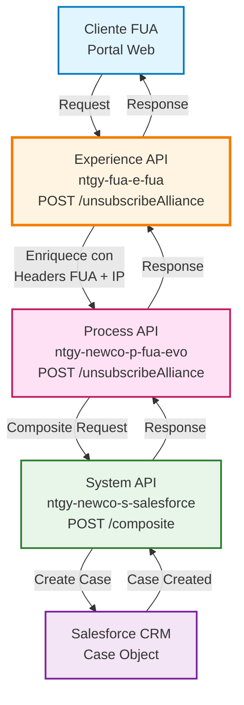
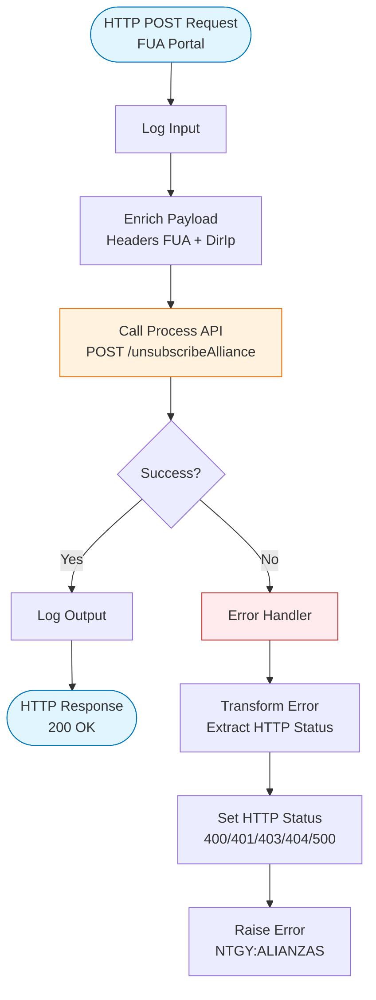
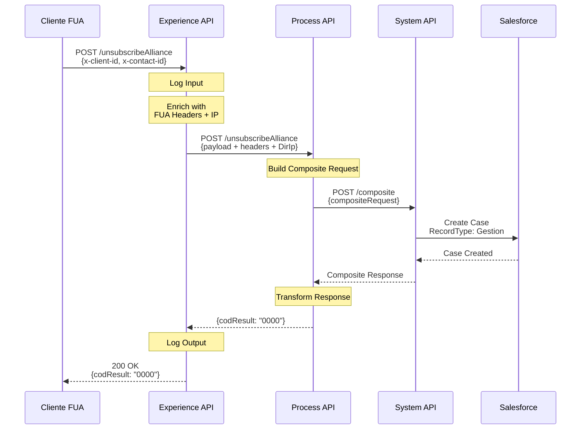
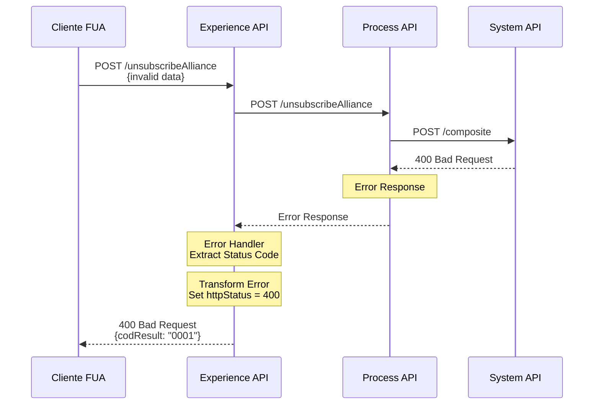
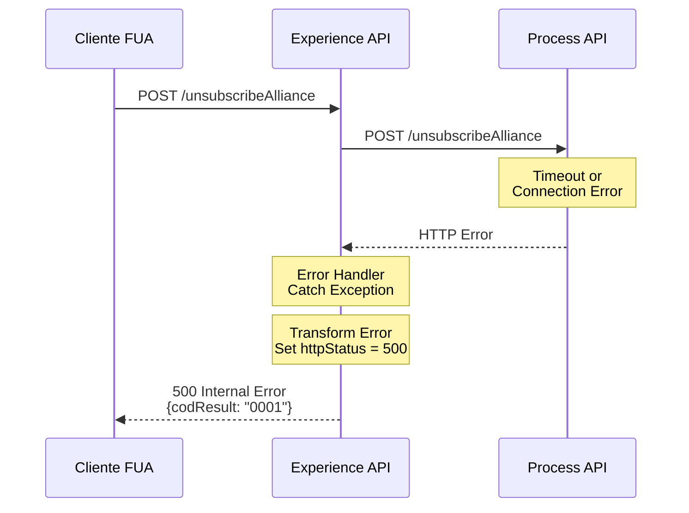

# POST /unsubscribeAlliance

## 📌 Descripción General

### Propósito del Endpoint

Permite a los clientes solicitar la baja de una alianza mediante la creación automática de un caso de gestión en Salesforce. El endpoint orquesta la comunicación entre la capa de experiencia (FUA), la capa de proceso y el sistema CRM de Salesforce, enriqueciendo la solicitud con información del agente y la dirección IP del cliente.

### Tipo de API

**Capa:** Experience API (API-Led Connectivity)

**Función:** Adaptación de experiencia para canal FUA (Formulario Único de Alta)

### Patrón de Integración

**Tipo:** Pass-Through con Enriquecimiento de Headers

**Descripción:** El Experience API recibe la solicitud del cliente, enriquece el payload con headers FUA y dirección IP, y delega la creación del caso al Process API, que a su vez utiliza la Composite API de Salesforce para crear el caso de gestión.

### Arquitectura API-Led Connectivity



---

## 💼 Propósito del Negocio

### Casos de Uso Principales

1. **Solicitud de Baja de Alianza por Cliente**
   - Cliente solicita dar de baja una alianza existente
   - Se genera automáticamente un caso de gestión para seguimiento
   - El caso queda registrado con prioridad y estado específicos

2. **Trazabilidad de Solicitudes**
   - Cada solicitud genera un caso único en Salesforce
   - Permite seguimiento del estado de la solicitud
   - Facilita la gestión por parte del equipo de atención al cliente

3. **Captura de Contexto del Agente**
   - Registra información del agente que procesa la solicitud
   - Captura la dirección IP del cliente para auditoría
   - Asocia el caso con el cliente y contacto correspondiente

### 📱 Canal y Audiencia

#### Canal de Consumo

**Canal:** FUA (Formulario Único de Alta) - Web

**Características del Canal:**
- **Plataforma**: Portal web de autoservicio de clientes
- **Dispositivos**: Navegadores web (desktop y móvil)
- **Conectividad**: Requiere conexión estable para operaciones en Salesforce
- **Experiencia de Usuario**: Interfaz simplificada para solicitudes de gestión

#### Audiencia Objetivo

**Usuarios Finales:**
- **Clientes de Naturgy**: Clientes con alianzas activas que desean solicitar la baja
- **Agentes de Atención al Cliente**: Personal que procesa solicitudes en nombre de clientes

**Contexto de Uso:**
- **Gestión de Alianzas**: Cliente decide cancelar una alianza existente
- **Cambio de Condiciones**: Modificación de servicios contratados

#### Adaptaciones del Canal

**Optimizaciones Aplicadas:**
- **Enriquecimiento de Datos**: Añade headers FUA y dirección IP automáticamente
- **Formato de Respuesta**: Respuesta estándar simplificada con código de resultado
- **Manejo de Errores**: Transformación de errores técnicos a mensajes de negocio
- **Timeout**: 60 segundos para operaciones en Salesforce

### 🔗 Endpoints Dependientes

Este Experience API consume el siguiente Process API:

| API | Endpoint | Método | Propósito |
|-----|----------|--------|-----------|
| `ntgy-newco-p-fua-evo` | `/unsubscribeAlliance` | POST | Orquesta la creación del caso de baja de alianza en Salesforce mediante Composite API |

**Nota:** El Process API internamente consume el System API de Salesforce (`ntgy-newco-s-salesforce`) para crear el caso de gestión, pero esta es una dependencia transitiva que no se documenta en el Experience API.

### Contexto Empresarial

- **Dominio:** Gestión de Alianzas y Servicios al Cliente
- **Sector:** Energía - Utilities
- **División:** Naturgy España - NewCo
- **Canal:** FUA (Portal Web)

### Stakeholders

- **Clientes de Naturgy**: Necesitan un proceso simple para solicitar baja de alianzas
- **Equipo de Atención al Cliente**: Requieren trazabilidad de solicitudes en Salesforce
- **Equipo de Gestión de Alianzas**: Necesitan visibilidad de solicitudes de baja

### Valor de Negocio

- **Automatización**: Creación automática de casos de gestión sin intervención manual
- **Trazabilidad**: Registro completo de solicitudes en Salesforce CRM
- **Eficiencia**: Reducción de tiempo de procesamiento de solicitudes
- **Auditoría**: Captura de información del agente y dirección IP del cliente

---

## 🔧 Especificación Técnica

### URLs por Ambiente

| Ambiente | URL Base | URL Completa |
|----------|----------|--------------|
| **Local** | `http://localhost:8081` | `http://localhost:8081/fua/api/unsubscribeAlliance` |
| **Development** | `https://ntgy-fua-e-fua-dev.de-c1.cloudhub.io` | `https://ntgy-fua-e-fua-dev.de-c1.cloudhub.io/fua/api/unsubscribeAlliance` |
| **Production** | `https://ntgy-fua-e-fua-pro.de-c1.cloudhub.io` | `https://ntgy-fua-e-fua-pro.de-c1.cloudhub.io/fua/api/unsubscribeAlliance` |

### Método HTTP

```
POST /fua/api/unsubscribeAlliance
```

### 🎯 Consideraciones del Canal

#### Limitaciones del Canal

| Aspecto | Limitación | Razón |
|---------|------------|-------|
| **Timeout** | 60 segundos | Operaciones en Salesforce pueden ser lentas |
| **Rate Limiting** | Según políticas de API Manager | Protección del sistema |
| **Tamaño de Request** | Limitado por payload JSON | Datos de cliente y contacto |

#### Campos Específicos del Canal

**Campos Añadidos por el Experience API:**

| Campo | Tipo | Descripción | Razón |
|-------|------|-------------|-------|
| `DirIp` | String | Dirección IP del cliente | Auditoría y seguridad |
| Headers FUA | Object | Headers de contexto FUA | Información del agente y sesión |

### Parámetros de Entrada

#### Headers

| Header | Tipo | Requerido | Descripción |
|--------|------|-----------|-------------|
| `Content-Type` | String | ✅ | Debe ser `application/json` |
| `x-client-id` | String | ✅ | ID del cliente (Account) en Salesforce |
| `x-contact-id` | String | ✅ | ID del contacto en Salesforce |
| `x-agent-mail` | String | ⚠️ | Email del agente (opcional, para username en Salesforce) |

**Nota:** Los campos `x-client-id`, `x-contact-id` y `x-agent-mail` se envían como **headers HTTP**. El Experience API los captura en `vars.fuaHeaders` y los incluye en el body del request al Process API.

#### Body (application/json)

El body puede estar vacío o contener datos adicionales según el caso de uso:

```json
{}
```

**O con datos adicionales:**

```json
{
  "additionalField": "value"
}
```

### Respuestas

#### ✅ 200 OK - Solicitud Exitosa

```json
{
  "result": {
    "codResult": "0000",
    "msgResult": "No hay error"
  }
}
```

**Descripción:** El caso de gestión se creó exitosamente en Salesforce.

#### ❌ 400 Bad Request - Error de Validación

```json
{
  "result": {
    "codResult": "0001",
    "msgResult": "Error de validación: [detalle del error]"
  }
}
```

**Causas comunes:**
- Falta `x-client-id` o `x-contact-id`
- IDs de Salesforce inválidos
- Formato de request incorrecto

#### ❌ 401 Unauthorized - Error de Autenticación

```json
{
  "result": {
    "codResult": "0001",
    "msgResult": "Error de autenticación en Salesforce"
  }
}
```

#### ❌ 500 Internal Server Error - Error del Sistema

```json
{
  "result": {
    "codResult": "0001",
    "msgResult": "Error interno del sistema"
  }
}
```

**Causas comunes:**
- Error de conexión con Salesforce
- Timeout en Process API
- Error en Composite API de Salesforce

### Autenticación

- **Tipo:** OAuth 2.0 (gestionado por API Manager)
- **Scope:** Acceso a operaciones de gestión de alianzas

### Timeouts

| Tipo | Valor | Razón |
|------|-------|-------|
| **Request Timeout** | 60 segundos | Operaciones en Salesforce pueden tardar |
| **Connection Timeout** | 30 segundos | Establecimiento de conexión con Process API |

---

## 🏗️ Implementación Técnica

### Arquitectura del Flow



### Transformaciones de Canal

**Enriquecimiento del Payload:**

El Experience API enriquece el payload original con información adicional antes de enviarlo al Process API:

```dataweave
%dw 2.2
import * from dw::core::Strings
output application/json
---
payload
++ 
vars.fuaHeaders 
++
{
    "DirIp": substringBefore(substringAfter(attributes.remoteAddress,"/"),":")
}
```

**Transformación Aplicada:**

| Campo Original | Campo Añadido | Transformación |
|----------------|---------------|----------------|
| `payload` | `payload` | Pass-through del body original |
| N/A | `vars.fuaHeaders` | Headers FUA (x-client-id, x-contact-id, x-agent-mail) |
| `attributes.remoteAddress` | `DirIp` | Extracción de IP del cliente |

**Lógica de Extracción de IP:**
- `attributes.remoteAddress` tiene formato: `/192.168.1.1:12345`
- `substringAfter(attributes.remoteAddress,"/")` → `192.168.1.1:12345`
- `substringBefore(...,":")` → `192.168.1.1`

### Patrones de Diseño

**Patrón:** API Orchestration con Error Handling Centralizado

**Justificación:** 
- Separa responsabilidades entre capas (Experience, Process, System)
- Manejo de errores consistente con transformación de códigos HTTP
- Enriquecimiento de contexto en la capa de experiencia

### Diagramas de Secuencia

#### 1. Flujo Normal de Éxito



#### 2. Flujo con Error de Negocio



#### 3. Flujo con Error Técnico



### Implementación del Process API

**Archivo:** `ntgy-newco-p-fua-evo/src/main/mule/alliances.xml`

**Subflow:** `alianzaUnsubscribeAlliance`

**Operaciones:**

1. **Log de Inicio**
   ```xml
   <logger level="INFO" message="Start alianza alianzaUnsubscribeAlliance: #[payload]"/>
   ```

2. **Guardar Payload Original**
   ```xml
   <set-variable value="#[payload]" variableName="entryPayload" />
   ```

3. **Transformación para Salesforce Composite**
   ```dataweave
   output application/json
   ---
   {
       "allOrNone": true,
       "collateSubrequests": false,
       "compositeRequest": [
           {
               "method": "POST",
               "url": "/services/data/v52.0/sobjects/Case",
               "referenceId": "refCaseGestion",
               "body": {
                   "AccountId": payload.'x-client-id' default "",
                   "ContactId": payload.'x-contact-id',
                   "NewCo_Recordtype__c": "Gestion", 
                   "Status": "06",
                   "Priority": "02",
                   "Origin": "FUA",
                   "acn_fld_Tittle__r": {
                       "NewCo_ExternalId__c": "SolBajaAlianza"
                   },
                   "Subject": "Solicitud Baja Alianza"
               }
           }
       ]
   }
   ```

4. **Llamada a Salesforce System API**
   ```xml
   <http:request method="POST" 
                 config-ref="HTTP_Request_configuration_ntgy_newco_s_salesforce" 
                 path="${ntgy-newco-s-salesforce.pathGenericComposite}">
       <http:headers>
           {("username" : vars.entryPayload.'x-agent-mail') if (!isEmpty(vars.entryPayload.'x-agent-mail'))}
       </http:headers>
   </http:request>
   ```

5. **Transformación de Respuesta**
   ```dataweave
   %dw 2.0
   output application/json
   ---
   {
       "result": {
           "codResult": '0000',
           "msgResult": "No hay error"
       }
   }
   ```

### Estructura del Caso en Salesforce

**Objeto:** Case

**Campos Configurados:**

| Campo | Valor | Descripción |
|-------|-------|-------------|
| `AccountId` | `payload.'x-client-id'` | ID del cliente |
| `ContactId` | `payload.'x-contact-id'` | ID del contacto |
| `NewCo_Recordtype__c` | `"Gestion"` | Tipo de registro |
| `Status` | `"06"` | Estado del caso |
| `Priority` | `"02"` | Prioridad del caso |
| `Origin` | `"FUA"` | Canal de origen |
| `Subject` | `"Solicitud Baja Alianza"` | Asunto del caso |
| `acn_fld_Tittle__r.NewCo_ExternalId__c` | `"SolBajaAlianza"` | ID externo del título |

### Manejo de Errores

**Error Handler del Experience API:**

```xml
<on-error-propagate>
    <ee:transform doc:name="error message">
        <ee:set-payload>
            {
                "result": {
                    "codResult": "0001",
                    "msgResult": if(error.errorMessage.payload.result.msgResult != null) 
                                   error.errorMessage.payload.result.msgResult 
                                 else 
                                   error.description
                }
            }
        </ee:set-payload>
        <ee:set-variable variableName="httpStatus">
            if((error.errorMessage.payload.result.msgResult contains ("400")) or (error.description contains ("400")))
                400
            else if((error.errorMessage.payload.result.msgResult contains ("401")) or (error.description contains ("401")))
                401
            else if((error.errorMessage.payload.result.msgResult contains ("403")) or (error.description contains ("403")))
                403
            else if((error.errorMessage.payload.result.msgResult contains ("404")) or (error.description contains ("404")))
                404
            else
                500
        </ee:set-variable>
    </ee:transform>
    <raise-error type="NTGY:ALIANZAS" description="Error envio terceros" />
</on-error-propagate>
```

**Lógica de Manejo:**
1. Extrae mensaje de error del payload o descripción del error
2. Determina código HTTP basándose en el contenido del mensaje
3. Transforma a formato estándar con `codResult: "0001"`
4. Propaga error con tipo `NTGY:ALIANZAS`

---

## 💻 Ejemplos de Uso

### Ejemplo 1: Llamada Exitosa desde Portal FUA

#### cURL

```bash
curl -X POST "https://ntgy-fua-e-fua-pro.de-c1.cloudhub.io/fua/api/unsubscribeAlliance" \
  -H "Content-Type: application/json" \
  -H "x-client-id: 0015I00000XYZ123ABC" \
  -H "x-contact-id: 0035I00000ABC456DEF" \
  -H "x-agent-mail: agente@naturgy.com" \
  -H "client_id: YOUR_CLIENT_ID" \
  -H "client_secret: YOUR_CLIENT_SECRET" \
  -d '{}'
```

#### Respuesta (200 OK)

```json
{
  "result": {
    "codResult": "0000",
    "msgResult": "No hay error"
  }
}
```

### Ejemplo 2: JavaScript (para Portal Web)

```javascript
const unsubscribeAlliance = async (clientId, contactId, agentMail) => {
  try {
    const response = await fetch('https://ntgy-fua-e-fua-pro.de-c1.cloudhub.io/fua/api/unsubscribeAlliance', {
      method: 'POST',
      headers: {
        'Content-Type': 'application/json',
        'x-client-id': clientId,
        'x-contact-id': contactId,
        'x-agent-mail': agentMail,
        'client_id': 'YOUR_CLIENT_ID',
        'client_secret': 'YOUR_CLIENT_SECRET'
      },
      body: JSON.stringify({})
    });

    const data = await response.json();
    
    if (data.result.codResult === '0000') {
      console.log('Solicitud de baja procesada exitosamente');
      return { success: true, data };
    } else {
      console.error('Error en la solicitud:', data.result.msgResult);
      return { success: false, error: data.result.msgResult };
    }
  } catch (error) {
    console.error('Error de conexión:', error);
    return { success: false, error: error.message };
  }
};

// Uso
unsubscribeAlliance('0015I00000XYZ123ABC', '0035I00000ABC456DEF', 'agente@naturgy.com')
  .then(result => {
    if (result.success) {
      alert('Solicitud de baja enviada correctamente');
    } else {
      alert('Error: ' + result.error);
    }
  });
```

### Ejemplo 3: Python

```python
import requests
import json

def unsubscribe_alliance(client_id, contact_id, agent_mail=None):
    """
    Solicita la baja de una alianza
    
    Args:
        client_id (str): ID del cliente en Salesforce
        contact_id (str): ID del contacto en Salesforce
        agent_mail (str, optional): Email del agente
    
    Returns:
        dict: Respuesta del API
    """
    url = 'https://ntgy-fua-e-fua-pro.de-c1.cloudhub.io/fua/api/unsubscribeAlliance'
    
    headers = {
        'Content-Type': 'application/json',
        'x-client-id': client_id,
        'x-contact-id': contact_id,
        'client_id': 'YOUR_CLIENT_ID',
        'client_secret': 'YOUR_CLIENT_SECRET'
    }
    
    if agent_mail:
        headers['x-agent-mail'] = agent_mail
    
    payload = {}
    
    try:
        response = requests.post(url, headers=headers, json=payload, timeout=60)
        response.raise_for_status()
        
        data = response.json()
        
        if data['result']['codResult'] == '0000':
            print('✅ Solicitud de baja procesada exitosamente')
            return {'success': True, 'data': data}
        else:
            print(f'❌ Error: {data["result"]["msgResult"]}')
            return {'success': False, 'error': data['result']['msgResult']}
            
    except requests.exceptions.Timeout:
        print('❌ Timeout: La solicitud tardó demasiado')
        return {'success': False, 'error': 'Timeout'}
    except requests.exceptions.RequestException as e:
        print(f'❌ Error de conexión: {str(e)}')
        return {'success': False, 'error': str(e)}

# Ejemplo de uso
result = unsubscribe_alliance(
    client_id='0015I00000XYZ123ABC',
    contact_id='0035I00000ABC456DEF',
    agent_mail='agente@naturgy.com'
)

if result['success']:
    print('Caso creado en Salesforce')
else:
    print(f'Error: {result["error"]}')
```

### Ejemplo 4: Error - Cliente No Encontrado

#### Request

```bash
curl -X POST "https://ntgy-fua-e-fua-pro.de-c1.cloudhub.io/fua/api/unsubscribeAlliance" \
  -H "Content-Type: application/json" \
  -H "x-client-id: INVALID_ID" \
  -H "x-contact-id: 0035I00000ABC456DEF" \
  -H "client_id: YOUR_CLIENT_ID" \
  -d '{}'
```

#### Respuesta (400 Bad Request)

```json
{
  "result": {
    "codResult": "0001",
    "msgResult": "400 Bad Request: Invalid AccountId"
  }
}
```

### Ejemplo 5: Error - Timeout en Salesforce

#### Respuesta (500 Internal Server Error)

```json
{
  "result": {
    "codResult": "0001",
    "msgResult": "Timeout al conectar con Salesforce"
  }
}