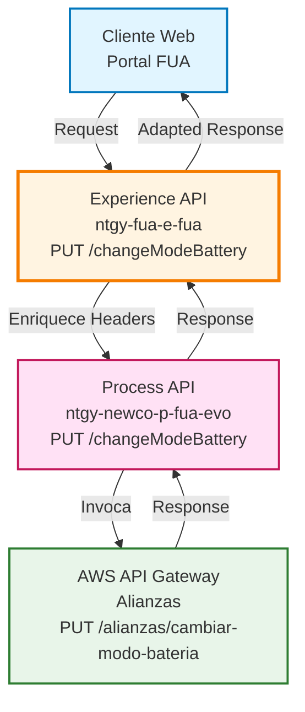
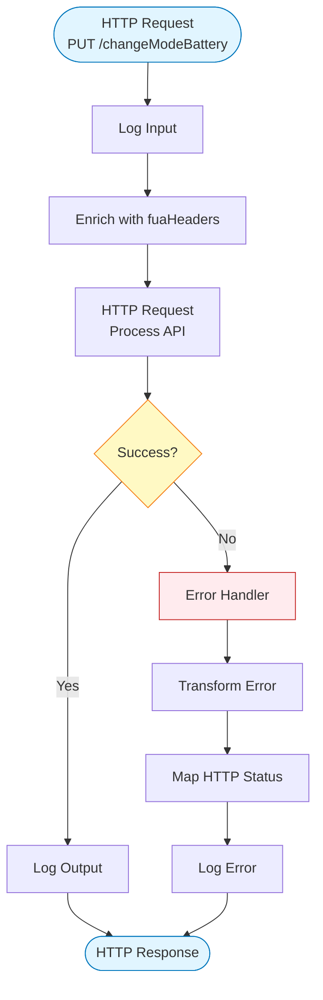
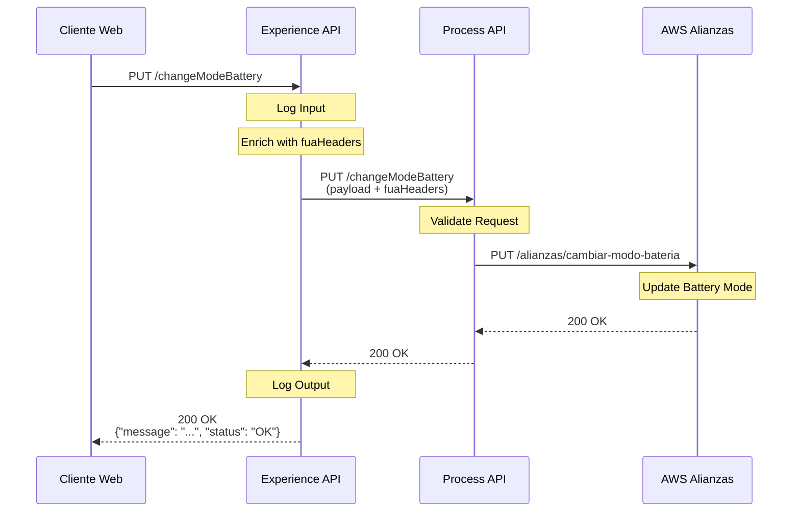
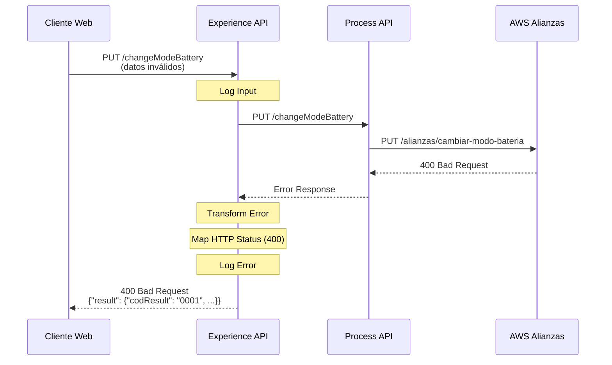
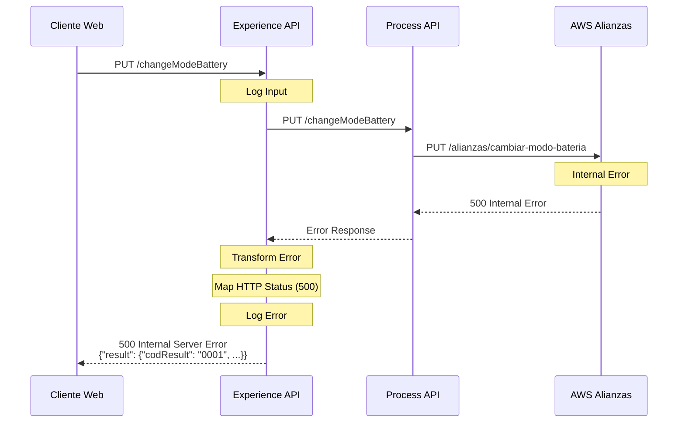

# PUT /changeModeBattery


## 📌 Descripción General

### Propósito del Endpoint

Este endpoint permite cambiar el modo de operación de la batería de un cliente entre modo automático y manual en el sistema de alianzas de Naturgy. El modo automático permite que el sistema gestione automáticamente el uso del saldo de batería, mientras que el modo manual requiere intervención del usuario.

### Tipo de API

**Capa:** Experience API (API-Led Connectivity)

**Función:** Adaptación de experiencia para canal web de autoservicio de clientes

### Patrón de Integración

**Tipo:** Pass-Through con Enriquecimiento de Headers

**Descripción:** Este endpoint actúa como pass-through hacia el Process API, enriqueciendo el request con headers FUA específicos (`vars.fuaHeaders`) antes de invocar el servicio de alianzas.

### Arquitectura API-Led Connectivity



---

## 💼 Propósito del Negocio

### Casos de Uso Principales

1. **Activación de Modo Automático**
   - El cliente desea que el sistema gestione automáticamente el uso de su saldo de batería
   - Optimiza el consumo energético sin intervención manual
   - Mejora la experiencia de usuario al automatizar decisiones de consumo

2. **Desactivación de Modo Automático (Modo Manual)**
   - El cliente prefiere controlar manualmente cuándo usar el saldo de batería
   - Permite mayor control sobre el consumo energético
   - Útil para clientes con patrones de consumo específicos

3. **Gestión de Alianzas Energéticas**
   - Permite configurar el comportamiento del saldo de batería en alianzas con terceros
   - Facilita la gestión de servicios de valor añadido (SVA)
   - Integra con sistemas externos de gestión energética

### 📱 Canal y Audiencia

#### Canal de Consumo

**Canal:** Web

**Características del Canal:**
- **Plataforma**: Portal web FUA (Frontal Único de Atención)
- **Dispositivos**: Navegadores web (desktop y móvil)
- **Conectividad**: Requiere conexión estable para operaciones de configuración
- **Experiencia de Usuario**: Interfaz de autoservicio para gestión de servicios energéticos

#### Audiencia Objetivo

**Usuarios Finales:**
- **Clientes Residenciales**: Usuarios que gestionan su saldo de batería en alianzas energéticas
- **Clientes con Servicios SVA**: Usuarios con servicios de valor añadido que incluyen gestión de batería

**Contexto de Uso:**
- **Configuración Inicial**: Al contratar servicios de alianzas con batería
- **Cambio de Preferencias**: Cuando el cliente desea modificar el comportamiento del sistema
- **Optimización Energética**: Para ajustar la gestión según patrones de consumo

#### Adaptaciones del Canal

**Optimizaciones Aplicadas:**
- **Enriquecimiento de Headers**: Añade headers FUA específicos (`vars.fuaHeaders`) al request
- **Manejo de Errores Específico**: Transforma errores del backend en códigos HTTP estándar
- **Timeout Optimizado**: 60 segundos para operaciones de configuración
- **Logging Detallado**: Registra entrada y salida para auditoría

### 🔗 Endpoints Dependientes

Este Experience API consume el siguiente Process API:

| Process API | Endpoint | Método | Propósito |
|-------------|----------|--------|-----------|
| `ntgy-newco-p-fua-evo` | `/changeModeBattery` | PUT | Orquesta el cambio de modo de batería con el sistema de alianzas AWS |

### Contexto Empresarial

- **Dominio:** Autoservicio de Clientes - Gestión de Alianzas
- **Sector:** Energía - Utilities
- **División:** Naturgy España - NewCo
- **Canal:** Web (Portal FUA)

### Stakeholders

- **Clientes Finales**: Usuarios que gestionan sus servicios de batería en alianzas
- **Equipo de Alianzas**: Responsables de la gestión de servicios con terceros
- **Soporte Técnico**: Personal que asiste a clientes con configuración de servicios

### Valor de Negocio

- **Autonomía del Cliente**: Permite autogestión de servicios sin intervención de agentes
- **Optimización Energética**: Facilita la gestión eficiente del consumo energético
- **Reducción de Costes Operativos**: Disminuye llamadas al call center por configuración
- **Mejora de Experiencia**: Proporciona control inmediato sobre servicios contratados

---

## 🔧 Especificación Técnica

### URLs por Ambiente

| Ambiente | URL Base | URL Completa |
|----------|----------|--------------|
| **Local** | `http://localhost:8081` | `http://localhost:8081/fua/api/changeModeBattery` |
| **Development** | `https://ntgy-fua-e-fua-dev.de-c1.cloudhub.io` | `https://ntgy-fua-e-fua-dev.de-c1.cloudhub.io/fua/api/changeModeBattery` |
| **UAT** | `https://ntgy-fua-e-fua-uat.de-c1.cloudhub.io` | `https://ntgy-fua-e-fua-uat.de-c1.cloudhub.io/fua/api/changeModeBattery` |
| **Production** | `https://ntgy-fua-e-fua-pro.de-c1.cloudhub.io` | `https://ntgy-fua-e-fua-pro.de-c1.cloudhub.io/fua/api/changeModeBattery` |

### Método HTTP

```
PUT /fua/api/changeModeBattery
```

### 🎯 Consideraciones del Canal

#### Limitaciones del Canal

| Aspecto | Limitación | Razón |
|---------|------------|-------|
| **Timeout** | 60 segundos | Operación de configuración que puede requerir validaciones en AWS |
| **Rate Limiting** | Según política API Manager | Protección contra uso excesivo |
| **Autenticación** | OAuth 2.0 requerido | Seguridad de operaciones de configuración |

#### Campos Específicos del Canal

**Campos Añadidos por el Experience API:**

| Campo | Tipo | Descripción | Razón |
|-------|------|-------------|-------|
| `vars.fuaHeaders` | Object | Headers específicos de FUA | Contexto de sesión y trazabilidad |

**Transformación Aplicada:**
```dataweave
payload ++ vars.fuaHeaders
```

### Parámetros de Entrada

#### Headers

| Header | Tipo | Requerido | Descripción |
|--------|------|-----------|-------------|
| `Content-Type` | String | Sí | Debe ser `application/json` |
| `Authorization` | String | Sí | Token OAuth 2.0 |
| `x-client-code` | String | Sí | Código del cliente (incluido en fuaHeaders) |

#### Body (application/json)

⚠️ **IMPORTANTE:** El código MuleSoft (Experience + Process) **NO transforma ni valida** el body. Actúa como pass-through puro hacia AWS Lambda.

**Campo Confirmado en Código:**

| Campo | Uso en Process API | Evidencia |
|-------|-------------------|-----------|
| `x-client-code` | Extraído del payload y enviado como header a AWS Lambda | `payload.'x-client-code'` en código del Process API |

**Estructura Completa del Body:**

❌ **NO está documentada en el código MuleSoft**

El Experience API:
1. Recibe el payload del cliente
2. Lo enriquece con `vars.fuaHeaders`
3. Lo envía al Process API sin transformación
4. El Process API lo envía a AWS Lambda sin transformación

**La estructura esperada por AWS Lambda debe consultarse en la especificación del endpoint AWS `/battery/assign`.**

**Ejemplo de estructura (NO confirmada en código MuleSoft):**
```json
{
  "x-client-code": "string"
  // ... otros campos según especificación AWS Lambda
}
```

⚠️ **Recomendación:** Consultar documentación oficial del endpoint AWS Lambda para conocer la estructura completa y los campos requeridos.

### Respuestas

#### 200 OK - Operación Exitosa

⚠️ **Pass-Through Response**

El Experience API devuelve la respuesta de AWS Lambda (a través del Process API) **sin transformación**.

**Estructura:** NO documentada en código MuleSoft

**Para conocer la estructura de la respuesta exitosa:**
Consultar la especificación del endpoint AWS Lambda `/battery/assign`

```json
{
  // Respuesta del servicio AWS Lambda
  // Estructura NO confirmada en código MuleSoft
}
```

#### 500 Internal Server Error - Error del Sistema

✅ **Estructura Confirmada en Código** (transformada por Process API)

Cuando ocurre un error (timeout, conexión, error de AWS), el Process API transforma el error a este formato:

```json
{
  "result": {
    "codResult": "0001",
    "msgResult": "Descripción del error"
  }
}
```

| Campo | Tipo | Descripción |
|-------|------|-------------|
| `result.codResult` | String | Código de error (siempre "0001") |
| `result.msgResult` | String | Descripción del error (extraída del error de AWS o descripción genérica) |

**Ejemplos de mensajes de error:**
- Error de AWS Lambda: El mensaje original del error de AWS
- Timeout: "Timeout al conectar con el sistema de alianzas AWS"
- Error genérico: "Internal server error"

**Mapeo de HTTP Status:**

El Experience API propaga el código HTTP del error:
- 400, 401, 403, 404: Si el mensaje de error contiene estos códigos
- 500: Por defecto para cualquier otro error

### Autenticación

- **Tipo:** OAuth 2.0
- **Scope:** Operaciones de cliente autenticado
- **Header:** `Authorization: Bearer {token}`

### Timeouts

| Tipo | Valor | Razón |
|------|-------|-------|
| **Request Timeout** | 60 segundos | Operación de configuración que requiere validación en sistemas externos |
| **Connection Idle Timeout** | 60 segundos | Mantiene conexión para operaciones largas |

---

## 🏗️ Implementación Técnica

### Arquitectura del Flow



### Transformaciones de Canal

**Enriquecimiento de Request:**

El Experience API enriquece el payload original con headers FUA:

```dataweave
%dw 2.0
output application/json
---
payload ++ vars.fuaHeaders
```

**Transformación de Errores:**

```dataweave
%dw 2.0
output application/json
---
{
  "result": {
    "codResult": "0001",
    "msgResult": if(error.errorMessage.payload.result.msgResult != null) 
                   error.errorMessage.payload.result.msgResult 
                 else 
                   error.description
  }
}
```

**Mapeo de Códigos HTTP:**

```dataweave
%dw 2.0
output application/java
---
if((error.errorMessage.payload.result.msgResult contains ("400")) or (error.description contains ("400")))
  400
else if((error.errorMessage.payload.result.msgResult contains ("401")) or (error.description contains ("401")))
  401
else if((error.errorMessage.payload.result.msgResult contains ("403")) or (error.description contains ("403")))
  403
else if((error.errorMessage.payload.result.msgResult contains ("404")) or (error.description contains ("404")))
  404
else
  500
```

### Patrones de Diseño

**Patrón:** Pass-Through con Enriquecimiento

**Justificación:** 
- Mantiene la simplicidad del Experience API
- Añade contexto específico del canal (headers FUA)
- Delega la lógica de negocio al Process API
- Facilita el mantenimiento y evolución independiente

### Diagramas de Secuencia

#### 1. Flujo Normal de Éxito



#### 2. Flujo con Error de Negocio (400)



#### 3. Flujo con Error Técnico (500)



### Configuración del Conector HTTP

**Config-Ref:** `HTTP_FUA_PROCESS_NEWCO_EVO`

**Configuración:**
```yaml
host: "mule-worker-internal-ntgy-newco-p-fua-evo.de-c1.cloudhub.io"
port: "8091"
basePath: "/api"
timeout: "60000"  # 60 segundos
connectionIdleTimeout: "60000"
```

### Manejo de Errores

**Estrategia:** Error Handler con Propagación

**Componentes:**
1. **On Error Propagate**: Captura todos los errores y los transforma
2. **Transform Error Message**: Convierte el error en formato estándar
3. **Map HTTP Status**: Determina el código HTTP apropiado
4. **Log Error**: Registra el error para auditoría

**Códigos de Error:**

| Código | Descripción | Acción |
|--------|-------------|--------|
| `0001` | Error genérico | Revisar logs para detalles específicos |

**Mapeo de HTTP Status:**
- Detecta códigos HTTP en el mensaje de error
- Mapea a códigos estándar (400, 401, 403, 404, 500)
- Por defecto retorna 500 si no se identifica el código

---

## 💻 Ejemplos de Uso

### Ejemplo 1: Request Básico

⚠️ **NOTA:** Este ejemplo muestra solo el campo confirmado en el código MuleSoft. La estructura completa depende de la especificación AWS Lambda.

#### cURL

```bash
curl -X PUT "https://ntgy-fua-e-fua-pro.de-c1.cloudhub.io/fua/api/changeModeBattery" \
  -H "Content-Type: application/json" \
  -H "Authorization: Bearer YOUR_ACCESS_TOKEN" \
  -d '{
    "x-client-code": "CLI-12345"
    // ... otros campos según especificación AWS Lambda
  }'
```

#### Respuesta (200 OK)

**Nota:** La respuesta proviene de AWS Lambda (pass-through a través de Process API). La estructura exacta depende de la implementación del servicio AWS `/battery/assign`.

```json
{
  // Respuesta del servicio AWS Lambda
  // Estructura NO documentada en código MuleSoft
}
```

### Ejemplo 3: JavaScript (Frontend Web)

```javascript
async function changeBatteryMode(mode, batteryId, clientCode) {
  try {
    const response = await fetch(
      'https://ntgy-fua-e-fua-pro.de-c1.cloudhub.io/fua/api/changeModeBattery',
      {
        method: 'PUT',
        headers: {
          'Content-Type': 'application/json',
          'Authorization': `Bearer ${getAccessToken()}`
        },
        body: JSON.stringify({
          mode: mode,
          batteryId: batteryId,
          clientCode: clientCode
        })
      }
    );

    if (!response.ok) {
      const error = await response.json();
      throw new Error(error.message || 'Error al cambiar modo de batería');
    }

    const data = await response.json();
    console.log('Modo de batería actualizado:', data.message);
    return data;
  } catch (error) {
    console.error('Error al cambiar modo de batería:', error.message);
    throw error;
  }
}

// Uso: Cambiar a modo automático
changeBatteryMode('automatic', 'BAT-12345', 'CLI-12345')
  .then(result => console.log('Éxito:', result))
  .catch(error => console.error('Error:', error));

// Uso: Cambiar a modo manual
changeBatteryMode('manual', 'BAT-12345', 'CLI-12345')
  .then(result => console.log('Éxito:', result))
  .catch(error => console.error('Error:', error));
```

### Ejemplo 4: Python

```python
import requests
import json

def change_battery_mode(mode, battery_id, client_code, access_token):
    """
    Cambia el modo de operación de la batería
    
    Args:
        mode: Modo de operación ("automatic" o "manual")
        battery_id: Identificador único de la batería
        client_code: Código del cliente propietario
        access_token: Token de autenticación OAuth 2.0
    
    Returns:
        dict: Respuesta del API
    """
    url = 'https://ntgy-fua-e-fua-pro.de-c1.cloudhub.io/fua/api/changeModeBattery'
    
    headers = {
        'Content-Type': 'application/json',
        'Authorization': f'Bearer {access_token}'
    }
    
    payload = {
        'mode': mode,
        'batteryId': battery_id,
        'clientCode': client_code
    }
    
    try:
        response = requests.put(url, headers=headers, json=payload, timeout=60)
        response.raise_for_status()
        return response.json()
    except requests.exceptions.HTTPError as e:
        error_data = e.response.json()
        print(f"Error HTTP {e.response.status_code}: {error_data.get('message', 'Error desconocido')}")
        raise
    except requests.exceptions.RequestException as e:
        print(f"Error de conexión: {str(e)}")
        raise

# Ejemplo de uso: Cambiar a modo automático
if __name__ == '__main__':
    result = change_battery_mode(
        mode='automatic',
        battery_id='BAT-12345',
        client_code='CLI-12345',
        access_token='YOUR_ACCESS_TOKEN'
    )
    print(f"Resultado: {result.get('message', 'Operación completada')}")
```

### Ejemplo 5: Error - Campo Requerido Faltante (400)

#### Request

```bash
curl -X PUT "https://ntgy-fua-e-fua-pro.de-c1.cloudhub.io/fua/api/changeModeBattery" \
  -H "Content-Type: application/json" \
  -H "Authorization: Bearer YOUR_ACCESS_TOKEN" \
  -d '{
    "x-client-code": "CLI123456",
    "idCliente": "0001234567",
    "idContrato": "CTR789012"
  }'
```

#### Respuesta (400 Bad Request)

```json
{
  "result": {
    "codResult": "0001",
    "msgResult": "400 - Campo requerido faltante: idSaldo"
  }
}
```

### Ejemplo 6: Error - Saldo No Encontrado (404)

#### Request

```bash
curl -X PUT "https://ntgy-fua-e-fua-pro.de-c1.cloudhub.io/fua/api/changeModeBattery" \
  -H "Content-Type: application/json" \
  -H "Authorization: Bearer YOUR_ACCESS_TOKEN" \
  -d '{
    "x-client-code": "CLI123456",
    "idCliente": "0001234567",
    "idContrato": "CTR789012",
    "idSaldo": "SLD999999",
    "modoAutomatico": true
  }'
```

#### Respuesta (404 Not Found)

```json
{
  "result": {
    "codResult": "0001",
    "msgResult": "404 - Saldo de batería no encontrado: SLD999999"
  }
}
```

### Ejemplo 7: Error - Sin Permisos (403)

#### Request

```bash
curl -X PUT "https://ntgy-fua-e-fua-pro.de-c1.cloudhub.io/fua/api/changeModeBattery" \
  -H "Content-Type: application/json" \
  -H "Authorization: Bearer INVALID_TOKEN" \
  -d '{
    "x-client-code": "CLI123456",
    "idCliente": "0001234567",
    "idContrato": "CTR789012",
    "idSaldo": "SLD345678",
    "modoAutomatico": true
  }'
```

#### Respuesta (403 Forbidden)

```json
{
  "result": {
    "codResult": "0001",
    "msgResult": "403 - El usuario no tiene permisos para modificar este saldo"
  }
}