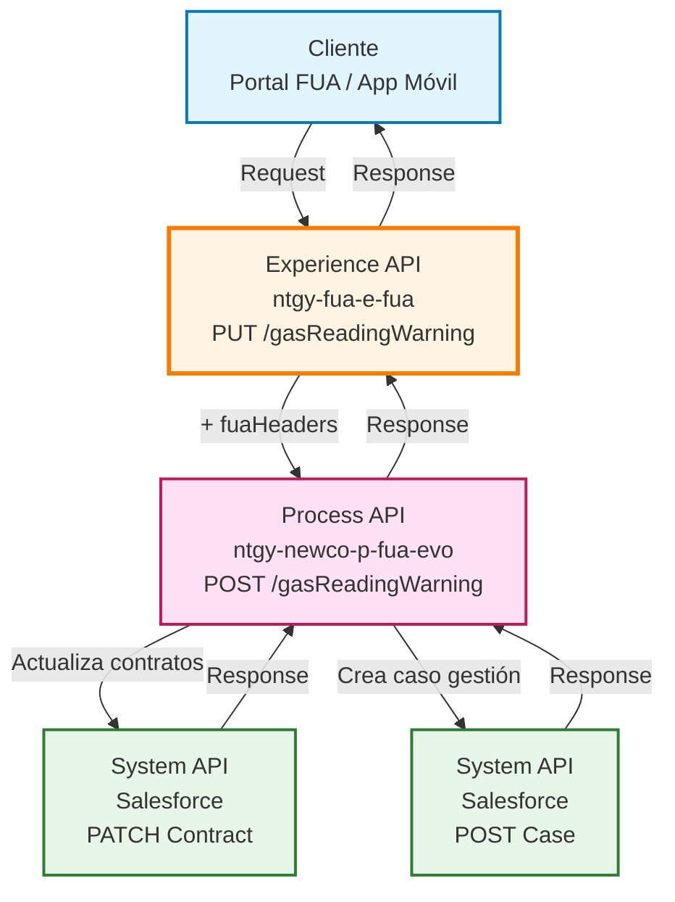
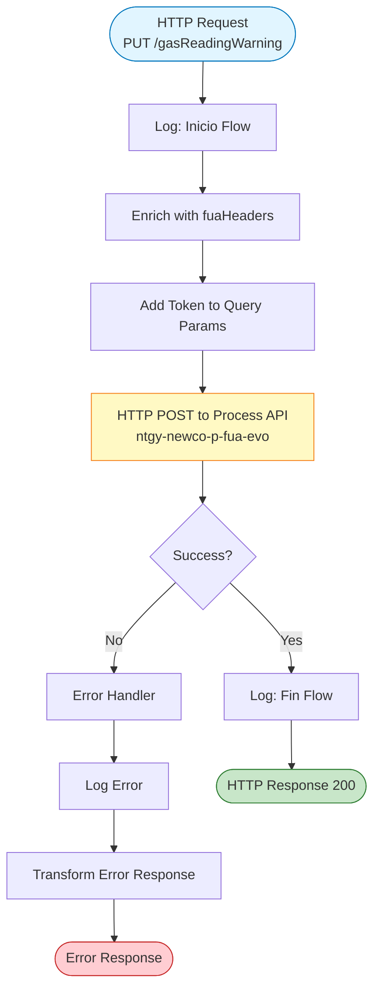
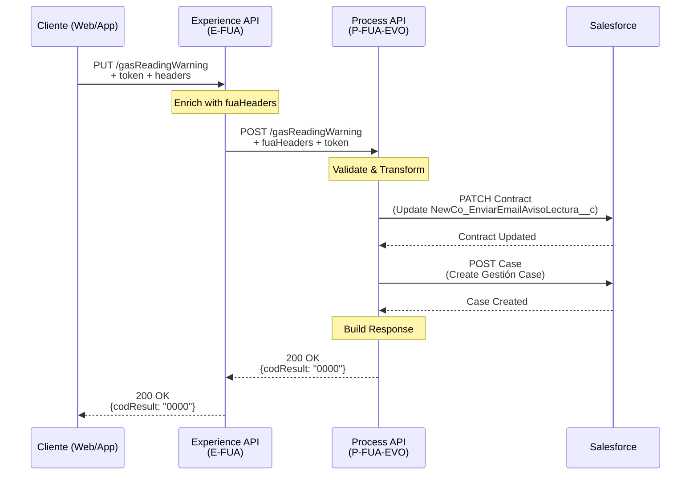
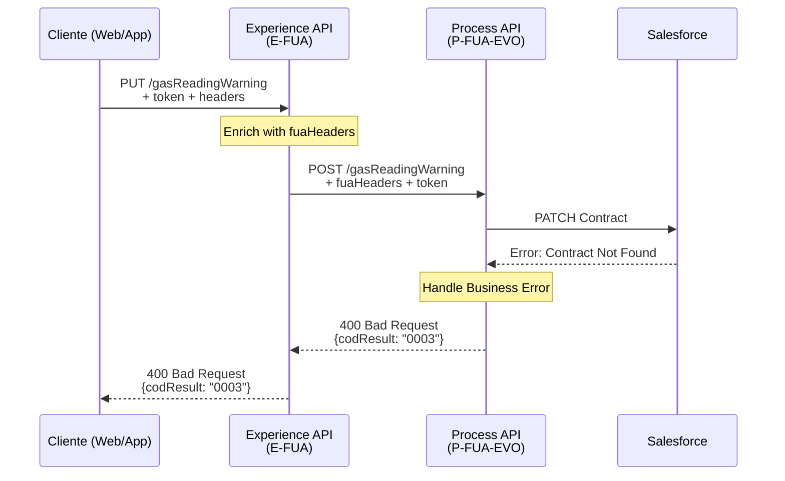
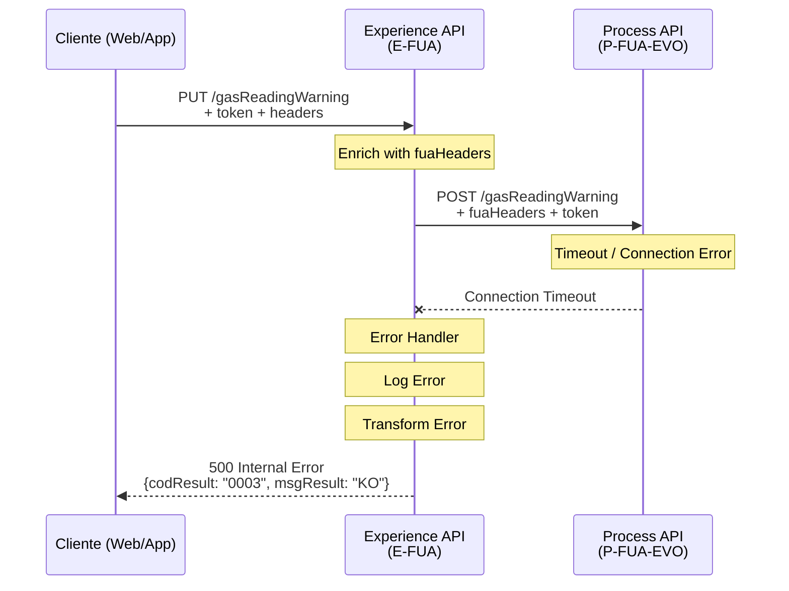

# PUT /gasReadingWarning

## 📌 Descripción General

### Propósito del Endpoint

Este endpoint permite a los clientes activar o desactivar el aviso de lectura del contador de gas para uno o varios contratos. Cuando se activa, el cliente recibirá notificaciones por email antes de la fecha de lectura del contador, facilitando la gestión proactiva de su suministro de gas.

### Tipo de API

**Capa:** Experience API (API-Led Connectivity)

**Función:** Adaptación de experiencia para canales web y aplicación móvil

### Patrón de Integración

**Tipo:** Pass-Through con Enriquecimiento de Headers

**Descripción:** El Experience API actúa como pass-through, reenviando la petición al Process API y agregando headers de contexto FUA (`vars.fuaHeaders`) necesarios para la trazabilidad y autenticación. No transforma la estructura del payload ni de la respuesta.

### Arquitectura API-Led Connectivity



---

## 💼 Propósito del Negocio

### Casos de Uso Principales

1. **Activación de Avisos de Lectura**
   - El cliente activa la notificación por email para recibir recordatorios antes de la fecha de lectura
   - Mejora la experiencia del cliente al facilitar la planificación de la lectura del contador
   - Reduce llamadas al call center por consultas sobre fechas de lectura

2. **Desactivación de Avisos de Lectura**
   - El cliente desactiva las notificaciones si prefiere no recibirlas
   - Respeta las preferencias de comunicación del cliente
   - Cumple con normativas de protección de datos (GDPR)

3. **Gestión Multi-Contrato**
   - Permite activar/desactivar avisos para múltiples contratos en una sola operación
   - Optimiza la experiencia cuando el cliente tiene varios puntos de suministro
   - Genera un único caso de gestión que agrupa todas las modificaciones

### 📱 Canal y Audiencia

#### Canal de Consumo

**Canal:** Web / Mobile

**Características del Canal:**
- **Plataforma**: Portal FUA (Frontal Único de Atención) y aplicación móvil
- **Dispositivos**: Navegadores web modernos, smartphones iOS/Android
- **Conectividad**: Requiere conexión a internet estable
- **Experiencia de Usuario**: Interfaz de autoservicio con confirmación inmediata

#### Audiencia Objetivo

**Usuarios Finales:**
- **Clientes Residenciales**: Particulares que gestionan su suministro de gas de forma autónoma
- **Clientes Empresariales**: Pequeñas y medianas empresas con contratos de gas

**Contexto de Uso:**
- **Gestión Proactiva**: Cliente configura preferencias de notificación desde su área personal
- **Autoservicio**: Operación realizada sin intervención de agentes de call center
- **Multi-dispositivo**: Acceso desde ordenador o dispositivo móvil según conveniencia

#### Adaptaciones del Canal

**Optimizaciones Aplicadas:**
- **Enriquecimiento de Headers**: Agrega headers de contexto FUA para trazabilidad
- **Propagación de Token**: Mantiene el token de autenticación en query params
- **Manejo de Errores Simplificado**: Respuestas de error estandarizadas para el canal
- **Sin Transformación de Payload**: Mantiene la estructura original del Process API

### 🔗 Endpoints Dependientes

Este Experience API consume el siguiente Process API:

| Process API | Endpoint | Método | Propósito |
|-------------|----------|--------|-----------|
| `ntgy-newco-p-fua-evo` | `/gasReadingWarning` | POST | Orquesta la actualización de contratos en Salesforce y la creación del caso de gestión |

**Flujo de Dependencias:**
```
Experience API (E-FUA)
  ↓ POST /gasReadingWarning
Process API (P-FUA-EVO)
  ↓ Salesforce Composite API
  ├─ PATCH Contract (actualiza campo NewCo_EnviarEmailAvisoLectura__c)
  └─ POST Case (crea caso de gestión tipo "AvisoLecturaPorMail")
```

### Contexto Empresarial

- **Dominio:** Autoservicio de Clientes - Gestión de Preferencias
- **Sector:** Energía - Utilities
- **División:** Naturgy España - NewCo
- **Canal:** Web / Móvil
- **Proceso de Negocio:** Gestión de Notificaciones de Lectura

### Stakeholders

- **Clientes Finales**: Necesitan gestionar sus preferencias de notificación de forma autónoma
- **Equipo de Atención al Cliente**: Se beneficia de la reducción de llamadas por consultas de lectura
- **Equipo de Operaciones**: Mejora la eficiencia en la gestión de lecturas de contadores
- **Equipo de CRM**: Mantiene actualizado el registro de preferencias del cliente en Salesforce

### Valor de Negocio

- **Mejora de Experiencia del Cliente**: Autoservicio 24/7 para gestión de preferencias
- **Reducción de Costes Operativos**: Menos llamadas al call center por consultas de lectura
- **Cumplimiento Normativo**: Respeta preferencias de comunicación (GDPR)
- **Trazabilidad**: Cada cambio genera un caso de gestión para auditoría
- **Eficiencia Operativa**: Gestión multi-contrato en una sola operación

---

## 🔧 Especificación Técnica

### URLs por Ambiente

| Ambiente | URL Base | URL Completa |
|----------|----------|--------------|
| **Local** | `http://localhost:8081` | `http://localhost:8081/fua/api/gasReadingWarning?token={token}` |
| **Development** | `https://ntgy-fua-e-fua-dev.de-c1.cloudhub.io` | `https://ntgy-fua-e-fua-dev.de-c1.cloudhub.io/fua/api/gasReadingWarning?token={token}` |
| **Production** | `https://ntgy-fua-e-fua-pro.de-c1.cloudhub.io` | `https://ntgy-fua-e-fua-pro.de-c1.cloudhub.io/fua/api/gasReadingWarning?token={token}` |

### Método HTTP

```
PUT /fua/api/gasReadingWarning
```

### 🎯 Consideraciones del Canal

#### Limitaciones del Canal

| Aspecto | Limitación | Razón |
|---------|------------|-------|
| **Timeout** | 60 segundos | Operación puede involucrar múltiples contratos y llamadas a Salesforce |
| **Rate Limiting** | Según política API Gateway | Protección contra uso abusivo |
| **Autenticación** | Token OAuth 2.0 requerido | Seguridad y trazabilidad de operaciones |

#### Campos Específicos del Canal

**Campos Añadidos por el Experience API:**

| Campo | Tipo | Descripción | Razón |
|-------|------|-------------|-------|
| `vars.fuaHeaders` | Object | Headers de contexto FUA (x-client-id, x-contact-id, x-user-id, etc.) | Trazabilidad y contexto de usuario para el Process API |

**Campos Pass-Through:**

⚠️ **Este Experience API NO transforma el payload.** Todos los campos del request y response son pass-through desde/hacia el Process API.

Para el schema completo de request y response, consultar:
📖 **Process API: `ntgy-newco-p-fua-evo` endpoint `POST /gasReadingWarning`**

### Parámetros de Entrada

#### Query Parameters

| Parámetro | Tipo | Requerido | Descripción |
|-----------|------|-----------|-------------|
| `token` | string | ✅ Sí | Token de autenticación OAuth 2.0 |

#### Headers

| Header | Tipo | Requerido | Descripción |
|--------|------|-----------|-------------|
| `Content-Type` | string | ✅ Sí | Debe ser `application/json` |
| `x-client-id` | string | ✅ Sí | ID del cliente en Salesforce (Account) |
| `x-contact-id` | string | ✅ Sí | ID del contacto en Salesforce |
| `x-client-code` | string | ✅ Sí | Código del cliente (NIF/CIF) |
| `x-user-id` | string | ⚠️ Opcional | ID del usuario (si es agente) |
| `x-interaction-id` | string | ⚠️ Opcional | ID de interacción padre (si aplica) |
| `traceparent` | string | ✅ Sí | Trace ID para trazabilidad distribuida |

#### Body (JSON)

**Estructura del Request:**

```json
{
  "contractIdList": [
    {
      "contractId": "string",
      "direccion": "string",
      "flagEnvio": boolean
    }
  ],
  "CUPS": "string"
}
```

**Campos del Body:**

| Campo | Tipo | Requerido | Descripción |
|-------|------|-----------|-------------|
| `contractIdList` | array | ✅ Sí | Lista de contratos a modificar |
| `contractIdList[].contractId` | string | ✅ Sí | ID del contrato en Salesforce |
| `contractIdList[].direccion` | string | ✅ Sí | Dirección del punto de suministro |
| `contractIdList[].flagEnvio` | boolean | ✅ Sí | `true` para activar, `false` para desactivar |
| `CUPS` | string | ✅ Sí | Código Universal del Punto de Suministro |

### Respuestas

#### Respuesta Exitosa (200 OK)

```json
{
  "result": {
    "codResult": "0000",
    "msgResult": "No hay error"
  }
}
```

**Campos de la Respuesta:**

| Campo | Tipo | Descripción |
|-------|------|-------------|
| `result` | object | Objeto de resultado |
| `result.codResult` | string | Código de resultado (`"0000"` = éxito) |
| `result.msgResult` | string | Mensaje descriptivo del resultado |

#### Respuesta de Error (4xx/5xx)

```json
{
  "result": {
    "codResult": "0003",
    "msgResult": "KO"
  }
}
```

**Códigos de Error:**

| Código | Descripción | Causa Probable |
|--------|-------------|----------------|
| `0003` | Error genérico | Error en Process API o Salesforce |
| `401` | No autorizado | Token inválido o expirado |
| `400` | Bad Request | Payload inválido o campos faltantes |
| `500` | Error interno | Error en el servidor |

### Autenticación

- **Tipo:** OAuth 2.0
- **Ubicación:** Query parameter `token`
- **Validación:** Realizada por API Gateway y Process API

### Timeouts

| Tipo | Valor | Razón |
|------|-------|-------|
| **Request Timeout** | 60 segundos | Operación puede involucrar múltiples actualizaciones en Salesforce |
| **Connection Idle Timeout** | 60 segundos | Mantiene conexión para operaciones largas |

---

## 🏗️ Implementación Técnica

### Arquitectura del Flow



### Transformaciones de Canal

#### 1. Enriquecimiento de Headers (Request)

**Transformación DataWeave:**

```dataweave
%dw 2.0
output application/json
---
payload
++
vars.fuaHeaders
```

**Descripción:**
- Combina el payload original con los headers de contexto FUA
- Los headers incluyen: `x-client-id`, `x-contact-id`, `x-client-code`, `x-user-id`, `x-interaction-id`, `traceparent`
- Estos headers son necesarios para la trazabilidad y contexto de usuario en el Process API

#### 2. Propagación de Token (Query Params)

**Transformación DataWeave:**

```dataweave
%dw 2.0
output application/java
---
{
  "token": attributes.queryParams.token
}
```

**Descripción:**
- Extrae el token del query parameter del request original
- Lo propaga al Process API para mantener la autenticación

#### 3. Pass-Through de Response

⚠️ **NO hay transformación de la respuesta del Process API.**

La respuesta del Process API se devuelve tal cual al cliente.

### Patrones de Diseño

**Patrón:** Pass-Through con Enriquecimiento de Contexto

**Justificación:** 
- El Experience API no necesita transformar la lógica de negocio
- Su responsabilidad es agregar contexto del canal (headers FUA) y propagar autenticación
- Mantiene la separación de responsabilidades: E-API (canal) vs P-API (orquestación)

### Diagramas de Secuencia

#### 1. Flujo Normal de Éxito



#### 2. Flujo con Error de Negocio



#### 3. Flujo con Error Técnico



### Manejo de Errores

#### Error Handler del Experience API

**Ubicación:** `put-gasReadingWarning.xml` (líneas 22-48)

**Estrategia:**

1. **Captura de Error:**
   ```xml
   <on-error-propagate enableNotifications="true" logException="true">
   ```

2. **Logging de Error:**
   ```dataweave
   if (!isEmpty(error.errorMessage.payload)) 
     error.errorMessage.payload
   else {
     "result": {
       "codResult": "0003",
       "msgResult": error.description as String replace /"/ with("")
     }
   }
   ```

3. **Transformación de Error:**
   - Si el Process API devuelve un error estructurado → Se propaga tal cual
   - Si es un error técnico → Se transforma a formato estándar con código `0003`

4. **Respuesta de Error Estandarizada:**
   ```json
   {
     "result": {
       "codResult": "0003",
       "msgResult": "KO"
     }
   }
   ```

**Tipos de Errores Manejados:**

| Tipo de Error | Código | Acción |
|---------------|--------|--------|
| Error de Process API | Variable | Propaga error original |
| Timeout de conexión | 0003 | Transforma a error estándar |
| Error de red | 0003 | Transforma a error estándar |
| Error interno | 0003 | Transforma a error estándar |

---

## 💻 Ejemplos de Uso

### Ejemplo 1: Activar Aviso de Lectura (Un Contrato)

#### cURL

```bash
curl -X PUT "https://ntgy-fua-e-fua-pro.de-c1.cloudhub.io/fua/api/gasReadingWarning?token=eyJhbGciOiJIUzI1NiIsInR5cCI6IkpXVCJ9..." \
  -H "Content-Type: application/json" \
  -H "x-client-id: 0015I00000ABC123QAD" \
  -H "x-contact-id: 0035I00000XYZ456QAE" \
  -H "x-client-code: 12345678A" \
  -H "traceparent: 00-4bf92f3577b34da6a3ce929d0e0e4736-00f067aa0ba902b7-01" \
  -d '{
    "contractIdList": [
      {
        "contractId": "8007Y0000031FbfQAE",
        "direccion": "Calle Mayor 123, Madrid",
        "flagEnvio": true
      }
    ],
    "CUPS": "ES0021000002155819PA"
  }'
```

#### Respuesta (200 OK)

```json
{
  "result": {
    "codResult": "0000",
    "msgResult": "No hay error"
  }
}
```

### Ejemplo 2: Desactivar Aviso de Lectura (Múltiples Contratos)

#### cURL

```bash
curl -X PUT "https://ntgy-fua-e-fua-pro.de-c1.cloudhub.io/fua/api/gasReadingWarning?token=eyJhbGciOiJIUzI1NiIsInR5cCI6IkpXVCJ9..." \
  -H "Content-Type: application/json" \
  -H "x-client-id: 0015I00000ABC123QAD" \
  -H "x-contact-id: 0035I00000XYZ456QAE" \
  -H "x-client-code: 12345678A" \
  -H "traceparent: 00-4bf92f3577b34da6a3ce929d0e0e4736-00f067aa0ba902b7-01" \
  -d '{
    "contractIdList": [
      {
        "contractId": "8007Y0000031FbfQAE",
        "direccion": "Calle Mayor 123, Madrid",
        "flagEnvio": false
      },
      {
        "contractId": "8007Y0000031FbgQAE",
        "direccion": "Avenida Libertad 456, Barcelona",
        "flagEnvio": false
      }
    ],
    "CUPS": "ES0021000002155819PA"
  }'
```

#### Respuesta (200 OK)

```json
{
  "result": {
    "codResult": "0000",
    "msgResult": "No hay error"
  }
}
```

### Ejemplo 3: JavaScript (React/Vue - Web)

```javascript
const activarAvisoLectura = async (contractData, token) => {
  try {
    const response = await fetch(
      `https://ntgy-fua-e-fua-pro.de-c1.cloudhub.io/fua/api/gasReadingWarning?token=${token}`,
      {
        method: 'PUT',
        headers: {
          'Content-Type': 'application/json',
          'x-client-id': '0015I00000ABC123QAD',
          'x-contact-id': '0035I00000XYZ456QAE',
          'x-client-code': '12345678A',
          'traceparent': generateTraceParent()
        },
        body: JSON.stringify({
          contractIdList: [
            {
              contractId: contractData.id,
              direccion: contractData.address,
              flagEnvio: true
            }
          ],
          CUPS: contractData.cups
        })
      }
    );

    const data = await response.json();
    
    if (data.result.codResult === '0000') {
      console.log('Aviso de lectura activado correctamente');
      return { success: true, data };
    } else {
      console.error('Error al activar aviso:', data.result.msgResult);
      return { success: false, error: data.result };
    }
  } catch (error) {
    console.error('Error de red:', error);
    return { success: false, error: error.message };
  }
};

// Función auxiliar para generar traceparent
function generateTraceParent() {
  const version = '00';
  const traceId = Array.from({length: 32}, () => 
    Math.floor(Math.random() * 16).toString(16)).join('');
  const spanId = Array.from({length: 16}, () => 
    Math.floor(Math.random() * 16).toString(16)).join('');
  const flags = '01';
  return `${version}-${traceId}-${spanId}-${flags}`;
}
```

### Ejemplo 4: Error - Token Inválido

#### Request

```bash
curl -X PUT "https://ntgy-fua-e-fua-pro.de-c1.cloudhub.io/fua/api/gasReadingWarning?token=invalid_token" \
  -H "Content-Type: application/json" \
  -H "x-client-id: 0015I00000ABC123QAD" \
  -H "x-contact-id: 0035I00000XYZ456QAE" \
  -H "x-client-code: 12345678A" \
  -d '{
    "contractIdList": [
      {
        "contractId": "8007Y0000031FbfQAE",
        "direccion": "Calle Mayor 123, Madrid",
        "flagEnvio": true
      }
    ],
    "CUPS": "ES0021000002155819PA"
  }'
```

#### Respuesta (401 Unauthorized)

```json
{
  "error": "Unauthorized",
  "message": "Invalid or expired token"
}
```

### Ejemplo 5: Error - Contrato No Encontrado

#### Request

```bash
curl -X PUT "https://ntgy-fua-e-fua-pro.de-c1.cloudhub.io/fua/api/gasReadingWarning?token=valid_token" \
  -H "Content-Type: application/json" \
  -H "x-client-id: 0015I00000ABC123QAD" \
  -H "x-contact-id: 0035I00000XYZ456QAE" \
  -H "x-client-code: 12345678A" \
  -d '{
    "contractIdList": [
      {
        "contractId": "INVALID_CONTRACT_ID",
        "direccion": "Calle Mayor 123, Madrid",
        "flagEnvio": true
      }
    ],
    "CUPS": "ES0021000002155819PA"
  }'
```

#### Respuesta (400 Bad Request o 500 Internal Error)

```json
{
  "result": {
    "codResult": "0003",
    "msgResult": "KO"
  }
}
```

### Ejemplo 6: Python (Backend Integration)

```python
import requests
import uuid
import time

def activar_aviso_lectura_gas(contract_id, direccion, cups, token, client_headers):
    """
    Activa el aviso de lectura de gas para un contrato.
    
    Args:
        contract_id (str): ID del contrato en Salesforce
        direccion (str): Dirección del punto de suministro
        cups (str): Código Universal del Punto de Suministro
        token (str): Token de autenticación OAuth 2.0
        client_headers (dict): Headers del cliente (x-client-id, x-contact-id, etc.)
    
    Returns:
        dict: Respuesta del API
    """
    url = "https://ntgy-fua-e-fua-pro.de-c1.cloudhub.io/fua/api/gasReadingWarning"
    
    # Generar traceparent para trazabilidad
    trace_id = uuid.uuid4().hex + uuid.uuid4().hex[:16]
    span_id = uuid.uuid4().hex[:16]
    traceparent = f"00-{trace_id}-{span_id}-01"
    
    headers = {
        'Content-Type': 'application/json',
        'traceparent': traceparent,
        **client_headers
    }
    
    payload = {
        "contractIdList": [
            {
                "contractId": contract_id,
                "direccion": direccion,
                "flagEnvio": True
            }
        ],
        "CUPS": cups
    }
    
    params = {'token': token}
    
    try:
        response = requests.put(
            url,
            json=payload,
            headers=headers,
            params=params,
            timeout=60
        )
        
        response.raise_for_status()
        result = response.json()
        
        if result.get('result', {}).get('codResult') == '0000':
            print(f"✅ Aviso de lectura activado para contrato {contract_id}")
            return {'success': True, 'data': result}
        else:
            print(f"❌ Error: {result.get('result', {}).get('msgResult')}")
            return {'success': False, 'error': result}
            
    except requests.exceptions.Timeout:
        print("⏱️ Timeout: La operación tardó más de 60 segundos")
        return {'success': False, 'error': 'Timeout'}
    except requests.exceptions.RequestException as e:
        print(f"🔥 Error de red: {str(e)}")
        return {'success': False, 'error': str(e)}

# Ejemplo de uso
if __name__ == "__main__":
    client_headers = {
        'x-client-id': '0015I00000ABC123QAD',
        'x-contact-id': '0035I00000XYZ456QAE',
        'x-client-code': '12345678A'
    }
    
    result = activar_av