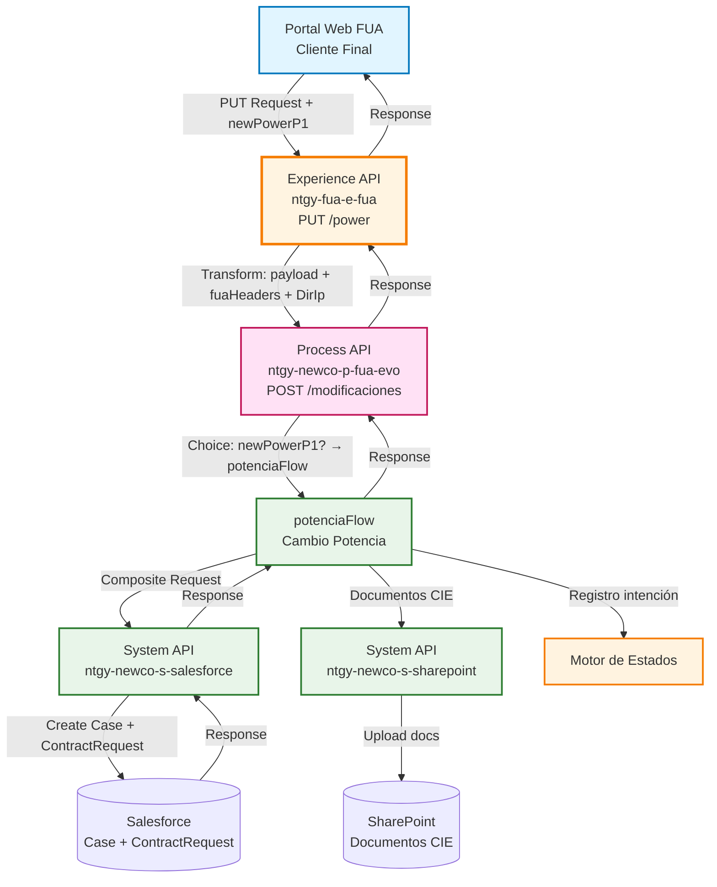
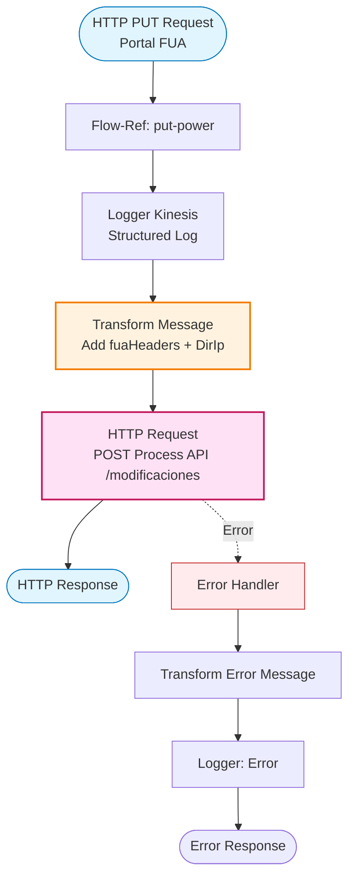
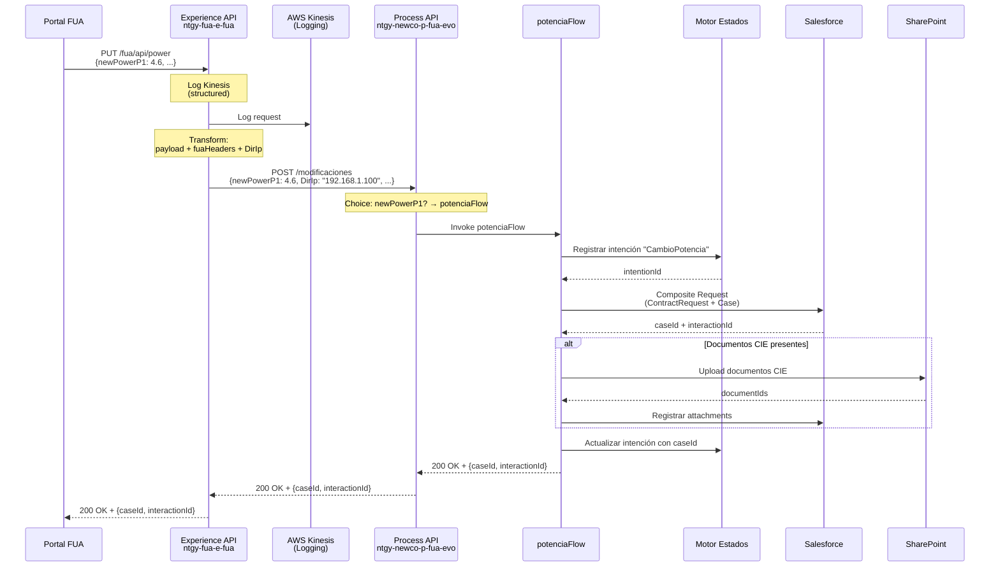
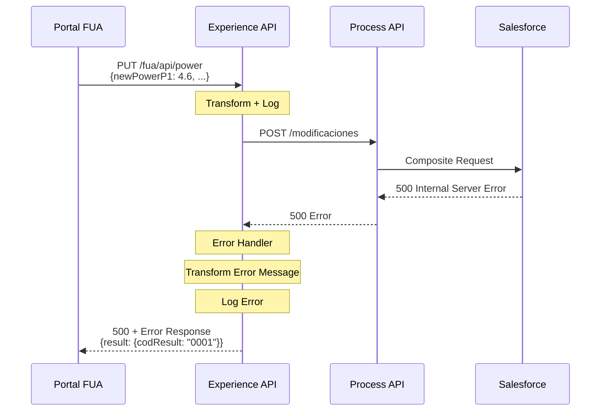
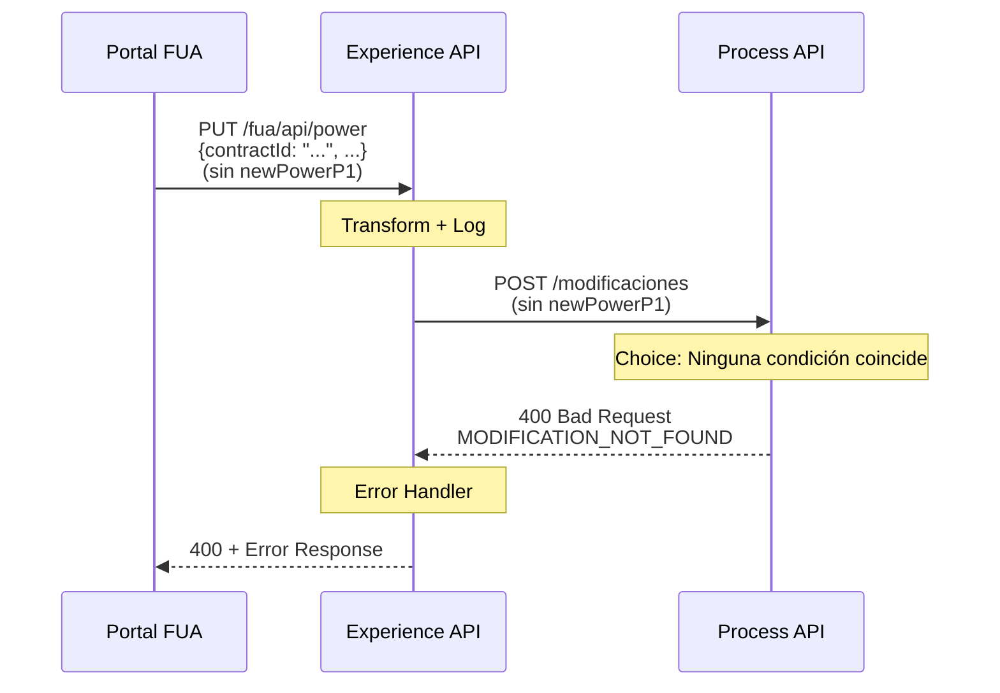

# PUT /power

## 📌 Descripción General

### Propósito del Endpoint

Este endpoint permite a los clientes del portal FUA solicitar un cambio de potencia eléctrica contratada. Transforma el request añadiendo contexto del canal (headers FUA y dirección IP del cliente) y lo envía al Process API que gestiona el proceso completo: registro en motor de estados, creación de caso en Salesforce y gestión documental si se adjuntan documentos CIE.

### Tipo de API

**Capa:** Experience API (API-Led Connectivity)

**Función:** Adaptación de experiencia para portal web FUA (Frontal Único de Atención)

### Patrón de Integración

**Tipo:** Transformación + Proxy

**Descripción:** Este endpoint transforma el request añadiendo información del canal FUA (headers específicos y dirección IP del cliente) y lo envía al Process API `/modificaciones` que enruta la solicitud al flow `potenciaFlow` basándose en la presencia del campo `newPowerP1`.

### Arquitectura API-Led Connectivity



---

## 💼 Propósito del Negocio

### Casos de Uso Principales

1. **Solicitud de Aumento de Potencia**
   - Cliente solicita incrementar la potencia contratada para evitar cortes
   - Sistema registra la solicitud y crea caso en Salesforce para gestión
   - Beneficio: Autoservicio para optimización de suministro eléctrico

2. **Solicitud de Reducción de Potencia**
   - Cliente solicita reducir potencia para optimizar costes
   - Sistema valida y registra la solicitud con documentación si es necesaria
   - Beneficio: Ahorro en costes de energía mediante autoservicio

3. **Cambio de Potencia con Documentación CIE**
   - Cliente adjunta certificado de instalación eléctrica (CIE)
   - Sistema gestiona documentos en SharePoint y los vincula al caso
   - Beneficio: Proceso completo de cambio con gestión documental integrada

### 📱 Canal y Audiencia

#### Canal de Consumo

**Canal:** Portal Web FUA

**Características del Canal:**
- **Plataforma**: Aplicación web responsive para desktop y tablet
- **Dispositivos**: Navegadores modernos (Chrome, Firefox, Safari, Edge)
- **Conectividad**: Conexión estable de banda ancha
- **Experiencia de Usuario**: Formulario interactivo con validación y carga de documentos

#### Audiencia Objetivo

**Usuarios Finales:**
- **Clientes Residenciales**: Solicitan cambios de potencia para optimizar su contrato
- **Clientes Empresariales**: Gestionan potencias de instalaciones comerciales
- **Clientes con Instalaciones Nuevas**: Requieren cambio de potencia con CIE

**Contexto de Uso:**
- **Optimización de Costes**: Cliente identifica que puede reducir potencia
- **Necesidad de Más Potencia**: Cliente experimenta cortes frecuentes
- **Cambio de Instalación**: Modificación eléctrica requiere ajuste de potencia

#### Adaptaciones del Canal

**Transformaciones Aplicadas:**
- **Headers FUA**: Añade `vars.fuaHeaders` para trazabilidad del canal
- **Dirección IP**: Extrae y añade `DirIp` del cliente para auditoría
- **Logging Kinesis**: Log estructurado con headers y payload para análisis

### 🔗 Endpoints Dependientes

Este Experience API consume el siguiente Process API:

| Process API | Endpoint | Método | Propósito |
|-------------|----------|--------|-----------|
| `ntgy-newco-p-fua-evo` | `/modificaciones` | POST | Hub de modificaciones que enruta a `potenciaFlow` por presencia de `newPowerP1` |

**Flujo en el Process API:**
1. Recibe request con `newPowerP1`
2. Choice evalúa: `payload.newPowerP1?` → Enruta a `potenciaFlow`
3. `potenciaFlow` ejecuta:
   - Registro en motor de estados (intención "CambioPotencia")
   - Creación de ContractRequest + Case en Salesforce (composite request)
   - Gestión de documentos CIE en SharePoint (si existen)
   - Actualización de intención con caseId

### Contexto Empresarial

- **Dominio:** Autoservicio de Clientes - Modificaciones de Contrato
- **Sector:** Energía - Utilities
- **División:** Naturgy España - NewCo
- **Canal:** Portal Web FUA
- **Proceso:** Cambio de Potencia Contratada

### Stakeholders

- **Clientes Finales**: Necesitan solicitar cambios de potencia de forma sencilla
- **Equipo de Gestión de Contratos**: Procesa las solicitudes de cambio
- **Equipo de Producto FUA**: Requiere endpoint optimizado para experiencia web
- **Equipo de Operaciones**: Monitorea solicitudes y gestiona casos

### Valor de Negocio

- **Autoservicio**: Clientes pueden solicitar cambios sin llamar al call center
- **Trazabilidad Completa**: Registro en motor de estados + caso en Salesforce
- **Gestión Documental**: Soporte para documentos CIE integrado
- **Auditoría**: Captura de IP y headers para cumplimiento normativo
- **Experiencia de Usuario**: Proceso simplificado desde el portal web

---

## 🔧 Especificación Técnica

### URLs por Ambiente

| Ambiente | URL Base | URL Completa |
|----------|----------|--------------|
| **Local** | `http://localhost:8081` | `http://localhost:8081/fua/api/power` |
| **Development** | `https://ntgy-fua-e-fua-dev.us-e2.cloudhub.io` | `https://ntgy-fua-e-fua-dev.us-e2.cloudhub.io/fua/api/power` |
| **UAT** | `https://ntgy-fua-e-fua-uat.us-e2.cloudhub.io` | `https://ntgy-fua-e-fua-uat.us-e2.cloudhub.io/fua/api/power` |
| **Production** | `https://ntgy-fua-e-fua-pro.us-e2.cloudhub.io` | `https://ntgy-fua-e-fua-pro.us-e2.cloudhub.io/fua/api/power` |

### Método HTTP

```
PUT /fua/api/power
```

### 🎯 Consideraciones del Canal

#### Limitaciones del Canal

| Aspecto | Limitación | Razón |
|---------|------------|-------|
| **Timeout** | 60 segundos | Timeout del Process API (proceso complejo con Salesforce + SharePoint) |
| **Tamaño de Documentos** | Según límites de SharePoint | Documentos CIE pueden ser archivos grandes |
| **Rate Limiting** | Según políticas de Anypoint Platform | Protección del servicio |

#### Headers Específicos del Canal

**Headers Añadidos por el Experience API:**

| Header | Tipo | Descripción | Razón |
|--------|------|-------------|-------|
| `vars.fuaHeaders` | object | Headers específicos del portal FUA | Trazabilidad y contexto del canal |

**Campos Añadidos al Payload:**

| Campo | Tipo | Descripción | Origen |
|-------|------|-------------|--------|
| `DirIp` | string | Dirección IP del cliente | Extraída de `attributes.remoteAddress` |
| `vars.fuaHeaders.*` | various | Headers del canal FUA convertidos a campos del body | Headers HTTP del request |

### Parámetros de Entrada

#### Request Body

**Content-Type:** `application/json`

⚠️ **Importante sobre la Transformación:**

El Experience API acepta los campos `x-*` de dos formas:
1. **Como headers HTTP** (recomendado): El Experience API los convierte automáticamente a campos del body mediante `vars.fuaHeaders`
2. **Como campos del body**: Se mantienen tal cual

Ambas formas son válidas. El resultado final enviado al Process API incluye todos los campos en el body.

**Estructura del Request:**

```json
{
  "newPowerP1": number,
  "newPowerP2": number,
  "newPowerP3": number,
  "newPowerP4": number,
  "newPowerP5": number,
  "newPowerP6": number,
  "contractId": "string",
  "accountId": "string",
  "x-client-id": "string",
  "x-client-code": "string",
  "x-user-id": "string",
  "x-interaction-id": "string",
  "documentoCIE": [
    {
      "file": "string (base64)",
      "fileNameWithExtension": "string"
    }
  ]
}
```

**Campos Obligatorios:**

| Campo | Tipo | Descripción | Ejemplo |
|-------|------|-------------|---------|
| `newPowerP1` | number | Nueva potencia periodo 1 (kW) | `4.6` |
| `contractId` | string | ID del contrato en Salesforce | `"8015I000000XYZ1QAO"` |
| `accountId` | string | ID de la cuenta en Salesforce | `"0015I000002ABC3QAM"` |

**Campos Requeridos (pueden venir como headers o en body):**

| Campo | Tipo | Descripción | Ejemplo | Origen Típico |
|-------|------|-------------|---------|---------------|
| `x-client-id` | string | ID del cliente | `"12345678"` | Header HTTP |
| `x-client-code` | string | NIF/CIF del cliente | `"12345678A"` | Header HTTP |
| `x-user-id` | string | ID del usuario autenticado | `"user@example.com"` | Header HTTP |

**Campos Opcionales:**

| Campo | Tipo | Descripción | Ejemplo |
|-------|------|-------------|---------|
| `newPowerP2` | number | Nueva potencia periodo 2 (kW) | `4.6` |
| `newPowerP3` | number | Nueva potencia periodo 3 (kW) | `4.6` |
| `newPowerP4` | number | Nueva potencia periodo 4 (kW) | `4.6` |
| `newPowerP5` | number | Nueva potencia periodo 5 (kW) | `4.6` |
| `newPowerP6` | number | Nueva potencia periodo 6 (kW) | `4.6` |
| `x-interaction-id` | string | ID de interacción padre (si existe) | `"5005I000001XYZ2QAO"` |
| `documentoCIE` | array | Documentos CIE en base64 | Ver estructura arriba |

**Notas sobre Parámetros:**
- `newPowerP1` es obligatorio y activa el routing a `potenciaFlow` en el Process API
- Los periodos P2-P6 dependen de la tarifa contratada (2.0TD tiene 2 periodos, 3.0TD tiene 6)
- `documentoCIE` es opcional pero recomendado para cambios que requieren certificación
- Los campos `x-*` típicamente vienen como headers HTTP y el Experience API los convierte a campos del body
- El campo `DirIp` se añade automáticamente por el Experience API (no debe enviarse en el request)

**Transformación Aplicada por el Experience API:**

```dataweave
payload original del cliente
++ vars.fuaHeaders (headers x-* convertidos a campos)
++ { "DirIp": "192.168.1.100" }
```

**Resultado enviado al Process API:**
```json
{
  "newPowerP1": 4.6,
  "contractId": "8015I000000XYZ1QAO",
  "x-client-id": "12345678",      // ← De header o body
  "x-client-code": "12345678A",   // ← De header o body
  "x-user-id": "user@example.com", // ← De header o body
  "DirIp": "192.168.1.100"        // ← Añadido automáticamente
}
```

### Respuestas

#### 200 OK - Solicitud Exitosa

**Content-Type:** `application/json`

```json
{
  "result": {
    "codResult": "0000",
    "msgResult": "No hay error"
  },
  "interactionId": "string",
  "caseId": "string"
}
```

**Campos:**

| Campo | Tipo | Descripción |
|-------|------|-------------|
| `result` | object | Objeto con información del resultado de la operación |
| `result.codResult` | string | Código de resultado (`"0000"` = éxito) |
| `result.msgResult` | string | Mensaje descriptivo del resultado |
| `interactionId` | string | ID de la interacción creada en Salesforce |
| `caseId` | string | ID del caso creado en Salesforce |

**Para detalles completos del proceso y estructura de respuesta, consultar:**
📖 **Process API: `ntgy-newco-p-fua-evo` endpoint `/modificaciones`**

#### 400 Bad Request - Error de Validación

**Content-Type:** `application/json`

```json
{
  "code": "VALIDATION_ERROR",
  "message": "Parámetros de entrada inválidos",
  "details": "El campo newPowerP1 es obligatorio",
  "timestamp": "2026-09-30T08:00:00Z"
}
```

#### 500 Internal Server Error - Error del Sistema

**Content-Type:** `application/json`

```json
{
  "result": {
    "codResult": "0001",
    "msgResult": "Error al procesar la solicitud de cambio de potencia"
  }
}
```

### Autenticación

- **Tipo:** Client ID & Client Secret (Anypoint Platform)
- **Headers Requeridos:**
  - `client_id`: ID del cliente registrado en Anypoint Platform
  - `client_secret`: Secret del cliente

### Timeouts

| Tipo | Valor | Razón |
|------|-------|-------|
| **Request Timeout** | 60 segundos | Proceso complejo con múltiples llamadas (Salesforce + SharePoint + Motor Estados) |
| **Connection Timeout** | 30 segundos | Timeout de conexión HTTP |

---

## 🏗️ Implementación Técnica

### Arquitectura del Flow



### Código de Implementación

#### Flow Principal: `put:\power:application\json:e-fua-config`

**Ubicación:** `src/main/mule/e-fua.xml`

```xml
<flow name="put:\power:application\json:e-fua-config">
    <flow-ref doc:name="put-power" name="put-power" />
</flow>
```

#### Sub-Flow: `put-power`

**Ubicación:** `src/main/mule/implementation/power.xml`

```xml
<flow name="put-power">
    <!-- Logger Kinesis: Log estructurado para análisis -->
    <logger level="INFO" 
            doc:name="LoggerKinesis" 
            message="#[%dw 2.0
output application/json
---
{
    headers: {
        method: attributes.method,
        requestUri: attributes.requestUri,
        correlationId: correlationId
    },
    message: {
        payload: payload
    }
}]" 
            category="kinesisLogger" />
    
    <!-- Transformación: Añadir contexto del canal FUA -->
    <ee:transform doc:name="Set Payload for Newco Post Power Request">
        <ee:message>
            <ee:set-payload><![CDATA[%dw 2.2
import * from dw::core::Strings
output application/json
---
payload
++
vars.fuaHeaders
++
{
    "DirIp": substringBefore(substringAfter(attributes.remoteAddress,"/"),":")
}]]></ee:set-payload>
        </ee:message>
    </ee:transform>
    
    <!-- Llamada al Process API -->
    <http:request method="POST" 
                  doc:name="Newco Evo Put Power Request" 
                  config-ref="HTTP_FUA_PROCESS_NEWCO_EVO" 
                  path="/modificaciones" 
                  outputMimeType="application/json" 
                  outputEncoding="UTF-8" 
                  sendBodyMode="ALWAYS" />
    
    <!-- Error Handler -->
    <error-handler>
        <on-error-propagate enableNotifications="true" logException="true">
            <ee:transform doc:name="Set Error Message">
                <ee:message>
                    <ee:set-payload><![CDATA[%dw 2.0
output application/json
---
{
    "result": {
        "codResult": "0001",
        "msgResult": error.description as String replace /\"/ with("")
    }
}]]></ee:set-payload>
                </ee:message>
            </ee:transform>
            <logger level="ERROR" 
                    doc:name="Error" 
                    message='#[{
    "result": {
        "codResult": "0001",
        "msgResult": error.description as String replace /\"/ with("")
    }
}]' />
        </on-error-propagate>
    </error-handler>
</flow>
```

### Transformaciones DataWeave

#### 1. Logger Kinesis (Structured Logging)

**Propósito:** Log estructurado para análisis en AWS Kinesis

```dataweave
%dw 2.0
output application/json
---
{
    headers: {
        method: attributes.method,
        requestUri: attributes.requestUri,
        correlationId: correlationId
    },
    message: {
        payload: payload
    }
}
```

**Información Capturada:**
- Método HTTP (PUT)
- URI del request (/fua/api/power)
- Correlation ID para trazabilidad
- Payload completo del request

#### 2. Transformación del Payload

**Propósito:** Añadir contexto del canal FUA al payload original

```dataweave
%dw 2.2
import * from dw::core::Strings
output application/json
---
payload
++
vars.fuaHeaders
++
{
    "DirIp": substringBefore(substringAfter(attributes.remoteAddress,"/"),":")
}
```

**Lógica:**
1. **`payload`**: Mantiene todos los campos originales del request
2. **`vars.fuaHeaders`**: Añade headers específicos del canal FUA (x-client-id, x-user-id, etc.)
3. **`DirIp`**: Extrae la dirección IP del cliente desde `attributes.remoteAddress`
   - Formato de `remoteAddress`: `"/192.168.1.100:54321"`
   - `substringAfter(attributes.remoteAddress,"/")`: `"192.168.1.100:54321"`
   - `substringBefore(...,":")`: `"192.168.1.100"`

**Resultado Final:**
```json
{
  "newPowerP1": 4.6,
  "contractId": "8015I000000XYZ1QAO",
  "x-client-id": "12345678",
  "x-user-id": "user@example.com",
  "DirIp": "192.168.1.100"
}
```

#### 3. Transformación de Error

**Propósito:** Estandarizar formato de error

```dataweave
%dw 2.0
output application/json
---
{
    "result": {
        "codResult": "0001",
        "msgResult": error.description as String replace /\"/ with("")
    }
}
```

**Lógica:**
- Extrae descripción del error
- Elimina comillas dobles del mensaje
- Retorna formato estándar con código "0001"

### Configuración HTTP

**Config-Ref:** `HTTP_FUA_PROCESS_NEWCO_EVO`

**Ubicación:** `src/main/mule/global.xml`

**Propiedades (e-fua-pro-config.yaml):**
```yaml
newco-p-fua-evo:
  host: "mule-worker-internal-ntgy-newco-p-fua-evo.de-c1.cloudhub.io"
  port: "8091"
  timeout: "60000"
```

**Configuración:**
- **Host:** `${newco-p-fua-evo.host}`
- **Port:** `${newco-p-fua-evo.port}`
- **Base Path:** `/api`
- **Timeout:** `${newco-p-fua-evo.timeout}` (60 segundos)
- **Protocol:** HTTPS (en ambientes desplegados)

### Patrones de Diseño

**Patrón:** Enrichment Pattern + Proxy

**Justificación:** 
- **Enrichment**: Añade información del canal (headers FUA + IP) sin modificar la lógica de negocio
- **Proxy**: Delega el procesamiento completo al Process API
- **Separation of Concerns**: Experience API se enfoca en adaptación del canal, Process API en lógica de negocio
- **Trazabilidad**: Logging estructurado en Kinesis para análisis y auditoría

### Diagramas de Secuencia

#### 1. Flujo Normal de Éxito



#### 2. Flujo con Error de Backend



#### 3. Flujo con Parámetros Inválidos



### Optimizaciones del Canal

**1. Logging Estructurado en Kinesis:**
- Formato JSON para análisis automatizado
- Incluye correlation ID para trazabilidad end-to-end
- Categoría "kinesisLogger" para filtrado en CloudWatch

**2. Captura de IP del Cliente:**
- Extracción automática desde `attributes.remoteAddress`
- Añadida al payload como `DirIp` para auditoría
- Útil para análisis de fraude y cumplimiento normativo

**3. Headers FUA:**
- Propagación automática de headers del canal
- Mantiene contexto del usuario y sesión
- Facilita trazabilidad en toda la cadena de APIs

### Manejo de Errores

**Estrategia:** Captura y estandarización de errores del Process API

**Errores Manejados:**

1. **Errores de Conectividad (500)**
   - Error de conexión con Process API
   - Timeout en la llamada (>60 segundos)
   - **Acción:** Transform error message + Log ERROR + Response 500

2. **Errores de Validación (400)**
   - Parámetros inválidos (falta newPowerP1)
   - Modificación no encontrada en Process API
   - **Acción:** Propagar error del Process API

3. **Errores de Negocio**
   - Error en Salesforce (caso no creado)
   - Error en SharePoint (documento no subido)
   - **Acción:** Transform + Log + Response con codResult "0001"

**Logging:**
- Log de error con nivel ERROR
- Incluye descripción del error en formato JSON
- Facilita troubleshooting en CloudWatch

---

## 💻 Ejemplos de Uso

### Ejemplo 1: Cambio de Potencia Simple (Headers como HTTP Headers - Recomendado)

#### cURL

```bash
curl -X PUT "https://ntgy-fua-e-fua-dev.us-e2.cloudhub.io/fua/api/power" \
  -H "Content-Type: application/json" \
  -H "client_id: YOUR_CLIENT_ID" \
  -H "client_secret: YOUR_CLIENT_SECRET" \
  -H "x-client-id: 12345678" \
  -H "x-client-code: 12345678A" \
  -H "x-user-id: user@example.com" \
  -d '{
    "newPowerP1": 4.6,
    "newPowerP2": 4.6,
    "contractId": "8015I000000XYZ1QAO",
    "accountId": "0015I000002ABC3QAM"
  }'
```

**Nota:** Los headers `x-*` se convierten automáticamente a campos del body por el Experience API.

#### Respuesta (200 OK)

```json
{
  "result": {
    "codResult": "0000",
    "msgResult": "No hay error"
  },
  "interactionId": "5005I000001XYZ2QAO",
  "caseId": "5005I000001ABC3QAO"
}
```

### Ejemplo 2: Cambio de Potencia con Campos x-* en el Body (Alternativa)

#### cURL

```bash
curl -X PUT "https://ntgy-fua-e-fua-dev.us-e2.cloudhub.io/fua/api/power" \
  -H "Content-Type: application/json" \
  -H "client_id: YOUR_CLIENT_ID" \
  -H "client_secret: YOUR_CLIENT_SECRET" \
  -d '{
    "newPowerP1": 4.6,
    "newPowerP2": 4.6,
    "contractId": "8015I000000XYZ1QAO",
    "accountId": "0015I000002ABC3QAM",
    "x-client-id": "12345678",
    "x-client-code": "12345678A",
    "x-user-id": "user@example.com"
  }'
```

**Nota:** Los campos `x-*` también pueden enviarse en el body. El resultado es el mismo.

#### Respuesta (200 OK)

```json
{
  "result": {
    "codResult": "0000",
    "msgResult": "No hay error"
  },
  "interactionId": "5005I000001XYZ2QAO",
  "caseId": "5005I000001ABC3QAO"
}
```

### Ejemplo 3: Cambio de Potencia con Documento CIE

#### cURL

```bash
curl -X PUT "https://ntgy-fua-e-fua-dev.us-e2.cloudhub.io/fua/api/power" \
  -H "Content-Type: application/json" \
  -H "client_id: YOUR_CLIENT_ID" \
  -H "client_secret: YOUR_CLIENT_SECRET" \
  -H "x-client-id: 12345678" \
  -H "x-client-code: 12345678A" \
  -H "x-user-id: user@example.com" \
  -d '{
    "newPowerP1": 5.75,
    "newPowerP2": 5.75,
    "contractId": "8015I000000XYZ1QAO",
    "accountId": "0015I000002ABC3QAM",
    "documentoCIE": [
      {
        "file": "JVBERi0xLjQKJeLjz9MKMSAwIG9iago8PC9UeXBlL0NhdGFsb2cvUGFnZXMgMiAw...",
        "fileNameWithExtension": "certificado_instalacion.pdf"
      }
    ]
  }'
```

#### Respuesta (200 OK)

```json
{
  "result": {
    "codResult": "0000",
    "msgResult": "No hay error"
  },
  "interactionId": "5005I000001XYZ2QAO",
  "caseId": "5005I000001ABC3QAO"
}
```

### Ejemplo 4: JavaScript (para Portal Web FUA)

```javascript
const solicitarCambioPotencia = async (datosCambio) => {
  const baseUrl = 'https://ntgy-fua-e-fua-dev.us-e2.cloudhub.io/fua/api/power';
  
  try {
    const response = await fetch(baseUrl, {
      method: 'PUT',
      headers: {
        'Content-Type': 'application/json',
        'client_id': process.env.CLIENT_ID,
        'client_secret': process.env.CLIENT_SECRET
      },
      body: JSON.stringify(datosCambio)
    });
    
    if (!response.ok) {
      throw new Error(`HTTP error! status: ${response.status}`);
    }
    
    const data = await response.json();
    
    if (data.result.codResult === '0000') {
      console.log('✓ Solicitud de cambio de potencia creada exitosamente');
      console.log('  Case ID:', data.caseId);
      console.log('  Interaction ID:', data.interactionId);
      return data;
    } else {
      console.error('✗ Error:', data.result.msgResult);
      return null;
    }
  } catch (error) {
    console.error('✗ Error al solicitar cambio de potencia:', error);
    throw error;
  }
};

// Uso en componente React del portal FUA
function CambioPotenciaForm({ contractData, userData }) {
  const [loading, setLoading] = useState(false);
  const [resultado, setResultado] = useState(null);
  const [documentoCIE, setDocumentoCIE] = useState(null);
  
  const handleSubmit = async (e) => {
    e.preventDefault();
    setLoading(true);
    
    const datosCambio = {
      newPowerP1: parseFloat(e.target.powerP1.value),
      newPowerP2: parseFloat(e.target.powerP2.value),
      contractId: contractData.id,
      accountId: contractData.accountId,
      'x-client-id': userData.clientId,
      'x-client-code': userData.nif,
      'x-user-id': userData.email
    };
    
    // Añadir documento CIE si se cargó
    if (documentoCIE) {
      datosCambio.documentoCIE = [{
        file: documentoCIE.base64,
        fileNameWithExtension: documentoCIE.name
      }];
    }
    
    try {
      const result = await solicitarCambioPotencia(datosCambio);
      setResultado(result);
      setLoading(false);
    } catch (error) {
      console.error('Error:', error);
      setLoading(false);
    }
  };
  
  const handleFileUpload = (e) => {
    const file = e.target.files[0];
    if (file) {
      const reader = new FileReader();
      reader.onload = (event) => {
        setDocumentoCIE({
          name: file.name,
          base64: event.target.result.split(',')[1]
        });
      };
      reader.readAsDataURL(file);
    }
  };
  
  if (loading) return <div>Procesando solicitud...</div>;
  
  if (resultado) {
    return (
      <div className="success-message">
        <h3>✓ Solicitud Enviada Exitosamente</h3>
        <p>Número de caso: {resultado.caseId}</p>
        <p>Su solicitud ha sido registrada y será procesada en breve.</p>
      </div>
    );
  }
  
  return (
    <form onSubmit={handleSubmit}>
      <h3>Solicitar Cambio de Potencia</h3>
      
      <div className="form-group">
        <label>Nueva Potencia P1 (kW):</label>
        <input type="number" name="powerP1" step="0.01" required />
      </div>
      
      <div className="form-group">
        <label>Nueva Potencia P2 (kW):</label>
        <input type="number" name="powerP2" step="0.01" required />
      </div>
      
      <div className="form-group">
        <label>Certificado de Instalación Eléctrica (CIE) - Opcional:</label>
        <input type="file" accept=".pdf" onChange={handleFileUpload} />
      </div>
      
      <button type="submit">Solicitar Cambio</button>
    </form>
  );
}
```

### Ejemplo 5: Python (para Testing)

```python
import requests
import base64
from typing import Optional, Dict, Any

def solicitar_cambio_potencia(
    new_power_p1: float,
    new_power_p2: float,
    contract_id: str,
    account_id: str,
    client_id: str,
    client_code: str,
    user_id: str,
    documento_cie_path: Optional[str] = None,
    base_url: str = "https://ntgy-fua-e-fua-dev.us-e2.cloudhub.io"
) -> Dict[str, Any]:
    """
    Solicita cambio de potencia desde el Experience API del portal FUA.
    
    Args:
        new_power_p1: Nueva potencia periodo 1 en kW
        new_power_p2: Nueva potencia periodo 2 en kW
        contract_id: ID del contrato en Salesforce
        account_id: ID de la cuenta en Salesforce
        client_id: ID del cliente
        client_code: NIF/CIF del cliente
        user_id: Email del usuario autenticado
        documento_cie_path: Ruta al archivo CIE (opcional)
        base_url: URL base del API
    
    Returns:
        Dict con la respuesta del API
    """
    url = f"{base_url}/fua/api/power"
    
    payload = {
        'newPowerP1': new_power_p1,
        'newPowerP2': new_power_p2,
        'contractId': contract_id,
        'accountId': account_id,
        'x-client-id': client_id,
        'x-client-code': client_code,
        'x-user-id': user_id
    }
    
    # Añadir documento CIE si se proporciona
    if documento_cie_path:
        with open(documento_cie_path, 'rb') as file:
            file_content = base64.b64encode(file.read()).decode('utf-8')
            payload['documentoCIE'] = [{
                'file': file_content,
                'fileNameWithExtension': documento_cie_path.split('/')[-1]
            }]
    
    headers = {
        'Content-Type': 'application/json',
        'client_id': 'YOUR_CLIENT_ID',
        'client_secret': 'YOUR_CLIENT_SECRET'
    }
    
    try:
        response = requests.put(url, json=payload, headers=headers)
        response.raise_for_status()
        
        data = response.json()
        
        if data['result']['codResult'] == '0000':
            print(f"✓ Solicitud creada exitosamente")
            print(f"  Case ID: {data['caseId']}")
            print(f"  Interaction ID: {data['interactionId']}")
            return data
        else:
            print(f"✗ Error: {data['result']['msgResult']}")
            return data
            
    except requests.exceptions.RequestException as e:
        print(f"✗ Error de conexión: {str(e)}")
        raise

# Uso
if __name__ == "__main__":
    # Ejemplo 1: Cambio simple sin documento
    result = solicitar_cambio_potencia(
        new_power_p1=4.6,
        new_power_p2=4.6,
        contract_id='8015I000000XYZ1QAO',
        account_id='0015I000002ABC3QAM',
        client_id='12345678',
        client_code='12345678A',
        user_id='user@example.com'
    )
    
    # Ejemplo 2: Cambio con documento CIE
    result_con_doc = solicitar_cambio_potencia(
        new_power_p1=5.75,
        new_power_p2=5.75,
        contract_id='8015I000000XYZ1QAO',
        account_id='0015I000002ABC3QAM',
        client_id='12345678',
        client_code='12345678A',
        user_id='user@example.com',
        documento_cie_path='/path/to/certificado_instalacion.pdf'
    )
```

### Ejemplo 6: Error - Falta Campo Obligatorio

#### cURL

```bash
curl -X PUT "https://ntgy-fua-e-fua-dev.us-e2.cloudhub.io/fua/api/power" \
  -H "Content-Type: application/json" \
  -H "client_id: YOUR_CLIENT_ID" \
  -H "client_secret: YOUR_CLIENT_SECRET" \
  -d '{
    "contractId": "8015I000000XYZ1QAO",
    "accountId": "0015I000002ABC3QAM",
    "x-client-id": "12345678",
    "x-user-id": "user@example.com"
  }'
```

#### Respuesta (400 Bad Request)

```json
{
  "error": "NTGY: MODIFICATION_NOT_FOUND",
  "description": "La modificacion no se ha encontrada"
}
```

**Causa:** Falta el campo `newPowerP1` que es obligatorio para activar el routing a `potenciaFlow`.

### Ejemplo 7: Error - Timeout del Backend

#### Respuesta (500 Internal Server Error)

```json
{
  "result": {
    "codResult": "0001",
    "msgResult": "HTTP:TIMEOUT - Timeout exceeded"
  }
}
```

**Causa:** El Process API tardó más de 60 segundos en responder (proceso complejo con Salesforce + SharePoint + Motor Estados).
