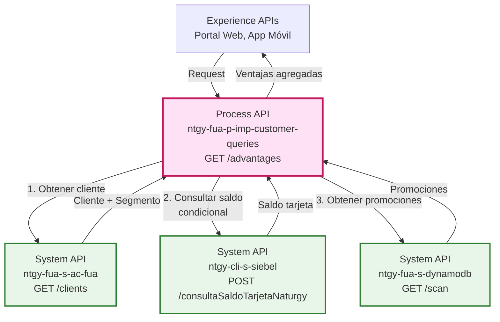
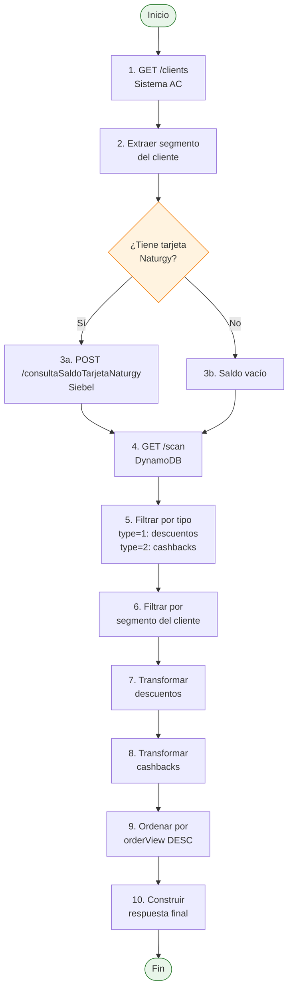
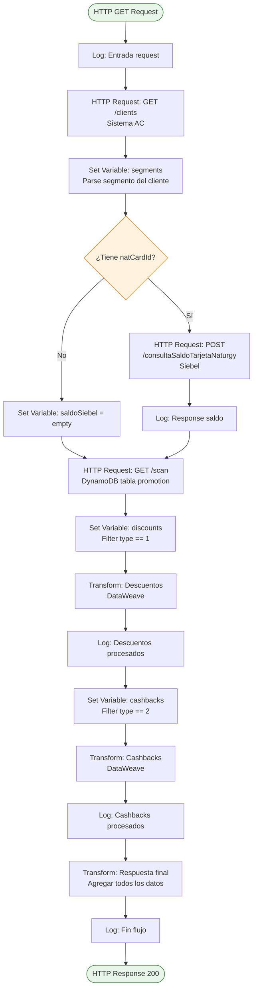
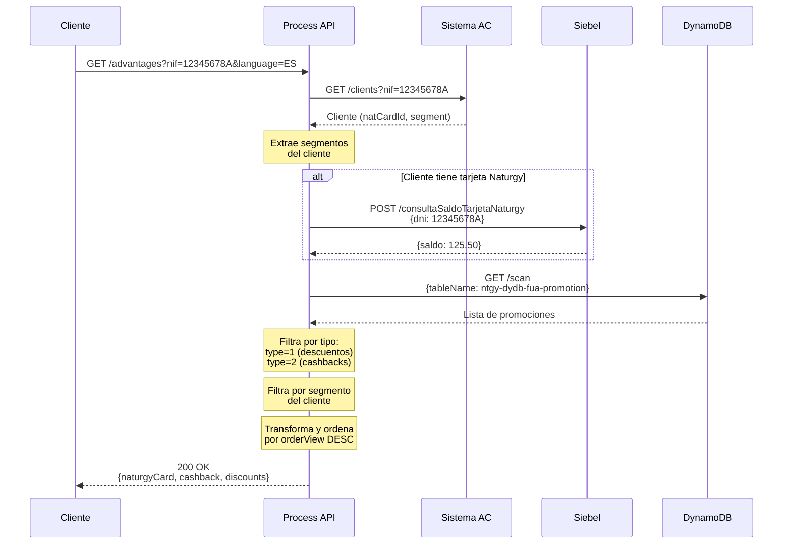
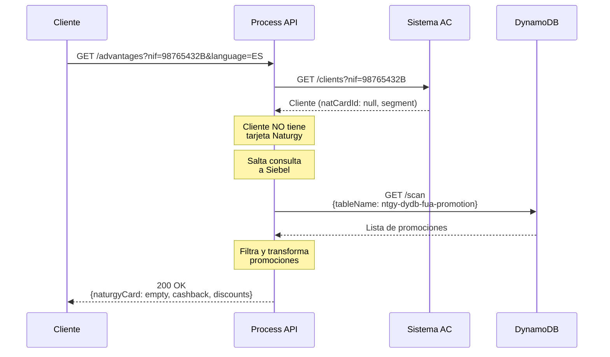
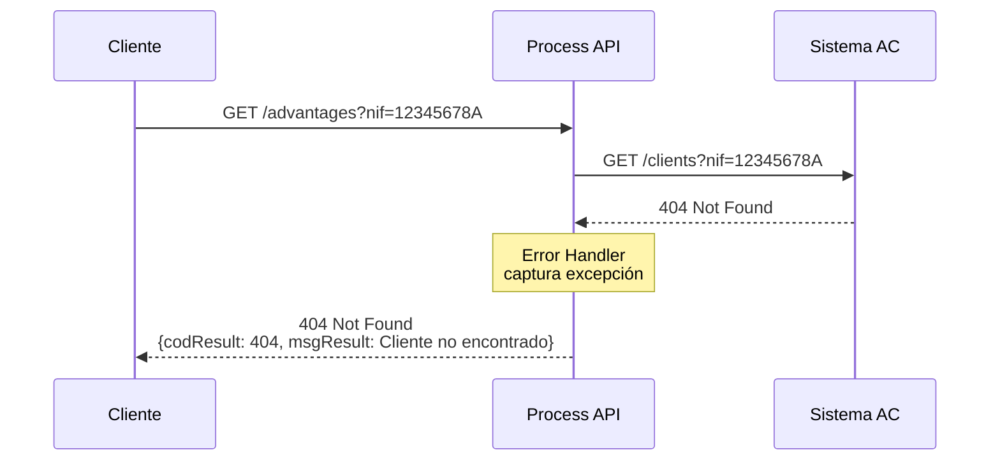

# GET /advantages

## 📌 Descripción General

### Propósito del Endpoint

Este endpoint orquesta la obtención de todas las ventajas disponibles para un cliente, incluyendo información de su tarjeta Naturgy, descuentos personalizados y cashbacks aplicables según su segmento de cliente. Consolida datos de tres fuentes diferentes para proporcionar una vista unificada del programa de fidelización.

### Tipo de API

**Capa:** Process API (API-Led Connectivity)

**Función:** Orquestación de consultas de ventajas y programa de fidelización

### Patrón de Integración

**Tipo:** Orquestación con Agregación y Filtrado

**Descripción:** El endpoint realiza tres llamadas a diferentes System APIs:
1. Consulta datos del cliente en Sistema AC (tarjeta Naturgy y segmento)
2. Consulta saldo de tarjeta en Siebel (condicional, solo si tiene tarjeta)
3. Obtiene promociones desde DynamoDB y las filtra por segmento del cliente

### Arquitectura API-Led Connectivity



---

## 💼 Propósito del Negocio

### Casos de Uso Principales

1. **Consulta de Ventajas en Portal de Cliente**
   - Cliente accede a su área personal
   - Visualiza su tarjeta Naturgy con saldo disponible
   - Ve descuentos y cashbacks personalizados según su segmento
   - **Beneficio:** Fomenta uso del programa de fidelización

2. **Información de Ventajas en App Móvil**
   - Cliente consulta ventajas desde dispositivo móvil
   - Accede a promociones activas en tiempo real
   - Visualiza saldo de tarjeta actualizado
   - **Beneficio:** Mejora engagement con el programa de fidelización

3. **Soporte de Agentes en Call Center**
   - Agente consulta ventajas disponibles para el cliente
   - Informa sobre promociones aplicables
   - Verifica saldo de tarjeta Naturgy
   - **Beneficio:** Mejora calidad de atención al cliente

### 🔗 Endpoints Dependientes

Este Process API consume los siguientes System APIs:

| System API | Endpoint | Método | Propósito |
|------------|----------|--------|-----------|
| `ntgy-fua-s-ac-fua` | `/clients` | GET | Obtiene datos del cliente (tarjeta Naturgy y segmento) |
| `ntgy-cli-s-siebel` | `/consultaSaldoTarjetaNaturgy` | POST | Consulta saldo de tarjeta Naturgy (condicional) |
| `ntgy-fua-s-dynamodb` | `/scan` | GET | Obtiene promociones activas desde DynamoDB |

### Lógica de Orquestación



**Pasos del Proceso:**

1. **Consulta de Cliente**: Obtiene datos del cliente desde Sistema AC
2. **Extracción de Segmento**: Extrae y parsea el segmento del cliente (puede ser múltiple, separado por ";")
3. **Consulta Condicional de Saldo**: Si el cliente tiene `natCardId`, consulta saldo en Siebel
4. **Obtención de Promociones**: Escanea tabla de promociones en DynamoDB
5. **Filtrado por Tipo**: Separa promociones en descuentos (type=1) y cashbacks (type=2)
6. **Filtrado por Segmento**: Filtra promociones aplicables al segmento del cliente
7. **Transformación de Datos**: Aplica transformaciones DataWeave para normalizar estructura
8. **Selección de Idioma**: Selecciona URL según parámetro `language` (ES por defecto)
9. **Ordenamiento**: Ordena por `orderView` en orden descendente
10. **Construcción de Respuesta**: Agrega todos los datos en respuesta unificada

### Transformaciones Aplicadas

#### Transformación de Descuentos (DataWeave)

| Campo Original (DynamoDB) | Campo Transformado | Transformación |
|---------------------------|-------------------|----------------|
| `preferred` | `isPreferred` | Mapeo directo |
| `id` | `offerId` | Mapeo directo |
| `url_[language]` | `url` | Selección por idioma con fallback a `url_es` |
| `start_date` | `startDate` | Mapeo directo |
| `end_date` | `endDate` | Mapeo directo |
| `segment` | `segmentId` | Mapeo directo |
| `order_view` | `orderView` | Mapeo directo |

#### Transformación de Cashbacks (DataWeave)

Aplica la misma transformación que descuentos, diferenciándose solo por el tipo de promoción.

#### Lógica de Filtrado por Segmento

```dataweave
// Si el cliente tiene segmentos definidos
if (vars.segments != "") 
    // Filtrar promociones donde el segmento del cliente está en la lista
    vars.discounts filter ((value, index) -> vars.segments contains value."type")
else 
    // Si no tiene segmentos, devolver todas las promociones
    vars.discounts
```

### Contexto Empresarial

- **Dominio:** Programa de Fidelización y Ventajas
- **Sector:** Energía - Utilities
- **División:** Naturgy España - Clientes Minoristas
- **Proceso de Negocio:** Gestión de ventajas y promociones personalizadas

### Stakeholders

- **Clientes Finales**: Consultan sus ventajas y saldo de tarjeta
- **Agentes de Call Center**: Informan sobre ventajas disponibles
- **Equipo de Marketing**: Gestiona promociones y segmentación
- **Equipo de Fidelización**: Administra programa de tarjeta Naturgy

### Valor de Negocio

- **Personalización**: Ventajas adaptadas al segmento del cliente
- **Fidelización**: Incentiva uso del programa de tarjeta Naturgy
- **Transparencia**: Cliente ve todas sus ventajas en un solo lugar
- **Engagement**: Aumenta interacción con canales digitales

### Consumidores Potenciales

Este endpoint puede ser consumido por:
- Portales web de autoservicio (área de cliente)
- Aplicaciones móviles (sección de ventajas)
- Sistemas de agentes de call center
- Campañas de marketing personalizadas

---

## 🔧 Especificación Técnica

### URLs por Ambiente

| Ambiente | URL Base | URL Completa |
|----------|----------|--------------|
| **Local** | `http://localhost:8084` | `http://localhost:8084/api/advantages?nif=12345678A&language=ES` |
| **Development** | `https://ntgy-fua-p-imp-customer-queries-dev.de-c1.cloudhub.io` | `https://ntgy-fua-p-imp-customer-queries-dev.de-c1.cloudhub.io/api/advantages?nif=12345678A&language=ES` |
| **UAT** | `https://ntgy-fua-p-imp-customer-queries-uat.de-c1.cloudhub.io` | `https://ntgy-fua-p-imp-customer-queries-uat.de-c1.cloudhub.io/api/advantages?nif=12345678A&language=ES` |
| **Production** | `https://ntgy-fua-p-imp-customer-queries-pro.de-c1.cloudhub.io` | `https://ntgy-fua-p-imp-customer-queries-pro.de-c1.cloudhub.io/api/advantages?nif=12345678A&language=ES` |

### Método HTTP

```
GET /api/advantages
```

### Parámetros de Entrada

#### Query Parameters

| Parámetro | Tipo | Requerido | Descripción | Ejemplo |
|-----------|------|-----------|-------------|---------|
| `nif` | string | ✅ Sí | NIF/DNI del cliente | `12345678A` |
| `language` | string | ❌ No | Idioma para URLs de promociones (ES, CA, EN) | `ES` |

**Validaciones:**
- `nif`: Debe ser un NIF/DNI válido español
- `language`: Si no se proporciona, se usa `ES` por defecto

### Respuestas

#### 200 OK - Éxito

```json
{
  "result": {
    "codResult": "0000",
    "msgResult": "OK"
  },
  "advantages": {
    "naturgyCard": {
      "cardNum": "1234567890123456",
      "balanceCard": "125.50"
    },
    "cashback": [
      {
        "isPreferred": true,
        "offerId": "CASH001",
        "isFavorite": "true",
        "url": "https://promociones.naturgy.es/cashback/oferta1",
        "startDate": "2026-01-01",
        "endDate": "2026-12-31",
        "segmentId": "PREMIUM",
        "orderView": 1,
        "isActive": true
      }
    ],
    "discounts": [
      {
        "isPreferred": true,
        "offerId": "DESC001",
        "isFavorite": "true",
        "url": "https://promociones.naturgy.es/descuentos/oferta1",
        "startDate": "2026-01-01",
        "endDate": "2026-12-31",
        "segmentId": "PREMIUM",
        "orderView": 1,
        "isActive": true
      }
    ]
  }
}
```

**Campos de Respuesta:**

| Campo | Tipo | Descripción |
|-------|------|-------------|
| `result.codResult` | string | Código de resultado (`0000` = éxito) |
| `result.msgResult` | string | Mensaje de resultado |
| `advantages.naturgyCard.cardNum` | string | Número de tarjeta Naturgy (vacío si no tiene) |
| `advantages.naturgyCard.balanceCard` | string | Saldo disponible en tarjeta (vacío si no tiene) |
| `advantages.cashback` | array | Lista de cashbacks aplicables (ordenados por `orderView` DESC) |
| `advantages.discounts` | array | Lista de descuentos aplicables (ordenados por `orderView` DESC) |

**Estructura de Promoción (Cashback/Discount):**

| Campo | Tipo | Descripción |
|-------|------|-------------|
| `isPreferred` | boolean | Indica si es promoción preferente |
| `offerId` | string | Identificador único de la oferta |
| `isFavorite` | string | Descuento en favoritos |
| `url` | string | URL de la promoción (según idioma solicitado) |
| `startDate` | string | Fecha de inicio de la promoción |
| `endDate` | string | Fecha de fin de la promoción |
| `segmentId` | string | Segmento al que aplica la promoción |
| `orderView` | number | Orden de visualización (mayor = más prioritario) |
| `isActive` | boolean | Indica si la promoción está activada para el cliente |

#### 400 Bad Request - Parámetros Inválidos

```json
{
  "result": {
    "codResult": "400",
    "msgResult": "Parámetro 'nif' es requerido"
  }
}
```

#### 404 Not Found - Cliente No Encontrado

```json
{
  "result": {
    "codResult": "404",
    "msgResult": "Cliente no encontrado"
  }
}
```

#### 500 Internal Server Error - Error del Sistema

```json
{
  "result": {
    "codResult": "500",
    "msgResult": "Error interno del servidor"
  }
}
```

### Autenticación

- **Tipo:** Client ID & Client Secret (Anypoint Platform)
- **Headers requeridos:**
  - `client_id`: ID de cliente de Anypoint Platform
  - `client_secret`: Secret de cliente de Anypoint Platform

### Timeouts

| Tipo | Valor | Justificación |
|------|-------|---------------|
| **Request Timeout** | 30 segundos | Tiempo suficiente para 3 llamadas secuenciales |
| **Connection Timeout** | 30 segundos | Timeout estándar para System APIs |
| **Siebel Timeout** | 300 segundos | Timeout extendido para Siebel (configurado en System API) |

---

## 🏗️ Implementación Técnica

### Arquitectura del Flow



### Transformaciones DataWeave

#### 1. Extracción de Segmentos (Línea 19)

```dataweave
%dw 2.0
output application/java
---
if (!isEmpty(vars.client.segment)) 
    vars.client.segment splitBy ";" 
else 
    ""
```

**Propósito:** Convierte el campo `segment` del cliente (que puede contener múltiples segmentos separados por ";") en un array para filtrado posterior.

#### 2. Transformación de Descuentos (Líneas 48-61)

```dataweave
%dw 2.0
output application/java
fun urlLanguage(aString) = "url_" ++ lower(aString)
var discounts = if (vars.segments != "") 
    vars.discounts filter ((value, index) -> vars.segments contains value."type")  
else 
    vars.discounts
---
discounts map((item,index) -> {
    isPreferred : item.preferred,
    offerId: item.id,
    url: if (item."$(urlLanguage(attributes.queryParams.language))" != null) 
        item."$(urlLanguage(attributes.queryParams.language))" 
    else 
        item.url_es,
    startDate: item.start_date,
    endDate: item.end_date,
    segmentId: item.segment,
    orderView: item.order_view,	
})
```

**Propósito:** 
- Filtra descuentos por segmento del cliente
- Selecciona URL según idioma solicitado (con fallback a español)
- Normaliza estructura de campos

#### 3. Transformación de Cashbacks (Líneas 66-79)

```dataweave
%dw 2.0
output application/java
fun urlLanguage(aString) = "url_" ++ lower(aString)
var cashbacks = if (vars.segments != "") 
    vars.cashbacks filter ((value, index) -> vars.segments contains value."type")  
else 
    vars.cashbacks
---
cashbacks map((item,index) -> {
    isPreferred : item.preferred,
    offerId: item.id,
    url: if (item."$(urlLanguage(attributes.queryParams.language))" != null) 
        item."$(urlLanguage(attributes.queryParams.language))" 
    else 
        item.url_es,
    startDate: item.start_date,
    endDate: item.end_date,
    segmentId: item.segment,
    orderView: item.order_view,	
})
```

**Propósito:** Misma lógica que descuentos, aplicada a cashbacks.

#### 4. Construcción de Respuesta Final (Líneas 81-99)

```dataweave
%dw 2.0
output application/json
---
{
    "result":{
        "codResult": "0000",
        "msgResult": "OK"
    },
    "advantages":{
        "naturgyCard": {
            "cardNum": vars.client.natCardId default "",
            "balanceCard": if (!isEmpty(vars.saldoSiebel.saldo)) 
                vars.saldoSiebel.saldo 
            else 
                ""
        },
        "cashback": if (!isEmpty(vars.cashback)) 
            (vars.cashback orderBy $.orderView)[-1 to 0] 
        else 
            "",
        "discounts": if(!isEmpty(vars.discount)) 
            (vars.discount orderBy $.orderView)[-1 to 0] 
        else 
            ""
    }
}
```

**Propósito:** 
- Agrega todos los datos en respuesta unificada
- Ordena promociones por `orderView` en orden descendente
- Maneja casos donde no hay tarjeta o promociones

### Patrones de Diseño

**Patrón:** Aggregator Pattern con Filtrado Condicional

**Justificación:** 
- Necesidad de consolidar datos de 3 fuentes diferentes
- Lógica condicional para consulta de saldo (solo si tiene tarjeta)
- Filtrado personalizado por segmento de cliente
- Ordenamiento y selección de mejores ofertas

### Diagramas de Secuencia

#### 1. Flujo Normal de Éxito (Cliente con Tarjeta Naturgy)



#### 2. Flujo Sin Tarjeta Naturgy



#### 3. Flujo con Error en Sistema AC



### Manejo de Errores

#### Estrategia de Error Handling

1. **Errores de Validación (400)**
   - Parámetro `nif` faltante o inválido
   - Respuesta inmediata sin llamadas a backend

2. **Errores de Sistema AC (404, 500)**
   - Cliente no encontrado → 404
   - Error de sistema → 500
   - Propagación del error al cliente

3. **Errores de Siebel (Timeout, 500)**
   - Si falla consulta de saldo → Continuar con saldo vacío
   - No bloquea el flujo principal
   - Log del error para troubleshooting

4. **Errores de DynamoDB (500)**
   - Error crítico → Devolver 500
   - Sin promociones disponibles
   - Log del error

#### Códigos de Error

| Código | Descripción | Acción |
|--------|-------------|--------|
| `400` | Bad Request | Validar parámetros de entrada |
| `404` | Not Found | Cliente no existe en Sistema AC |
| `500` | Internal Server Error | Error en System APIs o transformación |
| `503` | Service Unavailable | System API no disponible |

---

## 💻 Ejemplos de Uso

### Ejemplo 1: Cliente con Tarjeta Naturgy y Promociones

#### cURL

```bash
curl -X GET "https://ntgy-fua-p-imp-customer-queries-pro.de-c1.cloudhub.io/api/advantages?nif=12345678A&language=ES" \
  -H "Content-Type: application/json" \
  -H "client_id: YOUR_CLIENT_ID" \
  -H "client_secret: YOUR_CLIENT_SECRET"
```

#### Respuesta (200 OK)

```json
{
  "result": {
    "codResult": "0000",
    "msgResult": "OK"
  },
  "advantages": {
    "naturgyCard": {
      "cardNum": "1234567890123456",
      "balanceCard": "125.50"
    },
    "cashback": [
      {
        "isPreferred": true,
        "offerId": "CASH001",
        "isFavorite": "true",
        "url": "https://promociones.naturgy.es/cashback/oferta-premium",
        "startDate": "2026-01-01",
        "endDate": "2026-12-31",
        "segmentId": "PREMIUM",
        "orderView": 10,
        "isActive": true
      },
      {
        "isPreferred": false,
        "offerId": "CASH002",
        "isFavorite": "false",
        "url": "https://promociones.naturgy.es/cashback/oferta-general",
        "startDate": "2026-06-01",
        "endDate": "2026-12-31",
        "segmentId": "PREMIUM",
        "orderView": 5,
        "isActive": true
      }
    ],
    "discounts": [
      {
        "isPreferred": true,
        "offerId": "DESC001",
        "isFavorite": "true",
        "url": "https://promociones.naturgy.es/descuentos/oferta-premium",
        "startDate": "2026-01-01",
        "endDate": "2026-12-31",
        "segmentId": "PREMIUM",
        "orderView": 10,
        "isActive": true
      }
    ]
  }
}
```

### Ejemplo 2: Cliente Sin Tarjeta Naturgy

#### cURL

```bash
curl -X GET "https://ntgy-fua-p-imp-customer-queries-pro.de-c1.cloudhub.io/api/advantages?nif=98765432B&language=CA" \
  -H "Content-Type: application/json" \
  -H "client_id: YOUR_CLIENT_ID" \
  -H "client_secret: YOUR_CLIENT_SECRET"
```

#### Respuesta (200 OK)

```json
{
  "result": {
    "codResult": "0000",
    "msgResult": "OK"
  },
  "advantages": {
    "naturgyCard": {
      "cardNum": "",
      "balanceCard": ""
    },
    "cashback": [
      {
        "isPreferred": false,
        "offerId": "CASH003",
        "isFavorite": "false",
        "url": "https://promocions.naturgy.cat/cashback/oferta-general",
        "startDate": "2026-01-01",
        "endDate": "2026-12-31",
        "segmentId": "STANDARD",
        "orderView": 3,
        "isActive": true
      }
    ],
    "discounts": [
      {
        "isPreferred": false,
        "offerId": "DESC002",
        "isFavorite": "false",
        "url": "https://promocions.naturgy.cat/descomptes/oferta-general",
        "startDate": "2026-01-01",
        "endDate": "2026-12-31",
        "segmentId": "STANDARD",
        "orderView": 3,
        "isActive": true
      }
    ]
  }
}
```

### Ejemplo 3: JavaScript (Fetch API)

```javascript
const getAdvantages = async (nif, language = 'ES') => {
  try {
    const response = await fetch(
      `https://ntgy-fua-p-imp-customer-queries-pro.de-c1.cloudhub.io/api/advantages?nif=${nif}&language=${language}`,
      {
        method: 'GET',
        headers: {
          'Content-Type': 'application/json',
          'client_id': 'YOUR_CLIENT_ID',
          'client_secret': 'YOUR_CLIENT_SECRET'
        }
      }
    );

    if (!response.ok) {
      throw new Error(`HTTP error! status: ${response.status}`);
    }

    const data = await response.json();
    
    // Procesar ventajas
    console.log('Tarjeta Naturgy:', data.advantages.naturgyCard);
    console.log('Cashbacks disponibles:', data.advantages.cashback.length);
    console.log('Descuentos disponibles:', data.advantages.discounts.length);
    
    return data;
  } catch (error) {
    console.error('Error al obtener ventajas:', error);
    throw error;
  }
};

// Uso
getAdvantages('12345678A', 'ES')
  .then(data => console.log('Ventajas obtenidas:', data))
  .catch(error => console.error('Error:', error));
```

### Ejemplo 4: Python (Requests)

```python
import requests

def get_advantages(nif, language='ES'):
    """
    Obtiene las ventajas del cliente
    
    Args:
        nif (str): NIF/DNI del cliente
        language (str): Idioma para URLs (ES, CA, EN)
    
    Returns:
        dict: Ventajas del cliente
    """
    url = 'https://ntgy-fua-p-imp-customer-queries-pro.de-c1.cloudhub.io/api/advantages'
    
    params = {
        'nif': nif,
        'language': language
    }
    
    headers = {
        'Content-Type': 'application/json',
        'client_id': 'YOUR_CLIENT_ID',
        'client_secret': 'YOUR_CLIENT_SECRET'
    }
    
    try:
        response = requests.get(url, params=params, headers=headers)
        response.raise_for_status()
        
        data = response.json()
        
        # Procesar ventajas
        print(f"Tarjeta Naturgy: {data['advantages']['naturgyCard']['cardNum']}")
        print(f"Saldo: {data['advantages']['naturgyCard']['balanceCard']}")
        print(f"Cashbacks: {len(data['advantages']['cashback'])}")
        print(f"Descuentos: {len(data['advantages']['discounts'])}")
        
        return data
        
    except requests.exceptions.HTTPError as e:
        print(f"Error HTTP: {e}")
        raise
    except requests.exceptions.RequestException as e:
        print(f"Error de conexión: {e}")
        raise

# Uso
if __name__ == '__main__':
    advantages = get_advantages('12345678A', 'ES')
    print(advantages)
```

### Ejemplo 5: Error - Cliente No Encontrado

#### cURL

```bash
curl -X GET "https://ntgy-fua-p-imp-customer-queries-pro.de-c1.cloudhub.io/api/advantages?nif=99999999Z&language=ES" \
  -H "Content-Type: application/json" \
  -H "client_id: YOUR_CLIENT_ID" \
  -H "client_secret: YOUR_CLIENT_SECRET"
```

#### Respuesta (404 Not Found)

```json
{
  "result": {
    "codResult": "404",
    "msgResult": "Cliente no encontrado"
  }
}
```
