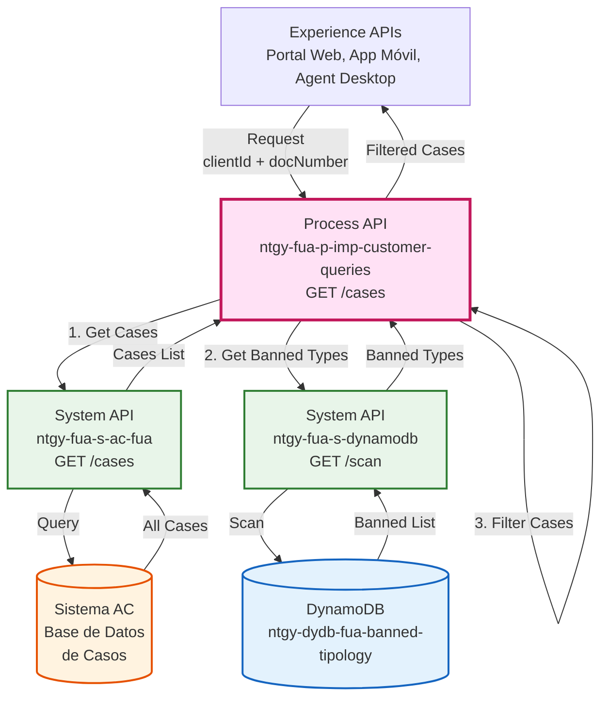
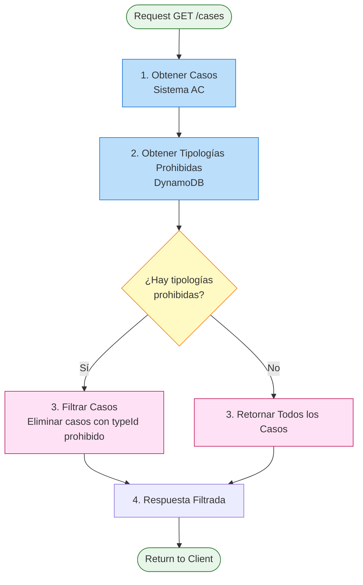
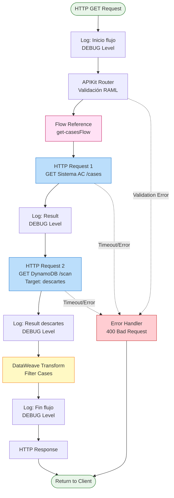
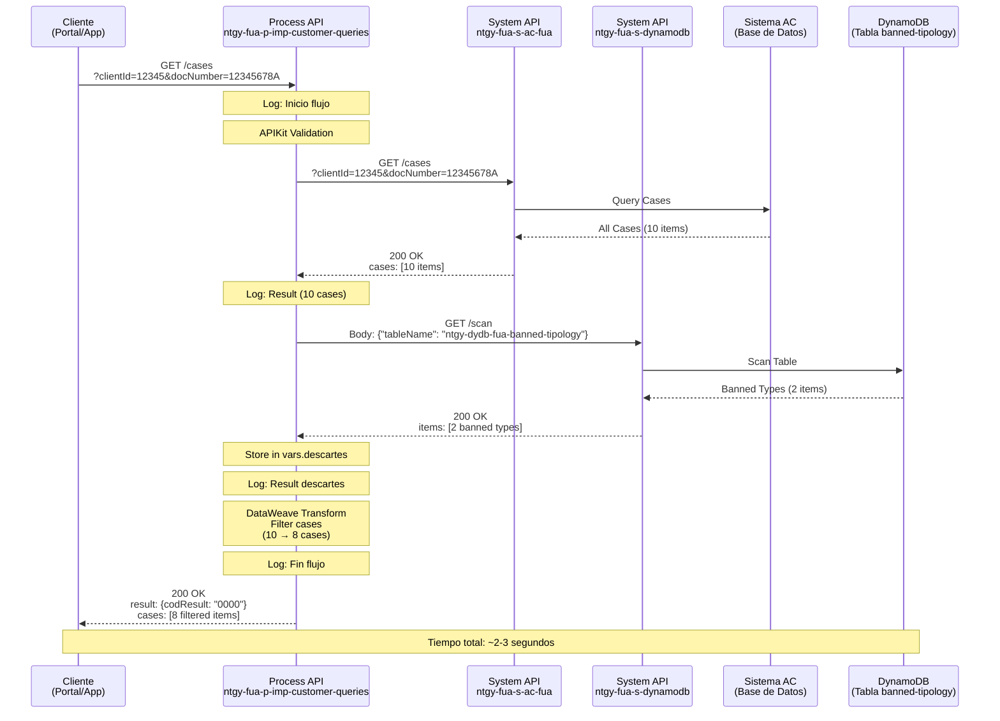
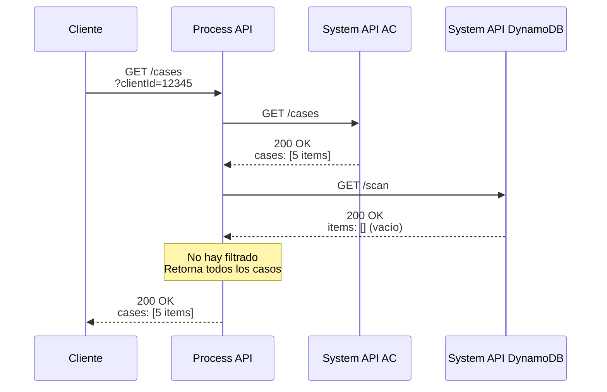
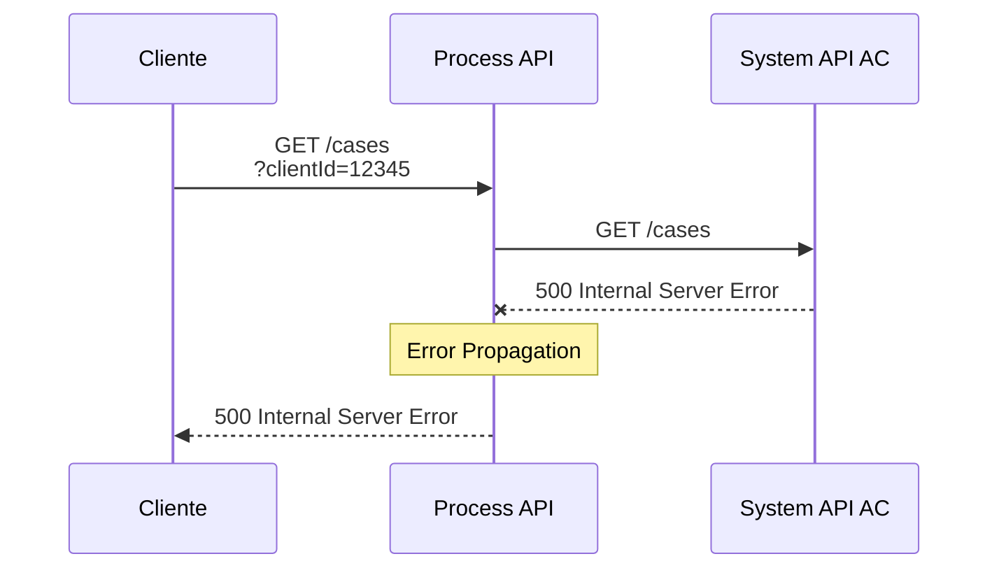
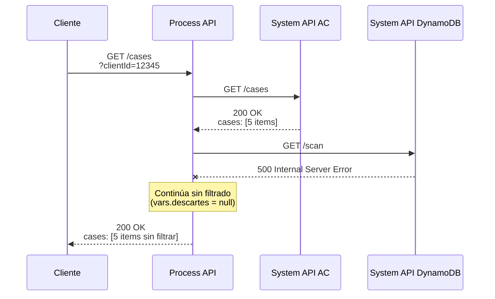

# GET /cases

## 📌 Descripción General

### Propósito del Endpoint

Este endpoint obtiene el historial de solicitudes y casos (Service Requests) del cliente de los últimos 6 meses, aplicando un filtrado inteligente que oculta automáticamente las tipologías de casos consideradas "internas" o no relevantes para el cliente. Implementa un patrón de orquestación que combina datos de Sistema AC con reglas de filtrado almacenadas en DynamoDB.

### Tipo de API

**Capa:** Process API (API-Led Connectivity)

**Función:** Orquestación con Lógica de Filtrado - Combina datos de múltiples fuentes y aplica reglas de negocio

### Patrón de Integración

**Tipo:** Orchestration + Business Logic (Orquestación con Filtrado)

**Descripción:** Este endpoint implementa un patrón de orquestación en dos fases:
1. Obtiene todos los casos del cliente desde Sistema AC
2. Consulta lista de tipologías prohibidas en DynamoDB
3. Filtra los casos eliminando aquellos con tipologías prohibidas
4. Retorna lista filtrada al cliente

Este patrón permite mantener la configuración de tipologías prohibidas de forma dinámica sin necesidad de modificar código.

### Arquitectura API-Led Connectivity



---

## 💼 Propósito del Negocio

### Casos de Uso Principales

1. **Consulta de Historial de Casos por Cliente**
   - Clientes consultan sus solicitudes y reclamaciones históricas
   - Agentes revisan el historial de interacciones con el cliente
   - Se muestran solo casos relevantes (filtrados automáticamente)

2. **Gestión de Casos en Portal de Autoservicio**
   - Clientes ven estado de sus solicitudes activas
   - Acceso a documentación adjunta a cada caso
   - Seguimiento de resolución de incidencias

3. **Soporte de Agentes de Call Center**
   - Agentes acceden rápidamente al historial del cliente
   - Contexto completo para resolver consultas
   - Identificación de patrones de problemas recurrentes

4. **Filtrado de Tipologías Internas**
   - Oculta casos de gestión interna no relevantes para el cliente
   - Mantiene configuración de tipologías prohibidas de forma dinámica
   - Permite actualizar reglas sin modificar código

### 🔗 Endpoints Dependientes

Este Process API consume los siguientes System APIs:

| System API | Endpoint | Método | Propósito |
|------------|----------|--------|-----------|
| `ntgy-fua-s-ac-fua` | `/cases` | GET | Obtención de casos/solicitudes del cliente de los últimos 6 meses |
| `ntgy-fua-s-dynamodb` | `/scan` | GET | Consulta de tipologías de casos prohibidas (tabla ntgy-dydb-fua-banned-tipology) |

### Lógica de Orquestación



**Pasos del Proceso:**

1. **Obtención de Casos**: Llama a Sistema AC para obtener todos los casos del cliente (últimos 6 meses)
2. **Consulta de Tipologías Prohibidas**: Consulta DynamoDB para obtener lista de tipologías que no deben mostrarse
3. **Filtrado Condicional**: 
   - Si existen tipologías prohibidas → Filtra casos eliminando los que coincidan
   - Si NO existen tipologías prohibidas → Retorna todos los casos
4. **Respuesta Estructurada**: Retorna casos filtrados con estructura estándar de resultado

### Transformaciones Aplicadas

**Transformación Principal: Filtrado de Casos**

Este endpoint aplica una transformación DataWeave que filtra los casos según tipologías prohibidas:

```dataweave
%dw 2.0
output application/json
---
{
  result: {
    codResult: "0000",
    msgResult: "No hay error"
  },
  cases: if (!isEmpty(vars.descartes)) 
           payload.cases filter (not (vars.descartes contains {"sr_type": $."typeId"})) 
         else 
           payload.cases
}
```

**Lógica de Filtrado:**

| Condición | Acción | Resultado |
|-----------|--------|-----------|
| `vars.descartes` está vacío | No filtrar | Retorna todos los casos de Sistema AC |
| `vars.descartes` tiene tipologías | Filtrar casos | Elimina casos cuyo `typeId` esté en la lista prohibida |

**Ejemplo de Filtrado:**

**Casos Originales (Sistema AC):**
```json
{
  "cases": [
    {"caseId": "001", "typeId": "CONSULTA", "description": "Consulta factura"},
    {"caseId": "002", "typeId": "INTERNO", "description": "Gestión interna"},
    {"caseId": "003", "typeId": "RECLAMACION", "description": "Reclamación"}
  ]
}
```

**Tipologías Prohibidas (DynamoDB):**
```json
[
  {"sr_type": "INTERNO"},
  {"sr_type": "AUDITORIA"}
]
```

**Resultado Filtrado:**
```json
{
  "result": {"codResult": "0000", "msgResult": "No hay error"},
  "cases": [
    {"caseId": "001", "typeId": "CONSULTA", "description": "Consulta factura"},
    {"caseId": "003", "typeId": "RECLAMACION", "description": "Reclamación"}
  ]
}
```

### Contexto Empresarial

- **Dominio:** Gestión de Casos y Atención al Cliente
- **Sector:** Energía - Utilities (Gas & Electricidad)
- **División:** Naturgy España - Clientes Minoristas
- **Proceso de Negocio:** Gestión de Solicitudes y Reclamaciones de Clientes

### Stakeholders

- **Clientes Finales**: Necesitan consultar estado de sus solicitudes y reclamaciones
- **Agentes de Atención al Cliente**: Requieren historial completo para resolver consultas
- **Equipos de Calidad**: Analizan patrones de casos para mejora continua
- **Gestores de Producto**: Definen qué tipologías deben ocultarse a clientes

### Valor de Negocio

- **Transparencia Controlada**: Muestra información relevante ocultando gestiones internas
- **Experiencia de Usuario**: Clientes ven solo casos que les conciernen
- **Flexibilidad Operativa**: Configuración dinámica de tipologías sin cambios de código
- **Eficiencia de Agentes**: Acceso rápido a historial completo del cliente
- **Reducción de Consultas**: Clientes resuelven dudas consultando sus casos
- **Cumplimiento Normativo**: Control sobre qué información se expone al cliente

### Consumidores Potenciales

Este endpoint puede ser consumido por:
- **Portales web de autoservicio**: Sección "Mis Solicitudes" o "Mis Casos"
- **Aplicaciones móviles**: Vista de historial de gestiones
- **Sistemas de agentes de call center**: Panel de historial del cliente
- **Aplicaciones de terceros**: Integraciones con partners autorizados

---

## 🔧 Especificación Técnica

### URLs por Ambiente

| Ambiente | URL Base | URL Completa |
|----------|----------|--------------|
| **Local** | `http://localhost:8084` | `http://localhost:8084/api/cases?clientId={id}&docNumber={doc}` |
| **Development** | `https://ntgy-fua-p-imp-customer-queries-dev.de-c1.cloudhub.io` | `https://ntgy-fua-p-imp-customer-queries-dev.de-c1.cloudhub.io/api/cases?clientId={id}&docNumber={doc}` |
| **UAT** | `https://ntgy-fua-p-imp-customer-queries-uat.de-c1.cloudhub.io` | `https://ntgy-fua-p-imp-customer-queries-uat.de-c1.cloudhub.io/api/cases?clientId={id}&docNumber={doc}` |
| **Production** | `https://ntgy-fua-p-imp-customer-queries-pro.de-c1.cloudhub.io` | `https://ntgy-fua-p-imp-customer-queries-pro.de-c1.cloudhub.io/api/cases?clientId={id}&docNumber={doc}` |

### Método HTTP

```
GET /api/cases
```

### Parámetros de Entrada

#### Query Parameters

| Parámetro | Tipo | Requerido | Descripción | Ejemplo |
|-----------|------|-----------|-------------|---------|
| `clientId` | string | ⚠️ Condicional | ID del cliente en el sistema | `12345678` |
| `docNumber` | string | ⚠️ Condicional | Número de documento del cliente (NIF/NIE) | `12345678A` |

**Validaciones:**
- Al menos uno de los dos parámetros debe estar presente
- Se recomienda proporcionar ambos para mayor precisión
- `docNumber` debe ser un NIF/NIE válido español

**Ejemplo de Query String:**
```
?clientId=12345678&docNumber=12345678A
```

### Respuestas

#### 200 OK - Éxito

**Descripción:** Lista de casos del cliente (filtrada según tipologías prohibidas)

**Estructura de Respuesta (según RAML):**

```json
{
  "result": {
    "codResult": "string",
    "msgResult": "string"
  },
  "case": [
    {
      "caseCode": "string",
      "caseId": "string",
      "typeId": "string",
      "step": "string",
      "subStep": "string",
      "state": "string",
      "contractAccountId": "string",
      "contractId": "string",
      "startDate": "string",
      "endDate": "string",
      "channel": "string",
      "hasFiles": boolean,
      "isCancelable": boolean,
      "productTypeFamily": "string",
      "updateDate": "string",
      "isSva": boolean,
      "addressId": "string",
      "idDocumentum": "string"
    }
  ]
}
```

**Campos de Respuesta:**

| Campo | Tipo | Requerido | Descripción |
|-------|------|-----------|-------------|
| `result.codResult` | string | ✅ | Código de resultado ("0000" = éxito) |
| `result.msgResult` | string | ✅ | Mensaje descriptivo del resultado |
| `case` | array | ✅ | Lista de casos del cliente (filtrada) |
| `case[].caseCode` | string | ✅ | Código del caso |
| `case[].caseId` | string | ⚠️ | Identificador único del caso |
| `case[].typeId` | string | ✅ | ID de la tipología del caso (usado en filtrado) |
| `case[].step` | string | ✅ | Paso del proceso del caso |
| `case[].subStep` | string | ⚠️ | Sub-paso del proceso |
| `case[].state` | string | ✅ | Estado actual del caso (ej: "Finalizada", "En proceso") |
| `case[].contractAccountId` | string | ⚠️ | ID de la cuenta contrato asociada |
| `case[].contractId` | string | ⚠️ | ID del contrato asociado |
| `case[].startDate` | string | ✅ | Fecha de inicio del caso (formato: "DD-MM-YYYY") |
| `case[].endDate` | string | ⚠️ | Fecha de finalización del caso |
| `case[].channel` | string | ✅ | Canal de origen del caso (ej: "A" = Agente) |
| `case[].hasFiles` | boolean | ✅ | Indica si el caso tiene archivos adjuntos |
| `case[].isCancelable` | boolean | ✅ | Indica si el caso puede ser cancelado |
| `case[].productTypeFamily` | string | ⚠️ | Familia de tipo de producto |
| `case[].updateDate` | string | ⚠️ | Fecha de última actualización |
| `case[].isSva` | boolean | ⚠️ | Indica si es un caso de SVA (Servicios de Valor Añadido) |
| `case[].addressId` | string | ⚠️ | ID de la dirección asociada |
| `case[].idDocumentum` | string | ⚠️ | ID del documento en Documentum |

**Notas Importantes:**
- ✅ = Campo requerido | ⚠️ = Campo opcional
- Los casos con tipologías prohibidas (definidas en DynamoDB) son automáticamente excluidos de la respuesta
- **Inconsistencia detectada:** El código XML usa `payload.cases` (plural) pero el RAML define `case` (singular). Esta documentación sigue el RAML como fuente de verdad.
- La estructura proviene de: `dataTypes/casesGetResponse.raml`

#### 400 Bad Request - Error de Validación

**Descripción:** Parámetros inválidos o faltantes

```json
{
  "message": "Bad request"
}
```

**Causas comunes:**
- Faltan ambos parámetros (`clientId` y `docNumber`)
- Formato de `docNumber` inválido

#### 404 Not Found - Cliente no encontrado

**Descripción:** No se encontraron casos para el cliente especificado

```json
{
  "result": {
    "codResult": "0001",
    "msgResult": "No se encontraron casos para el cliente"
  },
  "cases": []
}
```

#### 500 Internal Server Error - Error del Servidor

**Descripción:** Error interno del servidor o de los System APIs

```json
{
  "result": {
    "codResult": "9999",
    "msgResult": "Error interno del servidor"
  }
}
```

### Autenticación

- **Tipo:** OAuth 2.0 (Client Credentials)
- **Headers Requeridos:**
  - `client_id`: ID del cliente de Anypoint Platform
  - `client_secret`: Secret del cliente de Anypoint Platform

### Timeouts

| Tipo | Valor | Configuración |
|------|-------|---------------|
| **Response Timeout (Sistema AC)** | 30 segundos | `${s-ac.timeout}` |
| **Response Timeout (DynamoDB)** | 30 segundos | `${s-dynamo.timeout}` |
| **Connection Idle Timeout** | 30 segundos | Configurado por System API |

**Nota:** El timeout total del endpoint puede ser hasta 60 segundos (suma de ambas llamadas secuenciales).

### Rate Limiting

- **Límite:** 100 requests por minuto por cliente
- **Política:** Configurada a nivel de API Gateway

---

## 🏗️ Implementación Técnica

### Arquitectura del Flow



### Código de Implementación

#### Flow Principal (p-imp-customer-queries.xml)

**Ubicación:** `src/main/mule/p-imp-customer-queries.xml` (líneas 147-149)

```xml
<flow name="get:\cases:p-imp-customer-queries-config">
    <flow-ref doc:name="Flow Reference" 
              doc:id="6bea3f5e-16fa-4809-9505-1a55d69ad366" 
              name="get-casesFlow"/>
</flow>
```

#### Subflow de Implementación (get-cases.xml)

**Ubicación:** `src/main/mule/implementation/get-cases.xml`

```xml
<flow name="get-casesFlow" doc:id="1af24b50-4373-4048-ac98-b0c101c7f5df">
    <!-- Paso 1: Log de inicio -->
    <logger level="DEBUG" 
            doc:name="Inicio flujo" 
            doc:id="de127775-cfc9-4d07-8267-05fbdbe839e0" />
    
    <!-- Paso 2: Obtener casos de Sistema AC -->
    <http:request method="GET" 
                  doc:name="Se recuperan SRs de los últimos 6 meses" 
                  doc:id="db4204d4-b7ab-41d0-8ee0-fd2fff5faebc" 
                  config-ref="HTTP_API_SistemaAC" 
                  path="/cases">
        <http:query-params><![CDATA[#[output application/java
---
{
    "clientId": attributes.queryParams.clientId,
    "docNumber": attributes.queryParams.docNumber
}]]]></http:query-params>
    </http:request>
    
    <!-- Paso 3: Log de resultado de Sistema AC -->
    <logger level="DEBUG" 
            doc:name="Result" 
            doc:id="477e34aa-a219-4570-b499-b71264b113a4" 
            message="#[payload]"/>
    
    <!-- Paso 4: Obtener tipologías prohibidas de DynamoDB -->
    <http:request method="GET" 
                  doc:name="Se obtiene un listado de tipologías 'internas'" 
                  doc:id="0a1191d6-51d1-4de8-a3fe-726ff4d52bea" 
                  config-ref="HTTP_Request_Dynamo" 
                  path="/scan" 
                  target="descartes" 
                  targetValue="#[payload.items]" 
                  sendBodyMode="ALWAYS">
        <http:body><![CDATA[#[%dw 2.0
output application/json
---
{
    "tableName": "ntgy-dydb-fua-banned-tipology"
}]]]></http:body>
    </http:request>
    
    <!-- Paso 5: Log de tipologías prohibidas -->
    <logger level="DEBUG" 
            doc:name="Result" 
            doc:id="5812fa9c-2103-415b-a2e9-2152a8f004bd" 
            message="#[vars.descartes]"/>
    
    <!-- Paso 6: Transformación y filtrado -->
    <ee:transform doc:name="Transform Message" 
                  doc:id="81e070c1-8124-4401-9534-99a077647ec7">
        <ee:message>
            <ee:set-payload><![CDATA[%dw 2.0
output application/json
---
{
    result: {
        codResult: "0000",
        msgResult: "No hay error"
    },
    cases: if (!isEmpty(vars.descartes)) 
             payload.cases filter (not (vars.descartes contains {"sr_type": $."typeId"})) 
           else 
             payload.cases
}]]></ee:set-payload>
        </ee:message>
    </ee:transform>
    
    <!-- Paso 7: Log de fin -->
    <logger level="DEBUG" 
            doc:name="Fin flujo" 
            doc:id="6fe8a6d3-f969-497c-b284-cb7ed5cf63e1" 
            message="#[payload]"/>
</flow>
```

**Análisis del Código:**

**Paso 1 - Obtención de Casos (Sistema AC):**
- HTTP GET request a `/cases`
- Mapeo directo de query parameters
- Configuración: `HTTP_API_SistemaAC`

**Paso 2 - Consulta de Tipologías Prohibidas (DynamoDB):**
- HTTP GET request a `/scan`
- Body: `{"tableName": "ntgy-dydb-fua-banned-tipology"}`
- **Target variable:** `descartes` (almacena resultado sin sobrescribir payload)
- **Target value:** `#[payload.items]` (extrae solo el array de items)
- **sendBodyMode:** `ALWAYS` (envía body en GET request)

**Paso 3 - Filtrado con DataWeave:**
- Construye objeto `result` con código de éxito
- Aplica filtro condicional a `payload.cases`
- Lógica: Elimina casos cuyo `typeId` esté en `vars.descartes`

#### Configuración HTTP (global.xml)

**Sistema AC:**
```xml
<http:request-config name="HTTP_API_SistemaAC" 
                     basePath="/api" 
                     responseTimeout="${s-ac.timeout}">
    <http:request-connection host="${s-ac.host}" 
                             port="${s-ac.port}" 
                             protocol="${s-ac.protocol}"/>
</http:request-config>
```

**DynamoDB:**
```xml
<http:request-config name="HTTP_Request_Dynamo" 
                     basePath="/api" 
                     responseTimeout="${s-dynamo.timeout}">
    <http:request-connection host="${s-dynamo.host}" 
                             port="${s-dynamo.port}"/>
</http:request-config>
```

### Transformaciones DataWeave

#### 1. Mapeo de Query Parameters (Sistema AC)

**Propósito:** Mapear query parameters del request al System API

```dataweave
%dw 2.0
output application/java
---
{
    "clientId": attributes.queryParams.clientId,
    "docNumber": attributes.queryParams.docNumber
}
```

#### 2. Body para Consulta DynamoDB

**Propósito:** Especificar tabla a escanear en DynamoDB

```dataweave
%dw 2.0
output application/json
---
{
    "tableName": "ntgy-dydb-fua-banned-tipology"
}
```

#### 3. Filtrado de Casos (Transformación Principal)

**Propósito:** Filtrar casos eliminando tipologías prohibidas

```dataweave
%dw 2.0
output application/json
---
{
    result: {
        codResult: "0000",
        msgResult: "No hay error"
    },
    cases: if (!isEmpty(vars.descartes)) 
             payload.cases filter (not (vars.descartes contains {"sr_type": $."typeId"})) 
           else 
             payload.cases
}
```

**Análisis Detallado:**

**Condición:** `if (!isEmpty(vars.descartes))`
- Verifica si hay tipologías prohibidas en DynamoDB
- Si está vacío → Retorna todos los casos
- Si tiene datos → Aplica filtro

**Filtro:** `payload.cases filter (not (vars.descartes contains {"sr_type": $."typeId"}))`
- Itera sobre cada caso en `payload.cases`
- Para cada caso, verifica si su `typeId` está en la lista prohibida
- `vars.descartes contains {"sr_type": $."typeId"}` → Busca coincidencia
- `not (...)` → Invierte la lógica (mantiene los que NO están prohibidos)
- Resultado: Array de casos sin tipologías prohibidas

**Ejemplo de Ejecución:**

```dataweave
// Input: payload.cases
[
  {"caseId": "001", "typeId": "CONSULTA"},
  {"caseId": "002", "typeId": "INTERNO"},
  {"caseId": "003", "typeId": "RECLAMACION"}
]

// Input: vars.descartes
[
  {"sr_type": "INTERNO"},
  {"sr_type": "AUDITORIA"}
]

// Proceso de filtrado:
// Caso 001: typeId="CONSULTA" → NO está en descartes → MANTENER
// Caso 002: typeId="INTERNO" → SÍ está en descartes → ELIMINAR
// Caso 003: typeId="RECLAMACION" → NO está en descartes → MANTENER

// Output: cases
[
  {"caseId": "001", "typeId": "CONSULTA"},
  {"caseId": "003", "typeId": "RECLAMACION"}
]
```

### Patrones de Diseño

#### Patrón 1: Orchestration (Orquestación)

**Justificación:**
- Combina datos de múltiples System APIs
- Coordina llamadas secuenciales
- Agrega lógica de negocio (filtrado)

**Ventajas:**
- ✅ Centraliza lógica de negocio
- ✅ Desacopla consumidores de System APIs
- ✅ Facilita evolución independiente

#### Patrón 2: Target Variable

**Justificación:**
- Necesita preservar payload original (casos de Sistema AC)
- Almacena resultado de DynamoDB en variable separada
- Permite usar ambos datos en transformación final

**Implementación:**
```xml
<http:request ... 
              target="descartes" 
              targetValue="#[payload.items]">
```

**Ventajas:**
- ✅ No sobrescribe payload principal
- ✅ Acceso a múltiples resultados simultáneamente
- ✅ Código más limpio y legible

#### Patrón 3: Configuration-Driven Filtering

**Justificación:**
- Reglas de filtrado almacenadas en base de datos (DynamoDB)
- Permite actualizar configuración sin cambiar código
- Flexibilidad operativa

**Ventajas:**
- ✅ Configuración dinámica
- ✅ Sin necesidad de redespliegue
- ✅ Gestión centralizada de reglas

### Diagramas de Secuencia

#### 1. Flujo Normal de Éxito (Con Filtrado)



#### 2. Flujo Sin Tipologías Prohibidas



#### 3. Flujo con Error en Sistema AC



#### 4. Flujo con Error en DynamoDB



### Manejo de Errores

#### Estrategia de Error Handling

**Nivel 1: Validación de Entrada (APIKit)**
- Valida presencia de al menos un parámetro (clientId o docNumber)
- Valida tipos de datos según RAML
- Retorna 400 Bad Request si falla validación

**Nivel 2: Errores de Sistema AC**
- Si Sistema AC falla → Propaga error al cliente
- No se ejecuta consulta a DynamoDB
- Retorna código de error apropiado

**Nivel 3: Errores de DynamoDB**
- Si DynamoDB falla → Continúa sin filtrado
- Retorna todos los casos de Sistema AC
- Comportamiento degradado pero funcional

**Nivel 4: Errores de Transformación**
- Captura errores en DataWeave
- Retorna 500 Internal Server Error
- Log completo del stack trace

#### Códigos de Error

| Código HTTP | Tipo de Error | Descripción | Acción Recomendada |
|-------------|---------------|-------------|-------------------|
| 400 | Bad Request | Parámetros inválidos o faltantes | Verificar query parameters |
| 404 | Not Found | Cliente no encontrado | Verificar clientId/docNumber |
| 500 | Internal Server Error | Error del servidor | Contactar soporte técnico |
| 503 | Service Unavailable | System API no disponible | Reintentar más tarde |
| 504 | Gateway Timeout | Timeout del System API | Reintentar o contactar soporte |

### Logging

#### Niveles de Logging

**DEBUG Level:**
- Inicio del flujo
- Resultado de Sistema AC (payload completo)
- Resultado de DynamoDB (vars.descartes)
- Fin del flujo (payload filtrado)

**INFO Level:**
- Request entrante con headers y query params (nivel superior)

**ERROR Level:**
- Excepciones y stack traces
- Errores de conectividad
- Timeouts

#### Ejemplo de Logs

```
DEBUG - Inicio flujo
DEBUG - Result: {"cases": [{"caseId": "001", "typeId": "CONSULTA"}, ...]}
DEBUG - Result: [{"sr_type": "INTERNO"}, {"sr_type": "AUDITORIA"}]
DEBUG - Fin flujo: {"result": {"codResult": "0000"}, "cases": [...]}
```

---

## 💻 Ejemplos de Uso

### Ejemplo 1: Consulta de Casos con Filtrado

#### cURL

```bash
curl -X GET "https://ntgy-fua-p-imp-customer-queries-pro.de-c1.cloudhub.io/api/cases?clientId=12345678&docNumber=12345678A" \
  -H "Content-Type: application/json" \
  -H "client_id: YOUR_CLIENT_ID" \
  -H "client_secret: YOUR_CLIENT_SECRET"
```

#### Respuesta (200 OK)

```json
{
  "result": {
    "codResult": "0000",
    "msgResult": "No hay error"
  },
  "case": [
    {
      "caseCode": "SR001",
      "caseId": "SR-2026-001234",
      "typeId": "CONSULTA",
      "step": "S",
      "subStep": "N",
      "state": "En proceso",
      "contractAccountId": "1234567890",
      "contractId": "CON-2026-001",
      "startDate": "01-09-2026",
      "endDate": null,
      "channel": "W",
      "hasFiles": true,
      "isCancelable": true,
      "productTypeFamily": "2762",
      "updateDate": "15-09-2026",
      "isSva": false,
      "addressId": "ADDR-001",
      "idDocumentum": "DOC-12345"
    },
    {
      "caseCode": "SR002",
      "caseId": "SR-2026-001189",
      "typeId": "RECLAMACION",
      "step": "F",
      "subStep": "C",
      "state": "Finalizada",
      "contractAccountId": "1234567890",
      "contractId": "CON-2026-001",
      "startDate": "15-08-2026",
      "endDate": "30-08-2026",
      "channel": "T",
      "hasFiles": true,
      "isCancelable": false,
      "productTypeFamily": "2762",
      "updateDate": "30-08-2026",
      "isSva": false,
      "addressId": "ADDR-001",
      "idDocumentum": "DOC-67890"
    }
  ]
}
```

**Notas:**
- Los casos con `typeId` "INTERNO" o "AUDITORIA" fueron filtrados automáticamente
- **Canales:** W=Web, T=Teléfono, A=Agente, E=Email
- **Steps:** S=En proceso, F=Finalizada, P=Pendiente
- **Fechas:** Formato DD-MM-YYYY según RAML

### Ejemplo 2: Consulta Solo con clientId

#### cURL

```bash
curl -X GET "https://ntgy-fua-p-imp-customer-queries-pro.de-c1.cloudhub.io/api/cases?clientId=12345678" \
  -H "Content-Type: application/json" \
  -H "client_id: YOUR_CLIENT_ID" \
  -H "client_secret: YOUR_CLIENT_SECRET"
```

#### Respuesta (200 OK)

```json
{
  "result": {
    "codResult": "0000",
    "msgResult": "No hay error"
  },
  "cases": [
    {
      "caseId": "SR-2026-001234",
      "typeId": "CONSULTA",
      "typeName": "Consulta General",
      "status": "OPEN",
      "statusName": "Abierto",
      "description": "Consulta sobre factura",
      "creationDate": "2026-09-01T10:30:00Z",
      "lastUpdateDate": "2026-09-15T14:20:00Z",
      "priority": "MEDIA",
      "channel": "WEB",
      "assignedTo": "Equipo Facturación",
      "resolution": null
    }
  ]
}
```

### Ejemplo 3: Cliente Sin Casos

#### cURL

```bash
curl -X GET "https://ntgy-fua-p-imp-customer-queries-pro.de-c1.cloudhub.io/api/cases?docNumber=99999999Z" \
  -H "Content-Type: application/json" \
  -H "client_id: YOUR_CLIENT_ID" \
  -H "client_secret: YOUR_CLIENT_SECRET"
```

#### Respuesta (200 OK)

```json
{
  "result": {
    "codResult": "0000",
    "msgResult": "No hay error"
  },
  "cases": []
}
```

### Ejemplo 4: Error - Parámetros Faltantes

#### cURL

```bash
curl -X GET "https://ntgy-fua-p-imp-customer-queries-pro.de-c1.cloudhub.io/api/cases" \
  -H "Content-Type: application/json" \
  -H "client_id: YOUR_CLIENT_ID" \
  -H "client_secret: YOUR_CLIENT_SECRET"
```

#### Respuesta (400 Bad Request)

```json
{
  "message": "Bad request"
}
```

### Ejemplo 5: JavaScript (Fetch API)

```javascript
async function getCustomerCases(clientId, docNumber) {
  try {
    const params = new URLSearchParams();
    if (clientId) params.append('clientId', clientId);
    if (docNumber) params.append('docNumber', docNumber);

    const response = await fetch(
      `https://ntgy-fua-p-imp-customer-queries-pro.de-c1.cloudhub.io/api/cases?${params}`,
      {
        method: 'GET',
        headers: {
          'Content-Type': 'application/json',
          'client_id': 'YOUR_CLIENT_ID',
          'client_secret': 'YOUR_CLIENT_SECRET'
        }
      }
    );

    if (!response.ok) {
      throw new Error(`HTTP error! status: ${response.status}`);
    }

    const data = await response.json();
    
    // Procesar casos
    console.log(`Total de casos: ${data.cases.length}`);
    
    // Agrupar por estado
    const casesByStatus = data.cases.reduce((acc, case_) => {
      acc[case_.status] = (acc[case_.status] || 0) + 1;
      return acc;
    }, {});
    
    console.log('Casos por estado:', casesByStatus);
    
    return data.cases;
  } catch (error) {
    console.error('Error obteniendo casos:', error);
    throw error;
  }
}

// Uso
getCustomerCases('12345678', '12345678A')
  .then(cases => {
    cases.forEach(case_ => {
      console.log(`${case_.caseId}: ${case_.description} (${case_.status})`);
    });
  })
  .catch(error => console.error('Error:', error));
```

### Ejemplo 6: Python (Requests)

```python
import requests
from typing import List, Dict, Optional

def get_customer_cases(
    client_id: Optional[str] = None,
    doc_number: Optional[str] = None
) -> List[Dict]:
    """
    Obtiene los casos del cliente con filtrado automático
    
    Args:
        client_id: ID del cliente
        doc_number: Número de documento (NIF/NIE)
    
    Returns:
        Lista de casos del cliente
    """
    base_url = "https://ntgy-fua-p-imp-customer-queries-pro.de-c1.cloudhub.io/api/cases"
    
    # Construir parámetros
    params = {}
    if client_id:
        params['clientId'] = client_id
    if doc_number:
        params['docNumber'] = doc_number
    
    if not params:
        raise ValueError("Debe proporcionar al menos clientId o docNumber")
    
    headers = {
        'Content-Type': 'application/json',
        'client_id': 'YOUR_CLIENT_ID',
        'client_secret': 'YOUR_CLIENT_SECRET'
    }
    
    try:
        response = requests.get(
            base_url,
            params=params,
            headers=headers,
            timeout=60  # Timeout mayor por orquestación
        )
        
        response.raise_for_status()
        
        data = response.json()
        
        # Procesar resultados
        cases = data.get('cases', [])
        
        print(f"Total de casos: {len(cases)}")
        
        # Estadísticas
        open_cases = sum(1 for c in cases if c['status'] == 'OPEN')
        closed_cases = sum(1 for c in cases if c['status'] == 'CLOSED')
        
        print(f"Casos abiertos: {open_cases}")
        print(f"Casos cerrados: {closed_cases}")
        
        # Mostrar casos
        for case in cases:
            print(f"\n{case['caseId']}: {case['description']}")
            print(f"  Estado: {case['statusName']}")
            print(f"  Tipo: {case['typeName']}")
            print(f"  Prioridad: {case['priority']}")
        
        return cases
        
    except requests.exceptions.Timeout:
        print("Error: Timeout en la petición")
        raise
    except requests.exceptions.RequestException as e:
        print(f"Error en la petición: {e}")
        raise

# Uso
if __name__ == "__main__":
    cases = get_customer_cases(
        client_id='12345678',
        doc_number='12345678A'
    )
    print(f"\nTotal de casos obtenidos: {len(cases)}")
```

### Ejemplo 7: Componente React (TypeScript)

```typescript
import React, { useState, useEffect } from 'react';

interface Case {
  caseId: string;
  typeId: string;
  typeName: string;
  status: string;
  statusName: string;
  description: string;
  creationDate: string;
  lastUpdateDate: string;
  priority: string;
  channel: string;
  assignedTo: string;
  resolution: string | null;
}

interface CasesResponse {
  result: {
    codResult: string;
    msgResult: string;
  };
  cases: Case[];
}

interface CustomerCasesProps {
  clientId?: string;
  docNumber?: string;
}

const CustomerCases: React.FC<CustomerCasesProps> = ({ clientId, docNumber }) => {
  const [cases, setCases] = useState<Case[]>([]);
  const [loading, setLoading] = useState(true);
  const [error, setError] = useState<string | null>(null);

  useEffect(() => {
    const fetchCases = async () => {
      if (!clientId && !docNumber) {
        setError('Debe proporcionar clientId o docNumber');
        setLoading(false);
        return;
      }

      try {
        const params = new URLSearchParams();
        if (clientId) params.append('clientId', clientId);
        if (docNumber) params.append('docNumber', docNumber);

        const response = await fetch(
          `https://ntgy-fua-p-imp-customer-queries-pro.de-c1.cloudhub.io/api/cases?${params}`,
          {
            headers: {
              'Content-Type': 'application/json',
              'client_id': process.env.REACT_APP_CLIENT_ID || '',
              'client_secret': process.env.REACT_APP_CLIENT_SECRET || ''
            }
          }
        );

        if (!response.ok) {
          throw new Error(`Error ${response.status}: ${response.statusText}`);
        }

        const data: CasesResponse = await response.json();
        setCases(data.cases);
        setError(null);
      } catch (err) {
        setError(err instanceof Error ? err.message : 'Error desconocido');
      } finally {
        setLoading(false);
      }
    };

    fetchCases();
  }, [clientId, docNumber]);

  if (loading) {
    return <div className="loading">Cargando casos...</div>;
  }

  if (error) {
    return <div className="error">Error: {error}</div>;
  }

  if (cases.length === 0) {
    return <div className="no-cases">No hay casos para mostrar</div>;
  }

  return (
    <div className="customer-cases">
      <h2>Mis Solicitudes ({cases.length})</h2>
      <div className="cases-list">
        {cases.map((case_) => (
          <div key={case_.caseId} className={`case-card status-${case_.status.toLowerCase()}`}>
            <div className="case-header">
              <span className="case-id">{case_.caseId}</span>
              <span className={`case-status ${case_.status.toLowerCase()}`}>
                {case_.statusName}
              </span>
            </div>
            <div className="case-body">
              <h3>{case_.typeName}</h3>
              <p>{case_.description}</p>
              <div className="case-meta">
                <span>Prioridad: {case_.priority}</span>
                <span>Canal: {case_.channel}</span>
                <span>Creado: {new Date(case_.creationDate).toLocaleDateString()}</span>
              </div>
              {case_.resolution && (
                <div className="case-resolution">
                  <strong>Resolución:</strong> {case_.resolution}
                </div>
              )}
            </div>
          </div>
        ))}
      </div>
    </div>
  );
};

export default CustomerCases;
```

### Ejemplo 8: Integración con Sistema de Tickets

```javascript
// Ejemplo de integración con sistema de gestión de tickets
class CaseManagementService {
  constructor(apiConfig) {
    this.baseUrl = apiConfig.baseUrl;
    this.clientId = apiConfig.clientId;
    this.clientSecret = apiConfig.clientSecret;
  }

  async getCases(customerId, documentNumber) {
    const params = new URLSearchParams({
      clientId: customerId,
      docNumber: documentNumber
    });

    const response = await fetch(`${this.baseUrl}/cases?${params}`, {
      headers: {
        'Content-Type': 'application/json',
        'client_id': this.clientId,
        'client_secret': this.clientSecret
      }
    });

    if (!response.ok) {
      throw new Error(`Failed to fetch cases: ${response.statusText}`);
    }

    return await response.json();
  }

  async getOpenCases(customerId, documentNumber) {
    const data = await this.getCases(customerId, documentNumber);
    return data.cases.filter(c => c.status === 'OPEN');
  }

  async getCasesByPriority(customerId, documentNumber, priority) {
    const data = await this.getCases(customerId, documentNumber);
    return data.cases.filter(c => c.priority === priority);
  }

  async getCaseStatistics(customerId, documentNumber) {
    const data = await this.getCases(customerId, documentNumber);
    
    return {
      total: data.cases.length,
      open: data.cases.filter(c => c.status === 'OPEN').length,
      closed: data.cases.filter(c => c.status === 'CLOSED').length,
      byType: this.groupBy(data.cases, 'typeName'),
      byPriority: this.groupBy(data.cases, 'priority'),
      byChannel: this.groupBy(data.cases, 'channel')
    };
  }

  groupBy(array, key) {
    return array.reduce((result, item) => {
      const group = item[key];
      result[group] = (result[group] || 0) + 1;
      return result;
    }, {});
  }
}

// Uso
const caseService = new CaseManagementService({
  baseUrl: 'https://ntgy-fua-p-imp-customer-queries-pro.de-c1.cloudhub.io/api',
  clientId: 'YOUR_CLIENT_ID',
  clientSecret: 'YOUR_CLIENT_SECRET'
});

// Obtener estadísticas
const stats = await caseService.getCaseStatistics('12345678', '12345678A');
console.log('Estadísticas de casos:', stats);
```
