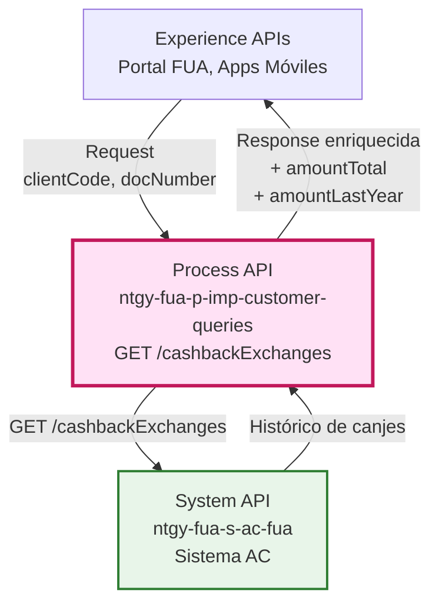
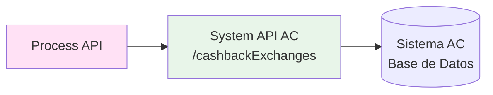
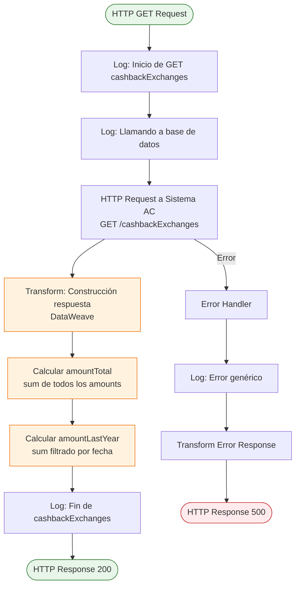
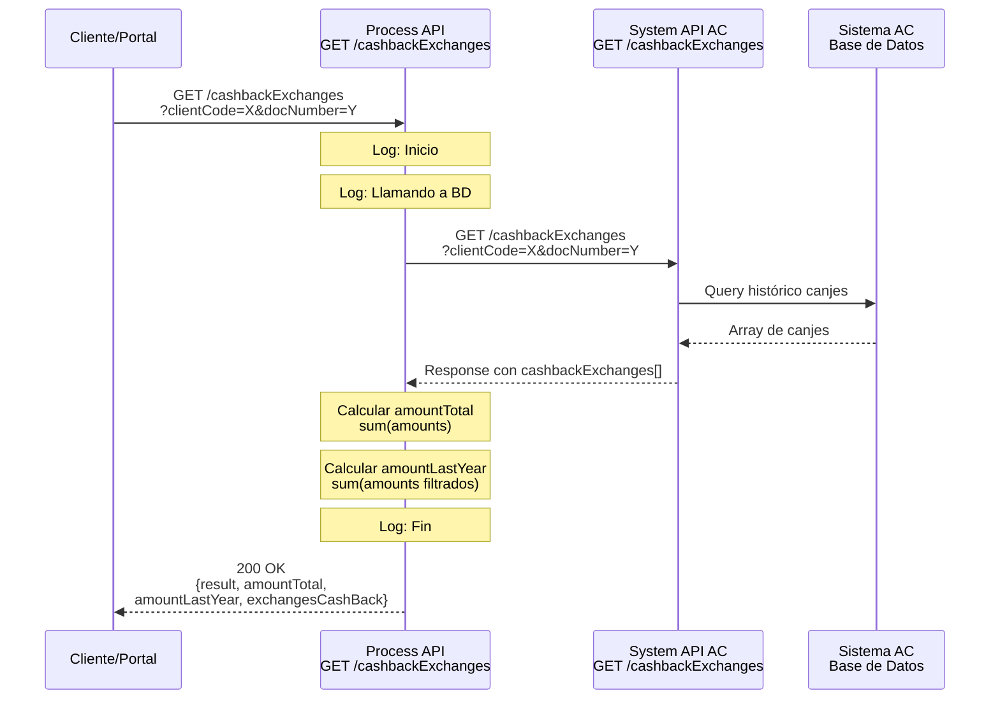
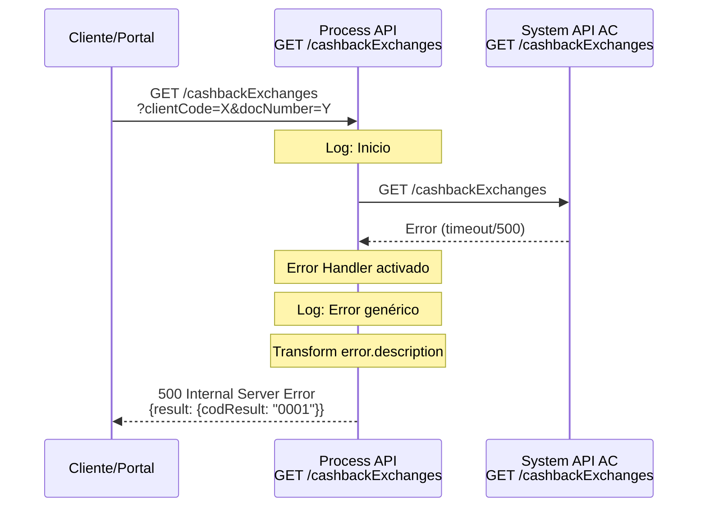
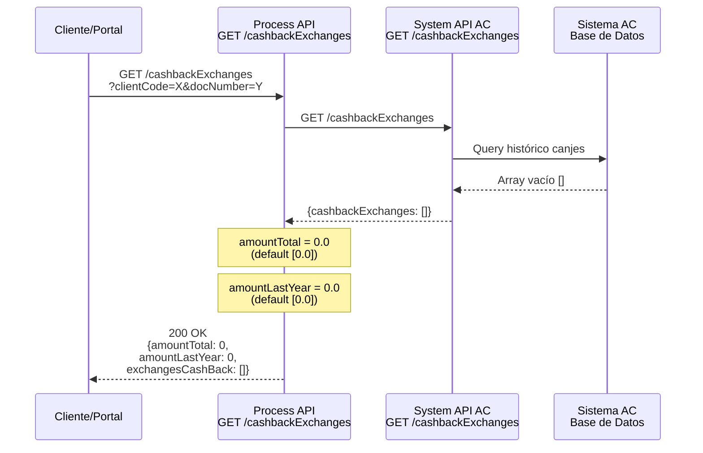

# GET /cashbackExchanges

## 📌 Descripción General

### Propósito del Endpoint

Este endpoint obtiene el histórico completo de canjes de cashback realizados por un cliente en el programa de partners de Naturgy. Además de retornar el listado de canjes, calcula automáticamente dos métricas agregadas: el monto total histórico de todos los canjes y el monto acumulado en el último año.

### Tipo de API

**Capa:** Process API (API-Led Connectivity)

**Función:** Orquestación con agregación de datos de fidelización

### Patrón de Integración

**Tipo:** Pass-Through con Transformación y Agregación

**Descripción:** El endpoint consume el System API AC para obtener el histórico de canjes y aplica transformaciones DataWeave para calcular métricas agregadas (suma total y suma del último año) antes de retornar la respuesta enriquecida.

### Arquitectura API-Led Connectivity



---

## 💼 Propósito del Negocio

### Casos de Uso Principales

1. **Consulta de Histórico de Canjes**
   - Cliente consulta todos sus canjes de cashback realizados
   - Visualización de fechas, montos y detalles de cada canje
   - Beneficio: Transparencia total del programa de fidelización

2. **Análisis de Actividad de Fidelización**
   - Agente revisa la participación del cliente en el programa
   - Identificación de patrones de uso del cashback
   - Beneficio: Mejor comprensión del engagement del cliente

3. **Cálculo de Beneficios Acumulados**
   - Visualización automática del monto total histórico
   - Cálculo del monto acumulado en el último año
   - Beneficio: Cliente ve el valor real obtenido del programa

### 🔗 Endpoints Dependientes

Este Process API consume el siguiente System API:

| System API | Endpoint | Método | Propósito |
|------------|----------|--------|-----------|
| `ntgy-fua-s-ac-fua` | `/cashbackExchanges` | GET | Obtiene el histórico completo de canjes de cashback del cliente |

### Lógica de Orquestación



**Pasos del Proceso:**

1. **Paso 1**: Recibe parámetros de consulta (clientCode, docNumber)
2. **Paso 2**: Llama a System API AC para obtener histórico de canjes
3. **Paso 3**: Aplica transformación DataWeave para calcular:
   - `amountTotal`: Suma de todos los montos históricos
   - `amountLastYear`: Suma de montos del último año (filtrado por fecha)
4. **Paso 4**: Retorna respuesta enriquecida con métricas agregadas

### Transformaciones Aplicadas

**Transformaciones de Agregación:**

| Cálculo | Descripción | Lógica DataWeave |
|---------|-------------|------------------|
| `amountTotal` | Suma total de todos los canjes históricos | `sum(payload.cashbackExchanges.amount default [0.0])` |
| `amountLastYear` | Suma de canjes del último año | `sum((payload.cashbackExchanges filter (item, index) -> ((item.date as DateTime as String {format: "yyyy-MM-dd"}) >= ((now() - \|P1Y\|) as String {format: "yyyy-MM-dd"}))).amount default [0.0])` |
| `exchangesCashBack` | Array completo de canjes | Pass-through de `payload.cashbackExchanges` |

**Estructura de Respuesta Enriquecida:**

```json
{
  "result": {
    "codResult": "0000",
    "msgResult": "No hay error"
  },
  "amountTotal": 150.50,
  "amountLastYear": 75.25,
  "exchangesCashBack": [...]
}
```

### Contexto Empresarial

- **Dominio:** Programas de Fidelización y Ventajas
- **Sector:** Energía - Utilities
- **División:** Naturgy España - Clientes Minoristas
- **Proceso de Negocio:** Gestión de Cashback y Canjes de Partners

### Stakeholders

- **Clientes Finales**: Consultan su histórico de canjes y beneficios acumulados
- **Agentes de Atención**: Revisan actividad de fidelización del cliente
- **Equipo de Marketing**: Analiza efectividad del programa de cashback

### Valor de Negocio

- **Transparencia**: Cliente ve claramente todos sus canjes realizados
- **Engagement**: Métricas agregadas motivan mayor participación en el programa
- **Eficiencia**: Cálculos automáticos evitan procesamiento manual
- **Retención**: Programa de fidelización fortalece relación con el cliente

### Consumidores Potenciales

Este endpoint puede ser consumido por:
- Portal web FUA (Frontal Único de Atención)
- Aplicaciones móviles de clientes
- Sistemas de agentes de call center
- Dashboards de análisis de fidelización

---

## 🔧 Especificación Técnica

### URLs por Ambiente

| Ambiente | URL Base | URL Completa |
|----------|----------|--------------|
| **Local** | `http://localhost:8084` | `http://localhost:8084/api/cashbackExchanges` |
| **Development** | `https://ntgy-fua-p-imp-customer-queries-dev.de-c1.cloudhub.io` | `https://ntgy-fua-p-imp-customer-queries-dev.de-c1.cloudhub.io/api/cashbackExchanges` |
| **UAT** | `https://ntgy-fua-p-imp-customer-queries-uat.de-c1.cloudhub.io` | `https://ntgy-fua-p-imp-customer-queries-uat.de-c1.cloudhub.io/api/cashbackExchanges` |
| **Production** | `https://ntgy-fua-p-imp-customer-queries-pro.de-c1.cloudhub.io` | `https://ntgy-fua-p-imp-customer-queries-pro.de-c1.cloudhub.io/api/cashbackExchanges` |

### Método HTTP

```
GET /api/cashbackExchanges
```

### Parámetros de Entrada

#### Query Parameters

| Parámetro | Tipo | Requerido | Descripción | Ejemplo |
|-----------|------|-----------|-------------|---------|
| `clientCode` | string | Sí | Código único del cliente en el sistema | `"12345678"` |
| `docNumber` | string | Sí | Número de documento del cliente (NIF/NIE) | `"12345678X"` |

**Ejemplo de URL con parámetros:**
```
GET /api/cashbackExchanges?clientCode=12345678&docNumber=12345678X
```

### Respuestas

#### 200 OK - Respuesta Exitosa

**Estructura de Respuesta:**

```json
{
  "result": {
    "codResult": "0000",
    "msgResult": "No hay error"
  },
  "amountTotal": 150.50,
  "amountLastYear": 75.25,
  "exchangesCashBack": [
    {
      "exchangeId": "CBE-2026-001234",
      "promotion": "Amazon",
      "date": "2026-08-15",
      "amount": 25.00,
      "address": {
        "addressId": "14479766",
        "zipCode": "28023",
        "province": "Madrid",
        "city": "Madrid",
        "town": "Aravaca",
        "way": "Gran Vía",
        "wayId": "12345",
        "wayType": "Calle",
        "number": "123",
        "floor": "3",
        "door": "A",
        "portal": "B",
        "stairs": "1"
      }
    },
    {
      "exchangeId": "CBE-2026-001235",
      "promotion": "Carrefour",
      "date": "2026-06-10",
      "amount": 50.25,
      "address": {
        "addressId": "14479767",
        "zipCode": "28015",
        "province": "Madrid",
        "city": "Madrid",
        "town": "Centro",
        "way": "Alcalá",
        "wayType": "Calle",
        "number": "45"
      }
    }
  ]
}
```

**Campos de Respuesta:**

| Campo | Tipo | Descripción |
|-------|------|-------------|
| `result.codResult` | string | Código de resultado ("0000" = éxito) |
| `result.msgResult` | string | Mensaje descriptivo del resultado |
| `amountTotal` | number | Suma total de todos los canjes históricos |
| `amountLastYear` | number | Suma de canjes realizados en el último año |
| `exchangesCashBack` | array | Array con el detalle de cada canje |
| `exchangesCashBack[].exchangeId` | string | Identificador único del canje |
| `exchangesCashBack[].promotion` | string | Promoción/partner (Amazon, BP, Carrefour, etc.) |
| `exchangesCashBack[].date` | date-only | Fecha del canje (formato: YYYY-MM-DD) |
| `exchangesCashBack[].amount` | number | Importe canjeado en euros |
| `exchangesCashBack[].address` | object | Vivienda asociada al canje de cashback |
| `exchangesCashBack[].address.addressId` | string | Identificador de dirección (opcional) |
| `exchangesCashBack[].address.zipCode` | string | Código postal |
| `exchangesCashBack[].address.province` | string | Provincia |
| `exchangesCashBack[].address.city` | string | Ciudad |
| `exchangesCashBack[].address.town` | string | Población |
| `exchangesCashBack[].address.way` | string | Nombre de la vía |
| `exchangesCashBack[].address.wayId` | string | Identificador de vía (opcional) |
| `exchangesCashBack[].address.wayType` | string | Tipo de vía (Calle, Avenida, etc.) |
| `exchangesCashBack[].address.number` | string | Número (opcional) |
| `exchangesCashBack[].address.floor` | string | Piso (opcional) |
| `exchangesCashBack[].address.door` | string | Puerta (opcional) |
| `exchangesCashBack[].address.portal` | string | Bloque (opcional) |
| `exchangesCashBack[].address.stairs` | string | Escalera (opcional) |

#### 500 Internal Server Error

**Estructura de Error:**

```json
{
  "result": {
    "codResult": "0001",
    "msgResult": "Error al consultar histórico de canjes"
  }
}
```

### Autenticación

- **Tipo:** OAuth 2.0 (Client ID & Client Secret)
- **Implementación:** Anypoint Platform API Gateway
- **Headers Requeridos:**
  - `Authorization: Bearer {token}`

### Timeouts

| Tipo | Valor |
|------|-------|
| **Request Timeout** | 30 segundos |
| **Connection Timeout** | 30 segundos |

---

## 🏗️ Implementación Técnica

### Arquitectura del Flow



### Transformaciones DataWeave

#### Transformación de Respuesta (Construcción con Agregaciones)

**Ubicación en código:** Inline en el flow XML (líneas 18-29 del archivo get-cashbackExchanges.xml)

```dataweave
%dw 2.0
output application/json
---
{
    "result": {
        "codResult": "0000",
        "msgResult": "No hay error"
    },
    amountTotal : sum(payload.cashbackExchanges.amount default [0.0]),
    amountLastYear : sum((payload.cashbackExchanges filter (item, index) -> 
        ((item.date as DateTime as String {format: "yyyy-MM-dd"}) >= 
         ((now() - |P1Y|) as String {format: "yyyy-MM-dd"}))
    ).amount default [0.0]),
    exchangesCashBack: payload.cashbackExchanges
}
```

**Explicación de la Lógica:**

1. **amountTotal**: Suma todos los montos del array `cashbackExchanges.amount`
   - Usa `default [0.0]` para manejar casos sin canjes
   
2. **amountLastYear**: Suma montos del último año
   - Filtra canjes por fecha: `item.date >= (now() - |P1Y|)`
   - Convierte fechas a formato comparable `yyyy-MM-dd`
   - Usa período ISO 8601: `|P1Y|` = 1 año
   
3. **exchangesCashBack**: Pass-through del array completo de canjes

#### Transformación de Error

**Ubicación en código:** Error handler (líneas 33-43 del archivo get-cashbackExchanges.xml)

```dataweave
%dw 2.0
output application/json
---
{
    "result": {
        "codResult": "0001",
        "msgResult": error.description as String replace /"/ with("")
    }
}
```

### Patrones de Diseño

**Patrón:** Pass-Through con Agregación

**Justificación:** 
- El endpoint delega la consulta al System API (pass-through)
- Añade valor mediante cálculos agregados (amountTotal, amountLastYear)
- Mantiene la estructura original del histórico de canjes
- Evita múltiples llamadas desde el cliente para calcular totales

### Diagramas de Secuencia

#### 1. Flujo Normal de Éxito



#### 2. Flujo con Error de Sistema AC



#### 3. Flujo con Cliente Sin Canjes



### Manejo de Errores

**Estrategia:** Error Handler con propagación y transformación

**Implementación:**

```xml
<error-handler>
    <on-error-propagate enableNotifications="true" logException="true">
        <logger level="ERROR" message="Error genérico"/>
        <ee:transform>
            <!-- Transformación de error a formato estándar -->
        </ee:transform>
    </on-error-propagate>
</error-handler>
```

**Tipos de Errores Manejados:**

| Error | Causa | Respuesta |
|-------|-------|-----------|
| HTTP:TIMEOUT | Sistema AC no responde en 30s | 500 con mensaje de timeout |
| HTTP:CONNECTIVITY | No se puede conectar a Sistema AC | 500 con mensaje de conectividad |
| Cualquier otro | Error inesperado | 500 con descripción del error |

**Características del Manejo de Errores:**

- ✅ Logging de errores habilitado (`logException="true"`)
- ✅ Notificaciones habilitadas (`enableNotifications="true"`)
- ✅ Transformación de error.description a formato JSON
- ✅ Eliminación de comillas en mensajes de error
- ✅ Código de error estándar: "0001"

---

## 💻 Ejemplos de Uso

### Ejemplo 1: Llamada Exitosa con Canjes

#### cURL

```bash
curl -X GET "https://ntgy-fua-p-imp-customer-queries-pro.de-c1.cloudhub.io/api/cashbackExchanges?clientCode=12345678&docNumber=12345678X" \
  -H "Content-Type: application/json" \
  -H "Authorization: Bearer YOUR_ACCESS_TOKEN"
```

#### Respuesta (200 OK)

```json
{
  "result": {
    "codResult": "0000",
    "msgResult": "No hay error"
  },
  "amountTotal": 275.75,
  "amountLastYear": 125.50,
  "exchangesCashBack": [
    {
      "exchangeId": "CBE-2026-001450",
      "promotion": "Amazon",
      "date": "2026-09-01",
      "amount": 50.00,
      "address": {
        "addressId": "14479766",
        "zipCode": "28023",
        "province": "Madrid",
        "city": "Madrid",
        "town": "Aravaca",
        "way": "Gran Vía",
        "wayType": "Calle",
        "number": "123",
        "floor": "3",
        "door": "A"
      }
    },
    {
      "exchangeId": "CBE-2026-001320",
      "promotion": "Carrefour",
      "date": "2026-07-15",
      "amount": 75.50,
      "address": {
        "addressId": "14479767",
        "zipCode": "28015",
        "province": "Madrid",
        "city": "Madrid",
        "town": "Centro",
        "way": "Alcalá",
        "wayType": "Calle",
        "number": "45"
      }
    },
    {
      "exchangeId": "CBE-2025-009876",
      "promotion": "Repsol",
      "date": "2025-12-20",
      "amount": 100.25,
      "address": {
        "addressId": "14479768",
        "zipCode": "08001",
        "province": "Barcelona",
        "city": "Barcelona",
        "town": "Ciutat Vella",
        "way": "Rambla",
        "wayType": "Paseo",
        "number": "78"
      }
    },
    {
      "exchangeId": "CBE-2025-005432",
      "promotion": "MediaMarkt",
      "date": "2025-06-10",
      "amount": 50.00,
      "address": {
        "addressId": "14479769",
        "zipCode": "46001",
        "province": "Valencia",
        "city": "Valencia",
        "town": "Ciutat Vella",
        "way": "Colón",
        "wayType": "Calle",
        "number": "12"
      }
    }
  ]
}
```

**Análisis de la Respuesta:**
- `amountTotal`: 275.75€ (suma de todos: 50 + 75.50 + 100.25 + 50)
- `amountLastYear`: 125.50€ (suma desde sept 2025: 50 + 75.50)
- 4 canjes históricos en total
- 2 canjes en el último año

### Ejemplo 2: Cliente Sin Canjes

#### cURL

```bash
curl -X GET "https://ntgy-fua-p-imp-customer-queries-pro.de-c1.cloudhub.io/api/cashbackExchanges?clientCode=99999999&docNumber=99999999Z" \
  -H "Content-Type: application/json" \
  -H "Authorization: Bearer YOUR_ACCESS_TOKEN"
```

#### Respuesta (200 OK)

```json
{
  "result": {
    "codResult": "0000",
    "msgResult": "No hay error"
  },
  "amountTotal": 0,
  "amountLastYear": 0,
  "exchangesCashBack": []
}
```

### Ejemplo 3: Error de Sistema

#### cURL

```bash
curl -X GET "https://ntgy-fua-p-imp-customer-queries-pro.de-c1.cloudhub.io/api/cashbackExchanges?clientCode=12345678&docNumber=12345678X" \
  -H "Content-Type: application/json" \
  -H "Authorization: Bearer YOUR_ACCESS_TOKEN"
```

#### Respuesta (500 Internal Server Error)

```json
{
  "result": {
    "codResult": "0001",
    "msgResult": "HTTP GET on resource 'https://ntgy-fua-s-ac-fua.../api/cashbackExchanges' failed: timeout exceeded."
  }
}
```

### Ejemplo 4: JavaScript (Fetch API)

```javascript
const clientCode = '12345678';
const docNumber = '12345678X';

const response = await fetch(
  `https://ntgy-fua-p-imp-customer-queries-pro.de-c1.cloudhub.io/api/cashbackExchanges?clientCode=${clientCode}&docNumber=${docNumber}`,
  {
    method: 'GET',
    headers: {
      'Content-Type': 'application/json',
      'Authorization': 'Bearer YOUR_ACCESS_TOKEN'
    }
  }
);

const data = await response.json();

console.log(`Total histórico: ${data.amountTotal}€`);
console.log(`Último año: ${data.amountLastYear}€`);
console.log(`Número de canjes: ${data.exchangesCashBack.length}`);

// Mostrar cada canje
data.exchangesCashBack.forEach(exchange => {
  console.log(`${exchange.exchangeId}: ${exchange.amount}€ en ${exchange.promotion}`);
  console.log(`  Dirección: ${exchange.address.wayType} ${exchange.address.way}, ${exchange.address.number}`);
  console.log(`  ${exchange.address.zipCode} ${exchange.address.town}, ${exchange.address.province}`);
});
```

### Ejemplo 5: Python (Requests)

```python
import requests
from datetime import datetime

# Parámetros de consulta
params = {
    'clientCode': '12345678',
    'docNumber': '12345678X'
}

# Headers con autenticación
headers = {
    'Content-Type': 'application/json',
    'Authorization': 'Bearer YOUR_ACCESS_TOKEN'
}

# Realizar petición
response = requests.get(
    'https://ntgy-fua-p-imp-customer-queries-pro.de-c1.cloudhub.io/api/cashbackExchanges',
    params=params,
    headers=headers
)

# Procesar respuesta
if response.status_code == 200:
    data = response.json()
    
    print(f"Total histórico: {data['amountTotal']}€")
    print(f"Último año: {data['amountLastYear']}€")
    print(f"Número de canjes: {len(data['exchangesCashBack'])}")
    
    # Analizar canjes por promoción
    promotions = {}
    for exchange in data['exchangesCashBack']:
        promotion = exchange['promotion']
        amount = exchange['amount']
        promotions[promotion] = promotions.get(promotion, 0) + amount
    
    print("\nTotal por promoción:")
    for promotion, total in promotions.items():
        print(f"  {promotion}: {total}€")
    
    # Mostrar detalles de cada canje
    print("\nDetalle de canjes:")
    for exchange in data['exchangesCashBack']:
        print(f"\n  ID: {exchange['exchangeId']}")
        print(f"  Promoción: {exchange['promotion']}")
        print(f"  Fecha: {exchange['date']}")
        print(f"  Importe: {exchange['amount']}€")
        address = exchange['address']
        print(f"  Dirección: {address['wayType']} {address['way']}, {address['number']}")
        print(f"  {address['zipCode']} {address['town']}, {address['province']}")
else:
    print(f"Error {response.status_code}: {response.json()}")
```

### Ejemplo 6: Postman Collection

```json
{
  "info": {
    "name": "Cashback Exchanges API",
    "schema": "https://schema.getpostman.com/json/collection/v2.1.0/collection.json"
  },
  "item": [
    {
      "name": "Get Cashback Exchanges",
      "request": {
        "method": "GET",
        "header": [
          {
            "key": "Content-Type",
            "value": "application/json"
          },
          {
            "key": "Authorization",
            "value": "Bearer {{access_token}}"
          }
        ],
        "url": {
          "raw": "{{base_url}}/api/cashbackExchanges?clientCode={{client_code}}&docNumber={{doc_number}}",
          "host": ["{{base_url}}"],
          "path": ["api", "cashbackExchanges"],
          "query": [
            {
              "key": "clientCode",
              "value": "{{client_code}}"
            },
            {
              "key": "docNumber",
              "value": "{{doc_number}}"
            }
          ]
        }
      }
    }
  ]
}