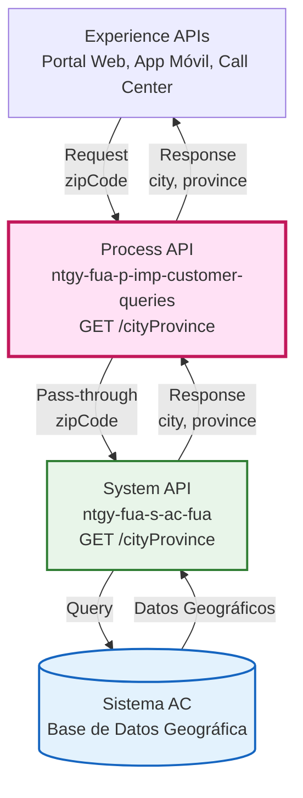
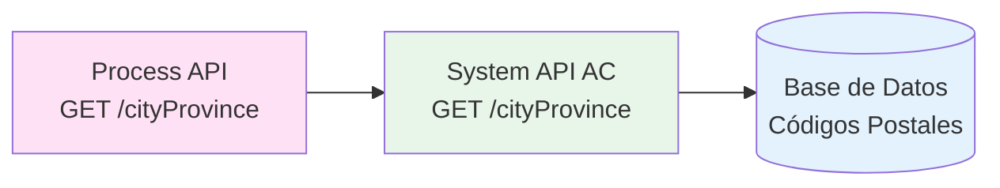
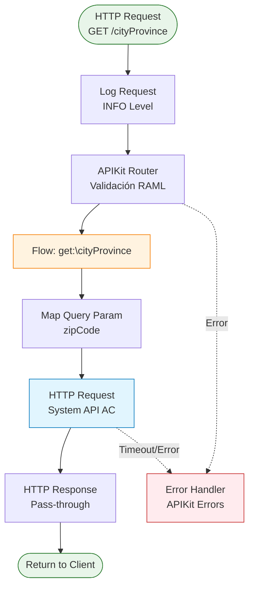
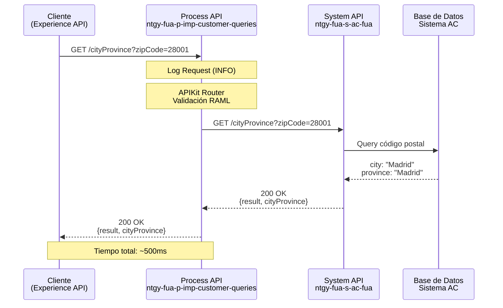
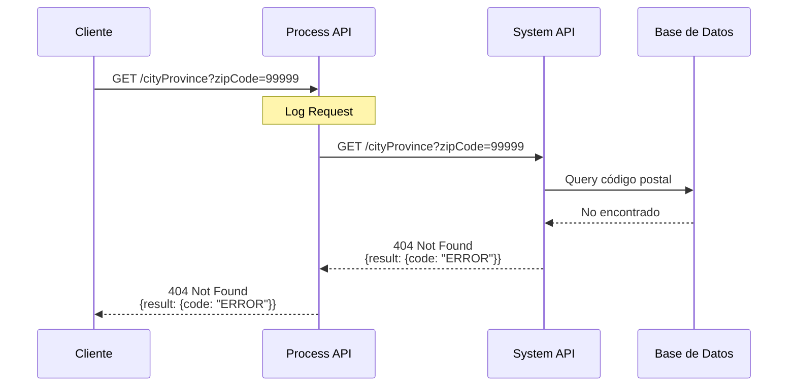
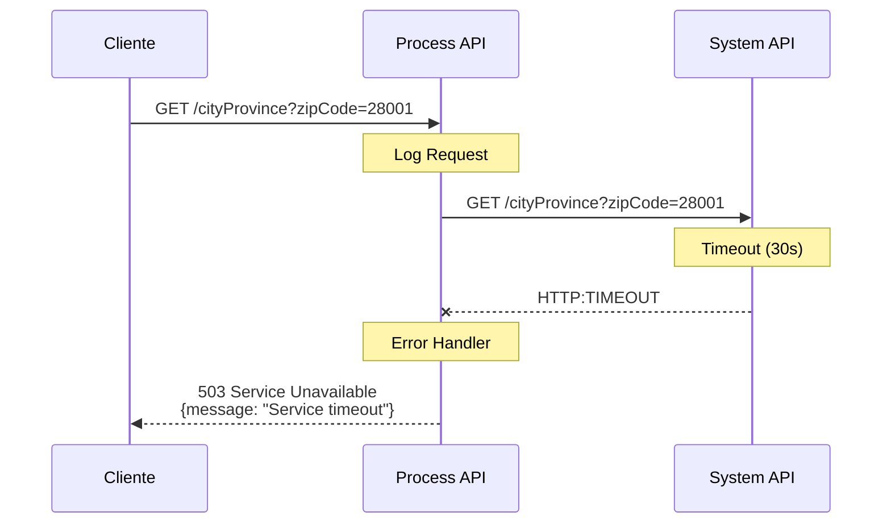

# GET /cityProvince

## 📌 Descripción General

### Propósito del Endpoint

Este endpoint proporciona información geográfica (municipio y provincia) a partir de un código postal español. Actúa como un servicio de consulta pass-through que delega directamente al System API de AC (ntgy-fua-s-ac-fua) sin aplicar transformaciones adicionales.

### Tipo de API

**Capa:** Process API (API-Led Connectivity)

**Función:** Orquestación de consultas geográficas para validación de direcciones

### Patrón de Integración

**Tipo:** Pass-Through (Delegación Pura)

**Descripción:** Este endpoint implementa un patrón de delegación directa donde:
- Recibe el código postal como query parameter
- Mapea el parámetro al System API sin transformaciones
- Retorna la respuesta del System API sin modificaciones
- No aplica lógica de negocio adicional

### Arquitectura API-Led Connectivity



---

## 💼 Propósito del Negocio

### Casos de Uso Principales

1. **Validación de Direcciones en Formularios**
   - Los usuarios ingresan su código postal en formularios de registro o actualización de datos
   - El sistema autocompleta municipio y provincia para evitar errores de captura
   - Mejora la experiencia de usuario y calidad de datos

2. **Normalización de Direcciones**
   - Estandarización de direcciones en procesos de alta de clientes
   - Validación de direcciones de suministro en contrataciones
   - Verificación de cobertura geográfica de servicios

3. **Búsqueda y Filtrado Geográfico**
   - Búsqueda de clientes por ubicación geográfica
   - Filtrado de servicios disponibles por zona
   - Análisis de distribución geográfica de clientes

### 🔗 Endpoints Dependientes

Este Process API consume el siguiente System API:

| System API | Endpoint | Método | Propósito |
|------------|----------|--------|-----------|
| `ntgy-fua-s-ac-fua` | `/cityProvince` | GET | Obtiene municipio y provincia a partir de código postal |

### Lógica de Orquestación



**Pasos del Proceso:**

1. **Recepción**: Process API recibe código postal como query parameter
2. **Delegación**: Mapea el parámetro y delega al System API de AC
3. **Respuesta**: Retorna directamente la respuesta del System API

### Transformaciones Aplicadas

⚠️ **Este Process API NO transforma la respuesta del System API.**

**Patrón Pass-Through:**
- El endpoint actúa como proxy transparente
- No modifica la estructura de datos
- No aplica validaciones adicionales
- Retorna la respuesta tal cual del System API

Para el schema completo, consultar:
📖 **System API: `ntgy-fua-s-ac-fua` endpoint `/cityProvince`**

### Contexto Empresarial

- **Dominio:** Gestión de Datos Geográficos
- **Sector:** Energía - Utilities
- **División:** Naturgy España - FUA (Frontal Único de Atención)
- **Proceso de Negocio:** Validación y normalización de direcciones

### Stakeholders

- **Agentes de Call Center**: Necesitan validar direcciones de clientes durante llamadas
- **Clientes Finales**: Utilizan el servicio indirectamente en portales web y apps móviles
- **Equipo de Calidad de Datos**: Requieren normalización consistente de direcciones
- **Desarrolladores de Experience APIs**: Consumen este servicio para validación de formularios

### Valor de Negocio

- **Mejora de Calidad de Datos**: Reduce errores en captura de direcciones
- **Experiencia de Usuario**: Autocomplete de direcciones mejora UX
- **Eficiencia Operativa**: Reduce tiempo de validación manual de direcciones
- **Cobertura de Servicios**: Permite verificar disponibilidad de servicios por zona

### Consumidores Potenciales

Este endpoint puede ser consumido por:
- Portales web de autoservicio (registro, actualización de datos)
- Aplicaciones móviles (formularios de alta)
- Sistemas de agentes de call center (validación de direcciones)
- Integraciones de terceros autorizados (partners comerciales)

---

## 🔧 Especificación Técnica

### URLs por Ambiente

| Ambiente | URL Base | URL Completa |
|----------|----------|--------------|
| **Local** | `http://localhost:8091` | `http://localhost:8091/api/cityProvince?zipCode=28001` |
| **Development** | `https://ntgy-fua-p-imp-customer-queries-dev.de-c1.cloudhub.io` | `https://ntgy-fua-p-imp-customer-queries-dev.de-c1.cloudhub.io/api/cityProvince?zipCode=28001` |
| **UAT** | `https://ntgy-fua-p-imp-customer-queries-uat.de-c1.cloudhub.io` | `https://ntgy-fua-p-imp-customer-queries-uat.de-c1.cloudhub.io/api/cityProvince?zipCode=28001` |
| **Production** | `https://ntgy-fua-p-imp-customer-queries-pro.de-c1.cloudhub.io` | `https://ntgy-fua-p-imp-customer-queries-pro.de-c1.cloudhub.io/api/cityProvince?zipCode=28001` |

### Método HTTP

```
GET /api/cityProvince
```

### Parámetros de Entrada

#### Query Parameters

| Parámetro | Tipo | Requerido | Descripción | Ejemplo |
|-----------|------|-----------|-------------|---------|
| `zipCode` | string | ✅ Sí | Código postal español (5 dígitos) | `28001` |

**Validaciones:**
- Formato: 5 dígitos numéricos
- Rango: 01000 - 52999 (códigos postales válidos en España)

### Estructura de Respuesta

⚠️ **Este Process API implementa un patrón pass-through.**

La respuesta es delegada directamente desde el System API `ntgy-fua-s-ac-fua` sin transformaciones.

#### Respuesta Exitosa (200 OK)

**Estructura según RAML:**

```json
{
  "result": {
    "codResult": "string",
    "msgResult": "string"
  },
  "cityProvince": {
    "cityId": "string",
    "cityDesc": "string",
    "provinceId": "string",
    "provinceDesc": "string"
  }
}
```

**Campos de Respuesta:**

| Campo | Tipo | Requerido | Descripción |
|-------|------|-----------|-------------|
| `result` | object | No | Objeto con resultado de la operación |
| `result.codResult` | string | No | Código de resultado |
| `result.msgResult` | string | No | Mensaje descriptivo del resultado |
| `cityProvince` | object | No | Objeto con datos geográficos |
| `cityProvince.cityId` | string | No | Código identificador del municipio |
| `cityProvince.cityDesc` | string | No | Nombre del municipio |
| `cityProvince.provinceId` | string | No | Identificador de la provincia |
| `cityProvince.provinceDesc` | string | No | Nombre de la provincia |

📖 **Para ejemplos reales de respuesta, consultar:**
- **System API:** `ntgy-fua-s-ac-fua`
- **Endpoint:** `GET /cityProvince`

**Nota:** Los valores exactos y el comportamiento de la respuesta son definidos por el System API.

#### Respuesta de Error (500 Internal Server Error)

```json
{
  "result": {
    "codResult": "string",
    "msgResult": "string"
  }
}
```

### Códigos de Estado HTTP

| Código | Descripción | Escenario |
|--------|-------------|-----------|
| `200` | OK | Código postal encontrado exitosamente |
| `400` | Bad Request | Parámetro zipCode faltante o inválido |
| `404` | Not Found | Código postal no existe en la base de datos |
| `500` | Internal Server Error | Error en System API o base de datos |
| `503` | Service Unavailable | System API no disponible |

### Autenticación

- **Tipo:** Client ID & Client Secret (Anypoint Platform)
- **Headers Requeridos:**
  - `client_id`: Identificador de la aplicación cliente
  - `client_secret`: Secreto de la aplicación cliente

### Timeouts

| Tipo | Valor | Configuración |
|------|-------|---------------|
| **Response Timeout** | 30 segundos | `${s-ac.timeout}` |
| **Connection Timeout** | 30 segundos | `${s-ac.timeout}` |

**Nota:** El timeout puede ser sobrescrito a 5 segundos para operaciones específicas mediante `${s-ac.timeoutOverride}`.

---

## 🏗️ Implementación Técnica

### Arquitectura del Flow



### Configuración del System API

**HTTP Request Configuration:**

```xml
<http:request-config 
    name="HTTP_API_SistemaAC" 
    basePath="/api" 
    responseTimeout="${s-ac.timeout}">
    <http:request-connection 
        host="${s-ac.host}" 
        port="${s-ac.port}" 
        connectionIdleTimeout="${s-ac.timeout}" 
        protocol="${s-ac.protocol}"/>
</http:request-config>
```

**Valores de Configuración (Producción):**
- **Host:** `ntgy-fua-s-ac-fua-bqyi65.internal-6bnlu3.irl-e1.cloudhub.io`
- **Port:** `443`
- **Protocol:** `HTTPS`
- **Base Path:** `/api`
- **Timeout:** `30000` ms (30 segundos)

### Implementación del Flow

**Archivo:** `p-imp-customer-queries.xml` (líneas 128-136)

```xml
<flow name="get:\cityProvince:p-imp-customer-queries-config">
    <http:request 
        method="GET" 
        doc:name="Request" 
        config-ref="HTTP_API_SistemaAC" 
        path="/cityProvince">
        <http:query-params><![CDATA[#[output application/java
---
{
    "zipCode": attributes.queryParams.zipCode
}]]]></http:query-params>
    </http:request>
</flow>
```

### Transformación DataWeave

**Mapeo de Query Parameters:**

```dataweave
%dw 2.0
output application/java
---
{
    "zipCode": attributes.queryParams.zipCode
}
```

**Descripción:**
- Extrae el parámetro `zipCode` de la query string del request
- Lo mapea directamente al query parameter del System API
- No aplica validaciones ni transformaciones adicionales

### Patrones de Diseño

**Patrón:** Pass-Through / Proxy Pattern

**Justificación:** 
- El Process API no necesita agregar lógica de negocio
- La respuesta del System API es adecuada para los consumidores
- Mantiene simplicidad y bajo acoplamiento
- Facilita el mantenimiento y evolución independiente

**Ventajas:**
- ✅ Bajo overhead de procesamiento
- ✅ Latencia mínima
- ✅ Fácil de mantener
- ✅ Escalabilidad horizontal simple

### Diagramas de Secuencia

#### 1. Flujo Normal de Éxito



#### 2. Flujo con Código Postal No Encontrado



#### 3. Flujo con Error Técnico (Timeout)



### Manejo de Errores

**Estrategia:** Propagación de errores del System API con manejo centralizado de APIKit

**Errores Manejados:**

1. **APIKIT:BAD_REQUEST (400)**
   - Parámetro `zipCode` faltante
   - Formato de código postal inválido
   - Response: `{"message": "Bad request"}`

2. **APIKIT:NOT_FOUND (404)**
   - Endpoint no encontrado
   - Response: `{"message": "Resource not found"}`

3. **HTTP:TIMEOUT**
   - System API no responde en 30 segundos
   - Se propaga como 503 Service Unavailable

4. **HTTP:CONNECTIVITY**
   - No se puede conectar al System API
   - Se propaga como 503 Service Unavailable

**Error Handler Configuration:**

```xml
<error-handler>
    <on-error-propagate type="APIKIT:BAD_REQUEST">
        <ee:transform>
            <ee:set-payload>
                {"message": "Bad request"}
            </ee:set-payload>
            <ee:set-variable variableName="httpStatus">400</ee:set-variable>
        </ee:transform>
    </on-error-propagate>
    <!-- Otros error handlers... -->
</error-handler>
```

### Logging

**Nivel de Log:** INFO

**Información Registrada:**
- Método HTTP
- URI del request
- Headers de cliente (x-client-code, x-client-doc-number, x-client-id)
- Query parameters
- URI parameters

**Ejemplo de Log:**

```json
{
  "method": "GET",
  "requestUri": "/api/cityProvince",
  "queryParams": {
    "zipCode": "28001"
  }
}
```

---

## 💻 Ejemplos de Uso

### Ejemplo 1: Consulta de Código Postal

#### cURL

```bash
curl -X GET "https://ntgy-fua-p-imp-customer-queries-pro.de-c1.cloudhub.io/api/cityProvince?zipCode=28001" \
  -H "Content-Type: application/json" \
  -H "client_id: YOUR_CLIENT_ID" \
  -H "client_secret: YOUR_CLIENT_SECRET"
```

#### Respuesta (200 OK)

**Estructura según RAML (valores de ejemplo):**

```json
{
  "result": {
    "codResult": "0",
    "msgResult": "OK"
  },
  "cityProvince": {
    "cityId": "28079",
    "cityDesc": "Madrid",
    "provinceId": "28",
    "provinceDesc": "Madrid"
  }
}
```

**Nota:** Los valores reales dependen de la respuesta del System API `ntgy-fua-s-ac-fua`.

### Ejemplo 2: Otro Código Postal

#### cURL

```bash
curl -X GET "https://ntgy-fua-p-imp-customer-queries-pro.de-c1.cloudhub.io/api/cityProvince?zipCode=08001" \
  -H "Content-Type: application/json" \
  -H "client_id: YOUR_CLIENT_ID" \
  -H "client_secret: YOUR_CLIENT_SECRET"
```

#### Respuesta (200 OK)

**Estructura según RAML (valores de ejemplo):**

```json
{
  "result": {
    "codResult": "0",
    "msgResult": "OK"
  },
  "cityProvince": {
    "cityId": "08019",
    "cityDesc": "Barcelona",
    "provinceId": "08",
    "provinceDesc": "Barcelona"
  }
}
```

### Ejemplo 3: JavaScript (Fetch API)

```javascript
const fetchCityProvince = async (zipCode) => {
  try {
    const response = await fetch(
      `https://ntgy-fua-p-imp-customer-queries-pro.de-c1.cloudhub.io/api/cityProvince?zipCode=${zipCode}`,
      {
        method: 'GET',
        headers: {
          'Content-Type': 'application/json',
          'client_id': 'YOUR_CLIENT_ID',
          'client_secret': 'YOUR_CLIENT_SECRET'
        }
      }
    );

    if (!response.ok) {
      throw new Error(`HTTP error! status: ${response.status}`);
    }

    const data = await response.json();
    
    // Estructura según RAML
    console.log(`Código Municipio: ${data.cityProvince.cityId}`);
    console.log(`Municipio: ${data.cityProvince.cityDesc}`);
    console.log(`Código Provincia: ${data.cityProvince.provinceId}`);
    console.log(`Provincia: ${data.cityProvince.provinceDesc}`);
    
    return data;
  } catch (error) {
    console.error('Error al consultar código postal:', error);
    throw error;
  }
};

// Uso
fetchCityProvince('28001');
```

### Ejemplo 4: Python (Requests)

```python
import requests

def get_city_province(zip_code):
    """
    Obtiene municipio y provincia a partir de código postal
    
    Args:
        zip_code (str): Código postal español (5 dígitos)
        
    Returns:
        dict: Información de ciudad y provincia según estructura RAML
    """
    url = "https://ntgy-fua-p-imp-customer-queries-pro.de-c1.cloudhub.io/api/cityProvince"
    
    headers = {
        'Content-Type': 'application/json',
        'client_id': 'YOUR_CLIENT_ID',
        'client_secret': 'YOUR_CLIENT_SECRET'
    }
    
    params = {
        'zipCode': zip_code
    }
    
    try:
        response = requests.get(url, headers=headers, params=params, timeout=30)
        response.raise_for_status()
        
        data = response.json()
        
        # Estructura según RAML
        city_id = data['cityProvince']['cityId']
        city_desc = data['cityProvince']['cityDesc']
        province_id = data['cityProvince']['provinceId']
        province_desc = data['cityProvince']['provinceDesc']
        
        print(f"Código Municipio: {city_id}")
        print(f"Municipio: {city_desc}")
        print(f"Código Provincia: {province_id}")
        print(f"Provincia: {province_desc}")
        
        return data
        
    except requests.exceptions.Timeout:
        print("Error: Timeout al consultar el servicio")
        raise
    except requests.exceptions.RequestException as e:
        print(f"Error al consultar código postal: {e}")
        raise

# Uso
result = get_city_province('28001')
```

### Ejemplo 5: Error - Código Postal No Encontrado

#### cURL

```bash
curl -X GET "https://ntgy-fua-p-imp-customer-queries-pro.de-c1.cloudhub.io/api/cityProvince?zipCode=99999" \
  -H "Content-Type: application/json" \
  -H "client_id: YOUR_CLIENT_ID" \
  -H "client_secret: YOUR_CLIENT_SECRET"
```

#### Respuesta (Según System API)

**Estructura según RAML:**

```json
{
  "result": {
    "codResult": "ERROR_CODE",
    "msgResult": "Código postal no encontrado"
  }
}
```

**Nota:** El código de estado HTTP y el mensaje exacto dependen de la implementación del System API.

### Ejemplo 6: Error - Parámetro Faltante

#### cURL

```bash
curl -X GET "https://ntgy-fua-p-imp-customer-queries-pro.de-c1.cloudhub.io/api/cityProvince" \
  -H "Content-Type: application/json" \
  -H "client_id: YOUR_CLIENT_ID" \
  -H "client_secret: YOUR_CLIENT_SECRET"
```

#### Respuesta (400 Bad Request)

```json
{
  "message": "Bad request"
}