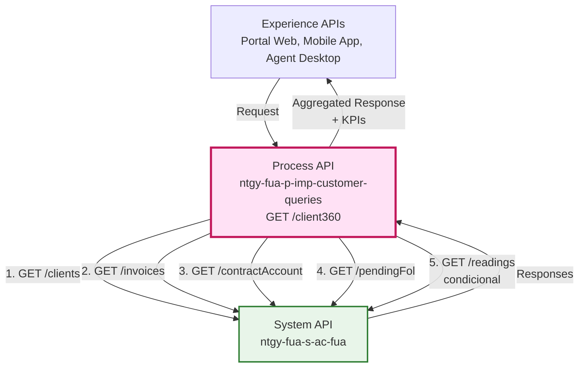
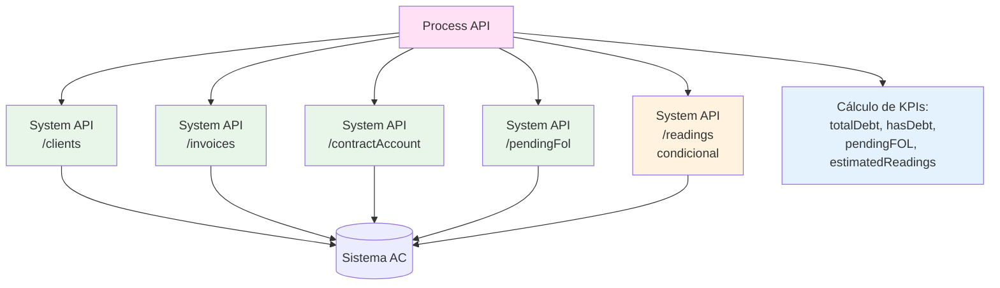
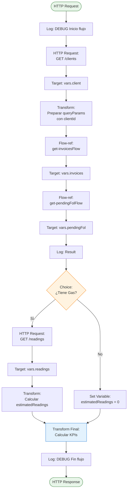
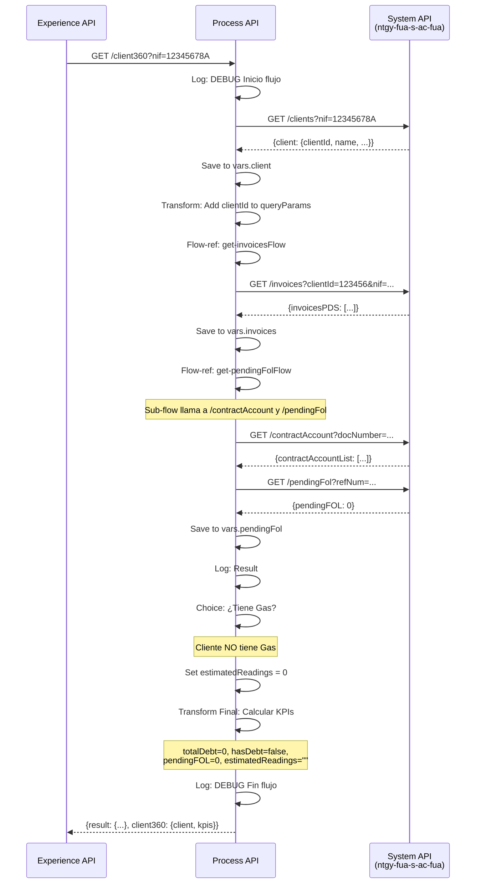
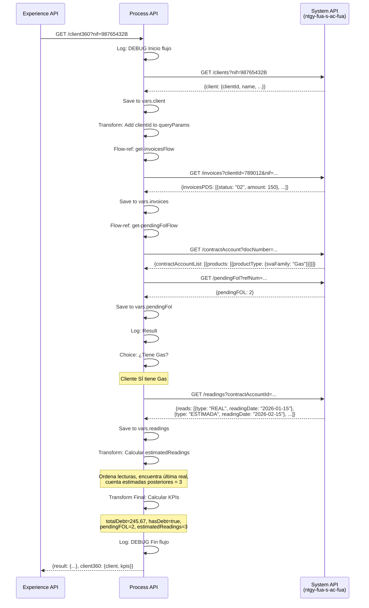
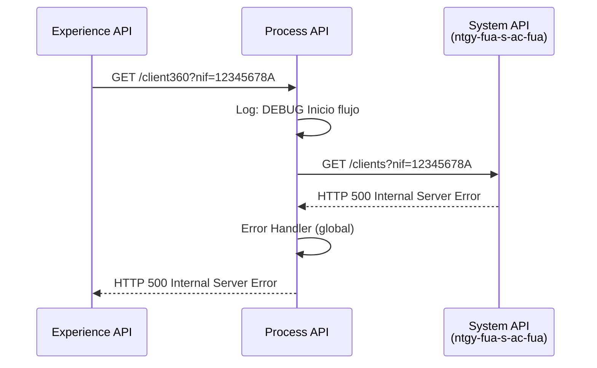

# GET /client360

## 📌 Descripción General

### Propósito del Endpoint

Este endpoint proporciona una **vista 360° completa del cliente**, agregando información de múltiples fuentes y calculando KPIs de negocio críticos. Orquesta hasta 5 llamadas al System API `ntgy-fua-s-ac-fua` para consolidar datos del cliente, facturas, contratos, FOL pendientes y lecturas de gas en una única respuesta enriquecida con indicadores calculados.

### Tipo de API

**Capa:** Process API (API-Led Connectivity)

**Función:** Orquestación compleja con agregación de datos y cálculo de KPIs

### Patrón de Integración

**Tipo:** Agregación con Cálculo de KPIs

**Descripción:** El endpoint orquesta múltiples llamadas secuenciales y condicionales al System API:
1. Obtiene datos básicos del cliente
2. Obtiene todas las facturas del cliente
3. Obtiene FOL pendientes (con sub-llamada a contratos)
4. Obtiene lecturas de gas (solo si aplica)
5. Calcula 4 KPIs de negocio
6. Retorna vista consolidada con datos + KPIs

### Arquitectura API-Led Connectivity



---

## 💼 Propósito del Negocio

### Casos de Uso Principales

1. **Vista Completa para Agentes de Atención**
   - Agentes obtienen toda la información del cliente en una sola llamada
   - Incluye datos básicos + KPIs críticos (deuda, FOL, lecturas)
   - **Beneficio:** Reduce tiempo de atención de 5 minutos a 30 segundos

2. **Dashboard de Cliente en Portal Web**
   - Clientes ven su información consolidada al iniciar sesión
   - KPIs visualizados: deuda total, estado de pagos, lecturas estimadas
   - **Beneficio:** Mejora experiencia de usuario y autoservicio

3. **Validación Pre-Operación**
   - Verificar estado del cliente antes de permitir operaciones
   - Identificar clientes con deuda o FOL pendientes
   - **Beneficio:** Previene operaciones con clientes problemáticos

4. **Análisis de Calidad de Lecturas**
   - Identificar clientes con muchas lecturas estimadas de gas
   - Priorizar visitas de lectura real
   - **Beneficio:** Mejora precisión de facturación

### 🔗 Endpoints Dependientes

Este Process API consume el siguiente System API con múltiples endpoints:

| System API | Endpoint | Método | Propósito |
|------------|----------|--------|-----------|
| `ntgy-fua-s-ac-fua` | `/clients` | GET | Obtiene información básica del cliente (nombre, dirección, contacto) |
| `ntgy-fua-s-ac-fua` | `/invoices` | GET | Obtiene lista completa de facturas del cliente |
| `ntgy-fua-s-ac-fua` | `/contractAccount` | GET | Obtiene cuentas de contrato y productos asociados |
| `ntgy-fua-s-ac-fua` | `/pendingFol` | GET | Obtiene FOL (First Order Logic) pendientes por contrato |
| `ntgy-fua-s-ac-fua` | `/readings` | GET | Obtiene lecturas históricas de gas (solo si cliente tiene Gas) |

### Lógica de Orquestación



**Pasos del Proceso:**

1. **Paso 1**: Obtener información básica del cliente mediante `/clients`
2. **Paso 2**: Transformar query params con `clientId` obtenido
3. **Paso 3**: Obtener facturas mediante flow-ref a `get-invoicesFlow`
4. **Paso 4**: Obtener FOL pendientes mediante flow-ref a `get-pendingFolFlow`
   - Sub-paso 4.1: Obtener contratos mediante `get-contractAccountFlow`
   - Sub-paso 4.2: Construir query con números de contrato
   - Sub-paso 4.3: Llamar a `/pendingFol`
5. **Paso 5**: Evaluar si cliente tiene productos de Gas
6. **Paso 6**: Si tiene Gas, obtener lecturas mediante `/readings`
7. **Paso 7**: Calcular lecturas estimadas (solo Gas)
8. **Paso 8**: Calcular 4 KPIs de negocio
9. **Paso 9**: Agregar y retornar respuesta consolidada

### Transformaciones Aplicadas

**Transformación de Request:**

| Campo Original | Campo Transformado | Transformación |
|----------------|-------------------|----------------|
| `nif` (query param) | `nif` (query param para /clients) | Pass-through |
| `client.clientId` (response /clients) | `clientId` (query param para /invoices) | Extracción del response |

**Cálculo de KPIs:**

| KPI | Fuente de Datos | Cálculo |
|-----|----------------|---------|
| `totalDebt` | Facturas con estado 02/04 vencidas | Suma de `amount` de facturas vencidas impagadas |
| `hasDebt` | Estados de facturas | `true` si alguna factura tiene estado "02" o "04" |
| `pendingFOL` | Endpoint `/pendingFol` | Valor directo del response |
| `estimatedReadings` | Lecturas de gas | Cuenta lecturas estimadas desde última lectura real |

### Contexto Empresarial

- **Dominio:** Gestión de Clientes y Atención al Cliente
- **Sector:** Energía - Utilities
- **División:** Naturgy España - FUA (Frontal Único de Atención)
- **Proceso de Negocio:** Vista 360° del Cliente

### Stakeholders

- **Agentes de Atención al Cliente**: Necesitan vista completa del cliente para resolver consultas eficientemente
- **Clientes Finales**: Reciben dashboard consolidado en portal web/móvil
- **Departamento de Cobros**: Utilizan KPI de deuda para gestión de morosos
- **Departamento de Operaciones**: Utilizan KPI de lecturas estimadas para planificar visitas

### Valor de Negocio

- **Eficiencia Operativa**: Reduce tiempo de atención de 5 minutos a 30 segundos
- **Mejora de Experiencia**: Cliente ve toda su información en un solo lugar
- **Gestión Proactiva**: KPIs permiten identificar clientes problemáticos
- **Optimización de Recursos**: Prioriza visitas de lectura según lecturas estimadas

### Consumidores Potenciales

Este endpoint puede ser consumido por:
- Portales web de autoservicio (FUA Portal) - Dashboard principal
- Aplicaciones móviles - Vista de cliente
- Sistemas de agentes de call center - Pantalla principal de atención
- Aplicaciones de back office - Análisis de clientes

---

## 🔧 Especificación Técnica

### URLs por Ambiente

| Ambiente | URL Base | URL Completa |
|----------|----------|--------------|
| **Local** | `http://localhost:8091` | `http://localhost:8091/api/client360` |
| **Development** | `https://ntgy-fua-p-imp-customer-queries-dev.de-c1.cloudhub.io` | `https://ntgy-fua-p-imp-customer-queries-dev.de-c1.cloudhub.io/api/client360` |
| **UAT** | `https://ntgy-fua-p-imp-customer-queries-uat.de-c1.cloudhub.io` | `https://ntgy-fua-p-imp-customer-queries-uat.de-c1.cloudhub.io/api/client360` |
| **Production** | `https://ntgy-fua-p-imp-customer-queries-pro.de-c1.cloudhub.io` | `https://ntgy-fua-p-imp-customer-queries-pro.de-c1.cloudhub.io/api/client360` |

### Método HTTP

```
GET /api/client360
```

### Parámetros de Entrada

#### Query Parameters

| Parámetro | Tipo | Requerido | Descripción | Ejemplo |
|-----------|------|-----------|-------------|---------|
| `nif` | string | Sí | Número de identificación fiscal del cliente (NIF/NIE) | "12345678A" |

### Respuestas

#### 200 OK - Cliente Sin Deuda, Sin Gas

```json
{
  "result": {
    "codResult": "0000",
    "msgResult": "No hay error"
  },
  "client360": {
    "client": {
      "clientId": "123456",
      "clientCode": "CLI001",
      "nif": "12345678A",
      "name": "Juan",
      "surname1": "García",
      "surname2": "López",
      "email": "juan.garcia@example.com",
      "phone": "600123456"
    },
    "kpis": {
      "totalDebt": 0,
      "hasDebt": false,
      "pendingFOL": 0,
      "estimatedReadings": ""
    }
  }
}
```

#### 200 OK - Cliente Con Deuda y Gas

```json
{
  "result": {
    "codResult": "0000",
    "msgResult": "No hay error"
  },
  "client360": {
    "client": {
      "clientId": "789012",
      "clientCode": "CLI002",
      "nif": "98765432B",
      "name": "María",
      "surname1": "Martínez",
      "surname2": "Sánchez",
      "email": "maria.martinez@example.com",
      "phone": "600987654"
    },
    "kpis": {
      "totalDebt": 245.67,
      "hasDebt": true,
      "pendingFOL": 2,
      "estimatedReadings": 3
    }
  }
}
```

**Nota sobre KPIs:**
- `totalDebt`: Suma de importes de facturas vencidas impagadas (estados 02 o 04)
- `hasDebt`: `true` si existe alguna factura con estado 02 o 04
- `pendingFOL`: Número de FOL (First Order Logic) pendientes
- `estimatedReadings`: Número de lecturas estimadas desde última lectura real (solo Gas), cadena vacía si no aplica

#### 400 Bad Request

```json
{
  "message": "Bad request"
}
```

**Causa:** Falta el parámetro requerido `nif`.

#### 404 Not Found

```json
{
  "message": "Resource not found"
}
```

**Causa:** Cliente no encontrado con el NIF proporcionado.

#### 500 Internal Server Error

```json
{
  "message": "Internal server error"
}
```

**Causa:** Error en la comunicación con System APIs o error interno del servidor.

### Autenticación

- **Tipo:** Client ID & Client Secret (Anypoint Platform)
- **Headers requeridos:**
  - `client_id`: ID del cliente de la aplicación
  - `client_secret`: Secret del cliente de la aplicación

### Timeouts

| Tipo | Valor |
|------|-------|
| **Request Timeout por llamada** | 30 segundos |
| **Connection Timeout** | 30 segundos |
| **Timeout Total Estimado** | 90-150 segundos (depende de si tiene Gas) |

**Nota:** El timeout total varía según:
- Sin Gas: ~90 segundos (4 llamadas secuenciales)
- Con Gas: ~120-150 segundos (5 llamadas secuenciales + cálculo de lecturas)

---

## 🏗️ Implementación Técnica

### Arquitectura del Flow



### Transformaciones DataWeave

#### 1. Preparación de Query Params con clientId

```dataweave
%dw 2.0
output application/java
---
{
  queryParams: {
    clientId: vars.client.clientId,
    nif: attributes.queryParams.nif
  }
}
```

**Propósito:** Enriquecer los query params con el `clientId` obtenido de la llamada a `/clients`.

#### 2. Cálculo de Lecturas Estimadas (Solo Gas)

```dataweave
%dw 2.0
output application/java
var arrOrdenado = vars.readings.reads orderBy $.readingDate
var maxNotEstimated = max((arrOrdenado filter (value, index) -> (value."type" != 'ESTIMADA')).readingDate)
---
sizeOf(arrOrdenado filter (value, index) -> (value.readingDate > maxNotEstimated))
```

**Propósito:** 
1. Ordena lecturas por fecha
2. Encuentra la fecha de la última lectura NO estimada
3. Cuenta cuántas lecturas estimadas hay después de esa fecha

#### 3. Transformación Final con Cálculo de KPIs

```dataweave
%dw 2.0
output application/json
var hasDebt = if ((vars.invoices.invoicesPDS..'status' contains "02") or 
                  (vars.invoices.invoicesPDS..'status' contains "04")) 
              true 
              else false

var billingDateExpired = vars.invoices.invoicesPDS filter ((value,index) -> 
                         value.billingDate < now())

var totalDebt = billingDateExpired filter ((value,index) -> 
                value.status == "02" or value.status == "04")
---
{
  "result": {
    "codResult": "0000",
    "msgResult": "No hay error"	
  },
  "client360": {
    "client": vars.client,
    "kpis": {
      "totalDebt": totalDebt..amount reduce ($$ + $),
      "hasDebt": hasDebt,
      "pendingFOL": vars.pendingFol.pendingFOL,
      "estimatedReadings": if(vars.estimatedReadings <= 0) "" else vars.estimatedReadings
    }
  }
}
```

**Lógica de Cálculo de KPIs:**

1. **hasDebt**: Verifica si alguna factura tiene estado "02" o "04"
2. **billingDateExpired**: Filtra facturas con fecha de facturación vencida (< now())
3. **totalDebt**: De las facturas vencidas, suma los importes de las que tienen estado "02" o "04"
4. **estimatedReadings**: Si es 0 o negativo, retorna cadena vacía; si no, retorna el número

### Patrones de Diseño

**Patrón 1: Agregación Secuencial con Enriquecimiento**

**Justificación:** Cada llamada enriquece el contexto para la siguiente. El `clientId` obtenido en la primera llamada se usa en las siguientes, creando una cadena de dependencias.

**Patrón 2: Flujo Condicional Basado en Tipo de Producto**

**Justificación:** La llamada a `/readings` solo se ejecuta si el cliente tiene productos de tipo Gas, optimizando el rendimiento para clientes que solo tienen electricidad.

**Patrón 3: Variables de Target para Aislamiento**

**Justificación:** Cada llamada guarda su resultado en una variable específica (`vars.client`, `vars.invoices`, etc.), permitiendo acceso independiente a cada conjunto de datos en la transformación final.

**Patrón 4: Cálculo de KPIs en Capa de Proceso**

**Justificación:** Los KPIs se calculan en el Process API en lugar de en el System API, permitiendo reutilización del System API para otros casos de uso sin lógica de negocio específica.

### Diagramas de Secuencia

#### 1. Flujo Normal - Cliente Sin Gas



#### 2. Flujo Completo - Cliente Con Gas y Deuda



#### 3. Flujo con Error Técnico



### Manejo de Errores

#### Error Handler Global (APIKit)

**Tipos manejados:**
- `APIKIT:BAD_REQUEST` (400) - Parámetro `nif` faltante
- `APIKIT:NOT_FOUND` (404) - Cliente no encontrado
- `APIKIT:METHOD_NOT_ALLOWED` (405)
- `APIKIT:NOT_ACCEPTABLE` (406)
- `APIKIT:UNSUPPORTED_MEDIA_TYPE` (415)
- `APIKIT:NOT_IMPLEMENTED` (501)

**Acción:** Retorna mensaje de error estándar con código HTTP apropiado.

#### Propagación de Errores de System API

Si alguna de las llamadas al System API falla:
1. El error se propaga al error handler global
2. Se retorna HTTP 500 con mensaje genérico
3. El error se registra en los logs para troubleshooting

### Estados de Factura para Cálculo de Deuda

| Código | Descripción | Considerado Deuda |
|--------|-------------|-------------------|
| `"02"` | Factura impagada | ✅ Sí |
| `"04"` | Factura impagada | ✅ Sí |
| `"01"` | Factura pagada | ❌ No |
| Otros | Otros estados | ❌ No |

**Lógica de Validación:**
```dataweave
(vars.invoices.invoicesPDS..'status' contains "02") or 
(vars.invoices.invoicesPDS..'status' contains "04")
```

### Condición para Lecturas de Gas

**Expresión de Evaluación:**
```dataweave
!isEmpty(vars.contractAccount.contractAccountList) and 
(vars.contractAccount.contractAccountList..contractAccountRefList..products..productType.svaFamily contains "Gas")
```

**Condiciones:**
1. El cliente debe tener cuentas de contrato
2. Al menos un producto debe tener `svaFamily = "Gas"`

### Configuración de System API

**Sistema AC (ntgy-fua-s-ac-fua):**
```yaml
s-ac:
  path:
    clients: "/clients"
  host: "ntgy-fua-s-ac-fua-bqyi65.internal-6bnlu3.irl-e1.cloudhub.io"
  port: "443"
  protocol: "HTTPS"
  timeout: "30000"
```

---

## 💻 Ejemplos de Uso

### Ejemplo 1: Cliente Sin Deuda, Sin Gas

#### cURL

```bash
curl -X GET "https://ntgy-fua-p-imp-customer-queries-pro.de-c1.cloudhub.io/api/client360?nif=12345678A" \
  -H "Content-Type: application/json" \
  -H "client_id: YOUR_CLIENT_ID" \
  -H "client_secret: YOUR_CLIENT_SECRET"
```

#### Respuesta (200 OK)

```json
{
  "result": {
    "codResult": "0000",
    "msgResult": "No hay error"
  },
  "client360": {
    "client": {
      "clientId": "123456",
      "clientCode": "CLI001",
      "nif": "12345678A",
      "name": "Juan",
      "surname1": "García",
      "surname2": "López",
      "email": "juan.garcia@example.com",
      "phone": "600123456",
      "address": {
        "street": "Calle Mayor",
        "number": "10",
        "city": "Madrid",
        "postalCode": "28001"
      }
    },
    "kpis": {
      "totalDebt": 0,
      "hasDebt": false,
      "pendingFOL": 0,
      "estimatedReadings": ""
    }
  }
}
```

### Ejemplo 2: Cliente Con Deuda y Gas

#### cURL

```bash
curl -X GET "https://ntgy-fua-p-imp-customer-queries-pro.de-c1.cloudhub.io/api/client360?nif=98765432B" \
  -H "Content-Type: application/json" \
  -H "client_id: YOUR_CLIENT_ID" \
  -H "client_secret: YOUR_CLIENT_SECRET"
```

#### Respuesta (200 OK)

```json
{
  "result": {
    "codResult": "0000",
    "msgResult": "No hay error"
  },
  "client360": {
    "client": {
      "clientId": "789012",
      "clientCode": "CLI002",
      "nif": "98765432B",
      "name": "María",
      "surname1": "Martínez",
      "surname2": "Sánchez",
      "email": "maria.martinez@example.com",
      "phone": "600987654",
      "address": {
        "street": "Avenida Diagonal",
        "number": "500",
        "city": "Barcelona",
        "postalCode": "08029"
      }
    },
    "kpis": {
      "totalDebt": 245.67,
      "hasDebt": true,
      "pendingFOL": 2,
      "estimatedReadings": 3
    }
  }
}
```

**Interpretación de KPIs:**
- Cliente tiene **245.67€ de deuda** en facturas vencidas
- Tiene **2 FOL pendientes** de gestión
- Tiene **3 lecturas estimadas** de gas desde la última lectura real

### Ejemplo 3: JavaScript (Fetch API)

```javascript
const getClient360 = async (nif) => {
  const response = await fetch(
    `https://ntgy-fua-p-imp-customer-queries-pro.de-c1.cloudhub.io/api/client360?nif=${nif}`,
    {
      method: 'GET',
      headers: {
        'Content-Type': 'application/json',
        'client_id': 'YOUR_CLIENT_ID',
        'client_secret': 'YOUR_CLIENT_SECRET'
      }
    }
  );

  const data = await response.json();
  
  // Mostrar información del cliente
  console.log(`Cliente: ${data.client360.client.name} ${data.client360.client.surname1}`);
  
  // Verificar KPIs
  if (data.client360.kpis.hasDebt) {
    console.log(`⚠️ ALERTA: Cliente tiene deuda de ${data.client360.kpis.totalDebt}€`);
  }
  
  if (data.client360.kpis.pendingFOL > 0) {
    console.log(`⚠️ ALERTA: Cliente tiene ${data.client360.kpis.pendingFOL} FOL pendientes`);
  }
  
  if (data.client360.kpis.estimatedReadings !== "" && data.client360.kpis.estimatedReadings > 2) {
    console.log(`⚠️ ALERTA: Cliente tiene ${data.client360.kpis.estimatedReadings} lecturas estimadas`);
  }
  
  return data;
};

// Uso
getClient360('12345678A');
```

### Ejemplo 4: Python (Requests)

```python
import requests

def get_client_360(nif):
    url = "https://ntgy-fua-p-imp-customer-queries-pro.de-c1.cloudhub.io/api/client360"
    
    params = {
        'nif': nif
    }
    
    headers = {
        'Content-Type': 'application/json',
        'client_id': 'YOUR_CLIENT_ID',
        'client_secret': 'YOUR_CLIENT_SECRET'
    }
    
    response = requests.get(url, params=params, headers=headers)
    data = response.json()
    
    # Extraer información
    client = data['client360']['client']
    kpis = data['client360']['kpis']
    
    print(f"Cliente: {client['name']} {client['surname1']}")
    print(f"NIF: {client['nif']}")
    print(f"\nKPIs:")
    print(f"  - Deuda Total: {kpis['totalDebt']}€")
    print(f"  - Tiene Deuda: {'Sí' if kpis['hasDebt'] else 'No'}")
    print(f"  - FOL Pendientes: {kpis['pendingFOL']}")
    print(f"  - Lecturas Estimadas: {kpis['estimatedReadings'] if kpis['estimatedReadings'] != '' else 'N/A'}")
    
    return data

# Uso
client_data = get_client_360('12345678A')
```

### Ejemplo 5: React Component (TypeScript)

```typescript
import React, { useEffect, useState } from 'react';

interface Client360Data {
  result: {
    codResult: string;
    msgResult: string;
  };
  client360: {
    client: {
      clientId: string;
      name: string;
      surname1: string;
      nif: string;
      email: string;
      phone: string;
    };
    kpis: {
      totalDebt: number;
      hasDebt: boolean;
      pendingFOL: number;
      estimatedReadings: number | string;
    };
  };
}

const Client360Dashboard: React.FC<{ nif: string }> = ({ nif }) => {
  const [data, setData] = useState<Client360Data | null>(null);
  const [loading, setLoading] = useState(true);
  const [error, setError] = useState<string | null>(null);

  useEffect(() => {
    const fetchClient360 = async () => {
      try {
        const response = await fetch(
          `https://ntgy-fua-p-imp-customer-queries-pro.de-c1.cloudhub.io/api/client360?nif=${nif}`,
          {
            headers: {
              'Content-Type': 'application/json',
              'client_id': process.env.REACT_APP_CLIENT_ID!,
              'client_secret': process.env.REACT_APP_CLIENT_SECRET!
            }
          }
        );

        if (!response.ok) {
          throw new Error('Error al obtener datos del cliente');
        }

        const result = await response.json();
        setData(result);
      } catch (err) {
        setError(err instanceof Error ? err.message : 'Error desconocido');
      } finally {
        setLoading(false);
      }
    };

    fetchClient360();
  }, [nif]);

  if (loading) return <div>Cargando...</div>;
  if (error) return <div>Error: {error}</div>;
  if (!data) return null;

  const { client, kpis } = data.client360;

  return (
    <div className="client-360-dashboard">
      <h2>Vista 360° del Cliente</h2>
      
      <div className="client-info">
        <h3>{client.name} {client.surname1}</h3>
        <p>NIF: {client.nif}</p>
        <p>Email: {client.email}</p>
        <p>Teléfono: {client.phone}</p>
      </div>

      <div className="kpis">
        <h3>Indicadores</h3>
        
        <div className={`kpi ${kpis.hasDebt ? 'alert' : 'ok'}`}>
          <span>Deuda Total:</span>
          <strong>{kpis.totalDebt}€</strong>
        </div>

        <div className={`kpi ${kpis.pendingFOL > 0 ? 'warning' : 'ok'}`}>
          <span>FOL Pendientes:</span>
          <strong>{kpis.pendingFOL}</strong>
        </div>

        {kpis.estimatedReadings !== "" && (
          <div className={`kpi ${Number(kpis.estimatedReadings) > 2 ? 'warning' : 'ok'}`}>
            <span>Lecturas Estimadas:</span>
            <strong>{kpis.estimatedReadings}</strong>
          </div>
        )}
      </div>
    </div>
  );
};

export default Client360Dashboard;
```

### Ejemplo 6: Error - Parámetro Faltante

#### cURL

```bash
curl -X GET "https://ntgy-fua-p-imp-customer-queries-pro.de-c1.cloudhub.io/api/client360" \
  -H "Content-Type: application/json" \
  -H "client_id: YOUR_CLIENT_ID" \
  -H "client_secret: YOUR_CLIENT_SECRET"
```

#### Respuesta (400 Bad Request)

```json
{
  "message": "Bad request"
}
```

### Ejemplo 7: Error - Cliente No Encontrado

#### cURL

```bash
curl -X GET "https://ntgy-fua-p-imp-customer-queries-pro.de-c1.cloudhub.io/api/client360?nif=99999999Z" \
  -H "Content-Type: application/json" \
  -H "client_id: YOUR_CLIENT_ID" \
  -H "client_secret": "YOUR_CLIENT_SECRET"
```

#### Respuesta (404 Not Found)

```json
{
  "message": "Resource not found"
}
```
