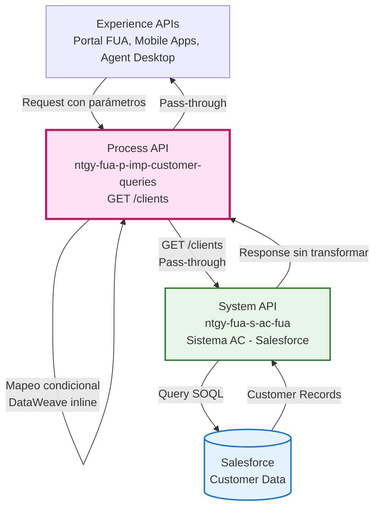
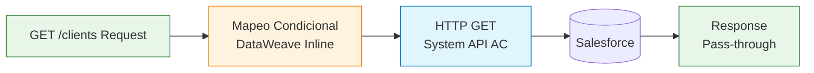
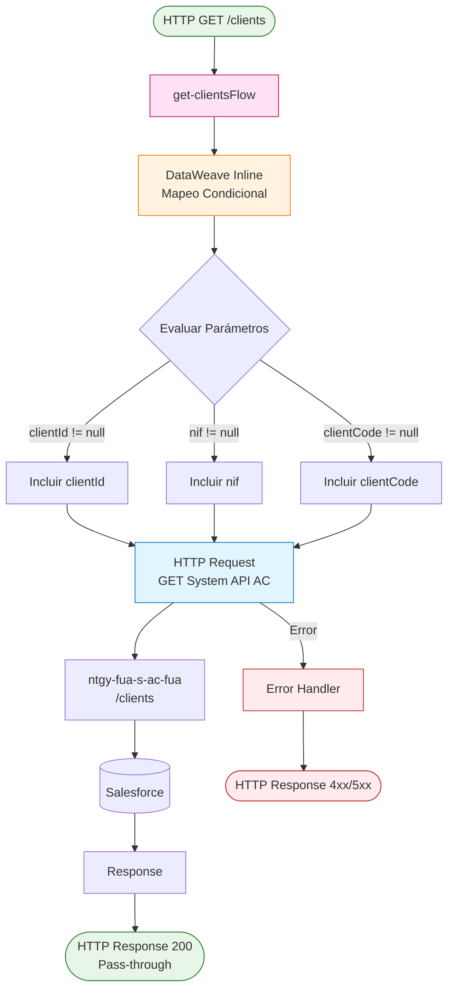
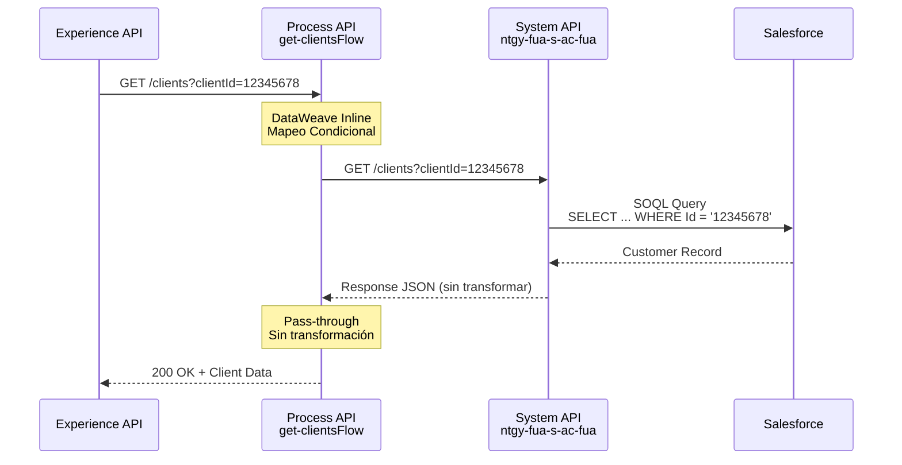
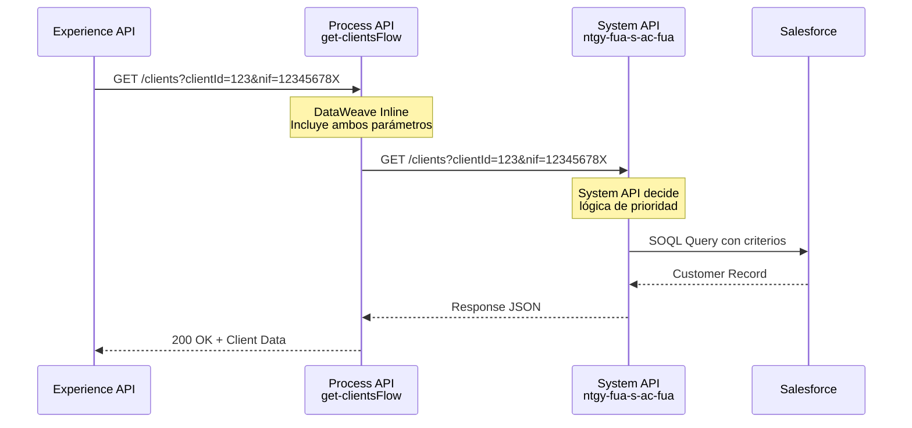
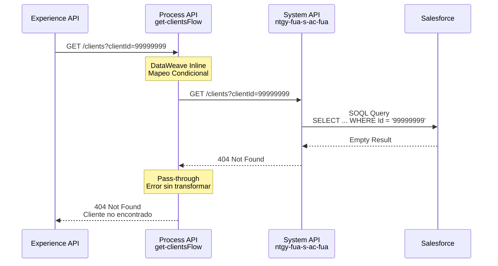

# GET /clients

## 📌 Descripción General

### Propósito del Endpoint

Este endpoint permite obtener información de clientes mediante diferentes criterios de búsqueda: por identificador de cliente (`clientId`), por número de identificación fiscal (`nif`), o por código de cliente (`clientCode`). El endpoint actúa como pass-through que mapea condicionalmente los parámetros recibidos y los envía directamente al System API AC.

### Tipo de API

**Capa:** Process API (API-Led Connectivity)

**Función:** Pass-through con mapeo condicional de parámetros de consulta de clientes

### Patrón de Integración

**Tipo:** Pass-Through Simple

**Descripción:** El endpoint recibe los parámetros de consulta, los mapea condicionalmente (solo incluye los que no son null) y los pasa directamente al System API AC sin transformaciones adicionales. La respuesta del System API se retorna tal cual al consumidor.

**Características:**
- Mapeo condicional de parámetros usando DataWeave inline
- Sin transformaciones de respuesta
- Delegación directa al System API
- Respuesta pass-through sin modificaciones

### Arquitectura API-Led Connectivity



---

## 💼 Propósito del Negocio

### Casos de Uso Principales

1. **Búsqueda de Cliente por ID**
   - Agente de call center necesita acceder rápidamente a información de un cliente conocido
   - Beneficio: Acceso directo y rápido (< 2 segundos) a datos completos del cliente

2. **Búsqueda de Cliente por NIF**
   - Cliente llama sin conocer su código de cliente, solo proporciona su DNI/NIE
   - Beneficio: Identificación del cliente sin necesidad de datos adicionales

3. **Búsqueda de Cliente por Código**
   - Sistemas internos necesitan consultar cliente por código interno
   - Beneficio: Integración con sistemas legacy que usan códigos propios

### 🔗 Endpoints Dependientes

Este Process API consume el siguiente System API:

| System API | Endpoint | Método | Propósito |
|------------|----------|--------|-----------|
| `ntgy-fua-s-ac-fua` | `/clients` | GET | Consulta de información de clientes desde Salesforce con múltiples criterios de búsqueda |

### Lógica de Orquestación



**Pasos del Proceso:**

1. **Recepción de Parámetros**: El endpoint recibe uno o más parámetros de consulta (clientId, nif, clientCode)
2. **Mapeo Condicional**: DataWeave inline evalúa qué parámetros no son null y los incluye en la petición
3. **Llamada al System API**: Se realiza HTTP GET al System API AC con los parámetros mapeados
4. **Respuesta Pass-Through**: La respuesta del System API se retorna sin transformaciones

### Transformaciones Aplicadas

⚠️ **Este Process API NO transforma la respuesta del System API.**

**Mapeo de Parámetros (DataWeave Inline):**

```dataweave
%dw 2.0
output application/java
---
{
  ("clientId": attributes.queryParams.clientId) if (attributes.queryParams.clientId != null),
  ("nif": attributes.queryParams.nif) if (attributes.queryParams.nif != null),
  ("clientCode": attributes.queryParams.clientCode) if (attributes.queryParams.clientCode != null)
}
```

**Lógica:** Solo se incluyen en la petición al System API los parámetros que tienen valor (no null).

Para el schema completo de la respuesta, consultar:
📖 **System API: `ntgy-fua-s-ac-fua` endpoint `/clients`**

### Contexto Empresarial

- **Dominio:** Gestión de Clientes Minoristas
- **Sector:** Energía - Utilities (Gas & Electricidad)
- **División:** Naturgy España - FUA (Frontal Único de Atención)
- **Proceso de Negocio:** Consulta y recuperación de información de clientes

### Stakeholders

- **Agentes de Call Center**: Necesitan acceso rápido a información de clientes durante llamadas
- **Clientes Finales**: Acceden a su información a través de portales de autoservicio
- **Equipos de Back Office**: Consultan información de clientes para operaciones administrativas
- **Sistemas de Terceros**: Integraciones autorizadas que requieren datos de clientes

### Valor de Negocio

- **Reducción de Tiempo de Atención**: Búsqueda rápida (< 2 segundos) mejora eficiencia de agentes
- **Flexibilidad de Búsqueda**: Múltiples criterios permiten encontrar clientes con datos parciales
- **Simplicidad de Integración**: Pass-through facilita mantenimiento y reduce latencia
- **Experiencia de Usuario**: Acceso unificado independientemente del criterio de búsqueda

### Consumidores Potenciales

Este endpoint puede ser consumido por:
- Portales web de autoservicio (FUA Portal)
- Aplicaciones móviles de clientes
- Sistemas de agentes de call center (Agent Desktop)
- Aplicaciones web internas de back office
- Integraciones de terceros autorizados

---

## 🔧 Especificación Técnica

### URLs por Ambiente

| Ambiente | URL Base | URL Completa |
|----------|----------|--------------|
| **Local** | `http://localhost:8084` | `http://localhost:8084/api/clients` |
| **Development** | `https://ntgy-fua-p-imp-customer-queries-dev.de-c1.cloudhub.io` | `https://ntgy-fua-p-imp-customer-queries-dev.de-c1.cloudhub.io/api/clients` |
| **UAT** | `https://ntgy-fua-p-imp-customer-queries-uat.de-c1.cloudhub.io` | `https://ntgy-fua-p-imp-customer-queries-uat.de-c1.cloudhub.io/api/clients` |
| **Production** | `https://ntgy-fua-p-imp-customer-queries-pro.de-c1.cloudhub.io` | `https://ntgy-fua-p-imp-customer-queries-pro.de-c1.cloudhub.io/api/clients` |

### Método HTTP

```
GET /api/clients
```

### Parámetros de Entrada

#### Query Parameters

| Parámetro | Tipo | Requerido | Descripción | Ejemplo |
|-----------|------|-----------|-------------|---------|
| `clientId` | string | No | Identificador único del cliente | `12345678` |
| `nif` | string | No | Número de identificación fiscal (DNI/NIE) | `12345678X` |
| `clientCode` | string | No | Código interno del cliente | `CLI001` |
| `limit` | integer | No | Límite de registros para paginación (según RAML) | `10` |
| `offset` | integer | No | Offset para paginación (según RAML) | `0` |

**Nota sobre Parámetros:**
- Los parámetros NO son mutuamente excluyentes
- Se pueden enviar múltiples parámetros simultáneamente
- Solo se pasan al System API los parámetros que tienen valor (no null)
- El System API determina la lógica de prioridad si hay múltiples parámetros

⚠️ **Observación:** Los parámetros `limit` y `offset` aparecen en el RAML pero no en la implementación XML actual del mapeo de parámetros.

#### Headers

| Header | Tipo | Requerido | Descripción |
|--------|------|-----------|-------------|
| `client_id` | string | Sí | Client ID de Anypoint Platform |
| `client_secret` | string | Sí | Client Secret de Anypoint Platform |

### Respuestas

#### 200 OK - Búsqueda Exitosa

**Estructura de Respuesta (según System API):**

```json
{
  "result": {
    "codResult": "0000",
    "msgResult": "No hay error"
  },
  "client": {
    "clientId": "123456",
    "clientNumber": "12345678",
    "isIndividualClient": true,
    "name": "MANUEL",
    "surname": "PEREZ",
    "surname2": "PEREZ",
    "docTypeId": "nif",
    "docNumber": "44332200E",
    "nationalityId": "ES",
    "birthDate": "1986-01-01T00:00:00Z",
    "businessName": "",
    "cnae": "",
    "idEnergyUseType": "",
    "preferredLanguage": "es",
    "gdprPreferences": {
      "commercialCommunications": true,
      "dataTransfer": true,
      "keepData": true,
      "communications": true,
      "profile": true,
      "advertising": true,
      "survey": true,
      "market": true
    },
    "contacts": [
      {
        "contactId": "112233",
        "clientId": "123456",
        "name": "MANUEL",
        "surname": "PEREZ",
        "surname2": "PEREZ",
        "docTypeId": "nif",
        "docNumber": "44332200E",
        "nationalityId": "ES",
        "representationTypeId": "preferred",
        "scheduleId": "morning",
        "preferredPhone": "654432210",
        "phone2": "",
        "channel": "mail",
        "preferredEmail": "manuperezperez@mail.com",
        "email2": "",
        "isPreferred": true,
        "isValidated": true
      }
    ]
  }
}
```

**Campos de la Respuesta:**

| Campo | Tipo | Descripción |
|-------|------|-------------|
| **result** | object | Objeto con información del resultado de la operación |
| result.codResult | string | Código de resultado ("0000" = éxito) |
| result.msgResult | string | Mensaje descriptivo del resultado |
| **client** | object | Objeto con información del cliente |
| client.clientId | string | Identificador único del cliente |
| client.clientNumber | string | Número de cliente |
| client.isIndividualClient | boolean | Indica si es cliente particular (true) o empresa (false) |
| client.name | string | Nombre del cliente |
| client.surname | string | Primer apellido |
| client.surname2 | string | Segundo apellido (opcional) |
| client.docTypeId | string | Tipo de documento (nif, nie, passport) |
| client.docNumber | string | Número de documento de identidad |
| client.nationalityId | string | Código de nacionalidad (ISO 3166-1 alpha-2) |
| client.birthDate | datetime | Fecha de nacimiento (ISO 8601) |
| client.businessName | string | Razón social (solo empresas) |
| client.cnae | string | Código CNAE (solo empresas) |
| client.idEnergyUseType | string | Tipo de uso de energía |
| client.preferredLanguage | string | Idioma preferido (es, ca, eu, gl, en) |
| client.gdprPreferences | object | Preferencias de consentimiento GDPR |
| client.contacts | array | Lista de contactos asociados al cliente |

**Estructura de `gdprPreferences`:**

| Campo | Tipo | Descripción |
|-------|------|-------------|
| commercialCommunications | boolean | Consentimiento para comunicaciones comerciales |
| dataTransfer | boolean | Consentimiento para transferencia de datos |
| keepData | boolean | Consentimiento para conservación de datos |
| communications | boolean | Consentimiento para comunicaciones |
| profile | boolean | Consentimiento para perfilado |
| advertising | boolean | Consentimiento para publicidad |
| survey | boolean | Consentimiento para encuestas |
| market | boolean | Consentimiento para estudios de mercado |

**Estructura de `contacts` (array):**

| Campo | Tipo | Descripción |
|-------|------|-------------|
| contactId | string | Identificador único del contacto |
| clientId | string | Identificador del cliente asociado |
| name | string | Nombre del contacto |
| surname | string | Primer apellido |
| surname2 | string | Segundo apellido |
| docTypeId | string | Tipo de documento |
| docNumber | string | Número de documento |
| nationalityId | string | Código de nacionalidad |
| representationTypeId | string | Tipo de representación (preferred, paymentCountHolder, etc.) |
| scheduleId | string | Horario preferido (morning, afternoon, evening) |
| preferredPhone | string | Teléfono preferido |
| phone2 | string | Teléfono secundario |
| channel | string | Canal de comunicación preferido (mail, phone, sms) |
| preferredEmail | string | Email preferido |
| email2 | string | Email secundario |
| isPreferred | boolean | Indica si es el contacto preferido |
| isValidated | boolean | Indica si el contacto está validado |

#### 400 Bad Request - Parámetros Inválidos

```json
{
  "message": "Bad request"
}
```

#### 404 Not Found - Cliente No Encontrado

```json
{
  "result": {
    "codResult": "404",
    "msgResult": "Cliente no encontrado"
  }
}
```

#### 500 Internal Server Error

```json
{
  "result": {
    "codResult": "500",
    "msgResult": "Error interno del servidor"
  }
}
```

### Autenticación

- **Tipo:** Client ID & Client Secret (Anypoint Platform)
- **Método:** Headers HTTP
- **Validación:** API Gateway de Anypoint Platform

### Timeouts

| Tipo | Valor | Configuración |
|------|-------|---------------|
| **Request Timeout** | 30 segundos | `s-ac.timeout: "30000"` |
| **Connection Timeout** | 30 segundos | Mismo que request timeout |
| **Override Timeout** | 5 segundos | `s-ac.timeoutOverride: "5000"` (operaciones específicas) |

---

## 🏗️ Implementación Técnica

### Arquitectura del Flow



### Código de Implementación

**Archivo:** `src/main/mule/implementation/get-clients.xml`

```xml
<?xml version="1.0" encoding="UTF-8"?>
<mule xmlns:ee="http://www.mulesoft.org/schema/mule/ee/core" 
      xmlns:http="http://www.mulesoft.org/schema/mule/http"
      xmlns="http://www.mulesoft.org/schema/mule/core"
      xmlns:doc="http://www.mulesoft.org/schema/mule/documentation" 
      xmlns:xsi="http://www.w3.org/2001/XMLSchema-instance" 
      xsi:schemaLocation="http://www.mulesoft.org/schema/mule/core 
                          http://www.mulesoft.org/schema/mule/core/current/mule.xsd
                          http://www.mulesoft.org/schema/mule/http 
                          http://www.mulesoft.org/schema/mule/http/current/mule-http.xsd
                          http://www.mulesoft.org/schema/mule/ee/core 
                          http://www.mulesoft.org/schema/mule/ee/core/current/mule-ee.xsd">
    
    <flow name="get-clientsFlow" doc:id="510c835a-390c-4818-95d5-bcfbf981364c">
        <http:request method="GET" 
                      doc:name="Request" 
                      doc:id="9bf5330f-330f-4037-a091-0ef8fff93cd5" 
                      config-ref="HTTP_API_SistemaAC" 
                      path="${s-ac.path.clients}">
            <http:query-params><![CDATA[#[output application/java
---
{
    ("clientId": attributes.queryParams.clientId) 
        if (attributes.queryParams.clientId != null),
    ("nif": attributes.queryParams.nif) 
        if (attributes.queryParams.nif != null),
    ("clientCode": attributes.queryParams.clientCode) 
        if (attributes.queryParams.clientCode != null)
}]]]></http:query-params>
        </http:request>
    </flow>
</mule>
```

### Configuración HTTP

**Archivo:** `global.xml`

```xml
<http:request-config name="HTTP_API_SistemaAC">
    <http:request-connection 
        host="${s-ac.host}" 
        port="${s-ac.port}" 
        protocol="${s-ac.protocol}">
        <http:client-socket-properties>
            <sockets:tcp-client-socket-properties 
                connectionTimeout="${s-ac.timeout}" 
                clientTimeout="${s-ac.timeout}"/>
        </http:client-socket-properties>
    </http:request-connection>
</http:request-config>
```

**Propiedades (Production):**
```yaml
s-ac:
  path:
    clients: "/clients"
  host: "ntgy-fua-s-ac-fua-bqyi65.internal-6bnlu3.irl-e1.cloudhub.io"
  port: "443"
  protocol: "HTTPS"
  timeout: "30000"
  timeoutOverride: "5000"
```

### Mapeo Condicional de Parámetros

**Lógica DataWeave:**

```dataweave
%dw 2.0
output application/java
---
{
  ("clientId": attributes.queryParams.clientId) 
    if (attributes.queryParams.clientId != null),
  ("nif": attributes.queryParams.nif) 
    if (attributes.queryParams.nif != null),
  ("clientCode": attributes.queryParams.clientCode) 
    if (attributes.queryParams.clientCode != null)
}
```

**Comportamiento:**
- Si `clientId` tiene valor → Se incluye en query params
- Si `nif` tiene valor → Se incluye en query params
- Si `clientCode` tiene valor → Se incluye en query params
- Si un parámetro es null → NO se incluye en la petición al System API

**Ejemplo de Mapeo:**

| Input | Output (Query Params al System API) |
|-------|-------------------------------------|
| `?clientId=123` | `?clientId=123` |
| `?nif=12345678X` | `?nif=12345678X` |
| `?clientId=123&nif=12345678X` | `?clientId=123&nif=12345678X` |
| `?clientCode=CLI001` | `?clientCode=CLI001` |

### Patrones de Diseño

**Patrón:** Pass-Through con Mapeo Condicional

**Justificación:** 
- Minimiza latencia al no aplicar transformaciones innecesarias
- Mantiene la separación de responsabilidades entre capas API-Led
- El System API es el dueño del schema de respuesta
- Facilita el mantenimiento al reducir puntos de transformación
- Permite que el System API evolucione sin afectar al Process API

**Ventajas:**
- ✅ Menor latencia (sin overhead de transformación)
- ✅ Menor complejidad de código
- ✅ Más fácil de mantener
- ✅ Menos puntos de fallo
- ✅ Schema único (SSOT en System API)

### Diagramas de Secuencia

#### 1. Flujo Normal de Éxito - Búsqueda por ClientId



#### 2. Flujo con Múltiples Parámetros



#### 3. Flujo con Error - Cliente No Encontrado



### Manejo de Errores

**Estrategia de Error Handling:**

1. **Errores de Validación (400 Bad Request)**
   - Parámetros con formato inválido
   - Manejado por APIKit Router
   - Pass-through desde validación RAML

2. **Errores de Negocio (404 Not Found)**
   - Cliente no encontrado en Salesforce
   - Propagado desde System API sin transformación
   - Pass-through de error del System API

3. **Errores Técnicos (500 Internal Server Error)**
   - Timeout de conexión con System API
   - Fallos en Salesforce
   - Capturado por error handler global
   - Pass-through de error del System API

4. **Errores de Conectividad (503 Service Unavailable)**
   - System API no disponible
   - Salesforce no accesible
   - Recomendación: Implementar retry policy (pendiente)

**Error Handler Global:**

El error handling se gestiona a nivel del flow principal (`p-imp-customer-queries.xml`) con handlers estándar de APIKit que retornan respuestas JSON con códigos HTTP apropiados.

---

## 💻 Ejemplos de Uso

### Ejemplo 1: Búsqueda por Client ID

#### cURL

```bash
curl -X GET "https://ntgy-fua-p-imp-customer-queries-pro.de-c1.cloudhub.io/api/clients?clientId=12345678" \
  -H "Content-Type: application/json" \
  -H "client_id: YOUR_CLIENT_ID" \
  -H "client_secret: YOUR_CLIENT_SECRET"
```

#### Respuesta (200 OK)

```json
{
  "result": {
    "codResult": "0000",
    "msgResult": "No hay error"
  },
  "client": {
    "clientId": "123456",
    "clientNumber": "12345678",
    "isIndividualClient": true,
    "name": "MANUEL",
    "surname": "PEREZ",
    "surname2": "PEREZ",
    "docTypeId": "nif",
    "docNumber": "44332200E",
    "nationalityId": "ES",
    "birthDate": "1986-01-01T00:00:00Z",
    "preferredLanguage": "es",
    "gdprPreferences": {
      "commercialCommunications": true,
      "dataTransfer": true,
      "keepData": true,
      "communications": true,
      "profile": true,
      "advertising": true,
      "survey": true,
      "market": true
    },
    "contacts": [
      {
        "contactId": "112233",
        "clientId": "123456",
        "name": "MANUEL",
        "surname": "PEREZ",
        "surname2": "PEREZ",
        "docTypeId": "nif",
        "docNumber": "44332200E",
        "nationalityId": "ES",
        "representationTypeId": "preferred",
        "scheduleId": "morning",
        "preferredPhone": "654432210",
        "channel": "mail",
        "preferredEmail": "manuperezperez@mail.com",
        "isPreferred": true,
        "isValidated": true
      }
    ]
  }
}
```

### Ejemplo 2: Búsqueda por NIF

#### cURL

```bash
curl -X GET "https://ntgy-fua-p-imp-customer-queries-pro.de-c1.cloudhub.io/api/clients?nif=12345678X" \
  -H "Content-Type: application/json" \
  -H "client_id: YOUR_CLIENT_ID" \
  -H "client_secret: YOUR_CLIENT_SECRET"
```

#### Respuesta (200 OK)

```json
{
  "result": {
    "codResult": "0000",
    "msgResult": "No hay error"
  },
  "client": {
    "clientId": "123456",
    "clientNumber": "12345678",
    "isIndividualClient": true,
    "name": "MANUEL",
    "surname": "PEREZ",
    "surname2": "PEREZ",
    "docTypeId": "nif",
    "docNumber": "44332200E",
    "nationalityId": "ES",
    "preferredLanguage": "es"
  }
}
```

### Ejemplo 3: Búsqueda por Client Code

#### cURL

```bash
curl -X GET "https://ntgy-fua-p-imp-customer-queries-pro.de-c1.cloudhub.io/api/clients?clientCode=CLI001" \
  -H "Content-Type: application/json" \
  -H "client_id: YOUR_CLIENT_ID" \
  -H "client_secret: YOUR_CLIENT_SECRET"
```

#### Respuesta (200 OK)

```json
{
  "result": {
    "codResult": "0000",
    "msgResult": "No hay error"
  },
  "client": {
    "clientId": "123456",
    "clientNumber": "12345678",
    "isIndividualClient": true,
    "name": "MANUEL",
    "surname": "PEREZ",
    "surname2": "PEREZ",
    "preferredLanguage": "es"
  }
}
```

### Ejemplo 4: Búsqueda con Múltiples Parámetros

#### cURL

```bash
curl -X GET "https://ntgy-fua-p-imp-customer-queries-pro.de-c1.cloudhub.io/api/clients?clientId=12345678&nif=12345678X" \
  -H "Content-Type: application/json" \
  -H "client_id: YOUR_CLIENT_ID" \
  -H "client_secret: YOUR_CLIENT_SECRET"
```

**Nota:** El System API determina la lógica de prioridad cuando se envían múltiples parámetros.

### Ejemplo 5: Error - Cliente No Encontrado

#### cURL

```bash
curl -X GET "https://ntgy-fua-p-imp-customer-queries-pro.de-c1.cloudhub.io/api/clients?clientId=99999999" \
  -H "Content-Type: application/json" \
  -H "client_id: YOUR_CLIENT_ID" \
  -H "client_secret: YOUR_CLIENT_SECRET"
```

#### Respuesta (404 Not Found)

```json
{
  "result": {
    "codResult": "404",
    "msgResult": "Cliente no encontrado"
  }
}
```

### Ejemplo 6: JavaScript (Fetch API)

```javascript
const getClientById = async (clientId) => {
  try {
    const response = await fetch(
      `https://ntgy-fua-p-imp-customer-queries-pro.de-c1.cloudhub.io/api/clients?clientId=${clientId}`,
      {
        method: 'GET',
        headers: {
          'Content-Type': 'application/json',
          'client_id': 'YOUR_CLIENT_ID',
          'client_secret': 'YOUR_CLIENT_SECRET'
        }
      }
    );

    if (!response.ok) {
      throw new Error(`HTTP error! status: ${response.status}`);
    }

    const data = await response.json();
    console.log('Cliente encontrado:', data.client);
    return data;
  } catch (error) {
    console.error('Error al buscar cliente:', error);
    throw error;
  }
};

// Uso
getClientById('12345678');
```

### Ejemplo 7: Python (Requests)

```python
import requests

def get_client_by_nif(nif):
    """
    Busca un cliente por su NIF
    
    Args:
        nif (str): Número de identificación fiscal
        
    Returns:
        dict: Datos del cliente
    """
    url = "https://ntgy-fua-p-imp-customer-queries-pro.de-c1.cloudhub.io/api/clients"
    
    headers = {
        'Content-Type': 'application/json',
        'client_id': 'YOUR_CLIENT_ID',
        'client_secret': 'YOUR_CLIENT_SECRET'
    }
    
    params = {
        'nif': nif
    }
    
    try:
        response = requests.get(url, headers=headers, params=params)
        response.raise_for_status()
        
        data = response.json()
        print(f"Cliente encontrado: {data['client']['name']}")
        return data
        
    except requests.exceptions.HTTPError as e:
        print(f"Error HTTP: {e}")
        raise
    except requests.exceptions.RequestException as e:
        print(f"Error de conexión: {e}")
        raise

# Uso
client_data = get_client_by_nif('12345678X')
```

### Ejemplo 8: Java (HttpClient)

```java
import java.net.URI;
import java.net.http.HttpClient;
import java.net.http.HttpRequest;
import java.net.http.HttpResponse;

public class ClientService {
    
    private static final String BASE_URL = 
        "https://ntgy-fua-p-imp-customer-queries-pro.de-c1.cloudhub.io/api/clients";
    
    public String getClientByCode(String clientCode) throws Exception {
        HttpClient client = HttpClient.newHttpClient();
        
        HttpRequest request = HttpRequest.newBuilder()
            .uri(URI.create(BASE_URL + "?client