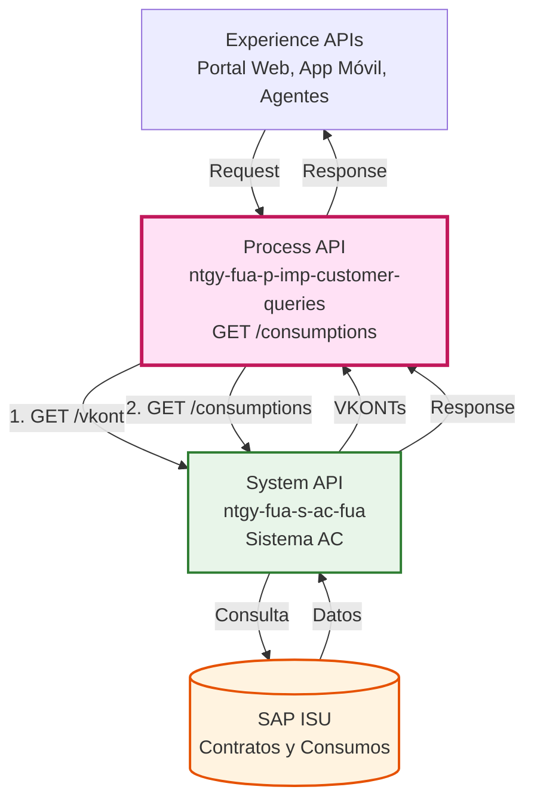
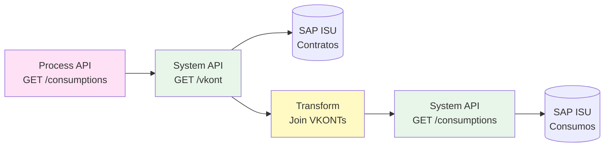
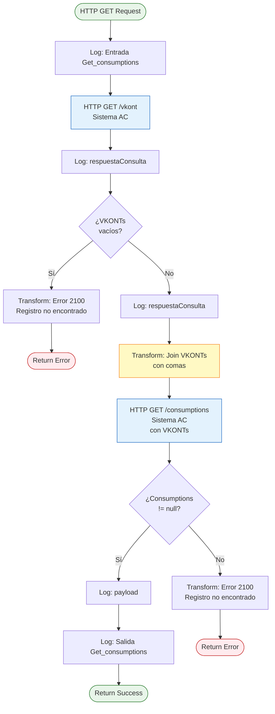
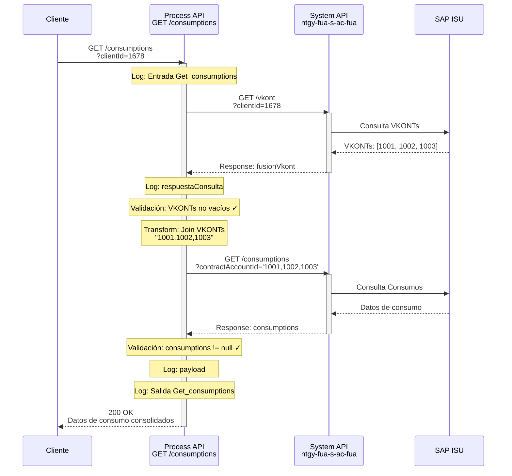
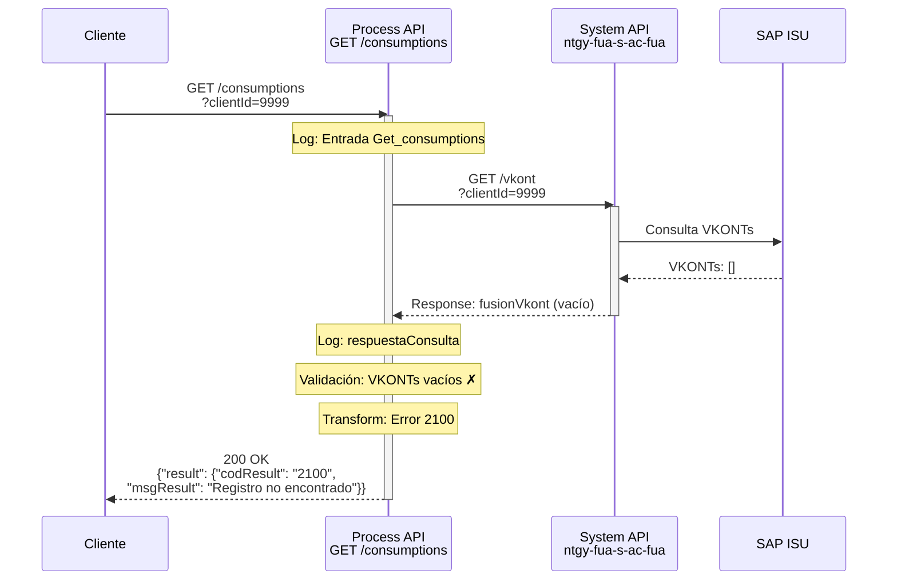
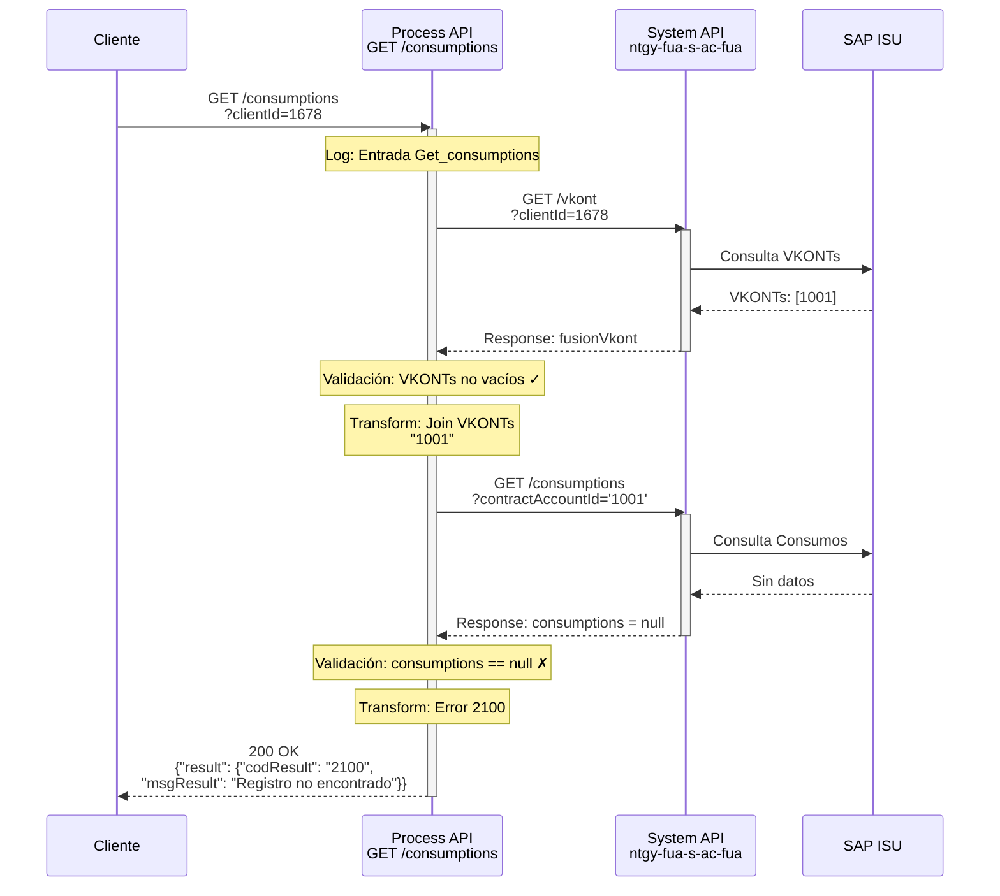

# GET /consumptions

## 📌 Descripción General

### Propósito del Endpoint

Este endpoint orquesta la obtención de datos de consumo energético para clientes que pueden tener múltiples contratos. Implementa un patrón de **orquestación en dos fases**: primero fusiona todas las cuentas de contrato (VKONTs) del cliente desde SAP ISU, y luego consulta los consumos consolidados para todos esos contratos.

### Tipo de API

**Capa:** Process API (API-Led Connectivity)

**Función:** Orquestación de consulta de consumos con fusión de cuentas de contrato

### Patrón de Integración

**Tipo:** Orquestación Secuencial con Agregación

**Descripción:** 
1. **Fase 1 - Fusión de Cuentas:** Obtiene todos los VKONTs (cuentas de contrato SAP) asociados al cliente
2. **Fase 2 - Consulta Consolidada:** Usa esos VKONTs para consultar consumos de todos los contratos en una sola llamada

### Arquitectura API-Led Connectivity



---

## 💼 Propósito del Negocio

### Casos de Uso Principales

1. **Visualización de Consumo Consolidado**
   - Cliente con múltiples contratos (electricidad + gas) ve todos sus consumos en una sola vista
   - Beneficio: Experiencia de usuario unificada sin necesidad de consultar contrato por contrato

2. **Análisis de Consumo Histórico**
   - Agentes de atención al cliente analizan patrones de consumo del cliente
   - Beneficio: Identificación rápida de anomalías o picos de consumo

3. **Generación de Gráficas de Consumo**
   - Portal web genera gráficas interactivas de consumo diario/mensual/anual
   - Beneficio: Cliente entiende su consumo energético y puede optimizarlo

### 🔗 Endpoints Dependientes

Este Process API consume los siguientes System APIs:

| System API | Endpoint | Método | Propósito |
|------------|----------|--------|-----------|
| `ntgy-fua-s-ac-fua` | `/vkont` | GET | Obtener todas las cuentas de contrato (VKONTs) del cliente desde SAP ISU |
| `ntgy-fua-s-ac-fua` | `/consumptions` | GET | Consultar datos de consumo para los VKONTs obtenidos |

### Lógica de Orquestación



**Pasos del Proceso:**

1. **Paso 1 - Obtención de VKONTs**: Consulta al Sistema AC para obtener todas las cuentas de contrato del cliente
2. **Paso 2 - Validación**: Si no hay VKONTs, retorna error 2100 "Registro no encontrado"
3. **Paso 3 - Transformación**: Une todos los VKONTs con comas: `"VKONT1,VKONT2,VKONT3"`
4. **Paso 4 - Consulta de Consumos**: Consulta consumos usando los VKONTs consolidados
5. **Paso 5 - Validación Final**: Si no hay consumos, retorna error 2100

### Transformaciones Aplicadas

**Transformación DataWeave - Construcción de Query:**

```dataweave
%dw 2.0
output application/json
var query = vars.fusionVkont..SAP_FUS_VKONT_VK joinBy (/','/)
---
query
```

**Resultado:** `"VKONT1,VKONT2,VKONT3"` (string con VKONTs separados por comas)

**Nota:** El `contractAccountId` se envía al Sistema AC con comillas simples: `'VKONT1,VKONT2'`

### Contexto Empresarial

- **Dominio:** Gestión de Consumos Energéticos
- **Sector:** Energía - Utilities
- **División:** Naturgy España - Clientes Minoristas
- **Proceso de Negocio:** Consulta y visualización de consumos históricos

### Stakeholders

- **Clientes Finales**: Necesitan ver su consumo energético para controlar gastos
- **Agentes de Atención al Cliente**: Requieren acceso rápido a datos de consumo para resolver consultas
- **Equipos de Análisis**: Usan datos de consumo para identificar patrones y oportunidades de ahorro

### Valor de Negocio

- **Vista Unificada**: Cliente con múltiples contratos ve todos sus consumos en una sola consulta
- **Reducción de Llamadas**: Evita que el cliente tenga que consultar contrato por contrato
- **Mejor Experiencia**: Gráficas consolidadas facilitan comprensión del consumo
- **Eficiencia Operativa**: Agentes resuelven consultas más rápido con información completa

### Consumidores Potenciales

Este endpoint puede ser consumido por:
- Portales web de autoservicio (FUA Portal)
- Aplicaciones móviles de clientes
- Sistemas de agentes de call center
- Dashboards de análisis de consumo

---

## 🔧 Especificación Técnica

### URLs por Ambiente

| Ambiente | URL Base | URL Completa |
|----------|----------|--------------|
| **Local** | `http://localhost:8084` | `http://localhost:8084/api/consumptions` |
| **Development** | `https://ntgy-fua-p-imp-customer-queries-dev.de-c1.cloudhub.io` | `https://ntgy-fua-p-imp-customer-queries-dev.de-c1.cloudhub.io/api/consumptions` |
| **UAT** | `https://ntgy-fua-p-imp-customer-queries-uat.de-c1.cloudhub.io` | `https://ntgy-fua-p-imp-customer-queries-uat.de-c1.cloudhub.io/api/consumptions` |
| **Production** | `https://ntgy-fua-p-imp-customer-queries-pro.de-c1.cloudhub.io` | `https://ntgy-fua-p-imp-customer-queries-pro.de-c1.cloudhub.io/api/consumptions` |

### Método HTTP

```
GET /api/consumptions
```

### Parámetros de Entrada

#### Query Parameters

| Parámetro | Tipo | Obligatorio | Descripción | Ejemplo |
|-----------|------|-------------|-------------|---------|
| `clientId` | string | Condicional* | ID del cliente | `"1678"` |
| `docNumber` | string | Condicional* | Número de documento del cliente | `"1784"` |
| `contractAccountId` | string | Condicional* | ID de cuenta de contrato | `"1678"` |
| `contractId` | string | Opcional | ID de contrato específico | `"1784"` |
| `productType` | string | Opcional | Tipo de producto | `"pro"` |
| `cups` | string | Opcional | Código CUPS del punto de suministro | `"123"` |
| `period` | string | Opcional | Periodo: `"day"` (mensual, solo luz), `"month"` (anual) | `"month"` |
| `startDate` | date-only/string | Opcional | Fecha inicio factura (formato: YYYY-MM-DD) | `"2024-01-01"` |
| `endDate` | date-only/string | Opcional | Fecha fin factura (formato: YYYY-MM-DD) | `"2024-12-31"` |

**\* Condicional:** Al menos uno de `clientId`, `docNumber` o `contractAccountId` es requerido para la primera llamada a `/vkont`.

### Respuestas

#### 200 OK - Éxito

**Estructura de Respuesta:**

```json
{
  "result": {
    "codResult": "0000",
    "msgResult": "No hay error"
  },
  "consumptions": {
    "contractId": "132",
    "productTypeFamily": "solar",
    "productGraphicResume": {
      "anualSelfConsumption": 2500,
      "anualEstimatedProduction": 2900,
      "anualPowerGridContribution": 2650,
      "anualClearedAmount": 50.24,
      "anualTotalConsumption": 1,
      "anualPointConsumption": 1,
      "anualValleyConsumption": 1,
      "anualComparative": 1
    },
    "consumptionsValues": [
      {
        "date": "2021-01-01",
        "consumed": 1,
        "valuePoint": "123",
        "valuePlain": "123",
        "valueValley": "123",
        "valueP4": "123",
        "valueP5": "123",
        "valueP6": "123",
        "aported": 1,
        "valueTotal": "2345"
      }
    ]
  }
}
```

**Campos de la Respuesta:**

| Campo | Tipo | Descripción |
|-------|------|-------------|
| `result.codResult` | string | Código de resultado: `"0000"` = éxito |
| `result.msgResult` | string | Mensaje de resultado |
| `consumptions.contractId` | string | ID del contrato |
| `consumptions.productTypeFamily` | string | Familia de producto (ej: "solar", "gas", "electricidad") |
| `consumptions.productGraphicResume` | object | Resumen anual para gráficas |
| `consumptions.productGraphicResume.anualSelfConsumption` | number | Autoconsumo anual (kWh) |
| `consumptions.productGraphicResume.anualEstimatedProduction` | number | Producción estimada anual (kWh) |
| `consumptions.productGraphicResume.anualPowerGridContribution` | number | Contribución a red anual (kWh) |
| `consumptions.productGraphicResume.anualClearedAmount` | number | Importe compensado anual (€) |
| `consumptions.consumptionsValues` | array | Array de valores de consumo por periodo |
| `consumptions.consumptionsValues[].date` | string | Fecha del periodo (YYYY-MM-DD) |
| `consumptions.consumptionsValues[].consumed` | number | Consumo total del periodo |
| `consumptions.consumptionsValues[].valuePoint` | string | Consumo en periodo punta |
| `consumptions.consumptionsValues[].valuePlain` | string | Consumo en periodo llano |
| `consumptions.consumptionsValues[].valueValley` | string | Consumo en periodo valle |
| `consumptions.consumptionsValues[].valueP4` | string | Consumo en periodo P4 |
| `consumptions.consumptionsValues[].valueP5` | string | Consumo en periodo P5 |
| `consumptions.consumptionsValues[].valueP6` | string | Consumo en periodo P6 |
| `consumptions.consumptionsValues[].aported` | number | Energía aportada a la red |
| `consumptions.consumptionsValues[].valueTotal` | string | Valor total del periodo |

#### 200 OK - No Encontrado (Error de Negocio)

```json
{
  "result": {
    "codResult": "2100",
    "msgResult": "Registro no encontrado"
  }
}
```

**Casos que retornan este error:**
- No se encontraron VKONTs para el cliente
- No hay datos de consumo disponibles para los VKONTs

#### 400 Bad Request

Parámetros inválidos o faltantes.

#### 401 Unauthorized

Credenciales de autenticación inválidas o faltantes.

#### 500 Internal Server Error

Error interno del servidor o del Sistema AC.

### Autenticación

- **Tipo:** Client ID & Client Secret (Anypoint Platform)
- **Headers requeridos:**
  - `client_id`: Client ID de la aplicación
  - `client_secret`: Client Secret de la aplicación

### Timeouts

| Tipo | Valor |
|------|-------|
| **Request Timeout** | 30 segundos (por llamada al Sistema AC) |
| **Connection Timeout** | 30 segundos |
| **Timeout Total Estimado** | ~60 segundos (2 llamadas secuenciales) |

---

## 🏗️ Implementación Técnica

### Arquitectura del Flow



### Código Fuente (Extracto)

**Archivo:** `src/main/mule/global.xml` (líneas 1-70 del flow `get-consumptionsFlow`)

```xml
<flow name="get-consumptionsFlow" doc:id="1a6ceb85-dc79-4c1d-8aaf-a9dbc2e74026">
    <!-- FASE 1: Obtener VKONTs del cliente -->
    <logger level="INFO" doc:name="Entrada Get_consumptions: prc" 
            message="Entrada Get_consumptions: prc"/>
    
    <http:request method="GET" doc:name="Sacamos todos los VKONT de SAP" 
                  config-ref="HTTP_API_SistemaAC" 
                  path="/vkont" 
                  target="fusionVkont">
        <http:query-params><![CDATA[#[output application/java
---
{
    "contractAccountId" : attributes.queryParams.contractAccountId,
    "clientId" : attributes.queryParams.clientId,
    "docNumber" : attributes.queryParams.docNumber
}]]]></http:query-params>
    </http:request>
    
    <logger level="DEBUG" doc:name="respuestaConsulta" 
            message="#[vars.fusionVkont]" />
    
    <!-- Validación: ¿Existen VKONTs? -->
    <choice doc:name="Choice">
        <when expression="#[isEmpty(vars.fusionVkont.vkont)]">
            <ee:transform doc:name="Transform Message">
                <ee:message>
                    <ee:set-payload><![CDATA[%dw 2.0
output application/json
---
{
    "result": {
        "codResult": "2100",
        "msgResult": "Registro no encontrado"
    }
}]]></ee:set-payload>
                </ee:message>
            </ee:transform>
        </when>
        <otherwise>
            <!-- FASE 2: Transformar VKONTs y consultar consumos -->
            <logger level="DEBUG" doc:name="respuestaConsulta" 
                    message="#[vars.fusionVkont]" />
            
            <ee:transform doc:name="Transform Message">
                <ee:message />
                <ee:variables>
                    <ee:set-variable variableName="query"><![CDATA[%dw 2.0
output application/json
var query = vars.fusionVkont..SAP_FUS_VKONT_VK joinBy (/','/)
---
query]]></ee:set-variable>
                </ee:variables>
            </ee:transform>
            
            <http:request method="GET" doc:name="Query facturas y consumos" 
                          config-ref="HTTP_API_SistemaAC" 
                          path="/consumptions">
                <http:query-params><![CDATA[#[output application/java
---
{
    "contractAccountId" : "'" ++ vars.query ++ "'",
    "contractId": attributes.queryParams.contractId,
    "productType": attributes.queryParams.productType,
    "cups": attributes.queryParams.cups,
    "period": attributes.queryParams.period,
    "startDate": attributes.queryParams.startDate,
    "endDate": attributes.queryParams.endDate,
    "clientId": attributes.queryParams."clientId",
    "docNumber": attributes.queryParams."docNumber"
}]]]></http:query-params>
            </http:request>
            
            <!-- Validación Final: ¿Hay consumos? -->
            <choice doc:name="Choice">
                <when expression="#[payload.consumptions != null]">
                    <logger level="INFO" doc:name="Logger" 
                            message="#[payload]" />
                </when>
                <otherwise>
                    <ee:transform doc:name="Transform Message">
                        <ee:message>
                            <ee:set-payload><![CDATA[%dw 2.0
output application/json
---
{
    "result": {
        "codResult": "2100",
        "msgResult": "Registro no encontrado"
    }
}]]></ee:set-payload>
                        </ee:message>
                    </ee:transform>
                </otherwise>
            </choice>
        </otherwise>
    </choice>
    
    <logger level="INFO" doc:name="Salida Get_consumptions: prc" 
            message="#[vars.resultFactura]"/>
</flow>
```

### Transformaciones DataWeave

#### Transformación 1: Join de VKONTs

**Propósito:** Unir todos los VKONTs en un string separado por comas

```dataweave
%dw 2.0
output application/json
var query = vars.fusionVkont..SAP_FUS_VKONT_VK joinBy (/','/)
---
query
```

**Input (vars.fusionVkont):**
```json
{
  "vkont": [
    { "SAP_FUS_VKONT_VK": "1001234567" },
    { "SAP_FUS_VKONT_VK": "1001234568" },
    { "SAP_FUS_VKONT_VK": "1001234569" }
  ]
}
```

**Output (vars.query):**
```
"1001234567,1001234568,1001234569"
```

#### Transformación 2: Error 2100

**Propósito:** Generar respuesta de error estándar

```dataweave
%dw 2.0
output application/json
---
{
  "result": {
    "codResult": "2100",
    "msgResult": "Registro no encontrado"
  }
}
```

### Patrones de Diseño

**Patrón:** API Composition con Fusión de Datos

**Justificación:** 
- Permite consolidar datos de múltiples contratos en una sola respuesta
- Reduce el número de llamadas que debe hacer el cliente
- Mejora la experiencia de usuario al proporcionar vista unificada

**Patrón:** Sequential Processing con Validación en Cascada

**Justificación:**
- La segunda llamada depende del resultado de la primera
- Validaciones intermedias evitan llamadas innecesarias
- Manejo de errores en cada fase del proceso

### Diagramas de Secuencia

#### 1. Flujo Normal de Éxito



#### 2. Flujo con Error - VKONTs No Encontrados



#### 3. Flujo con Error - Consumos No Encontrados



### Manejo de Errores

#### Estrategia de Manejo de Errores

**Validación en Cascada:**
1. **Primera Validación:** Después de obtener VKONTs
   - Si `isEmpty(vars.fusionVkont.vkont)` → Error 2100
   - Evita llamada innecesaria a `/consumptions`

2. **Segunda Validación:** Después de obtener consumos
   - Si `payload.consumptions == null` → Error 2100
   - Garantiza que siempre se retorna data válida o error explícito

**Códigos de Error:**

| Código | Mensaje | Causa | Acción |
|--------|---------|-------|--------|
| `0000` | "No hay error" | Operación exitosa | N/A |
| `2100` | "Registro no encontrado" | No hay VKONTs o consumos | Verificar parámetros de entrada |

**Logging:**
- **INFO:** Entrada y salida del flow
- **DEBUG:** Respuestas intermedias de System APIs
- **INFO:** Payload final antes de retornar

---

## 💻 Ejemplos de Uso

### Ejemplo 1: Consulta Exitosa con ClientId

#### cURL

```bash
curl -X GET "https://ntgy-fua-p-imp-customer-queries-pro.de-c1.cloudhub.io/api/consumptions?clientId=1678&period=month&startDate=2024-01-01&endDate=2024-12-31" \
  -H "Content-Type: application/json" \
  -H "client_id: YOUR_CLIENT_ID" \
  -H "client_secret: YOUR_CLIENT_SECRET"
```

#### Respuesta (200 OK)

```json
{
  "result": {
    "codResult": "0000",
    "msgResult": "No hay error"
  },
  "consumptions": {
    "contractId": "132",
    "productTypeFamily": "solar",
    "productGraphicResume": {
      "anualSelfConsumption": 2500,
      "anualEstimatedProduction": 2900,
      "anualPowerGridContribution": 2650,
      "anualClearedAmount": 50.24,
      "anualTotalConsumption": 1,
      "anualPointConsumption": 1,
      "anualValleyConsumption": 1,
      "anualComparative": 1
    },
    "consumptionsValues": [
      {
        "date": "2021-01-01",
        "consumed": 1,
        "valuePoint": "123",
        "valuePlain": "123",
        "valueValley": "123",
        "valueP4": "123",
        "valueP5": "123",
        "valueP6": "123",
        "aported": 1,
        "valueTotal": "2345"
      },
      {
        "date": "2021-02-01",
        "consumed": 1.2,
        "valuePoint": "145",
        "valuePlain": "130",
        "valueValley": "110",
        "valueP4": "125",
        "valueP5": "115",
        "valueP6": "105",
        "aported": 0.8,
        "valueTotal": "2567"
      }
    ]
  }
}
```

### Ejemplo 2: Consulta con Múltiples Parámetros

#### cURL

```bash
curl -X GET "https://ntgy-fua-p-imp-customer-queries-pro.de-c1.cloudhub.io/api/consumptions?contractAccountId=1678&contractId=1784&productType=pro&cups=123&period=day&startDate=2024-01-01&endDate=2024-01-31" \
  -H "Content-Type: application/json" \
  -H "client_id: YOUR_CLIENT_ID" \
  -H "client_secret: YOUR_CLIENT_SECRET"
```

### Ejemplo 3: Error - Cliente No Encontrado

#### cURL

```bash
curl -X GET "https://ntgy-fua-p-imp-customer-queries-pro.de-c1.cloudhub.io/api/consumptions?clientId=9999" \
  -H "Content-Type: application/json" \
  -H "client_id: YOUR_CLIENT_ID" \
  -H "client_secret: YOUR_CLIENT_SECRET"
```

#### Respuesta (200 OK - Error de Negocio)

```json
{
  "result": {
    "codResult": "2100",
    "msgResult": "Registro no encontrado"
  }
}
```

### Ejemplo 4: JavaScript (Fetch API)

```javascript
const getConsumptions = async (clientId, period, startDate, endDate) => {
  const params = new URLSearchParams({
    clientId: clientId,
    period: period,
    startDate: startDate,
    endDate: endDate
  });

  const response = await fetch(
    `https://ntgy-fua-p-imp-customer-queries-pro.de-c1.cloudhub.io/api/consumptions?${params}`,
    {
      method: 'GET',
      headers: {
        'Content-Type': 'application/json',
        'client_id': 'YOUR_CLIENT_ID',
        'client_secret': 'YOUR_CLIENT_SECRET'
      }
    }
  );

  if (!response.ok) {
    throw new Error(`HTTP error! status: ${response.status}`);
  }

  const data = await response.json();
  
  // Verificar si hay error de negocio
  if (data.result.codResult !== '0000') {
    console.error('Error de negocio:', data.result.msgResult);
    return null;
  }

  return data.consumptions;
};

// Uso
getConsumptions('1678', 'month', '2024-01-01', '2024-12-31')
  .then(consumptions => {
    console.log('Consumos obtenidos:', consumptions);
    console.log('Resumen anual:', consumptions.productGraphicResume);
    console.log('Valores de consumo:', consumptions.consumptionsValues);
  })
  .catch(error => console.error('Error:', error));
```

### Ejemplo 5: Python (Requests)

```python
import requests
from datetime import datetime

def get_consumptions(client_id, period='month', start_date=None, end_date=None):
    """
    Obtiene datos de consumo para un cliente.
    
    Args:
        client_id (str): ID del cliente
        period (str): Periodo ('day' o 'month')
        start_date (str): Fecha inicio (YYYY-MM-DD)
        end_date (str): Fecha fin (YYYY-MM-DD)
    
    Returns:
        dict: Datos de consumo o None si hay error
    """
    url = 'https://ntgy-fua-p-imp-customer-queries-pro.de-c1.cloudhub.io/api/consumptions'
    
    params = {
        'clientId': client_id,
        'period': period
    }
    
    if start_date:
        params['startDate'] = start_date
    if end_date:
        params['endDate'] = end_date
    
    headers = {
        'Content-Type': 'application/json',
        'client_id': 'YOUR_CLIENT_ID',
        'client_secret': 'YOUR_CLIENT_SECRET'
    }
    
    try:
        response = requests.get(url, params=params, headers=headers)
        response.raise_for_status()
        
        data = response.json()
        
        # Verificar error de negocio
        if data['result']['codResult'] != '0000':
            print(f"Error de negocio: {data['result']['msgResult']}")
            return None
        
        return data['consumptions']
    
    except requests.exceptions.RequestException as e:
        print(f"Error en la petición: {e}")
        return None

# Uso
consumptions = get_consumptions(
    client_id='1678',
    period='month',
    start_date='2024-01-01',
    end_date='2024-12-31'
)

if consumptions:
    print(f"Contrato ID: {consumptions['contractId']}")
    print(f"Tipo de producto: {consumptions['productTypeFamily']}")
    print(f"Autoconsumo anual: {consumptions['productGraphicResume']['anualSelfConsumption']} kWh")
    print(f"Número de periodos: {len(consumptions['consumptionsValues'])}")
```

### Ejemplo 6: Postman Collection

```json
{
  "info": {
    "name": "GET /consumptions",
    "schema": "https://schema.getpostman.com/json/collection/v2.1.0/collection.json"
  },
  "item": [
    {
      "name": "Get Consumptions - Success",
      "request": {
        "method": "GET",
        "header": [
          {
            "key": "Content-Type",
            "value": "application/json"
          },
          {
            "key": "client_id",
            "value": "{{client_id}}"
          },
          {
            "key": "client_secret",
            "value": "{{client_secret}}"
          }
        ],
        "url": {
          "raw": "{{base_url}}/api/consumptions?clientId=1678&period=month&startDate=2024-01-01&endDate=2024-12-31",
          "host": ["{{base_url}}"],
          "path": ["api", "consumptions"],
          "query": [
            {
              "key": "clientId",
              "value": "1678"
            },
            {
              "key": "period",
              "value": "month"
            },
            {
              "key": "startDate",
              "value": "2024-01-01"
            },
            {
              "key": "endDate",
              "value": "2024-12-31"
            }
          ]
        }
      }
    }
  ]
}
```
