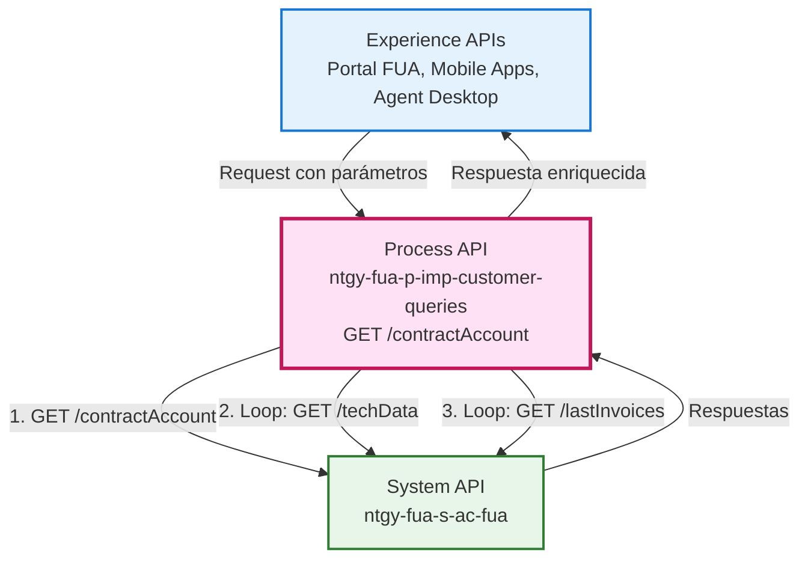
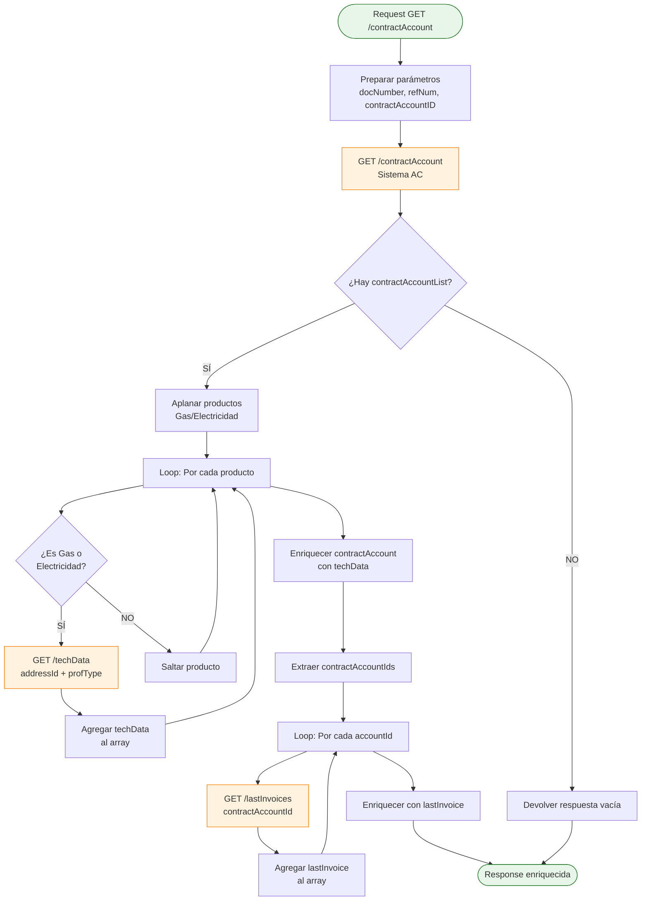
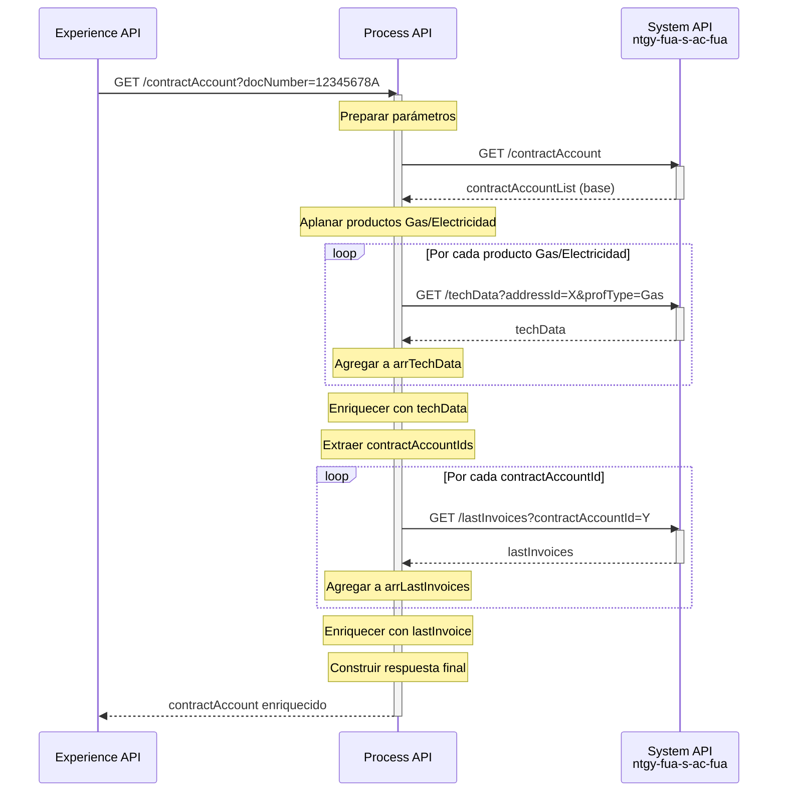
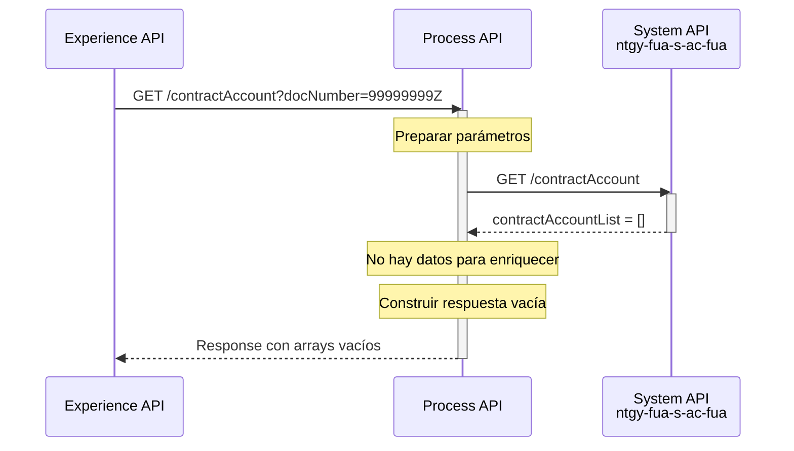
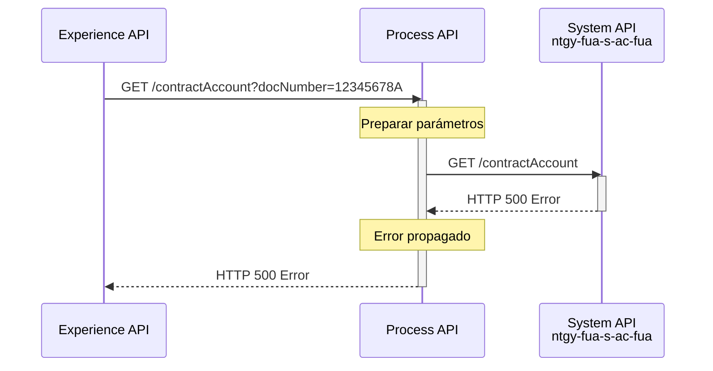

# GET /contractAccount

## 📌 Descripción General

### Propósito del Endpoint

Este endpoint orquesta múltiples llamadas al System API `ntgy-fua-s-ac-fua` para proporcionar una vista completa y enriquecida de las cuentas de contrato de un cliente. Realiza un proceso de agregación progresiva que combina información base de contratos, datos técnicos de suministro (para productos de Gas y Electricidad) y la última factura emitida por cada cuenta.

### Tipo de API

**Capa:** Process API (API-Led Connectivity)

**Función:** Orquestación y enriquecimiento de datos de cuentas de contrato

### Patrón de Integración

**Tipo:** Orquestación con Enriquecimiento Progresivo

**Descripción:** El endpoint implementa un patrón de orquestación secuencial con enriquecimiento de datos en tres fases:

1. **Fase 1 - Obtención Base**: Consulta información inicial de la cuenta de contrato
2. **Fase 2 - Enriquecimiento Técnico**: Itera sobre productos Gas/Electricidad para obtener datos técnicos
3. **Fase 3 - Enriquecimiento Facturación**: Itera sobre cuentas para obtener última factura

### Arquitectura API-Led Connectivity



---

## 💼 Propósito del Negocio

### Casos de Uso Principales

1. **Vista Completa de Cuenta de Contrato**
   - Agentes de atención al cliente necesitan ver toda la información de una cuenta de contrato en una sola consulta
   - Incluye datos de contratos, productos, direcciones, referencias y facturación
   - **Beneficio**: Reduce tiempo de atención al tener toda la información disponible inmediatamente

2. **Consulta de Datos Técnicos de Suministro**
   - Técnicos y agentes necesitan conocer características técnicas de los puntos de suministro
   - Información específica por tipo de producto (Gas/Electricidad)
   - **Beneficio**: Facilita diagnóstico de problemas técnicos y gestión de incidencias

3. **Verificación de Estado de Facturación**
   - Clientes y agentes consultan el estado de la última factura emitida
   - Información de importes, fechas y estado de pago
   - **Beneficio**: Permite gestión proactiva de cobros y atención de consultas de facturación

### 🔗 Endpoints Dependientes

Este Process API consume los siguientes endpoints del System API:

| System API | Endpoint | Método | Propósito |
|------------|----------|--------|-----------|
| `ntgy-fua-s-ac-fua` | `/contractAccount` | GET | Obtiene información base de la cuenta de contrato con referencias y productos |
| `ntgy-fua-s-ac-fua` | `/techData` | GET | Obtiene datos técnicos de suministro (potencia, tarifa, etc.) por producto |
| `ntgy-fua-s-ac-fua` | `/lastInvoices` | GET | Obtiene la última factura emitida por cuenta de contrato |

### Lógica de Orquestación



**Pasos del Proceso:**

1. **Preparación de Parámetros**: Extrae y valida parámetros de entrada (docNumber, refNum, contractAccountID)
2. **Consulta Base**: Obtiene información inicial de la cuenta de contrato desde Sistema AC
3. **Validación de Datos**: Verifica si existen cuentas de contrato en la respuesta
4. **Enriquecimiento Técnico** (condicional):
   - Aplana la estructura de productos para facilitar iteración
   - Itera sobre productos de tipo Gas o Electricidad
   - Consulta datos técnicos por cada producto elegible
   - Agrega datos técnicos a la estructura de respuesta
5. **Enriquecimiento de Facturación**:
   - Extrae IDs de cuentas de contrato
   - Itera sobre cada cuenta
   - Consulta última factura por cuenta
   - Agrega información de facturación a la respuesta
6. **Transformación Final**: Construye respuesta enriquecida con toda la información agregada

### Transformaciones Aplicadas

Este Process API **SÍ transforma y enriquece** la respuesta del System API.

#### Enriquecimiento 1: Datos Técnicos (techData)

| Campo Original | Campo Enriquecido | Transformación |
|----------------|-------------------|----------------|
| `products[].productType` | `products[].techData` | Agrega objeto techData con información técnica del suministro |
| N/A | `techData.addressId` | Identificador de dirección del suministro |
| N/A | `techData.eType` | Tipo de energía (Gas/Electricidad) |
| N/A | `techData.*` | Campos técnicos específicos del Sistema AC |

#### Enriquecimiento 2: Última Factura (lastInvoice)

| Campo Original | Campo Enriquecido | Transformación |
|----------------|-------------------|----------------|
| `contractAccountList[]` | `contractAccountList[].lastInvoice` | Agrega objeto lastInvoice con información de facturación |
| N/A | `lastInvoice.invoiceId` | ID de la última factura |
| N/A | `lastInvoice.invoiceNum` | Número de factura |
| N/A | `lastInvoice.issuedDate` | Fecha de emisión |
| N/A | `lastInvoice.billingDate` | Fecha de facturación |
| N/A | `lastInvoice.status` | Estado de la factura |
| N/A | `lastInvoice.amount` | Importe de la factura |

### Contexto Empresarial

- **Dominio:** Gestión de Clientes y Contratos
- **Sector:** Energía - Utilities (Gas y Electricidad)
- **División:** Naturgy España - FUA (Frontal Único de Atención)
- **Proceso de Negocio:** Consulta unificada de información de cuentas de contrato para atención al cliente

### Stakeholders

- **Agentes de Call Center**: Necesitan acceso rápido a información completa de contratos para atención telefónica
- **Clientes Finales**: Consultan sus contratos a través del portal de autoservicio
- **Equipos Técnicos**: Requieren datos técnicos de suministro para gestión de incidencias
- **Departamento de Facturación**: Consultan estado de facturación por cuenta de contrato

### Valor de Negocio

- **Reducción de Tiempo de Atención**: Una sola llamada proporciona toda la información necesaria
- **Mejora de Experiencia de Cliente**: Información completa y actualizada disponible inmediatamente
- **Eficiencia Operativa**: Elimina necesidad de consultar múltiples sistemas manualmente
- **Precisión de Información**: Datos técnicos y de facturación siempre sincronizados

### Consumidores Potenciales

Este endpoint puede ser consumido por:
- Portal web FUA (Frontal Único de Atención)
- Aplicaciones móviles de clientes
- Sistemas de agentes de call center
- Aplicaciones de escritorio para técnicos de campo
- Integraciones con sistemas de terceros autorizados

---

## 🔧 Especificación Técnica

### URLs por Ambiente

| Ambiente | URL Base | URL Completa |
|----------|----------|--------------|
| **Local** | `http://localhost:8084` | `http://localhost:8084/api/contractAccount` |
| **Development** | `https://ntgy-fua-p-imp-customer-queries-dev.de-c1.cloudhub.io` | `https://ntgy-fua-p-imp-customer-queries-dev.de-c1.cloudhub.io/api/contractAccount` |
| **UAT** | `https://ntgy-fua-p-imp-customer-queries-uat.de-c1.cloudhub.io` | `https://ntgy-fua-p-imp-customer-queries-uat.de-c1.cloudhub.io/api/contractAccount` |
| **Production** | `https://ntgy-fua-p-imp-customer-queries-pro.de-c1.cloudhub.io` | `https://ntgy-fua-p-imp-customer-queries-pro.de-c1.cloudhub.io/api/contractAccount` |

### Método HTTP

```
GET /api/contractAccount
```

### Parámetros de Entrada

#### Query Parameters

| Parámetro | Tipo | Requerido | Descripción | Ejemplo |
|-----------|------|-----------|-------------|---------|
| `docNumber` | string | No | Número de documento del cliente (NIF/NIE) | `12345678A` |
| `contractId` | string | No | **⚠️ NO USADO EN CÓDIGO** - Definido en RAML pero no implementado | N/A |
| `refNum` | string | No | Número de referencia del contrato | `REF123456` |
| `contractAccountID` | string | No | ID de la cuenta de contrato | `ACC789012` |

**⚠️ Nota Importante**: Aunque el RAML define el parámetro `contractId`, el código de implementación **NO lo utiliza**. Los parámetros funcionales son: `docNumber`, `refNum` y `contractAccountID`.

**Validación de Parámetros:**
- Al menos uno de los parámetros debe ser proporcionado
- Si no se proporciona ningún parámetro, se envían valores vacíos al System API
- El System API es responsable de validar y retornar error si es necesario

### Respuestas

#### 200 OK - Éxito con Datos

```json
{
  "result": {
    "codResult": "0000",
    "msgResult": "No hay error"
  },
  "docNumber": "12345678A",
  "clientId": "CLI123456",
  "clientCode": "CC789012",
  "contractAccountList": [
    {
      "supplyPointId": "SP001",
      "contractAccountId": "ACC789012",
      "clientId": "CLI123456",
      "address": {
        "addressId": "ADDR001",
        "street": "Calle Principal",
        "number": "123",
        "city": "Madrid",
        "postalCode": "28001"
      },
      "contractAccountRefList": [
        {
          "refNum": "REF123456",
          "contractRefNum": "CREF789",
          "lastBillAmount": 85.50,
          "isDirectPayment": true,
          "isOnlineBill": true,
          "bankAccount": "ES1234567890123456789012",
          "products": [
            {
              "contractId": "CNT001",
              "contractNumber": "123456789",
              "isActive": true,
              "startDate": "2023-01-15",
              "endDate": null,
              "dropOutDate": null,
              "contractSignatureDate": "2023-01-10",
              "isPending": false,
              "productType": {
                "productTypeId": "ELEC",
                "productTypeRealName": "Electricidad"
              },
              "adviseGas": false,
              "techData": {
                "addressId": "ADDR001",
                "eType": "Electricidad",
                "power": "4.6 kW",
                "tariff": "2.0TD",
                "voltage": "230V"
              }
            }
          ],
          "mailingAddress": {
            "street": "Calle Correspondencia",
            "number": "456",
            "city": "Madrid",
            "postalCode": "28002"
          }
        }
      ],
      "lastInvoice": {
        "invoiceId": "INV001",
        "invoiceNum": "F-2024-001",
        "issuedDate": "2024-01-15",
        "billingDate": "2024-01-01",
        "status": "PAID",
        "amount": 85.50,
        "interactiveInvoice": "https://...",
        "pdfDocumentId": "PDF001",
        "productInvoiceRelationList": [
          {
            "productId": "CNT001",
            "amount": 85.50
          }
        ]
      }
    }
  ]
}
```

#### 200 OK - Sin Datos (No se encontró cuenta)

```json
{
  "result": {
    "codResult": "0001",
    "msgResult": "No se encontraron cuentas de contrato"
  },
  "docNumber": "12345678A",
  "clientId": null,
  "clientCode": null,
  "contractAccountList": [],
  "lastInvoice": []
}
```

#### 400 Bad Request - Parámetros Inválidos

```json
{
  "result": {
    "codResult": "ERROR",
    "msgResult": "Parámetros de entrada inválidos"
  }
}
```

#### 500 Internal Server Error - Error del Sistema

```json
{
  "result": {
    "codResult": "ERROR",
    "msgResult": "Error interno del servidor"
  }
}
```

### Autenticación

- **Tipo:** Client ID & Client Secret (Anypoint Platform)
- **Headers Requeridos:**
  - `client_id`: ID del cliente proporcionado por Anypoint Platform
  - `client_secret`: Secret del cliente proporcionado por Anypoint Platform

### Timeouts

| Tipo | Valor | Descripción |
|------|-------|-------------|
| **Request Timeout** | 30 segundos | Timeout para cada llamada al System API |
| **Connection Timeout** | 30 segundos | Timeout de conexión idle |
| **Total Timeout Estimado** | 60-90 segundos | Considerando 3 llamadas secuenciales + loops |

**⚠️ Nota sobre Performance:**
- El tiempo total depende del número de productos Gas/Electricidad (loop techData)
- El tiempo total depende del número de cuentas de contrato (loop lastInvoices)
- En casos con múltiples productos y cuentas, el tiempo puede extenderse

---

## 🏗️ Implementación Técnica

### Arquitectura del Flow

```mermaid
flowchart TD
    Start([HTTP GET Request]) --> LogStart[Log: Inicio flujo]
    LogStart --> Transform1[Transform: Preparar parámetros<br/>docNumber, refNum, contractAccountID]
    Transform1 --> Call1[HTTP GET: /contractAccount<br/>Sistema AC]
    Call1 --> LogResponse[Log: contractAccount response]
    LogResponse --> Check1{¿contractAccountList<br/>tiene datos?}
    
    Check1 -->|NO| EmptyTransform[Transform: Respuesta vacía]
    EmptyTransform --> End([HTTP Response])
    
    Check1 -->|SÍ| FlattenVar[Set Variable: flattenProducts<br/>Aplanar productos Gas/Electricidad]
    FlattenVar --> InitArray[Set Variable: arrTechData = []]
    InitArray --> ForEach1[ForEach: flattenProducts]
    
    ForEach1 --> CheckType{¿productTypeFamily<br/>== Gas o Electricidad?}
    CheckType -->|NO| LogSkip[Log: Producto no es Gas/Electricidad]
    CheckType -->|SÍ| Call2[HTTP GET: /techData<br/>addressId + profType]
    
    Call2 --> AppendTech[Transform: Agregar techData<br/>a arrTechData]
    AppendTech --> LogTech[Log: techData agregado]
    LogTech --> ForEach1
    LogSkip --> ForEach1
    
    ForEach1 --> EnrichTech[Transform: Enriquecer contractAccount<br/>con techData]
    EnrichTech --> LogEnriched[Log: contractAccount + TechData]
    LogEnriched --> Check2{¿contractAccountList<br/>tiene datos?}
    
    Check2 -->|NO| LogNoRef[Log: Sin refNum]
    LogNoRef --> End
    
    Check2 -->|SÍ| ExtractIds[Set Variable: arrContractAccountId]
    ExtractIds --> InitInvoices[Set Variable: arrLastInvoices = []]
    InitInvoices --> ForEach2[ForEach: arrContractAccountId]
    
    ForEach2 --> Call3[HTTP GET: /lastInvoices<br/>contractAccountId]
    Call3 --> AppendInvoice[Transform: Agregar lastInvoice<br/>a arrLastInvoices]
    AppendInvoice --> LogInvoice[Log: lastInvoice agregado]
    LogInvoice --> ForEach2
    
    ForEach2 --> FinalTransform[Transform: Enriquecer con lastInvoice<br/>Construir respuesta final]
    FinalTransform --> LogFinal[Log: contractAccount + lastInvoice]
    LogFinal --> End
    
    style Start fill:#e8f5e9,stroke:#2e7d32,stroke-width:2px
    style End fill:#e8f5e9,stroke:#2e7d32,stroke-width:2px
    style Call1 fill:#fff3e0,stroke:#f57c00,stroke-width:2px
    style Call2 fill:#fff3e0,stroke:#f57c00,stroke-width:2px
    style Call3 fill:#fff3e0,stroke:#f57c00,stroke-width:2px
    style Check1 fill:#e1f5fe,stroke:#0277bd,stroke-width:2px
    style Check2 fill:#e1f5fe,stroke:#0277bd,stroke-width:2px
    style CheckType fill:#e1f5fe,stroke:#0277bd,stroke-width:2px
```

### Transformaciones DataWeave

#### Transformación 1: Preparación de Parámetros (Líneas 11-26)

```dataweave
%dw 2.0
output application/json

var docNumber = if (attributes.queryParams.docNumber != null) 
                   (attributes.queryParams.docNumber) 
                else (if (vars.peticionOriginal.docNumber != null) 
                         (vars.peticionOriginal.docNumber) 
                      else(""))
var refNum = if (attributes.queryParams.refNum != null) 
                attributes.queryParams.refNum 
             else ""
var contractAccountID = if (attributes.queryParams.contractAccountID != null) 
                           (attributes.queryParams.contractAccountID) 
                        else("")
---
{
    "docNumber": docNumber,
    "contractAccountID": contractAccountID,
    "refNum": refNum
}
```

**Propósito:** Normaliza y valida parámetros de entrada, manejando valores nulos.

#### Transformación 2: Aplanar Productos (Líneas 39-49)

```dataweave
%dw 2.0
output application/json
import * from dw::core::Arrays

var contractAccountList = vars.contractAccount.contractAccountList map {
    products: $.contractAccountRefList..products..productType map (i) -> {
        addressId: $.address.addressId,
        "productTypeFamily": i.productTypeRealName
    }
}
---
flatten(contractAccountList.products)
```

**Propósito:** Extrae y aplana productos Gas/Electricidad para facilitar iteración en el loop de techData.

#### Transformación 3: Agregar techData (Líneas 66-75)

```dataweave
%dw 2.0
output application/json
---
vars.arrTechData << (
    vars.techData.techData ++ 
    {
        "addressId": payload.addressId,
        "eType": payload.productTypeFamily 
    }
)
```

**Propósito:** Agrega datos técnicos al array, incluyendo identificadores de contexto.

#### Transformación 4: Enriquecer con techData (Líneas 89-136)

```dataweave
%dw 2.0
output application/json

fun attachObject(addId, prdType) = 
    vars.arrTechData filter ($.addressId == addId and $.eType == prdType) reduce $

var contractAccountListTechData = vars.contractAccount.contractAccountList map (cal) -> {
    "supplyPointId": cal.supplyPointId,
    "contractAccountId": cal.contractAccountId,
    "clientId": cal.clientId,
    "address": cal.address,
    "contractAccountRefList": cal.contractAccountRefList map (car) -> {
        "refNum": car.refNum,
        "contractRefNum": car.contractRefNum,
        "lastBillAmount": car.lastBillAmount,
        "isDirectPayment": car.isDirectPayment,
        "isOnlineBill": car.isOnlineBill,
        "bankAccount": car.bankAccount,
        "products": car.products map (prd) -> {
            "contractId": prd.contractId,
            "contractNumber": prd.contractNumber,
            "isActive": prd.isActive,
            "startDate": prd.startDate,
            "endDate": prd.endDate,
            "dropOutDate": prd.dropOutDate,
            "contractSignatureDate": prd.contractSignatureDate,
            "isPending": prd.isPending,
            "productType": prd.productType,
            "adviseGas": prd.adviseGas,
            ("techData": attachObject(cal.address.addressId, prd.productType.productTypeRealName)) 
                if (attachObject(cal.address.addressId, prd.productType.productTypeRealName) != null)
        },
        "mailingAddress": car.mailingAddress
    }
}
---
{
    "result": {
        "codResult": "0000",
        "msgResult": "No hay error"
    },
    "docNumber": vars.contractAccount.docNumber,
    "clientId": vars.contractAccount.clientId,
    "clientCode": vars.contractAccount.clientCode,
    "contractAccountList": contractAccountListTechData
}
```

**Propósito:** Enriquece la estructura de contractAccount con datos técnicos, usando función auxiliar para buscar y adjuntar techData por addressId y tipo de producto.

#### Transformación 5: Agregar lastInvoice (Líneas 156-164)

```dataweave
%dw 2.0
output application/json
---
vars.arrLastInvoices << (
    vars.lastInvoices.invoices[0] ++ 
    {
        "contractAccountId": payload
    }
)
```

**Propósito:** Agrega información de última factura al array, incluyendo el contractAccountId para posterior matching.

#### Transformación 6: Enriquecer con lastInvoice (Líneas 176-211)

```dataweave
%dw 2.0
output application/json

fun rebuildLastInvoice(invoice) = {
    "invoiceId": invoice.invoiceId,
    "invoiceNum": invoice.invoiceNum,
    "issuedDate": invoice.issuedDate,
    "billingDate": invoice.billingDate,
    "status": invoice.status,
    "amount": invoice.amount,
    "interactiveInvoice": invoice.interactiveInvoice,
    "pdfDocumentId": invoice.pdfDocumentId,
    "productInvoiceRelationList": invoice.productInvoiceRelationList
}

fun attachObject(contractAccountId) = 
    vars.arrLastInvoices filter ($.contractAccountId == contractAccountId) reduce $

var contractAccountListLastInvoices = vars.contractAccount.contractAccountList map (cal) -> {
    "supplyPointId": cal.supplyPointId,
    "contractAccountId": cal.contractAccountId,
    "clientId": cal.clientId,
    "address": cal.address,
    "contractAccountRefList": cal.contractAccountRefList,
    "lastInvoice": rebuildLastInvoice(attachObject(cal.contractAccountId))
}
---
{
    "result": {
        "codResult": "0000",
        "msgResult": "No hay error"
    },
    "docNumber": vars.contractAccount.docNumber,
    "clientId": vars.contractAccount.clientId,
    "clientCode": vars.contractAccount.clientCode,
    "contractAccountList": contractAccountListLastInvoices
}
```

**Propósito:** Enriquece la estructura final con información de última factura, usando funciones auxiliares para reconstruir y adjuntar datos de facturación.

### Patrones de Diseño

**Patrón Principal:** Enriquecimiento Progresivo (Progressive Enrichment)

**Justificación:** 
- Permite agregar información de múltiples fuentes de forma incremental
- Mantiene la estructura base mientras se enriquece con datos adicionales
- Facilita el manejo de datos opcionales (techData solo para Gas/Electricidad)
- Optimiza llamadas al backend (solo consulta techData cuando es necesario)

**Patrón Secundario:** Iteración Condicional (Conditional Iteration)

**Justificación:**
- Los loops solo procesan elementos que cumplen condiciones específicas
- Reduce llamadas innecesarias al System API
- Mejora performance al filtrar productos antes de consultar techData

### Diagramas de Secuencia

#### 1. Flujo Normal de Éxito (Con Enriquecimiento Completo)



#### 2. Flujo Sin Datos (No se encuentra cuenta)



#### 3. Flujo con Error Técnico



### Manejo de Errores

#### Estrategia de Manejo de Errores

**Propagación de Errores del System API:**
- Los errores del System API se propagan al consumidor
- No se implementa retry logic (oportunidad de mejora)
- Los timeouts se configuran a nivel de HTTP connector

**Errores Manejados:**

| Tipo de Error | Código HTTP | Manejo |
|---------------|-------------|---------|
| System API no disponible | 503 | Propagado al consumidor |
| Timeout en System API | 504 | Propagado al consumidor |
| Datos no encontrados | 200 | Response con arrays vacíos |
| Error de transformación | 500 | Error interno del servidor |

**Logging de Errores:**
- Nivel DEBUG: Logs de flujo normal
- Nivel INFO: Logs de agregación de datos
- Nivel ERROR: Errores de sistema (propagados por error handler)

---

## 💻 Ejemplos de Uso

### Ejemplo 1: Consulta por Número de Documento

#### cURL

```bash
curl -X GET "https://ntgy-fua-p-imp-customer-queries-pro.de-c1.cloudhub.io/api/contractAccount?docNumber=12345678A" \
  -H "Content-Type: application/json" \
  -H "client_id: YOUR_CLIENT_ID" \
  -H "client_secret: YOUR_CLIENT_SECRET"
```

#### Respuesta (200 OK)

```json
{
  "result": {
    "codResult": "0000",
    "msgResult": "No hay error"
  },
  "docNumber": "12345678A",
  "clientId": "CLI123456",
  "clientCode": "CC789012",
  "contractAccountList": [
    {
      "supplyPointId": "SP001",
      "contractAccountId": "ACC789012",
      "clientId": "CLI123456",
      "address": {
        "addressId": "ADDR001",
        "street": "Calle Principal",
        "number": "123",
        "city": "Madrid",
        "postalCode": "28001"
      },
      "contractAccountRefList": [
        {
          "refNum": "REF123456",
          "contractRefNum": "CREF789",
          "lastBillAmount": 85.50,
          "isDirectPayment": true,
          "isOnlineBill": true,
          "bankAccount": "ES1234567890123456789012",
          "products": [
            {
              "contractId": "CNT001",
              "contractNumber": "123456789",
              "isActive": true,
              "startDate": "2023-01-15",
              "endDate": null,
              "dropOutDate": null,
              "contractSignatureDate": "2023-01-10",
              "isPending": false,
              "productType": {
                "productTypeId": "ELEC",
                "productTypeRealName": "Electricidad"
              },
              "adviseGas": false,
              "techData": {
                "addressId": "ADDR001",
                "eType": "Electricidad",
                "power": "4.6 kW",
                "tariff": "2.0TD",
                "voltage": "230V",
                "cups": "ES0021000000000001JN"
              }
            }
          ],
          "mailingAddress": {
            "street": "Calle Correspondencia",
            "number": "456",
            "city": "Madrid",
            "postalCode": "28002"
          }
        }
      ],
      "lastInvoice": {
        "invoiceId": "INV001",
        "invoiceNum": "F-2024-001",
        "issuedDate": "2024-01-15",
        "billingDate": "2024-01-01",
        "status": "PAID",
        "amount": 85.50,
        "interactiveInvoice": "https://interactive-invoice.example.com/INV001",
        "pdfDocumentId": "PDF001",
        "productInvoiceRelationList": [
          {
            "productId": "CNT001",
            "amount": 85.50
          }
        ]
      }
    }
  ]
}
```

### Ejemplo 2: Consulta por Contract Account ID

#### cURL

```bash
curl -X GET "https://ntgy-fua-p-imp-customer-queries-pro.de-c1.cloudhub.io/api/contractAccount?contractAccountID=ACC789012" \
  -H "Content-Type: application/json" \
  -H "client_id: YOUR_CLIENT_ID" \
  -H "client_secret: YOUR_CLIENT_SECRET"
```

#### Respuesta (200 OK)

```json
{
  "result": {
    "codResult": "0000",
    "msgResult": "No hay error"
  },
  "docNumber": "12345678A",
  "clientId": "CLI123456",
  "clientCode": "CC789012",
  "contractAccountList": [
    {
      "supplyPointId": "SP001",
      "contractAccountId": "ACC789012",
      "clientId": "CLI123456",
      "address": {
        "addressId": "ADDR001",
        "street": "Calle Principal",
        "number": "123",
        "city": "Madrid",
        "postalCode": "28001"
      },
      "contractAccountRefList": [
        {
          "refNum": "REF123456",
          "contractRefNum": "CREF789",
          "lastBillAmount": 85.50,
          "isDirectPayment": true,
          "isOnlineBill": true,
          "bankAccount": "ES1234567890123456789012",
          "products": [
            {
              "contractId": "CNT001",
              "contractNumber": "123456789",
              "isActive": true,
              "startDate": "2023-01-15",
              "productType": {
                "productTypeId": "ELEC",
                "productTypeRealName": "Electricidad"
              },
              "techData": {
                "addressId": "ADDR001",
                "eType": "Electricidad",
                "power": "4.6 kW",
                "tariff": "2.0TD"
              }
            }
          ]
        }
      ],
      "lastInvoice": {
        "invoiceId": "INV001",
        "invoiceNum": "F-2024-001",
        "issuedDate": "2024-01-15",
        "status": "PAID",
        "amount": 85.50
      }
    }
  ]
}
```

### Ejemplo 3: Consulta Sin Resultados

#### cURL

```bash
curl -X GET "https://ntgy-fua-p-imp-customer-queries-pro.de-c1.cloudhub.io/api/contractAccount?docNumber=99999999Z" \
  -H "Content-Type: application/json" \
  -H "client_id: YOUR_CLIENT_ID" \
  -H "client_secret: YOUR_CLIENT_SECRET"
```

#### Respuesta (200 OK - Sin Datos)

```json
{
  "result": {
    "codResult": "0001",
    "msgResult": "No se encontraron cuentas de contrato"
  },
  "docNumber": "99999999Z",
  "clientId": null,
  "clientCode": null,
  "contractAccountList": [],
  "lastInvoice": []
}
```

### Ejemplo 4: JavaScript (Fetch API)

```javascript
const getContractAccount = async (docNumber) => {
  try {
    const response = await fetch(
      `https://ntgy-fua-p-imp-customer-queries-pro.de-c1.cloudhub.io/api/contractAccount?docNumber=${docNumber}`,
      {
        method: 'GET',
        headers: {
          'Content-Type': 'application/json',
          'client_id': 'YOUR_CLIENT_ID',
          'client_secret': 'YOUR_CLIENT_SECRET'
        }
      }
    );

    if (!response.ok) {
      throw new Error(`HTTP error! status: ${response.status}`);
    }

    const data = await response.json();
    
    // Procesar respuesta
    if (data.contractAccountList && data.contractAccountList.length > 0) {
      console.log('Cuentas encontradas:', data.contractAccountList.length);
      
      // Iterar sobre cuentas
      data.contractAccountList.forEach(account => {
        console.log(`Cuenta: ${account.contractAccountId}`);
        
        // Verificar si tiene datos técnicos
        account.contractAccountRefList.forEach(ref => {
          ref.products.forEach(product => {
            if (product.techData) {
              console.log(`  Producto ${product.contractId} tiene datos técnicos`);
              console.log(`  Potencia: ${product.techData.power}`);
            }
          });
        });
        
        // Verificar última factura
        if (account.lastInvoice) {
          console.log(`  Última factura: ${account.lastInvoice.invoiceNum}`);
          console.log(`  Importe: ${account.lastInvoice.amount}€`);
        }
      });
    } else {
      console.log('No se encontraron cuentas de contrato');
    }

    return data;
  } catch (error) {
    console.error('Error al consultar contractAccount:', error);
    throw error;
  }
};

// Uso
getContractAccount('12345678A')
  .then(data => console.log('Datos obtenidos:', data))
  .catch(error => console.error('Error:', error));
```

### Ejemplo 5: Python (Requests)

```python
import requests
from typing import Optional, Dict, Any

def get_contract_account(
    doc_number: Optional[str] = None,
    contract_account_id: Optional[str] = None,
    ref_num: Optional[str] = None,
    client_id: str = "YOUR_CLIENT_ID",
    client_secret: str = "YOUR_CLIENT_SECRET"
) -> Dict[str, Any]:
    """
    Obtiene información de cuenta de contrato enriquecida.
    
    Args:
        doc_number: Número de documento del cliente
        contract_account_id: ID de la cuenta de contrato
        ref_num: Número de referencia
        client_id: Client ID de Anypoint Platform
        client_secret: Client Secret de Anypoint Platform
    
    Returns:
        Dict con información de la cuenta de contrato
    """
    base_url = "https://ntgy-fua-p-imp-customer-queries-pro.de-c1.cloudhub.io"
    endpoint = "/api/contractAccount"
    
    # Construir parámetros
    params = {}
    if doc_number:
        params['docNumber'] = doc_number
    if contract_account_id:
        params['contractAccountID'] = contract_account_id
    if ref_num:
        params['refNum'] = ref_num
    
    # Headers
    headers = {
        'Content-Type': 'application/json',
        'client_id': client_id,
        'client_secret': client_secret
    }
    
    try:
        response = requests.get(
            f"{base_url}{endpoint}",
            params=params,
            headers=headers,
            timeout=90  # Timeout considerando loops
        )
        response.raise_for_status()
        
        data = response.json()
        
        # Procesar respuesta
        if data.get('contractAccountList'):
            print(f"✓ Encontradas {len(data['contractAccountList'])} cuentas")
            
            for account in data['contractAccountList']:
                print(f"\nCuenta: {account['contractAccountId']}")
                
                # Verificar datos técnicos
                for ref in account.get('contractAccountRefList', []):
                    for product in ref.get('products', []):
                        if 'techData' in product:
                            print(f"  ✓ Producto {product['contractId']} con datos técnicos")
                            print(f"    Tipo: {product['techData'].get('eType')}")
                            print(f"    Potencia: {product['techData'].get('power')}")
                
                # Verificar última factura
                if 'lastInvoice' in account:
                    invoice = account['lastInvoice']
                    print(f"  ✓ Última factura: {invoice.get('invoiceNum')}")
                    print(f"    Importe: {invoice.get('amount')}€")
                    print(f"    Estado: {invoice.get('status')}")
        else:
            print("✗ No se encontraron cuentas de contrato")
        
        return data
        
    except requests.exceptions.Timeout:
        print("✗ Error: Timeout en la petición")
        raise
    except requests.exceptions.HTTPError as e:
        print(f"✗ Error HTTP: {e.response.status_code}")
        print(f"  Respuesta: {e.response.text}")
        raise
    except Exception as e:
        print(f"✗ Error inesperado: {str(e)}")
        raise

# Uso
if __name__ == "__main__":
    # Ejemplo 1: Consulta por documento
    result = get_contract_account(doc_number="12345678A")
    
    # Ejemplo 2: Consulta por contract account ID
    result = get_contract_account(contract_account_id="ACC789012")
    
    # Ejemplo 3: Consulta por referencia
    result = get_contract_account(ref_num="REF123456")
```

### Ejemplo 6: Postman Collection

```json
{
  "info": {
    "name": "GET /contractAccount",
    "description": "Obtiene información completa de cuentas de contrato enriquecida"
  },
  "item": [
    {
      "name": "Consulta por docNumber",
      "request": {
        "method": "GET",
        "header": [
          {
            "key": "Content-Type",
            "value": "application/json"
          },
          {
            "key": "client_id",
            "value": "{{client_id}}"
          },
          {
            "key": "client_secret",
            "value": "{{client_secret}}"
          }
        ],
        "url": {
          "raw": "{{base_url}}/api/contractAccount?docNumber=12345678A",
          "host": ["{{base_url}}"],
          "path": ["api", "contractAccount"],
          "query": [
            {
              "key": "docNumber",
              "value": "12345678A"
            }
          ]
        }
      }
    },
    {
      "name": "Consulta por contractAccountID",
      "request": {
        "method": "GET",
        "header": [
          {
            "key": "Content-Type",
            "value": "application/json"
          },
          {
            "key": "client_id",
            "value": "{{client_id}}"
          },
          {
            "key": "client_secret",
            "value": "{{client_secret}}"
          }
        ],
        "url": {
          "raw": "{{base_url}}/api/contractAccount?contractAccountID=ACC789012",
          "host": ["{{base_url}}"],
          "path": ["api", "contractAccount"],
          "query": [
            {
              "key": "contractAccountID",
              "value": "ACC789012"
            }
          ]
        }
      }
    }
  ]
}
```
