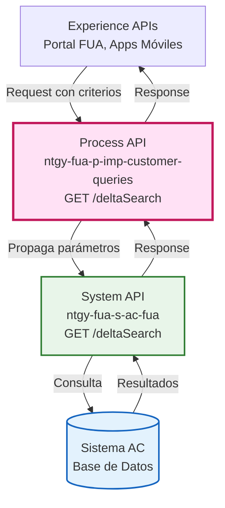
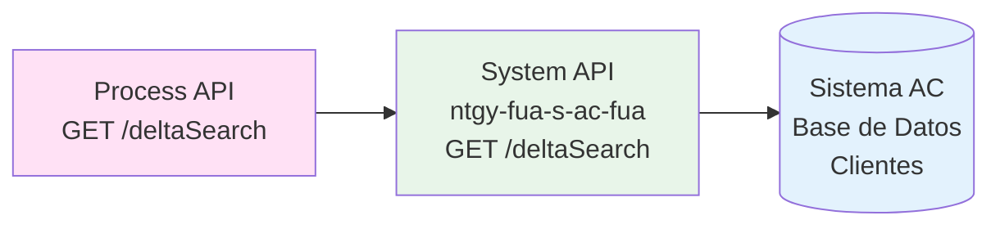
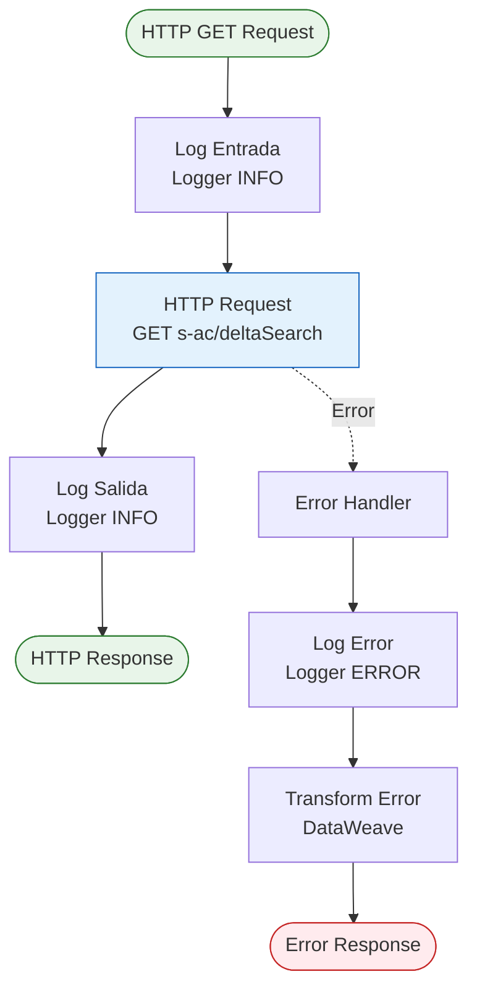
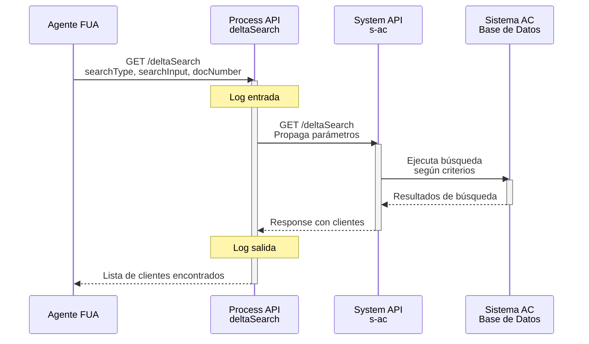
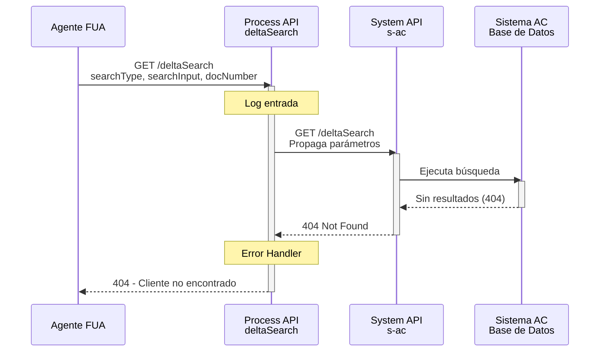
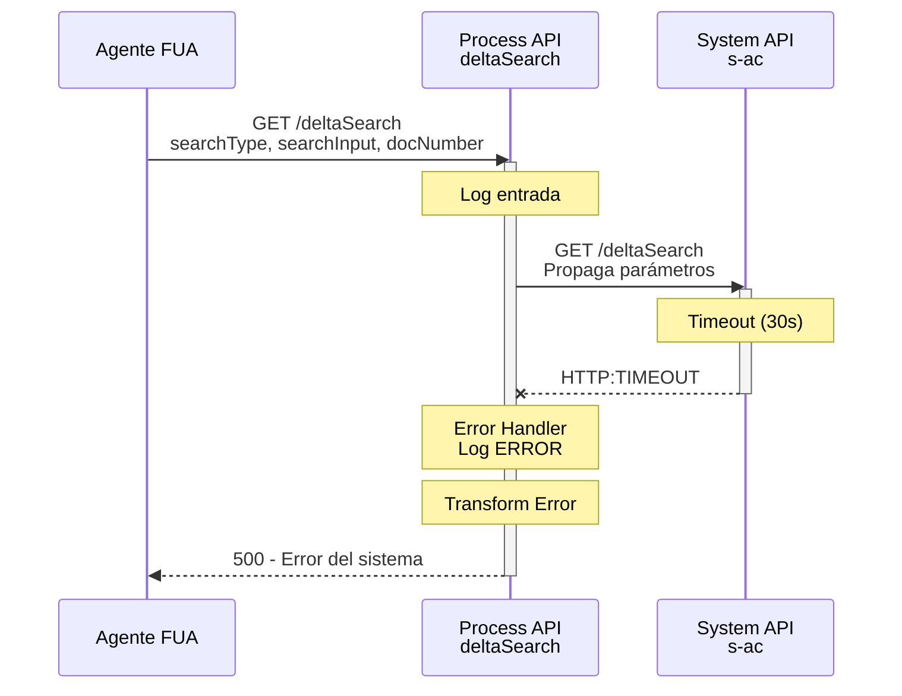

# GET /deltaSearch

## 📌 Descripción General

### Propósito del Endpoint

Este endpoint proporciona capacidades de búsqueda avanzada para agentes de atención al cliente en el portal FUA (Frontal Único de Atención). Permite localizar clientes utilizando diferentes criterios de búsqueda, facilitando el acceso rápido a la información del cliente durante las interacciones de servicio.

### Tipo de API

**Capa:** Process API (API-Led Connectivity)

**Función:** Orquestación de búsqueda de clientes para agentes de atención

### Patrón de Integración

**Tipo:** Pass-Through (Delegación)

**Descripción:** Este endpoint actúa como un proxy que delega la búsqueda directamente al System API ntgy-fua-s-ac-fua (Sistema AC), propagando los parámetros de búsqueda sin transformación. El patrón pass-through se utiliza porque la lógica de búsqueda compleja está centralizada en el System API, y este Process API simplemente proporciona un punto de acceso consistente para los consumidores.

### Arquitectura API-Led Connectivity



---

## 💼 Propósito del Negocio

### Casos de Uso Principales

1. **Búsqueda por NIF/DNI**
   - Agente recibe llamada de cliente con documento de identidad
   - Localiza rápidamente el cliente en el sistema
   - Accede a información completa para resolver consulta

2. **Búsqueda por Código de Cliente**
   - Cliente proporciona su código de cliente
   - Agente busca directamente por este identificador
   - Acceso inmediato a datos del cliente

3. **Búsqueda por Número de Contrato**
   - Cliente menciona número de contrato o referencia
   - Agente localiza cliente asociado al contrato
   - Facilita resolución de consultas sobre facturación o servicios

4. **Búsqueda por CUPS (Punto de Suministro)**
   - Cliente proporciona dirección o punto de suministro
   - Agente busca por CUPS para identificar cliente
   - Útil para consultas sobre instalaciones específicas

### 🔗 Endpoints Dependientes

Este Process API consume el siguiente System API:

| System API | Endpoint | Método | Propósito |
|------------|----------|--------|-----------|
| `ntgy-fua-s-ac-fua` | `/deltaSearch` | GET | Búsqueda avanzada de clientes en Sistema AC con múltiples criterios |

### Lógica de Orquestación



**Pasos del Proceso:**

1. **Recepción de Criterios**: Process API recibe parámetros de búsqueda (searchType, searchInput, docNumber)
2. **Propagación Directa**: Parámetros se propagan sin transformación al System API
3. **Búsqueda en Sistema AC**: System API ejecuta búsqueda en base de datos según criterios
4. **Retorno de Resultados**: Resultados se devuelven directamente al consumidor

### Transformaciones Aplicadas

⚠️ **Este Process API NO transforma la respuesta del System API.**

Este endpoint implementa un patrón pass-through puro, donde:
- Los parámetros de entrada se propagan directamente
- La respuesta del System API se retorna sin modificaciones
- No hay transformaciones DataWeave aplicadas

Para el schema completo de request y response, consultar:
📖 **System API: `ntgy-fua-s-ac-fua` endpoint `/deltaSearch`**

### Contexto Empresarial

- **Dominio:** Atención al Cliente
- **Sector:** Energía - Utilities (Gas & Electricidad)
- **División:** Naturgy España - Clientes Minoristas
- **Proceso de Negocio:** Búsqueda y localización de clientes para soporte

### Stakeholders

- **Agentes de Call Center**: Usuarios principales que necesitan localizar clientes rápidamente
- **Supervisores de Atención**: Monitorean eficiencia en localización de clientes
- **Clientes Finales**: Beneficiarios indirectos de búsquedas rápidas y precisas

### Valor de Negocio

- **Reducción de Tiempo de Atención**: Localización rápida de clientes reduce tiempo medio de llamada
- **Mejora de First Call Resolution**: Acceso inmediato a datos correctos facilita resolución en primera llamada
- **Flexibilidad de Búsqueda**: Múltiples criterios permiten localizar clientes con información parcial
- **Experiencia de Cliente Mejorada**: Menor tiempo de espera y resolución más eficiente

### Consumidores Potenciales

Este endpoint puede ser consumido por:
- Portal web FUA para agentes de call center
- Aplicaciones de escritorio de agentes
- Sistemas de gestión de casos
- Herramientas de supervisión y reporting

---

## 🔧 Especificación Técnica

### URLs por Ambiente

| Ambiente | URL Base | URL Completa |
|----------|----------|--------------|
| **Local** | `http://localhost:8084` | `http://localhost:8084/api/deltaSearch` |
| **Development** | `https://ntgy-fua-p-imp-customer-queries-dev.de-c1.cloudhub.io` | `https://ntgy-fua-p-imp-customer-queries-dev.de-c1.cloudhub.io/api/deltaSearch` |
| **UAT** | `https://ntgy-fua-p-imp-customer-queries-uat.de-c1.cloudhub.io` | `https://ntgy-fua-p-imp-customer-queries-uat.de-c1.cloudhub.io/api/deltaSearch` |
| **Production** | `https://ntgy-fua-p-imp-customer-queries-pro.de-c1.cloudhub.io` | `https://ntgy-fua-p-imp-customer-queries-pro.de-c1.cloudhub.io/api/deltaSearch` |

### Método HTTP

```
GET /api/deltaSearch
```

### Parámetros de Entrada

#### Query Parameters

| Parámetro | Tipo | Requerido | Descripción | Ejemplo |
|-----------|------|-----------|-------------|---------|
| `searchType` | string | Sí | Tipo de búsqueda a realizar | `"156894"` |
| `searchInput` | string | Sí | Valor de búsqueda según el tipo | `"12345678A"` |
| `docNumber` | string | Sí | Número de documento del cliente | `"1784"` |

**Tipos de Búsqueda Soportados:**

El parámetro `searchType` determina el criterio de búsqueda:
- **Por NIF/DNI**: Búsqueda por documento de identidad
- **Por Código de Cliente**: Búsqueda por identificador interno
- **Por Contrato**: Búsqueda por número de contrato
- **Por CUPS**: Búsqueda por punto de suministro
- **Por Referencia**: Búsqueda por número de referencia

**Nota:** Los valores específicos de `searchType` están definidos en el System API ntgy-fua-s-ac-fua.

### Respuestas

#### 200 OK - Búsqueda Exitosa

**Content-Type:** `application/json`

**Estructura de Respuesta:**

```json
{
  "result": {
    "codResult": "0000",
    "msgResult": "No hay error"
  },
  "searchResult": {
    "docNumber": "1111",
    "searchResult": "1111"
  }
}
```

**Campos de la Respuesta:**

| Campo | Tipo | Descripción |
|-------|------|-------------|
| `result` | object | Objeto con información del resultado de la operación |
| `result.codResult` | string | Código de resultado ("0000" = éxito) |
| `result.msgResult` | string | Mensaje descriptivo del resultado |
| `searchResult` | object | Objeto con los resultados de la búsqueda |
| `searchResult.docNumber` | string | Número de documento encontrado |
| `searchResult.searchResult` | string | Resultado de la búsqueda |

**Nota:** La estructura exacta de la respuesta está definida en el System API ntgy-fua-s-ac-fua. Este Process API retorna la respuesta sin modificaciones.

#### 400 Bad Request - Parámetros Inválidos

```json
{
  "error": {
    "code": "BAD_REQUEST",
    "message": "Parámetros de búsqueda inválidos o incompletos"
  }
}
```

#### 404 Not Found - Sin Resultados

```json
{
  "error": {
    "code": "NOT_FOUND",
    "message": "No se encontraron clientes con los criterios especificados"
  }
}
```

#### 500 Internal Server Error - Error del Sistema

```json
{
  "result": {
    "codResult": "0001",
    "msgResult": "Error en el sistema de búsqueda"
  }
}
```

### Autenticación

- **Tipo:** OAuth 2.0 (Client Credentials)
- **Headers Requeridos:**
  - `client_id`: ID del cliente de Anypoint Platform
  - `client_secret`: Secret del cliente de Anypoint Platform

### Timeouts

| Tipo | Valor |
|------|-------|
| **Request Timeout** | 30 segundos |
| **Connection Timeout** | 30 segundos |

---

## 🏗️ Implementación Técnica

### Arquitectura del Flow



### Componentes del Flow

#### 1. Logger de Entrada
```xml
<logger level="INFO" 
        message="Logger entrada p-customer-query: /deltaSearch"/>
```

**Propósito:** Registra el inicio de la operación de búsqueda

#### 2. HTTP Request a System API
```xml
<http:request method="GET" 
              doc:name="s-ac" 
              config-ref="HTTP_API_SistemaAC" 
              path="/deltaSearch">
    <http:query-params>
        <![CDATA[#[output application/java
---
{
    searchType: attributes.queryParams.searchType,
    searchInput: attributes.queryParams.searchInput,
    docNumber: attributes.queryParams.docNumber
}]]]>
    </http:query-params>
</http:request>
```

**Propósito:** Propaga parámetros al System API ntgy-fua-s-ac-fua

**Configuración HTTP:**
- **Config:** HTTP_API_SistemaAC
- **Host:** ntgy-fua-s-ac-fua-bqyi65.internal-6bnlu3.irl-e1.cloudhub.io
- **Port:** 443
- **Protocol:** HTTPS
- **Base Path:** /api
- **Timeout:** 30000ms (30 segundos)

#### 3. Logger de Salida
```xml
<logger level="INFO" 
        message="Logger salida p-customer-query: /deltaSearch"/>
```

**Propósito:** Registra la finalización exitosa de la búsqueda

### Transformaciones DataWeave

#### Propagación de Query Parameters

```dataweave
%dw 2.0
output application/java
---
{
    searchType: attributes.queryParams.searchType,
    searchInput: attributes.queryParams.searchInput,
    docNumber: attributes.queryParams.docNumber
}
```

**Propósito:** Mapeo directo de parámetros de entrada a parámetros del System API

**Campos Mapeados:**
- `searchType` → Tipo de búsqueda
- `searchInput` → Valor de búsqueda
- `docNumber` → Número de documento

### Manejo de Errores

#### Error Handler Configuration

```xml
<error-handler>
    <on-error-propagate enableNotifications="true" 
                        logException="true">
        <logger level="ERROR" 
                message="error en p-c-q delta search"/>
        <ee:transform>
            <ee:set-payload>
                <![CDATA[%dw 2.0
output application/json
---
if ( !isEmpty(error.errorMessage.payload) ) 
    error.errorMessage.payload
else
{
    "result": {
        "codResult": "0001",
        "msgResult": error.description as String replace /\"/ with("")
    }
}]]>
            </ee:set-payload>
        </ee:transform>
    </on-error-propagate>
</error-handler>
```

**Estrategia de Manejo:**

1. **Logging de Error**: Registra error en logs con nivel ERROR
2. **Transformación de Error**: Convierte excepción a formato JSON estándar
3. **Propagación**: Propaga error al consumidor con estructura consistente

**Tipos de Errores Manejados:**
- Errores de conectividad con System API
- Timeouts de búsqueda
- Errores de validación de parámetros
- Errores internos del sistema

### Patrones de Diseño

**Patrón:** Pass-Through (Proxy Pattern)

**Justificación:** 
- La lógica de búsqueda compleja está centralizada en el System API
- No se requieren transformaciones de datos
- Simplifica mantenimiento al delegar responsabilidad
- Proporciona punto de acceso consistente para consumidores

### Diagramas de Secuencia

#### 1. Flujo Normal de Éxito



#### 2. Flujo con Error de Búsqueda (Sin Resultados)



#### 3. Flujo con Error Técnico (Timeout)



### Configuración de Conectividad

#### HTTP Request Configuration

**Nombre:** HTTP_API_SistemaAC

**Configuración de Conexión:**
```yaml
s-ac:
  host: "ntgy-fua-s-ac-fua-bqyi65.internal-6bnlu3.irl-e1.cloudhub.io"
  port: "443"
  protocol: "HTTPS"
  timeout: "30000"
  timeoutOverride: "5000"
```

**Características:**
- **Base Path:** /api
- **Response Timeout:** 30 segundos
- **Connection Idle Timeout:** 30 segundos
- **Protocol:** HTTPS (TLS)
- **Connection Pooling:** Habilitado (default)

---

## 💻 Ejemplos de Uso

### Ejemplo 1: Búsqueda por NIF

#### cURL

```bash
curl -X GET "https://ntgy-fua-p-imp-customer-queries-pro.de-c1.cloudhub.io/api/deltaSearch?searchType=156894&searchInput=12345678A&docNumber=1784" \
  -H "Content-Type: application/json" \
  -H "client_id: YOUR_CLIENT_ID" \
  -H "client_secret: YOUR_CLIENT_SECRET"
```

#### Respuesta (200 OK)

```json
{
  "result": {
    "codResult": "0000",
    "msgResult": "No hay error"
  },
  "searchResult": {
    "docNumber": "12345678A",
    "searchResult": "Cliente encontrado: Juan García Martínez"
  }
}
```

### Ejemplo 2: Búsqueda por Código de Cliente

#### JavaScript (Fetch API)

```javascript
const searchCustomer = async (searchType, searchInput, docNumber) => {
  const baseUrl = 'https://ntgy-fua-p-imp-customer-queries-pro.de-c1.cloudhub.io';
  const params = new URLSearchParams({
    searchType: searchType,
    searchInput: searchInput,
    docNumber: docNumber
  });

  try {
    const response = await fetch(`${baseUrl}/api/deltaSearch?${params}`, {
      method: 'GET',
      headers: {
        'Content-Type': 'application/json',
        'client_id': 'YOUR_CLIENT_ID',
        'client_secret': 'YOUR_CLIENT_SECRET'
      }
    });

    if (!response.ok) {
      throw new Error(`HTTP error! status: ${response.status}`);
    }

    const data = await response.json();
    console.log('Resultado de búsqueda:', data.searchResult);
    return data;
  } catch (error) {
    console.error('Error en búsqueda:', error);
    throw error;
  }
};

// Uso
searchCustomer('156894', 'CLI001', '1784')
  .then(result => console.log(result))
  .catch(error => console.error(error));
```

### Ejemplo 3: Búsqueda con Manejo de Errores

#### Python (Requests)

```python
import requests
from typing import Dict, Optional

def search_customer(
    search_type: str,
    search_input: str,
    doc_number: str,
    client_id: str,
    client_secret: str
) -> Optional[Dict]:
    """
    Busca clientes en el sistema FUA.
    
    Args:
        search_type: Tipo de búsqueda
        search_input: Valor de búsqueda
        doc_number: Número de documento
        client_id: Client ID de Anypoint
        client_secret: Client Secret de Anypoint
    
    Returns:
        Diccionario con resultados de búsqueda o None si hay error
    """
    base_url = 'https://ntgy-fua-p-imp-customer-queries-pro.de-c1.cloudhub.io'
    endpoint = f'{base_url}/api/deltaSearch'
    
    params = {
        'searchType': search_type,
        'searchInput': search_input,
        'docNumber': doc_number
    }
    
    headers = {
        'Content-Type': 'application/json',
        'client_id': client_id,
        'client_secret': client_secret
    }
    
    try:
        response = requests.get(
            endpoint,
            params=params,
            headers=headers,
            timeout=30
        )
        
        response.raise_for_status()
        
        data = response.json()
        if data['result']['codResult'] == '0000':
            print(f"Búsqueda exitosa: {data['searchResult']['searchResult']}")
        return data
        
    except requests.exceptions.Timeout:
        print("Error: Timeout en la búsqueda (>30s)")
        return None
        
    except requests.exceptions.HTTPError as e:
        if e.response.status_code == 404:
            print("No se encontraron clientes con los criterios especificados")
        elif e.response.status_code == 400:
            print("Error: Parámetros de búsqueda inválidos")
        else:
            print(f"Error HTTP: {e.response.status_code}")
        return None
        
    except requests.exceptions.RequestException as e:
        print(f"Error en la petición: {str(e)}")
        return None

# Uso
if __name__ == "__main__":
    result = search_customer(
        search_type='156894',
        search_input='12345678A',
        doc_number='1784',
        client_id='YOUR_CLIENT_ID',
        client_secret='YOUR_CLIENT_SECRET'
    )
    
    if result:
        if result['result']['codResult'] == '0000':
            print(f"Documento: {result['searchResult']['docNumber']}")
            print(f"Resultado: {result['searchResult']['searchResult']}")
        else:
            print(f"Error: {result['result']['msgResult']}")
```

### Ejemplo 4: Respuesta de Error

#### Request

```bash
curl -X GET "https://ntgy-fua-p-imp-customer-queries-pro.de-c1.cloudhub.io/api/deltaSearch?searchType=INVALID&searchInput=&docNumber=" \
  -H "Content-Type: application/json" \
  -H "client_id: YOUR_CLIENT_ID" \
  -H "client_secret: YOUR_CLIENT_SECRET"
```

#### Respuesta (400 Bad Request)

```json
{
  "error": {
    "code": "BAD_REQUEST",
    "message": "Parámetros de búsqueda inválidos: searchInput y docNumber son requeridos"
  }
}
```

#### Respuesta (500 Internal Server Error)

```json
{
  "result": {
    "codResult": "0001",
    "msgResult": "Error al conectar con el sistema de búsqueda"
  }
}